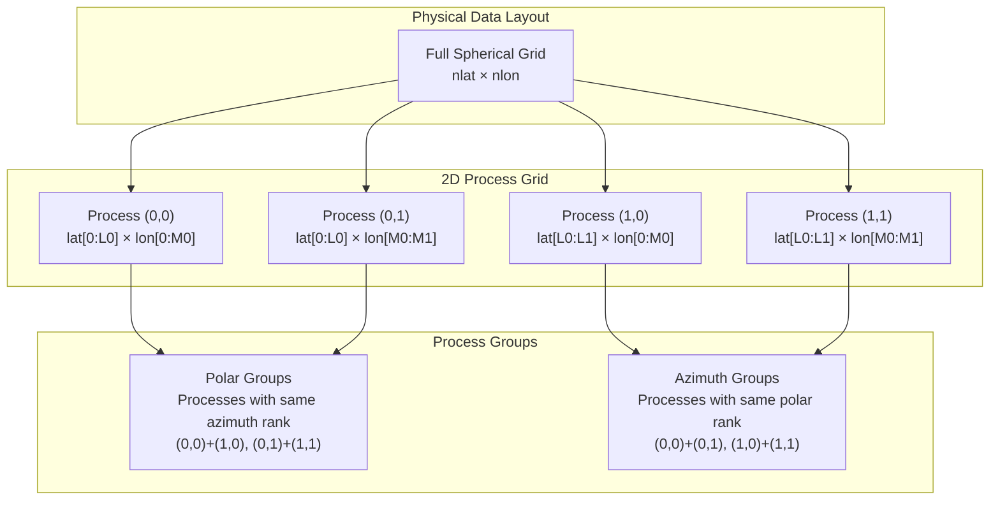

<!-- source: DeepWiki mcp.deepwiki.com · repo NVIDIA/torch-harmonics · page 6.1 Distributed SHT · fetched 2026-10-26 -->

# Distributed SHT

<details>
<summary>Relevant source files</summary>

The following files were used as context for generating this wiki page:

- [tests/test_distributed_convolution.py](tests/test_distributed_convolution.py)
- [tests/test_distributed_sht.py](tests/test_distributed_sht.py)
- [torch_harmonics/distributed/distributed_sht.py](torch_harmonics/distributed/distributed_sht.py)
- [torch_harmonics/sht.py](torch_harmonics/sht.py)

</details>


This page documents the distributed spherical harmonic transform (SHT) implementations in torch-harmonics. These classes enable SHT computations to be parallelized across multiple GPUs or compute nodes using a 2D process grid strategy.

**Scope**: This page covers the four main distributed SHT classes (`DistributedRealSHT`, `DistributedInverseRealSHT`, `DistributedRealVectorSHT`, `DistributedInverseRealVectorSHT`), their data partitioning strategy, and communication patterns. For information about the underlying non-distributed SHT operations, see [Spherical Harmonic Transforms](#2). For details on the communication primitives used, see [Communication Primitives](#6.3). For distributed convolutions, see [Distributed DISCO Convolutions](#6.2).

## Overview

The distributed SHT implementation partitions spherical data across multiple processes using a 2D decomposition strategy:
- **Polar dimension** (latitude): Split among the polar process group
- **Azimuthal dimension** (longitude): Split among the azimuthal process group

The total number of processes is `polar_group_size × azimuth_group_size`. Each process owns a subset of the latitude and longitude points, enabling parallel computation of SHT operations on large spherical grids.

**Sources**: [torch_harmonics/distributed/distributed_sht.py:45-178]()

## Main Classes

| Class | Purpose | Input Shape | Output Shape |
|-------|---------|-------------|--------------|
| `DistributedRealSHT` | Forward scalar SHT | `(..., nlat_local, nlon_local)` | `(..., lmax_local, mmax_local)` |
| `DistributedInverseRealSHT` | Inverse scalar SHT | `(..., lmax_local, mmax_local)` | `(..., nlat_local, nlon_local)` |
| `DistributedRealVectorSHT` | Forward vector SHT | `(..., 2, nlat_local, nlon_local)` | `(..., 2, lmax_local, mmax_local)` |
| `DistributedInverseRealVectorSHT` | Inverse vector SHT | `(..., 2, lmax_local, mmax_local)` | `(..., 2, nlat_local, nlon_local)` |

All classes support the same parameters as their non-distributed counterparts: `nlat`, `nlon`, `lmax`, `mmax`, `grid`, `norm`, and `csphase`. The key difference is that input and output tensors are partitioned across processes.

**Sources**: [torch_harmonics/distributed/distributed_sht.py:45-613]()

## 2D Process Grid Strategy



**Diagram: 2D Process Grid Decomposition**

Each process is identified by:
- **Polar rank**: Position in the polar dimension (0 to `polar_group_size - 1`)
- **Azimuthal rank**: Position in the azimuthal dimension (0 to `azimuth_group_size - 1`)

The split sizes are computed using `compute_split_shapes()`, which divides dimensions as evenly as possible across processes.

**Sources**: [torch_harmonics/distributed/distributed_sht.py:106-122](), [tests/test_distributed_sht.py:72-107]()

## Data Partitioning

### Spatial Domain Partitioning

In the spatial domain (latitude-longitude grid), data is partitioned along both dimensions:

```python
# On each process, input has shape:
# (batch, channels, lat_local, lon_local)
# where:
#   lat_local = lat_shapes[polar_rank]
#   lon_local = lon_shapes[azimuth_rank]
```

The partitioning is computed during initialization:

```python
self.lat_shapes = compute_split_shapes(self.nlat, self.comm_size_polar)
self.lon_shapes = compute_split_shapes(self.nlon, self.comm_size_azimuth)
```

### Spectral Domain Partitioning

In the spectral domain (spherical harmonic coefficients), data is partitioned along degree `l` and order `m`:

```python
# On each process, output has shape:
# (batch, channels, l_local, m_local)
# where:
#   l_local = l_shapes[polar_rank]
#   m_local = m_shapes[azimuth_rank]
```

The spectral partitioning:

```python
self.l_shapes = compute_split_shapes(self.lmax, self.comm_size_polar)
self.m_shapes = compute_split_shapes(self.mmax, self.comm_size_azimuth)
```

**Sources**: [torch_harmonics/distributed/distributed_sht.py:118-122]()

## Forward Transform Communication Pattern

The forward SHT (`DistributedRealSHT`) orchestrates transposes to make dimensions local when needed:

```mermaid
graph LR
    subgraph "Initial State"
        INPUT["Input Tensor<br/>(B,C,lat_local,lon_local)<br/>lat SPLIT, lon SPLIT"]
    end
    
    subgraph "Step 1: Make lon Local"
        TRANSPOSE1["distributed_transpose_azimuth<br/>(C,lon) → (lon_full,C_local)"]
        STATE1["(B,C_local,lat_local,lon_full)"]
    end
    
    subgraph "Step 2: FFT"
        FFT["torch.fft.rfft<br/>dim=-1"]
        STATE2["(B,C_local,lat_local,mmax)"]
    end
    
    subgraph "Step 3: Distribute m"
        TRANSPOSE2["distributed_transpose_azimuth<br/>(m,C) → (C_full,m_local)"]
        STATE3["(B,C_full,lat_local,m_local)"]
    end
    
    subgraph "Step 4: Make lat Local"
        TRANSPOSE3["distributed_transpose_polar<br/>(C,lat) → (lat_full,C_local)"]
        STATE4["(B,C_local,lat_full,m_local)"]
    end
    
    subgraph "Step 5: Legendre Quadrature"
        LEGENDRE["Einsum with weights<br/>Gaussian quadrature"]
        STATE5["(B,C_local,l_full,m_local)"]
    end
    
    subgraph "Step 6: Distribute l"
        TRANSPOSE4["distributed_transpose_polar<br/>(l,C) → (C_full,l_local)"]
        OUTPUT["Output Tensor<br/>(B,C,l_local,m_local)<br/>l SPLIT, m SPLIT"]
    end
    
    INPUT --> TRANSPOSE1
    TRANSPOSE1 --> STATE1
    STATE1 --> FFT
    FFT --> STATE2
    STATE2 --> TRANSPOSE2
    TRANSPOSE2 --> STATE3
    STATE3 --> TRANSPOSE3
    TRANSPOSE3 --> STATE4
    STATE4 --> LEGENDRE
    LEGENDRE --> STATE5
    STATE5 --> TRANSPOSE4
    TRANSPOSE4 --> OUTPUT
```



**Diagram: Forward Transform Data Flow**

### Detailed Steps

1. **Make longitude local** [line 145-147](): Transpose channels and longitude so FFT can be computed locally
2. **Apply FFT** [line 149](): Compute FFT along longitude dimension (now local)
3. **Redistribute m** [line 155-157](): Transpose back to distribute m across azimuth processes
4. **Make latitude local** [line 160-161](): Transpose channels and latitude for Legendre transform
5. **Legendre quadrature** [line 167](): Compute weighted sum with precomputed Legendre polynomials
6. **Redistribute l** [line 173-175](): Transpose back to distribute l across polar processes

**Sources**: [torch_harmonics/distributed/distributed_sht.py:136-177]()

## Inverse Transform Communication Pattern

The inverse SHT (`DistributedInverseRealSHT`) follows the reverse pattern:

```mermaid
graph LR
    subgraph "Initial State"
        INPUT["Input Tensor<br/>(B,C,l_local,m_local)<br/>l SPLIT, m SPLIT"]
    end
    
    subgraph "Step 1: Make l Local"
        TRANSPOSE1["distributed_transpose_polar<br/>(C,l) → (l_full,C_local)"]
        STATE1["(B,C_local,l_full,m_local)"]
    end
    
    subgraph "Step 2: Legendre Evaluation"
        LEGENDRE["Einsum with pct<br/>Polynomial evaluation"]
        STATE2["(B,C_local,lat_full,m_local)"]
    end
    
    subgraph "Step 3: Distribute lat"
        TRANSPOSE2["distributed_transpose_polar<br/>(lat,C) → (C_full,lat_local)"]
        STATE3["(B,C_full,lat_local,m_local)"]
    end
    
    subgraph "Step 4: Make m Local"
        TRANSPOSE3["distributed_transpose_azimuth<br/>(C,m) → (m_full,C_local)"]
        STATE4["(B,C_local,lat_local,m_full)"]
    end
    
    subgraph "Step 5: Inverse FFT"
        IFFT["torch.fft.irfft<br/>dim=-1"]
        STATE5["(B,C_local,lat_local,lon_full)"]
    end
    
    subgraph "Step 6: Distribute lon"
        TRANSPOSE4["distributed_transpose_azimuth<br/>(lon,C) → (C_full,lon_local)"]
        OUTPUT["Output Tensor<br/>(B,C,lat_local,lon_local)<br/>lat SPLIT, lon SPLIT"]
    end
    
    INPUT --> TRANSPOSE1
    TRANSPOSE1 --> STATE1
    STATE1 --> LEGENDRE
    LEGENDRE --> STATE2
    STATE2 --> TRANSPOSE2
    TRANSPOSE2 --> STATE3
    STATE3 --> TRANSPOSE3
    TRANSPOSE3 --> STATE4
    STATE4 --> IFFT
    IFFT --> STATE5
    STATE5 --> TRANSPOSE4
    TRANSPOSE4 --> OUTPUT
```



**Diagram: Inverse Transform Data Flow**

### Detailed Steps

1. **Make l local** [line 275-276](): Transpose to get full l dimension locally
2. **Evaluate Legendre polynomials** [line 282](): Compute weighted sum with precomputed polynomials
3. **Redistribute latitude** [line 287-289](): Distribute latitude back across polar processes
4. **Make m local** [line 292-293](): Transpose to get full m dimension locally
5. **Inverse FFT** [line 301](): Compute inverse FFT along longitude dimension
6. **Redistribute longitude** [line 304-306](): Distribute longitude back across azimuth processes

**Sources**: [torch_harmonics/distributed/distributed_sht.py:266-308]()

## Vector Transforms

The vector transform classes (`DistributedRealVectorSHT`, `DistributedInverseRealVectorSHT`) follow the same communication patterns but process two-component vector fields, decomposing them into spheroidal and toroidal components.

### Key Differences

| Aspect | Scalar Transform | Vector Transform |
|--------|------------------|------------------|
| Input dimension | `(..., nlat, nlon)` | `(..., 2, nlat, nlon)` |
| Output dimension | `(..., lmax, mmax)` | `(..., 2, lmax, mmax)` |
| Legendre basis | Associated Legendre polynomials | Derivatives of Legendre polynomials |
| Quadrature | Single einsum contraction | Four einsum contractions (spheroidal/toroidal, real/imag) |

The vector transforms use `_precompute_dlegpoly()` for Legendre derivative computations and apply normalization factors `1 / (l(l+1))` to the weights.

**Sources**: [torch_harmonics/distributed/distributed_sht.py:311-466](), [torch_harmonics/distributed/distributed_sht.py:468-613]()

## Initialization and Setup

### Process Group Setup

Before using distributed SHT classes, initialize the distributed module:

```python
import torch.distributed as dist
import torch_harmonics.distributed as thd

# Create polar and azimuthal process groups
# ... (see Communication Primitives documentation)

# Initialize torch_harmonics distributed module
thd.init(polar_group, azimuth_group)
```

### Class Instantiation

```python
# Create distributed forward transform
forward_sht = thd.DistributedRealSHT(
    nlat=256, 
    nlon=512,
    lmax=None,  # Defaults based on grid type
    mmax=None,  # Defaults to nlon // 2 + 1
    grid="equiangular",
    norm="ortho",
    csphase=True
).to(device)

# Create distributed inverse transform
inverse_sht = thd.DistributedInverseRealSHT(
    nlat=256,
    nlon=512,
    grid="equiangular"
).to(device)
```

**Sources**: [tests/test_distributed_sht.py:46-116]()

## Usage Example

```python
# Input tensor on each process (already partitioned)
# Shape: (batch, channels, lat_local, lon_local)
input_local = torch.randn(32, 8, lat_shapes[polar_rank], lon_shapes[azimuth_rank])

# Forward transform
coeffs_local = forward_sht(input_local)
# Output shape: (batch, channels, l_local, m_local)

# Inverse transform
reconstructed_local = inverse_sht(coeffs_local)
# Output shape: (batch, channels, lat_local, lon_local)
```

Each process only sees its local portion of the data. The communication primitives handle all inter-process data movement transparently.

**Sources**: [tests/test_distributed_sht.py:217-276]()

## Precomputed Weights and Polynomials

### Distributed Storage

Precomputed weights and Legendre polynomials are partitioned across processes to reduce memory overhead:

- **Forward transform**: Weights tensor shape is `(m_local, lmax, nlat)` [line 131]()
- **Inverse transform**: Polynomial tensor shape is `(m_local, lmax, nlat)` [line 261]()
- **Vector forward**: Weights shape is `(2, m_local, lmax, nlat)` [line 402]()
- **Vector inverse**: Polynomial shape is `(2, m_local, lmax, nlat)` [line 547]()

Each process only stores the portion of precomputed data needed for its assigned m-values, reducing memory requirements proportionally to `azimuth_group_size`.

**Sources**: [torch_harmonics/distributed/distributed_sht.py:124-131](), [torch_harmonics/distributed/distributed_sht.py:255-261]()

## Performance Considerations

### Communication vs. Computation Trade-off

The distributed SHT involves multiple transpose operations that incur communication overhead:

| Operation | Communication | Computation |
|-----------|--------------|-------------|
| Forward SHT | 4 transposes | 1 FFT + 1 Legendre quadrature |
| Inverse SHT | 4 transposes | 1 Legendre eval + 1 inverse FFT |

The benefit of distribution scales with:
- **Grid size**: Larger `nlat` and `nlon` increase compute time
- **Batch size**: Amortizes communication overhead
- **Number of channels**: More data per communication

### Grid Size Recommendations

For effective parallelization, ensure:
- `nlat >= polar_group_size`: Each process gets at least one latitude point
- `nlon >= azimuth_group_size`: Each process gets at least one longitude point  
- Preferably `nlat >> polar_group_size` and `nlon >> azimuth_group_size` for good load balancing

### Backend Selection

The distributed module supports both NCCL (GPU) and Gloo (CPU) backends:
- **NCCL**: Recommended for GPU clusters, optimized for CUDA-to-CUDA transfers
- **Gloo**: Used for CPU-only execution

**Sources**: [tests/test_distributed_sht.py:56-68]()

## Gradient Computation

All distributed SHT classes support automatic differentiation. The backward pass mirrors the forward pass structure, with transposes applied in reverse order. This ensures gradients are correctly distributed across processes.

The test suite validates gradient correctness by comparing against non-distributed implementations:

```python
# Forward and backward pass
output = forward_sht(input_local.requires_grad_(True))
output.backward(grad_output_local)

# Gradients are correctly partitioned
input_grad_local = input_local.grad
```

**Sources**: [tests/test_distributed_sht.py:245-275]()

## Testing and Validation

The test suite [tests/test_distributed_sht.py]() validates:

1. **Forward transform accuracy**: Compares distributed output (gathered) against non-distributed reference
2. **Inverse transform accuracy**: Validates reconstruction quality
3. **Gradient correctness**: Ensures backward pass produces correct gradients
4. **Multiple grid types**: Tests `"equiangular"` and `"legendre-gauss"` grids
5. **Vector transforms**: Validates both scalar and vector SHT implementations

Tests run on various process grid configurations (1×1, 2×1, 1×2, 2×2) to ensure correctness across different partitioning schemes.

**Sources**: [tests/test_distributed_sht.py:197-364]()

---

