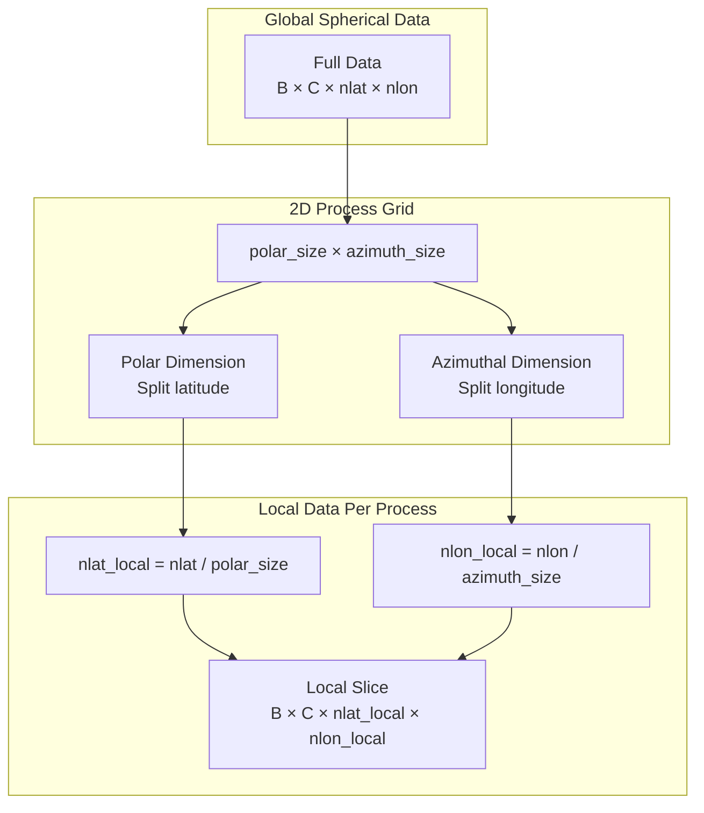
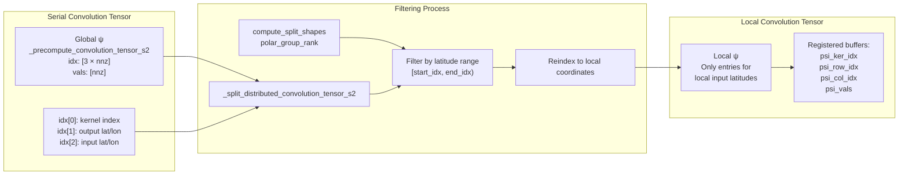
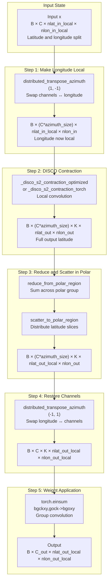
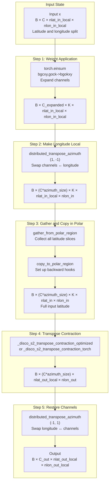
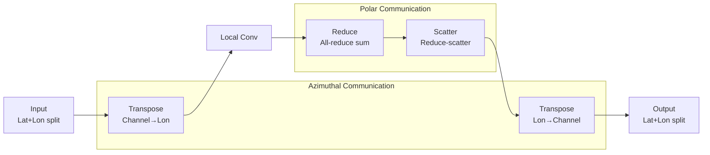
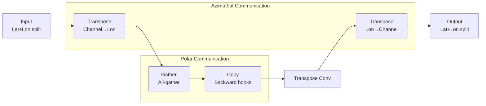
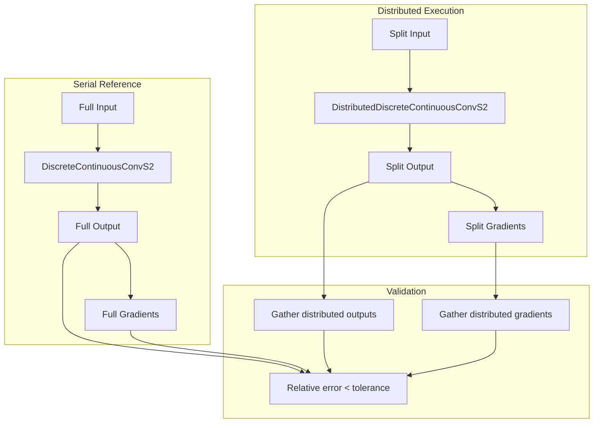
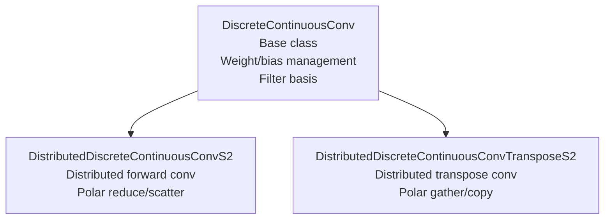

<!-- source: DeepWiki mcp.deepwiki.com · repo NVIDIA/torch-harmonics · page 6.2 Distributed DISCO Convolutions · fetched 2026-10-26 -->

# Distributed DISCO Convolutions

<details>
<summary>Relevant source files</summary>

The following files were used as context for generating this wiki page:

- [tests/test_distributed_convolution.py](tests/test_distributed_convolution.py)
- [tests/test_distributed_sht.py](tests/test_distributed_sht.py)
- [torch_harmonics/distributed/distributed_convolution.py](torch_harmonics/distributed/distributed_convolution.py)

</details>


## Purpose and Scope

This page documents the distributed implementation of Discrete-Continuous (DISCO) convolutions on the sphere, enabling multi-GPU and multi-node training of spherical CNNs. For the foundational non-distributed DISCO convolution concepts, see [DISCO Convolutions](#3). For general distributed computing architecture and the 2D process grid strategy, see [Distributed Computing](#6). For the underlying communication primitives, see [Communication Primitives](#6.3).

The distributed DISCO implementation partitions spherical data across both latitude and longitude dimensions, orchestrating data movement to enable localized convolutions while maintaining mathematical equivalence to the serial implementation.

---

## Overview

The distributed DISCO convolution system provides two primary classes:

| Class | Purpose | Key Characteristics |
|-------|---------|---------------------|
| `DistributedDiscreteContinuousConvS2` | Forward distributed DISCO convolution | Splits latitude in input, produces latitude-split output |
| `DistributedDiscreteContinuousConvTransposeS2` | Transpose distributed DISCO convolution | Gathers input, produces latitude-split output |

Both classes inherit from `DiscreteContinuousConv` [torch_harmonics/disco/convolution.py]() and extend it with distributed data partitioning and communication patterns.

Sources: [torch_harmonics/distributed/distributed_convolution.py:115-156](), [torch_harmonics/distributed/distributed_convolution.py:288-330]()

---

## Data Partitioning Strategy

### 2D Process Grid and Dimension Splitting

DISCO convolutions are distributed using a 2D process grid that partitions the sphere along both latitude (polar) and longitude (azimuthal) dimensions:



Each process in the grid holds a local slice determined by its position in the polar and azimuthal groups. The splitting is computed using `compute_split_shapes` [torch_harmonics/distributed/__init__.py]() which handles uneven divisions.

Sources: [torch_harmonics/distributed/distributed_convolution.py:179-188](), [torch_harmonics/distributed/distributed_convolution.py:352-362]()

---

## Convolution Tensor Splitting

### Precomputation and Filtering

The convolution tensor ψ represents the discrete-continuous mapping between input and output latitudes. In distributed mode, this tensor must be split to reflect the local latitude slices:



The function `_split_distributed_convolution_tensor_s2` [torch_harmonics/distributed/distributed_convolution.py:58-112]() performs this filtering:

1. Computes latitude split shapes and offsets for the current polar rank
2. Extracts latitude and longitude indices from the combined index
3. Filters entries where `lats >= start_idx` and `lats < end_idx`
4. Re-indexes the filtered entries to local latitude coordinates: `(lats - start_idx) * nlon_in + lons`

Sources: [torch_harmonics/distributed/distributed_convolution.py:58-112](), [torch_harmonics/distributed/distributed_convolution.py:206-219](), [torch_harmonics/distributed/distributed_convolution.py:382-396]()

---

## Forward Convolution (DistributedDiscreteContinuousConvS2)

### Architecture

The `DistributedDiscreteContinuousConvS2` class implements distributed forward DISCO convolutions with the following local shapes:

| Property | Value | Description |
|----------|-------|-------------|
| `nlat_in_local` | `lat_in_shapes[comm_rank_polar]` | Input latitude split for this process |
| `nlat_out_local` | `nlat_out` | Full output latitude (before scatter) |
| `nlon_in`, `nlon_out` | Varies | Managed via azimuthal transposes |

Sources: [torch_harmonics/distributed/distributed_convolution.py:202-203]()

### Forward Pass Communication Pattern



The key insight is that the convolution operates along longitude (which is localized via transpose) while the polar reduction/scatter handles the latitude dimension after computing the full output latitude locally.

Sources: [torch_harmonics/distributed/distributed_convolution.py:249-285]()

### Implementation Details

The forward method [torch_harmonics/distributed/distributed_convolution.py:249-285]() executes these steps:

1. **Azimuthal transpose (optional)**: If `comm_size_azimuth > 1`, transpose to make longitude dimension local
2. **DISCO contraction**: Apply the locally-filtered convolution tensor
3. **Polar reduction**: `reduce_from_polar_region` sums partial results across polar group
4. **Polar scatter**: `scatter_to_polar_region` distributes output latitude slices
5. **Azimuthal transpose back**: Restore original channel/longitude partitioning
6. **Weight multiplication**: Apply learned weights with `torch.einsum`
7. **Bias addition**: Add bias if enabled

Sources: [torch_harmonics/distributed/distributed_convolution.py:249-285]()

---

## Transpose Convolution (DistributedDiscreteContinuousConvTransposeS2)

### Architecture

The transpose convolution inverts the forward operation, with different local shapes:

| Property | Value | Description |
|----------|-------|-------------|
| `nlat_in_local` | `nlat_in` | Full input latitude (after gather) |
| `nlat_out_local` | `lat_out_shapes[comm_rank_polar]` | Output latitude split for this process |

Note the inversion: transpose convolution gathers the input and splits the output.

Sources: [torch_harmonics/distributed/distributed_convolution.py:376-377]()

### Forward Pass Communication Pattern



The transpose convolution requires gathering the full input latitude before applying the transpose convolution operation. The backward pass will properly scatter gradients back to the input slices.

Sources: [torch_harmonics/distributed/distributed_convolution.py:426-460]()

### Implementation Details

The forward method [torch_harmonics/distributed/distributed_convolution.py:426-460]() executes:

1. **Weight multiplication**: Applied first, expanding channels and adding kernel dimension
2. **Azimuthal transpose**: Make longitude dimension local
3. **Polar gather**: `gather_from_polar_region` collects all latitude slices
4. **Polar copy**: `copy_to_polar_region` sets up backward reduction hooks
5. **Transpose contraction**: Apply the transpose convolution operator
6. **Azimuthal transpose back**: Restore channel/longitude partitioning
7. **Bias addition**: Add bias if enabled

Sources: [torch_harmonics/distributed/distributed_convolution.py:426-460]()

---

## Communication Primitives Usage

### Summary Table

| Primitive | Forward Conv | Transpose Conv | Purpose |
|-----------|--------------|----------------|---------|
| `distributed_transpose_azimuth` | ✓ (2x) | ✓ (2x) | Swap channel/longitude partitioning |
| `reduce_from_polar_region` | ✓ | - | Sum partial results across polar group |
| `scatter_to_polar_region` | ✓ | - | Distribute output latitude slices |
| `gather_from_polar_region` | - | ✓ | Collect all input latitude slices |
| `copy_to_polar_region` | - | ✓ | Set up backward reduction hooks |

### Communication Flow Diagrams

**Forward Convolution:**


**Transpose Convolution:**


For detailed documentation of these primitives, see [Communication Primitives](#6.3).

Sources: [torch_harmonics/distributed/distributed_convolution.py:52-54]()

---

## Usage Example

### Basic Setup

```python
import torch
import torch_harmonics.distributed as thd

# Initialize distributed environment
# polar_group: process group for latitude splitting
# azimuth_group: process group for longitude splitting
thd.init(polar_group, azimuth_group)

# Create distributed DISCO convolution
conv_dist = thd.DistributedDiscreteContinuousConvS2(
    in_channels=32,
    out_channels=64,
    in_shape=(128, 256),     # nlat_in, nlon_in
    out_shape=(128, 256),    # nlat_out, nlon_out
    kernel_shape=(3, 3),     # theta × phi kernel size
    basis_type="piecewise linear",
    grid_in="equiangular",
    grid_out="equiangular",
    bias=True
).to(device)

# Input is already partitioned across processes
# Shape: B × C × nlat_local × nlon_local
x_local = torch.randn(batch_size, 32, nlat_local, nlon_local, device=device)

# Forward pass
y_local = conv_dist(x_local)
# Output shape: B × C_out × nlat_local × nlon_local
```

Sources: [tests/test_distributed_convolution.py:187-233]()

### Transpose Convolution

```python
# Create distributed transpose convolution (upsampling)
conv_transpose_dist = thd.DistributedDiscreteContinuousConvTransposeS2(
    in_channels=64,
    out_channels=32,
    in_shape=(64, 128),      # Smaller input
    out_shape=(128, 256),    # Larger output
    kernel_shape=(3, 3),
    basis_type="piecewise linear",
    grid_in="equiangular",
    grid_out="equiangular"
).to(device)

# Input: B × C × nlat_in_local × nlon_in_local
x_local = torch.randn(batch_size, 64, nlat_in_local, nlon_in_local, device=device)

# Forward pass
y_local = conv_transpose_dist(x_local)
# Output shape: B × C_out × nlat_out_local × nlon_out_local
```

Sources: [tests/test_distributed_convolution.py:228-230]()

---

## Testing and Validation

### Test Structure

The distributed DISCO convolution tests [tests/test_distributed_convolution.py]() validate:

1. **Forward pass correctness**: Distributed output matches serial implementation
2. **Backward pass correctness**: Gradients match serial implementation
3. **Multiple configurations**: Different grid sizes, kernel shapes, basis types, and transpose modes

### Validation Approach



Tests use `torch.distributed.all_gather` to reconstruct the full output and verify that relative errors are below tolerance (typically 1e-5).

Sources: [tests/test_distributed_convolution.py:207-285]()

### Key Test Parameters

```python
@parameterized.expand([
    # [nlat_in, nlon_in, nlat_out, nlon_out, batch, channels, 
    #  kernel_shape, basis_type, basis_norm, groups, grid_in, grid_out, 
    #  transpose, tolerance]
    [128, 256, 128, 256, 32, 8, (3), "piecewise linear", "mean", 1, 
     "equiangular", "equiangular", False, 1e-5],
    [128, 256, 64, 128, 32, 8, (3), "piecewise linear", "mean", 1, 
     "equiangular", "equiangular", True, 1e-5],
    [129, 256, 129, 256, 32, 8, (3, 4), "morlet", "mean", 1, 
     "equiangular", "equiangular", True, 1e-5],
])
```

Sources: [tests/test_distributed_convolution.py:187-206]()

---

## Performance Considerations

### Memory Distribution

Distributed DISCO convolutions reduce per-process memory by:

1. **Convolution tensor splitting**: Each process stores only entries for its latitude slice
2. **Data partitioning**: Input/output tensors split across polar and azimuthal dimensions
3. **Intermediate results**: Temporary buffers sized for local data only

### Communication Overhead

| Operation | Communication Type | Volume | Frequency |
|-----------|-------------------|--------|-----------|
| `distributed_transpose_azimuth` | All-to-all | Full tensor | 2× per forward pass |
| `reduce_from_polar_region` | All-reduce | Full tensor | 1× per forward pass (fwd conv) |
| `scatter_to_polar_region` | Reduce-scatter | Full → split | 1× per forward pass (fwd conv) |
| `gather_from_polar_region` | All-gather | Split → full | 1× per forward pass (transpose conv) |

### Optimization Strategy

The distributed implementation supports both optimized and fallback kernels:

```python
# Enable optimized kernels (default)
conv = DistributedDiscreteContinuousConvS2(
    ...,
    optimized_kernel=True  # Uses custom CUDA kernels if available
)
```

When `optimized_kernel=True`, the implementation uses:
- `_disco_s2_contraction_optimized` [torch_harmonics/disco/_disco_utils.py]()
- Preprocessed `psi_roff_idx` buffer for efficient GPU execution

When `optimized_kernel=False`, falls back to:
- `_disco_s2_contraction_torch` using PyTorch operations
- Stored sparse tensor `psi`

Sources: [torch_harmonics/distributed/distributed_convolution.py:171-172](), [torch_harmonics/distributed/distributed_convolution.py:227-240]()

---

## Relationship to Non-Distributed Implementation

### Inheritance and Extension

Both distributed classes inherit from `DiscreteContinuousConv` [torch_harmonics/disco/convolution.py]():



The distributed classes extend the base by:
1. Managing polar and azimuthal process groups
2. Computing local shapes for latitude/longitude splits
3. Splitting the convolution tensor
4. Orchestrating communication primitives
5. Overriding the `forward` method with distributed logic

Sources: [torch_harmonics/distributed/distributed_convolution.py:115-173](), [torch_harmonics/distributed/distributed_convolution.py:288-346]()

### Mathematical Equivalence

When properly initialized with matching weights, the distributed implementation produces numerically identical results to the serial implementation (within floating-point precision). This is validated by the test suite which compares:

- Forward outputs: `||y_dist - y_serial|| / ||y_serial|| < 1e-5`
- Backward gradients: `||∇x_dist - ∇x_serial|| / ||∇x_serial|| < 1e-5`

Sources: [tests/test_distributed_convolution.py:271-285]()

---

