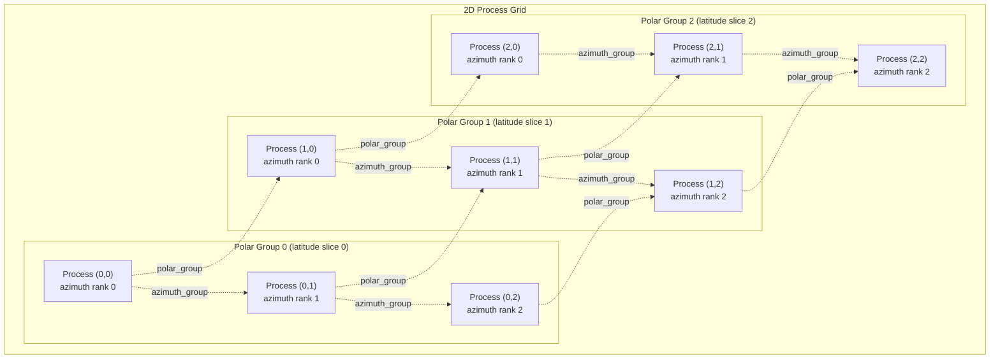
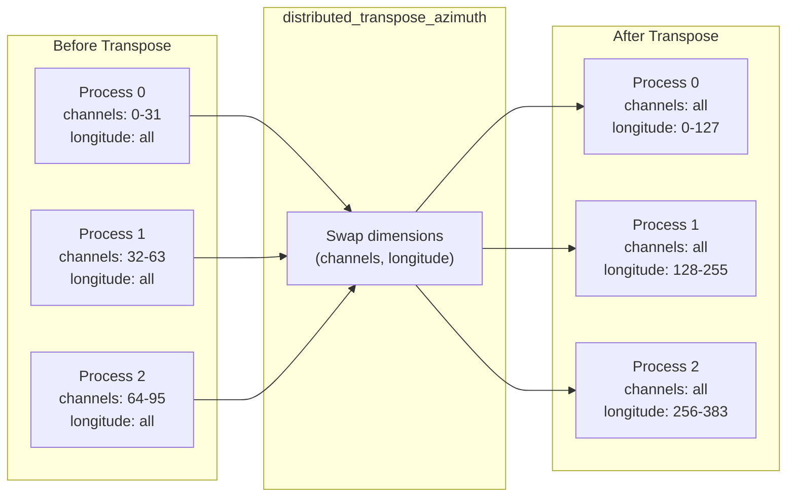
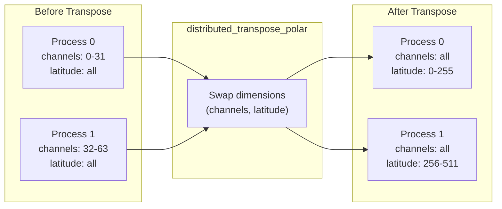
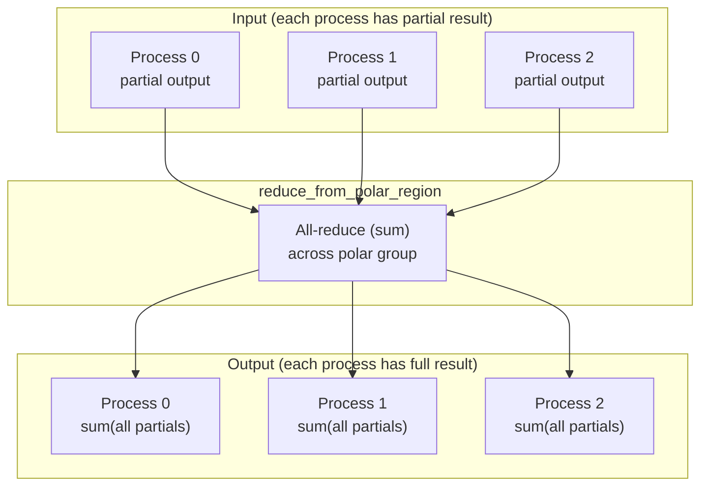
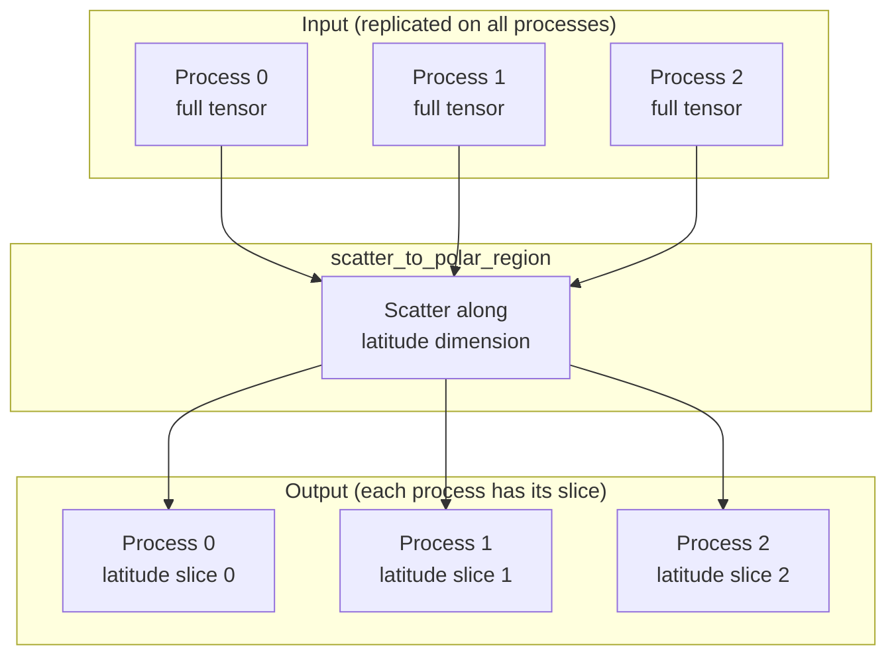
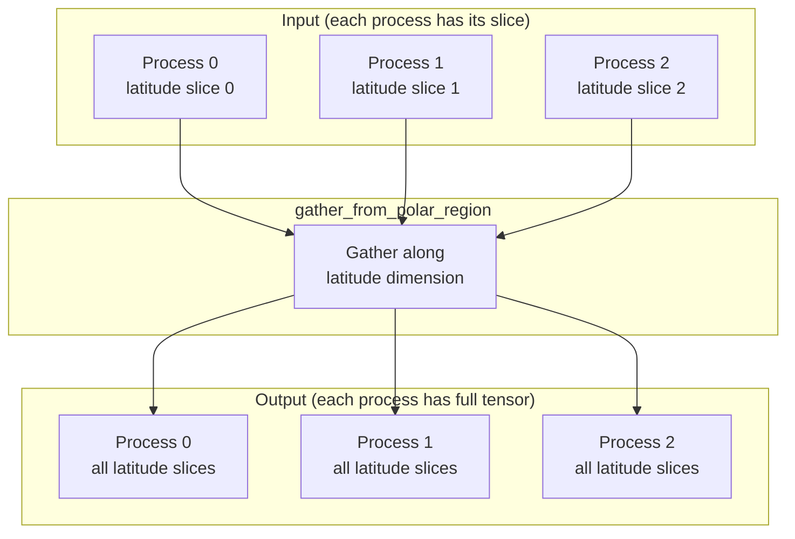
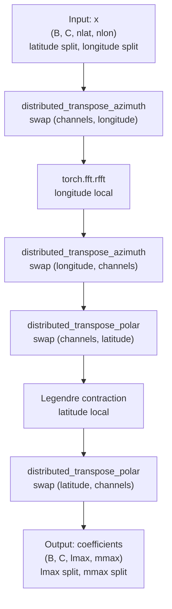
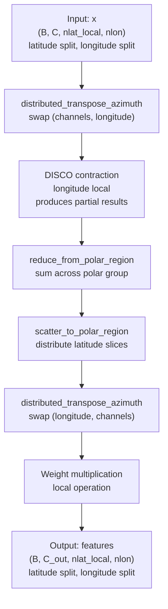
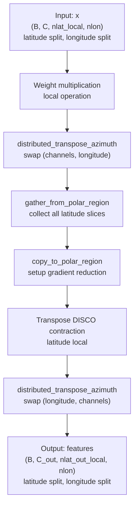

<!-- source: DeepWiki mcp.deepwiki.com · repo NVIDIA/torch-harmonics · page 6.3 Communication Primitives · fetched 2026-10-26 -->

# Communication Primitives

<details>
<summary>Relevant source files</summary>

The following files were used as context for generating this wiki page:

- [torch_harmonics/distributed/distributed_convolution.py](torch_harmonics/distributed/distributed_convolution.py)
- [torch_harmonics/distributed/distributed_sht.py](torch_harmonics/distributed/distributed_sht.py)
- [torch_harmonics/sht.py](torch_harmonics/sht.py)

</details>


## Purpose and Scope

This page documents the low-level communication primitives that enable distributed data parallelism in torch-harmonics. These primitives manage data movement and synchronization across multiple processes organized in a 2D process grid, providing the foundation for distributed spherical harmonic transforms and convolutions.

For higher-level distributed implementations that use these primitives, see [Distributed SHT](#6.1) and [Distributed DISCO Convolutions](#6.2).

**Sources:** [torch_harmonics/distributed/distributed_sht.py:1-613](), [torch_harmonics/distributed/distributed_convolution.py:1-461]()

## 2D Process Grid Organization

The distributed system organizes processes into a 2D grid with two orthogonal process groups:

- **Polar Group**: Processes that split data along the latitude dimension
- **Azimuthal Group**: Processes that split data along the longitude dimension

Each process belongs to exactly one polar group and one azimuthal group. The product `polar_group_size() × azimuth_group_size()` equals the total number of processes.

### Process Grid Structure



**Sources:** [torch_harmonics/distributed/distributed_sht.py:105-109](), [torch_harmonics/distributed/distributed_convolution.py:178-182]()

### Group Query Functions

| Function | Return Type | Description |
|----------|-------------|-------------|
| `polar_group_size()` | `int` | Number of processes in the polar group |
| `polar_group_rank()` | `int` | Rank of current process within its polar group (0 to size-1) |
| `azimuth_group_size()` | `int` | Number of processes in the azimuthal group |
| `azimuth_group_rank()` | `int` | Rank of current process within its azimuthal group (0 to size-1) |

**Sources:** [torch_harmonics/distributed/distributed_sht.py:106-109](), [torch_harmonics/distributed/distributed_convolution.py:179-182]()

## Transpose Operations

Transpose operations redistribute tensor data across processes by swapping which dimension is distributed and which is local. These are implemented as autograd functions that handle both forward and backward passes.

### distributed_transpose_azimuth

Swaps data distribution between two dimensions within the azimuthal process group. Typically used to exchange between channel and longitude dimensions.



**Usage Pattern:**
```python
# Make longitude local for FFT operations
x = distributed_transpose_azimuth.apply(x, (channel_dim, lon_dim), lon_shapes)

# After FFT, make channels local again
x = distributed_transpose_azimuth.apply(x, (lon_dim, channel_dim), channel_shapes)
```

**Sources:** [torch_harmonics/distributed/distributed_sht.py:146](), [torch_harmonics/distributed/distributed_sht.py:157](), [torch_harmonics/distributed/distributed_convolution.py:256]()

### distributed_transpose_polar

Swaps data distribution between two dimensions within the polar process group. Typically used to exchange between channel and latitude dimensions.



**Usage Pattern:**
```python
# Make latitude local for Legendre transform
x = distributed_transpose_polar.apply(x, (channel_dim, lat_dim), lat_shapes)

# After transform, make channels local again
x = distributed_transpose_polar.apply(x, (lat_dim, channel_dim), channel_shapes)
```

**Sources:** [torch_harmonics/distributed/distributed_sht.py:161](), [torch_harmonics/distributed/distributed_sht.py:175](), [torch_harmonics/distributed/distributed_convolution.py:443]()

## Collective Operations

Collective operations synchronize or redistribute data across the polar process group. These are primarily used in distributed convolutions to handle reductions and data distribution.

### reduce_from_polar_region

Performs an all-reduce operation across the polar group, summing contributions from all processes. Each process ends up with the complete reduced result.



**Usage:** Used in `DistributedDiscreteContinuousConvS2` to sum partial convolution results from different latitude slices.

**Sources:** [torch_harmonics/distributed/distributed_convolution.py:266]()

### scatter_to_polar_region

Scatters tensor slices along a specified dimension to processes in the polar group. Each process receives its designated slice.



**Usage:** Used in `DistributedDiscreteContinuousConvS2` after all-reduce to distribute the output along the latitude dimension.

**Sources:** [torch_harmonics/distributed/distributed_convolution.py:267]()

### gather_from_polar_region

Gathers tensor slices from all processes in the polar group along a specified dimension. Each process receives the complete concatenated tensor.



**Usage:** Used in `DistributedDiscreteContinuousConvTransposeS2` to gather input slices before transpose convolution.

**Sources:** [torch_harmonics/distributed/distributed_convolution.py:442]()

### copy_to_polar_region

Registers backward hooks to perform reduction during the backward pass. This is used with `gather_from_polar_region` to ensure gradients are properly reduced.

**Usage:** Applied after `gather_from_polar_region` to set up gradient reduction in the backward pass.

**Sources:** [torch_harmonics/distributed/distributed_convolution.py:443]()

## Utility Functions

### compute_split_shapes

Computes how to split a dimension across a given number of chunks, ensuring balanced distribution.

**Function Signature:**
```python
compute_split_shapes(total_size: int, num_chunks: int) -> List[int]
```

**Returns:** List of sizes for each chunk. The last chunks may be slightly larger to accommodate any remainder.

**Example:**
```python
# Split 512 latitude points across 3 processes
lat_shapes = compute_split_shapes(512, 3)
# Returns: [170, 171, 171] (balanced as evenly as possible)
```

**Sources:** [torch_harmonics/distributed/distributed_sht.py:118-121](), [torch_harmonics/distributed/distributed_convolution.py:185-188]()

### split_tensor_along_dim

Splits a tensor along a specified dimension into multiple chunks.

**Function Signature:**
```python
split_tensor_along_dim(tensor: torch.Tensor, dim: int, num_chunks: int) -> List[torch.Tensor]
```

**Returns:** List of tensor chunks split along the specified dimension.

**Usage:** Commonly used to split precomputed weights or polynomials for distributed processing.

**Sources:** [torch_harmonics/distributed/distributed_sht.py:128](), [torch_harmonics/distributed/distributed_sht.py:258]()

## Communication Patterns in Distributed Modules

### Distributed SHT Forward Pass

The forward pass of `DistributedRealSHT` orchestrates multiple transpose operations:



**Key Pattern:** 
1. Transpose to make longitude local → perform FFT → transpose back
2. Transpose to make latitude local → perform Legendre transform → transpose back

**Sources:** [torch_harmonics/distributed/distributed_sht.py:136-177]()

### Distributed DISCO Forward Pass

The forward pass of `DistributedDiscreteContinuousConvS2` uses a different pattern with collective operations:



**Key Pattern:**
1. Make longitude local for convolution
2. Reduce partial results across polar group
3. Scatter to distribute output latitude slices
4. Make channels local for weight multiplication

**Sources:** [torch_harmonics/distributed/distributed_convolution.py:249-285]()

### Distributed DISCO Transpose Pass

The `DistributedDiscreteContinuousConvTransposeS2` uses gather instead of reduce/scatter:



**Key Pattern:**
1. Weight multiplication first (reverse order from forward)
2. Make longitude local
3. Gather all latitude slices before transpose convolution
4. Setup backward reduction hooks
5. Perform transpose convolution
6. Make channels local again

**Sources:** [torch_harmonics/distributed/distributed_convolution.py:426-460]()

## Split Shape Computation

The computation of split shapes is critical for balanced data distribution. The following table shows examples of how `compute_split_shapes` distributes data:

| Total Size | Num Chunks | Split Shapes | Notes |
|------------|------------|--------------|-------|
| 512 | 2 | `[256, 256]` | Perfect split |
| 512 | 3 | `[170, 171, 171]` | Remainder distributed to last chunks |
| 128 | 5 | `[25, 25, 26, 26, 26]` | Balanced as evenly as possible |
| 64 | 8 | `[8, 8, 8, 8, 8, 8, 8, 8]` | Perfect split |

The split shapes are computed once during initialization and used throughout the forward and backward passes to determine which data belongs to which process.

**Sources:** [torch_harmonics/distributed/distributed_sht.py:118-121](), [torch_harmonics/distributed/distributed_convolution.py:185-188]()

## Backend Communication Libraries

The communication primitives use `torch.distributed` process groups, which support multiple backends:

| Backend | Hardware | Use Case |
|---------|----------|----------|
| NCCL | GPU | High-performance GPU communication, recommended for production |
| Gloo | CPU/GPU | Cross-platform compatibility, useful for CPU-only or mixed systems |

The backend is selected automatically based on the device and available libraries. Users do not need to interact with backends directly; the primitives handle backend selection transparently.

**Sources:** [torch_harmonics/distributed/distributed_sht.py:40]()

## Summary of Communication Primitives

| Primitive | Operation Type | Primary Use Case | Backward Pass |
|-----------|----------------|------------------|---------------|
| `distributed_transpose_azimuth` | All-to-all | Swap channel ↔ longitude distribution | Reverse transpose |
| `distributed_transpose_polar` | All-to-all | Swap channel ↔ latitude distribution | Reverse transpose |
| `reduce_from_polar_region` | All-reduce | Sum partial convolution results | Identity (gradients already summed) |
| `scatter_to_polar_region` | Scatter | Distribute latitude slices | All-reduce (gather gradients) |
| `gather_from_polar_region` | All-gather | Collect all latitude slices | Reduce-scatter (distribute gradients) |
| `copy_to_polar_region` | No-op forward | Setup backward reduction | Reduce sum |

All primitives are implemented as `torch.autograd.Function` subclasses, ensuring correct gradient flow in the backward pass.

**Sources:** [torch_harmonics/distributed/distributed_sht.py:40-42](), [torch_harmonics/distributed/distributed_convolution.py:52-55]()

---

