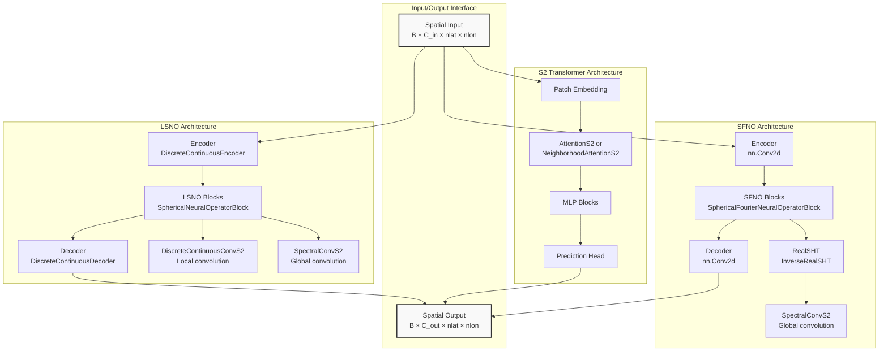
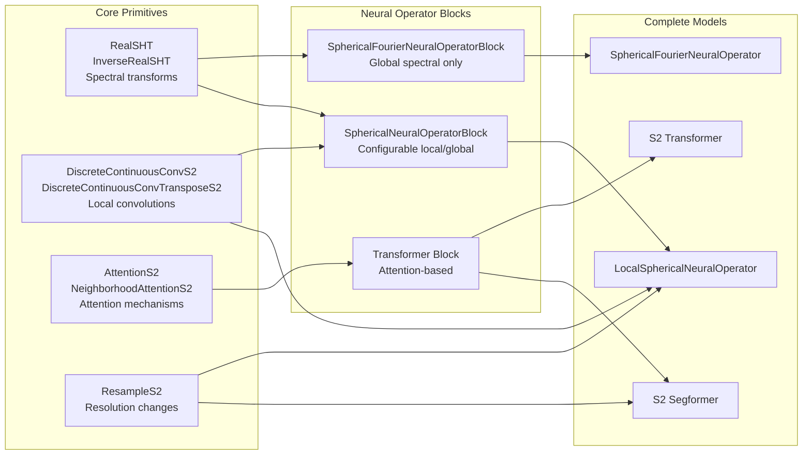
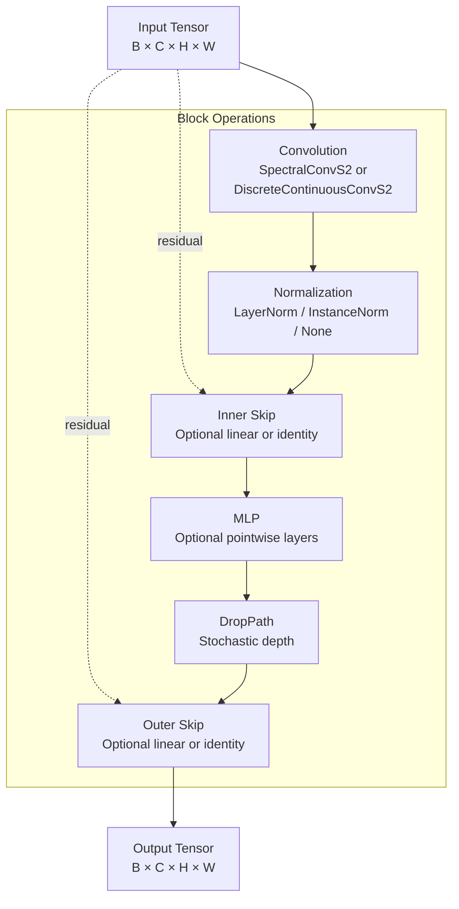

<!-- source: DeepWiki mcp.deepwiki.com · repo NVIDIA/torch-harmonics · page 7 Neural Operator Architectures · fetched 2026-10-26 -->

# Neural Operator Architectures

<details>
<summary>Relevant source files</summary>

The following files were used as context for generating this wiki page:

- [README.md](README.md)
- [notebooks/partial_derivatives.ipynb](notebooks/partial_derivatives.ipynb)
- [setup.py](setup.py)
- [torch_harmonics/examples/models/lsno.py](torch_harmonics/examples/models/lsno.py)
- [torch_harmonics/examples/models/sfno.py](torch_harmonics/examples/models/sfno.py)
- [torch_harmonics/examples/pde_dataset.py](torch_harmonics/examples/pde_dataset.py)

</details>


This page provides an overview of neural operator architectures implemented in torch-harmonics for learning stable dynamics on the sphere. Neural operators are a class of deep learning models designed to learn mappings between function spaces, making them particularly suitable for solving partial differential equations (PDEs) and other problems involving continuous dynamics.

For detailed documentation on specific architectures, see:
- Spherical Fourier Neural Operator (SFNO): [7.1](#7.1)
- Local Spherical Neural Operator (LSNO): [7.2](#7.2)
- S2 Transformer and Segformer: [7.3](#7.3)

For information about the underlying mathematical primitives these architectures use, see:
- Spherical Harmonic Transforms: [2](#2)
- DISCO Convolutions: [3](#3)
- Spherical Attention Mechanisms: [4](#4)

## Purpose and Scope

Neural operators provide a framework for learning solution operators to PDEs and other continuous dynamical systems on spherical domains. Unlike traditional neural networks that learn mappings between finite-dimensional spaces, neural operators learn mappings between infinite-dimensional function spaces, offering several advantages:

1. **Resolution invariance**: Models can be trained at one resolution and evaluated at another
2. **Physical consistency**: Architecture design can incorporate geometric and physical constraints
3. **Sample efficiency**: Learning operators rather than individual solutions requires fewer training examples
4. **Stability**: Properly designed operators preserve physical properties like energy conservation

torch-harmonics implements three main families of neural operator architectures, each with different trade-offs between computational cost, expressiveness, and physical interpretability.

Sources: [README.md:52-59](), [torch_harmonics/examples/models/sfno.py:175-240](), [torch_harmonics/examples/models/lsno.py:378-456]()

## Architecture Comparison

The following table summarizes the key characteristics of each neural operator architecture:

| Architecture | Operation Type | Computational Cost | Best Use Case | Key Feature |
|--------------|---------------|-------------------|---------------|-------------|
| **SFNO** | Global spectral | O(N log N) per layer | Large-scale PDEs, global phenomena | Exact spherical convolutions via SHT |
| **LSNO** | Mixed local+global | O(N) + O(N log N) | Multi-scale problems | Combines local and global operators |
| **S2 Transformer** | Attention-based | O(N²) or O(N log N) | Vision tasks, irregular data | Flexible attention mechanisms |
| **S2 Segformer** | Multi-scale attention | O(N log N) | Dense prediction tasks | Hierarchical feature extraction |

Sources: [README.md:52-74](), [torch_harmonics/examples/models/sfno.py:175-240](), [torch_harmonics/examples/models/lsno.py:378-456]()

## Neural Operator Architecture Patterns



**Diagram: Neural Operator Architecture Patterns and Their Components**

This diagram shows how each architecture composes different primitives from torch-harmonics to create end-to-end models.

Sources: [torch_harmonics/examples/models/sfno.py:175-424](), [torch_harmonics/examples/models/lsno.py:378-624]()

## Building Blocks and Composition

All neural operator architectures in torch-harmonics compose a common set of building blocks. Understanding how these blocks are combined helps in selecting and customizing architectures.



**Diagram: Building Block Composition in Neural Operators**

Sources: [torch_harmonics/examples/models/sfno.py:43-173](), [torch_harmonics/examples/models/lsno.py:52-376]()

### Spectral Convolution Layer

The `SpectralConvS2` class implements global spectral convolutions via spherical harmonic transforms. It is the core operation in SFNO and can be optionally used in LSNO blocks.

**Key Classes:**
- `SpectralConvS2` [torch_harmonics/examples/models/_layers.py](): Performs convolution in spectral domain
- `RealSHT` / `InverseRealSHT`: Transform between spatial and spectral domains

**Operation Flow:**
1. Forward SHT: spatial → spectral coefficients
2. Spectral multiplication: learned weights multiply coefficients
3. Inverse SHT: spectral coefficients → spatial
4. Optional hard thresholding for mode truncation

Sources: [torch_harmonics/examples/models/sfno.py:108](), [torch_harmonics/examples/models/lsno.py:298]()

### DISCO Convolution Layers

The `DiscreteContinuousConvS2` class implements local convolutions on the sphere with finite support regions. These are used extensively in LSNO for efficient local operations.

**Key Classes:**
- `DiscreteContinuousEncoder` [torch_harmonics/examples/models/lsno.py:52-121](): Downsampling with DISCO convolutions
- `DiscreteContinuousDecoder` [torch_harmonics/examples/models/lsno.py:124-205](): Upsampling with DISCO convolutions
- `DiscreteContinuousConvS2`: Core convolution operation

**Parameters:**
- `kernel_shape`: Size of the kernel in latitude/longitude
- `basis_type`: Filter basis ("morlet", "zernike", "piecewise linear")
- `theta_cutoff`: Angular cutoff radius for local support

The cutoff radius is computed heuristically based on kernel size and basis type [torch_harmonics/examples/models/lsno.py:47-50]().

Sources: [torch_harmonics/examples/models/lsno.py:52-205]()

### Neural Operator Block Structure

Both SFNO and LSNO use a common block structure with variations in the convolution type:



**Diagram: General Neural Operator Block Structure**

**Configuration Options:**
- `conv_type`: "global" (spectral) or "local" (DISCO)
- `norm_layer`: "layer_norm", "instance_norm", or "none"
- `inner_skip` / `outer_skip`: "linear", "identity", or "none"
- `use_mlp`: Enable/disable MLP layers
- `mlp_ratio`: Expansion ratio for hidden dimension

Sources: [torch_harmonics/examples/models/sfno.py:43-173](), [torch_harmonics/examples/models/lsno.py:208-376]()

## Operator Learning Paradigm

Neural operators differ fundamentally from standard neural networks in their mathematical formulation and purpose.

### Traditional Neural Networks vs Neural Operators

**Traditional Neural Networks:**
- Learn mappings: $\mathbb{R}^n \rightarrow \mathbb{R}^m$ (finite-dimensional)
- Operate on discretized data at fixed resolution
- Require retraining for different resolutions

**Neural Operators:**
- Learn operators: $\mathcal{F} \rightarrow \mathcal{G}$ (function spaces)
- Can generalize across resolutions (discretization-invariant)
- Represent continuous solution operators

For PDE applications, a neural operator learns the solution operator $\mathcal{G}$ that maps initial conditions $u_0$ to solutions $u(t)$:

$$\mathcal{G}: u_0 \mapsto u(t)$$

This is particularly powerful for problems where the underlying continuous operator is well-defined but computationally expensive to evaluate.

Sources: [README.md:52-59](), [torch_harmonics/examples/models/sfno.py:175-240]()

### Spherical Geometry Considerations

All neural operator architectures in torch-harmonics are designed to respect spherical geometry:

1. **Approximate Equivariance**: Operations are approximately equivariant under SO(3) rotations when using appropriate quadrature
2. **No Singularities**: Proper handling of pole singularities through spectral methods
3. **Natural Periodicity**: Longitude periodicity is naturally handled
4. **Geometric Consistency**: Convolutions and attention use geodesic distances

These properties make the architectures suitable for global atmospheric/oceanic modeling, planetary-scale problems, and spherical vision tasks.

Sources: [README.md:109-178](), [torch_harmonics/examples/models/sfno.py:175-240]()

## Architecture Selection Guide

### SFNO: Spherical Fourier Neural Operator

**When to Use:**
- Problems dominated by global, long-range interactions
- Smooth solutions in spectral domain
- Computational budget allows O(N log N) transforms
- Physical phenomena naturally expressed in spectral basis

**Key Characteristics:**
- Purely spectral convolutions via SHT
- Hard thresholding for mode truncation
- Excellent for PDEs with global coupling
- Implemented in `SphericalFourierNeuralOperator` [torch_harmonics/examples/models/sfno.py:175-424]()

**Example Configuration:**
```python
# Located in torch_harmonics/examples/models/sfno.py
model = SphericalFourierNeuralOperator(
    img_size=(128, 256),           # Input resolution
    scale_factor=3,                # Downsampling factor
    in_chans=3,                    # Input channels
    out_chans=3,                   # Output channels
    embed_dim=256,                 # Hidden dimension
    num_layers=4,                  # Number of SFNO blocks
    hard_thresholding_fraction=1.0 # Spectral mode truncation
)
```

For details, see [7.1](#7.1).

Sources: [torch_harmonics/examples/models/sfno.py:175-424]()

### LSNO: Local Spherical Neural Operator

**When to Use:**
- Multi-scale phenomena (local + global interactions)
- Problems requiring both high-frequency details and global coupling
- Memory constraints favor local operations
- Encoder-decoder structure benefits the task

**Key Characteristics:**
- Combines DISCO (local) and spectral (global) convolutions
- Configurable block frequency for mixing operation types
- DISCO encoder/decoder for resolution changes
- Implemented in `LocalSphericalNeuralOperator` [torch_harmonics/examples/models/lsno.py:378-624]()

**Example Configuration:**
```python
# Located in torch_harmonics/examples/models/lsno.py
model = LocalSphericalNeuralOperator(
    img_size=(128, 256),
    scale_factor=3,
    in_chans=3,
    out_chans=3,
    embed_dim=256,
    num_layers=4,
    kernel_shape=(3, 3),          # DISCO kernel size
    filter_basis_type="morlet",    # DISCO filter basis
    sfno_block_frequency=2         # Use spectral every 2nd block
)
```

For details, see [7.2](#7.2).

Sources: [torch_harmonics/examples/models/lsno.py:378-624]()

### S2 Transformer and Segformer

**When to Use:**
- Vision tasks on spherical images
- Dense prediction (segmentation, depth estimation)
- Problems where attention mechanisms are beneficial
- Irregular or non-uniform data distributions

**Key Characteristics:**
- Self-attention mechanisms adapted for spherical geometry
- Multi-scale feature hierarchies (Segformer)
- Patch-based processing
- Geodesic distance-aware neighborhoods

For details, see [7.3](#7.3).

Sources: [README.md:175-178]()

## Common Configuration Parameters

The following parameters are common across all neural operator architectures:

| Parameter | Type | Description | Typical Values |
|-----------|------|-------------|----------------|
| `img_size` | tuple | Input spatial resolution (nlat, nlon) | (128, 256), (256, 512) |
| `grid` | str | Input/output grid type | "equiangular", "legendre-gauss" |
| `grid_internal` | str | Internal processing grid | "legendre-gauss" |
| `scale_factor` | int | Resolution reduction factor | 2, 3, 4 |
| `in_chans` | int | Input channels | 2, 3, ... |
| `out_chans` | int | Output channels | 2, 3, ... |
| `embed_dim` | int | Hidden dimension | 128, 256, 512 |
| `num_layers` | int | Number of blocks | 4, 8, 12 |
| `activation_function` | str | Nonlinearity | "gelu", "relu" |
| `mlp_ratio` | float | MLP expansion ratio | 2.0, 4.0 |
| `drop_rate` | float | Dropout probability | 0.0, 0.1 |
| `drop_path_rate` | float | Stochastic depth rate | 0.0, 0.1 |
| `normalization_layer` | str | Normalization type | "none", "layer_norm", "instance_norm" |
| `residual_prediction` | bool | Add global skip connection | True, False |
| `pos_embed` | str | Position embedding type | "none", "spectral", "learnable lat" |

Sources: [torch_harmonics/examples/models/sfno.py:242-263](), [torch_harmonics/examples/models/lsno.py:459-484]()

## Position Embeddings

Neural operators can optionally incorporate position embeddings to provide explicit spatial context:

**Available Types:**
- `"none"`: No position embedding (default)
- `"sequence"`: `SequencePositionEmbedding` - learned sequential encoding
- `"spectral"`: `SpectralPositionEmbedding` - spectral basis encoding
- `"learnable lat"`: `LearnablePositionEmbedding` - learnable latitude-only
- `"learnable latlon"`: `LearnablePositionEmbedding` - learnable latitude and longitude

Position embeddings are added after encoding and before processing blocks [torch_harmonics/examples/models/sfno.py:300-311](), [torch_harmonics/examples/models/lsno.py:520-531]().

Sources: [torch_harmonics/examples/models/sfno.py:300-311](), [torch_harmonics/examples/models/lsno.py:520-531]()

## Training Workflow

### PDE Dataset Generation

The `PdeDataset` class [torch_harmonics/examples/pde_dataset.py:39-160]() generates training data by solving PDEs with random initial conditions:

**Key Features:**
- On-the-fly data generation using PDE solvers
- Configurable time step and number of solver steps
- Support for shallow water equations
- Optional normalization

**Example Usage:**
```python
# Located in torch_harmonics/examples/pde_dataset.py
dataset = PdeDataset(
    dt=0.1,                        # Time step
    nsteps=10,                     # Solver steps per sample
    dims=(128, 256),               # Resolution
    grid="equiangular",            # Grid type
    pde="shallow water equations", # PDE type
    initial_condition="random",    # IC type
    num_examples=1000,             # Dataset size
    normalize=True                 # Normalize inputs
)
```

Sources: [torch_harmonics/examples/pde_dataset.py:39-160]()

### Encoder-Decoder Structure

Both SFNO and LSNO use encoder-decoder architectures to map between input/output resolutions and embedding dimensions:

**SFNO:**
- Encoder: Simple `nn.Conv2d` [torch_harmonics/examples/models/sfno.py:313-334]()
- Decoder: Simple `nn.Conv2d` [torch_harmonics/examples/models/sfno.py:371-391]()
- Resolution change: Handled by SHT with different `lmax`/`mmax`

**LSNO:**
- Encoder: `DiscreteContinuousEncoder` with DISCO convolution [torch_harmonics/examples/models/lsno.py:534-545]()
- Decoder: `DiscreteContinuousDecoder` with DISCO convolution [torch_harmonics/examples/models/lsno.py:580-592]()
- Resolution change: DISCO convolution or SHT-based resampling

Sources: [torch_harmonics/examples/models/sfno.py:313-391](), [torch_harmonics/examples/models/lsno.py:534-592]()

## Performance Considerations

### Computational Complexity

| Architecture | Per-Layer Cost | Memory | Best For |
|--------------|----------------|--------|----------|
| SFNO | O(N log N) | O(N) | Large-scale, smooth solutions |
| LSNO (local blocks) | O(N) | O(N) | High-frequency, local features |
| LSNO (global blocks) | O(N log N) | O(N) | Mixed-scale problems |
| S2 Transformer | O(N²) or O(N log N) | O(N²) or O(N log N) | Vision tasks, attention benefits |

### Hard Thresholding

Both SFNO and LSNO support hard thresholding in spectral space to reduce computational cost:

```python
# Spectral mode truncation
modes_lat = self.h
modes_lon = (self.w // 2 + 1) - 1
modes_lat = modes_lon = int(min(modes_lat, modes_lon) * self.hard_thresholding_fraction)
```

Setting `hard_thresholding_fraction < 1.0` truncates high-frequency modes, reducing transform cost and potentially regularizing the model [torch_harmonics/examples/models/sfno.py:336-341](), [torch_harmonics/examples/models/lsno.py:547-552]().

Sources: [torch_harmonics/examples/models/sfno.py:336-341](), [torch_harmonics/examples/models/lsno.py:547-552]()

### Mixed Precision Training

All architectures support automatic mixed precision (AMP), but special care is needed for SHT operations due to cuFFT limitations. DISCO convolutions in LSNO explicitly handle AMP [torch_harmonics/examples/models/lsno.py:115-120]():

```python
# DISCO operations use explicit float32
with amp.autocast(device_type="cuda", enabled=False):
    x = x.float()
    x = self.conv(x)
    x = x.to(dtype=dtype)
```

For general AMP guidelines, see [9.2](#9.2).

Sources: [torch_harmonics/examples/models/lsno.py:115-120](), [README.md:225-251]()

## Summary

torch-harmonics provides a flexible framework for building neural operators on spherical domains:

- **SFNO** [7.1](#7.1): Pure spectral approach for global phenomena
- **LSNO** [7.2](#7.2): Mixed local+global for multi-scale problems  
- **S2 Transformer/Segformer** [7.3](#7.3): Attention-based for vision tasks

All architectures compose the library's core primitives (SHT, DISCO, attention) and can be customized through extensive configuration parameters. The choice of architecture depends on the problem's spatial scale, computational budget, and the nature of the underlying dynamics.

Sources: [README.md:52-74](), [torch_harmonics/examples/models/sfno.py:1-424](), [torch_harmonics/examples/models/lsno.py:1-624]()

---

