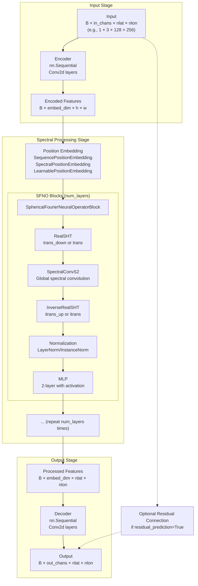
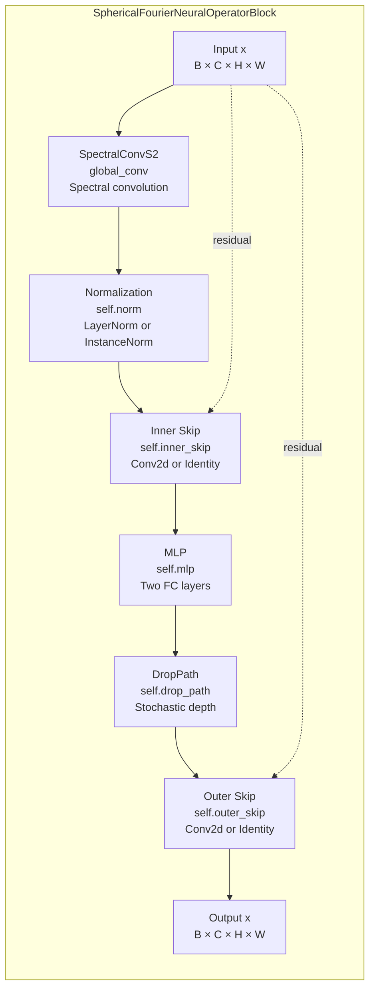
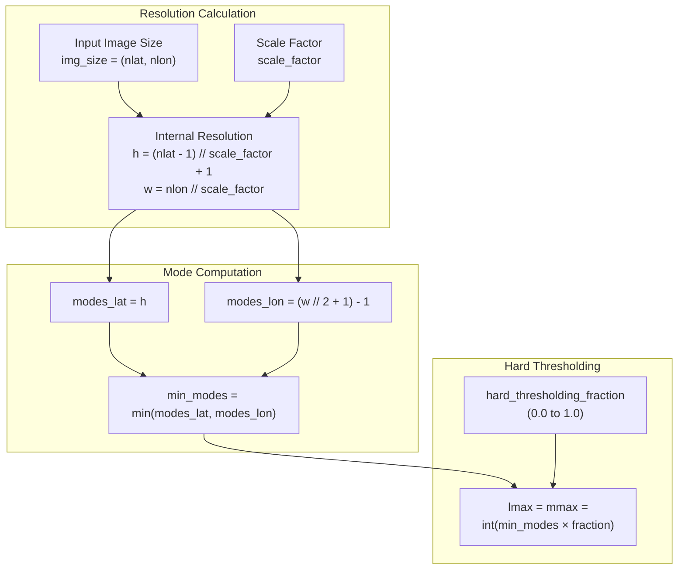
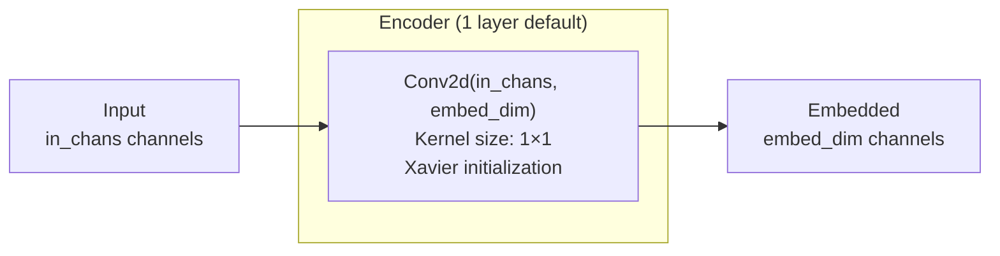
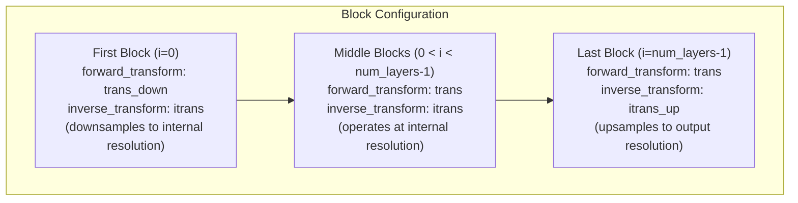
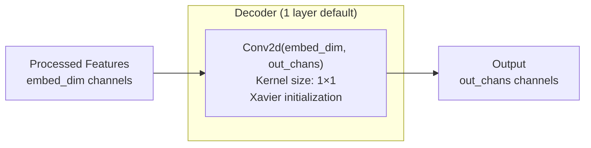
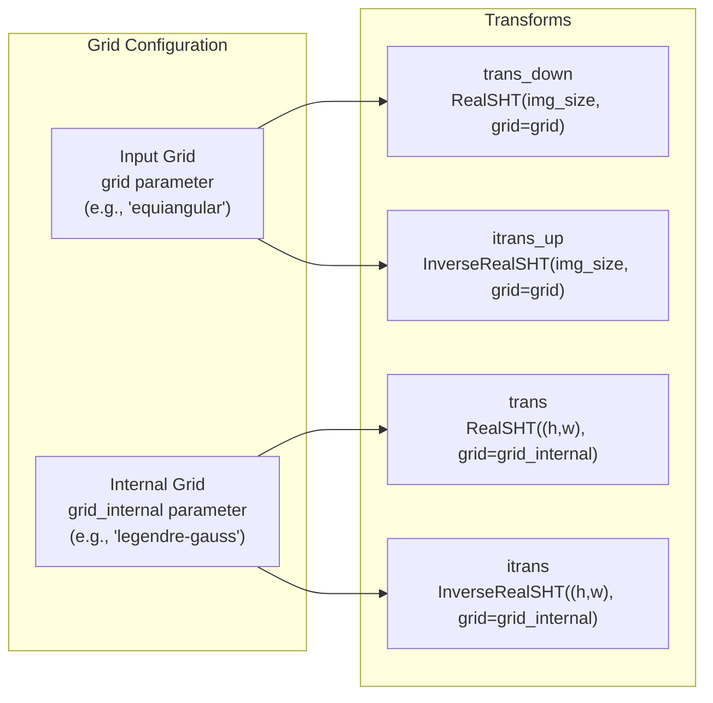
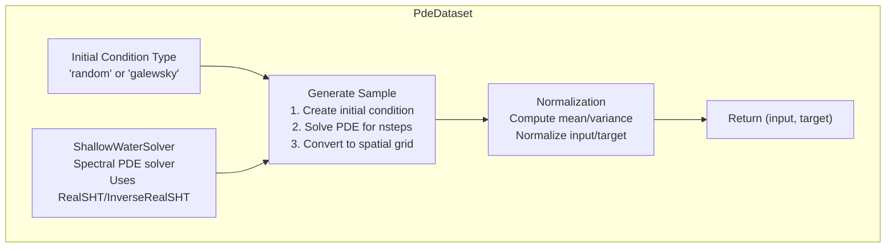
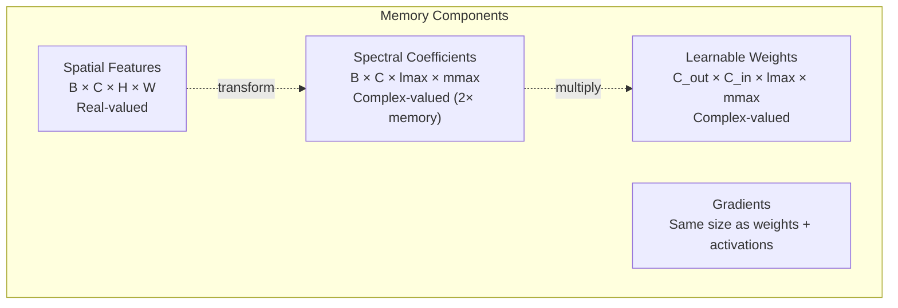

<!-- source: DeepWiki mcp.deepwiki.com · repo NVIDIA/torch-harmonics · page 7.1 Spherical Fourier Neural Operator (SFNO) · fetched 2026-10-26 -->

# Spherical Fourier Neural Operator (SFNO)

<details>
<summary>Relevant source files</summary>

The following files were used as context for generating this wiki page:

- [torch_harmonics/examples/models/lsno.py](torch_harmonics/examples/models/lsno.py)
- [torch_harmonics/examples/models/sfno.py](torch_harmonics/examples/models/sfno.py)
- [torch_harmonics/examples/pde_dataset.py](torch_harmonics/examples/pde_dataset.py)

</details>


## Purpose and Scope

This page provides comprehensive documentation for the Spherical Fourier Neural Operator (SFNO), a neural operator architecture designed for learning solution operators of partial differential equations (PDEs) on spherical domains. SFNO uses global spectral convolutions via spherical harmonic transforms to achieve geometrically consistent and approximately equivariant predictions on the sphere.

For information about the Local Spherical Neural Operator variant that combines local and global operators, see [Local Spherical Neural Operator (LSNO)](#7.2). For details on the underlying spherical harmonic transforms, see [Spherical Harmonic Transforms](#2). For transformer-based architectures on the sphere, see [S2 Transformer and Segformer](#7.3).

**Sources:** [torch_harmonics/examples/models/sfno.py:1-424]()

---

## Overview

The Spherical Fourier Neural Operator implements the "linear" variant of the SFNO architecture introduced by Bonev et al. (2023) for learning stable dynamics on the sphere. Unlike traditional CNNs that struggle with spherical geometry, SFNO operates primarily in the spectral domain using spherical harmonic transforms, ensuring geometric consistency and equivariance properties.

### Key Characteristics

| Feature | Description |
|---------|-------------|
| **Domain** | Spherical surfaces (e.g., Earth's atmosphere, planetary surfaces) |
| **Operation Mode** | Global spectral convolutions in frequency domain |
| **Transform** | Spherical Harmonic Transform (SHT) via `RealSHT`/`InverseRealSHT` |
| **Primary Use Case** | PDE solving, weather/climate modeling, geophysical simulations |
| **Equivariance** | Approximately equivariant to SO(3) rotations |
| **Computational Pattern** | Spatial → Spectral → Process → Spatial |

### When to Use SFNO

- **PDEs on spheres**: Shallow water equations, atmospheric dynamics, geophysical flows
- **Global phenomena**: Problems requiring long-range spatial dependencies
- **Stable predictions**: When solution stability over time is critical
- **Spectral methods**: When the solution has smooth spectral characteristics

**Sources:** [torch_harmonics/examples/models/sfno.py:175-240]()

---

## Architecture Overview

The SFNO architecture consists of three main stages: encoding, spectral processing, and decoding. The model operates at a reduced internal resolution determined by the `scale_factor` parameter.

### High-Level Architecture Diagram



### Data Flow Through SFNO

1. **Input** (spatial domain): `B × in_chans × nlat × nlon`
2. **Encoder**: Projects input to `embed_dim` channels, optionally reduces resolution
3. **Position Embedding**: Adds positional information
4. **SFNO Blocks**: Each block applies spectral convolution + MLP
   - Forward SHT to spectral domain
   - Spectral convolution with learnable weights
   - Inverse SHT back to spatial domain
   - Normalization and MLP
5. **Decoder**: Projects back to `out_chans` channels
6. **Output** (spatial domain): `B × out_chans × nlat × nlon`

**Sources:** [torch_harmonics/examples/models/sfno.py:242-423](), [torch_harmonics/examples/models/sfno.py:397-423]()

---

## Core Components

### SphericalFourierNeuralOperatorBlock

The fundamental building block of SFNO, implementing a single layer of spectral processing.



#### Key Parameters

| Parameter | Type | Default | Description |
|-----------|------|---------|-------------|
| `forward_transform` | `RealSHT` | Required | Forward spherical harmonic transform |
| `inverse_transform` | `InverseRealSHT` | Required | Inverse spherical harmonic transform |
| `input_dim` | `int` | Required | Number of input channels |
| `output_dim` | `int` | Required | Number of output channels |
| `mlp_ratio` | `float` | 2.0 | MLP hidden dimension expansion ratio |
| `drop_rate` | `float` | 0.0 | Dropout rate in MLP |
| `drop_path` | `float` | 0.0 | Stochastic depth probability |
| `act_layer` | `nn.Module` | `nn.GELU` | Activation function |
| `norm_layer` | `str` | "none" | Normalization type: "layer_norm", "instance_norm", "none" |
| `inner_skip` | `str` | "none" | Skip connection before MLP: "linear", "identity", "none" |
| `outer_skip` | `str` | "identity" | Skip connection after MLP: "linear", "identity", "none" |
| `use_mlp` | `bool` | True | Whether to include MLP layers |
| `bias` | `bool` | False | Whether to use bias in convolutions |

**Sources:** [torch_harmonics/examples/models/sfno.py:43-172]()

### Spectral Convolution Layer

The `SpectralConvS2` layer performs convolution in the spectral domain:

1. **Forward Transform**: Apply `forward_transform` (RealSHT) to convert spatial data to spherical harmonic coefficients
2. **Spectral Multiplication**: Multiply coefficients by learnable complex weights
3. **Hard Thresholding**: Retain only modes up to `lmax` and `mmax` (determined by `hard_thresholding_fraction`)
4. **Inverse Transform**: Apply `inverse_transform` (InverseRealSHT) to return to spatial domain

The spectral convolution is implemented in `SpectralConvS2` from [torch_harmonics/examples/models/_layers.py](), which is referenced in the SFNO block at [sfno.py:108]().

**Sources:** [torch_harmonics/examples/models/sfno.py:108](), [torch_harmonics/examples/models/_layers.py]()

---

## Hard Thresholding

Hard thresholding is a critical feature of SFNO that improves stability and reduces computational cost by limiting the spectral bandwidth.

### Frequency Cutoff Mechanism



### Implementation Details

The hard thresholding is applied when creating the SHT and inverse SHT transforms:

```python
# From sfno.py:336-346
modes_lat = self.h
modes_lon = (self.w // 2 + 1) - 1

# Apply hard thresholding fraction
modes_lat = modes_lon = int(min(modes_lat, modes_lon) * self.hard_thresholding_fraction)

# Create transforms with limited modes
self.trans_down = RealSHT(*self.img_size, lmax=modes_lat, mmax=modes_lon, grid=self.grid).float()
self.itrans_up = InverseRealSHT(*self.img_size, lmax=modes_lat, mmax=modes_lon, grid=self.grid).float()
self.trans = RealSHT(self.h, self.w, lmax=modes_lat, mmax=modes_lon, grid=grid_internal).float()
self.itrans = InverseRealSHT(self.h, self.w, lmax=modes_lat, mmax=modes_lon, grid=grid_internal).float()
```

### Effect on Model

| `hard_thresholding_fraction` | Effect |
|------------------------------|--------|
| 1.0 (default) | Full spectral resolution, maximum expressiveness |
| 0.5-0.9 | Reduced high-frequency modes, smoother solutions, faster computation |
| < 0.5 | Heavily smoothed, may lose important features |

**Sources:** [torch_harmonics/examples/models/sfno.py:336-346]()

---

## Complete SFNO Model

### SphericalFourierNeuralOperator Class

The `SphericalFourierNeuralOperator` class at [sfno.py:175-423]() orchestrates the complete architecture.

#### Constructor Parameters

| Parameter | Type | Default | Description |
|-----------|------|---------|-------------|
| `img_size` | `tuple` | (128, 256) | Input shape (nlat, nlon) |
| `grid` | `str` | "equiangular" | Input/output grid type |
| `grid_internal` | `str` | "legendre-gauss" | Internal computation grid |
| `scale_factor` | `int` | 3 | Resolution reduction factor |
| `in_chans` | `int` | 3 | Number of input channels |
| `out_chans` | `int` | 3 | Number of output channels |
| `embed_dim` | `int` | 256 | Embedding dimension |
| `num_layers` | `int` | 4 | Number of SFNO blocks |
| `activation_function` | `str` | "gelu" | Activation: "gelu", "relu", "identity" |
| `encoder_layers` | `int` | 1 | Number of encoder layers (currently fixed at 1) |
| `use_mlp` | `bool` | True | Whether to use MLP in blocks |
| `mlp_ratio` | `float` | 2.0 | MLP expansion ratio |
| `drop_rate` | `float` | 0.0 | Dropout rate |
| `drop_path_rate` | `float` | 0.0 | Stochastic depth rate |
| `normalization_layer` | `str` | "none" | Normalization type |
| `hard_thresholding_fraction` | `float` | 1.0 | Spectral cutoff fraction |
| `residual_prediction` | `bool` | False | Add global skip connection |
| `pos_embed` | `str` | "none" | Position embedding type |
| `bias` | `bool` | False | Use bias in convolutions |

**Sources:** [torch_harmonics/examples/models/sfno.py:242-263]()

### Encoder Structure

The encoder is a simple MLP that projects input channels to the embedding dimension:



The encoder initialization ensures proper weight scaling:

```python
# From sfno.py:328-334
fc = nn.Conv2d(current_dim, self.embed_dim, 1, bias=bias)
scale = math.sqrt(1.0 / current_dim)
nn.init.normal_(fc.weight, mean=0.0, std=scale)
if fc.bias is not None:
    nn.init.constant_(fc.bias, 0.0)
```

**Sources:** [torch_harmonics/examples/models/sfno.py:313-334]()

### SFNO Blocks Configuration

The model creates `num_layers` SFNO blocks with specific configurations for the first and last layers:



Key implementation detail at [sfno.py:348-368]():

```python
for i in range(self.num_layers):
    first_layer = i == 0
    last_layer = i == self.num_layers - 1
    
    block = SphericalFourierNeuralOperatorBlock(
        self.trans_down if first_layer else self.trans,
        self.itrans_up if last_layer else self.itrans,
        self.embed_dim,
        self.embed_dim,
        mlp_ratio=mlp_ratio,
        drop_rate=drop_rate,
        drop_path=dpr[i],
        act_layer=self.activation_function,
        norm_layer=self.normalization_layer,
        use_mlp=use_mlp,
        bias=bias,
    )
```

**Sources:** [torch_harmonics/examples/models/sfno.py:348-368]()

### Decoder Structure

Similar to the encoder, the decoder projects from `embed_dim` back to `out_chans`:



**Sources:** [torch_harmonics/examples/models/sfno.py:370-391]()

### Forward Pass

The complete forward pass is implemented in [sfno.py:406-423]():

```python
def forward(self, x):
    if self.residual_prediction:
        residual = x
    
    x = self.encoder(x)
    
    if self.pos_embed is not None:
        x = self.pos_embed(x)
    
    x = self.forward_features(x)  # Apply all SFNO blocks
    
    x = self.decoder(x)
    
    if self.residual_prediction:
        x = x + residual
    
    return x
```

**Sources:** [torch_harmonics/examples/models/sfno.py:406-423]()

---

## Position Embeddings

SFNO supports multiple position embedding strategies to provide spatial awareness:

| Type | Description | When to Use |
|------|-------------|-------------|
| `"none"` | No position embedding | Default, relying on spectral properties |
| `"sequence"` | `SequencePositionEmbedding` | Treat as sequence data |
| `"spectral"` | `SpectralPositionEmbedding` | Embed using spectral basis |
| `"learnable lat"` | `LearnablePositionEmbedding` (latitude only) | Learn latitude-dependent patterns |
| `"learnable latlon"` | `LearnablePositionEmbedding` (lat+lon) | Learn full spatial patterns |

Position embeddings are added after the encoder at [sfno.py:300-311]():

```python
if pos_embed == "sequence":
    self.pos_embed = SequencePositionEmbedding((self.h, self.w), num_chans=self.embed_dim, grid=grid_internal)
elif pos_embed == "spectral":
    self.pos_embed = SpectralPositionEmbedding((self.h, self.w), num_chans=self.embed_dim, grid=grid_internal)
elif pos_embed == "learnable lat":
    self.pos_embed = LearnablePositionEmbedding((self.h, self.w), num_chans=self.embed_dim, grid=grid_internal, embed_type="lat")
elif pos_embed == "learnable latlon":
    self.pos_embed = LearnablePositionEmbedding((self.h, self.w), num_chans=self.embed_dim, grid=grid_internal, embed_type="latlon")
elif pos_embed == "none":
    self.pos_embed = nn.Identity()
```

**Sources:** [torch_harmonics/examples/models/sfno.py:300-311]()

---

## Grid Types and Resolution Handling

### Input and Internal Grids

SFNO operates with two potentially different grid types:



**Typical Configuration:**
- `grid="equiangular"`: For input/output data on regular lat-lon grids
- `grid_internal="legendre-gauss"`: For internal processing with optimal quadrature properties

**Sources:** [torch_harmonics/examples/models/sfno.py:343-346]()

### Scale Factor and Resolution

The `scale_factor` parameter controls the internal processing resolution:

```python
# From sfno.py:292-294
# compute downsampled image size. We assume that the latitude-grid includes both poles
self.h = (self.img_size[0] - 1) // scale_factor + 1
self.w = self.img_size[1] // scale_factor
```

**Example:**
- Input: `img_size = (128, 256)`
- `scale_factor = 4`
- Internal: `(h, w) = (33, 64)`

This reduces computational cost while maintaining expressiveness for smooth functions.

**Sources:** [torch_harmonics/examples/models/sfno.py:292-294]()

---

## Usage Examples

### Basic SFNO for PDE Solving

```python
import torch
from torch_harmonics.examples.models.sfno import SphericalFourierNeuralOperator

# Create model for shallow water equations
model = SphericalFourierNeuralOperator(
    img_size=(128, 256),          # Input resolution
    scale_factor=4,                # Process at 32x64 internally
    in_chans=3,                    # 3 state variables (h, u, v)
    out_chans=3,                   # 3 output variables
    embed_dim=256,                 # Feature dimension
    num_layers=4,                  # Number of SFNO blocks
    activation_function="gelu",    # GELU activation
    use_mlp=True,                  # Use MLP layers
    mlp_ratio=2.0,                 # MLP expansion ratio
    hard_thresholding_fraction=1.0,# Full spectral resolution
    normalization_layer="instance_norm",
    grid="equiangular",
    grid_internal="legendre-gauss",
)

# Forward pass
input_state = torch.randn(1, 3, 128, 256)  # Batch of 1
output_state = model(input_state)
print(output_state.shape)  # torch.Size([1, 3, 128, 256])
```

### With Residual Prediction

For learning residuals (corrections to a base solution):

```python
model = SphericalFourierNeuralOperator(
    img_size=(128, 256),
    scale_factor=4,
    in_chans=3,
    out_chans=3,
    embed_dim=256,
    num_layers=4,
    residual_prediction=True,  # Enable residual learning
)

# The output will be: input + model_output
output = model(input_state)
```

### With Reduced Spectral Bandwidth

For faster computation and smoother solutions:

```python
model = SphericalFourierNeuralOperator(
    img_size=(256, 512),
    scale_factor=3,
    in_chans=2,
    out_chans=2,
    embed_dim=128,
    num_layers=6,
    hard_thresholding_fraction=0.75,  # Keep 75% of modes
    normalization_layer="layer_norm",
)
```

**Sources:** [torch_harmonics/examples/models/sfno.py:222-240]()

---

## Integration with PDE Dataset

SFNO is commonly used with the `PdeDataset` class for training on PDE problems:

### PdeDataset Structure



### Training Example

```python
from torch_harmonics.examples.pde_dataset import PdeDataset

# Create dataset
train_dataset = PdeDataset(
    dt=3600,                      # Time step (1 hour)
    nsteps=4,                     # Solver steps to target
    dims=(128, 256),              # Grid resolution
    grid="equiangular",
    pde="shallow water equations",
    initial_condition="random",
    num_examples=1000,
    device=torch.device("cuda"),
    normalize=True,
)

# Create dataloader
train_loader = torch.utils.data.DataLoader(
    train_dataset,
    batch_size=8,
    shuffle=True,
)

# Training loop
model = SphericalFourierNeuralOperator(
    img_size=(128, 256),
    in_chans=3,
    out_chans=3,
    embed_dim=256,
    num_layers=4,
).cuda()

optimizer = torch.optim.Adam(model.parameters(), lr=1e-4)

for epoch in range(100):
    for inp, tar in train_loader:
        optimizer.zero_grad()
        pred = model(inp)
        loss = torch.nn.functional.mse_loss(pred, tar)
        loss.backward()
        optimizer.step()
```

**Sources:** [torch_harmonics/examples/pde_dataset.py:39-160]()

---

## Mathematical Background

### Spectral Convolution on the Sphere

SFNO performs convolution in the spectral domain. For a function \(f\) on the sphere:

1. **Forward Transform**: \(f(\theta, \phi) \rightarrow \hat{f}_{\ell m}\) via SHT
2. **Spectral Multiplication**: \(\hat{g}_{\ell m} = W_{\ell m} \cdot \hat{f}_{\ell m}\)
3. **Inverse Transform**: \(\hat{g}_{\ell m} \rightarrow g(\theta, \phi)\) via inverse SHT

Where:
- \(\hat{f}_{\ell m}\) are spherical harmonic coefficients
- \(W_{\ell m}\) are learnable complex weights
- \(\ell \in [0, \text{lmax}]\) and \(m \in [-\ell, \ell]\) are mode indices

### Advantages of Spectral Approach

1. **Global Receptive Field**: Each spectral mode captures global patterns
2. **Geometric Consistency**: Natural representation on the sphere
3. **Stability**: Hard thresholding prevents high-frequency instabilities
4. **Efficiency**: FFT-based implementation scales as \(O(N \log N)\)

**Sources:** [torch_harmonics/examples/models/sfno.py:175-240]()

---

## Performance Considerations

### Computational Complexity

The main computational costs are:

| Operation | Complexity | Notes |
|-----------|------------|-------|
| Forward SHT | \(O(N \log N)\) | FFT + Legendre transform |
| Inverse SHT | \(O(N \log N)\) | Legendre synthesis + inverse FFT |
| Spectral multiplication | \(O(M)\) | \(M\) = number of modes retained |
| MLP | \(O(HW \cdot C^2)\) | Spatial MLP at each location |

**Total per block**: \(O(N \log N + HW \cdot C^2)\)

### Memory Usage



**Memory optimization strategies:**
1. Reduce `embed_dim` for memory-constrained settings
2. Lower `hard_thresholding_fraction` to reduce spectral coefficient storage
3. Increase `scale_factor` to process at lower internal resolution
4. Use gradient checkpointing (not currently implemented in SFNO)

### Optimization Tips

| Setting | Effect | Trade-off |
|---------|--------|-----------|
| `scale_factor=4-8` | Faster, less memory | May lose fine-scale features |
| `hard_thresholding_fraction=0.5-0.9` | Faster transforms | Reduced high-frequency expressiveness |
| `grid_internal="legendre-gauss"` | Better numerical stability | Requires grid conversion |
| `use_mlp=False` | Faster forward pass | Reduced expressiveness |
| `num_layers=2-4` | Balanced performance | Fewer layers = less capacity |

**Sources:** [torch_harmonics/examples/models/sfno.py:1-424]()

---

## Comparison with LSNO

| Feature | SFNO | LSNO |
|---------|------|------|
| **Convolution Type** | Global spectral only | Mixed local (DISCO) + global |
| **Encoder/Decoder** | Simple Conv2d | `DiscreteContinuousEncoder/Decoder` |
| **Use Case** | Smooth, global phenomena | Multi-scale, local + global features |
| **Computational Cost** | Lower (pure spectral) | Higher (local + spectral) |
| **Expressiveness** | Global patterns | Local + global patterns |

For problems requiring both local and global operators, see [Local Spherical Neural Operator (LSNO)](#7.2).

**Sources:** [torch_harmonics/examples/models/sfno.py:1-424](), [torch_harmonics/examples/models/lsno.py:1-624]()

---

## Key Takeaways

1. **SFNO** is designed for learning PDE solution operators on spherical domains using global spectral convolutions
2. **Core mechanism**: Spatial → SHT → Spectral convolution → Inverse SHT → Spatial
3. **Hard thresholding** controls spectral bandwidth for stability and efficiency
4. **Scale factor** enables multi-resolution processing
5. **Position embeddings** are optional but can improve spatial awareness
6. **Best for**: Smooth, global phenomena like atmospheric dynamics, climate modeling

**Primary Implementation:** [torch_harmonics/examples/models/sfno.py:175-423]()

---

