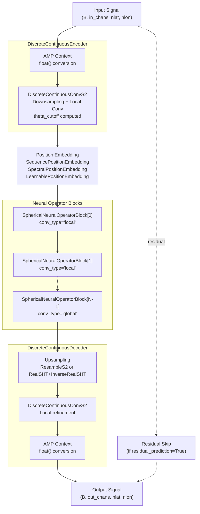
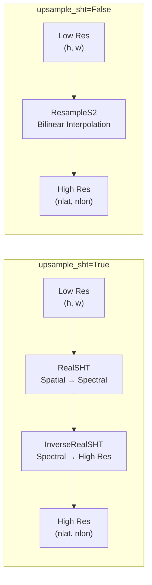
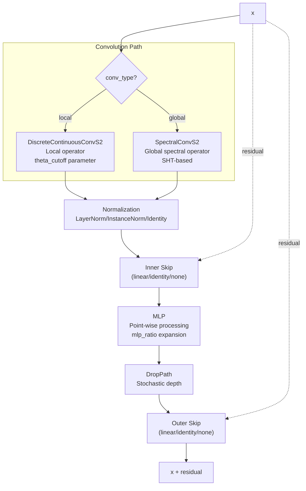
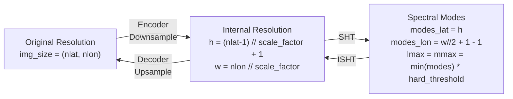
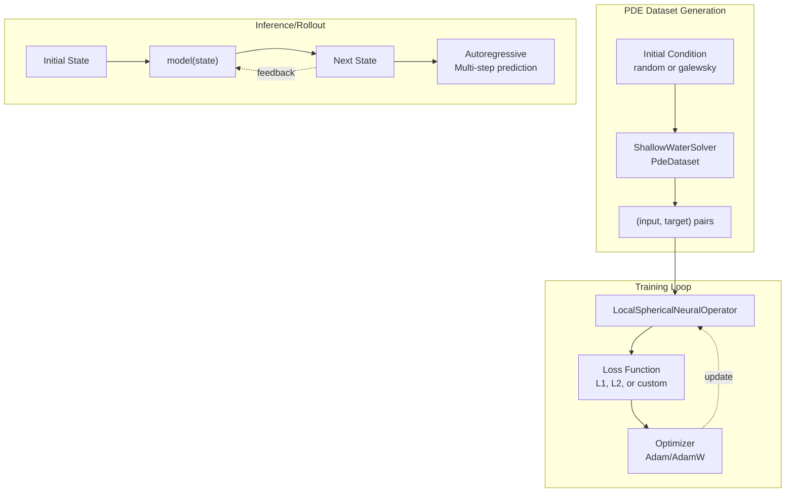

<!-- source: DeepWiki mcp.deepwiki.com · repo NVIDIA/torch-harmonics · page 7.2 Local Spherical Neural Operator (LSNO) · fetched 2026-10-26 -->

# Local Spherical Neural Operator (LSNO)

<details>
<summary>Relevant source files</summary>

The following files were used as context for generating this wiki page:

- [torch_harmonics/examples/models/lsno.py](torch_harmonics/examples/models/lsno.py)
- [torch_harmonics/examples/models/sfno.py](torch_harmonics/examples/models/sfno.py)
- [torch_harmonics/examples/pde_dataset.py](torch_harmonics/examples/pde_dataset.py)

</details>


## Purpose and Scope

This page documents the Local Spherical Neural Operator (LSNO) architecture, which combines local and global integral operators for learning solution operators on spherical domains. LSNO extends the Spherical Fourier Neural Operator (SFNO) by incorporating discrete-continuous (DISCO) convolutions alongside spectral convolutions, enabling the model to capture both localized features and global patterns effectively.

For the purely spectral SFNO architecture, see [Spherical Fourier Neural Operator (SFNO)](#7.1). For details on DISCO convolutions used in LSNO, see [DiscreteContinuousConvS2](#3.1). For the underlying spherical harmonic transforms, see [RealSHT and InverseRealSHT](#2.1).

**Sources:** [torch_harmonics/examples/models/lsno.py:378-456]()

---

## Architecture Overview

LSNO is implemented in the `LocalSphericalNeuralOperator` class and consists of three main stages:

1. **Encoder**: Downsamples input using DISCO convolutions (`DiscreteContinuousEncoder`)
2. **Neural Operator Blocks**: Sequence of blocks alternating between local (DISCO) and global (spectral) operators (`SphericalNeuralOperatorBlock`)
3. **Decoder**: Upsamples features using DISCO convolutions (`DiscreteContinuousDecoder`)

The key innovation over SFNO is the use of localized convolutions that can capture fine-grained spatial features while maintaining global spectral processing for long-range dependencies.

### High-Level Component Architecture



**Sources:** [torch_harmonics/examples/models/lsno.py:459-623]()

---

## Key Components

### DiscreteContinuousEncoder

The encoder performs downsampling and initial feature extraction using DISCO convolutions. It converts input from the original resolution to a lower internal resolution while extracting features.

**Key aspects:**
- Uses `DiscreteContinuousConvS2` for resolution reduction
- Automatically computes `theta_cutoff` based on kernel shape and basis type
- Runs in float32 via AMP context to avoid numerical issues
- Supports arbitrary input/output grid types

**Implementation details:**

| Parameter | Purpose | Default |
|-----------|---------|---------|
| `in_shape` | Input spatial dimensions (nlat, nlon) | (721, 1440) |
| `out_shape` | Output spatial dimensions (nlat, nlon) | (480, 960) |
| `grid_in` / `grid_out` | Grid types (equiangular, legendre-gauss, etc.) | "equiangular" |
| `kernel_shape` | DISCO kernel dimensions | (3, 3) |
| `basis_type` | Filter basis (morlet, zernike, piecewise linear) | "morlet" |

The `theta_cutoff` parameter is computed using a heuristic:
```
theta_cutoff = (kernel_shape[0] + 1) * factor * π / (nlat - 1)
```
where `factor` depends on basis type: 0.5 for morlet/piecewise linear, √2 for zernike.

**Sources:** [torch_harmonics/examples/models/lsno.py:52-121](), [torch_harmonics/examples/models/lsno.py:47-50]()

### DiscreteContinuousDecoder

The decoder performs upsampling and output generation using either spherical harmonic transforms or interpolation, followed by DISCO convolutions for refinement.

**Upsampling strategies:**



Both paths are followed by a `DiscreteContinuousConvS2` for local refinement at the target resolution.

**Sources:** [torch_harmonics/examples/models/lsno.py:124-205]()

### SphericalNeuralOperatorBlock

Individual neural operator blocks that can operate in either local or global mode. Each block consists of:

1. **Convolution layer**: Either `DiscreteContinuousConvS2` (local) or `SpectralConvS2` (global)
2. **Normalization**: LayerNorm, InstanceNorm, or none
3. **MLP**: Optional point-wise MLP with configurable expansion ratio
4. **Skip connections**: Inner and outer skip connections for gradient flow

**Block configuration:**



**Sources:** [torch_harmonics/examples/models/lsno.py:208-375]()

---

## Data Flow Through LSNO

The following diagram shows how data flows through the complete LSNO architecture, mapping spatial and spectral domains to specific code operations:

```mermaid
graph TB
    subgraph SpatialDomain1["Spatial Domain - Input"]
        InputData["Input<br/>(B, in_chans, nlat, nlon)<br/>Original Resolution"]
    end
    
    subgraph EncoderStage["Encoder Stage"]
        EncConv["DiscreteContinuousConvS2<br/>in_shape → (h, w)<br/>Local convolution with<br/>theta_cutoff"]
    end
    
    subgraph SpatialDomain2["Spatial Domain - Internal"]
        InternalRep["Internal Representation<br/>(B, embed_dim, h, w)<br/>Reduced Resolution"]
        PosEmb["pos_embed applied<br/>SequencePositionEmbedding<br/>or SpectralPositionEmbedding"]
    end
    
    subgraph BlockStage["Neural Operator Blocks"]
        direction TB
        
        subgraph LocalBlock["Local Blocks (i % sfno_block_frequency != N-1)"]
            LocalSpatial["Spatial<br/>(B, embed_dim, h, w)"]
            LocalDISCO["DiscreteContinuousConvS2<br/>Local operator"]
            LocalMLP["MLP + Normalization"]
            
            LocalSpatial --> LocalDISCO
            LocalDISCO --> LocalMLP
        end
        
        subgraph GlobalBlock["Global Blocks (i % sfno_block_frequency == N-1)"]
            GlobalSpatial["Spatial<br/>(B, embed_dim, h, w)"]
            SHT["RealSHT<br/>self.trans"]
            Spectral["Spectral Domain<br/>(B, embed_dim, lmax, mmax)<br/>SpectralConvS2 weights"]
            ISHT["InverseRealSHT<br/>self.itrans"]
            GlobalMLP["MLP + Normalization"]
            
            GlobalSpatial --> SHT
            SHT --> Spectral
            Spectral --> ISHT
            ISHT --> GlobalMLP
        end
        
        LocalMLP --> GlobalSpatial
    end
    
    subgraph DecoderStage["Decoder Stage"]
        Upsample["Upsampling<br/>ResampleS2 or<br/>RealSHT + InverseRealSHT"]
        DecConv["DiscreteContinuousConvS2<br/>Local refinement"]
    end
    
    subgraph SpatialDomain3["Spatial Domain - Output"]
        OutputData["Output<br/>(B, out_chans, nlat, nlon)<br/>Original Resolution"]
    end
    
    InputData --> EncConv
    EncConv --> InternalRep
    InternalRep --> PosEmb
    PosEmb --> LocalSpatial
    GlobalMLP --> Upsample
    Upsample --> DecConv
    DecConv --> OutputData
```



**Sources:** [torch_harmonics/examples/models/lsno.py:606-623]()

---

## Configuration and Parameters

### Main Constructor Parameters

The `LocalSphericalNeuralOperator` class accepts the following key parameters:

| Parameter | Type | Default | Description |
|-----------|------|---------|-------------|
| `img_size` | tuple | (128, 256) | Input/output spatial dimensions (nlat, nlon) |
| `grid` | str | "equiangular" | Grid type for input/output data |
| `grid_internal` | str | "legendre-gauss" | Grid type for internal computations |
| `scale_factor` | int | 3 | Downsampling factor: h = (nlat-1)//scale_factor + 1 |
| `in_chans` | int | 3 | Number of input channels |
| `out_chans` | int | 3 | Number of output channels |
| `embed_dim` | int | 256 | Hidden dimension for features |
| `num_layers` | int | 4 | Number of neural operator blocks |
| `kernel_shape` | tuple | (3, 3) | DISCO kernel shape |
| `encoder_kernel_shape` | tuple | (3, 3) | Encoder/decoder kernel shape |
| `filter_basis_type` | str | "morlet" | Filter basis: morlet, zernike, piecewise linear |
| `sfno_block_frequency` | int | 2 | Insert global block every N layers |
| `hard_thresholding_fraction` | float | 1.0 | Spectral mode cutoff fraction |
| `use_mlp` | bool | True | Whether to use MLPs in blocks |
| `mlp_ratio` | float | 2.0 | MLP hidden dimension expansion ratio |
| `normalization_layer` | str | "none" | Normalization type: layer_norm, instance_norm, none |
| `residual_prediction` | bool | False | Add global skip from input to output |
| `pos_embed` | str | "none" | Position embedding type |
| `upsample_sht` | bool | False | Use SHT for upsampling (else ResampleS2) |

**Sources:** [torch_harmonics/examples/models/lsno.py:459-484]()

### Block Type Scheduling

The `sfno_block_frequency` parameter controls the pattern of local vs global blocks:

```python
# Block i uses global convolution if:
i % sfno_block_frequency == (sfno_block_frequency - 1)

# Example with num_layers=8, sfno_block_frequency=2:
# Blocks: [local, global, local, global, local, global, local, global]

# Example with num_layers=8, sfno_block_frequency=3:
# Blocks: [local, local, global, local, local, global, local, local]
```

This allows flexible mixing of local and global operators based on the problem requirements.

**Sources:** [torch_harmonics/examples/models/lsno.py:558-577]()

---

## Resolution and Mode Calculation

LSNO operates at a reduced internal resolution for efficiency:



The spectral mode calculation includes a `- 1` adjustment for `modes_lon` to avoid cuFFT spectral artifacts. The `hard_thresholding_fraction` parameter allows further reduction of spectral modes for computational efficiency.

**Sources:** [torch_harmonics/examples/models/lsno.py:513-555]()

---

## Comparison with SFNO

| Aspect | SFNO | LSNO |
|--------|------|------|
| **Encoder** | Simple Conv2d layers | DiscreteContinuousConvS2 with downsampling |
| **Neural Operator Blocks** | All spectral (SpectralConvS2) | Mixed local (DISCO) and global (spectral) |
| **Decoder** | Simple Conv2d layers | DiscreteContinuousConvS2 with upsampling |
| **Locality** | Global only | Both local and global |
| **Grid Handling** | Transforms between grids using SHT | Native multi-grid support via DISCO |
| **Filter Basis** | N/A (spectral only) | Morlet, Zernike, Piecewise Linear |
| **Computational Cost** | Lower (spectral only) | Higher (DISCO + spectral) |
| **Effective Receptive Field** | Global from all blocks | Grows with local blocks, global at SFNO blocks |

### Code Mapping

**SFNO Block:**
```
SphericalFourierNeuralOperatorBlock(
    trans, itrans, dim, dim,
    # Only spectral convolution
)
```
[torch_harmonics/examples/models/sfno.py:82-173]()

**LSNO Block:**
```
SphericalNeuralOperatorBlock(
    trans, itrans, dim, dim,
    conv_type="local",  # or "global"
    disco_kernel_shape=(3, 3),
    disco_basis_type="morlet",
)
```
[torch_harmonics/examples/models/lsno.py:253-375]()

**Sources:** [torch_harmonics/examples/models/sfno.py:1-424](), [torch_harmonics/examples/models/lsno.py:1-624]()

---

## Usage Example

### Basic Instantiation

```python
from torch_harmonics.examples.models.lsno import LocalSphericalNeuralOperator

model = LocalSphericalNeuralOperator(
    img_size=(128, 256),           # Input/output resolution
    scale_factor=4,                # Internal resolution: (32, 64)
    in_chans=2,                    # e.g., vorticity and divergence
    out_chans=2,                   # Predict same fields
    embed_dim=64,                  # Feature dimension
    num_layers=8,                  # 8 neural operator blocks
    kernel_shape=(3, 3),           # DISCO kernel size
    filter_basis_type="morlet",    # Morlet wavelet basis
    sfno_block_frequency=2,        # Global block every 2 layers
    hard_thresholding_fraction=0.8,# Use 80% of spectral modes
    use_mlp=True,                  # Include MLPs
    mlp_ratio=2.0,                 # MLP expansion
    normalization_layer="instance_norm",
    residual_prediction=False,
    upsample_sht=False,            # Use interpolation for upsampling
)

# Forward pass
import torch
x = torch.randn(4, 2, 128, 256)  # Batch of 4 samples
y = model(x)                      # Shape: (4, 2, 128, 256)
```

### For PDE Applications

When using LSNO for PDE solving (e.g., shallow water equations):

```python
# Typical configuration for PDE operator learning
model = LocalSphericalNeuralOperator(
    img_size=(256, 512),           # Higher resolution
    grid="equiangular",            # Input grid
    grid_internal="legendre-gauss",# More accurate for spectral ops
    scale_factor=2,                # Moderate downsampling
    in_chans=3,                    # h, u, v for shallow water
    out_chans=3,
    embed_dim=128,
    num_layers=12,                 # Deeper for complex dynamics
    kernel_shape=(5, 5),           # Larger kernels for PDEs
    filter_basis_type="zernike",   # Good for smooth fields
    sfno_block_frequency=3,        # More local blocks
    hard_thresholding_fraction=0.75,
    residual_prediction=True,      # Predict changes, not absolute
)
```

**Sources:** [torch_harmonics/examples/models/lsno.py:434-445]()

---

## Training Considerations

### Automatic Mixed Precision (AMP)

LSNO internally uses float32 for DISCO convolutions regardless of input dtype:

```python
# In DiscreteContinuousEncoder.forward():
with amp.autocast(device_type="cuda", enabled=False):
    x = x.float()
    x = self.conv(x)
    x = x.to(dtype=dtype)
```

This prevents numerical issues while allowing the rest of the model to use half precision. The spectral transforms (`RealSHT`/`InverseRealSHT`) are also created with `.float()` to ensure stability.

**Sources:** [torch_harmonics/examples/models/lsno.py:114-119](), [torch_harmonics/examples/models/lsno.py:197-203]()

### Weight Initialization

LSNO uses careful weight initialization:
- DISCO convolutions: Initialized within `DiscreteContinuousConvS2`
- Skip connections: Xavier/He initialization based on gain factors
- Gain factors account for activation functions and skip connections

The `no_weight_decay()` method marks position embeddings for exclusion from weight decay:

```python
@torch.jit.ignore
def no_weight_decay(self):
    return {"pos_embed", "cls_token"}
```

**Sources:** [torch_harmonics/examples/models/lsno.py:594-596]()

### Position Embeddings

LSNO supports multiple position embedding strategies:

| Type | Class | Description |
|------|-------|-------------|
| `"sequence"` | `SequencePositionEmbedding` | 1D sequence-based embedding |
| `"spectral"` | `SpectralPositionEmbedding` | Spectral mode-based embedding |
| `"learnable lat"` | `LearnablePositionEmbedding` | Learnable latitude-only |
| `"learnable latlon"` | `LearnablePositionEmbedding` | Learnable latitude-longitude |
| `"none"` | `nn.Identity` | No position embedding |

Position embeddings are applied after encoding and before the neural operator blocks.

**Sources:** [torch_harmonics/examples/models/lsno.py:520-531]()

---

## Integration with Training Pipeline

LSNO is typically used with the PDE dataset for operator learning tasks:



**Sources:** [torch_harmonics/examples/pde_dataset.py:39-160]()

---

## Performance Characteristics

### Computational Complexity

For an LSNO with:
- Internal resolution: `(h, w)`
- Number of blocks: `L`
- Embedding dimension: `d`
- DISCO kernel size: `k × k`

**Per-block complexity:**
- Local block (DISCO): `O(h · w · d² · k²)`
- Global block (Spectral): `O(h · w · d · log(h·w)) + O(lmax · mmax · d²)`

**Total:** Mix of local and global operations based on `sfno_block_frequency`.

### Memory Considerations

LSNO has higher memory requirements than SFNO due to:
1. DISCO convolution kernels and intermediate activations
2. Cached Legendre polynomials and quadrature weights
3. Float32 copies for numerical stability

Typical memory usage for a 256×512 resolution with embed_dim=128:
- SFNO: ~2-3 GB
- LSNO: ~4-6 GB

**Sources:** [torch_harmonics/examples/models/lsno.py:378-624]()

---

## Advanced Configuration

### Custom Cutoff Radius

The default cutoff radius heuristic can be overridden by modifying `_compute_cutoff_radius`:

```python
def _compute_cutoff_radius(nlat, kernel_shape, basis_type):
    # Custom factors
    theta_cutoff_factor = {
        "piecewise linear": 0.5,
        "morlet": 0.5,
        "zernike": math.sqrt(2.0)
    }
    return (kernel_shape[0] + 1) * theta_cutoff_factor[basis_type] * math.pi / float(nlat - 1)
```

A larger cutoff increases locality but may miss long-range interactions. A smaller cutoff reduces computational cost but may lose local details.

**Sources:** [torch_harmonics/examples/models/lsno.py:47-50]()

### Mixed Precision Training

To train with AMP while preserving LSNO's internal float32 operations:

```python
from torch.cuda.amp import GradScaler, autocast

model = LocalSphericalNeuralOperator(...)
scaler = GradScaler()

for batch in dataloader:
    with autocast():
        output = model(batch)
        loss = criterion(output, target)
    
    scaler.scale(loss).backward()
    scaler.step(optimizer)
    scaler.update()
```

The LSNO's internal AMP contexts will override the outer autocast for DISCO operations.

**Sources:** [torch_harmonics/examples/models/lsno.py:116-119]()

---

## References

LSNO is based on the following research:

1. **Liu-Schiaffini M., Berner J., Bonev B., Kurth T., Azizzadenesheli K., Anandkumar A.** (2024)  
   "Neural Operators with Localized Integral and Differential Kernels"  
   ICML 2024, https://arxiv.org/pdf/2402.16845

2. **Bonev B., Kurth T., Hundt C., Pathak J., Baust M., Kashinath K., Anandkumar A.** (2023)  
   "Spherical Fourier Neural Operators: Learning Stable Dynamics on the Sphere"  
   ICML 2023, https://arxiv.org/abs/2306.03838

The first reference introduces the local operator concept, while the second provides the foundational SFNO architecture that LSNO extends.

**Sources:** [torch_harmonics/examples/models/lsno.py:447-455]()

---

