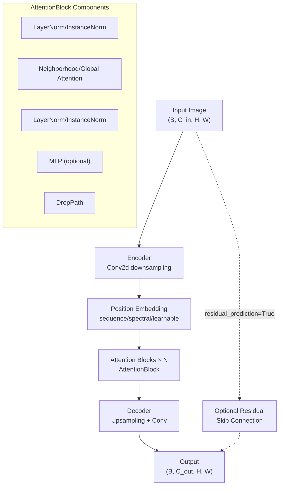
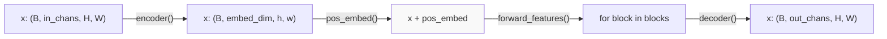
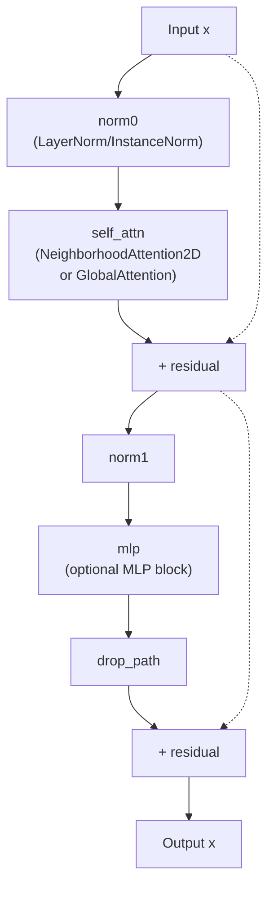
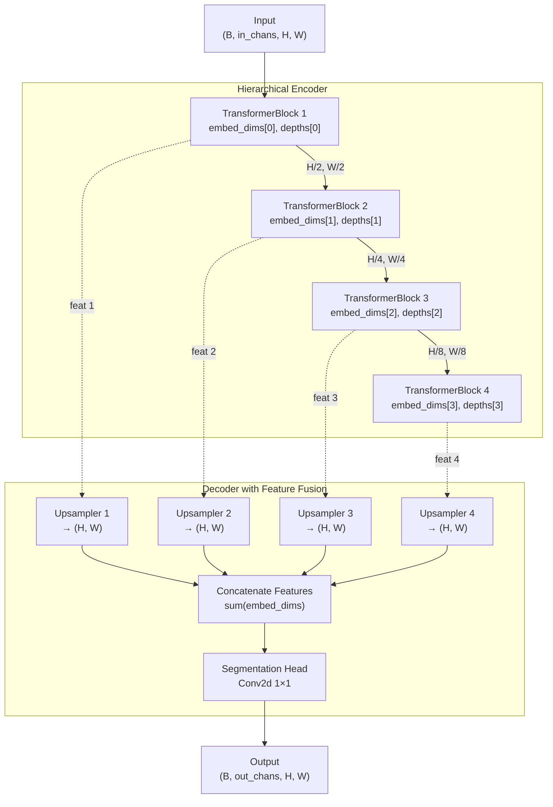
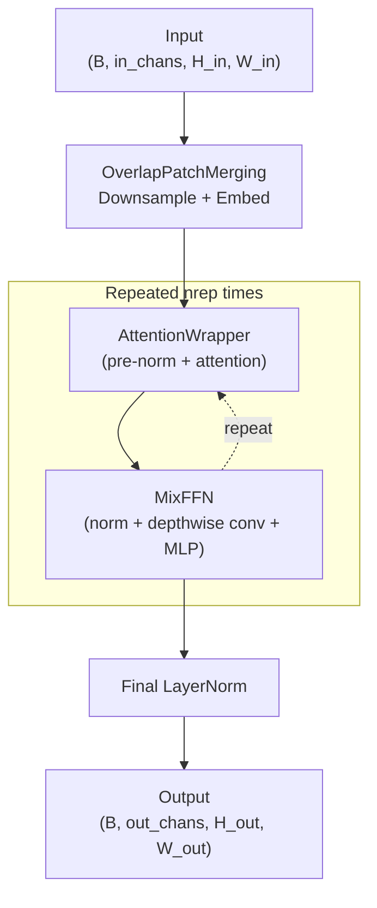
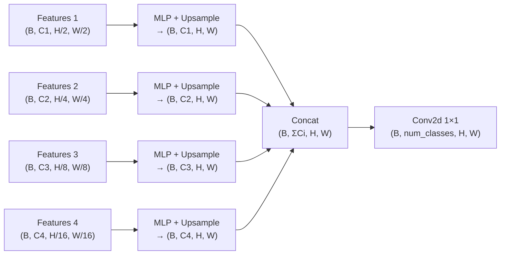
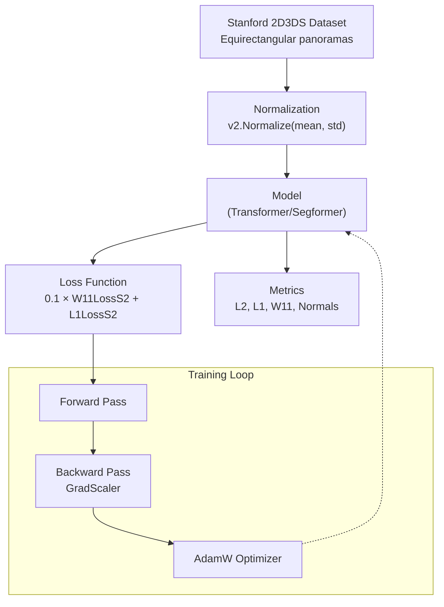
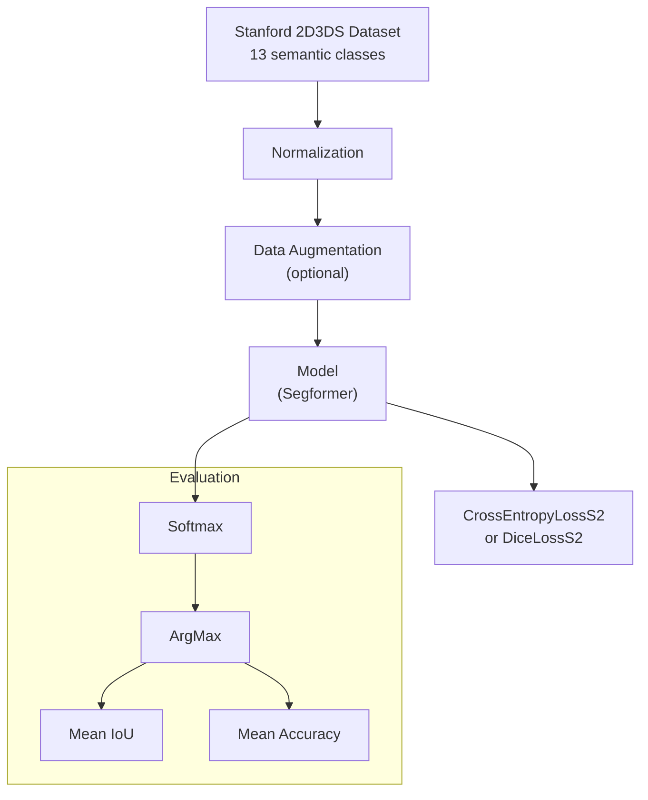
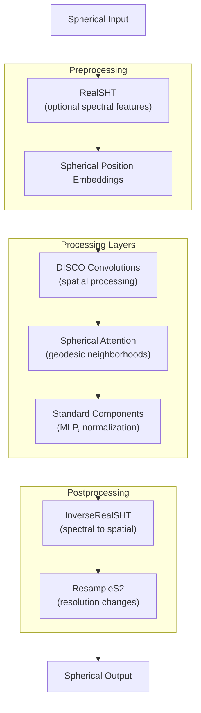

<!-- source: DeepWiki mcp.deepwiki.com · repo NVIDIA/torch-harmonics · page 7.3 S2 Transformer and Segformer · fetched 2026-10-26 -->

# S2 Transformer and Segformer

<details>
<summary>Relevant source files</summary>

The following files were used as context for generating this wiki page:

- [examples/baseline_models/segformer.py](examples/baseline_models/segformer.py)
- [examples/baseline_models/transformer.py](examples/baseline_models/transformer.py)
- [examples/depth/train.py](examples/depth/train.py)
- [examples/segmentation/train.py](examples/segmentation/train.py)

</details>


## Purpose and Scope

This page documents transformer-based architectures for spherical vision tasks, specifically the `Transformer` and `Segformer` classes implemented as baseline models for depth estimation and semantic segmentation on spherical images. These models leverage attention mechanisms to process equirectangular panoramic data.

For neural operator architectures that use spherical harmonic transforms and spectral convolutions, see [Spherical Fourier Neural Operator (SFNO)](#7.1) and [Local Spherical Neural Operator (LSNO)](#7.2). For attention mechanisms integrated with spherical operations, see [Spherical Attention Mechanisms](#4).

**Sources:** [examples/baseline_models/transformer.py:1-491](), [examples/baseline_models/segformer.py:1-708]()

---

## Architecture Overview

The library provides two primary transformer-based architectures for spherical vision tasks:

| Architecture | Purpose | Key Characteristics | Output Type |
|--------------|---------|---------------------|-------------|
| **Transformer** | Image-to-image regression | Encoder-decoder with attention blocks, single-scale processing | Dense prediction (depth, RGB) |
| **Segformer** | Semantic segmentation | Multi-scale hierarchical encoder, lightweight MLP decoder, feature fusion | Class logits per pixel |

Both architectures support **standard** and **spherical (S2)** variants. The S2 variants integrate spherical-aware components from torch-harmonics such as spherical attention mechanisms and DISCO convolutions.

**Sources:** [examples/baseline_models/transformer.py:278-491](), [examples/baseline_models/segformer.py:522-708]()

---

## Transformer Architecture

### Class Definition



The `Transformer` class implements an encoder-decoder architecture with self-attention:

**Key Parameters:**
- `img_size`: Input resolution (nlat, nlon)
- `scale_factor`: Downsampling ratio between input and internal resolution
- `embed_dim`: Channel dimension in attention blocks
- `num_layers`: Number of sequential `AttentionBlock` modules
- `attention_mode`: `"neighborhood"` (local window) or `"global"` (full image)
- `pos_embed`: Type of positional encoding (see [Position Embeddings](#position-embeddings))
- `attn_kernel_shape`: Window size for neighborhood attention (e.g., (7, 7))

**Sources:** [examples/baseline_models/transformer.py:278-491]()

### Forward Pass Pipeline



**Processing Steps:**
1. **Encoding**: [examples/baseline_models/transformer.py:422-430]() - Convolution downsamples input from `(H, W)` to `(h, w)` where `h = (H-1)//scale_factor + 1`, `w = W//scale_factor`
2. **Positional Embedding**: [examples/baseline_models/transformer.py:407-418]() - Adds spatial context
3. **Attention Blocks**: [examples/baseline_models/transformer.py:433-451]() - Sequential self-attention with optional MLP
4. **Decoding**: [examples/baseline_models/transformer.py:453-463]() - Bilinear upsampling or pixel shuffle to restore original resolution

**Sources:** [examples/baseline_models/transformer.py:475-491]()

### AttentionBlock Architecture



Each `AttentionBlock` [examples/baseline_models/transformer.py:154-276]() contains:

- **Normalization**: Layer normalization or instance normalization before attention
- **Self-Attention**: Either `NeighborhoodAttention` (from NATTEN library) or `GlobalAttention` (PyTorch MultiheadAttention)
- **MLP Block**: Optional feedforward network with configurable expansion ratio
- **Residual Connections**: Skip connections around attention and MLP
- **Stochastic Depth**: DropPath for regularization

**Sources:** [examples/baseline_models/transformer.py:154-276]()

---

## Segformer Architecture

### Class Definition

The `Segformer` class implements a hierarchical encoder with multi-scale feature fusion:



**Key Design Principles:**
- **Hierarchical Processing**: Progressive downsampling through multiple `TransformerBlock` stages
- **Multi-Scale Features**: Extract features at different spatial resolutions (similar to FPN)
- **Lightweight Decoder**: Simple upsampling + concatenation + 1×1 convolution
- **Efficiency**: Smaller attention windows at higher resolutions reduce computational cost

**Sources:** [examples/baseline_models/segformer.py:522-708]()

### TransformerBlock Components

Each `TransformerBlock` [examples/baseline_models/segformer.py:301-456]() consists of:



**Components:**

1. **OverlapPatchMerging** [examples/baseline_models/segformer.py:43-106]():
   - Strided convolution for downsampling with overlapping patches
   - Increases channel dimension while reducing spatial dimensions
   - Layer normalization after convolution

2. **AttentionWrapper** [examples/baseline_models/segformer.py:237-299]():
   - Pre-normalization before attention
   - Supports `NeighborhoodAttention2D` or `GlobalAttention`
   - Residual connection with DropPath

3. **MixFFN** [examples/baseline_models/segformer.py:108-199]():
   - Layer normalization
   - 1×1 convolution for channel mixing
   - 3×3 depthwise convolution for spatial mixing
   - Second 1×1 convolution
   - Residual connection with DropPath

**Sources:** [examples/baseline_models/segformer.py:301-456]()

### Decoder Architecture

The decoder performs multi-scale feature fusion:



**Upsampling Module** [examples/baseline_models/segformer.py:458-520]():
- 1×1 convolution to adjust channel dimension
- Bilinear interpolation to target resolution
- All features upsampled to input resolution before concatenation

**Segmentation Head** [examples/baseline_models/segformer.py:673]():
- Single 1×1 convolution mapping concatenated features to class logits
- No softmax (applied externally during inference/training)

**Sources:** [examples/baseline_models/segformer.py:686-708]()

---

## Key Components

### Global Attention

Both architectures use `GlobalAttention` [examples/baseline_models/segformer.py:201-235]() and [examples/baseline_models/transformer.py:118-152]() for full-image self-attention:

```python
# Pseudocode flow:
x: (B, C, H, W) 
→ permute to (B, H, W, C)
→ reshape to (B, H*W, C)
→ MultiheadAttention(x, x, x)
→ reshape to (B, H, W, C)
→ permute to (B, C, H, W)
```

**Key Properties:**
- Uses PyTorch's `nn.MultiheadAttention` with `batch_first=True`
- Complexity: O(N²) where N = H × W
- Suitable for low-resolution internal representations

**Sources:** [examples/baseline_models/transformer.py:118-152](), [examples/baseline_models/segformer.py:201-235]()

### Neighborhood Attention

For local attention, both architectures use `NeighborhoodAttention2D` from the NATTEN library:

```python
# From NATTEN library (external dependency)
NeighborhoodAttention(
    dim=channels,
    kernel_size=attn_kernel_shape,  # e.g., (7, 7)
    num_heads=num_heads,
    qkv_bias=bias
)
```

**Key Properties:**
- Restricts attention to a local window around each pixel
- Complexity: O(N × K²) where K is kernel size
- More efficient for high-resolution inputs
- Preserves locality bias useful for vision tasks

**Sources:** [examples/baseline_models/transformer.py:219-229](), [examples/baseline_models/segformer.py:268-271]()

### Position Embeddings

The `Transformer` architecture supports multiple positional encoding strategies:

| Type | Class | Description | Grid-Aware |
|------|-------|-------------|------------|
| Sequence | `SequencePositionEmbedding` | 1D positional encoding | Yes |
| Spectral | `SpectralPositionEmbedding` | Frequency-based encoding using SHT | Yes |
| Learnable Lat | `LearnablePositionEmbedding` | Per-latitude learned parameters | Yes |
| Learnable LatLon | `LearnablePositionEmbedding` | Per-position learned parameters | Yes |
| None | `nn.Identity()` | No positional information | N/A |

**Grid Types:**
- Position embeddings can be computed on different grids: `"equiangular"`, `"legendre-gauss"`, `"lobatto"`
- The `grid_internal` parameter controls this choice
- Spherical position embeddings account for latitude-dependent spatial distortion

**Sources:** [examples/baseline_models/transformer.py:407-418]()

---

## Spherical vs Standard Variants

The model registry (referenced in training scripts) provides multiple variants:

### Naming Convention

Model names follow the pattern: `[s2][n]{transformer|segformer}_{config}`

- **s2**: Indicates spherical-aware components (uses torch-harmonics primitives)
- **n**: Indicates neighborhood attention
- **Base architecture**: `transformer` or `segformer`

### Component Mapping

| Variant Prefix | Attention Type | Uses Spherical Components |
|----------------|----------------|---------------------------|
| `transformer` | Global | No |
| `ntransformer` | Neighborhood | No |
| `s2transformer` | Global | Yes (spectral position embeddings, etc.) |
| `s2ntransformer` | Neighborhood | Yes |
| `segformer` | Global | No |
| `nsegformer` | Neighborhood | No |
| `s2segformer` | Global | Yes |
| `s2nsegformer` | Neighborhood | Yes |

### Spherical Components Integration

While the base `Transformer` and `Segformer` classes in the provided files are standard PyTorch implementations, the "s2" variants (defined in the model registry) integrate:

- **Spherical position embeddings** that account for latitude distortion
- **DISCO convolutions** (see [DISCO Convolutions](#3)) for spatially-aware processing
- **Spherical attention** mechanisms (see [Spherical Attention Mechanisms](#4))
- **Grid-aware normalization** using quadrature weights

**Sources:** [examples/depth/train.py:438-451](), [examples/segmentation/train.py:451-479]()

---

## Training and Applications

### Depth Estimation

The `Transformer` and `Segformer` models are used for monocular depth estimation on the Stanford 2D3DS dataset:



**Key Configuration:**
- **Input**: RGB(A) panoramas downsampled by factor of 16
- **Output**: Single-channel depth map
- **Loss**: Combination of W11 Sobolev norm and L1 loss
- **Metrics**: L2, L1, W11 errors and surface normal error

**Training Script:** [examples/depth/train.py:1-636]()

**Sources:** [examples/depth/train.py:169-328](), [examples/depth/train.py:459-471]()

### Semantic Segmentation

For semantic segmentation on Stanford 2D3DS:



**Key Configuration:**
- **Input**: RGB panoramas
- **Output**: Class logits for 13 categories
- **Loss**: CrossEntropyLossS2 with optional label smoothing
- **Metrics**: Mean IoU and mean accuracy per class
- **Augmentation**: Color jitter, Gaussian noise, auto-contrast

**Training Script:** [examples/segmentation/train.py:1-669]()

**Sources:** [examples/segmentation/train.py:159-319](), [examples/segmentation/train.py:488-507]()

---

## Model Variants and Configurations

### Example Configurations

Common model configurations used in experiments:

| Model Name | Architecture | Attention | Embed Dims | Depths | Heads |
|------------|-------------|-----------|------------|--------|-------|
| `transformer_sc2_layers4_e128` | Transformer | Global | 128 | [4] | [1] |
| `s2transformer_sc2_layers4_e128` | Transformer | Global (S2) | 128 | [4] | [1] |
| `ntransformer_sc2_layers4_e128` | Transformer | Neighborhood | 128 | [4] | [1] |
| `segformer_sc2_layers4_e128` | Segformer | Global | [64,128,256,512] | [3,4,6,3] | [1,2,4,8] |
| `s2segformer_sc2_layers4_e128` | Segformer | Global (S2) | [64,128,256,512] | [3,4,6,3] | [1,2,4,8] |
| `nsegformer_sc2_layers4_e128` | Segformer | Neighborhood | [64,128,256,512] | [3,4,6,3] | [1,2,4,8] |

**Notes:**
- `sc2` indicates scale factor of 2
- `layers4` indicates 4 transformer blocks/stages
- `e128` or `e256` indicates embedding dimension
- Segformer uses hierarchical embedding dimensions that increase with depth

**Sources:** [examples/depth/train.py:438-451](), [examples/segmentation/train.py:451-479]()

### Instantiation Example

```python
# Transformer for depth estimation
model = Transformer(
    img_size=(128, 256),
    scale_factor=2,
    in_chans=3,
    out_chans=1,  # Single-channel depth
    embed_dim=256,
    num_layers=4,
    num_heads=1,
    pos_embed="spectral",  # Spherical position encoding
    attention_mode="global",
    attn_kernel_shape=(7, 7),
    mlp_ratio=2.0,
    drop_path_rate=0.0
)

# Segformer for semantic segmentation
model = Segformer(
    img_size=(128, 256),
    in_chans=3,
    out_chans=13,  # 13 semantic classes
    embed_dims=[64, 128, 256, 512],
    heads=[1, 2, 4, 8],
    depths=[3, 4, 6, 3],
    scale_factor=2,
    attention_mode="neighborhood",
    attn_kernel_shape=(7, 7),
    mlp_ratio=2.0,
    drop_path_rate=0.1
)
```

**Sources:** [examples/baseline_models/transformer.py:321-349](), [examples/baseline_models/segformer.py:559-577]()

---

## Performance Characteristics

### Computational Complexity

| Component | Complexity | Notes |
|-----------|-----------|-------|
| Global Attention | O(N²) | N = H × W spatial size |
| Neighborhood Attention | O(N × K²) | K = kernel size (e.g., 7) |
| MLP/FFN | O(N × C²) | C = channel dimension |
| OverlapPatchMerging | O(N × C_in × C_out) | Depends on kernel size |

### Memory Considerations

- **Transformer**: Single-scale processing reduces memory footprint but may limit capacity
- **Segformer**: Multi-scale features increase memory but improve representational power
- **Attention Mode**: Neighborhood attention significantly reduces memory for high-resolution inputs
- **AMP Support**: Both architectures support automatic mixed precision (bf16/fp16) for training

**Sources:** [examples/depth/train.py:184-198](), [examples/segmentation/train.py:184-188]()

### Distributed Training

Both architectures support distributed data parallel (DDP) training:

```python
# Example from training scripts
if ddp:
    dist.init_process_group(backend="nccl")
    model = DDP(model, device_ids=[device.index])
```

- Uses `DistributedSampler` for data loading
- All-reduce for loss and metric aggregation
- Checkpoint saving on rank 0 only

**Sources:** [examples/depth/train.py:348-356](), [examples/segmentation/train.py:340-347]()

---

## Integration with torch-harmonics

While the base implementations use standard PyTorch operations, the S2 variants integrate torch-harmonics components:



**Key Integrations:**
- **Spectral position embeddings** using spherical harmonic basis functions
- **Grid-aware operations** respecting equiangular or Legendre-Gauss grids
- **Quadrature-weighted losses** (W11LossS2, CrossEntropyLossS2) accounting for latitude distortion
- **Spherical metrics** (NormalLossS2) for evaluation

**Sources:** [torch_harmonics/examples/losses.py]() (referenced in training scripts), [examples/depth/train.py:53](), [examples/segmentation/train.py:55-56]()

---

