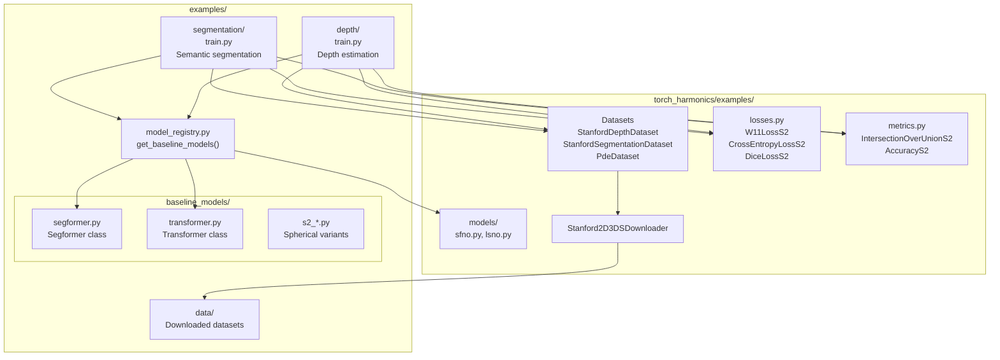
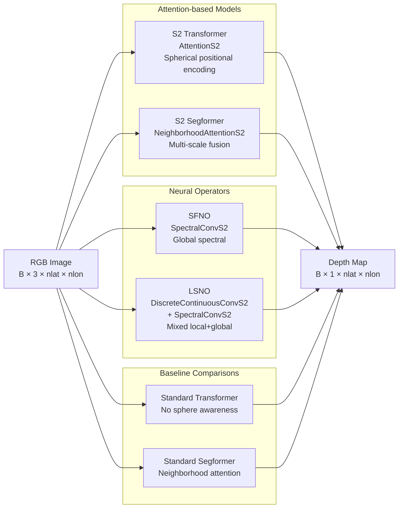
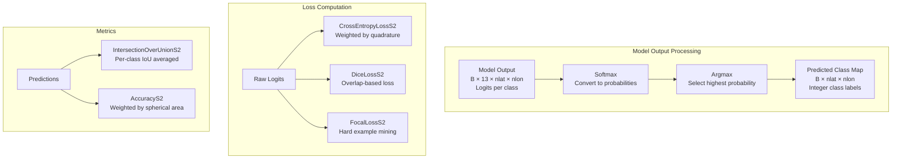
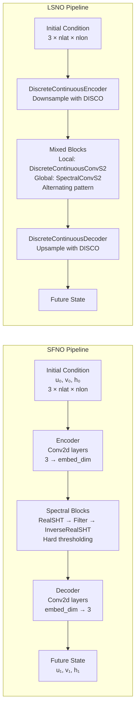
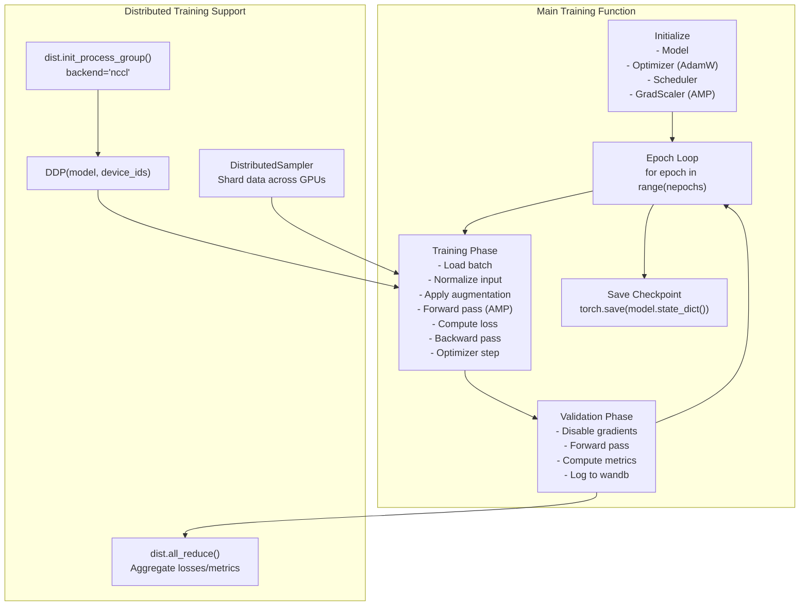
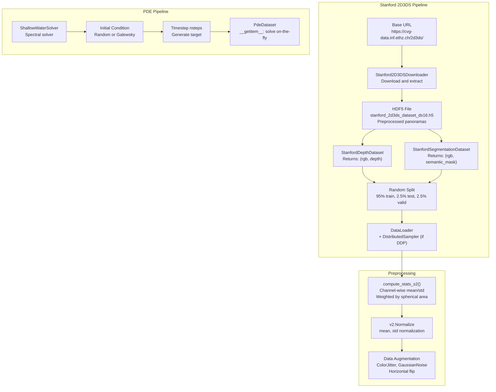
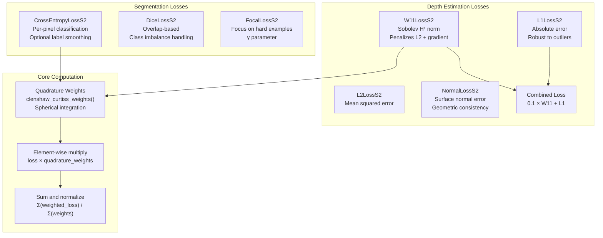
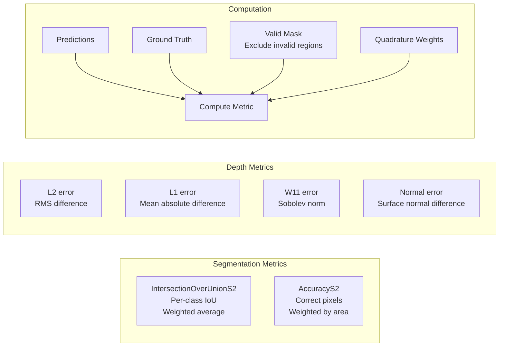
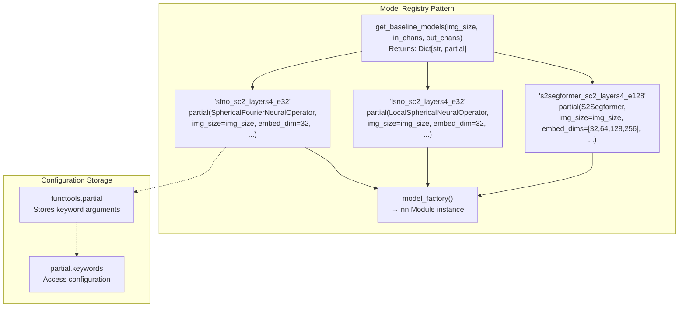

<!-- source: DeepWiki mcp.deepwiki.com · repo NVIDIA/torch-harmonics · page 8 Example Applications · fetched 2026-10-26 -->

# Example Applications

<details>
<summary>Relevant source files</summary>

The following files were used as context for generating this wiki page:

- [examples/baseline_models/segformer.py](examples/baseline_models/segformer.py)
- [examples/baseline_models/transformer.py](examples/baseline_models/transformer.py)
- [examples/depth/train.py](examples/depth/train.py)
- [examples/segmentation/train.py](examples/segmentation/train.py)
- [torch_harmonics/examples/models/lsno.py](torch_harmonics/examples/models/lsno.py)
- [torch_harmonics/examples/models/sfno.py](torch_harmonics/examples/models/sfno.py)
- [torch_harmonics/examples/pde_dataset.py](torch_harmonics/examples/pde_dataset.py)

</details>


## Purpose and Scope

This page provides an overview of the complete example applications included with torch-harmonics, demonstrating practical usage of the library's capabilities across different problem domains. These examples serve as reference implementations showing how to combine the core components (spherical transforms, convolutions, attention mechanisms) into end-to-end machine learning pipelines.

For detailed documentation on the underlying model architectures, see [Neural Operator Architectures](#7). For information on the core mathematical operations used in these examples, see [Spherical Harmonic Transforms](#2), [DISCO Convolutions](#3), and [Spherical Attention Mechanisms](#4).

## Application Domains

torch-harmonics includes three primary application domains, each targeting different types of problems on spherical data:

| Domain | Task Type | Dataset | Input/Output | Primary Models |
|--------|-----------|---------|--------------|----------------|
| Depth Estimation | Regression | Stanford 2D3DS | RGB → Depth map | S2 Transformer, S2 Segformer, SFNO, LSNO |
| Semantic Segmentation | Multi-class Classification | Stanford 2D3DS | RGB → Class labels | S2 Segformer, S2 Transformer, SFNO, LSNO |
| PDE Solving | Operator Learning | Shallow Water Equations | Initial state → Future state | SFNO, LSNO |

**Vision Tasks** (Depth Estimation and Semantic Segmentation): These applications process spherical panoramic images from indoor environments. The Stanford 2D3DS dataset provides equirectangular projections with depth annotations and semantic labels for 13 object classes.

**PDE Tasks**: Neural operator learning for time-stepping partial differential equations on the sphere. The shallow water equations serve as a testbed for learning stable dynamics using purely data-driven approaches.

Sources: [examples/depth/train.py:48-53](), [examples/segmentation/train.py:53-58](), [torch_harmonics/examples/pde_dataset.py:39-71]()

## Example Directory Structure



**Directory Organization**:

- `examples/depth/` and `examples/segmentation/`: Task-specific training scripts for vision applications
- `examples/baseline_models/`: Model architectures not specific to torch-harmonics (standard transformers, segformers)
- `examples/model_registry.py`: Central registry providing factory functions for all available models
- `torch_harmonics/examples/models/`: Core neural operator implementations (SFNO, LSNO)
- `torch_harmonics/examples/`: Datasets, loss functions, metrics, and data utilities

Sources: [examples/depth/train.py:56-59](), [examples/segmentation/train.py:61-63](), [examples/baseline_models/segformer.py:1-30](), [torch_harmonics/examples/models/sfno.py:1-40]()

## Model Architectures by Application

### Depth Estimation Models



All depth estimation models are configured through the `get_baseline_models()` function with variants differentiated by embedding dimensions (e.g., `e32`, `e128`, `e256`) and number of layers. Models prefixed with `s2` incorporate spherical geometry awareness through specialized components.

**Key Depth Models**:
- `s2transformer_sc2_layers4_e128`: Uses `AttentionS2` for global spherical attention
- `s2segformer_sc2_layers4_e128`: Uses `NeighborhoodAttentionS2` with geodesic distance-based neighborhoods
- `sfno_sc2_layers4_e32`: Pure spectral convolution approach via spherical harmonic transforms
- `lsno_sc2_layers4_e32`: Combines local DISCO convolutions with global spectral operations

Sources: [examples/depth/train.py:434-454](), [torch_harmonics/examples/models/sfno.py:175-240](), [torch_harmonics/examples/models/lsno.py:378-457]()

### Semantic Segmentation Models

The segmentation task uses the same model architectures as depth estimation but configured for multi-class output (13 semantic classes). The primary difference is in the loss functions and metrics used for training and evaluation.



Sources: [examples/segmentation/train.py:446-508](), [examples/segmentation/train.py:135-138]()

### PDE Solving Models

For operator learning on PDEs, the SFNO and LSNO architectures are specifically designed for this task:



The SFNO uses exclusively spectral operations with hard thresholding to retain only the most energetic modes, ensuring numerical stability for long-term rollouts. The LSNO adds local discrete-continuous convolutions to capture fine-scale features that may not be well-represented in spectral space.

Sources: [torch_harmonics/examples/models/sfno.py:313-346](), [torch_harmonics/examples/models/lsno.py:534-592]()

## Common Training Infrastructure

### Training Loop Architecture



All example applications share a common training infrastructure pattern:

1. **Initialization**: Model creation, optimizer setup (AdamW with weight decay), learning rate scheduler (ReduceLROnPlateau for depth, CosineAnnealingLR for segmentation), and gradient scaler for automatic mixed precision
2. **Training Loop**: Forward pass with optional AMP, loss computation, backward pass, gradient clipping (optional), optimizer step
3. **Validation**: Periodic evaluation on held-out data with metrics computation
4. **Logging**: Integration with Weights & Biases for experiment tracking
5. **Checkpointing**: Save/load model state for resuming training

Sources: [examples/depth/train.py:168-328](), [examples/segmentation/train.py:158-319]()

### Data Pipeline



**Stanford 2D3DS Dataset**:
- Automatic download and preprocessing via `Stanford2D3DSDownloader`
- Configurable downsampling factor (default: 16x to reduce resolution)
- Stored in HDF5 format for efficient random access
- Supports both depth and segmentation annotations

**PDE Dataset**:
- Generated on-the-fly using `ShallowWaterSolver`
- Each sample: run spectral solver for `nsteps` to create input/target pair
- Supports multiple initial conditions (random, Galewsky jet)
- Optional normalization based on first sample statistics

Sources: [examples/depth/train.py:371-389](), [examples/segmentation/train.py:363-384](), [torch_harmonics/examples/pde_dataset.py:39-160]()

## Loss Functions and Metrics

### Spherical-Aware Loss Functions

All loss functions in torch-harmonics incorporate quadrature weights to account for varying grid cell areas on the sphere:



**Key Loss Functions**:

| Loss Class | Equation | Use Case |
|------------|----------|----------|
| `W11LossS2` | `∫_S² (‖u - v‖² + ‖∇u - ∇v‖²) dA` | Depth regression with smoothness |
| `L1LossS2` | `∫_S² ‖u - v‖ dA` | Robust depth regression |
| `CrossEntropyLossS2` | `∫_S² -Σ_c y_c log(p_c) dA` | Multi-class segmentation |
| `DiceLossS2` | `1 - (2∫_S² p·y dA)/(∫_S² p dA + ∫_S² y dA)` | Segmentation with class imbalance |
| `NormalLossS2` | `∫_S² ‖n_pred - n_gt‖ dA` | Geometric consistency for depth |

All losses integrate over the sphere using quadrature weights that account for the varying area of grid cells (smaller near poles, larger near equator).

Sources: [examples/depth/train.py:459-471](), [examples/segmentation/train.py:488-507]()

### Metrics

Evaluation metrics also incorporate spherical geometry:



**Metrics by Task**:
- **Depth**: L1, L2, W11 (Sobolev), Normal error
- **Segmentation**: Mean Intersection over Union (mIoU), Mean Accuracy
- **PDE**: L2 relative error, energy conservation

All metrics are weighted by spherical area to provide accurate global statistics.

Sources: [examples/depth/train.py:464-471](), [examples/segmentation/train.py:494-507]()

## Running the Examples

### Depth Estimation

```bash
# Basic training
python examples/depth/train.py \
    --models s2transformer_sc2_layers4_e128 \
    --num_epochs 100 \
    --batch_size 8 \
    --learning_rate 1e-3

# Multi-GPU distributed training
python -m torch.distributed.run --nproc_per_node=4 \
    examples/depth/train.py \
    --models sfno_sc2_layers4_e32 \
    --enable_ddp \
    --amp_mode bf16

# Multiple models comparison
python examples/depth/train.py \
    --models s2transformer_sc2_layers4_e128 \
           sfno_sc2_layers4_e32 \
           lsno_sc2_layers4_e32 \
    --num_epochs 100
```

**Command-line Arguments**:
- `--models`: Space-separated list of model names from registry
- `--num_epochs`: Training epochs (0 for evaluation only)
- `--batch_size`: Batch size per GPU
- `--learning_rate`: Initial learning rate
- `--data_downsampling_factor`: Spatial downsampling (default: 16)
- `--amp_mode`: Mixed precision mode (`none`, `fp16`, `bf16`)
- `--enable_ddp`: Enable distributed data parallel
- `--resume`: Load checkpoint and resume training
- `--output_path`: Directory for checkpoints and outputs
- `--data_path`: Dataset location

Sources: [examples/depth/train.py:592-636]()

### Semantic Segmentation

```bash
# Training with data augmentation
python examples/segmentation/train.py \
    --models s2segformer_sc2_layers4_e128 \
    --num_epochs 200 \
    --learning_rate 5e-4 \
    --enable_data_augmentation

# With gradient clipping and label smoothing
python examples/segmentation/train.py \
    --models s2segformer_sc2_layers4_e128 \
    --max_grad_norm 4.0 \
    --label_smoothing_factor 0.1
```

**Additional Segmentation Arguments**:
- `--max_grad_norm`: Gradient clipping threshold (default: 4.0)
- `--label_smoothing_factor`: Label smoothing [0, 1] (default: 0.0)
- `--enable_data_augmentation`: Apply color jitter, noise, autocontrast

Sources: [examples/segmentation/train.py:621-669]()

### Training Output Structure

```
output_path/
├── model_name/
│   ├── checkpoint.pt              # Model state dict
│   ├── figures/
│   │   ├── input_0.png           # Input visualization
│   │   ├── pred_0.png            # Prediction visualization
│   │   └── truth_0.png           # Ground truth visualization
│   └── output_data/
│       └── metrics.pkl            # Performance metrics DataFrame
└── ...
```

Each model creates a subdirectory containing:
- **checkpoint.pt**: Saved model parameters for resumption
- **figures/**: Visualizations of validation set predictions
- **output_data/metrics.pkl**: Pandas DataFrame with statistics (mean/std of losses and metrics)

Sources: [examples/depth/train.py:492-586](), [examples/segmentation/train.py:528-616]()

## Integration with Weights & Biases

All examples support experiment tracking via Weights & Biases:

```python
# Automatic initialization when training
wandb.init(
    project="depth estimation 2d3ds",  # or "spherical segmentation 2d3ds"
    group=model_name,
    name=f"{model_name}_{timestamp}",
    config=model_config
)

# Logged metrics per epoch
wandb.log({
    "loss": train_loss,
    "validation loss": val_loss,
    "learning rate": current_lr,
    "L2 error": l2_metric,
    "mean IoU": miou_metric,
    # ... task-specific metrics
})
```

This enables:
- Hyperparameter tracking
- Real-time training curves
- Cross-model comparison
- Reproducibility via saved configs

Sources: [examples/depth/train.py:502-541](), [examples/segmentation/train.py:538-578]()

## Model Registry System

The `get_baseline_models()` function provides a centralized registry of all available models with pre-configured hyperparameters:



This pattern allows:
1. **Easy model selection**: Select models by string name
2. **Hyperparameter storage**: Configuration accessible via `factory.keywords`
3. **Lazy instantiation**: Models created only when needed
4. **Type safety**: All returned objects are callable factories

Example usage:
```python
models = get_baseline_models(img_size=(128, 256), in_chans=3, out_chans=13)
model = models["s2segformer_sc2_layers4_e128"]()  # Instantiate
config = models["s2segformer_sc2_layers4_e128"].keywords  # Access config
```

Sources: [examples/depth/train.py:433-454](), [examples/segmentation/train.py:446-482]()

---

