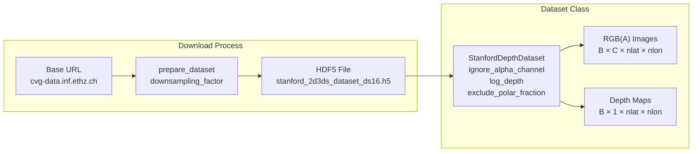
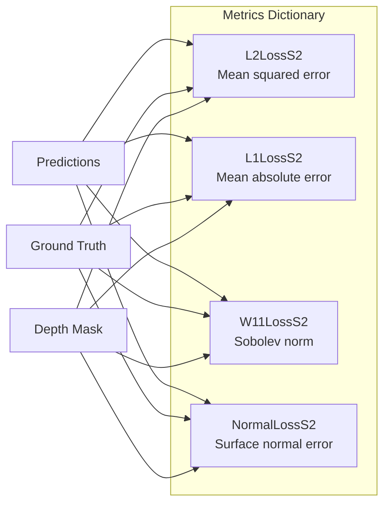
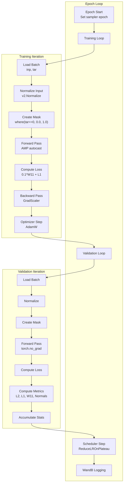
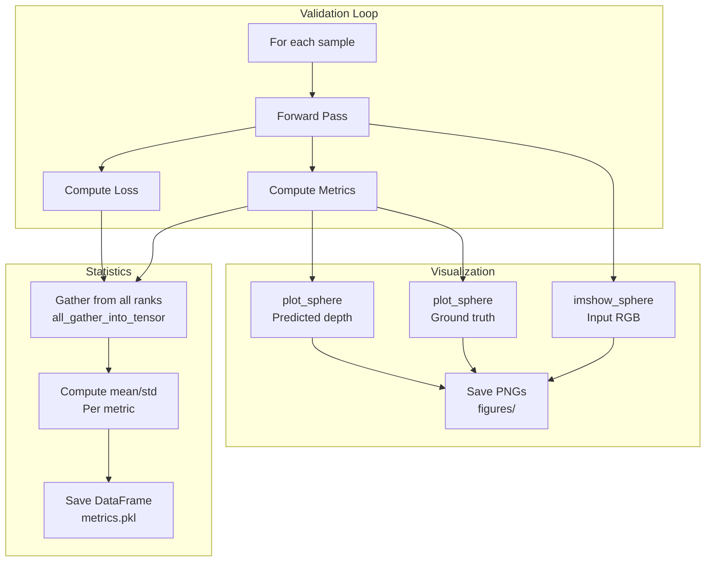

<!-- source: DeepWiki mcp.deepwiki.com · repo NVIDIA/torch-harmonics · page 8.1 Depth Estimation on 2D3DS · fetched 2026-10-26 -->

# Depth Estimation on 2D3DS

<details>
<summary>Relevant source files</summary>

The following files were used as context for generating this wiki page:

- [examples/baseline_models/segformer.py](examples/baseline_models/segformer.py)
- [examples/baseline_models/transformer.py](examples/baseline_models/transformer.py)
- [examples/depth/train.py](examples/depth/train.py)
- [examples/segmentation/train.py](examples/segmentation/train.py)

</details>


## Purpose and Scope

This page documents the complete training pipeline for spherical depth estimation on the Stanford 2D-3D Semantics (2D3DS) dataset. The example demonstrates how to train various neural network architectures to predict depth maps from spherical panoramic images. This application showcases the library's capabilities for vision tasks on spherical data.

For semantic segmentation on the same dataset, see [Semantic Segmentation on 2D3DS](#8.2). For neural operator applications to PDEs, see [PDE Solving with Neural Operators](#8.3).

**Sources:** [examples/depth/train.py:1-636]()

---

## Overview

The depth estimation pipeline provides a complete reference implementation including:
- Automated dataset download and preprocessing
- Multiple baseline model architectures (transformers, segformers, neural operators)
- Specialized spherical loss functions and metrics
- Distributed training support with automatic mixed precision
- Comprehensive validation and visualization

```mermaid
graph TB
    subgraph "Data Pipeline"
        DOWNLOAD["Stanford2D3DSDownloader"]
        DATASET["StanfordDepthDataset"]
        SPLIT["Train/Test/Valid Split<br/>95%/2.5%/2.5%"]
        STATS["compute_stats_s2<br/>Normalization statistics"]
    end
    
    subgraph "Model Selection"
        REGISTRY["get_baseline_models"]
        TRANS["Transformers<br/>s2transformer, ntransformer"]
        SEG["Segformers<br/>s2segformer, nsegformer"]
        OPS["Neural Operators<br/>SFNO, LSNO"]
    end
    
    subgraph "Training Infrastructure"
        LOSS["Loss Function<br/>0.1*W11LossS2 + L1LossS2"]
        METRICS["Metrics<br/>L2, L1, W11, NormalLossS2"]
        TRAIN["train_model<br/>AMP, DDP, WandB"]
        VALID["validate_model<br/>Visualization"]
    end
    
    DOWNLOAD --> DATASET
    DATASET --> SPLIT
    SPLIT --> STATS
    
    REGISTRY --> TRANS
    REGISTRY --> SEG
    REGISTRY --> OPS
    
    STATS --> TRAIN
    TRANS --> TRAIN
    SEG --> TRAIN
    OPS --> TRAIN
    
    LOSS --> TRAIN
    METRICS --> TRAIN
    TRAIN --> VALID
```



**Sources:** [examples/depth/train.py:330-590]()

---

## Dataset Preparation

### Stanford2D3DSDownloader

The `Stanford2D3DSDownloader` class handles automatic download and preprocessing of the Stanford 2D3DS dataset. It downloads RGB panoramas and depth maps, converts them to HDF5 format, and applies optional downsampling.



The downsampling factor controls the spatial resolution. Default is 16x downsampling for faster training. The `exclude_polar_fraction` parameter (default 0.15) masks out polar regions where depth measurements are unreliable.

**Parameters:**
| Parameter | Default | Description |
|-----------|---------|-------------|
| `data_downsampling_factor` | 16 | Spatial downsampling factor |
| `ignore_alpha_channel` | True | Use RGB instead of RGBA |
| `log_depth` | False | Apply logarithmic scaling to depth |
| `exclude_polar_fraction` | 0.15 | Fraction of poles to mask out |

**Sources:** [examples/depth/train.py:371-373](), [examples/depth/train.py:385-386]()

### Dataset Splitting and Normalization

The dataset is split into training (95%), test (2.5%), and validation (2.5%) sets using a fixed random seed for reproducibility. Statistics are computed on the training set for input and output normalization.

```python
# Split ratios from code
split_ratios = [0.95, 0.025, 0.025]
rng = torch.Generator().manual_seed(333)
train_dataset, test_dataset, valid_dataset = torch.utils.data.random_split(
    dataset, split_ratios, generator=rng
)
```

The `compute_stats_s2` function calculates spherically-weighted mean and standard deviation for normalization, accounting for the non-uniform latitude spacing on spherical grids.

**Sources:** [examples/depth/train.py:383-397]()

---

## Model Architectures

The training script supports multiple baseline architectures through a model registry. Models are organized by architecture type and configuration.

### Available Model Families

```mermaid
graph TB
    subgraph "Transformer-Based"
        TRANS["transformer_sc2_layers4_e128"]
        S2TRANS["s2transformer_sc2_layers4_e128<br/>Spectral position embedding"]
        NTRANS["ntransformer_sc2_layers4_e128<br/>Neighborhood attention"]
        S2NTRANS["s2ntransformer_sc2_layers4_e256<br/>Spectral + Neighborhood"]
    end
    
    subgraph "Segformer-Based"
        SEG["segformer_sc2_layers4_e128"]
        S2SEG["s2segformer_sc2_layers4_e128<br/>Spherical variant"]
        NSEG["nsegformer_sc2_layers4_e128<br/>Neighborhood attention"]
        S2NSEG["s2nsegformer_sc2_layers4_e128<br/>Spherical + Neighborhood"]
    end
    
    subgraph "Neural Operators"
        SFNO["sfno_sc2_layers4_e32<br/>Global spectral"]
        LSNO["lsno_sc2_layers4_e32<br/>Local + Spectral"]
    end
    
    REGISTRY["get_baseline_models<br/>img_size, in_chans=3, out_chans=1"]
    
    REGISTRY --> TRANS
    REGISTRY --> S2TRANS
    REGISTRY --> NTRANS
    REGISTRY --> S2NTRANS
    REGISTRY --> SEG
    REGISTRY --> S2SEG
    REGISTRY --> NSEG
    REGISTRY --> S2NSEG
    REGISTRY --> SFNO
    REGISTRY --> LSNO
```



**Model Naming Convention:**
- `s2`: Spherical-specific components (e.g., spherical position embeddings)
- `n`: Neighborhood attention (local attention mechanisms)
- `sc2`: Scale factor of 2 for encoder/decoder
- `layers4`: 4 transformer/attention layers
- `e128`/`e256`/`e32`: Embedding dimension

**Sources:** [examples/depth/train.py:433-454](), [examples/baseline_models/transformer.py:278-491](), [examples/baseline_models/segformer.py:522-708]()

### Model Configuration

All models are initialized with:
- Input channels: 3 (RGB) or 4 (RGBA)
- Output channels: 1 (depth prediction)
- Image size: Determined by downsampling factor

Models can be selected via command line:
```bash
python train.py --models s2transformer_sc2_layers4_e128 sfno_sc2_layers4_e32
```

**Sources:** [examples/depth/train.py:434-454](), [examples/depth/train.py:609]()

---

## Loss Functions and Metrics

### Combined Loss Function

The training uses a weighted combination of Sobolev W¹'¹ norm and L¹ loss:

```python
loss_w11 = W11LossS2(nlat=img_size[0], nlon=img_size[1], grid="equiangular")
loss_l1 = L1LossS2(nlat=img_size[0], nlon=img_size[1], grid="equiangular")
loss_fn = lambda prd, tar, mask: 0.1 * loss_w11(prd, tar, mask) + loss_l1(prd, tar, mask)
```

| Loss Component | Weight | Purpose |
|----------------|--------|---------|
| `W11LossS2` | 0.1 | Penalize gradients, encourage smoothness |
| `L1LossS2` | 1.0 | Pointwise depth accuracy |

All losses support masking to exclude invalid depth regions (where `tar == 0`).

**Sources:** [examples/depth/train.py:460-462]()

### Evaluation Metrics



The `NormalLossS2` metric computes error in estimated surface normals by taking gradients of the depth map, providing a measure of geometric accuracy beyond pointwise depth error.

**Sources:** [examples/depth/train.py:466-471]()

---

## Training Pipeline

### Training Loop



**Sources:** [examples/depth/train.py:169-327]()

### Key Training Features

**Normalization:**
- Input: Normalized using training set mean/std per channel
- Output: Normalized depth values for stable training

**Masking:**
```python
mask = torch.where(tar == 0, 0.0, 1.0)
```
Zero depth values (invalid measurements) are masked out during loss computation.

**Automatic Mixed Precision:**
```python
with torch.autocast(device_type="cuda", dtype=amp_dtype, enabled=(amp_mode != "none")):
    prd = model(inp)
    loss = loss_fn(prd, tar.unsqueeze(-3), mask)
```

Supports `none`, `fp16`, and `bf16` modes via `--amp_mode` flag.

**Sources:** [examples/depth/train.py:216-243]()

### Distributed Training

When using DDP (`--enable_ddp`):
- Process groups initialized with NCCL backend
- Data split across GPUs using `DistributedSampler`
- Loss and metrics synchronized with `dist.all_reduce`
- Only rank 0 saves checkpoints and logs to WandB

```python
if dist.is_initialized():
    dist.all_reduce(accumulated_loss)
    dist.all_reduce(valid_loss)
    for metric in metrics_fns:
        dist.all_reduce(valid_metrics[metric])
```

**Sources:** [examples/depth/train.py:246-293](), [examples/depth/train.py:348-356]()

---

## Validation and Visualization

### Validation Process

The `validate_model` function evaluates the trained model on the validation set and generates visualizations.



**Output Files:**
- `figures/pred_{idx}.png`: Predicted depth maps
- `figures/truth_{idx}.png`: Ground truth depth maps  
- `figures/input_{idx}.png`: Input RGB images
- `output_data/metrics.pkl`: Performance statistics

**Sources:** [examples/depth/train.py:86-165](), [examples/depth/train.py:550-586]()

### Visualization Details

Depth maps are visualized using `plot_sphere` from the `torch_harmonics.plotting` module, which properly handles spherical projections. The colormap is `plasma` with consistent min/max values for prediction and ground truth comparison.

```python
vmin = min(tar.min(), prd.min())
vmax = min(tar.max(), prd.max())
plot_sphere(prd.cpu(), fig=fig, vmax=vmax, vmin=vmin, cmap="plasma")
```

**Sources:** [examples/depth/train.py:143-158]()

---

## Usage

### Command Line Interface

```bash
python examples/depth/train.py \
    --models s2transformer_sc2_layers4_e128 \
    --data_path ./data/2D3DS \
    --output_path ./checkpoints \
    --num_epochs 100 \
    --batch_size 8 \
    --learning_rate 1e-3 \
    --amp_mode bf16 \
    --enable_ddp
```

### Command Line Arguments

| Argument | Default | Description |
|----------|---------|-------------|
| `--models` | None | List of model names to train |
| `--data_path` | `../data/2D3DS` | Dataset storage directory |
| `--output_path` | `./checkpoints` | Checkpoint and output directory |
| `--num_epochs` | 100 | Number of training epochs |
| `--batch_size` | 8 | Batch size per GPU |
| `--learning_rate` | 1e-3 | Initial learning rate |
| `--data_downsampling_factor` | 16 | Spatial downsampling factor |
| `--amp_mode` | `none` | AMP mode: `none`, `fp16`, `bf16` |
| `--enable_ddp` | False | Enable distributed training |
| `--enable_data_augmentation` | False | Enable data augmentation |
| `--resume` | False | Resume from checkpoint |

**Sources:** [examples/depth/train.py:599-635]()

### Training Configuration

**Optimizer:** AdamW with weight decay 0.01
```python
optimizer = torch.optim.AdamW(
    model.parameters(), 
    lr=learning_rate, 
    weight_decay=0.01, 
    foreach=torch.cuda.is_available()
)
```

**Scheduler:** ReduceLROnPlateau monitoring validation loss
```python
scheduler = torch.optim.lr_scheduler.ReduceLROnPlateau(optimizer, "min")
```

**Gradient Scaling:** Enabled for fp16 mode only
```python
gscaler = torch.GradScaler("cuda", enabled=(amp_mode == "fp16"))
```

**Sources:** [examples/depth/train.py:507-509]()

### Multi-GPU Training

Launch with `torchrun`:
```bash
torchrun --nproc_per_node=4 examples/depth/train.py \
    --enable_ddp \
    --models s2nsegformer_sc2_layers4_e256
```

Or use `torch.distributed.launch`:
```bash
python -m torch.distributed.launch \
    --nproc_per_node=4 \
    examples/depth/train.py \
    --enable_ddp
```

**Sources:** [examples/depth/train.py:348-356](), [examples/depth/train.py:481-482]()

---

## Output and Checkpoints

### Directory Structure

```
checkpoints/
├── model_name/
│   ├── checkpoint.pt              # Model state dict
│   ├── figures/
│   │   ├── pred_0.png            # Validation predictions
│   │   ├── truth_0.png           # Ground truth
│   │   └── input_0.png           # Input images
│   ├── weights_and_grads/        # Optional gradient logs
│   └── output_data/
│       └── metrics.pkl           # Performance metrics
```

### Metrics DataFrame

The final `metrics.pkl` contains a pandas DataFrame with columns:
- `num_params`: Model parameter count
- `loss mean`, `loss std`: Validation loss statistics
- `L2 error mean`, `L2 error std`: L2 metric statistics
- `L1 error mean`, `L1 error std`: L1 metric statistics
- `W11 error mean`, `W11 error std`: Sobolev metric statistics
- `Normals error mean`, `Normals error std`: Normal error statistics
- `training_time`: Total training time (if trained)

**Sources:** [examples/depth/train.py:582-586](), [examples/depth/train.py:573-580]()

---

## WandB Integration

The training script integrates with Weights & Biases for experiment tracking.

```python
wandb.login()
run = wandb.init(
    project="depth estimation 2d3ds", 
    group=model_name, 
    name=model_name + "_" + str(time.time()), 
    config=model_handle.keywords
)
```

**Logged Metrics:**
- `loss`: Training loss per epoch
- `validation loss`: Validation loss per epoch
- `learning rate`: Current learning rate
- `L2 error`, `L1 error`, `W11 error`, `Normals error`: Validation metrics

**Sources:** [examples/depth/train.py:502](), [examples/depth/train.py:313-318]()

---

## Implementation Notes

### Polar Region Exclusion

The `exclude_polar_fraction` parameter masks out regions near the poles where:
1. Depth measurements are often unreliable
2. Pixel density is highest on equiangular grids
3. This can bias training toward polar accuracy

**Sources:** [examples/depth/train.py:385]()

### Data Augmentation

Currently, data augmentation is not implemented for depth estimation (unlike semantic segmentation). The infrastructure exists but augmentation transforms are set to `None`.

**Sources:** [examples/depth/train.py:420](), [examples/depth/train.py:528]()

### Memory Management

- `persistent_workers=True`: Reuse data loading workers across epochs
- `pin_memory=True`: Faster GPU transfer
- Batch size 8 is typical for models with 128-256 embedding dimensions
- Gradient accumulation is not implemented but can be added if needed

**Sources:** [examples/depth/train.py:410-415]()

---

