<!-- source: DeepWiki mcp.deepwiki.com · repo NVIDIA/torch-harmonics · page 8.2 Semantic Segmentation on 2D3DS · fetched 2026-10-26 -->

# Semantic Segmentation on 2D3DS

<details>
<summary>Relevant source files</summary>

The following files were used as context for generating this wiki page:

- [examples/baseline_models/segformer.py](examples/baseline_models/segformer.py)
- [examples/baseline_models/transformer.py](examples/baseline_models/transformer.py)
- [examples/depth/train.py](examples/depth/train.py)
- [examples/segmentation/train.py](examples/segmentation/train.py)

</details>


## Purpose and Scope

This page documents the semantic segmentation application on spherical images from the Stanford 2D3DS dataset. The example demonstrates how to train neural networks to predict per-pixel semantic labels (13 classes) on 360-degree panoramic images represented on the sphere. This is distinct from depth estimation (see [Depth Estimation on 2D3DS](#8.1)) and PDE solving applications (see [PDE Solving with Neural Operators](#8.3)).

The implementation provides a complete training pipeline including data loading, model selection, loss computation with spherical geometry awareness, distributed training, and evaluation metrics.

**Sources**: [examples/segmentation/train.py:1-669]()

---

## Dataset and Data Pipeline

### Stanford 2D3DS Dataset

The segmentation task uses the Stanford 2D3DS dataset containing spherical panoramic images with pixel-level semantic annotations. The dataset is automatically downloaded and preprocessed using `Stanford2D3DSDownloader`.

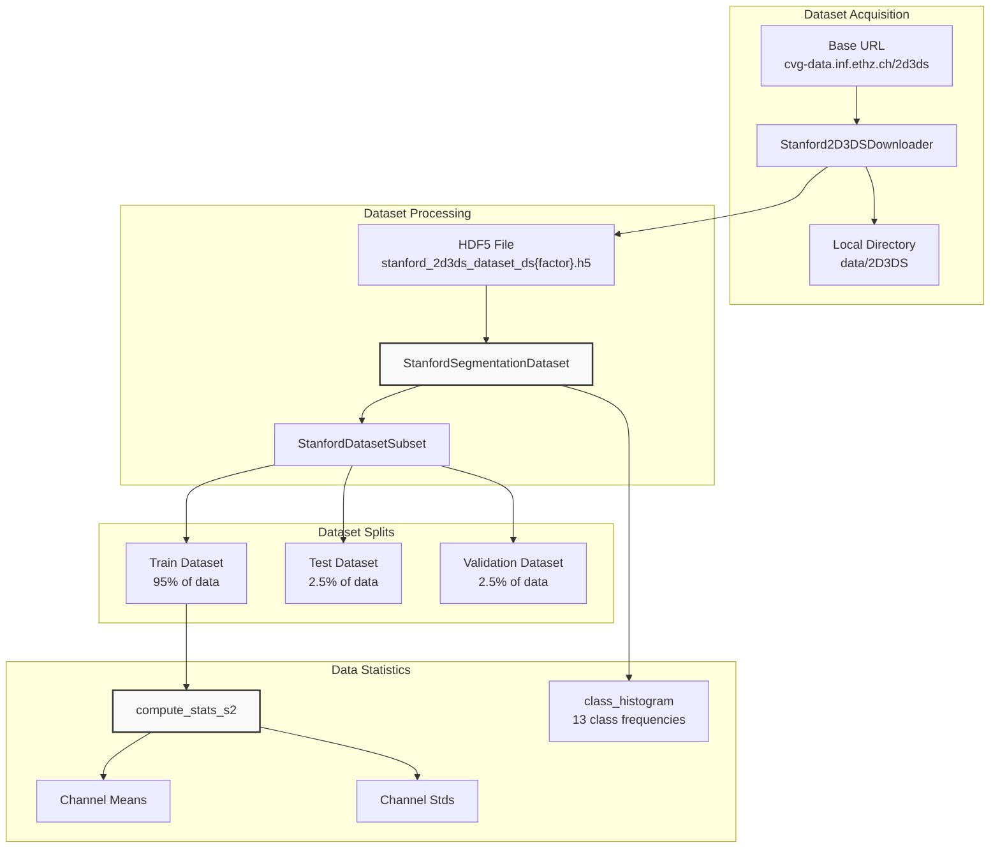

**Dataset Configuration**:

| Parameter | Value | Description |
|-----------|-------|-------------|
| Split Ratios | `[0.95, 0.025, 0.025]` | Train/Test/Validation |
| Input Channels | 3 (RGB) or 4 (RGBA) | Controlled by `ignore_alpha_channel` |
| Output Classes | 13 | Semantic categories |
| Default Downsampling | 16 | Factor for image resolution |
| Image Shape | `(nlat, nlon)` | Equiangular grid |

**Sources**: [examples/segmentation/train.py:362-389](), [examples/segmentation/train.py:428-444]()

### Data Normalization and Augmentation

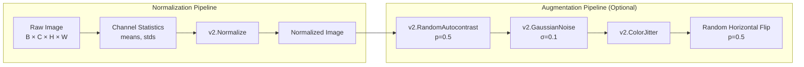

The normalization uses statistics computed over the training set via `compute_stats_s2`. Data augmentation is optional and includes color jitter, noise, and horizontal flipping (which preserves spherical topology).

**Sources**: [examples/segmentation/train.py:386-425](), [examples/segmentation/train.py:206-219]()

---

## Model Architectures

The example supports multiple model architectures through the `get_baseline_models` registry. Models are categorized by their approach to handling spherical data.

### Model Architecture Taxonomy

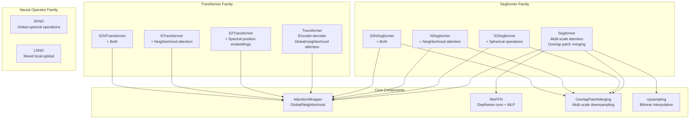

**Sources**: [examples/baseline_models/segformer.py:522-707](), [examples/baseline_models/transformer.py:278-491](), [examples/segmentation/train.py:446-482]()

### Segformer Architecture Details

The `Segformer` class implements a hierarchical encoder-decoder with multi-scale feature fusion:

| Component | Class | Purpose |
|-----------|-------|---------|
| Encoder Blocks | `TransformerBlock` | Multi-scale feature extraction with attention |
| Patch Merging | `OverlapPatchMerging` | Downsampling with overlapping windows |
| Attention | `AttentionWrapper` | Global or neighborhood attention |
| Feed-Forward | `MixFFN` | Depthwise convolution + MLP |
| Decoder | `Upsampling` | Multi-scale feature upsampling |
| Head | `nn.Conv2d(1×1)` | Final segmentation prediction |

**Architecture Flow**:

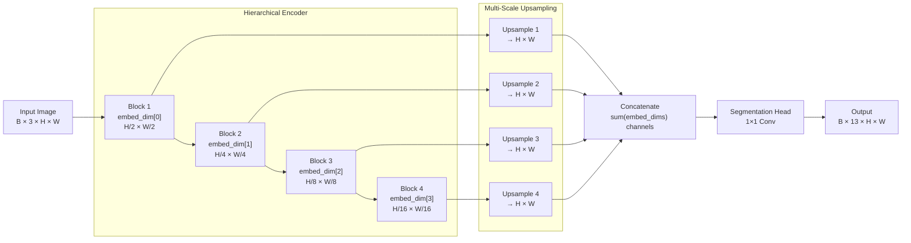

**Default Configuration**:
- `embed_dims=[64, 128, 256, 512]`
- `heads=[1, 2, 4, 8]`
- `depths=[3, 4, 6, 3]` (number of attention blocks per stage)
- `scale_factor=2` (downsampling ratio)

**Sources**: [examples/baseline_models/segformer.py:579-707](), [examples/baseline_models/segformer.py:301-455]()

---

## Loss Functions and Metrics

### Loss Functions

The training script supports three spherical-aware loss functions that account for non-uniform grid spacing on equiangular grids:

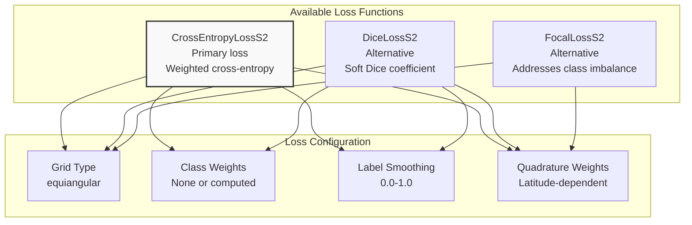

**CrossEntropyLossS2** (default):
```python
loss_fn = CrossEntropyLossS2(
    nlat=img_size[0], 
    nlon=img_size[1], 
    grid="equiangular",
    weight=class_weights,  # Optional per-class weights
    smooth=label_smoothing  # Label smoothing factor
)
```

The loss integrates over the sphere using quadrature weights to properly handle the non-uniform spacing of equiangular grids.

**Sources**: [examples/segmentation/train.py:487-490]()

### Evaluation Metrics

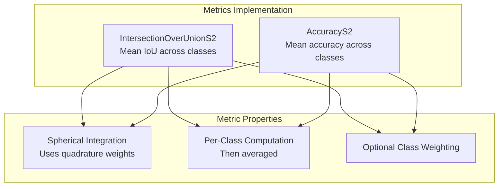

| Metric | Class | Formula | Purpose |
|--------|-------|---------|---------|
| Mean IoU | `IntersectionOverUnionS2` | `mean(intersection / union)` per class | Primary segmentation metric |
| Mean Accuracy | `AccuracyS2` | `mean(correct / total)` per class | Secondary metric |

Both metrics properly integrate over the sphere using latitude-dependent quadrature weights from the equiangular grid.

**Sources**: [examples/segmentation/train.py:492-507]()

---

## Training Configuration

### Training Loop Structure

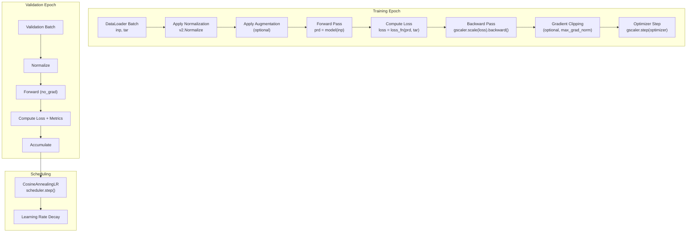

**Sources**: [examples/segmentation/train.py:159-318]()

### Hyperparameters

| Parameter | Default | Description |
|-----------|---------|-------------|
| `num_epochs` | 200 | Total training epochs |
| `batch_size` | 8 | Batch size per GPU |
| `learning_rate` | 5e-4 | Initial learning rate |
| `weight_decay` | 0.1 | AdamW weight decay |
| `max_grad_norm` | 4.0 | Gradient clipping threshold |
| `label_smoothing` | 0.0 | Label smoothing factor |
| `drop_path_rate` | 0.1 | Stochastic depth rate |

**Optimizer Configuration**:
```python
optimizer = torch.optim.AdamW(
    model.parameters(), 
    lr=learning_rate, 
    weight_decay=0.1,
    foreach=torch.cuda.is_available()
)

scheduler = torch.optim.lr_scheduler.CosineAnnealingLR(
    optimizer, 
    T_max=num_epochs, 
    eta_min=1e-6
)
```

**Sources**: [examples/segmentation/train.py:543-544](), [examples/segmentation/train.py:639-644]()

### Distributed Training Support

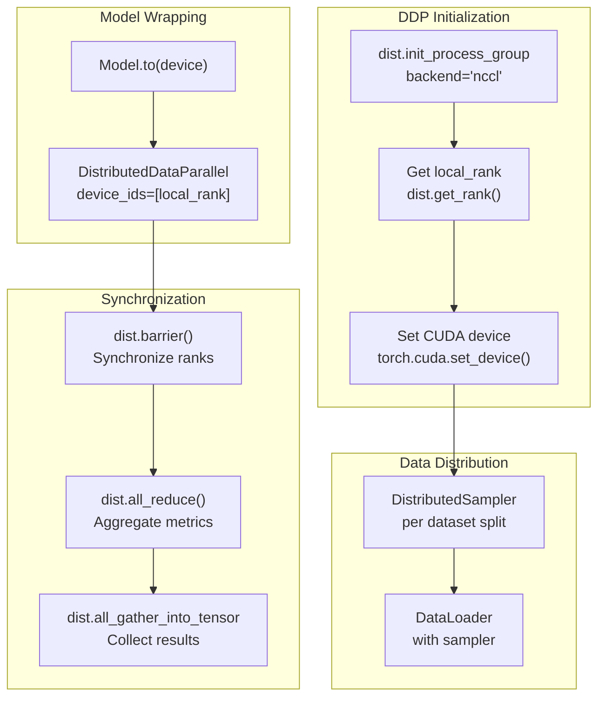

**DDP Usage**:
- Process group initialized with NCCL backend for GPU communication
- Each rank processes a subset of data via `DistributedSampler`
- Losses and metrics are synchronized using `all_reduce`
- Final validation results gathered using `all_gather_into_tensor`

**Sources**: [examples/segmentation/train.py:340-348](), [examples/segmentation/train.py:392-399](), [examples/segmentation/train.py:517-518]()

### Automatic Mixed Precision

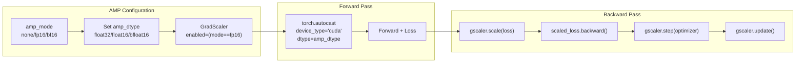

**AMP Support**:
- `fp16`: Mixed precision with GradScaler for loss scaling
- `bf16`: Bfloat16 without loss scaling (hardware dependent)
- `none`: Full precision (float32)

**Sources**: [examples/segmentation/train.py:183-188](), [examples/segmentation/train.py:221-223](), [examples/segmentation/train.py:545]()

---

## Running the Training Script

### Command Line Interface

The training script `examples/segmentation/train.py` provides a comprehensive command-line interface:

```bash
python examples/segmentation/train.py \
    --output_path ./checkpoints \
    --data_path ./data/2D3DS \
    --models s2segformer_sc2_layers4_e128 \
    --num_epochs 200 \
    --batch_size 8 \
    --learning_rate 5e-4 \
    --max_grad_norm 4.0 \
    --label_smoothing_factor 0.0 \
    --data_downsampling_factor 16 \
    --amp_mode bf16 \
    --enable_ddp \
    --enable_data_augmentation
```

### Command Line Arguments

| Argument | Type | Default | Description |
|----------|------|---------|-------------|
| `--output_path` | str | `./checkpoints` | Checkpoint and output directory |
| `--data_path` | str | `../data/2D3DS` | Dataset storage location |
| `--models` | str+ | None (all) | Model names to train |
| `--num_epochs` | int | 200 | Number of training epochs |
| `--batch_size` | int | 8 | Batch size per GPU |
| `--learning_rate` | float | 5e-4 | Initial learning rate |
| `--max_grad_norm` | float | 4.0 | Gradient clipping threshold (0 disables) |
| `--label_smoothing_factor` | float | 0.0 | Label smoothing [0, 1] |
| `--data_downsampling_factor` | int | 16 | Image downsampling factor |
| `--amp_mode` | str | "none" | AMP mode: none/fp16/bf16 |
| `--enable_ddp` | flag | False | Enable distributed training |
| `--enable_data_augmentation` | flag | False | Enable data augmentation |
| `--resume` | flag | False | Resume from checkpoint |

**Sources**: [examples/segmentation/train.py:628-649]()

### Example Training Commands

**Single GPU Training**:
```bash
python examples/segmentation/train.py \
    --models s2nsegformer_sc2_layers4_e128 \
    --num_epochs 200 \
    --batch_size 16 \
    --amp_mode bf16
```

**Multi-GPU Distributed Training**:
```bash
torchrun --nproc_per_node=4 examples/segmentation/train.py \
    --models s2segformer_sc2_layers4_e256 \
    --num_epochs 200 \
    --batch_size 8 \
    --learning_rate 5e-4 \
    --enable_ddp \
    --amp_mode bf16
```

**Training Multiple Models**:
```bash
python examples/segmentation/train.py \
    --models s2segformer_sc2_layers4_e128 \
             s2nsegformer_sc2_layers4_e128 \
             transformer_sc2_layers4_e128 \
    --num_epochs 100
```

**Sources**: [examples/segmentation/train.py:621-668]()

---

## Validation and Evaluation

### Validation Pipeline

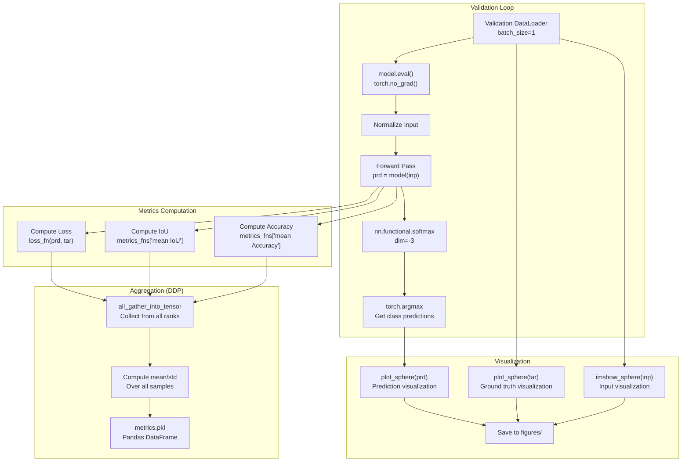

**Sources**: [examples/segmentation/train.py:93-155](), [examples/segmentation/train.py:584-616]()

### Output Structure

After training and validation, the following directory structure is created:

```
{output_path}/
├── {model_name}/
│   ├── checkpoint.pt              # Model weights
│   ├── figures/                   # Validation visualizations
│   │   ├── pred_0.png            # Prediction on sample 0
│   │   ├── truth_0.png           # Ground truth for sample 0
│   │   ├── input_0.png           # Input image for sample 0
│   │   └── ...
│   └── output_data/
│       └── metrics.pkl            # Pandas DataFrame with results
```

**Metrics DataFrame Columns**:
- `num_params`: Number of trainable parameters
- `loss mean`: Mean validation loss
- `loss std`: Standard deviation of validation loss
- `mean IoU mean`: Mean of IoU across samples
- `mean IoU std`: Standard deviation of IoU
- `mean Accuracy mean`: Mean accuracy across samples
- `mean Accuracy std`: Standard deviation of accuracy
- `training_time`: Total training time in seconds

**Sources**: [examples/segmentation/train.py:601-615]()

### Logging and Monitoring

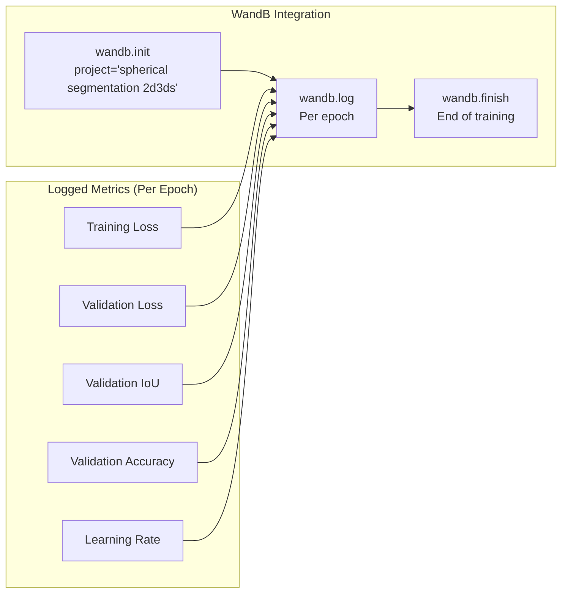

The training script integrates with Weights & Biases for experiment tracking. Each model is logged as a separate run with its configuration and metrics.

**Logged Information**:
- Per-epoch training loss
- Per-epoch validation loss
- Per-epoch validation metrics (IoU, Accuracy)
- Current learning rate
- Model configuration from `model_handle.keywords`

**Sources**: [examples/segmentation/train.py:537-540](), [examples/segmentation/train.py:304-309]()

---

## Class Weighting and Imbalanced Data

The dataset contains imbalanced class distributions, which is tracked via `class_histogram`. The training script supports optional class weighting:

```python
# Class weights can be computed from class_histogram
class_histogram = torch.as_tensor(dataset.class_histogram)
# class_weights = 1.0 / class_histogram  # Inverse frequency
# class_weights = class_weights / class_weights.sum()

# Current best practice: No class weights
class_weights = None
```

When class weights are provided, they are used in:
- `CrossEntropyLossS2(weight=class_weights)`
- `DiceLossS2(weight=class_weights)`
- `IntersectionOverUnionS2(weight=class_weights)`
- `AccuracyS2(weight=class_weights)`

**Note**: Based on experimental results, using no class weights (`None`) currently performs best for this dataset.

**Sources**: [examples/segmentation/train.py:428-439](), [examples/segmentation/train.py:488-506]()

---

