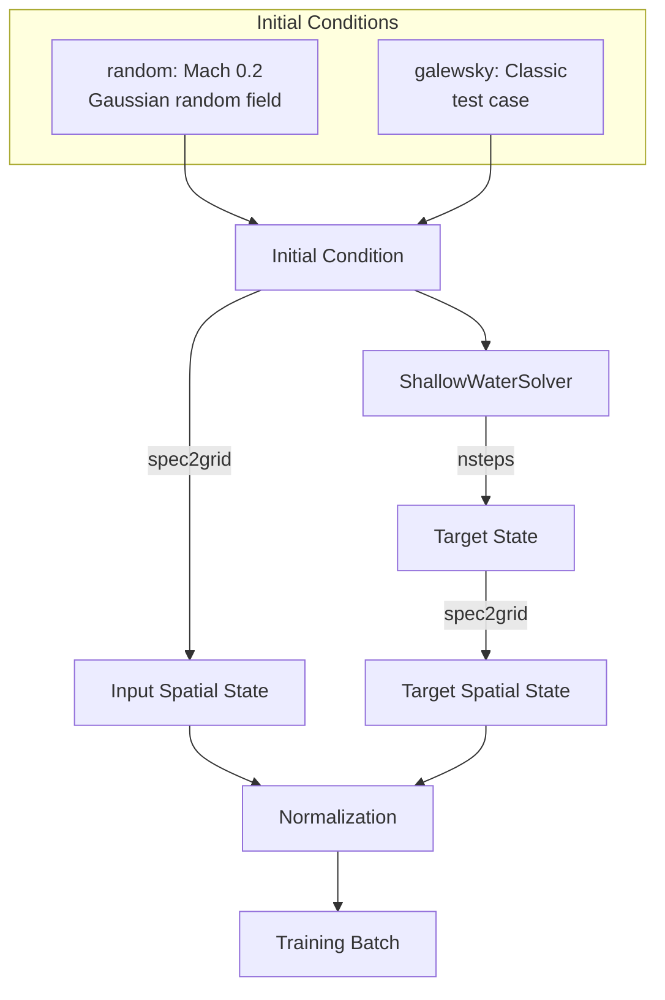
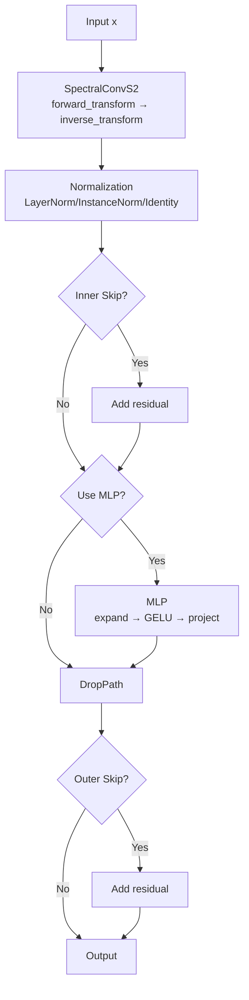
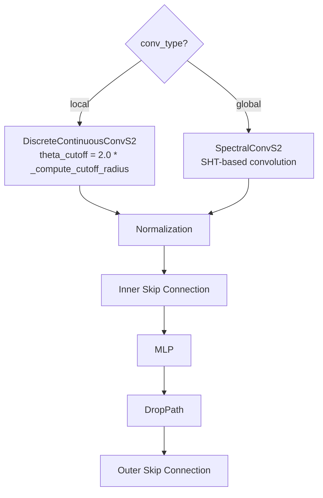

<!-- source: DeepWiki mcp.deepwiki.com · repo NVIDIA/torch-harmonics · page 8.3 PDE Solving with Neural Operators · fetched 2026-10-26 -->

# PDE Solving with Neural Operators

<details>
<summary>Relevant source files</summary>

The following files were used as context for generating this wiki page:

- [torch_harmonics/examples/models/lsno.py](torch_harmonics/examples/models/lsno.py)
- [torch_harmonics/examples/models/sfno.py](torch_harmonics/examples/models/sfno.py)
- [torch_harmonics/examples/pde_dataset.py](torch_harmonics/examples/pde_dataset.py)

</details>


## Purpose and Scope

This page provides a comprehensive guide to using neural operators for solving partial differential equations (PDEs) on the sphere within the torch-harmonics framework. It covers the two primary architectures—Spherical Fourier Neural Operator (SFNO) and Local Spherical Neural Operator (LSNO)—for learning PDE dynamics, specifically focusing on the shallow water equations as a representative example. This tutorial explains dataset generation, model architectures, and training workflows for operator learning tasks.

For general neural operator concepts, see [Neural Operator Architectures](#7). For detailed SFNO architecture documentation, see [Spherical Fourier Neural Operator (SFNO)](#7.1). For LSNO details, see [Local Spherical Neural Operator (LSNO)](#7.2).

## Neural Operators for PDE Solving

Neural operators learn mappings between infinite-dimensional function spaces rather than fixed-dimensional vectors. For PDEs on the sphere, this means learning a map from initial conditions to solution states at future time steps, enabling the model to generalize across different resolutions and initial conditions.

The torch-harmonics library provides two complementary approaches:
- **SFNO**: Uses purely global spectral convolutions via spherical harmonic transforms
- **LSNO**: Combines local DISCO convolutions with global spectral operations

Both architectures learn stable, long-term dynamics by operating in geometrically consistent coordinate systems on the sphere.

**Key Advantages**:
- **Resolution independence**: Train at one resolution, evaluate at another
- **Stability**: Spectral methods provide natural regularization
- **Physical consistency**: Respects spherical geometry and conservation laws

Sources: [torch_harmonics/examples/models/sfno.py:175-240](), [torch_harmonics/examples/models/lsno.py:378-456]()

## Dataset Generation for PDEs

### PdeDataset Class

The `PdeDataset` class generates training data by solving PDEs forward in time using a reference solver, creating input-target pairs for supervised learning.



**Diagram: PDE Dataset Generation Pipeline**

The `PdeDataset` class implements the following workflow:

| Component | Purpose | Key Parameters |
|-----------|---------|----------------|
| `ShallowWaterSolver` | Reference PDE solver | `nlat`, `nlon`, `dt_solver`, `lmax`, `mmax` |
| Initial conditions | Generate starting states | `ictype`: "random" or "galewsky" |
| Time stepping | Solve forward `nsteps` | `nsteps`, `dt` |
| Normalization | Zero mean, unit variance | `normalize=True` |

Sources: [torch_harmonics/examples/pde_dataset.py:39-160]()

### Shallow Water Equations Setup

The shallow water equations model fluid dynamics on a rotating sphere and serve as a simplified atmospheric model:

```python
# From PdeDataset initialization
dt_solver = dt / float(self.nsteps)
lmax = ceil(self.nlat / 3)  # Spectral resolution
mmax = lmax
self.solver = ShallowWaterSolver(
    self.nlat, self.nlon, dt_solver, 
    lmax=lmax, mmax=mmax, grid=grid
).to(self.device).float()
```

**Configuration**:
- **Spectral truncation**: `lmax = nlat / 3` prevents aliasing
- **Time stepping**: `dt` is divided into `nsteps` for accurate reference solutions
- **Grid types**: Supports "equiangular" and "legendre-gauss" grids

Sources: [torch_harmonics/examples/pde_dataset.py:97-103]()

## SFNO Architecture

### Architecture Overview

The `SphericalFourierNeuralOperator` uses purely global spectral convolutions, operating entirely in the spherical harmonic domain for the main computational blocks.

```mermaid
graph LR
    Input["Input<br/>(nlat, nlon)"] --> Encoder["Encoder<br/>Conv2d"]
    Encoder --> PosEmbed["Position Embedding<br/>(optional)"]
    PosEmbed --> SHT1["RealSHT<br/>trans_down"]
    
    SHT1 --> Block1["SFNO Block 1<br/>SpectralConvS2"]
    Block1 --> SHT2["RealSHT<br/>trans"]
    SHT2 --> Block2["SFNO Block 2<br/>SpectralConvS2"]
    Block2 --> SHT3["RealSHT<br/>trans"]
    SHT3 --> BlockN["SFNO Block N<br/>SpectralConvS2"]
    
    BlockN --> ISHT["InverseRealSHT<br/>itrans_up"]
    ISHT --> Decoder["Decoder<br/>Conv2d"]
    Decoder --> Output["Output<br/>(nlat, nlon)"]
    
    Input -.residual_prediction.-> Output
```



**Diagram: SFNO Forward Pass Data Flow**

### SphericalFourierNeuralOperatorBlock

Each SFNO block performs:
1. **Spectral convolution** via `SpectralConvS2`
2. **Normalization** (optional: layer norm or instance norm)
3. **MLP mixing** in spatial domain
4. **Skip connections** (inner and outer)



**Diagram: SFNO Block Internal Structure**

### Key Configuration Parameters

| Parameter | Purpose | Typical Values |
|-----------|---------|----------------|
| `img_size` | Input/output resolution | `(128, 256)`, `(256, 512)` |
| `scale_factor` | Resolution downsampling | `3`, `4` |
| `embed_dim` | Hidden dimension | `128`, `256`, `512` |
| `num_layers` | Number of SFNO blocks | `4`, `8`, `12` |
| `hard_thresholding_fraction` | Spectral mode cutoff | `0.5`, `1.0` |
| `mlp_ratio` | MLP expansion ratio | `2.0`, `4.0` |
| `grid_internal` | Internal grid type | `"legendre-gauss"` |

Sources: [torch_harmonics/examples/models/sfno.py:175-424](), [torch_harmonics/examples/models/sfno.py:43-173]()

### Hard Thresholding

SFNO applies spectral truncation to limit high-frequency modes:

```python
# Compute spectral resolution
modes_lat = self.h
modes_lon = (self.w // 2 + 1) - 1  # FFT convention
modes_lat = modes_lon = int(min(modes_lat, modes_lon) * self.hard_thresholding_fraction)

self.trans = RealSHT(self.h, self.w, lmax=modes_lat, mmax=modes_lon, grid=grid_internal).float()
self.itrans = InverseRealSHT(self.h, self.w, lmax=modes_lat, mmax=modes_lon, grid=grid_internal).float()
```

This provides natural regularization and prevents overfitting to high-frequency noise.

Sources: [torch_harmonics/examples/models/sfno.py:336-346]()

## LSNO Architecture

### Architecture Overview

The `LocalSphericalNeuralOperator` combines local DISCO convolutions with global spectral operations, using different types of blocks at different layers.

```mermaid
graph LR
    Input["Input<br/>(nlat, nlon)"] --> DiscoEnc["DiscreteContinuousEncoder<br/>Downsample + Local Conv"]
    DiscoEnc --> PosEmbed["Position Embedding<br/>(optional)"]
    
    PosEmbed --> LocalBlock1["Local Block 1<br/>DiscreteContinuousConvS2"]
    LocalBlock1 --> LocalBlock2["Local Block 2<br/>DiscreteContinuousConvS2"]
    LocalBlock2 --> GlobalBlock["Global Block<br/>SpectralConvS2"]
    GlobalBlock --> LocalBlock3["Local Block 3<br/>DiscreteContinuousConvS2"]
    
    LocalBlock3 --> DiscoDec["DiscreteContinuousDecoder<br/>Upsample + Local Conv"]
    DiscoDec --> Output["Output<br/>(nlat, nlon)"]
    
    Input -.residual_prediction.-> Output
```



**Diagram: LSNO Forward Pass Data Flow**

### Block Type Selection

LSNO alternates between local and global blocks based on `sfno_block_frequency`:

```python
for i in range(self.num_layers):
    block = SphericalNeuralOperatorBlock(
        self.trans,
        self.itrans,
        self.embed_dim,
        self.embed_dim,
        conv_type="global" if i % sfno_block_frequency == (sfno_block_frequency-1) else "local",
        # ... other parameters
    )
```

**Example**: With `num_layers=8` and `sfno_block_frequency=2`:
- Blocks 0, 2, 4, 6: Local DISCO convolutions
- Blocks 1, 3, 5, 7: Global spectral convolutions

Sources: [torch_harmonics/examples/models/lsno.py:557-577]()

### DiscreteContinuousEncoder

The encoder downsamples spatial resolution using DISCO convolutions while preserving local features:

```python
class DiscreteContinuousEncoder(nn.Module):
    def __init__(
        self,
        in_shape=(721, 1440),      # High-res input
        out_shape=(480, 960),       # Downsampled output
        inp_chans=2,
        out_chans=256,              # Project to embedding dim
        kernel_shape=(3, 3),
        basis_type="morlet",
        # ...
    ):
        self.conv = DiscreteContinuousConvS2(
            inp_chans, out_chans,
            in_shape=in_shape,
            out_shape=out_shape,
            kernel_shape=kernel_shape,
            basis_type=basis_type,
            theta_cutoff=_compute_cutoff_radius(in_shape[0], kernel_shape, basis_type),
        )
```

The `theta_cutoff` parameter controls the local support region:
```python
def _compute_cutoff_radius(nlat, kernel_shape, basis_type):
    theta_cutoff_factor = {
        "piecewise linear": 0.5, 
        "morlet": 0.5, 
        "zernike": math.sqrt(2.0)
    }
    return (kernel_shape[0] + 1) * theta_cutoff_factor[basis_type] * math.pi / float(nlat - 1)
```

Sources: [torch_harmonics/examples/models/lsno.py:52-121](), [torch_harmonics/examples/models/lsno.py:46-50]()

### DiscreteContinuousDecoder

The decoder upsamples back to the original resolution, with two upsampling strategies:

| Strategy | Method | Use Case |
|----------|--------|----------|
| `upsample_sht=True` | SHT → InverseSHT | Spectrally accurate, smoother |
| `upsample_sht=False` | `ResampleS2` | Faster, direct interpolation |

```python
if upsample_sht:
    self.sht = RealSHT(*in_shape, grid=grid_in).float()
    self.isht = InverseRealSHT(*out_shape, lmax=self.sht.lmax, mmax=self.sht.mmax, grid=grid_out).float()
    self.upsample = nn.Sequential(self.sht, self.isht)
else:
    self.upsample = ResampleS2(*in_shape, *out_shape, grid_in=grid_in, grid_out=grid_out)
```

Sources: [torch_harmonics/examples/models/lsno.py:124-205]()

### SphericalNeuralOperatorBlock in LSNO

This block supports both local and global convolutions through the `conv_type` parameter:



**Diagram: LSNO Block Type Selection**

Sources: [torch_harmonics/examples/models/lsno.py:208-376]()

## Architecture Comparison

### SFNO vs LSNO Design Differences

| Aspect | SFNO | LSNO |
|--------|------|------|
| **Primary operation** | Global spectral convolutions | Mixed local + global |
| **Encoder** | Simple Conv2d | DISCO convolution with downsampling |
| **Decoder** | Simple Conv2d | DISCO convolution with upsampling |
| **Block types** | All global | Alternating local/global |
| **Computational cost** | O(N log N) for SHT | O(N) for local, O(N log N) for global |
| **Receptive field** | Global from start | Gradually increasing |
| **Best for** | Smooth, global dynamics | Mixed-scale dynamics, discontinuities |

### Parameter Efficiency Comparison

```mermaid
graph TB
    subgraph "SFNO - Purely Global"
        SFNO_Input[Input] --> SFNO_Enc[Conv2d Encoder]
        SFNO_Enc --> SFNO_B1[Global Block 1]
        SFNO_B1 --> SFNO_B2[Global Block 2]
        SFNO_B2 --> SFNO_B3[Global Block 3]
        SFNO_B3 --> SFNO_B4[Global Block 4]
        SFNO_B4 --> SFNO_Dec[Conv2d Decoder]
        SFNO_Dec --> SFNO_Out[Output]
    end
    
    subgraph "LSNO - Mixed Strategy"
        LSNO_Input[Input] --> LSNO_Enc[DISCO Encoder]
        LSNO_Enc --> LSNO_B1[Local Block 1]
        LSNO_B1 --> LSNO_B2[Global Block 2]
        LSNO_B2 --> LSNO_B3[Local Block 3]
        LSNO_B3 --> LSNO_B4[Global Block 4]
        LSNO_B4 --> LSNO_Dec[DISCO Decoder]
        LSNO_Dec --> LSNO_Out[Output]
    end
```



**Diagram: SFNO and LSNO Block Structure Comparison**

Sources: [torch_harmonics/examples/models/sfno.py:175-240](), [torch_harmonics/examples/models/lsno.py:378-456]()

## Common Configuration Patterns

### Position Embeddings

Both SFNO and LSNO support multiple position embedding strategies:

| Type | Implementation | Use Case |
|------|----------------|----------|
| `"sequence"` | `SequencePositionEmbedding` | Standard learnable embeddings |
| `"spectral"` | `SpectralPositionEmbedding` | Fourier feature encodings |
| `"learnable lat"` | `LearnablePositionEmbedding` | Latitude-aware embeddings |
| `"learnable latlon"` | `LearnablePositionEmbedding` | Full 2D position encoding |
| `"none"` | `nn.Identity()` | No positional information |

```python
if pos_embed == "sequence":
    self.pos_embed = SequencePositionEmbedding((self.h, self.w), num_chans=self.embed_dim, grid=grid_internal)
elif pos_embed == "spectral":
    self.pos_embed = SpectralPositionEmbedding((self.h, self.w), num_chans=self.embed_dim, grid=grid_internal)
# ... other options
```

Sources: [torch_harmonics/examples/models/sfno.py:300-311](), [torch_harmonics/examples/models/lsno.py:520-531]()

### Grid Configuration

Both architectures support different grid types for input/output and internal computation:

- **External grids** (`grid`): "equiangular" for input/output data
- **Internal grids** (`grid_internal`): "legendre-gauss" for better quadrature accuracy

This dual-grid approach allows reading data in one format while computing in another more efficient format.

### Residual Prediction

Enable residual learning to predict only the change from input to output:

```python
if self.residual_prediction:
    residual = x
    # ... forward pass ...
    x = x + residual
```

This helps with stability in long-term rollouts and accelerates training convergence.

Sources: [torch_harmonics/examples/models/sfno.py:408-421](), [torch_harmonics/examples/models/lsno.py:606-623]()

## Implementation Best Practices

### Resolution Scaling Strategy

The `scale_factor` parameter controls internal resolution relative to input:

```python
# Input resolution
img_size = (721, 1440)  # High-resolution input

# Internal resolution (downsampled)
h = (img_size[0] - 1) // scale_factor + 1
w = img_size[1] // scale_factor

# For scale_factor=3:
# h = (721 - 1) // 3 + 1 = 241
# w = 1440 // 3 = 480
```

**Typical configurations**:
- **scale_factor=1**: No downsampling, full resolution processing
- **scale_factor=2-3**: Balanced efficiency and accuracy
- **scale_factor=4+**: Fast but may lose fine details

Sources: [torch_harmonics/examples/models/sfno.py:292-294](), [torch_harmonics/examples/models/lsno.py:512-514]()

### AMP Compatibility

Both encoders and decoders in LSNO explicitly handle mixed precision:

```python
def forward(self, x):
    dtype = x.dtype
    
    with amp.autocast(device_type="cuda", enabled=False):
        x = x.float()  # Force FP32 for numerical stability
        x = self.conv(x)
        x = x.to(dtype=dtype)  # Convert back to original dtype
    
    return x
```

This ensures numerical stability in convolution operations while maintaining AMP benefits elsewhere.

Sources: [torch_harmonics/examples/models/lsno.py:112-121](), [torch_harmonics/examples/models/lsno.py:195-205]()

### Filter Basis Selection for LSNO

Different filter basis types provide different trade-offs:

| Basis Type | Characteristics | Best For |
|------------|-----------------|----------|
| `"morlet"` | Wavelet-like, localized | Multi-scale features |
| `"zernike"` | Polynomial, orthogonal | Smooth fields |
| `"piecewise linear"` | Simple, fast | Computational efficiency |

The basis type affects `theta_cutoff` computation, controlling the local support region size.

Sources: [torch_harmonics/examples/models/lsno.py:46-50]()

## Training Workflow Integration

### Typical Usage Example

```python
# Dataset setup
train_dataset = PdeDataset(
    dt=3600,              # 1 hour time step
    nsteps=4,             # 4 solver steps for reference
    dims=(128, 256),      # Resolution
    grid="equiangular",
    pde="shallow water equations",
    initial_condition="random",
    num_examples=1024,
    device=device,
    normalize=True
)

# Model instantiation - SFNO
model_sfno = SphericalFourierNeuralOperator(
    img_size=(128, 256),
    scale_factor=2,
    in_chans=2,           # Vorticity and divergence
    out_chans=2,
    embed_dim=256,
    num_layers=8,
    hard_thresholding_fraction=0.75,
    grid="equiangular",
    grid_internal="legendre-gauss"
)

# Model instantiation - LSNO
model_lsno = LocalSphericalNeuralOperator(
    img_size=(128, 256),
    scale_factor=2,
    in_chans=2,
    out_chans=2,
    embed_dim=256,
    num_layers=8,
    sfno_block_frequency=2,  # Alternate local/global
    filter_basis_type="morlet",
    kernel_shape=(3, 3)
)
```

### Loss Functions for PDE Tasks

Use L2/L1 norms or Sobolev norms that respect spherical geometry:

- **Standard losses**: MSE, MAE in spatial domain
- **Spectral losses**: MSE in spherical harmonic coefficients
- **Sobolev norms**: Weight different spectral modes (see [8.1](#8.1) for `W11LossS2`)

### Multi-Step Rollout

For autoregressive prediction:

```python
# Single-step prediction during training
output = model(input)
loss = criterion(output, target)

# Multi-step rollout during evaluation
state = initial_condition
predictions = []
for t in range(num_steps):
    state = model(state)
    predictions.append(state)
```

Sources: [torch_harmonics/examples/pde_dataset.py:122-159]()

## Performance Considerations

### Computational Complexity

| Operation | SFNO | LSNO (Local Block) | LSNO (Global Block) |
|-----------|------|-------------------|-------------------|
| Forward transform | O(N log N) | — | O(N log N) |
| Convolution | O(M) modes | O(N × K) | O(M) modes |
| Inverse transform | O(N log N) | — | O(N log N) |
| **Total per block** | **O(N log N)** | **O(N)** | **O(N log N)** |

Where:
- N = spatial grid points (nlat × nlon)
- M = spectral modes (lmax × mmax)
- K = kernel size

### Memory Optimization

LSNO's encoder/decoder downsampling reduces memory:

```python
# Full resolution: 721 × 1440 = 1,038,240 points
# Downsampled (scale_factor=3): 241 × 480 = 115,680 points
# Memory reduction: ~9x for intermediate features
```

SFNO processes at full resolution but can use smaller `embed_dim` for similar memory.

### Choosing Between SFNO and LSNO

**Use SFNO when**:
- Dynamics are primarily global and smooth
- Maximum spectral accuracy is required
- Training data is abundant

**Use LSNO when**:
- Dynamics have both local and global features
- Computational budget is limited
- Sharp discontinuities or shocks are present
- You need better parameter efficiency

Sources: [torch_harmonics/examples/models/lsno.py:447-456](), [torch_harmonics/examples/models/sfno.py:236-240]()

---

