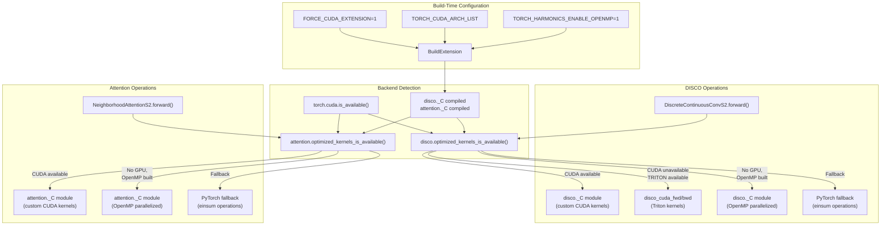
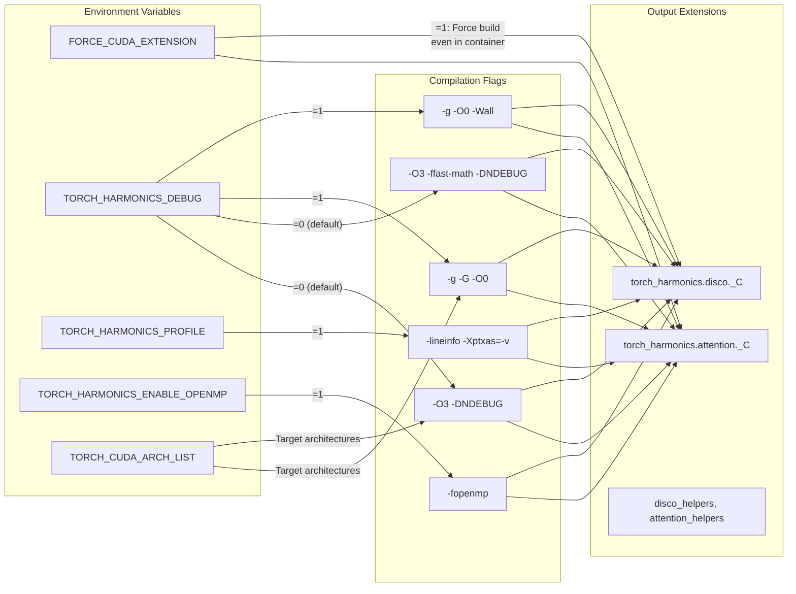
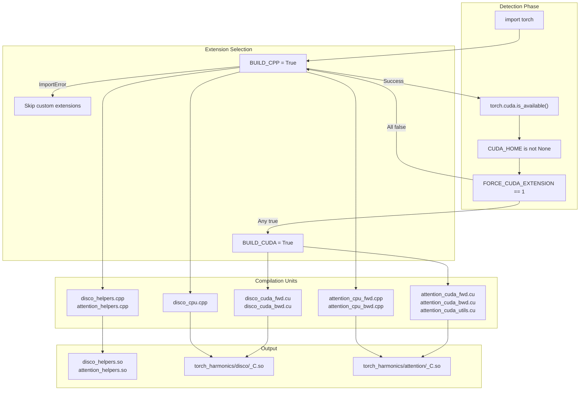
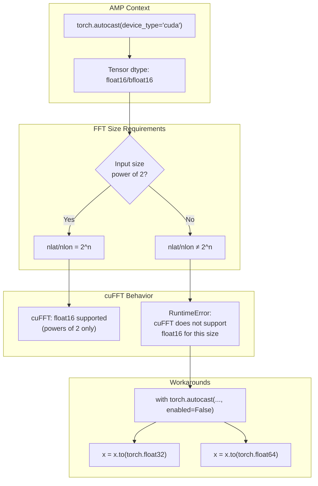
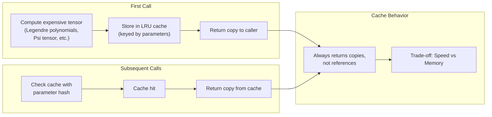

<!-- source: DeepWiki mcp.deepwiki.com · repo NVIDIA/torch-harmonics · page 9 Advanced Topics · fetched 2026-10-26 -->

# Advanced Topics

<details>
<summary>Relevant source files</summary>

The following files were used as context for generating this wiki page:

- [Changelog.md](Changelog.md)
- [README.md](README.md)
- [notebooks/partial_derivatives.ipynb](notebooks/partial_derivatives.ipynb)
- [setup.py](setup.py)
- [torch_harmonics/__init__.py](torch_harmonics/__init__.py)

</details>


## Purpose and Scope

This document covers advanced usage patterns, performance optimization techniques, and backend configuration for torch-harmonics. It provides guidance for users who need to maximize performance, understand build-time configuration, or troubleshoot specialized deployment scenarios.

**What this covers:**
- Multi-backend optimization strategies (CUDA, Triton, OpenMP)
- Automatic mixed precision (AMP) considerations specific to spherical operations
- Custom CUDA extension compilation and debugging
- Caching mechanisms for precomputed tensors
- Environment variables and build-time configuration

**Related pages:**
- For basic usage of core transforms and convolutions, see [Core Concepts](#1.2)
- For distributed computing strategies, see [Distributed Computing](#6)
- For building from source and development workflows, see [Building from Source](#10.1)

The material here assumes familiarity with PyTorch optimization techniques and focuses on aspects unique to spherical signal processing.

---

## Backend Architecture and Selection

torch-harmonics provides multiple computational backends for critical operations, with automatic fallback mechanisms to ensure portability across different hardware configurations.

### Backend Hierarchy



**Sources:** [setup.py:39-183](), [torch_harmonics/__init__.py:32-40](), [Changelog.md:9-10]()

### Backend Selection Logic

The library automatically selects the optimal backend at runtime based on:

1. **Hardware availability**: GPU presence detected via `torch.cuda.is_available()`
2. **Build configuration**: Whether custom extensions were compiled during installation
3. **Operation type**: Different operations may have different backend availability

Query functions are provided to check backend availability:

| Function | Purpose | Return Value |
|----------|---------|--------------|
| `torch_harmonics.disco.optimized_kernels_is_available()` | Check if DISCO CUDA/Triton kernels are available | `bool` |
| `torch_harmonics.attention.optimized_kernels_is_available()` | Check if attention CUDA kernels are available | `bool` |

**Sources:** [Changelog.md:10]()

---

## Build System and Environment Variables

### Build-Time Environment Variables

torch-harmonics uses several environment variables to control compilation behavior:



**Sources:** [setup.py:39-83](), [README.md:82-88]()

### Environment Variable Reference

| Variable | Default | Effect | Recommended Use |
|----------|---------|--------|-----------------|
| `FORCE_CUDA_EXTENSION` | `0` | Forces compilation of CUDA extensions even when CUDA devices are not detected | Container builds, CI/CD |
| `TORCH_HARMONICS_DEBUG` | `0` | Compiles with debugging symbols and no optimization | Development, debugging segfaults |
| `TORCH_HARMONICS_PROFILE` | `0` | Adds profiling flags (`-lineinfo`, `-Xptxas=-v`) | Performance analysis with NSight |
| `TORCH_HARMONICS_ENABLE_OPENMP` | `0` | Enables OpenMP parallelization in CPU backends | Multi-core CPU deployments |
| `TORCH_CUDA_ARCH_LIST` | Auto-detect | Specifies target GPU architectures (e.g., `"8.0 8.6 9.0"`) | Reduces compilation time, ensures compatibility |

**Sources:** [setup.py:56-83](), [README.md:84-86]()

### Compilation Process



**Sources:** [setup.py:38-183]()

The build process consists of:

1. **Detection**: Checks for PyTorch installation and CUDA availability
2. **Helper modules**: Always compiled to provide capability detection functions
3. **Core extensions**: Compiled with CPU-only or CPU+CUDA code depending on environment
4. **Conditional compilation**: CUDA code only included if `BUILD_CUDA` is true

The key insight is that `disco._C` and `attention._C` modules are **single extensions** containing both CPU and CUDA code paths, selected at runtime based on device availability.

**Sources:** [setup.py:93-183]()

---

## Automatic Mixed Precision Limitations

### cuFFT Precision Constraints

torch-harmonics uses `torch.fft.rfft` for longitude transforms, which internally uses cuFFT. This introduces specific constraints when using automatic mixed precision (AMP):



**Sources:** [README.md:226-251]()

### Recommended AMP Pattern

The recommended pattern for using SHT operations with AMP is to disable autocast specifically for the transform:

**Example usage pattern:**
```python
# From README.md example
sht = th.RealSHT(512, 1024, grid="equiangular").cuda()

with torch.autocast(device_type="cuda", enabled=True):
    # AMP enabled for other operations
    x = some_math(x)
    
    # Explicitly convert to float32
    x = x.to(torch.float32)
    
    # Disable autocast for SHT to prevent internal conversion
    with torch.autocast(device_type="cuda", enabled=False):
        xt = sht(x)
    
    # Continue with AMP-enabled operations
    xt = some_more_math(xt)
```

**Sources:** [README.md:229-248]()

### Precision Trade-offs

| Grid Size | AMP Support | Recommendation |
|-----------|-------------|----------------|
| `nlat=256, nlon=512` (both powers of 2) | Full | Use AMP directly |
| `nlat=512, nlon=1024` (both powers of 2) | Full | Use AMP directly |
| `nlat=360, nlon=720` (not powers of 2) | Limited | Disable AMP for SHT, upcast to `float32` |
| High-resolution grids with instability | Limited | Consider `float64` for numerical stability |

For problems requiring high numerical stability (e.g., high-degree transforms, ill-conditioned systems), upcasting to `float64` instead of `float32` may be beneficial, despite the performance cost.

**Sources:** [README.md:250-251]()

---

## Custom Extension Architecture

### Extension Modules Structure

```mermaid
graph TB
    subgraph "Python Interface Layer"
        DISCO_PY["torch_harmonics/disco/disco_convolution.py"]
        ATT_PY["torch_harmonics/attention/attention.py"]
    end
    
    subgraph "C++ Interface Layer"
        DISCO_IFACE["disco/csrc/disco_interface.cpp<br/>PYBIND11_MODULE"]
        ATT_IFACE["attention/csrc/attention_interface.cpp<br/>PYBIND11_MODULE"]
    end
    
    subgraph "Implementation Layer"
        DISCO_CPU["disco/csrc/disco_cpu.cpp<br/>OpenMP parallel loops"]
        DISCO_CUDA_FWD["disco/csrc/disco_cuda_fwd.cu<br/>CUDA kernels"]
        DISCO_CUDA_BWD["disco/csrc/disco_cuda_bwd.cu<br/>CUDA kernels"]
        
        ATT_CPU_FWD["attention/csrc/attention_cpu_fwd.cpp"]
        ATT_CPU_BWD["attention/csrc/attention_cpu_bwd.cpp"]
        ATT_CUDA_FWD["attention/csrc/attention_cuda_fwd.cu"]
        ATT_CUDA_BWD["attention/csrc/attention_cuda_bwd.cu"]
        ATT_CUDA_UTIL["attention/csrc/attention_cuda_utils.cu"]
    end
    
    subgraph "Helper Modules"
        DISCO_HELPER["disco_helpers module<br/>BUILD_CPP, BUILD_CUDA flags"]
        ATT_HELPER["attention_helpers module<br/>BUILD_CPP, BUILD_CUDA flags"]
    end
    
    DISCO_PY --> DISCO_HELPER
    DISCO_PY -->|"if optimized"| DISCO_IFACE
    ATT_PY --> ATT_HELPER
    ATT_PY -->|"if optimized"| ATT_IFACE
    
    DISCO_IFACE -->|"CPU path"| DISCO_CPU
    DISCO_IFACE -->|"CUDA path"| DISCO_CUDA_FWD
    DISCO_IFACE -->|"CUDA path"| DISCO_CUDA_BWD
    
    ATT_IFACE -->|"CPU path"| ATT_CPU_FWD
    ATT_IFACE -->|"CPU path"| ATT_CPU_BWD
    ATT_IFACE -->|"CUDA path"| ATT_CUDA_FWD
    ATT_IFACE -->|"CUDA path"| ATT_CUDA_BWD
    ATT_IFACE -->|"CUDA path"| ATT_CUDA_UTIL
```



**Sources:** [setup.py:120-181]()

### Helper Modules and Capability Detection

Helper modules are minimal Python extensions compiled with preprocessor flags indicating build configuration:

```cpp
// From disco_helpers.cpp and attention_helpers.cpp
#define BUILD_CPP 0/1  // Set via setup.py
#define BUILD_CUDA 0/1 // Set via setup.py
```

These flags are queried at runtime by `optimized_kernels_is_available()` functions to determine which backend to use.

**Sources:** [setup.py:85-118]()

### CUDA Architecture Targeting

The `TORCH_CUDA_ARCH_LIST` environment variable controls which GPU architectures are targeted:

```bash
# Example: Target specific architectures to reduce compile time
export TORCH_CUDA_ARCH_LIST="8.0 8.6 9.0"
```

Supported architectures (as of version 0.8.1):
- `7.0` - V100 (Volta)
- `7.5` - T4, RTX 20 series (Turing)
- `8.0` - A100 (Ampere)
- `8.6` - RTX 30 series, A10/A40 (Ampere)
- `9.0` - H100 (Hopper)
- `10.0+PTX` - Future architectures via PTX

**Note:** Custom CUDA extensions currently only support architectures >= 7.0.

**Sources:** [README.md:82-88](), [README.md:88]()

### Compilation Flags for Debugging and Profiling

| Scenario | Environment Variables | Compiler Flags | Use Case |
|----------|----------------------|----------------|----------|
| Release (default) | None | `-O3 -ffast-math -DNDEBUG` (C++)<br/>`-O3 -DNDEBUG` (CUDA) | Production deployments |
| Debug | `TORCH_HARMONICS_DEBUG=1` | `-g -O0 -Wall` (C++)<br/>`-g -G -O0` (CUDA) | Debugging segfaults, inspecting variables |
| Profiling | `TORCH_HARMONICS_PROFILE=1` | Release flags + `-lineinfo -Xptxas=-v` | NSight profiling, kernel analysis |
| OpenMP | `TORCH_HARMONICS_ENABLE_OPENMP=1` | Release flags + `-fopenmp` | Multi-threaded CPU execution |

**Sources:** [setup.py:56-83]()

---

## Caching System

### LRU Cache for Precomputed Tensors

torch-harmonics version 0.7.6 introduced an LRU cache for precomputed tensors to accelerate model initialization. The cache stores expensive-to-compute tensors such as:

- Legendre polynomial weights for SHT
- DISCO convolution weight tensors (Psi matrices)
- Filter basis functions
- Quadrature weights



**Sources:** [Changelog.md:30-34]()

### Cache Usage Recommendations

The cache returns **copies** of tensors, not references. Users are encouraged to manually reuse tensors in their models when possible to save both memory and time:

```python
# Instead of:
class Model(nn.Module):
    def __init__(self):
        self.conv1 = DiscreteContinuousConvS2(...)  # Computes Psi tensor
        self.conv2 = DiscreteContinuousConvS2(...)  # Re-computes same Psi tensor
        
# Consider:
class Model(nn.Module):
    def __init__(self):
        self.conv1 = DiscreteContinuousConvS2(...)
        # Manually share Psi tensor if parameters match
        self.conv2 = DiscreteContinuousConvS2(...)
        if same_parameters:
            self.conv2.psi = self.conv1.psi  # Direct reuse
```

The cache primarily benefits:
1. **Rapid prototyping**: Faster iteration when creating/destroying models
2. **Multi-model workflows**: When multiple models with similar configurations are instantiated
3. **Testing**: Speeds up parameterized tests that create many module instances

**Sources:** [Changelog.md:30-34]()

### Cache Invalidation

The cache uses parameter hashing (grid type, resolution, filter parameters, etc.) as keys. Cache invalidation is automatic - tensors are evicted when the LRU policy is triggered or when parameter combinations change.

**Sources:** [Changelog.md:30-34]()

---

## Performance Considerations

### Backend Performance Characteristics

| Backend | Best For | Limitations | Typical Speedup |
|---------|----------|-------------|-----------------|
| CUDA Custom Kernels | High-throughput GPU workloads, batch processing | Requires CUDA-capable GPU (compute >= 7.0) | 5-20x vs PyTorch |
| Triton | DISCO convolutions on modern GPUs | Requires Triton installation, GPU only | 3-10x vs PyTorch |
| OpenMP | Multi-core CPU deployments | CPU only, requires OpenMP support | 2-8x vs single-threaded |
| PyTorch Fallback | Portability, debugging | Slower for large-scale operations | 1x (baseline) |

**Sources:** [Changelog.md:1-27]()

### Memory vs Speed Trade-offs

1. **Fused operations**: DISCO convolutions fuse quadrature into Psi tensor multiplication to reduce memory footprint (version 0.7.0)
2. **Cache usage**: Cache speeds up initialization but increases memory usage
3. **Precision**: `float16` saves memory but requires power-of-2 grid sizes; `float64` increases memory but improves numerical stability

**Sources:** [Changelog.md:76]()

### Distributed vs Local Implementations

When to use distributed implementations (see [Distributed Computing](#6)):

- **Grid sizes > 1024**: Communication overhead becomes negligible
- **Multi-GPU training**: Data parallelism requires spatial distribution
- **Memory constraints**: Distributing across devices reduces per-device memory

When to use local implementations:
- **Grid sizes < 512**: Communication overhead dominates
- **Single-GPU inference**: No benefit from distribution
- **Debugging**: Simpler execution model

**Sources:** Architecture diagrams, [Changelog.md:89-94]()

---

## Summary

Advanced usage of torch-harmonics involves understanding:

1. **Backend selection**: Automatic fallback from CUDA → Triton → OpenMP → PyTorch based on availability
2. **Build configuration**: Environment variables control optimization level, target architectures, and enabled features
3. **AMP constraints**: cuFFT limitations require special handling for non-power-of-2 grid sizes
4. **Custom extensions**: PyBind11 interfaces to optimized C++/CUDA implementations
5. **Caching**: LRU cache accelerates initialization at the cost of memory

For detailed information on specific topics:
- Optimization backend selection and query functions: [Optimization Backends](#9.1)
- AMP usage patterns and precision recommendations: [Automatic Mixed Precision (AMP)](#9.2)
- CUDA extension compilation, debugging, and profiling: [Custom CUDA Extensions](#9.3)
- Cache configuration and manual tensor reuse: [Caching and Performance](#9.4)

**Sources:** [README.md](), [setup.py](), [Changelog.md](), [torch_harmonics/__init__.py]()

---

