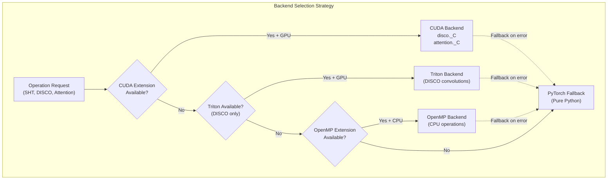
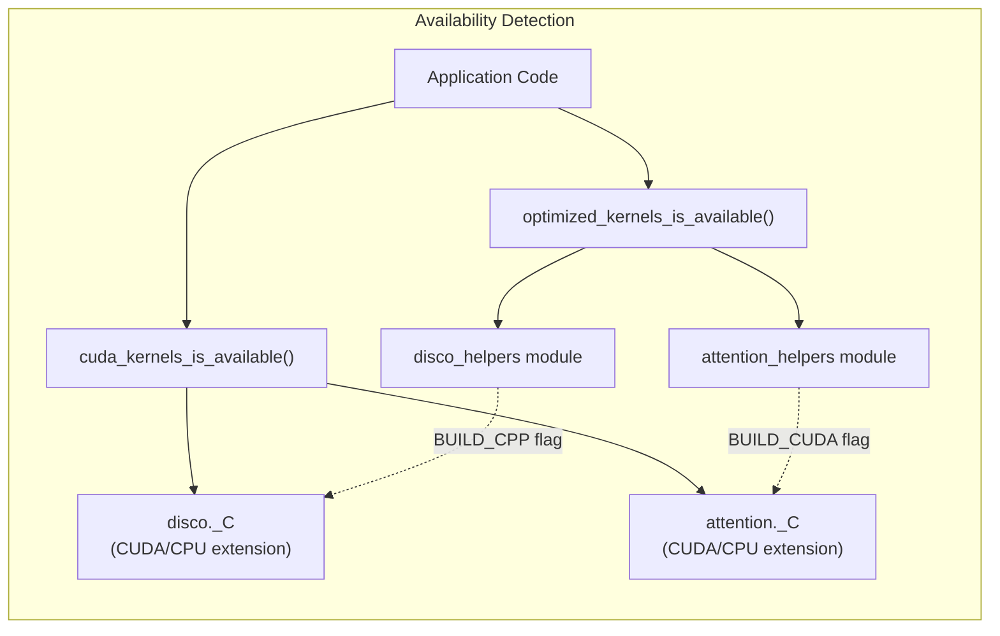
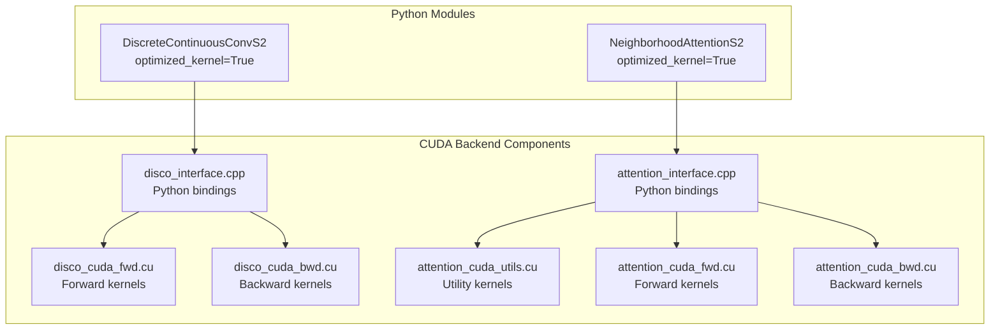
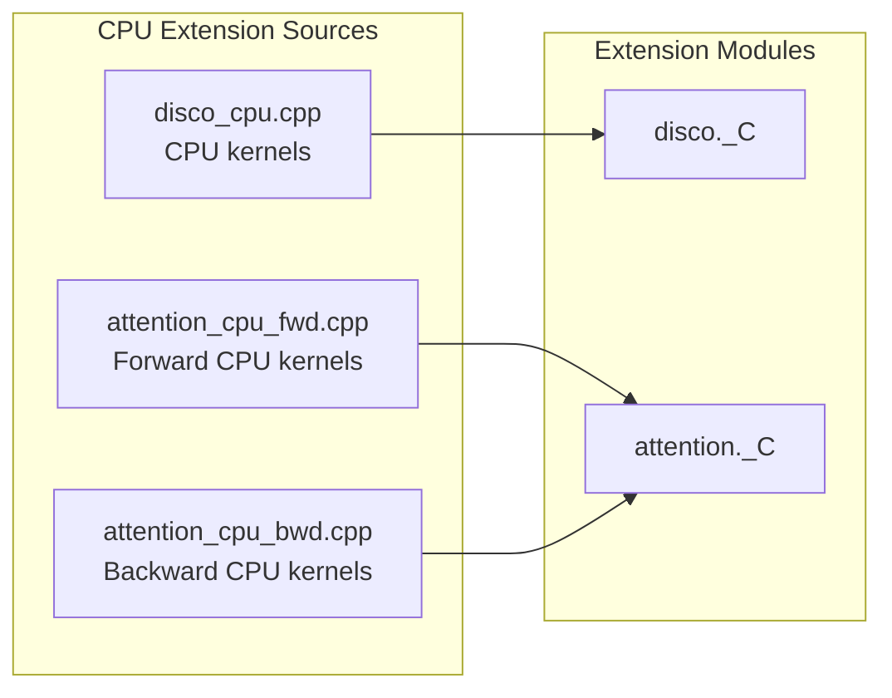
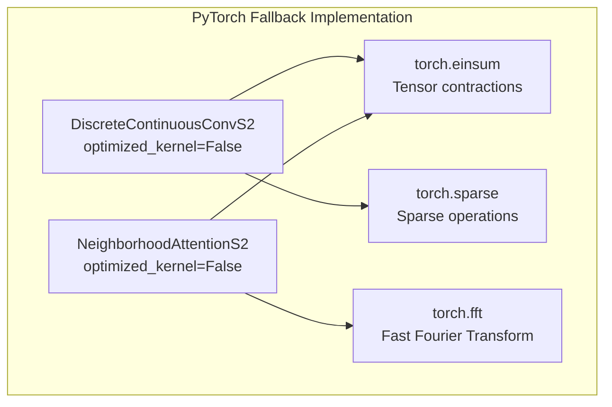
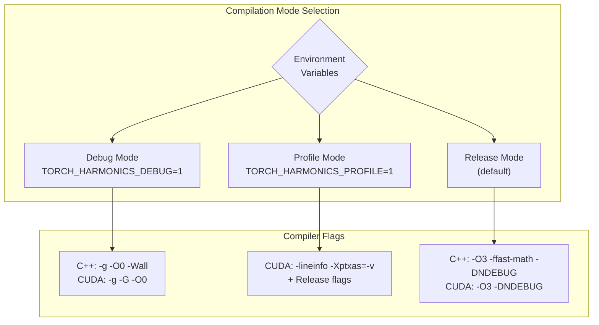
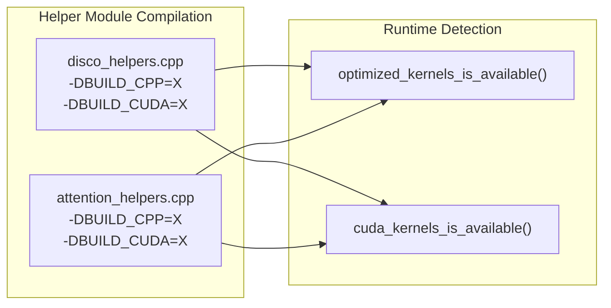
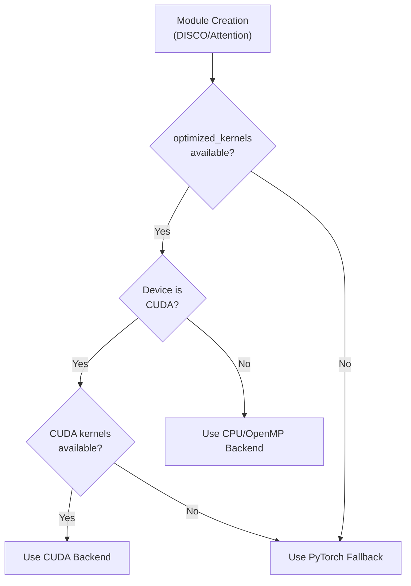

<!-- source: DeepWiki mcp.deepwiki.com · repo NVIDIA/torch-harmonics · page 9.1 Optimization Backends · fetched 2026-10-26 -->

# Optimization Backends

<details>
<summary>Relevant source files</summary>

The following files were used as context for generating this wiki page:

- [README.md](README.md)
- [notebooks/partial_derivatives.ipynb](notebooks/partial_derivatives.ipynb)
- [setup.py](setup.py)
- [tests/test_convolution.py](tests/test_convolution.py)

</details>


## Purpose and Scope

This document describes the performance optimization backends available in torch-harmonics for accelerating spherical harmonic transforms, DISCO convolutions, and spherical attention operations. It covers the different computational backends, how they are detected and enabled, build configuration options, and their performance characteristics.

For information about using automatic mixed precision (AMP) with these operations, see [Automatic Mixed Precision (AMP)](#9.2). For details about the custom CUDA kernel implementations, see [Custom CUDA Extensions](#9.3).

---

## Overview of Available Backends

torch-harmonics provides multiple computational backends that are selected based on hardware availability and build configuration. The library implements a fallback strategy where optimized backends are preferred but pure PyTorch implementations are always available.



**Backend Priority (highest to lowest):**

| Backend | Target Device | Operations | Typical Speedup |
|---------|---------------|------------|-----------------|
| Custom CUDA | GPU | DISCO, Attention | 10-50x vs PyTorch |
| Triton | GPU | DISCO | 5-20x vs PyTorch |
| OpenMP | CPU | DISCO, Attention | 2-8x vs PyTorch |
| PyTorch | CPU/GPU | All | Baseline |

**Sources:** [README.md:78-88](), [setup.py:39-52](), [tests/test_convolution.py:43-46]()

---

## Backend Detection and Availability

The library provides helper functions to detect which optimization backends are available at runtime:



The helper modules (`disco_helpers` and `attention_helpers`) are always compiled and contain build-time flags indicating which backends were successfully built.

**Sources:** [setup.py:100-118](), [tests/test_convolution.py:43-46]()

---

## CUDA Backend

The CUDA backend provides the highest performance for GPU operations through custom C++/CUDA kernel implementations.

### Architecture and Modules



### CUDA Architecture Requirements

The custom CUDA extensions **only support CUDA architectures >= 7.0** (Volta and newer GPUs). This is specified at build time via the `TORCH_CUDA_ARCH_LIST` environment variable.

**Supported Architectures:**
- Volta: 7.0, 7.2, 7.5
- Turing: 7.5
- Ampere: 8.0, 8.6, 8.7
- Ada Lovelace: 8.9
- Hopper: 9.0
- Future: 10.0+PTX

**Sources:** [README.md:82-88](), [setup.py:128-140, 159-172]()

### Build Configuration

CUDA extensions are built when the following conditions are met:

1. PyTorch with CUDA support is installed
2. CUDA toolkit is available (`CUDA_HOME` is set)
3. OR `FORCE_CUDA_EXTENSION=1` environment variable is set

**Example build command:**
```bash
export FORCE_CUDA_EXTENSION=1
export TORCH_CUDA_ARCH_LIST="7.0 8.0 8.6 9.0"
pip install --no-build-isolation torch-harmonics
```

**Sources:** [README.md:82-87](), [setup.py:39-52]()

---

## OpenMP Backend

The OpenMP backend provides CPU parallelization for DISCO convolutions and attention operations, offering significant speedups on multi-core CPUs.

### Enabling OpenMP

OpenMP support is **opt-in** via the `TORCH_HARMONICS_ENABLE_OPENMP` environment variable:

```bash
export TORCH_HARMONICS_ENABLE_OPENMP=1
pip install --no-build-isolation torch-harmonics
```

When enabled, the `-fopenmp` compiler flag is added to C++ compilation.

### CPU Extensions

Even without OpenMP, optimized CPU kernels are always built as part of the DISCO and attention extensions:



**Performance Note:** OpenMP can provide 2-8x speedup on multi-core CPUs compared to single-threaded execution, depending on the number of cores and problem size.

**Sources:** [setup.py:61-65](), [setup.py:124-126, 154-157]()

---

## Triton Backend

The Triton backend provides GPU acceleration for DISCO convolutions using the Triton JIT compiler. This backend is primarily used as an alternative when custom CUDA kernels are not available or for rapid prototyping.

**Current Status:** The Triton backend is mentioned in the high-level architecture but specific implementation details are not visible in the provided source files. It serves as a middle-ground option between custom CUDA and pure PyTorch.

**Sources:** Diagram 1 (high-level architecture)

---

## PyTorch Fallback

All operations have a pure PyTorch implementation that serves as a fallback when optimized backends are not available. This implementation uses standard PyTorch operations like `torch.einsum`, `torch.sparse`, and tensor contractions.

### Fallback Usage



The fallback implementation is automatically selected when:
- No optimized kernels are available
- The `optimized_kernel=False` parameter is explicitly set
- An error occurs in optimized kernel execution (safety fallback)

**Sources:** [tests/test_convolution.py:236-240, 393-407]()

---

## Build System Configuration

### Environment Variables

The build system supports several environment variables to control optimization backend compilation:

| Variable | Values | Purpose |
|----------|--------|---------|
| `FORCE_CUDA_EXTENSION` | 0, 1 | Force CUDA extension build even in containers |
| `TORCH_CUDA_ARCH_LIST` | Space-separated archs | Specify target GPU architectures |
| `TORCH_HARMONICS_DEBUG` | 0, 1 | Enable debug symbols and disable optimizations |
| `TORCH_HARMONICS_PROFILE` | 0, 1 | Enable profiling information in kernels |
| `TORCH_HARMONICS_ENABLE_OPENMP` | 0, 1 | Enable OpenMP parallelization |

**Sources:** [setup.py:39, 59-61](), [README.md:84-85]()

### Compilation Flags



**Debug Mode:** Full debugging symbols, no optimization, all warnings enabled. Useful for development and debugging kernel issues.

**Profile Mode:** Includes line information and verbose PTX output while maintaining optimizations. Useful for performance analysis with profilers like `nvprof` or `nsys`.

**Release Mode (Default):** Maximum optimization with fast math and no debug symbols. Used for production deployments.

**Sources:** [setup.py:56-83]()

### Helper Modules

Two helper modules are always compiled to provide build-time configuration information:



These modules contain compile-time constants indicating which backends were successfully built, allowing runtime detection of available optimizations.

**Sources:** [setup.py:85-118]()

---

## Performance Characteristics

### Performance Benchmarks

The test suite includes performance validation to detect regressions:

| Device | Forward (ms) | Backward (ms) | Grid Size | Batch Size |
|--------|--------------|---------------|-----------|------------|
| CPU (16 threads) | ≤100 | ≤90 | 91×180 | 8 |
| GPU (V100 16GB) | ≤2 | ≤3 | 91×180 | 8 |

These thresholds are normalized to specific hardware configurations and serve as regression detection benchmarks, not absolute performance guarantees.

**Sources:** [tests/test_convolution.py:53-59, 609-689]()

### Enabling Performance Tests

Performance tests are disabled by default to avoid CI overhead. Enable them with:

```bash
export TORCH_HARMONICS_RUN_PERF_TESTS=1
pytest tests/test_convolution.py::TestDiscreteContinuousConvolution::test_perf
```

**Sources:** [tests/test_convolution.py:59]()

---

## Selecting Backends at Runtime

### Explicit Backend Selection

Most operations accept an `optimized_kernel` parameter to control backend selection:

```python
# Use optimized kernels if available
conv = DiscreteContinuousConvS2(
    in_channels, out_channels, 
    in_shape, out_shape, kernel_shape,
    optimized_kernel=True  # Default when available
)

# Force PyTorch fallback
conv = DiscreteContinuousConvS2(
    in_channels, out_channels,
    in_shape, out_shape, kernel_shape,
    optimized_kernel=False  # Pure PyTorch
)
```

### Automatic Backend Selection

When `optimized_kernel` is not specified, the library automatically selects the best available backend:



**Sources:** [tests/test_convolution.py:236-264, 377-423]()

---

## Installation Best Practices

### GPU Installation with CUDA Extensions

For optimal GPU performance, install with CUDA extensions enabled:

```bash
# Set environment variables
export FORCE_CUDA_EXTENSION=1
export TORCH_CUDA_ARCH_LIST="8.0 8.6 9.0"  # Match your GPU architecture

# Install without build isolation to use existing PyTorch
pip install --no-build-isolation torch-harmonics
```

**Important:** The `--no-build-isolation` flag ensures custom kernels are built with the existing PyTorch installation, which is critical for CUDA compatibility.

**Sources:** [README.md:78-87]()

### CPU-Only Installation

For CPU-only environments with OpenMP:

```bash
export TORCH_HARMONICS_ENABLE_OPENMP=1
pip install --no-build-isolation torch-harmonics
```

### Container Installation

When building inside containers where CUDA devices may not be visible:

```bash
export FORCE_CUDA_EXTENSION=1
export TORCH_CUDA_ARCH_LIST="7.0 8.0 8.6 9.0"
pip install --no-build-isolation torch-harmonics
```

**Sources:** [README.md:82-86]()

---

## Troubleshooting

### Common Build Issues

**Problem:** CUDA extensions fail to build
- **Solution:** Check that `CUDA_HOME` is set and PyTorch has CUDA support
- **Workaround:** Set `FORCE_CUDA_EXTENSION=1` if building in a container

**Problem:** Optimized kernels not available at runtime
- **Solution:** Verify build completed successfully, check `optimized_kernels_is_available()` and `cuda_kernels_is_available()`
- **Workaround:** Use `optimized_kernel=False` to force PyTorch fallback

**Problem:** Architecture mismatch errors
- **Solution:** Set `TORCH_CUDA_ARCH_LIST` to match your target GPU architecture (must be >= 7.0)

**Problem:** Performance is slower than expected
- **Solution:** Verify optimized kernels are being used, enable `TORCH_HARMONICS_RUN_PERF_TESTS=1` to run benchmarks
- **Check:** Ensure you're not accidentally using `optimized_kernel=False`

**Sources:** [README.md:88](), [tests/test_convolution.py:377-378]()

---

