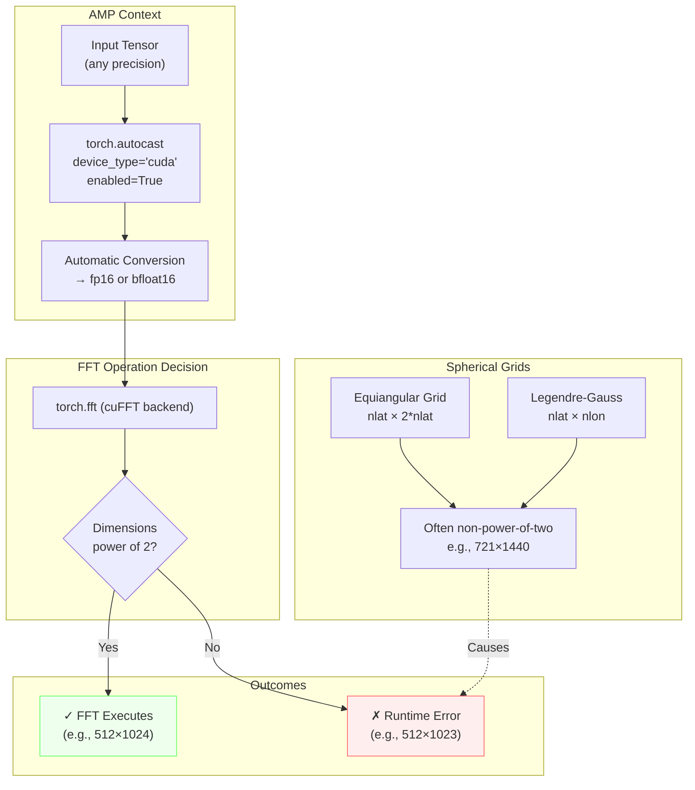
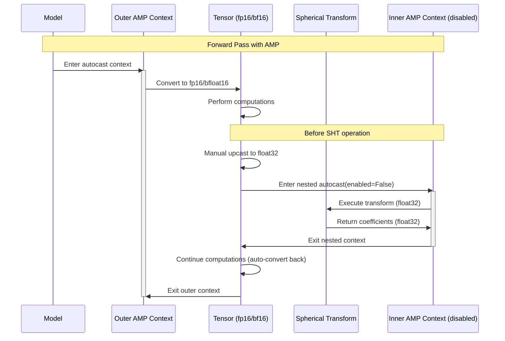
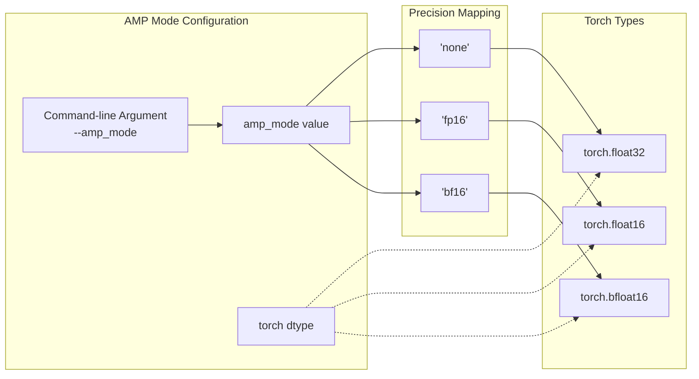
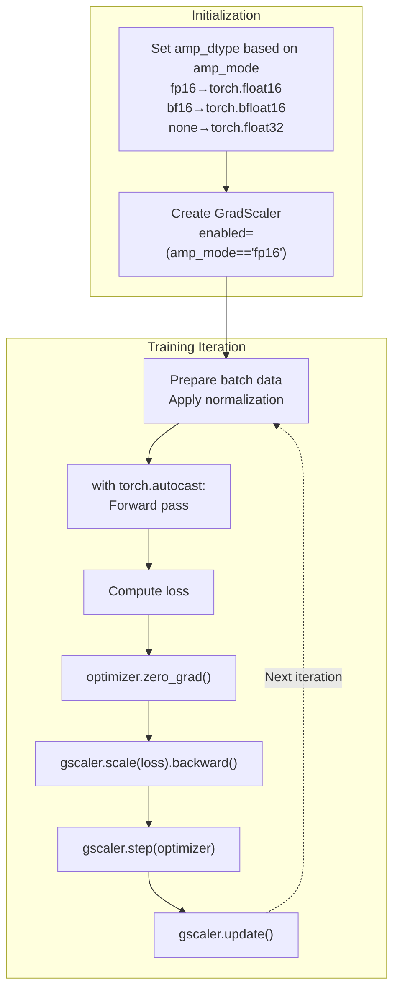
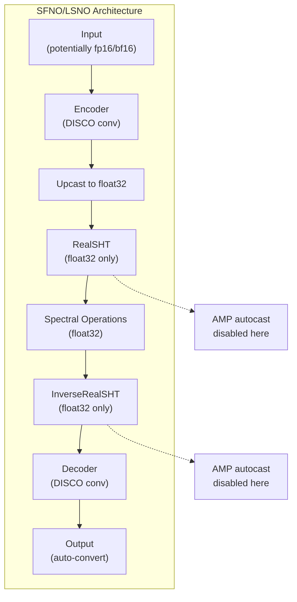
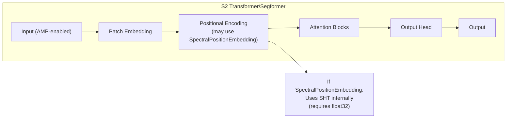
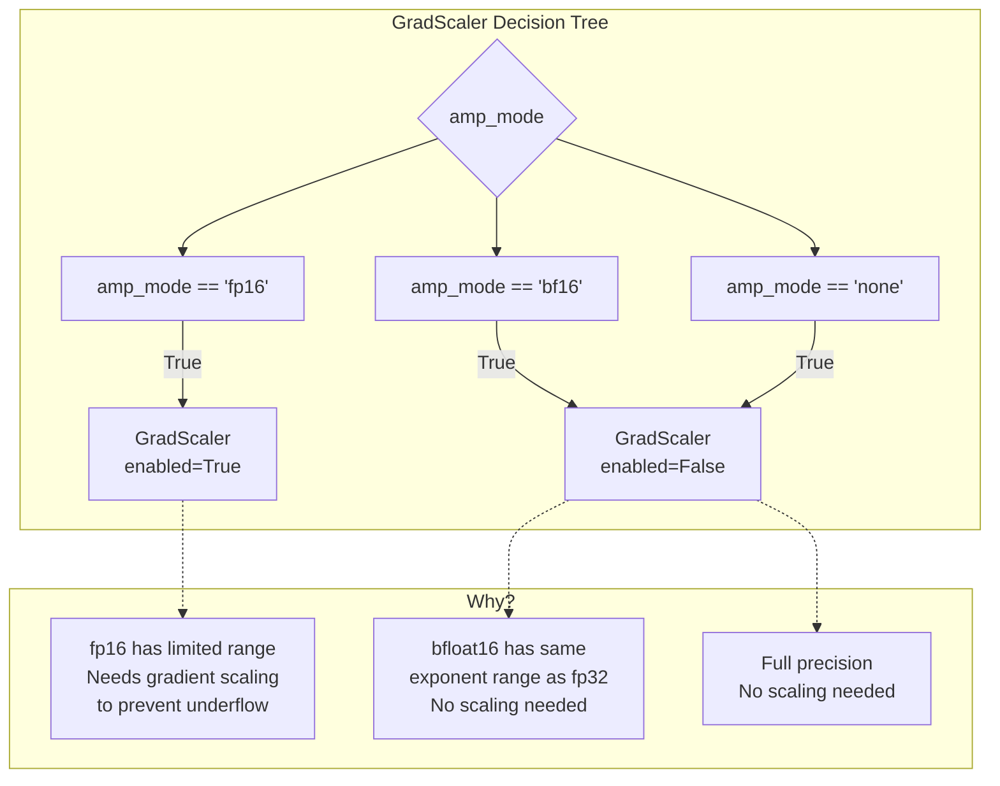
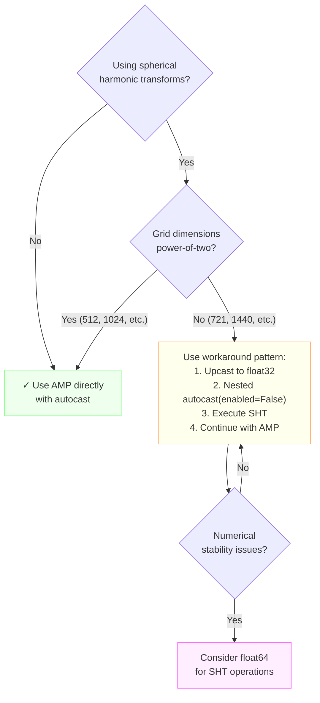

<!-- source: DeepWiki mcp.deepwiki.com · repo NVIDIA/torch-harmonics · page 9.2 Automatic Mixed Precision (AMP) · fetched 2026-10-26 -->

# Automatic Mixed Precision (AMP)

<details>
<summary>Relevant source files</summary>

The following files were used as context for generating this wiki page:

- [README.md](README.md)
- [examples/baseline_models/segformer.py](examples/baseline_models/segformer.py)
- [examples/baseline_models/transformer.py](examples/baseline_models/transformer.py)
- [examples/depth/train.py](examples/depth/train.py)
- [examples/segmentation/train.py](examples/segmentation/train.py)
- [notebooks/partial_derivatives.ipynb](notebooks/partial_derivatives.ipynb)
- [setup.py](setup.py)

</details>


This page describes best practices for using Automatic Mixed Precision (AMP) with torch-harmonics operations, explains cuFFT limitations that affect spherical harmonic transforms, and provides workarounds for common precision-related issues.

For information about optimization backends and CUDA extensions, see [Optimization Backends](#9.1). For custom CUDA kernel details, see [Custom CUDA Extensions](#9.3).

---

## Overview and Limitations

torch-harmonics leverages PyTorch's `torch.fft` module for Fourier transforms, which in turn uses NVIDIA's optimized cuFFT library on CUDA devices. This introduces specific constraints when using Automatic Mixed Precision training:

**cuFFT Precision Support:**
- `float32` and `float64`: Full support for all input dimensions
- `float16` and `bfloat16`: **Restricted to power-of-two dimensions only**

Since spherical grids (equiangular, Legendre-Gauss, Lobatto) typically have non-power-of-two dimensions (e.g., 512×1024, 721×1440), direct use of `torch.autocast` with spherical harmonic transforms will fail when AMP attempts to convert tensors to reduced precision formats.

**Sources:** [README.md:225-251]()

---

## The cuFFT Dimension Restriction Problem



**Dimension Compatibility Matrix:**

| Grid Type | Typical Dimensions | Power-of-Two? | AMP Compatible? |
|-----------|-------------------|---------------|-----------------|
| Equiangular (nlat=512) | 512 × 1024 | Yes | ✓ Yes |
| Equiangular (nlat=256) | 256 × 512 | Yes | ✓ Yes |
| Legendre-Gauss (custom) | 721 × 1440 | No | ✗ Requires workaround |
| Legendre-Gauss (custom) | 480 × 960 | No | ✗ Requires workaround |

**Sources:** [README.md:225-251]()

---

## Recommended Workaround Pattern

The standard approach is to selectively disable autocast for spherical harmonic transform operations while keeping it enabled for other computations:



### Implementation Example

```python
import torch
import torch_harmonics as th

# Initialize SHT with non-power-of-two dimensions
sht = th.RealSHT(512, 1024, grid="equiangular").cuda()

with torch.autocast(device_type="cuda", enabled=True):
    # AMP-enabled operations (converted to fp16/bfloat16)
    x = some_preprocessing(x)
    x = model_layer_1(x)
    
    # Manually upcast before SHT
    x = x.to(torch.float32)
    
    # Disable autocast for SHT operation
    with torch.autocast(device_type="cuda", enabled=False):
        xt = sht(x)
    
    # Continue with AMP-enabled operations
    xt = model_layer_2(xt)  # Auto-converts back to reduced precision
```

**Sources:** [README.md:229-248]()

---

## AMP Configuration in Training Scripts

### Precision Type Selection

Training scripts in torch-harmonics use a configurable `amp_mode` parameter to control precision:



### Training Loop Integration

The following pattern is used across example applications:



**Implementation in depth estimation:**

```python
# Set AMP type
amp_dtype = torch.float32
if amp_mode == "fp16":
    amp_dtype = torch.float16
elif amp_mode == "bf16":
    amp_dtype = torch.bfloat16

# Create gradient scaler (only for fp16)
gscaler = torch.GradScaler("cuda", enabled=(amp_mode == "fp16"))

# Training loop
for inp, tar in train_dataloader:
    inp = inp.to(device)
    tar = tar.to(device)
    
    if normalization_in is not None:
        inp = normalization_in(inp)
    
    with torch.autocast(device_type="cuda", dtype=amp_dtype, enabled=(amp_mode != "none")):
        prd = model(inp)
        loss = loss_fn(prd, tar.unsqueeze(-3), mask)
    
    optimizer.zero_grad(set_to_none=True)
    gscaler.scale(loss).backward()
    gscaler.step(optimizer)
    gscaler.update()
```

**Sources:** [examples/depth/train.py:184-238](), [examples/segmentation/train.py:183-236]()

---

## Model-Level AMP Handling

### Spherical Neural Operators (SFNO/LSNO)

Neural operator architectures that use spherical harmonic transforms internally must handle AMP carefully:



These models typically handle precision internally, so external AMP contexts should work transparently.

**Sources:** Diagram based on [7.1](#7.1), [7.2](#7.2)

### Attention-Based Models (Transformer/Segformer)

Attention mechanisms generally work well with reduced precision, but may still interact with SHT operations in hybrid architectures:



**Sources:** [examples/baseline_models/transformer.py:407-418](), [examples/baseline_models/segformer.py:1-708]()

---

## GradScaler Configuration

PyTorch's `GradScaler` is essential for stable fp16 training but not needed for bfloat16:



**Implementation:**

```python
# Depth estimation example
gscaler = torch.GradScaler("cuda", enabled=(amp_mode == "fp16"))

# Segmentation example  
gscaler = torch.GradScaler("cuda", enabled=(amp_mode == "fp16"))
```

**Sources:** [examples/depth/train.py:509](), [examples/segmentation/train.py:545]()

---

## Numerical Stability Considerations

### When to Use Higher Precision

Different operations have varying numerical requirements:

| Operation | Recommended Precision | Reason |
|-----------|----------------------|---------|
| Convolutions | fp16/bf16 | Well-conditioned, benefits from speed |
| Attention | fp16/bf16 | Softmax stable with modern implementations |
| SHT Forward | **float32 minimum** | Numerical integration via quadrature |
| SHT Inverse | **float32 minimum** | Polynomial evaluation, accumulation errors |
| Spectral Filtering | float32 | Coefficient manipulation, precision loss |
| Loss Computation | fp16/bf16 (output) | Usually stable, but check gradient magnitudes |

### Float64 Upcasting

For problems requiring high numerical accuracy (e.g., PDE solving, scientific computing):

```python
# Inside AMP context, explicitly upcast to float64 for SHT
x = x.to(torch.float64)
with torch.autocast(device_type="cuda", enabled=False):
    xt = sht(x)  # Executes in float64
# Result stays in float64 until next autocast conversion
```

**Trade-offs:**
- **float32**: 2× faster than float64, sufficient for most ML tasks
- **float64**: Required for high-accuracy scientific computing, gradient checking

**Sources:** [README.md:250-251]()

---

## Command-Line Interface

Example training scripts expose AMP configuration through command-line arguments:

```bash
# No AMP (full precision)
python train.py --amp_mode none

# Float16 AMP (fastest, requires power-of-2 or workarounds)
python train.py --amp_mode fp16

# BFloat16 AMP (good balance, requires Ampere+ GPUs)
python train.py --amp_mode bf16
```

**Argument definitions:**

```python
parser.add_argument(
    "--amp_mode", 
    default="none", 
    type=str, 
    choices=["none", "bf16", "fp16"], 
    help="Switch to enable AMP."
)
```

**Sources:** [examples/depth/train.py:615](), [examples/segmentation/train.py:1-708]()

---

## Complete Example: Depth Estimation Training

This shows the full AMP integration pattern from the depth estimation example:

```mermaid
sequenceDiagram
    participant CLI as Command Line
    participant Main as main()
    participant Train as train_model()
    participant Loop as Training Loop
    participant Model as Neural Network
    participant Loss as Loss Function
    
    CLI->>Main: --amp_mode fp16
    Main->>Main: amp_dtype = torch.float16
    Main->>Main: gscaler = GradScaler(enabled=True)
    
    Main->>Train: Pass amp_mode, gscaler
    
    loop Each Epoch
        Train->>Loop: Iterate batches
        
        Loop->>Loop: Normalize input
        
        activate Loop
        Loop->>Loop: with autocast(dtype=amp_dtype)
        Loop->>Model: Forward pass (fp16)
        Model->>Loss: Compute loss (fp16)
        Loss->>Loop: Return loss scalar
        deactivate Loop
        
        Loop->>Loop: optimizer.zero_grad()
        Loop->>Loop: gscaler.scale(loss).backward()
        Loop->>Loop: gscaler.step(optimizer)
        Loop->>Loop: gscaler.update()
    end
```

**Key Code Sections:**

1. **AMP Setup** [examples/depth/train.py:184-198]()
2. **GradScaler Creation** [examples/depth/train.py:509]()
3. **Forward Pass with Autocast** [examples/depth/train.py:227-229]()
4. **Scaled Backward Pass** [examples/depth/train.py:232-238]()
5. **Validation with Autocast** [examples/depth/train.py:276-278]()

**Sources:** [examples/depth/train.py:169-328]()

---

## Summary and Best Practices

### Quick Reference



### Best Practices Summary

1. **Always use the workaround pattern** for non-power-of-two grids with AMP
2. **Prefer bfloat16** over fp16 when available (Ampere+ GPUs) - no GradScaler needed
3. **Explicitly upcast to float32** before SHT operations when using AMP
4. **Use nested autocast contexts** rather than global disable/enable
5. **Monitor numerical stability** - upcast to float64 if needed
6. **Test gradient magnitudes** when enabling AMP for the first time
7. **Use GradScaler only for fp16**, not for bfloat16 or float32

**Sources:** [README.md:225-251](), [examples/depth/train.py:184-328](), [examples/segmentation/train.py:183-236]()

---

