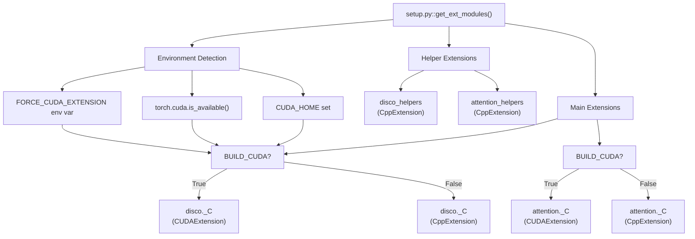
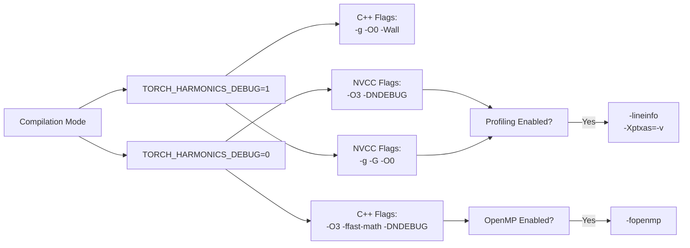
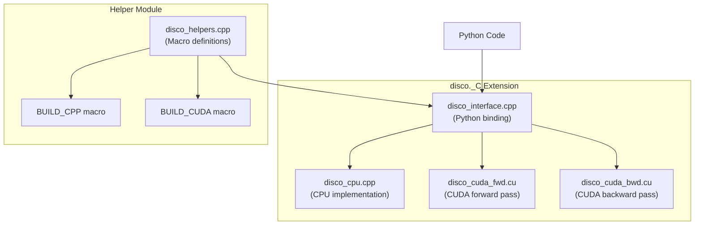
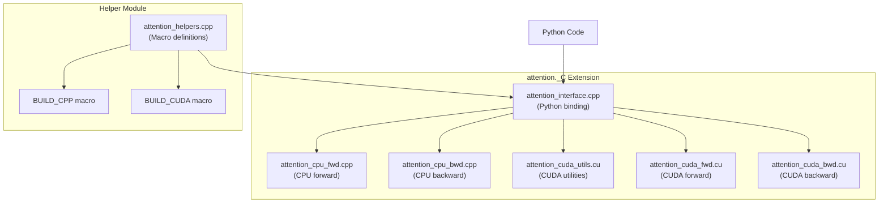
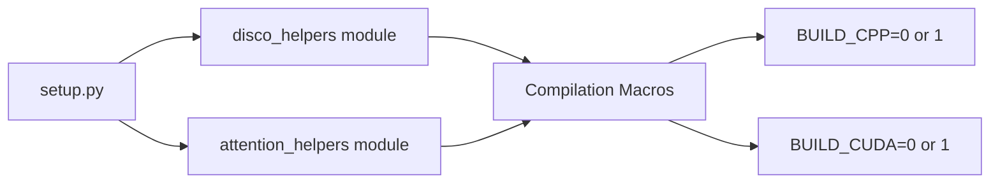

<!-- source: DeepWiki mcp.deepwiki.com · repo NVIDIA/torch-harmonics · page 9.3 Custom CUDA Extensions · fetched 2026-10-26 -->

# Custom CUDA Extensions

<details>
<summary>Relevant source files</summary>

The following files were used as context for generating this wiki page:

- [Dockerfile.examples](Dockerfile.examples)
- [README.md](README.md)
- [notebooks/partial_derivatives.ipynb](notebooks/partial_derivatives.ipynb)
- [setup.py](setup.py)
- [torch_harmonics/plotting.py](torch_harmonics/plotting.py)

</details>


## Purpose and Scope

This page provides detailed documentation of the custom CUDA kernels used to accelerate critical operations in torch-harmonics. The library includes hand-optimized CUDA implementations for DISCO convolutions and spherical attention mechanisms. These extensions are optional but provide significant performance improvements over PyTorch-only implementations.

For information about the overall optimization backends strategy, see [9.1](#9.1). For build system details, see [10.1](#10.1).

## Overview

torch-harmonics implements two primary CUDA extension modules that accelerate computationally intensive operations on the sphere:

| Extension | Purpose | Source Files |
|-----------|---------|--------------|
| `disco._C` | DISCO convolution forward/backward passes | `disco_cuda_fwd.cu`, `disco_cuda_bwd.cu` |
| `attention._C` | Spherical attention forward/backward passes | `attention_cuda_fwd.cu`, `attention_cuda_bwd.cu`, `attention_cuda_utils.cu` |

Both extensions include CPU fallback implementations and are conditionally compiled based on CUDA availability.

**Sources:** [setup.py:120-181](), [README.md:78-88]()

## Build System Architecture

The build system uses PyTorch's `CppExtension` and `CUDAExtension` classes to compile custom C++/CUDA code. The process is controlled by detection logic and environment variables.



**Build Process Determination:**

The build system sets `BUILD_CUDA = True` if:
- `FORCE_CUDA_EXTENSION=1` environment variable is set, OR
- `torch.cuda.is_available()` returns `True` AND `CUDA_HOME` is defined

**Sources:** [setup.py:38-55](), [setup.py:93-183]()

## Compilation Flags and Environment Variables

### Environment Variables

| Variable | Purpose | Default | Example |
|----------|---------|---------|---------|
| `FORCE_CUDA_EXTENSION` | Force CUDA compilation even if CUDA not detected | `0` | `export FORCE_CUDA_EXTENSION=1` |
| `TORCH_HARMONICS_DEBUG` | Enable debug symbols and disable optimizations | `0` | `export TORCH_HARMONICS_DEBUG=1` |
| `TORCH_HARMONICS_PROFILE` | Enable profiling information | `0` | `export TORCH_HARMONICS_PROFILE=1` |
| `TORCH_HARMONICS_ENABLE_OPENMP` | Enable OpenMP parallelization | `0` | `export TORCH_HARMONICS_ENABLE_OPENMP=1` |
| `TORCH_CUDA_ARCH_LIST` | Target CUDA compute capabilities | Auto-detected | `export TORCH_CUDA_ARCH_LIST="7.0 8.0 8.6"` |

**Sources:** [setup.py:56-83](), [README.md:82-87]()

### Compiler Flags

The build system applies different compiler flags based on debug/release mode:



**Sources:** [setup.py:56-83]()

## Extension Structure

Each CUDA extension follows a consistent structure with interface files, CPU fallbacks, and CUDA kernels.

### DISCO Extension Structure



**Source Files:**
- Interface: [torch_harmonics/disco/csrc/disco_interface.cpp]()
- CPU: [torch_harmonics/disco/csrc/disco_cpu.cpp]()
- CUDA Forward: [torch_harmonics/disco/csrc/disco_cuda_fwd.cu]()
- CUDA Backward: [torch_harmonics/disco/csrc/disco_cuda_bwd.cu]()
- Helpers: [torch_harmonics/disco/csrc/disco_helpers.cpp]()

**Sources:** [setup.py:121-149]()

### Attention Extension Structure



**Source Files:**
- Interface: [torch_harmonics/attention/csrc/attention_interface.cpp]()
- CPU Forward: [torch_harmonics/attention/csrc/attention_cpu_fwd.cpp]()
- CPU Backward: [torch_harmonics/attention/csrc/attention_cpu_bwd.cpp]()
- CUDA Utils: [torch_harmonics/attention/csrc/attention_cuda_utils.cu]()
- CUDA Forward: [torch_harmonics/attention/csrc/attention_cuda_fwd.cu]()
- CUDA Backward: [torch_harmonics/attention/csrc/attention_cuda_bwd.cu]()
- Helpers: [torch_harmonics/attention/csrc/attention_helpers.cpp]()

**Sources:** [setup.py:151-181]()

## Helper Modules

Helper modules define preprocessor macros that indicate which backends are available at runtime. These are compiled separately and provide capability detection.



The helper modules receive compile-time flags indicating backend availability:

```python
extra_compile_args={
    'cxx': [
        '-DBUILD_CPP=1' if BUILD_CPP else '-DBUILD_CPP=0',
        '-DBUILD_CUDA=1' if BUILD_CUDA else '-DBUILD_CUDA=0'
    ]
}
```

**Sources:** [setup.py:85-118]()

## CUDA Architecture Support

Custom CUDA extensions require compute capability 7.0 or higher. This restriction is due to the use of modern CUDA features not available on older architectures.

### Supported Architectures

| Compute Capability | Architecture | Support |
|--------------------|--------------|---------|
| < 7.0 | Pascal and earlier | ❌ Not supported |
| 7.0, 7.2, 7.5 | Volta | ✅ Supported |
| 8.0, 8.6, 8.7 | Ampere | ✅ Supported |
| 9.0+ | Hopper | ✅ Supported |

### Architecture Configuration

Specify target architectures via `TORCH_CUDA_ARCH_LIST`:

```bash
# Single architecture (faster compilation)
export TORCH_CUDA_ARCH_LIST="8.0"

# Multiple architectures (portable binary)
export TORCH_CUDA_ARCH_LIST="7.0 7.2 7.5 8.0 8.6 8.7 9.0+PTX"
```

**Note:** The `+PTX` suffix enables forward compatibility with future architectures by including PTX intermediate code.

**Sources:** [README.md:88](), [Dockerfile.examples:60]()

## Debugging and Profiling

### Debug Build

Enable debug symbols and disable optimizations:

```bash
export TORCH_HARMONICS_DEBUG=1
pip install --no-build-isolation -e .
```

Debug mode applies:
- C++: `-g -O0 -Wall` (debug symbols, no optimization, all warnings)
- NVCC: `-g -G -O0` (debug symbols, device debug, no optimization)

### Profiling Build

Enable profiling information for CUDA kernels:

```bash
export TORCH_HARMONICS_PROFILE=1
pip install --no-build-isolation -e .
```

Profiling mode adds:
- `-lineinfo`: Line-level profiling information
- `-Xptxas=-v`: Verbose PTX assembler output (register usage, memory usage)

**Sources:** [setup.py:56-83]()

## Installation Examples

### Minimal Installation (CPU Only)

```bash
pip install --no-build-isolation torch-harmonics
```

### GPU Installation with Auto-detection

```bash
pip install --no-build-isolation torch-harmonics
```

### GPU Installation with Forced Compilation

```bash
export FORCE_CUDA_EXTENSION=1
export TORCH_CUDA_ARCH_LIST="8.0 8.6"
pip install --no-build-isolation torch-harmonics
```

### Development Installation with Debugging

```bash
export FORCE_CUDA_EXTENSION=1
export TORCH_HARMONICS_DEBUG=1
export TORCH_CUDA_ARCH_LIST="8.0"
pip install --no-build-isolation -e .
```

**Note:** The `--no-build-isolation` flag is important to ensure custom extensions use the existing PyTorch installation rather than downloading a new one.

**Sources:** [README.md:78-96]()

## Compilation Process Flow

```mermaid
graph TB
    start["pip install"]
    setup_py["setup.py::setup()"]
    get_ext["get_ext_modules()"]
    
    detect["Detect Environment"]
    torch_import["import torch"]
    check_cuda["torch.cuda.is_available()"]
    check_home["CUDA_HOME set?"]
    check_force["FORCE_CUDA_EXTENSION?"]
    
    set_flags["Set BUILD_CUDA flag"]
    
    compile_helpers["Compile Helper Modules"]
    compile_disco_helper["disco_helpers.cpp"]
    compile_attention_helper["attention_helpers.cpp"]
    
    compile_main["Compile Main Extensions"]
    
    disco_branch{"BUILD_CUDA?"}
    disco_cuda_compile["CUDAExtension('disco._C')<br/>Sources: interface, cpu, cuda_fwd, cuda_bwd"]
    disco_cpp_compile["CppExtension('disco._C')<br/>Sources: interface, cpu"]
    
    attention_branch{"BUILD_CUDA?"}
    attention_cuda_compile["CUDAExtension('attention._C')<br/>Sources: interface, cpu_fwd, cpu_bwd,<br/>cuda_utils, cuda_fwd, cuda_bwd"]
    attention_cpp_compile["CppExtension('attention._C')<br/>Sources: interface, cpu_fwd, cpu_bwd"]
    
    build_ext["BuildExtension (ninja)"]
    install["Install Python Package"]
    
    start --> setup_py
    setup_py --> get_ext
    get_ext --> detect
    
    detect --> torch_import
    torch_import --> check_force
    torch_import --> check_cuda
    torch_import --> check_home
    
    check_force --> set_flags
    check_cuda --> set_flags
    check_home --> set_flags
    
    set_flags --> compile_helpers
    compile_helpers --> compile_disco_helper
    compile_helpers --> compile_attention_helper
    
    compile_helpers --> compile_main
    
    compile_main --> disco_branch
    disco_branch -->|"True"| disco_cuda_compile
    disco_branch -->|"False"| disco_cpp_compile
    
    compile_main --> attention_branch
    attention_branch -->|"True"| attention_cuda_compile
    attention_branch -->|"False"| attention_cpp_compile
    
    disco_cuda_compile --> build_ext
    disco_cpp_compile --> build_ext
    attention_cuda_compile --> build_ext
    attention_cpp_compile --> build_ext
    
    build_ext --> install
```



**Sources:** [setup.py:38-193]()

## Troubleshooting

### Extension Not Building

If CUDA extensions are not compiling:

1. Verify CUDA toolkit is installed: `nvcc --version`
2. Verify `CUDA_HOME` is set: `echo $CUDA_HOME`
3. Force compilation: `export FORCE_CUDA_EXTENSION=1`
4. Check PyTorch CUDA support: `python -c "import torch; print(torch.cuda.is_available())"`

### Architecture Mismatch

If you encounter `CUDA error: no kernel image is available for execution`:

1. Check your GPU architecture: `nvidia-smi --query-gpu=compute_cap --format=csv`
2. Add your architecture to `TORCH_CUDA_ARCH_LIST`
3. Rebuild: `pip install --no-build-isolation --force-reinstall -e .`

### Build Isolation Issues

If extensions fail to link against PyTorch:

- Always use `--no-build-isolation` flag
- This ensures the builder uses your existing PyTorch installation

**Sources:** [README.md:78-96]()

---

