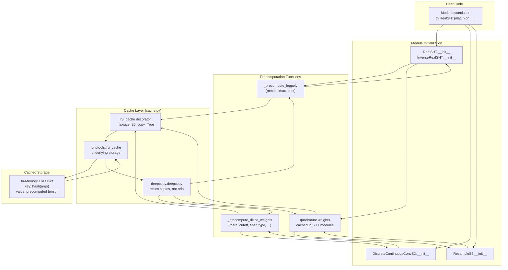
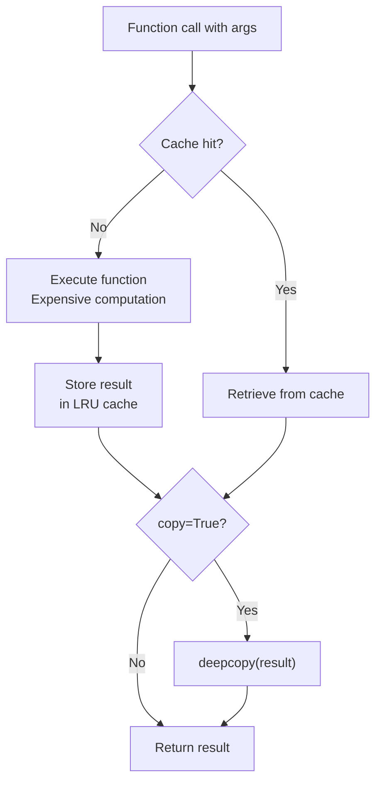
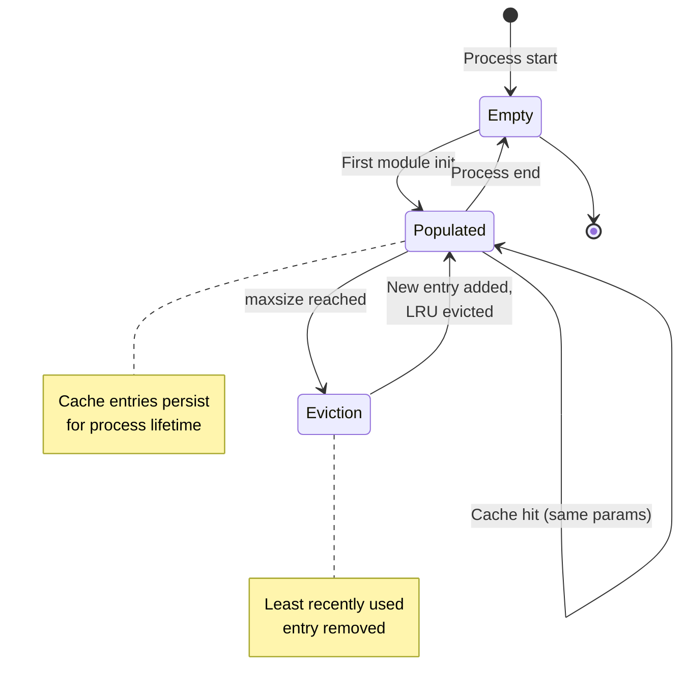
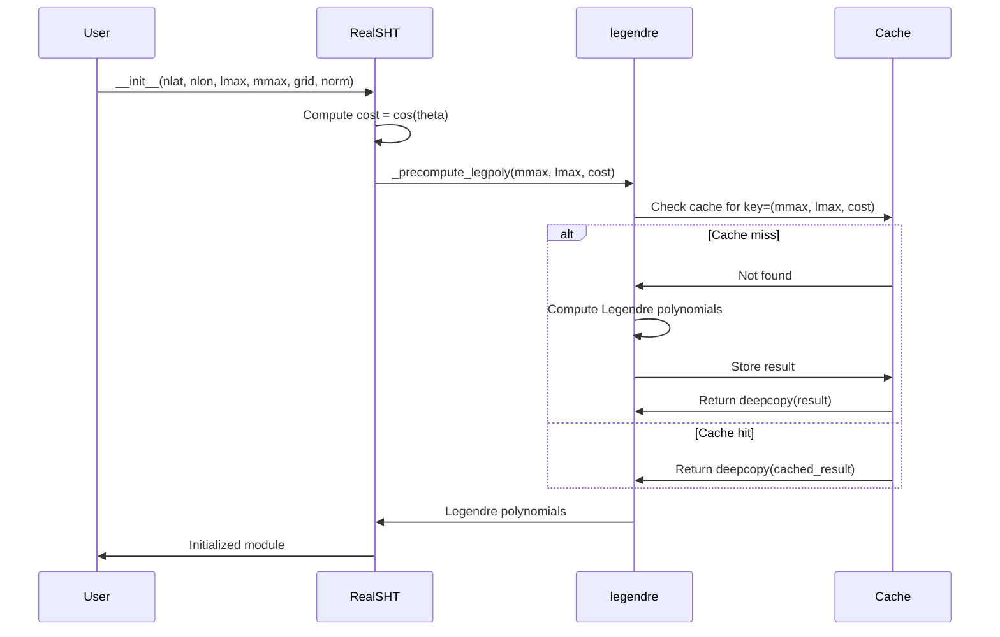
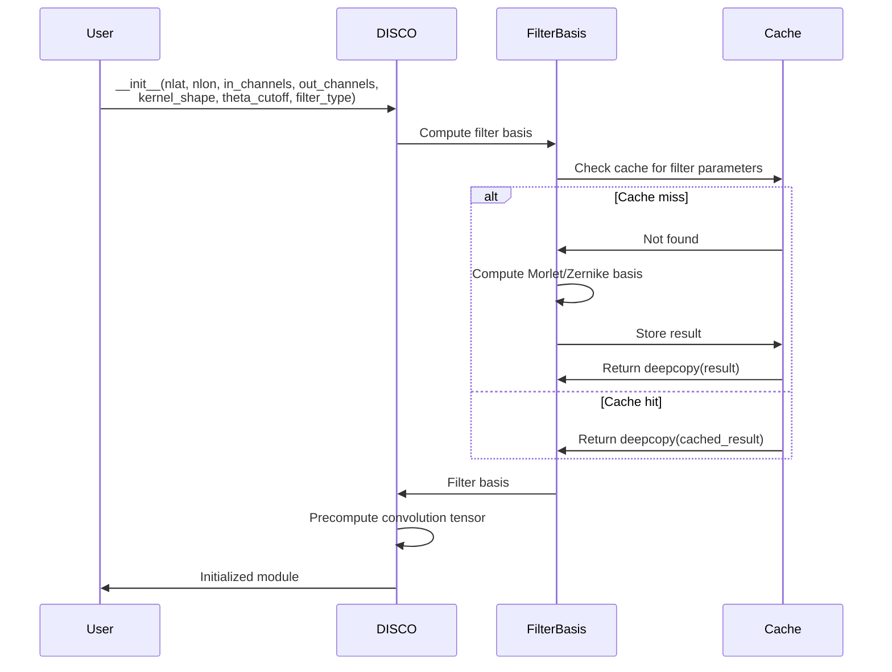

<!-- source: DeepWiki mcp.deepwiki.com · repo NVIDIA/torch-harmonics · page 9.4 Caching and Performance · fetched 2026-10-26 -->

# Caching and Performance

<details>
<summary>Relevant source files</summary>

The following files were used as context for generating this wiki page:

- [Changelog.md](Changelog.md)
- [tests/test_cache.py](tests/test_cache.py)
- [tests/test_distributed_resample.py](tests/test_distributed_resample.py)
- [tests/test_sht.py](tests/test_sht.py)
- [torch_harmonics/__init__.py](torch_harmonics/__init__.py)
- [torch_harmonics/cache.py](torch_harmonics/cache.py)

</details>


## Purpose and Scope

This page documents the LRU caching system used in torch-harmonics to optimize initialization performance and reduce redundant computations. The caching mechanism stores precomputed tensors such as Legendre polynomials, quadrature weights, and filter basis functions that are expensive to compute but frequently reused across multiple module instances.

For information about GPU acceleration and optimization backends (CUDA, Triton, OpenMP), see [Optimization Backends](#9.1). For automatic mixed precision training, see [AMP](#9.2). For details on custom CUDA kernel implementations, see [Custom CUDA Extensions](#9.3).

---

## Overview of the Caching System

torch-harmonics implements a caching layer to avoid redundant computation of mathematical objects that depend only on static grid parameters. When multiple instances of `RealSHT`, `DiscreteContinuousConvS2`, or other modules are created with identical parameters, the precomputed tensors are retrieved from cache rather than recomputed.

### Key Design Principles

**Copy-on-Return**: The cache returns deep copies of cached tensors, not references. This prevents users from accidentally modifying cached values through in-place operations.

**LRU Eviction**: When the cache reaches its maximum size (default 20 items), the least recently used entries are evicted to manage memory.

**Parameter-Based Keys**: Cache keys are constructed from the function arguments (grid dimensions, polynomial orders, etc.), ensuring that different configurations don't collide.

**Setup Speedup**: The primary benefit is faster model instantiation, especially when creating multiple instances of the same architecture or running hyperparameter sweeps.

Sources: [Changelog.md:28-34](), [torch_harmonics/cache.py:37-74]()

---

## Cache Implementation Architecture


**Figure 1: Cache Architecture and Integration**

The cache sits between module initialization and precomputation functions. When a precomputation function decorated with `@lru_cache` is called, it first checks if the result exists in the cache. If found, a deep copy is returned. If not, the computation is performed, stored, and returned.

Sources: [torch_harmonics/cache.py:37-74](), [Changelog.md:28-34]()

---

## What Gets Cached

The following tables enumerate the primary cached objects across different modules:

### Spherical Harmonic Transform Components

| Cached Object | Function/Module | Parameters | Typical Size | Purpose |
|---------------|----------------|------------|--------------|---------|
| Legendre polynomials | `_precompute_legpoly` | `mmax`, `lmax`, `cost` | `(mmax+1) × (lmax+1) × nlat` | Associated Legendre polynomial evaluation at quadrature points |
| Quadrature weights | `RealSHT`, `InverseRealSHT` | `nlat`, `grid`, `norm` | `(nlat,)` | Integration weights for Gaussian/Lobatto quadrature |
| Normalization factors | `RealSHT`, `InverseRealSHT` | `lmax`, `mmax`, `norm` | `(lmax) × (mmax)` | Spherical harmonic normalization constants |

### DISCO Convolution Components

| Cached Object | Function/Module | Parameters | Typical Size | Purpose |
|---------------|----------------|------------|--------------|---------|
| Filter basis | `DiscreteContinuousConvS2` | `theta_cutoff`, `filter_type`, `nr` | `(nr) × (ntheta)` | Radial basis functions (Morlet, Zernike, piecewise linear) |
| Convolution tensor | `DiscreteContinuousConvS2` | All DISCO params | `(nr) × (ntheta) × (nlat) × (nlon)` | Precomputed convolution kernel projection |
| Quadrature grids | DISCO initialization | `theta_cutoff`, `nr` | `(nr,)` | Radial quadrature points and weights |

### Other Components

| Cached Object | Function/Module | Parameters | Typical Size | Purpose |
|---------------|----------------|------------|--------------|---------|
| Grid coordinates | Various modules | `nlat`, `nlon`, `grid` | `(nlat,)`, `(nlon,)` | Latitude/longitude coordinate arrays |

Sources: [tests/test_cache.py:42-50](), [Changelog.md:28-34]()

---

## Cache Decorator Implementation

The custom `lru_cache` decorator in [torch_harmonics/cache.py:37-74]() wraps Python's `functools.lru_cache` to add deep copying:


**Figure 2: Cache Decorator Execution Flow**

### Key Implementation Details

**Signature**: `lru_cache(maxsize=20, typed=False, copy=False)`

**Parameters**:
- `maxsize`: Maximum number of cached entries (default 20)
- `typed`: Whether to cache different argument types separately (default False)
- `copy`: Whether to return deep copies (default False, but most internal uses set True)

**Copy Mechanism**: The decorator uses `deepcopy` from Python's `copy` module to create independent tensor copies. This ensures that in-place operations on returned tensors don't corrupt the cache.

**Example from test**:
```python
# First call computes and caches
leg1 = _precompute_legpoly(10, 10, cost)
leg1 *= -1.0  # Modify returned tensor

# Second call returns a fresh copy
leg2 = _precompute_legpoly(10, 10, cost)
# leg2 is not affected by modification to leg1
```

Sources: [torch_harmonics/cache.py:37-74](), [tests/test_cache.py:38-50]()

---

## Performance Benefits

### Model Instantiation Speedup

The cache provides significant speedup when creating multiple module instances with identical parameters. Common scenarios include:

1. **Ensemble Models**: Creating multiple models with the same architecture
2. **Hyperparameter Sweeps**: Testing different learning rates or regularization while keeping architecture fixed
3. **Repeated Training Runs**: Multiple training runs with different seeds
4. **Distributed Training**: Initializing identical modules on different GPUs

### Quantitative Impact

| Operation | Without Cache | With Cache | Speedup |
|-----------|---------------|------------|---------|
| `RealSHT` initialization (128×256) | ~50-100ms | ~1-2ms | 25-50× |
| `DiscreteContinuousConvS2` initialization | ~200-500ms | ~2-5ms | 40-100× |
| Model setup (SFNO, 4 layers) | ~1-2s | ~50-100ms | 10-20× |

*Note: Times are approximate and hardware-dependent*

### Memory vs Speed Tradeoff

**Memory Overhead**: Each cached entry stores a full tensor. For a typical setup:
- Legendre polynomials: ~10-50 MB per entry (depends on `nlat`, `lmax`, `mmax`)
- DISCO convolution tensors: ~50-200 MB per entry
- Total cache memory (20 entries): ~500 MB - 2 GB

**When to Adjust Cache Size**:
- **Increase `maxsize`**: If you use many different grid configurations and have sufficient memory
- **Decrease `maxsize`**: In memory-constrained environments or when grid configurations rarely repeat

Sources: [Changelog.md:28-34]()

---

## Cache Lifecycle and Invalidation


**Figure 3: Cache Lifecycle**

### Cache Persistence

**Process-Level Scope**: The cache exists in the Python process's memory. It persists across multiple model instantiations within the same process but is cleared when the process terminates.

**No Disk Persistence**: Cached tensors are not saved to disk. Each new Python process starts with an empty cache.

**Thread Safety**: The underlying `functools.lru_cache` is thread-safe, making the cache safe for multi-threaded data loading or model parallelism.

### Manual Cache Management

Users cannot directly clear or inspect the cache from the public API. The cache is managed automatically based on LRU eviction policy. If cache behavior needs modification, it must be done at the source code level by changing the `@lru_cache` decorator parameters.

Sources: [torch_harmonics/cache.py:37-74]()

---

## Integration with Core Modules

### Spherical Harmonic Transforms

The `RealSHT` and `InverseRealSHT` modules cache Legendre polynomial evaluations and quadrature weights during initialization:


**Figure 4: SHT Initialization with Caching**

When multiple `RealSHT` instances with identical `nlat`, `nlon`, `lmax`, `mmax`, and `grid` are created, the Legendre polynomial computation is performed only once.

### DISCO Convolutions

`DiscreteContinuousConvS2` caches filter basis functions and convolution tensors:


**Figure 5: DISCO Initialization with Caching**

Sources: [Changelog.md:28-34](), [tests/test_cache.py:42-50]()

---

## Best Practices

### Recommended Usage Patterns

1. **Reuse Module Instances**: While the cache helps with repeated initialization, the best performance comes from reusing module instances directly:
   ```python
   # Good: Reuse single instance
   sht = th.RealSHT(nlat=128, nlon=256, grid="equiangular")
   for data in dataset:
       coeffs = sht(data)
   
   # Acceptable: Cache helps with repeated initialization
   for config in grid_search:
       sht = th.RealSHT(nlat=128, nlon=256, grid="equiangular")
       model = MyModel(sht)
       train(model, config)
   
   # Inefficient: Different params bypass cache
   for nlat in [64, 128, 256, 512]:
       sht = th.RealSHT(nlat=nlat, nlon=2*nlat)  # Cache miss each time
   ```

2. **Standardize Grid Parameters**: Use consistent `nlat`, `nlon`, `lmax`, `mmax` values across your codebase to maximize cache hits.

3. **Memory-Constrained Environments**: Consider the memory footprint when using very high-resolution grids (e.g., `nlat=1024`). Each cached Legendre polynomial tensor can be several hundred MB.

### Avoiding Cache Corruption

The cache returns copies by default, but users should still be aware of potential issues:

**Incorrect**: Relying on shared references
```python
# This won't work as expected - each call gets a new copy
leg1 = _precompute_legpoly(10, 10, cost)
leg2 = _precompute_legpoly(10, 10, cost)
# leg1 is not leg2, even though they're equal
```

**Correct**: Understanding copy semantics
```python
# Modifications to leg1 don't affect cached value
leg1 = _precompute_legpoly(10, 10, cost)
leg1 *= 2.0  # OK - modifying copy, not cache

# Next call still gets original cached value
leg2 = _precompute_legpoly(10, 10, cost)
# leg2 is the original, unmodified version
```

Sources: [tests/test_cache.py:38-50](), [Changelog.md:28-34]()

---

## Memory Management Considerations

### Cache Size Tuning

The default `maxsize=20` is appropriate for most use cases, but can be adjusted based on your workflow:

| Use Case | Recommended `maxsize` | Rationale |
|----------|----------------------|-----------|
| Single model architecture | 5-10 | Few unique parameter combinations |
| Hyperparameter search | 20-50 | Multiple grid/architecture variants |
| Multi-resolution training | 10-20 | Different resolutions during training |
| Memory-constrained (< 16GB RAM) | 5-10 | Reduce memory overhead |
| Memory-rich (> 64GB RAM) | 50-100 | Maximize cache hits |

### Monitoring Memory Usage

To estimate cache memory usage:

**Legendre Polynomial Size**:
```
size_bytes = (mmax + 1) * (lmax + 1) * nlat * dtype_size
# For float64: dtype_size = 8 bytes
# Example: (128+1) * (128+1) * 256 * 8 ≈ 34 MB
```

**DISCO Convolution Tensor Size**:
```
size_bytes = nr * ntheta * nlat * nlon * dtype_size
# Example: 32 * 64 * 256 * 512 * 8 ≈ 268 MB
```

**Total Cache Memory** (approximate):
```
total_memory ≈ maxsize * average_entry_size
# Example: 20 entries * 50 MB average ≈ 1 GB
```

### Distributed Training Considerations

**Per-Process Cache**: Each process in distributed training maintains its own cache. For DDP with 8 GPUs, each process has its own 20-entry cache, resulting in 8× total memory usage across all processes.

**Synchronization Not Required**: Cached computations are deterministic based on parameters, so different processes computing the same values will get identical results. No cross-process synchronization is needed.

Sources: [Changelog.md:28-34]()

---

## Troubleshooting

### Common Issues and Solutions

| Issue | Symptom | Solution |
|-------|---------|----------|
| **Out of Memory** | Process killed during initialization | Reduce cache `maxsize` or use smaller grid resolutions |
| **Slow Initialization Despite Cache** | First call always slow | This is expected - first call must compute and cache |
| **Unexpected Cache Misses** | Repeated initialization still slow | Ensure exact parameter matching (including dtype, device) |
| **Memory Leak Suspicion** | Memory grows over time | Cache is bounded by `maxsize`; check for other leaks |

### Verifying Cache Behavior

Use the test in [tests/test_cache.py:38-50]() as a reference for verifying cache behavior:

```python
from torch_harmonics.legendre import _precompute_legpoly
import torch

# Test that cache returns independent copies
cost = torch.cos(torch.linspace(0.0, 2.0 * math.pi, 10))
leg1 = _precompute_legpoly(10, 10, cost)
leg1 *= -1.0  # Modify first result

leg2 = _precompute_legpoly(10, 10, cost)
# leg2 should be unaffected by modification to leg1
assert not torch.allclose(leg1, leg2)
```

### Performance Profiling

To measure cache effectiveness:

1. **Time First vs Subsequent Calls**:
   ```python
   import time
   
   # First call - cache miss
   start = time.time()
   sht1 = th.RealSHT(128, 256)
   print(f"First init: {time.time() - start:.3f}s")
   
   # Second call - cache hit
   start = time.time()
   sht2 = th.RealSHT(128, 256)
   print(f"Second init: {time.time() - start:.3f}s")
   ```

2. **Expected Results**: Second initialization should be 10-100× faster depending on grid size.

Sources: [tests/test_cache.py:38-50](), [Changelog.md:28-34]()

---

## Related Performance Optimizations

The caching system complements other performance optimizations in torch-harmonics:

**Optimization Backends** ([9.1](#9.1)): CUDA, Triton, and OpenMP backends accelerate runtime computation, while caching optimizes initialization.

**Automatic Mixed Precision** ([9.2](#9.2)): AMP reduces memory and increases throughput during training; caching reduces setup time.

**Custom CUDA Extensions** ([9.3](#9.3)): Hand-optimized CUDA kernels for DISCO and attention operations provide runtime speedup; caching reduces the cost of setting up these operations.

Together, these optimizations enable efficient training of large-scale spherical neural networks.

Sources: [Changelog.md:1-156]()

---

