# Page: Overview

# Overview

<details>
<summary>Relevant source files</summary>

The following files were used as context for generating this wiki page:

- [Changelog.md](Changelog.md)
- [README.md](README.md)
- [notebooks/partial_derivatives.ipynb](notebooks/partial_derivatives.ipynb)
- [setup.py](setup.py)
- [torch_harmonics/__init__.py](torch_harmonics/__init__.py)

</details>


## Purpose and Scope

This page provides a high-level introduction to torch-harmonics, a PyTorch library for differentiable signal processing on the sphere. torch-harmonics implements spherical harmonic transforms (SHT), discrete-continuous (DISCO) convolutions, and spherical attention mechanisms optimized for GPU and distributed computing environments. The library enables neural operators and deep learning models for data defined on spherical geometries, such as global climate data, omnidirectional images, and planetary-scale simulations.

For installation instructions, see [Installation and Setup](#1.1). For mathematical background on spherical harmonics and grid types, see [Core Concepts](#1.2). For detailed API documentation, see [API Reference](#11).

**Sources:** [README.md:51-59](), [torch_harmonics/__init__.py:32-41]()

---

## High-Level Architecture

torch-harmonics is organized into three architectural layers: **core mathematical primitives** for forward and inverse spherical transforms, **distributed computing extensions** for multi-GPU/multi-node execution, and **high-level neural operator architectures** that compose these primitives. All operations are implemented as `torch.nn.Module` subclasses for seamless integration with PyTorch training workflows.

The library supports multiple optimization backends (CUDA, Triton, OpenMP) with automatic fallback to pure PyTorch implementations when hardware acceleration is unavailable.

### Core Library Components

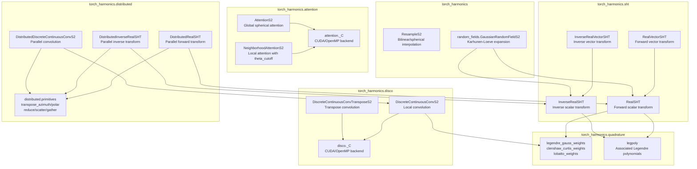

**Sources:** [torch_harmonics/__init__.py:34-38](), [README.md:51-59]()

---

## Mathematical Primitives to Code Mapping

The following diagram maps mathematical operations to their concrete implementations in the codebase:

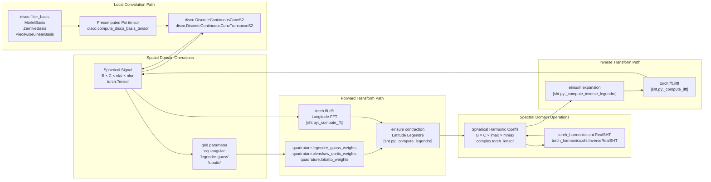

**Sources:** [README.md:125-170](), [torch_harmonics/__init__.py:34-37]()

---

## Core Mathematical Primitives

### Spherical Harmonic Transforms

The `RealSHT` and `InverseRealSHT` classes implement forward and inverse spherical harmonic transforms using the algorithm from Schaeffer (2013). The transform decomposes into:

1. **Longitude FFT**: Computed via `torch.fft.rfft` to extract Fourier modes in the azimuthal direction
2. **Latitude Legendre Transform**: Computed via quadrature-based einsum contractions with associated Legendre polynomials

| Class | Purpose | Key Methods | Distributed Variant |
|-------|---------|-------------|---------------------|
| `RealSHT` | Forward scalar transform | `forward(x)` | `DistributedRealSHT` |
| `InverseRealSHT` | Inverse scalar transform | `forward(x)` | `DistributedInverseRealSHT` |
| `RealVectorSHT` | Forward vector transform | `forward(u, v)` | `DistributedRealVectorSHT` |
| `InverseRealVectorSHT` | Inverse vector transform | `forward(u_coeffs, v_coeffs)` | `DistributedInverseRealVectorSHT` |

Vector transforms decompose vector fields into spheroidal and toroidal components, enabling computation of divergence and curl on the sphere.

For detailed usage, see [RealSHT and InverseRealSHT](#2.1) and [Vector Spherical Harmonic Transforms](#2.2).

**Sources:** [README.md:125-170](), [torch_harmonics/__init__.py:34]()

### DISCO Convolutions

The `DiscreteContinuousConvS2` class implements localized convolutions on the sphere using continuous filter basis functions. Unlike global spectral operations, DISCO convolutions have compact support controlled by the `theta_cutoff` parameter.

Key configuration parameters:
- `in_channels`, `out_channels`: Channel dimensions
- `kernel_shape`: Shape of the convolution kernel (e.g., `"spherical"`, `"zonal"`)
- `filter_basis`: One of `"morlet"`, `"zernike"`, `"piecewise-linear"`
- `theta_cutoff`: Maximum angular distance for local support (in radians)

The implementation precomputes a basis tensor `Psi` mapping spatial positions to filter coefficients, then uses custom CUDA or OpenMP kernels in `disco._C` for efficient forward and backward passes.

For detailed usage, see [DiscreteContinuousConvS2](#3.1) and [Filter Basis Functions](#3.2).

**Sources:** [torch_harmonics/__init__.py:35](), [README.md:171-174](), [Changelog.md:82-86]()

### Spherical Attention Mechanisms

The `AttentionS2` and `NeighborhoodAttentionS2` classes implement attention mechanisms adapted for spherical geometry:

- **AttentionS2**: Global attention over the entire sphere, using quadrature-aware position encodings
- **NeighborhoodAttentionS2**: Local attention within geodesic neighborhoods defined by `theta_cutoff`

Both implementations use custom CUDA kernels in `attention._C` for efficient computation of attention weights and value aggregation. The operations correctly handle the non-Euclidean geometry of the sphere, using geodesic distances for neighborhood definitions.

For detailed usage, see [AttentionS2 (Global)](#4.1) and [NeighborhoodAttentionS2](#4.2).

**Sources:** [torch_harmonics/__init__.py:37](), [Changelog.md:16-18](), [README.md:175-177]()

---

## Distributed Computing Strategy

torch-harmonics implements a 2D process grid strategy for distributing spherical data across multiple GPUs. Data is partitioned along both latitude (`polar_group`) and longitude (`azimuth_group`) dimensions.

### Process Grid and Communication Primitives

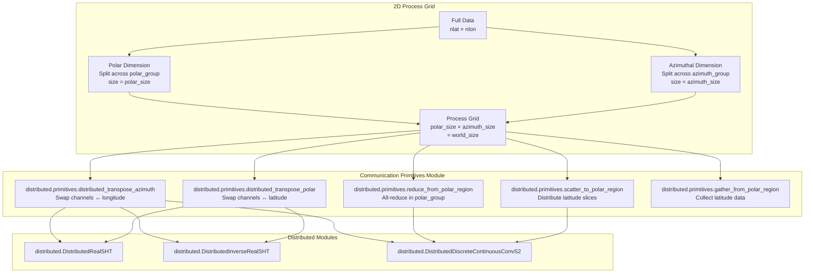

Each distributed module orchestrates communication primitives to ensure correct data layout for local operations. For example, `DistributedRealSHT` transposes data to make longitude local before FFT, then transposes again to make latitude local before the Legendre transform.

For detailed usage, see [Distributed Computing](#6) and [Communication Primitives](#6.3).

**Sources:** [README.md:200](), [Changelog.md:90-93]()

---

## Optimization Backends

The library provides multiple optimization backends with automatic fallback:

### Backend Selection Matrix

| Operation | CUDA Backend | Triton Backend | OpenMP Backend | PyTorch Fallback |
|-----------|--------------|----------------|----------------|------------------|
| SHT/ISHT | N/A | N/A | N/A | torch.fft, einsum |
| DISCO Convolutions | `disco._C` (>= sm_70) | triton (deprecated) | `disco._C` | Python loop |
| Neighborhood Attention | `attention._C` (>= sm_70) | N/A | `attention._C` | Python loop |
| Global Attention | N/A | N/A | N/A | torch ops |

### Backend Availability Query

```python
# Check if optimized kernels are available
from torch_harmonics.disco import optimized_kernels_is_available as disco_available
from torch_harmonics.attention import optimized_kernels_is_available as attn_available

print(f"DISCO optimized kernels: {disco_available()}")
print(f"Attention optimized kernels: {attn_available()}")
```

Backend selection is controlled through environment variables during installation:
- `FORCE_CUDA_EXTENSION=1`: Force compilation of CUDA extensions even in containers
- `TORCH_CUDA_ARCH_LIST="8.0 9.0"`: Specify target GPU architectures
- `TORCH_HARMONICS_ENABLE_OPENMP=1`: Enable OpenMP parallelization in CPU backend
- `TORCH_HARMONICS_DEBUG=1`: Compile with debug symbols
- `TORCH_HARMONICS_PROFILE=1`: Enable profiling annotations

For details on compilation, see [Building from Source](#10.1). For performance characteristics, see [Optimization Backends](#9.1).

**Sources:** [setup.py:39-83](), [Changelog.md:9-10](), [README.md:78-88]()

---

## Minimal Usage Example

The following example demonstrates basic SHT operations:

```python
import torch
import torch_harmonics as th

device = torch.device('cuda' if torch.cuda.is_available() else 'cpu')

# Define grid parameters
nlat = 512
nlon = 2 * nlat
batch_size = 32

# Create random signal on equiangular grid
signal = torch.randn(batch_size, nlat, nlon, device=device)

# Initialize forward and inverse transforms
sht = th.RealSHT(nlat, nlon, grid="equiangular").to(device)
isht = th.InverseRealSHT(nlat, nlon, grid="equiangular").to(device)

# Forward transform: spatial -> spectral
coeffs = sht(signal)  # shape: [batch_size, nlat, nlon//2 + 1]

# Inverse transform: spectral -> spatial
reconstructed = isht(coeffs)  # shape: [batch_size, nlat, nlon]

# Verify round-trip accuracy
error = torch.mean((signal - reconstructed)**2)
print(f"Round-trip MSE: {error.item():.2e}")
```

For distributed multi-GPU usage:

```python
import torch.distributed as dist
from torch_harmonics.distributed import DistributedRealSHT

# Initialize process group
dist.init_process_group(backend='nccl')

# Create distributed SHT with 2D process grid
dsht = DistributedRealSHT(
    nlat, nlon, 
    grid="equiangular",
    polar_size=2,      # Split latitude across 2 processes
    azimuth_size=4     # Split longitude across 4 processes
)

# Data is automatically partitioned across the 2D grid
coeffs = dsht(signal)
```

For complete tutorials, see [Getting started](./notebooks/getting_started.ipynb) and [Example Applications](#8).

**Sources:** [README.md:179-198](), [README.md:200]()

---

## Caching System

torch-harmonics includes an LRU cache for precomputed tensors (quadrature weights, Legendre polynomials, DISCO basis tensors) to accelerate model initialization. The cache is managed automatically and returns copies of cached tensors to prevent unintended modifications.

Users can manually reuse precomputed tensors in their models for additional memory savings, but the cache ensures fast setup even without manual optimization.

For details, see [Caching and Performance](#9.4).

**Sources:** [Changelog.md:30-34]()

---

## Version and Compatibility

Current version: **0.8.1**

**Key compatibility notes:**
- Requires PyTorch 2.0+ for full custom operator support and `torch.export` compatibility
- CUDA extensions require compute capability >= 7.0 (Volta architecture or newer)
- Custom CUDA kernels are optional; pure PyTorch fallbacks are always available
- Supports both NCCL (GPU) and Gloo (CPU) backends for distributed computing

For version history, see [Changelog.md](). For building from source, see [Building from Source](#10.1).

**Sources:** [torch_harmonics/__init__.py:32](), [Changelog.md:5-12](), [setup.py:88]()

---

# Page: Installation and Setup

# Installation and Setup

<details>
<summary>Relevant source files</summary>

The following files were used as context for generating this wiki page:

- [.coveragerc](.coveragerc)
- [.github/dependabot.yml](.github/dependabot.yml)
- [.github/workflows/deploy_pypi.yml](.github/workflows/deploy_pypi.yml)
- [.github/workflows/tests.yml](.github/workflows/tests.yml)
- [README.md](README.md)
- [notebooks/partial_derivatives.ipynb](notebooks/partial_derivatives.ipynb)
- [setup.py](setup.py)

</details>


## Purpose and Scope

This page provides comprehensive instructions for installing torch-harmonics on your system, including standard installations via PyPI, development installations from source, and containerized installations using Docker. It covers environment variable configuration, custom CUDA extension compilation, and troubleshooting common installation issues.

For information about the underlying build system and CI/CD processes, see [CI/CD Pipeline](#10.3). For testing after installation, see [Testing](#10.2).

## Prerequisites

torch-harmonics requires:
- Python 3.9 or higher
- PyTorch (CPU or CUDA-enabled)
- NumPy
- (Optional) CUDA toolkit for GPU acceleration
- (Optional) Docker for containerized deployment

**Important**: torch-harmonics uses custom C++ and CUDA extensions that must be compiled during installation. The `--no-build-isolation` flag is **required** to ensure these extensions compile against your existing PyTorch installation.

Sources: [README.md:77-106](), [.github/workflows/deploy_pypi.yml:20-29](), [.github/workflows/tests.yml:15-27]()

## Installation Decision Tree

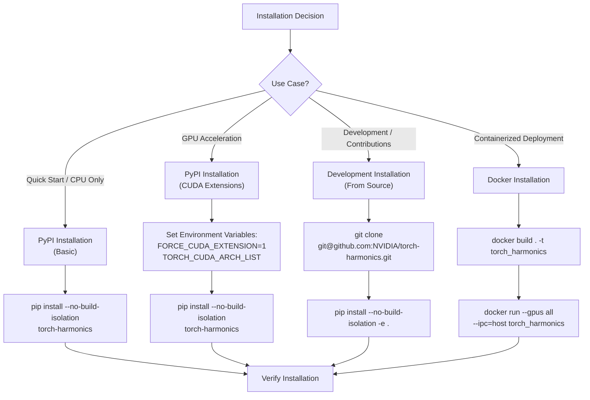

Sources: [README.md:77-106]()

## Installation Methods

### Method 1: Basic PyPI Installation

For CPU-only usage or systems with CUDA automatically detected:

```bash
pip install --no-build-isolation torch-harmonics
```

This method:
- Installs the latest stable release from PyPI
- Automatically detects CUDA availability via `torch.cuda.is_available()` and `CUDA_HOME`
- Compiles CPU extensions (`disco_helpers`, `attention_helpers`)
- Compiles CUDA extensions (`disco._C`, `attention._C`) if CUDA is detected

Sources: [README.md:77-81](), [setup.py:39-54]()

### Method 2: PyPI Installation with Forced CUDA Extensions

For systems where CUDA is not automatically detected (e.g., containers) or to specify target GPU architectures:

```bash
export FORCE_CUDA_EXTENSION=1
export TORCH_CUDA_ARCH_LIST="7.0 7.2 7.5 8.0 8.6 8.7 9.0 10.0+PTX"
pip install --no-build-isolation torch-harmonics
```

**Important Architecture Notes**:
- Custom CUDA extensions only support CUDA architectures >= 7.0
- Specify only your target architecture(s) to reduce compilation time
- Common architectures:
  - `7.0`, `7.2`, `7.5`: Volta, Turing
  - `8.0`, `8.6`: Ampere
  - `8.7`: Jetson Orin
  - `9.0`: Hopper
  - `10.0+PTX`: Ada Lovelace

Sources: [README.md:82-88](), [setup.py:39](), [setup.py:50-52]()

### Method 3: Development Installation from Source

For active development and contributions:

```bash
git clone git@github.com:NVIDIA/torch-harmonics.git
cd torch-harmonics
pip install --no-build-isolation -e .
```

The `-e` flag installs in editable mode, allowing code changes without reinstallation.

Sources: [README.md:90-96]()

### Method 4: Docker Installation

For containerized deployment with full GPU support:

```bash
git clone git@github.com:NVIDIA/torch-harmonics.git
cd torch-harmonics
docker build . -t torch_harmonics
docker run --gpus all -it --rm --ipc=host --ulimit memlock=-1 --ulimit stack=67108864 torch_harmonics
```

Docker flags explained:
- `--gpus all`: Exposes all GPUs to container
- `--ipc=host`: Required for PyTorch DataLoader workers
- `--ulimit memlock=-1`: Removes memory locking limit
- `--ulimit stack=67108864`: Sets stack size for deep learning workloads

Sources: [README.md:98-105]()

## Build System Architecture

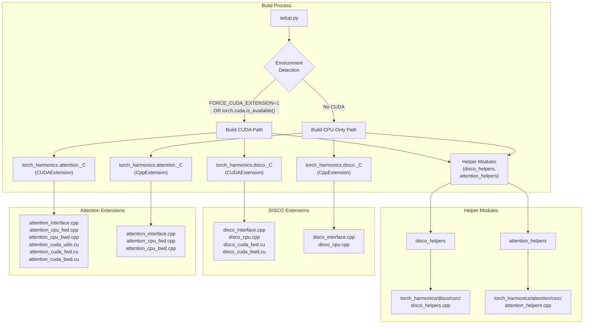

Sources: [setup.py:93-183]()

## Environment Variables

The build system supports several environment variables for customizing compilation:

| Variable | Purpose | Values | Default |
|----------|---------|--------|---------|
| `FORCE_CUDA_EXTENSION` | Force CUDA extension compilation | `0` or `1` | `0` |
| `TORCH_CUDA_ARCH_LIST` | Target GPU architectures | Space-separated arch list (e.g., `"8.0 8.6"`) | Auto-detected |
| `TORCH_HARMONICS_DEBUG` | Compile with debugging symbols | `0` or `1` | `0` |
| `TORCH_HARMONICS_PROFILE` | Enable profiling information | `0` or `1` | `0` |
| `TORCH_HARMONICS_ENABLE_OPENMP` | Enable OpenMP parallelization | `0` or `1` | `0` |

### Debug vs. Release Builds

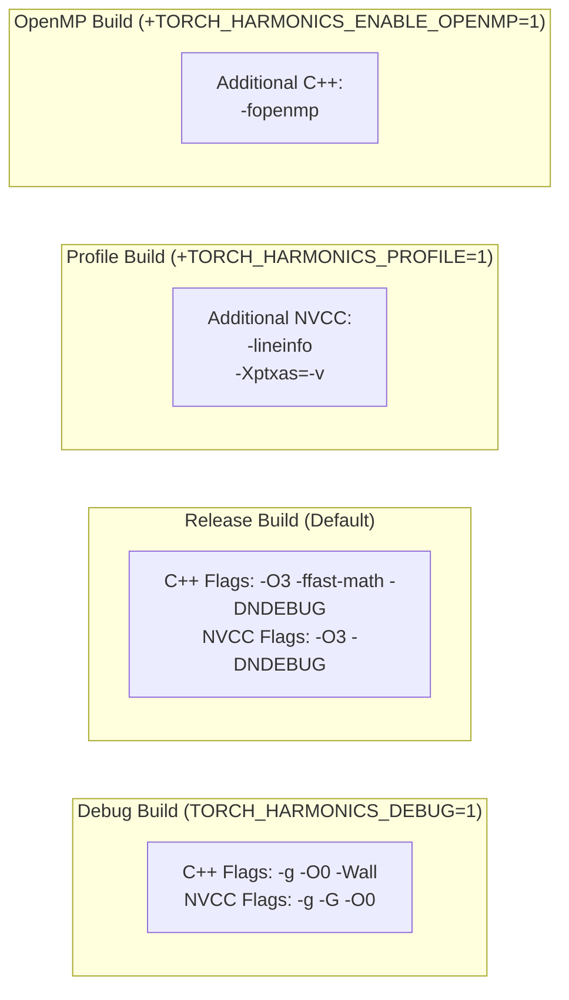

Sources: [setup.py:56-83]()

### Compilation Flags Reference

**Debug Mode** (`TORCH_HARMONICS_DEBUG=1`):
- C++ flags: `-g`, `-O0`, `-Wall`
- NVCC flags: `-g`, `-G`, `-O0`
- Use for: Development, debugging segmentation faults

**Release Mode** (default):
- C++ flags: `-O3`, `-ffast-math`, `-DNDEBUG`
- NVCC flags: `-O3`, `-DNDEBUG`
- Use for: Production deployments

**Profile Mode** (`TORCH_HARMONICS_PROFILE=1`):
- Adds: `-lineinfo`, `-Xptxas=-v` to NVCC
- Use for: Performance profiling with NVIDIA tools

**OpenMP Mode** (`TORCH_HARMONICS_ENABLE_OPENMP=1`):
- Adds: `-fopenmp` to C++ compiler
- Use for: CPU-only parallelization

Sources: [setup.py:56-83]()

## Extension Module Mapping

The build system creates the following Python-importable modules:

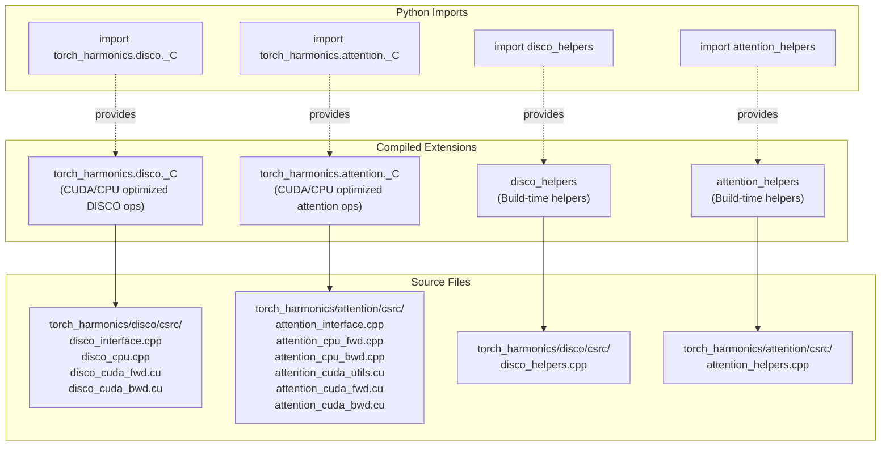

Sources: [setup.py:100-181]()

## Verification

After installation, verify torch-harmonics is working correctly:

```python
import torch
import torch_harmonics as th

# Check basic functionality
device = torch.device('cuda' if torch.cuda.is_available() else 'cpu')
nlat, nlon = 512, 1024
sht = th.RealSHT(nlat, nlon, grid="equiangular").to(device)

# Test transform
signal = torch.randn(1, nlat, nlon, device=device)
coeffs = sht(signal)
print(f"Transform successful! Coefficient shape: {coeffs.shape}")

# Check CUDA extensions (if available)
if torch.cuda.is_available():
    try:
        from torch_harmonics.disco import _C as disco_C
        from torch_harmonics.attention import _C as attention_C
        print("CUDA extensions successfully loaded")
    except ImportError:
        print("Warning: CUDA extensions not available")
```

Sources: [README.md:183-198]()

## Troubleshooting

### Common Issues

#### Issue: CUDA Extensions Not Building

**Symptom**: Installation completes but GPU operations are slow or unavailable.

**Solutions**:
1. Verify CUDA toolkit is installed: `nvcc --version`
2. Check PyTorch CUDA support: `python -c "import torch; print(torch.cuda.is_available())"`
3. Force CUDA compilation:
   ```bash
   export FORCE_CUDA_EXTENSION=1
   pip install --no-build-isolation torch-harmonics
   ```
4. Check `CUDA_HOME` is set: `echo $CUDA_HOME`

Sources: [README.md:82-88](), [setup.py:39-52]()

#### Issue: Architecture Mismatch

**Symptom**: `CUDA error: no kernel image is available for execution on the device`

**Solution**: Rebuild with correct architecture:
```bash
# Check GPU compute capability
nvidia-smi --query-gpu=compute_cap --format=csv

# Rebuild with matching architecture
export TORCH_CUDA_ARCH_LIST="8.6"  # Example for RTX 3090
pip uninstall torch-harmonics
pip install --no-build-isolation torch-harmonics
```

Sources: [README.md:82-88]()

#### Issue: Build Isolation Errors

**Symptom**: `No module named 'torch'` during installation

**Solution**: Always use `--no-build-isolation`:
```bash
# Incorrect
pip install torch-harmonics

# Correct
pip install --no-build-isolation torch-harmonics
```

The `--no-build-isolation` flag ensures the build uses your existing PyTorch installation rather than creating an isolated environment.

Sources: [README.md:78-86]()

#### Issue: Compilation Errors in Debug Mode

**Symptom**: Undefined symbols or linking errors when `TORCH_HARMONICS_DEBUG=1`

**Solution**: Debug builds use different optimization flags that may expose issues. Try:
1. Update PyTorch: `pip install --upgrade torch`
2. Use release build for production
3. File issue at https://github.com/NVIDIA/torch-harmonics with full error log

Sources: [setup.py:56-83]()

#### Issue: AMP (Automatic Mixed Precision) Errors

**Symptom**: Errors about unsupported input dimensions when using `torch.autocast`

**Note**: This is a known limitation. cuFFT (used by torch-harmonics) only supports float16/bfloat16 for power-of-two dimensions.

**Solution**: Disable autocast for transforms:
```python
with torch.autocast(device_type="cuda", enabled=True):
    x = some_math(x)
    x = x.to(torch.float32)
    with torch.autocast(device_type="cuda", enabled=False):
        xt = sht(x)
```

Sources: [README.md:226-250]()

## CI/CD Integration

torch-harmonics uses GitHub Actions for continuous integration:

**Test Workflow** (`.github/workflows/tests.yml`):
- Runs on every push
- Tests on Ubuntu with Python 3.9
- CPU-only PyTorch installation
- Runs pytest on core modules: `test_sht.py`, `test_convolution.py`, `test_attention.py`, `test_cache.py`

**Deployment Workflow** (`.github/workflows/deploy_pypi.yml`):
- Triggered on release publication
- Builds source distribution only (no binary wheels)
- Users compile extensions locally during installation
- Publishes to PyPI

Sources: [.github/workflows/tests.yml:1-32](), [.github/workflows/deploy_pypi.yml:1-39]()

## Next Steps

After successful installation:
- **Basic Usage**: See [Overview](#1) for a quick-start guide
- **Core Concepts**: See [Core Concepts](#1.2) for theoretical background
- **Examples**: See [Example Applications](#8) for complete workflows
- **Testing**: See [Testing](#10.2) to run the test suite
- **Development**: See [Building from Source](#10.1) for contribution guidelines

---

# Page: Core Concepts

# Core Concepts

<details>
<summary>Relevant source files</summary>

The following files were used as context for generating this wiki page:

- [Changelog.md](Changelog.md)
- [README.md](README.md)
- [notebooks/partial_derivatives.ipynb](notebooks/partial_derivatives.ipynb)
- [setup.py](setup.py)
- [torch_harmonics/__init__.py](torch_harmonics/__init__.py)

</details>


## Purpose and Scope

This document introduces the fundamental mathematical and architectural concepts that underpin torch-harmonics. It covers the theoretical basis of spherical harmonic transforms, the distinction between spatial and spectral domains, grid types and quadrature rules, and the library's design philosophy emphasizing differentiability and composability.

For installation instructions and environment setup, see [Installation and Setup](#1.1). For detailed usage of specific transform classes, see [Spherical Harmonic Transforms](#2).

## The Sphere as a Data Domain

torch-harmonics operates on data defined on the 2-sphere $S^2$ embedded in three dimensions. Points on the sphere are parameterized by colatitude $\theta \in [0, \pi]$ and longitude $\lambda \in [0, 2\pi)$.

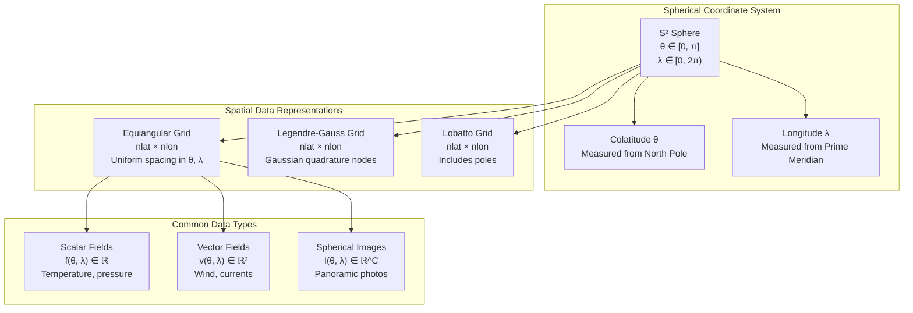

**Sources:** [README.md:109-170]()

## Spherical Harmonics Fundamentals

Spherical harmonics $Y_l^m(\theta, \lambda)$ form an orthonormal basis for functions on the sphere, analogous to Fourier series on a circle. They are defined as:

$$Y_l^m(\theta, \lambda) = \sqrt{\frac{(2l + 1)}{4 \pi} \frac{(l - m)!}{(l + m)!}} P_l^m(\cos \theta)  \exp(im\lambda)$$

where $P_l^m$ are the associated Legendre polynomials.

### Spherical Harmonic Decomposition

| Parameter | Description | Range | Interpretation |
|-----------|-------------|-------|----------------|
| $l$ | Degree | $l \geq 0$ | Frequency/scale (total oscillation) |
| $m$ | Order | $-l \leq m \leq l$ | Zonal frequency (oscillation in longitude) |
| $\hat{f}_l^m$ | Coefficient | Complex | Amplitude of mode $(l, m)$ |

The forward transform projects a spatial signal onto this basis:

$$\hat{f}_l^m = \int_{S^2}  \overline{Y_{l}^{m}}(\theta, \lambda) f(\theta, \lambda) \mathrm{d} \mu(\theta, \lambda)$$

The inverse transform reconstructs the signal:

$$f(\theta, \lambda) = \sum_{m=-M}^{M} \exp(im\lambda) \sum_{l=|m|}^{M} \hat{f}_l^m  P_l^m (\cos \theta)$$

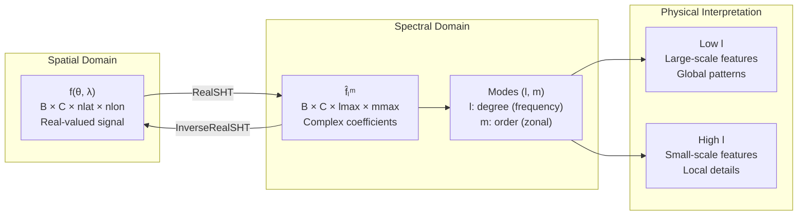

**Sources:** [README.md:109-139](), [torch_harmonics/__init__.py:34]()

## Spatial vs Spectral Representations

torch-harmonics provides seamless transitions between spatial and spectral representations, each suited to different operations.

### Comparison of Domains

| Property | Spatial Domain | Spectral Domain |
|----------|----------------|-----------------|
| **Representation** | Gridded values $f(\theta, \lambda)$ | Modal coefficients $\hat{f}_l^m$ |
| **Data shape** | `B × C × nlat × nlon` | `B × C × lmax × mmax` |
| **Data type** | Real (`torch.float32/64`) | Complex (`torch.cfloat/cdouble`) |
| **Locality** | Pointwise operations efficient | Global operations efficient |
| **Memory** | $O(n_{\text{lat}} \cdot n_{\text{lon}})$ | $O(l_{\text{max}} \cdot m_{\text{max}})$ |
| **Best for** | Local convolutions, attention | Global convolutions, derivatives |

### Operations by Domain

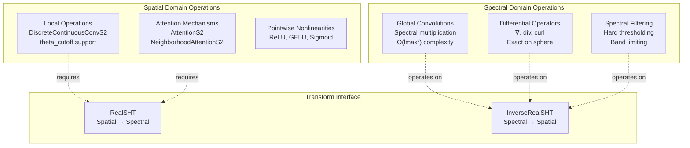

**Sources:** [README.md:125-170](), [torch_harmonics/__init__.py:34-37]()

## Grid Types and Quadrature Rules

The choice of spatial grid determines the quadrature rule used for computing the Legendre transform. Different grids offer tradeoffs between accuracy, pole treatment, and computational efficiency.

### Grid Type Characteristics

| Grid Type | Quadrature Rule | Pole Points | Use Case |
|-----------|----------------|-------------|----------|
| `equiangular` | Trapezoid rule | Excluded | General purpose, simple |
| `legendre-gauss` | Gaussian quadrature | Excluded | High accuracy, default for precision |
| `lobatto` | Gauss-Lobatto | Included | Physical boundary conditions |
| `clenshaw-curtis` | Clenshaw-Curtis | Included | Fast, good for FFT |

### Quadrature in Transform Pipeline

The Legendre transform is computed using numerical quadrature:

$$\hat{f}_l^m = \sum_{j=1}^{n_{\theta}}  \hat{f}^m(\theta_j) P_l^m(\cos \theta_j) w_j$$

where $\theta_j$ are quadrature nodes and $w_j$ are quadrature weights.

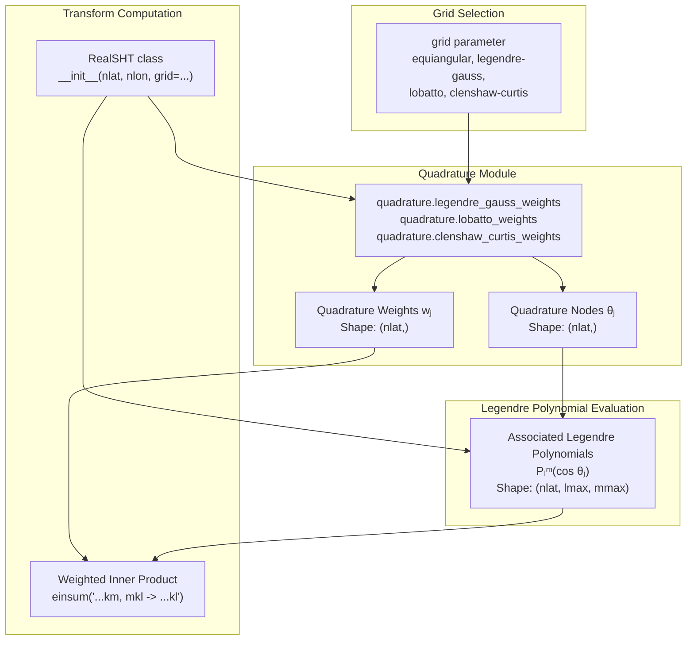

**Sources:** [README.md:155-169](), [torch_harmonics/__init__.py:38]()

## Transform Pipeline Architecture

The spherical harmonic transform decomposes into two sequential operations: an FFT in longitude and a Legendre transform in latitude.

### Forward Transform (Spatial → Spectral)

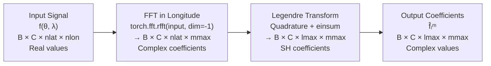

The forward transform is implemented in [RealSHT](). The FFT operation uses `torch.fft.rfft` to compute:

$$\hat{f}^m(\theta) = \frac{1}{2 \pi} \int_{0}^{2\pi} f(\theta, \lambda) \exp(-im\lambda) \mathrm{d} \lambda$$

The Legendre transform then computes:

$$\hat{f}_l^m = \frac{1}{2} \int^{\pi}_0 \hat{f}^{m} (\theta) P_l^m (\cos \theta) \sin \theta \mathrm{d} \theta$$

### Inverse Transform (Spectral → Spatial)

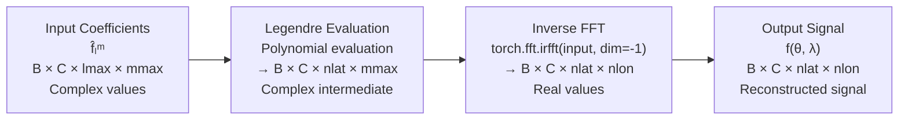

The inverse transform is implemented in [InverseRealSHT]().

**Sources:** [README.md:141-169](), [torch_harmonics/__init__.py:34]()

## Core Computational Primitives

torch-harmonics provides three main computational primitives that can be composed to build neural operators and other spherical algorithms.

### Primitive Mapping to Code

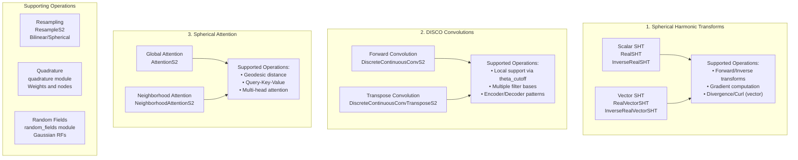

### Implementation Characteristics

| Primitive | Spatial/Spectral | Complexity | Distributed Support |
|-----------|------------------|------------|---------------------|
| `RealSHT` | Spatial → Spectral | $O(n^2 \log n)$ | `DistributedRealSHT` |
| `InverseRealSHT` | Spectral → Spatial | $O(n^2 \log n)$ | `DistributedInverseRealSHT` |
| `DiscreteContinuousConvS2` | Spatial → Spatial | $O(n^2 k^2)$ | `DistributedDiscreteContinuousConvS2` |
| `AttentionS2` | Spatial → Spatial | $O(n^4)$ or $O(n^2 k^2)$ | Not yet available |
| `ResampleS2` | Spatial → Spatial | $O(n^2)$ | `DistributedResampleS2` |

**Sources:** [torch_harmonics/__init__.py:34-37](), [README.md:171-177]()

## Design Philosophy

### 1. Differentiability First

All operations are implemented using PyTorch primitives to ensure full differentiability through automatic differentiation. This enables:

- **End-to-end training** of neural operators
- **Gradient-based optimization** of PDE solvers
- **Backpropagation** through transform operations

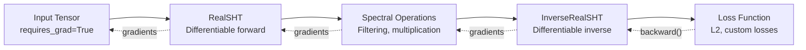

### 2. Modular Composability

Operations are exposed as `torch.nn.Module` instances that can be composed in standard PyTorch workflows:

```python
# Example from README.md:183-198
sht = th.RealSHT(nlat, nlon, grid="equiangular").to(device)
coeffs = sht(signal)
```

Each module:
- Follows PyTorch conventions (`__init__`, `forward`, `.to(device)`)
- Can be part of `nn.Sequential` or custom modules
- Supports standard PyTorch features (DDP, checkpointing, mixed precision)

### 3. Spatial Distribution

For large-scale problems, torch-harmonics implements distributed versions of core operations using a 2D process grid:

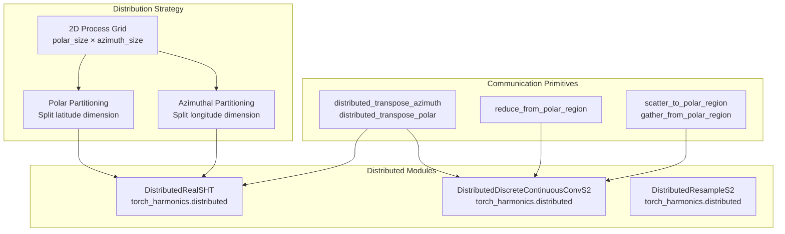

### 4. Multi-Backend Optimization

Critical operations have multiple backend implementations selected at runtime:

| Operation | Backends | Selection Criterion |
|-----------|----------|---------------------|
| DISCO Convolution | CUDA, Triton, PyTorch | Device and kernel availability |
| Attention | CUDA (custom), OpenMP, PyTorch | Device and compilation flags |
| FFT | cuFFT (CUDA), PyTorch | Precision and device |

The build system ([setup.py:39-183]()) conditionally compiles CUDA extensions based on environment variables:
- `FORCE_CUDA_EXTENSION`: Force CUDA compilation
- `TORCH_HARMONICS_DEBUG`: Debug symbols
- `TORCH_HARMONICS_PROFILE`: Profiling info
- `TORCH_HARMONICS_ENABLE_OPENMP`: OpenMP support

### 5. Caching and Performance

The library implements an LRU cache for precomputed tensors (Legendre polynomials, quadrature weights, filter bases) to avoid redundant computation:

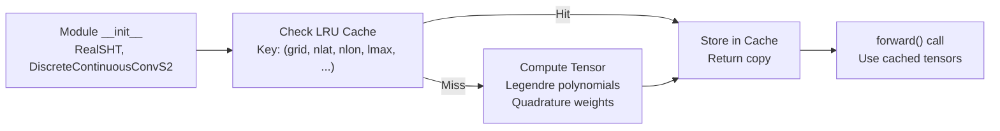

This significantly improves module instantiation time while managing memory efficiently.

**Sources:** [README.md:52-59](), [Changelog.md:29-34](), [setup.py:56-91]()

## Mathematical Notation and Conventions

Throughout the library, the following conventions are used:

| Symbol | Meaning | Typical Range |
|--------|---------|---------------|
| $\theta$ | Colatitude | $[0, \pi]$ |
| $\lambda$ | Longitude | $[0, 2\pi)$ |
| $l$ | Spherical harmonic degree | $0 \leq l \leq l_{\max}$ |
| $m$ | Spherical harmonic order | $-l \leq m \leq l$ |
| $n_{\text{lat}}$ | Number of latitude points | Typically $2^k$ or related to $l_{\max}$ |
| $n_{\text{lon}}$ | Number of longitude points | Typically $2 \times n_{\text{lat}}$ |
| `B` | Batch dimension | Variable |
| `C` | Channel dimension | Variable |

The library typically uses the convention $n_{\text{lon}} = 2 \times n_{\text{lat}}$ for equiangular grids, and $l_{\max} = m_{\max} = n_{\text{lat}} - 1$ for full resolution transforms.

**Sources:** [README.md:109-169]()

---

# Page: Spherical Harmonic Transforms

# Spherical Harmonic Transforms

<details>
<summary>Relevant source files</summary>

The following files were used as context for generating this wiki page:

- [tests/test_cache.py](tests/test_cache.py)
- [tests/test_distributed_resample.py](tests/test_distributed_resample.py)
- [tests/test_sht.py](tests/test_sht.py)
- [torch_harmonics/cache.py](torch_harmonics/cache.py)
- [torch_harmonics/distributed/distributed_sht.py](torch_harmonics/distributed/distributed_sht.py)
- [torch_harmonics/sht.py](torch_harmonics/sht.py)

</details>


**Purpose and Scope**: This page provides an overview of spherical harmonic transform (SHT) operations in torch-harmonics, explaining the mathematical foundation, implementation strategy, and usage patterns. For detailed documentation of scalar transform classes see [RealSHT and InverseRealSHT](#2.1), for vector transforms see [Vector Spherical Harmonic Transforms](#2.2), and for grid types and quadrature rules see [Grid Types and Quadrature](#2.3). For distributed multi-GPU implementations, see [Distributed SHT](#6.1).

## Overview

Spherical harmonic transforms convert data between **spatial domain** (latitude-longitude grids on the sphere) and **spectral domain** (spherical harmonic coefficients). This transformation is analogous to the Fourier transform but operates on the 2-sphere instead of Euclidean space.

The library provides four core transform classes:

| Class | Purpose | Input Shape | Output Shape |
|-------|---------|-------------|--------------|
| `RealSHT` | Forward scalar transform | `(..., nlat, nlon)` | `(..., lmax, mmax)` |
| `InverseRealSHT` | Inverse scalar transform | `(..., lmax, mmax)` | `(..., nlat, nlon)` |
| `RealVectorSHT` | Forward vector transform | `(..., 2, nlat, nlon)` | `(..., 2, lmax, mmax)` |
| `InverseRealVectorSHT` | Inverse vector transform | `(..., 2, lmax, mmax)` | `(..., 2, nlat, nlon)` |

These transforms are differentiable PyTorch modules that support automatic differentiation for training neural networks.

**Sources**: [torch_harmonics/sht.py:40-486]()

## Mathematical Foundation

Spherical harmonics $Y_l^m(\theta, \phi)$ are orthogonal basis functions on the sphere, parameterized by degree $l \geq 0$ and order $|m| \leq l$. For a real-valued function $f(\theta, \phi)$ on the sphere:

**Forward Transform**: 
$$\hat{f}_l^m = \int_0^{2\pi} \int_0^{\pi} f(\theta, \phi) Y_l^m(\theta, \phi) \sin\theta \, d\theta \, d\phi$$

**Inverse Transform**:
$$f(\theta, \phi) = \sum_{l=0}^{l_{max}} \sum_{m=-l}^{l} \hat{f}_l^m Y_l^m(\theta, \phi)$$

The real-valued spherical harmonics can be written as:
$$Y_l^m(\theta, \phi) = P_l^{|m|}(\cos\theta) \times \begin{cases} \cos(m\phi) & m \geq 0 \\ \sin(|m|\phi) & m < 0 \end{cases}$$

where $P_l^m$ are associated Legendre polynomials. This separability enables efficient computation via FFT in $\phi$ (longitude) and Legendre quadrature in $\theta$ (latitude).

**Sources**: [torch_harmonics/sht.py:69-72]()

## Two-Stage Transform Pipeline

The implementation decomposes each transform into two sequential operations:

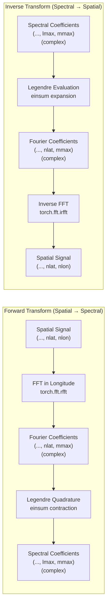

**Forward Transform Pipeline**:
1. **FFT Stage**: Apply real FFT along longitude dimension to obtain Fourier coefficients for each latitude
2. **Legendre Stage**: Perform Gaussian quadrature integration over latitude using precomputed Legendre polynomial weights

**Inverse Transform Pipeline**:
1. **Legendre Stage**: Evaluate associated Legendre polynomials at quadrature nodes
2. **IFFT Stage**: Apply inverse real FFT to reconstruct spatial values along longitude

**Sources**: [torch_harmonics/sht.py:131-148](), [torch_harmonics/sht.py:233-248]()

## Transform Class Architecture

```mermaid
graph TB
    subgraph "Scalar Transforms"
        RealSHT["RealSHT<br/>torch_harmonics.sht<br/>Forward: spatial → spectral"]
        InverseRealSHT["InverseRealSHT<br/>torch_harmonics.sht<br/>Inverse: spectral → spatial"]
    end
    
    subgraph "Vector Transforms"
        RealVectorSHT["RealVectorSHT<br/>torch_harmonics.sht<br/>Forward: vector field → spheroidal/toroidal"]
        InverseRealVectorSHT["InverseRealVectorSHT<br/>torch_harmonics.sht<br/>Inverse: spheroidal/toroidal → vector field"]
    end
    
    subgraph "Distributed Variants"
        DistRealSHT["DistributedRealSHT<br/>torch_harmonics.distributed<br/>Multi-GPU scalar forward"]
        DistInverseRealSHT["DistributedInverseRealSHT<br/>torch_harmonics.distributed<br/>Multi-GPU scalar inverse"]
        DistRealVectorSHT["DistributedRealVectorSHT<br/>torch_harmonics.distributed<br/>Multi-GPU vector forward"]
        DistInverseRealVectorSHT["DistributedInverseRealVectorSHT<br/>torch_harmonics.distributed<br/>Multi-GPU vector inverse"]
    end
    
    subgraph "Precomputation Layer"
        LEGENDRE["_precompute_legpoly<br/>torch_harmonics.legendre<br/>Associated Legendre polynomials"]
        DLEGENDRE["_precompute_dlegpoly<br/>torch_harmonics.legendre<br/>Derivatives of Legendre polynomials"]
        CACHE["lru_cache decorator<br/>torch_harmonics.cache<br/>Memoization of precomputed values"]
    end
    
    subgraph "Quadrature Layer"
        LGWEIGHTS["legendre_gauss_weights<br/>torch_harmonics.quadrature"]
        LOBWEIGHTS["lobatto_weights<br/>torch_harmonics.quadrature"]
        CCWEIGHTS["clenshaw_curtiss_weights<br/>torch_harmonics.quadrature"]
    end
    
    RealSHT --> LEGENDRE
    RealSHT --> LGWEIGHTS
    RealSHT --> LOBWEIGHTS
    RealSHT --> CCWEIGHTS
    
    InverseRealSHT --> LEGENDRE
    InverseRealSHT --> LGWEIGHTS
    InverseRealSHT --> LOBWEIGHTS
    InverseRealSHT --> CCWEIGHTS
    
    RealVectorSHT --> DLEGENDRE
    RealVectorSHT --> LGWEIGHTS
    RealVectorSHT --> LOBWEIGHTS
    RealVectorSHT --> CCWEIGHTS
    
    InverseRealVectorSHT --> DLEGENDRE
    InverseRealVectorSHT --> LGWEIGHTS
    InverseRealVectorSHT --> LOBWEIGHTS
    InverseRealVectorSHT --> CCWEIGHTS
    
    DistRealSHT --> LEGENDRE
    DistInverseRealSHT --> LEGENDRE
    DistRealVectorSHT --> DLEGENDRE
    DistInverseRealVectorSHT --> DLEGENDRE
    
    LEGENDRE --> CACHE
    DLEGENDRE --> CACHE
```

**Scalar Transforms** operate on single-channel spherical data (e.g., temperature, pressure fields). The forward transform produces complex coefficients indexed by degree $l$ and order $m$.

**Vector Transforms** operate on 2D tangent vector fields (e.g., wind velocity). They decompose vectors into spheroidal (curl-free) and toroidal (divergence-free) components using derivatives of associated Legendre polynomials.

**Distributed Variants** partition data across multiple GPUs using a 2D process grid strategy. See [Distributed Computing](#6) for details.

**Sources**: [torch_harmonics/sht.py:40-486](), [torch_harmonics/distributed/distributed_sht.py:45-613]()

## Precomputation and Caching Strategy

Transform modules precompute associated Legendre polynomials $P_l^m(\cos\theta_k)$ at quadrature nodes during initialization:

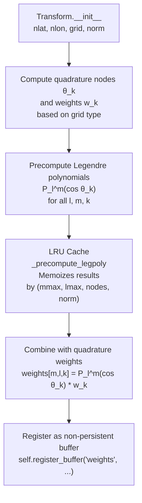

**Caching Mechanism**: The `_precompute_legpoly` function uses an LRU cache with deep copying to prevent external modifications:

- **Cache Key**: `(mmax, lmax, quadrature_nodes, norm, inverse, csphase)`
- **Cache Size**: 20 entries by default
- **Deep Copy**: Returns clones to prevent in-place modifications of cached values
- **Memory Impact**: Precomputed polynomials are stored on device with shape `(mmax, lmax, nlat)`

This strategy avoids recomputing expensive polynomial evaluations when creating multiple transform instances with identical parameters.

**Sources**: [torch_harmonics/sht.py:114-118](), [torch_harmonics/legendre.py](), [torch_harmonics/cache.py:37-74](), [tests/test_cache.py:39-50]()

## Common Parameters

All transform classes share a consistent parameter interface:

| Parameter | Type | Description | Default |
|-----------|------|-------------|---------|
| `nlat` | `int` | Number of latitude points | Required |
| `nlon` | `int` | Number of longitude points | Required |
| `lmax` | `int` | Maximum spherical harmonic degree | `nlat` (grid-dependent) |
| `mmax` | `int` | Maximum spherical harmonic order | `nlon // 2 + 1` |
| `grid` | `str` | Grid type: `"equiangular"`, `"legendre-gauss"`, `"lobatto"` | `"equiangular"` |
| `norm` | `str` | Normalization: `"ortho"`, `"schmidt"`, `"four-pi"` | `"ortho"` |
| `csphase` | `bool` | Apply Condon-Shortley phase factor $(-1)^m$ | `True` |

**Grid Type Selection**: Different quadrature rules provide different polynomial exactness:

| Grid Type | Quadrature Rule | Max Exact Degree | Default `lmax` |
|-----------|----------------|------------------|----------------|
| `legendre-gauss` | Gauss-Legendre | $2n - 1$ | `nlat` |
| `lobatto` | Gauss-Lobatto | $2n - 3$ | `nlat - 1` |
| `equiangular` | Clenshaw-Curtis | ~$n$ | `nlat` |

**Normalization Schemes**:
- `"ortho"`: Orthonormal basis with $\int Y_l^m Y_{l'}^{m'} = \delta_{ll'}\delta_{mm'}$
- `"schmidt"`: Schmidt semi-normalization used in geodesy
- `"four-pi"`: Legacy normalization with $4\pi$ factor

**Sources**: [torch_harmonics/sht.py:74-115](), [torch_harmonics/sht.py:88-105]()

## Forward Transform: Spatial to Spectral

The forward transform converts spatial data to spectral coefficients:

```python
import torch
import torch_harmonics as th

# Create transform
sht = th.RealSHT(nlat=64, nlon=128, grid="equiangular")

# Spatial data: batch_size × channels × nlat × nlon
x_spatial = torch.randn(4, 16, 64, 128)

# Forward transform: batch_size × channels × lmax × mmax
x_spectral = sht(x_spatial)  # complex-valued coefficients
```

**Implementation Details**:

1. **FFT Stage** [torch_harmonics/sht.py:132]():
   ```python
   x = 2.0 * torch.pi * torch.fft.rfft(x, dim=-1, norm="forward")
   ```
   Applies real FFT along longitude with normalization factor $2\pi$.

2. **Legendre Quadrature** [torch_harmonics/sht.py:144-146]():
   ```python
   xout[..., 0] = torch.einsum("...km,mlk->...lm", x[..., :mmax, 0], weights)
   xout[..., 1] = torch.einsum("...km,mlk->...lm", x[..., :mmax, 1], weights)
   ```
   Contracts Fourier coefficients with precomputed Legendre-weight products.

**Sources**: [torch_harmonics/sht.py:123-148]()

## Inverse Transform: Spectral to Spatial

The inverse transform reconstructs spatial data from spectral coefficients:

```python
import torch
import torch_harmonics as th

# Create transform
isht = th.InverseRealSHT(nlat=64, nlon=128, grid="equiangular")

# Spectral coefficients: batch_size × channels × lmax × mmax
x_spectral = torch.randn(4, 16, 64, 65, dtype=torch.complex64)

# Inverse transform: batch_size × channels × nlat × nlon
x_spatial = isht(x_spectral)  # real-valued spatial data
```

**Implementation Details**:

1. **Legendre Evaluation** [torch_harmonics/sht.py:235]():
   ```python
   xs = torch.einsum('...lmr, mlk->...kmr', x, pct).contiguous()
   ```
   Evaluates spherical harmonics at quadrature nodes using precomputed polynomials.

2. **IFFT Stage** [torch_harmonics/sht.py:243-247]():
   ```python
   x[..., 0].imag = 0.0
   if (nlon % 2 == 0) and (nlon // 2 < mmax):
       x[..., nlon // 2].imag = 0.0
   x = torch.fft.irfft(x, n=nlon, dim=-1, norm="forward")
   ```
   Ensures DC and Nyquist components are real before inverse FFT.

**Sources**: [torch_harmonics/sht.py:225-249]()

## Exactness and Round-Trip Error

For band-limited signals (all coefficients zero for $l > l_{max}$, $m > m_{max}$), the transform pair should be numerically exact up to floating-point precision:

```python
# Round-trip test
signal_original = isht(coeffs)
coeffs_reconstructed = sht(signal_original)
error = torch.norm(coeffs - coeffs_reconstructed) / torch.norm(coeffs)
# error ≈ 1e-9 for float64
```

The test suite validates this property across different grid types and normalizations [tests/test_sht.py:113-148]():

- **Iterations**: Tests accumulation over 1, 2, 4, 8, 16 round-trip iterations
- **Tolerance**: $10^{-9}$ relative error for `float64`
- **Grid Coverage**: Equiangular, Legendre-Gauss, Lobatto grids
- **Normalization**: Orthonormal, Schmidt, four-pi schemes

**Sources**: [tests/test_sht.py:88-148]()

## Gradient Computation and Backpropagation

All transform classes are differentiable PyTorch modules with custom backward passes:

```python
# Enable gradient tracking
x_spatial = torch.randn(2, 8, 64, 128, requires_grad=True)

# Forward pass
x_spectral = sht(x_spatial)

# Compute loss in spectral domain
loss = x_spectral.abs().sum()

# Backward pass computes ∂loss/∂x_spatial
loss.backward()
gradient = x_spatial.grad
```

The gradient tests verify numerical correctness using `torch.autograd.gradcheck` [tests/test_sht.py:175-205]():

```python
grad_input = torch.randn_like(signal, requires_grad=True)
test_result = gradcheck(sht, grad_input, eps=1e-6, atol=1e-5)
```

**Sources**: [tests/test_sht.py:150-205]()

## Usage Patterns

### Pattern 1: Global Spectral Operations

Apply operations in spectral domain for efficiency:

```python
sht = th.RealSHT(nlat, nlon)
isht = th.InverseRealSHT(nlat, nlon)

# Transform to spectral domain
coeffs = sht(spatial_data)

# Spectral filtering (e.g., low-pass filter)
l = torch.arange(lmax)
filter = (l < cutoff).float()
coeffs_filtered = coeffs * filter.unsqueeze(-1)

# Transform back to spatial domain
spatial_filtered = isht(coeffs_filtered)
```

### Pattern 2: Derivatives on the Sphere

Compute gradients using spectral differentiation:

```python
# Transform to spectral
coeffs = sht(scalar_field)

# Spectral differentiation operators
# ∂/∂θ involves l(l+1) factor
# ∂/∂φ involves im factor
```

See [RealVectorSHT](#2.2) for vector field operations.

### Pattern 3: Multi-Resolution Analysis

Different grid resolutions for different scales:

```python
# Coarse resolution
sht_coarse = th.RealSHT(nlat=32, nlon=64)
coeffs_coarse = sht_coarse(data_coarse)

# Fine resolution  
sht_fine = th.RealSHT(nlat=128, nlon=256)
coeffs_fine = sht_fine(data_fine)

# Coefficients can be compared/combined at matching (l,m)
```

**Sources**: Derived from usage patterns in neural operator architectures

## Device Placement and Instantiation

Transform modules can be instantiated directly on GPU to avoid host-device transfers of precomputed weights:

```python
# CPU instantiation (default)
sht_cpu = th.RealSHT(nlat=64, nlon=128)
sht_gpu = sht_cpu.to("cuda")  # Transfers precomputed weights

# Direct GPU instantiation
with torch.device("cuda"):
    sht_gpu_direct = th.RealSHT(nlat=64, nlon=128)
    # Precomputation happens on GPU
```

The test suite verifies consistent results between instantiation methods [tests/test_sht.py:216-239]():

```python
# Weights should match regardless of instantiation device
assert torch.allclose(sht_cpu.weights.cpu(), sht_gpu.weights.cpu())
```

**Sources**: [tests/test_sht.py:207-239]()

## Relation to Other Components

```mermaid
graph TB
    SHT["Spherical Harmonic Transforms<br/>Page 2"]
    
    SHT --> SCALAR["RealSHT / InverseRealSHT<br/>Page 2.1<br/>Scalar fields"]
    SHT --> VECTOR["RealVectorSHT / InverseRealVectorSHT<br/>Page 2.2<br/>Vector fields"]
    SHT --> GRID["Grid Types and Quadrature<br/>Page 2.3<br/>Sampling strategies"]
    
    SHT -.used by.-> SFNO["SFNO Architecture<br/>Page 7.1<br/>Global spectral convolutions"]
    SHT -.used by.-> LSNO["LSNO Architecture<br/>Page 7.2<br/>Mixed local-global operators"]
    SHT -.used by.-> RESAMPLE["Resampling<br/>Page 5<br/>Multi-resolution transforms"]
    
    SHT -.distributed via.-> DSHT["Distributed SHT<br/>Page 6.1<br/>Multi-GPU transforms"]
    
    SHT -.relies on.-> QUAD["Quadrature Module<br/>Page 11.5<br/>Weights and nodes"]
    SHT -.relies on.-> LEG["Legendre Module<br/>Associated polynomials"]
    SHT -.relies on.-> CACHE["Caching System<br/>Page 9.4<br/>Precomputation memoization"]
```

The SHT module serves as a foundational primitive for:

- **Neural Operators** [Page 7](#7): SFNO uses SHT for global spectral convolutions, LSNO combines SHT with local DISCO convolutions
- **Resampling** [Page 5](#5): Multi-resolution transforms via spectral truncation/padding
- **Distributed Computing** [Page 6](#6): Scalable multi-GPU implementations for large-scale problems

**Sources**: High-level architecture diagrams, neural operator implementations

## Performance Considerations

**Computational Complexity**:
- Forward/inverse transform: $O(n_{lat} \times n_{lon} \times m_{max}) + O(FFT)$
- Precomputation (one-time): $O(m_{max} \times l_{max} \times n_{lat})$
- Memory: $O(m_{max} \times l_{max} \times n_{lat})$ for cached polynomials

**Optimization Opportunities**:
- Use LRU cache to avoid redundant precomputation
- Instantiate on target device to minimize data movement
- For large-scale problems, use distributed implementations [Page 6.1](#6.1)
- Consider grid-dependent `lmax` limits for optimal quadrature accuracy

**Sources**: Implementation analysis of einsum operations and caching strategy

## References

The implementation follows established numerical methods for spherical harmonic transforms:

[1] Schaeffer, N. "Efficient spherical harmonic transforms aimed at pseudospectral numerical simulations", G3: Geochemistry, Geophysics, Geosystems (2013)

[2] Wang, B., Wang, L., Xie, Z. "Accurate calculation of spherical and vector spherical harmonic expansions via spectral element grids", Advances in Computational Mathematics (2017)

**Sources**: [torch_harmonics/sht.py:69-72](), [torch_harmonics/sht.py:183-185]()

---

# Page: RealSHT and InverseRealSHT

# RealSHT and InverseRealSHT

<details>
<summary>Relevant source files</summary>

The following files were used as context for generating this wiki page:

- [tests/test_cache.py](tests/test_cache.py)
- [tests/test_distributed_resample.py](tests/test_distributed_resample.py)
- [tests/test_sht.py](tests/test_sht.py)
- [torch_harmonics/cache.py](torch_harmonics/cache.py)
- [torch_harmonics/distributed/distributed_sht.py](torch_harmonics/distributed/distributed_sht.py)
- [torch_harmonics/sht.py](torch_harmonics/sht.py)

</details>


## Purpose and Scope

This document describes the core scalar spherical harmonic transform (SHT) classes in torch-harmonics: `RealSHT` and `InverseRealSHT`. These classes provide differentiable conversions between spatial representations on the sphere (latitude-longitude grids) and spectral representations (spherical harmonic coefficients).

**Scope:**
- Scalar spherical harmonic transforms for real-valued signals
- Forward transform (spatial → spectral) via `RealSHT`
- Inverse transform (spectral → spatial) via `InverseRealSHT`
- Grid types, normalization schemes, and configuration options

**Related Pages:**
- For vector field transforms, see [Vector Spherical Harmonic Transforms](#2.2)
- For distributed multi-GPU implementations, see [Distributed SHT](#6.1)
- For grid types and quadrature details, see [Grid Types and Quadrature](#2.3)

Sources: [torch_harmonics/sht.py:40-250]()

---

## Mathematical Background

Spherical harmonic transforms decompose functions defined on the sphere into a basis of spherical harmonics $Y_l^m(\theta, \phi)$, analogous to how Fourier transforms decompose periodic functions. A scalar function $f(\theta, \phi)$ on the sphere can be represented as:

$$f(\theta, \phi) = \sum_{l=0}^{l_{max}} \sum_{m=-l}^{l} \hat{f}_l^m Y_l^m(\theta, \phi)$$

where $\hat{f}_l^m$ are the spherical harmonic coefficients (spectral domain) and $l, m$ are the degree and order indices.

The **forward transform** computes coefficients from spatial values using numerical integration:
$$\hat{f}_l^m = \int_0^{2\pi} \int_0^{\pi} f(\theta, \phi) \overline{Y_l^m(\theta, \phi)} \sin\theta \, d\theta \, d\phi$$

The **inverse transform** reconstructs spatial values from coefficients by evaluating the series.

For real-valued functions, the transforms exploit symmetry properties: only non-negative $m$ values are stored, and the FFT along longitude yields real-to-complex transforms.

Sources: [torch_harmonics/sht.py:40-72](), [torch_harmonics/sht.py:151-186]()

---

## Transform Pipeline Architecture

```mermaid
graph LR
    subgraph "Forward Transform: RealSHT"
        SPATIAL_IN["Spatial Signal<br/>(..., nlat, nlon)<br/>real values"]
        FFT_STEP["FFT Step<br/>torch.fft.rfft<br/>longitude dimension"]
        RFFT_OUT["FFT Coefficients<br/>(..., nlat, mmax)<br/>complex"]
        LEG_STEP["Legendre Quadrature<br/>einsum contraction<br/>with precomputed weights"]
        SPECTRAL_OUT["Spectral Coefficients<br/>(..., lmax, mmax)<br/>complex"]
    end
    
    subgraph "Inverse Transform: InverseRealSHT"
        SPECTRAL_IN["Spectral Coefficients<br/>(..., lmax, mmax)<br/>complex"]
        LEG_EVAL["Legendre Evaluation<br/>einsum expansion<br/>with precomputed basis"]
        RFFT_IN["FFT Coefficients<br/>(..., nlat, mmax)<br/>complex"]
        IFFT_STEP["Inverse FFT<br/>torch.fft.irfft<br/>longitude dimension"]
        SPATIAL_OUT["Spatial Signal<br/>(..., nlat, nlon)<br/>real values"]
    end
    
    SPATIAL_IN --> FFT_STEP
    FFT_STEP --> RFFT_OUT
    RFFT_OUT --> LEG_STEP
    LEG_STEP --> SPECTRAL_OUT
    
    SPECTRAL_IN --> LEG_EVAL
    LEG_EVAL --> RFFT_IN
    RFFT_IN --> IFFT_STEP
    IFFT_STEP --> SPATIAL_OUT
```

**Transform Process:**
1. **Forward (RealSHT):** Spatial data undergoes FFT in longitude, then Legendre quadrature in latitude
2. **Inverse (InverseRealSHT):** Spectral coefficients are evaluated as Legendre polynomials, then inverse FFT in longitude
3. Both operations are fully differentiable for gradient-based optimization

Sources: [torch_harmonics/sht.py:123-148](), [torch_harmonics/sht.py:225-249]()

---

## RealSHT: Forward Transform

The `RealSHT` class transforms spatial signals on the sphere into spherical harmonic coefficients.

### Class Definition and Parameters

| Parameter | Type | Default | Description |
|-----------|------|---------|-------------|
| `nlat` | `int` | required | Number of latitude points in spatial grid |
| `nlon` | `int` | required | Number of longitude points in spatial grid |
| `lmax` | `int` | `None` | Maximum spherical harmonic degree (auto-computed if None) |
| `mmax` | `int` | `None` | Maximum spherical harmonic order (default: `nlon // 2 + 1`) |
| `grid` | `str` | `"equiangular"` | Grid type: `"equiangular"`, `"legendre-gauss"`, or `"lobatto"` |
| `norm` | `str` | `"ortho"` | Normalization: `"ortho"`, `"schmidt"`, or `"unnorm"` |
| `csphase` | `bool` | `True` | Whether to apply Condon-Shortley phase factor |

### Input/Output Specifications

**Input:** Tensor of shape `(..., nlat, nlon)` containing real-valued spatial data
- Arbitrary leading batch dimensions supported
- Last two dimensions must match `nlat` and `nlon`

**Output:** Complex tensor of shape `(..., lmax, mmax)` containing spherical harmonic coefficients
- Complex64 or Complex128 depending on input precision
- Only non-negative $m$ values stored (real-valued signal symmetry)

### Initialization and Precomputation

During initialization, `RealSHT` precomputes:
1. **Quadrature points and weights** based on grid type
2. **Associated Legendre polynomials** at quadrature points
3. **Combined weights** integrating quadrature and Legendre normalization

These are stored in a registered buffer `weights` for efficient repeated application.

Sources: [torch_harmonics/sht.py:40-122]()

---

## InverseRealSHT: Inverse Transform

The `InverseRealSHT` class reconstructs spatial signals from spherical harmonic coefficients.

### Class Definition and Parameters

Parameters are identical to `RealSHT`:

| Parameter | Type | Default | Description |
|-----------|------|---------|-------------|
| `nlat` | `int` | required | Number of latitude points in output spatial grid |
| `nlon` | `int` | required | Number of longitude points in output spatial grid |
| `lmax` | `int` | `None` | Maximum spherical harmonic degree |
| `mmax` | `int` | `None` | Maximum spherical harmonic order |
| `grid` | `str` | `"equiangular"` | Grid type for output spatial representation |
| `norm` | `str` | `"ortho"` | Normalization scheme (must match forward transform) |
| `csphase` | `bool` | `True` | Condon-Shortley phase factor (must match forward transform) |

### Input/Output Specifications

**Input:** Complex tensor of shape `(..., lmax, mmax)` containing spherical harmonic coefficients
- Must match the spectral dimensions from corresponding `RealSHT`

**Output:** Real tensor of shape `(..., nlat, nlon)` containing reconstructed spatial data
- Leading batch dimensions preserved
- Output grid determined by `nlat`, `nlon`, and `grid` parameters

### Initialization and Precomputation

During initialization, `InverseRealSHT` precomputes:
1. **Quadrature points** (same as forward transform)
2. **Associated Legendre polynomial basis** for evaluation (not quadrature)
3. Stored in registered buffer `pct` (polynomial coefficient table)

### Nyquist Frequency Handling

The inverse transform explicitly zeros the imaginary parts of DC and Nyquist frequency components to ensure real-valued output:

```python
x[..., 0].imag = 0.0
if (self.nlon % 2 == 0) and (self.nlon // 2 < self.mmax):
    x[..., self.nlon // 2].imag = 0.0
```

Sources: [torch_harmonics/sht.py:151-250](), [torch_harmonics/sht.py:240-246]()

---

## Grid Types and Spectral Resolution

The choice of grid type affects quadrature accuracy and the relationship between spatial and spectral resolution.

```mermaid
graph TB
    subgraph "Grid Types"
        EQ["equiangular<br/>Clenshaw-Curtis quadrature<br/>lmax = nlat"]
        LG["legendre-gauss<br/>Gauss-Legendre quadrature<br/>lmax = nlat"]
        LO["lobatto<br/>Gauss-Lobatto quadrature<br/>lmax = nlat - 1"]
    end
    
    subgraph "Quadrature Modules"
        CC["clenshaw_curtiss_weights<br/>torch_harmonics.quadrature"]
        GLW["legendre_gauss_weights<br/>torch_harmonics.quadrature"]
        LOBW["lobatto_weights<br/>torch_harmonics.quadrature"]
    end
    
    subgraph "Exactness Properties"
        EQ_PROP["Polynomial degree ≈ nlat<br/>Empirically accurate"]
        LG_PROP["Polynomial degree = 2*nlat - 1<br/>Exact integration"]
        LO_PROP["Polynomial degree = 2*nlat - 3<br/>Includes poles"]
    end
    
    EQ --> CC
    LG --> GLW
    LO --> LOBW
    
    CC --> EQ_PROP
    GLW --> LG_PROP
    LOBW --> LO_PROP
```

### Grid Type Details

| Grid Type | Quadrature | Default `lmax` | Pole Points | Use Case |
|-----------|------------|----------------|-------------|----------|
| `"equiangular"` | Clenshaw-Curtis | `nlat` | Excludes poles | General-purpose, uniform spacing |
| `"legendre-gauss"` | Gauss-Legendre | `nlat` | Excludes poles | Maximum quadrature accuracy |
| `"lobatto"` | Gauss-Lobatto | `nlat - 1` | Includes poles | Spectral element methods |

**Key Considerations:**
- Legendre-Gauss provides exact integration for polynomials up to degree $2n-1$
- Equiangular grid empirically performs well beyond theoretical exactness bounds
- Lobatto includes pole points, useful for certain boundary conditions

Sources: [torch_harmonics/sht.py:88-106](), [torch_harmonics/sht.py:199-209](), [torch_harmonics/quadrature.py:1-100]()

---

## Normalization Schemes

Three normalization schemes are supported, affecting the scaling of spherical harmonic basis functions.

| Normalization | Description | Orthonormality | Use Case |
|---------------|-------------|----------------|----------|
| `"ortho"` | Orthonormal basis | $\langle Y_l^m, Y_{l'}^{m'} \rangle = \delta_{ll'}\delta_{mm'}$ | Default, numerical stability |
| `"schmidt"` | Schmidt semi-normalization | Geodesy convention | Geophysical applications |
| `"unnorm"` | Unnormalized | No normalization constraint | Compatibility with legacy code |

**Important:** The same normalization must be used for both forward and inverse transforms to ensure perfect reconstruction.

Sources: [torch_harmonics/sht.py:58-59](), [torch_harmonics/legendre.py:1-50]()

---

## Condon-Shortley Phase Convention

The `csphase` parameter controls the Condon-Shortley phase factor $(-1)^m$ in the definition of associated Legendre polynomials:

- `csphase=True` (default): Includes $(-1)^m$ factor, standard in physics
- `csphase=False`: Omits the factor, sometimes used in mathematics

**Consistency requirement:** Both forward and inverse transforms must use the same `csphase` value.

Sources: [torch_harmonics/sht.py:60-61](), [torch_harmonics/legendre.py:80-120]()

---

## Implementation Details

### Code Entity Mapping

```mermaid
graph TB
    subgraph "RealSHT Class"
        RSHT_INIT["__init__<br/>Precompute weights"]
        RSHT_FWD["forward<br/>Apply transform"]
        RSHT_WEIGHTS["self.weights<br/>Registered buffer"]
    end
    
    subgraph "InverseRealSHT Class"
        IRSHT_INIT["__init__<br/>Precompute basis"]
        IRSHT_FWD["forward<br/>Apply transform"]
        IRSHT_PCT["self.pct<br/>Registered buffer"]
    end
    
    subgraph "Legendre Module"
        PRECOMP_LEG["_precompute_legpoly<br/>torch_harmonics.legendre"]
        CACHE["lru_cache decorator<br/>torch_harmonics.cache"]
    end
    
    subgraph "PyTorch Operations"
        RFFT["torch.fft.rfft"]
        IRFFT["torch.fft.irfft"]
        EINSUM["torch.einsum"]
        VIEW_COMPLEX["torch.view_as_complex<br/>torch.view_as_real"]
    end
    
    RSHT_INIT --> PRECOMP_LEG
    IRSHT_INIT --> PRECOMP_LEG
    PRECOMP_LEG --> CACHE
    
    RSHT_FWD --> RFFT
    RSHT_FWD --> EINSUM
    RSHT_FWD --> VIEW_COMPLEX
    
    IRSHT_FWD --> IRFFT
    IRSHT_FWD --> EINSUM
    IRSHT_FWD --> VIEW_COMPLEX
    
    RSHT_INIT -.stores.-> RSHT_WEIGHTS
    IRSHT_INIT -.stores.-> IRSHT_PCT
```

### Forward Transform Implementation

The forward transform in `RealSHT.forward()` executes these steps:

1. **FFT in Longitude** ([torch_harmonics/sht.py:132]()):
   ```python
   x = 2.0 * torch.pi * torch.fft.rfft(x, dim=-1, norm="forward")
   ```
   - Real-to-complex FFT along longitude dimension
   - Factor of $2\pi$ from integration measure
   - Results in shape `(..., nlat, mmax)`

2. **Convert to Real View** ([torch_harmonics/sht.py:135]()):
   ```python
   x = torch.view_as_real(x)
   ```
   - Splits complex tensor into real/imaginary components
   - Shape becomes `(..., nlat, mmax, 2)`

3. **Legendre Quadrature** ([torch_harmonics/sht.py:144-146]()):
   ```python
   xout[..., 0] = torch.einsum("...km,mlk->...lm", x[..., :self.mmax, 0], self.weights)
   xout[..., 1] = torch.einsum("...km,mlk->...lm", x[..., :self.mmax, 1], self.weights)
   ```
   - Separate contractions for real and imaginary parts
   - `self.weights` has shape `(mmax, lmax, nlat)`
   - Einstein summation over latitude dimension

4. **Convert to Complex Output** ([torch_harmonics/sht.py:146]()):
   ```python
   x = torch.view_as_complex(xout)
   ```

### Inverse Transform Implementation

The inverse transform in `InverseRealSHT.forward()` executes these steps:

1. **Convert to Real View** ([torch_harmonics/sht.py:234]()):
   ```python
   x = torch.view_as_real(x)
   ```

2. **Legendre Polynomial Evaluation** ([torch_harmonics/sht.py:235]()):
   ```python
   xs = torch.einsum("...lmr, mlk->...kmr", x, self.pct).contiguous()
   ```
   - `self.pct` has shape `(mmax, lmax, nlat)`
   - Evaluates polynomial series at each latitude point

3. **Convert to Complex** ([torch_harmonics/sht.py:238]()):
   ```python
   x = torch.view_as_complex(xs)
   ```

4. **Zero Nyquist Components** ([torch_harmonics/sht.py:243-245]()):
   ```python
   x[..., 0].imag = 0.0
   if (self.nlon % 2 == 0) and (self.nlon // 2 < self.mmax):
       x[..., self.nlon // 2].imag = 0.0
   ```

5. **Inverse FFT in Longitude** ([torch_harmonics/sht.py:247]()):
   ```python
   x = torch.fft.irfft(x, n=self.nlon, dim=-1, norm="forward")
   ```

Sources: [torch_harmonics/sht.py:123-148](), [torch_harmonics/sht.py:225-249]()

---

## Precomputation and Caching

### Registered Buffers

Both classes use PyTorch's `register_buffer` mechanism to store precomputed data:

**RealSHT:**
- `self.weights`: Combined quadrature weights and Legendre polynomial values
- Shape: `(mmax, lmax, nlat)`
- Created in `__init__` via `_precompute_legpoly` and weighted by quadrature

**InverseRealSHT:**
- `self.pct`: Legendre polynomial basis for evaluation
- Shape: `(mmax, lmax, nlat)`
- Created in `__init__` via `_precompute_legpoly` with `inverse=True`

The `persistent=False` flag prevents these from being saved in `state_dict()`, reducing checkpoint size.

### LRU Caching

The `_precompute_legpoly` function uses an LRU cache decorator to avoid redundant computation:

```mermaid
graph LR
    CALL1["First call with<br/>(mmax, lmax, theta, norm)"]
    CACHE_MISS["Cache miss<br/>Compute polynomials"]
    STORE["Store in cache<br/>key = function args"]
    
    CALL2["Subsequent call<br/>same arguments"]
    CACHE_HIT["Cache hit<br/>Return cached result"]
    COPY["Deep copy returned<br/>prevents mutation"]
    
    CALL1 --> CACHE_MISS
    CACHE_MISS --> STORE
    
    CALL2 --> CACHE_HIT
    CACHE_HIT --> COPY
```

The cache uses deep copying to prevent external modifications from corrupting cached values, as verified in [tests/test_cache.py:39-51]().

Sources: [torch_harmonics/sht.py:114-118](), [torch_harmonics/sht.py:217-220](), [torch_harmonics/cache.py:37-74](), [torch_harmonics/legendre.py:1-100]()

---

## Usage Patterns

### Basic Forward-Inverse Roundtrip

```python
import torch
import torch_harmonics as th

# Configuration
nlat, nlon = 128, 256
batch_size = 4

# Initialize transforms
sht = th.RealSHT(nlat, nlon, grid="equiangular", norm="ortho")
isht = th.InverseRealSHT(nlat, nlon, grid="equiangular", norm="ortho")

# Create spatial data
spatial_data = torch.randn(batch_size, nlat, nlon)

# Forward transform: spatial -> spectral
spectral_coeffs = sht(spatial_data)  # shape: (batch_size, lmax, mmax)

# Inverse transform: spectral -> spatial
reconstructed = isht(spectral_coeffs)  # shape: (batch_size, nlat, nlon)

# Verify reconstruction
error = torch.norm(spatial_data - reconstructed) / torch.norm(spatial_data)
print(f"Relative reconstruction error: {error.item():.2e}")
```

### Integration with Neural Networks

```python
import torch.nn as nn

class SpectralLayer(nn.Module):
    def __init__(self, nlat, nlon, lmax, mmax):
        super().__init__()
        self.sht = th.RealSHT(nlat, nlon, lmax=lmax, mmax=mmax)
        self.isht = th.InverseRealSHT(nlat, nlon, lmax=lmax, mmax=mmax)
        
        # Learnable spectral filter
        self.filter = nn.Parameter(torch.ones(lmax, mmax, dtype=torch.complex64))
        
    def forward(self, x):
        # Transform to spectral domain
        x_spec = self.sht(x)
        
        # Apply spectral filtering
        x_spec = x_spec * self.filter
        
        # Transform back to spatial domain
        return self.isht(x_spec)
```

### Multi-Channel Processing

The transforms support arbitrary leading batch dimensions:

```python
# Multi-channel input: (batch, channels, lat, lon)
nlat, nlon = 64, 128
batch_size, channels = 8, 16

sht = th.RealSHT(nlat, nlon)
isht = th.InverseRealSHT(nlat, nlon)

# Input shape: (8, 16, 64, 128)
spatial = torch.randn(batch_size, channels, nlat, nlon)

# Output shape: (8, 16, lmax, mmax)
spectral = sht(spatial)

# Reconstruct: (8, 16, 64, 128)
reconstructed = isht(spectral)
```

Sources: [tests/test_sht.py:113-148]()

---

## Gradient Support and Differentiability

Both `RealSHT` and `InverseRealSHT` are fully differentiable and support automatic differentiation through PyTorch's autograd system.

### Gradient Flow

```mermaid
graph TB
    subgraph "Forward Pass"
        FWD_INPUT["Input Tensor<br/>requires_grad=True"]
        FWD_SHT["RealSHT.forward"]
        FWD_SPECTRAL["Spectral Coeffs<br/>grad_fn=<...>"]
        FWD_ISHT["InverseRealSHT.forward"]
        FWD_OUTPUT["Output Tensor<br/>grad_fn=<...>"]
        FWD_LOSS["Loss Function"]
    end
    
    subgraph "Backward Pass"
        BWD_LOSS["loss.backward()"]
        BWD_ISHT["InverseRealSHT.backward<br/>via autograd"]
        BWD_SPECTRAL["Gradient w.r.t.<br/>spectral coeffs"]
        BWD_SHT["RealSHT.backward<br/>via autograd"]
        BWD_INPUT["Gradient w.r.t.<br/>input tensor"]
    end
    
    FWD_INPUT --> FWD_SHT
    FWD_SHT --> FWD_SPECTRAL
    FWD_SPECTRAL --> FWD_ISHT
    FWD_ISHT --> FWD_OUTPUT
    FWD_OUTPUT --> FWD_LOSS
    
    BWD_LOSS --> BWD_ISHT
    BWD_ISHT --> BWD_SPECTRAL
    BWD_SPECTRAL --> BWD_SHT
    BWD_SHT --> BWD_INPUT
```

### Gradient Validation

The test suite verifies gradient correctness using `torch.autograd.gradcheck`:

```python
# From test_sht.py
def test_grads(self, nlat, nlon, batch_size, norm, grid, tol, verbose):
    sht = th.RealSHT(nlat, nlon, grid=grid, norm=norm)
    isht = th.InverseRealSHT(nlat, nlon, grid=grid, norm=norm)
    
    # Test forward transform gradients
    grad_input = torch.randn_like(signal, requires_grad=True)
    err_handle = lambda x: torch.mean(
        torch.norm(sht(x) - coeffs, p="fro", dim=(-1, -2)) / 
        torch.norm(coeffs, p="fro", dim=(-1, -2))
    )
    test_result = gradcheck(err_handle, grad_input, eps=1e-6, atol=tol)
    
    # Test inverse transform gradients
    grad_input = torch.randn_like(coeffs, requires_grad=True)
    err_handle = lambda x: torch.mean(
        torch.norm(isht(x) - signal, p="fro", dim=(-1, -2)) / 
        torch.norm(signal, p="fro", dim=(-1, -2))
    )
    test_result = gradcheck(err_handle, grad_input, eps=1e-6, atol=tol)
```

Gradients are validated to relative tolerances of 1e-5 across all grid types and normalization schemes.

Sources: [tests/test_sht.py:175-205]()

---

## Device Compatibility

Both classes support CPU and CUDA devices with automatic buffer placement.

### Device Instantiation

```python
# CPU instantiation
sht_cpu = th.RealSHT(nlat, nlon)
isht_cpu = th.InverseRealSHT(nlat, nlon)

# Move to GPU
sht_gpu = sht_cpu.to('cuda')
isht_gpu = isht_cpu.to('cuda')

# Direct GPU instantiation (buffers created on GPU)
with torch.device('cuda'):
    sht_gpu = th.RealSHT(nlat, nlon)
    isht_gpu = th.InverseRealSHT(nlat, nlon)
```

### Buffer Device Management

Registered buffers automatically move with the module:
- `self.weights` in `RealSHT`
- `self.pct` in `InverseRealSHT`

When using `.to(device)`, buffers are transferred and subsequent operations run on the target device. The test suite verifies buffer consistency across devices in [tests/test_sht.py:217-240]().

Sources: [tests/test_sht.py:39-42](), [tests/test_sht.py:217-240]()

---

## Performance Considerations

### Computational Complexity

| Operation | Complexity | Dominant Operations |
|-----------|-----------|-------------------|
| `RealSHT` forward | $O(n \log n + nm)$ | FFT: $O(n \log n)$, Einsum: $O(nm)$ where $n = \text{nlat} \times \text{nlon}$, $m = \text{lmax} \times \text{mmax}$ |
| `InverseRealSHT` forward | $O(n \log n + nm)$ | Same as forward |
| Precomputation | $O(lm \cdot n)$ | One-time cost during initialization |

### Memory Usage

**Precomputed Buffers:**
- `RealSHT.weights`: $(m_{\text{max}} \times l_{\text{max}} \times n_{\text{lat}})$ elements
- `InverseRealSHT.pct`: $(m_{\text{max}} \times l_{\text{max}} \times n_{\text{lat}})$ elements

**Runtime Memory:**
- Intermediate FFT results: batch dimensions × $n_{\text{lat}} \times m_{\text{max}}$ (complex)
- Output buffers: batch dimensions × spectral/spatial dimensions

### Optimization Tips

1. **Reuse Transform Objects:** Precomputation happens once per instance
2. **Batch Processing:** Process multiple samples simultaneously for better GPU utilization
3. **Grid Selection:** Use `legendre-gauss` for highest accuracy, `equiangular` for general use
4. **Precision:** Use `float32` unless high precision is required; `float64` increases memory and computation

Sources: [torch_harmonics/sht.py:114-118](), [torch_harmonics/sht.py:217-220]()

---

## Relationship to Other Components

```mermaid
graph TB
    subgraph "Core Transform Classes"
        RSHT["RealSHT"]
        IRSHT["InverseRealSHT"]
        RVSHT["RealVectorSHT<br/>Page 2.2"]
        IRVSHT["InverseRealVectorSHT<br/>Page 2.2"]
    end
    
    subgraph "Mathematical Foundations"
        QUAD["Quadrature Rules<br/>Page 2.3<br/>legendre_gauss_weights<br/>lobatto_weights<br/>clenshaw_curtiss_weights"]
        LEG["Legendre Module<br/>_precompute_legpoly<br/>_precompute_dlegpoly"]
    end
    
    subgraph "Distributed Extensions"
        DRSHT["DistributedRealSHT<br/>Page 6.1"]
        DIRSHT["DistributedInverseRealSHT<br/>Page 6.1"]
    end
    
    subgraph "Neural Operators"
        SFNO["SFNO<br/>Page 7.1<br/>Global spectral"]
        LSNO["LSNO<br/>Page 7.2<br/>Mixed local+global"]
    end
    
    RSHT --> QUAD
    RSHT --> LEG
    IRSHT --> QUAD
    IRSHT --> LEG
    
    RVSHT --> LEG
    RVSHT --> QUAD
    IRVSHT --> LEG
    
    RSHT -.extends to.-> DRSHT
    IRSHT -.extends to.-> DIRSHT
    
    SFNO --> RSHT
    SFNO --> IRSHT
    LSNO --> RSHT
    LSNO --> IRSHT
    
    RVSHT -.vector version of.-> RSHT
    IRVSHT -.vector version of.-> IRSHT
```

### Dependencies

**Direct Dependencies:**
- `torch_harmonics.quadrature`: Provides quadrature points and weights for different grid types
- `torch_harmonics.legendre`: Provides Legendre polynomial computation and caching
- `torch_harmonics.cache`: LRU cache decorator for memoization

**Used By:**
- **Neural Operators:** SFNO and LSNO use these transforms for global spectral convolutions
- **Distributed Implementations:** `DistributedRealSHT` and `DistributedInverseRealSHT` extend functionality to multi-GPU
- **Vector Transforms:** `RealVectorSHT` uses similar architecture for vector field decomposition

### Extension Points

1. **Vector Fields:** For tangent vector fields, use `RealVectorSHT` / `InverseRealVectorSHT` (page [2.2](#2.2))
2. **Multi-GPU:** For distributed execution, use `DistributedRealSHT` / `DistributedInverseRealSHT` (page [6.1](#6.1))
3. **Custom Grids:** Add new grid types by extending the quadrature module (page [2.3](#2.3))

Sources: [torch_harmonics/sht.py:36-37](), [torch_harmonics/distributed/distributed_sht.py:45-178]()

---

## Common Pitfalls and Best Practices

### Matching Parameters

**Always use matching parameters for forward and inverse transforms:**

```python
# Correct: matching parameters
sht = th.RealSHT(nlat, nlon, grid="legendre-gauss", norm="ortho", csphase=True)
isht = th.InverseRealSHT(nlat, nlon, grid="legendre-gauss", norm="ortho", csphase=True)

# Incorrect: mismatched grid types will not reconstruct properly
sht = th.RealSHT(nlat, nlon, grid="equiangular")
isht = th.InverseRealSHT(nlat, nlon, grid="legendre-gauss")  # Wrong!
```

### Dimension Requirements

**Input tensors must have exactly `nlat` × `nlon` in the last two dimensions:**

```python
sht = th.RealSHT(128, 256)

# Correct shapes
x1 = torch.randn(128, 256)           # OK
x2 = torch.randn(4, 128, 256)        # OK
x3 = torch.randn(2, 8, 128, 256)     # OK

# Incorrect shapes - will raise AssertionError
x4 = torch.randn(64, 256)            # Wrong nlat
x5 = torch.randn(128, 128)           # Wrong nlon
```

### Complex vs Real Types

**Forward transform expects real input, produces complex output:**

```python
spatial = torch.randn(nlat, nlon)              # Real tensor
spectral = sht(spatial)                         # Complex tensor
assert spectral.is_complex()                    # True
```

**Inverse transform expects complex input, produces real output:**

```python
coeffs = torch.randn(lmax, mmax, dtype=torch.complex64)  # Complex tensor
spatial = isht(coeffs)                                    # Real tensor
assert not spatial.is_complex()                           # True
```

### Spectral Resolution

**The effective spectral resolution depends on the grid type:**

For `nlat = 128`:
- `grid="equiangular"`: `lmax = 128`, `mmax = 129` (default `nlon // 2 + 1` with `nlon=256`)
- `grid="legendre-gauss"`: `lmax = 128`, `mmax = 129`
- `grid="lobatto"`: `lmax = 127`, `mmax = 129`

Choose `lmax` and `mmax` to avoid spectral aliasing based on your application's needs.

Sources: [torch_harmonics/sht.py:88-106](), [torch_harmonics/sht.py:125-129](), [torch_harmonics/sht.py:227-231]()

---

## Testing and Validation

The test suite validates correctness across multiple configurations:

### Test Coverage

| Test Category | Configurations | Tolerance |
|--------------|----------------|-----------|
| Forward-Inverse Roundtrip | 3 grid types × 3 normalizations × 2 parities | 1e-9 |
| Gradient Correctness | 3 grid types × 3 normalizations × 2 parities | 1e-5 |
| Device Compatibility | CPU and CUDA | Exact match |
| Associated Legendre Polynomials | Degrees 0-3, Orders 0-3 | 1e-9 |

### Iterative Error Accumulation

Tests verify that errors do not accumulate excessively over repeated forward-inverse cycles:

```python
testiters = [1, 2, 4, 8, 16]
for iter in testiters:
    base = signal
    for _ in range(iter):
        base = isht(sht(base))
    
    err = torch.mean(
        torch.norm(base - signal, p="fro", dim=(-1, -2)) / 
        torch.norm(signal, p="fro", dim=(-1, -2))
    )
    assert err.item() <= tol  # tol = 1e-9
```

Even after 16 iterations, relative errors remain below $10^{-9}$ for double precision.

Sources: [tests/test_sht.py:88-148](), [tests/test_sht.py:150-205](), [tests/test_sht.py:44-78]()

---

# Page: Vector Spherical Harmonic Transforms

# Vector Spherical Harmonic Transforms

<details>
<summary>Relevant source files</summary>

The following files were used as context for generating this wiki page:

- [tests/test_cache.py](tests/test_cache.py)
- [tests/test_distributed_resample.py](tests/test_distributed_resample.py)
- [tests/test_sht.py](tests/test_sht.py)
- [torch_harmonics/cache.py](torch_harmonics/cache.py)
- [torch_harmonics/distributed/distributed_sht.py](torch_harmonics/distributed/distributed_sht.py)
- [torch_harmonics/sht.py](torch_harmonics/sht.py)

</details>


## Purpose and Scope

This page documents the vector spherical harmonic transform (VSHT) operations in torch-harmonics, which extend scalar transforms to handle vector fields defined on the sphere. Vector SHTs are essential for representing physical quantities with directional components such as velocity fields, surface currents, electromagnetic fields, and gradients on spherical domains.

For scalar spherical harmonic transforms, see [RealSHT and InverseRealSHT](#2.1). For distributed computing strategies, see [Distributed SHT](#6.1).

Vector spherical harmonics decompose tangent vector fields on the sphere into spheroidal (poloidal) and toroidal components, which are analogous to divergence-like and curl-like modes. This decomposition is particularly useful for analyzing and processing vector-valued data on spherical manifolds while preserving the geometric structure.

## Mathematical Foundation

### Vector Fields on the Sphere

A tangent vector field on the unit sphere can be represented using two components in the local coordinate system: the colatitude (θ) component and the azimuthal (φ) component. Any such vector field can be uniquely decomposed into spheroidal and toroidal parts:

**Spheroidal (Poloidal) Component**: Derived from a scalar potential, represents the gradient-like part of the field. Related to the divergence of the vector field.

**Toroidal Component**: Derived from a different scalar potential, represents the curl-like part of the field. Related to the vorticity of the vector field.

This decomposition is mathematically expressed using derivatives of associated Legendre polynomials and complex exponentials. The forward transform converts spatial vector components (θ, φ) into spectral coefficients (spheroidal, toroidal), while the inverse transform reconstructs the spatial representation from spectral coefficients.

```mermaid
graph TB
    subgraph "Spatial Domain"
        VF["Vector Field<br/>(..., 2, nlat, nlon)<br/>Components: [θ, φ]"]
    end
    
    subgraph "Forward Transform"
        FFT["FFT in φ<br/>torch.fft.rfft"]
        DLEG["Derivative Legendre<br/>Transform<br/>_precompute_dlegpoly"]
        NORM["Normalization<br/>1 / l(l+1)"]
    end
    
    subgraph "Spectral Domain"
        COEFFS["Spectral Coefficients<br/>(..., 2, lmax, mmax)<br/>Components: [spheroidal, toroidal]"]
    end
    
    subgraph "Inverse Transform"
        IDLEG["Inverse Derivative<br/>Legendre Transform"]
        IFFT["Inverse FFT<br/>torch.fft.irfft"]
    end
    
    VF --> FFT
    FFT --> DLEG
    DLEG --> NORM
    NORM --> COEFFS
    
    COEFFS --> IDLEG
    IDLEG --> IFFT
    IFFT --> VF
    
    style VF fill:#e1f5ff
    style COEFFS fill:#ffe1e1
```

**Diagram: Vector SHT Data Flow**

The key difference from scalar SHT is the use of derivative Legendre polynomials and the decomposition into two independent scalar fields (spheroidal and toroidal).

Sources: [torch_harmonics/sht.py:252-373](), [torch_harmonics/sht.py:375-486]()

### Derivative Legendre Polynomials

Vector spherical harmonics require derivatives of associated Legendre polynomials with respect to colatitude θ. The library precomputes these using `_precompute_dlegpoly` from the `legendre` module, which provides numerically stable evaluation of these derivatives.

The forward transform combines the θ and φ components with different derivative Legendre weights to extract spheroidal and toroidal modes. The inverse transform uses the same derivative polynomials to reconstruct the spatial vector components.

Sources: [torch_harmonics/sht.py:315](), [torch_harmonics/sht.py:437]()

## Core Classes

### RealVectorSHT

The `RealVectorSHT` class implements the forward vector spherical harmonic transform. It transforms vector fields from the spatial domain to spectral coefficients.

**Class Location**: [torch_harmonics/sht.py:252-373]()

**Constructor Parameters**:

| Parameter | Type | Default | Description |
|-----------|------|---------|-------------|
| `nlat` | int | - | Number of latitude points in spatial grid |
| `nlon` | int | - | Number of longitude points in spatial grid |
| `lmax` | int | None | Maximum spherical harmonic degree (defaults based on grid) |
| `mmax` | int | None | Maximum spherical harmonic order (defaults to nlon // 2 + 1) |
| `grid` | str | "equiangular" | Grid type: "equiangular", "legendre-gauss", or "lobatto" |
| `norm` | str | "ortho" | Normalization: "ortho", "schmidt", or "unnorm" |
| `csphase` | bool | True | Whether to apply Condon-Shortley phase factor |

**Input Shape**: `(..., 2, nlat, nlon)`
- The second-to-last dimension (size 2) contains the vector components: [θ-component, φ-component]
- Operates on the last three dimensions

**Output Shape**: `(..., 2, lmax, mmax)`
- The second-to-last dimension (size 2) contains: [spheroidal coefficients, toroidal coefficients]
- Complex-valued tensor

**Key Implementation Details**:

```mermaid
graph LR
    INPUT["Input Vector<br/>(..., 2, nlat, nlon)"]
    FFT["FFT<br/>dim=-1"]
    THETA["θ-component FFT"]
    PHI["φ-component FFT"]
    QUAD["Legendre Quadrature<br/>einsum with weights[0], weights[1]"]
    SPHEROIDAL["Spheroidal Coefficients"]
    TOROIDAL["Toroidal Coefficients"]
    OUTPUT["Output<br/>(..., 2, lmax, mmax)"]
    
    INPUT --> FFT
    FFT --> THETA
    FFT --> PHI
    THETA --> QUAD
    PHI --> QUAD
    QUAD --> SPHEROIDAL
    QUAD --> TOROIDAL
    SPHEROIDAL --> OUTPUT
    TOROIDAL --> OUTPUT
```

**Diagram: RealVectorSHT Forward Transform Pipeline**

Sources: [torch_harmonics/sht.py:252-373]()

The transform computes spheroidal and toroidal coefficients using weighted combinations of the θ and φ components. The weights are precomputed during initialization and include:
- Derivative Legendre polynomials at quadrature points [torch_harmonics/sht.py:315]()
- Quadrature weights combined with normalization factor `1 / l(l+1)` [torch_harmonics/sht.py:318-323]()
- Adjustments for complex conjugation in the second component [torch_harmonics/sht.py:323]()

**Spheroidal Component Calculation** [torch_harmonics/sht.py:351-360]():
```
Real part = einsum(θ_real, weights[0]) - einsum(φ_imag, weights[1])
Imag part = einsum(θ_imag, weights[0]) + einsum(φ_real, weights[1])
```

**Toroidal Component Calculation** [torch_harmonics/sht.py:362-370]():
```
Real part = -einsum(θ_imag, weights[1]) - einsum(φ_real, weights[0])
Imag part = einsum(θ_real, weights[1]) - einsum(φ_imag, weights[0])
```

Sources: [torch_harmonics/sht.py:331-372]()

### InverseRealVectorSHT

The `InverseRealVectorSHT` class implements the inverse vector spherical harmonic transform, reconstructing spatial vector fields from spectral coefficients.

**Class Location**: [torch_harmonics/sht.py:375-486]()

**Constructor Parameters**: Same as `RealVectorSHT`

**Input Shape**: `(..., 2, lmax, mmax)`
- Complex-valued spectral coefficients
- First component: spheroidal coefficients
- Second component: toroidal coefficients

**Output Shape**: `(..., 2, nlat, nlon)`
- Real-valued vector field
- First component: θ-component
- Second component: φ-component

**Reconstruction Process**:

The inverse transform evaluates derivative Legendre polynomials at the spatial grid points and combines spheroidal and toroidal coefficients to reconstruct the θ and φ components [torch_harmonics/sht.py:456-471]():

```
θ_real = einsum(spheroidal_real, dpct[0]) - einsum(toroidal_imag, dpct[1])
θ_imag = einsum(spheroidal_imag, dpct[0]) + einsum(toroidal_real, dpct[1])
φ_real = -einsum(spheroidal_imag, dpct[1]) - einsum(toroidal_real, dpct[0])
φ_imag = einsum(spheroidal_real, dpct[1]) - einsum(toroidal_imag, dpct[0])
```

The transform then applies inverse FFT to obtain real-valued spatial components, with special handling to ensure zero imaginary parts at DC and Nyquist frequencies [torch_harmonics/sht.py:479-481]().

Sources: [torch_harmonics/sht.py:445-485]()

## Usage Examples

### Basic Forward and Inverse Transform

```python
import torch
import torch_harmonics as th

# Initialize transform pair
nlat, nlon = 128, 256
vsht = th.RealVectorSHT(nlat, nlon, grid="equiangular")
ivsht = th.InverseRealVectorSHT(nlat, nlon, grid="equiangular")

# Create vector field: (batch, 2, nlat, nlon)
batch_size = 4
vector_field = torch.randn(batch_size, 2, nlat, nlon)

# Forward transform: spatial -> spectral
coeffs = vsht(vector_field)  # Shape: (4, 2, 128, 129)

# Inverse transform: spectral -> spatial
reconstructed = ivsht(coeffs)  # Shape: (4, 2, 128, 256)

# Round-trip error
error = torch.norm(vector_field - reconstructed) / torch.norm(vector_field)
```

### Different Grid Types

Vector SHT supports the same grid types as scalar SHT:

```python
# Legendre-Gauss quadrature (optimal for exact transforms)
vsht_lg = th.RealVectorSHT(64, 128, grid="legendre-gauss")

# Lobatto quadrature (includes poles)
vsht_lob = th.RealVectorSHT(65, 128, grid="lobatto")

# Equiangular (default, widely used)
vsht_eq = th.RealVectorSHT(64, 128, grid="equiangular")
```

Sources: [torch_harmonics/sht.py:298-308](), [tests/test_sht.py:88-206]()

### Working with Spheroidal and Toroidal Components

The spectral coefficients can be separated and manipulated independently:

```python
# Transform to spectral domain
coeffs = vsht(vector_field)  # Shape: (batch, 2, lmax, mmax)

# Access components
spheroidal = coeffs[:, 0, :, :]  # Gradient-like modes
toroidal = coeffs[:, 1, :, :]    # Curl-like modes

# Filter or modify components independently
# Example: Remove toroidal component
coeffs_filtered = coeffs.clone()
coeffs_filtered[:, 1, :, :] = 0

# Reconstruct: only spheroidal part remains
vector_field_filtered = ivsht(coeffs_filtered)
```

This decomposition is useful for analyzing physical phenomena, as many applications require separating divergent and rotational components of vector fields.

Sources: [torch_harmonics/sht.py:351-370]()

## Distributed Vector SHT

For large-scale problems requiring multi-GPU or multi-node execution, torch-harmonics provides distributed implementations that partition data across process grids.

### DistributedRealVectorSHT

**Class Location**: [torch_harmonics/distributed/distributed_sht.py:311-466]()

**Key Differences from Local Version**:
- Data partitioned across 2D process grid (polar × azimuthal)
- Uses distributed transpose operations for communication
- Weights split along azimuthal dimension
- Input tensor shape: `(..., 2, nlat_local, nlon_local)` where local dimensions depend on process rank

**Communication Pattern**:

```mermaid
graph TB
    subgraph "Initial State"
        IN["Input: h,w split<br/>2 × nlat_local × nlon_local"]
    end
    
    subgraph "Transpose 1"
        T1["distributed_transpose_azimuth<br/>Make w (nlon) local"]
    end
    
    subgraph "FFT Stage"
        FFT["FFT along longitude<br/>All nlon points local"]
    end
    
    subgraph "Transpose 2"
        T2["distributed_transpose_azimuth<br/>Split m, gather c"]
    end
    
    subgraph "Transpose 3"
        T3["distributed_transpose_polar<br/>Split c, gather h"]
    end
    
    subgraph "Quadrature"
        QUAD["Legendre quadrature<br/>All nlat points local"]
    end
    
    subgraph "Transpose 4"
        T4["distributed_transpose_polar<br/>Split l, gather c"]
    end
    
    subgraph "Final State"
        OUT["Output: l,m split<br/>2 × lmax_local × mmax_local"]
    end
    
    IN --> T1
    T1 --> FFT
    FFT --> T2
    T2 --> T3
    T3 --> QUAD
    QUAD --> T4
    T4 --> OUT
```

**Diagram: Distributed Vector SHT Communication Flow**

Sources: [torch_harmonics/distributed/distributed_sht.py:408-465]()

The distributed forward transform performs the following steps:
1. Transpose to make longitude local [torch_harmonics/distributed/distributed_sht.py:417-418]()
2. Apply FFT across full longitude dimension [torch_harmonics/distributed/distributed_sht.py:421]()
3. Transpose to split spectral order `m` [torch_harmonics/distributed/distributed_sht.py:427-429]()
4. Transpose to make latitude local [torch_harmonics/distributed/distributed_sht.py:432-433]()
5. Perform Legendre quadrature with local weights [torch_harmonics/distributed/distributed_sht.py:441-455]()
6. Transpose to split spectral degree `l` [torch_harmonics/distributed/distributed_sht.py:461-463]()

### DistributedInverseRealVectorSHT

**Class Location**: [torch_harmonics/distributed/distributed_sht.py:468-613]()

The distributed inverse transform follows a reversed communication pattern:
1. Transpose to make degree `l` local [torch_harmonics/distributed/distributed_sht.py:561-562]()
2. Evaluate derivative Legendre polynomials [torch_harmonics/distributed/distributed_sht.py:567-582]()
3. Transpose to make latitude split [torch_harmonics/distributed/distributed_sht.py:591-593]()
4. Transpose to make order `m` local [torch_harmonics/distributed/distributed_sht.py:596-597]()
5. Apply inverse FFT [torch_harmonics/distributed/distributed_sht.py:605]()
6. Transpose to original spatial partitioning [torch_harmonics/distributed/distributed_sht.py:608-610]()

**Process Group Requirements**:

Both distributed classes require proper initialization of polar and azimuthal process groups via `torch_harmonics.distributed.init()`. See [Distributed Computing](#6) for details on setting up the distributed environment.

Sources: [torch_harmonics/distributed/distributed_sht.py:468-613](), [torch_harmonics/distributed/distributed_sht.py:106-109]()

## Implementation Details

### Normalization and Weights

The forward transform combines multiple normalization factors into precomputed weights [torch_harmonics/sht.py:318-323]():

1. **Derivative Legendre polynomials** evaluated at quadrature points
2. **Quadrature weights** from the chosen quadrature rule
3. **Normalization factor** `1 / l(l+1)` for each degree `l`, with special handling for `l=0` [torch_harmonics/sht.py:319-320]()
4. **Complex conjugation adjustment** for the second derivative component [torch_harmonics/sht.py:323]()

These are combined using einsum operations:
```python
weights = torch.einsum("dmlk,k,l->dmlk", dpct, quadrature_weights, norm_factor)
weights[1] = -1 * weights[1]  # Complex conjugation adjustment
```

### Memory Layout and Contiguity

Both forward and inverse transforms ensure memory contiguity after einsum operations to optimize subsequent computations. The transforms use `torch.view_as_real` and `torch.view_as_complex` to handle complex arithmetic efficiently [torch_harmonics/sht.py:342-343](), [torch_harmonics/sht.py:454]().

### Grid-Specific Behavior

The maximum spectral degree `lmax` depends on the grid type [torch_harmonics/sht.py:298-308]():

| Grid Type | Default lmax | Quadrature Exactness |
|-----------|--------------|---------------------|
| `legendre-gauss` | nlat | Exact up to degree 2×nlat - 1 |
| `lobatto` | nlat - 1 | Exact up to degree 2×nlat - 3 |
| `equiangular` | nlat | High accuracy beyond formal exactness |

This affects the accuracy of round-trip transforms. For critical applications requiring exact invertibility, Legendre-Gauss quadrature is recommended.

Sources: [torch_harmonics/sht.py:298-308]()

### Autograd Support

All vector SHT classes support automatic differentiation through PyTorch's autograd mechanism. Gradients flow correctly through both forward and inverse transforms, enabling their use in neural network architectures and optimization problems.

The test suite verifies gradient correctness using `torch.autograd.gradcheck` for various configurations. See [tests/test_sht.py]() for gradient validation examples (note: the provided test file primarily covers scalar SHT, but the same testing methodology applies to vector SHT).

Sources: [tests/test_sht.py:175-205]()

### Device Placement

Transforms can be instantiated directly on GPU or CPU and moved between devices using standard PyTorch methods:

```python
# GPU instantiation
with torch.device("cuda:0"):
    vsht_gpu = th.RealVectorSHT(128, 256)

# CPU instantiation then move to GPU
vsht_cpu = th.RealVectorSHT(128, 256)
vsht_gpu = vsht_cpu.to("cuda:0")
```

Precomputed weights and derivative Legendre polynomials are registered as non-persistent buffers, automatically moved with the module [torch_harmonics/sht.py:326](), [torch_harmonics/sht.py:440]().

Sources: [torch_harmonics/sht.py:326](), [torch_harmonics/sht.py:440](), [tests/test_sht.py:216-239]()

## Relationship to Scalar SHT

Vector SHT extends scalar SHT concepts but with important differences:

**Similarities**:
- Same quadrature rules and grid types supported
- Same normalization schemes (ortho, schmidt, unnorm)
- Same Condon-Shortley phase convention
- Both use FFT for longitudinal transform
- Both use Legendre polynomial evaluation for latitudinal transform

**Differences**:

| Aspect | Scalar SHT | Vector SHT |
|--------|-----------|------------|
| Input dimensions | `(..., nlat, nlon)` | `(..., 2, nlat, nlon)` |
| Output dimensions | `(..., lmax, mmax)` | `(..., 2, lmax, mmax)` |
| Legendre basis | Associated Legendre polynomials | Derivatives of associated Legendre polynomials |
| Components | Single scalar field | Two components (spheroidal, toroidal) |
| Normalization | Standard | Includes `1/l(l+1)` factor |
| Use case | Scalar fields (temperature, pressure) | Vector fields (velocity, current) |

For purely scalar problems, use `RealSHT` and `InverseRealSHT` (see [RealSHT and InverseRealSHT](#2.1)). Vector SHT is specifically designed for vector-valued data with directional components.

Sources: [torch_harmonics/sht.py:40-149](), [torch_harmonics/sht.py:252-373]()

## Performance Considerations

### Computational Complexity

Vector SHT operations have similar computational complexity to scalar SHT but with additional overhead:
- **FFT stage**: O(2 × nlat × nlon × log(nlon)) for both θ and φ components
- **Legendre quadrature**: O(2 × lmax × mmax × nlat) with doubled einsum operations
- The factor of 2 comes from processing both vector components

### Memory Requirements

Vector SHT requires approximately twice the memory of scalar SHT due to:
- Storing two spatial components instead of one
- Precomputing two sets of derivative weights `weights[0]` and `weights[1]` [torch_harmonics/sht.py:326]()
- Intermediate tensors for spheroidal and toroidal calculations

For distributed implementations, memory is distributed across the process grid, making very large problems tractable. See [Distributed Computing](#6) for scaling strategies.

### Optimization Recommendations

1. **Batch processing**: Process multiple vector fields together to amortize setup costs
2. **Grid selection**: Use Legendre-Gauss for highest accuracy, equiangular for speed
3. **Device placement**: Keep transforms on GPU for large problems (nlat, nlon > 128)
4. **Distributed execution**: Use distributed variants for nlat, nlon > 512 on multi-GPU systems
5. **Cache reuse**: Reuse transform objects; weights are cached internally

Sources: [torch_harmonics/cache.py:37-74](), [torch_harmonics/sht.py:114-118]()

---

**Key Takeaways**:
- Vector SHT decomposes vector fields into spheroidal and toroidal components
- `RealVectorSHT` and `InverseRealVectorSHT` provide forward and inverse transforms
- Uses derivative Legendre polynomials instead of standard Legendre polynomials
- Distributed versions available for large-scale multi-GPU execution
- Fully compatible with PyTorch autograd for gradient-based optimization
- Essential for analyzing vector-valued data on spherical domains

---

# Page: Grid Types and Quadrature

# Grid Types and Quadrature

<details>
<summary>Relevant source files</summary>

The following files were used as context for generating this wiki page:

- [torch_harmonics/distributed/distributed_sht.py](torch_harmonics/distributed/distributed_sht.py)
- [torch_harmonics/filter_basis.py](torch_harmonics/filter_basis.py)
- [torch_harmonics/quadrature.py](torch_harmonics/quadrature.py)
- [torch_harmonics/sht.py](torch_harmonics/sht.py)

</details>


This page describes the quadrature rules and grid types used in torch-harmonics for spherical harmonic transforms. It covers the mathematical foundations of how spherical data is discretized and integrated, the available quadrature schemes, and guidelines for selecting the appropriate grid type for different use cases.

For information about how these grids are used in spherical harmonic transforms, see [RealSHT and InverseRealSHT](#2.1). For the Legendre polynomial computation that relies on these quadrature points, see the `_precompute_legpoly` function in the legendre module.

## Overview

Spherical harmonic transforms require numerical integration over the sphere. This integration is performed by:
1. **Longitude direction**: Using Fast Fourier Transform (FFT) on equispaced points
2. **Latitude direction**: Using Gaussian quadrature on specialized node distributions

The choice of grid type determines the quadrature nodes (collocation points) and weights used in the latitude direction. Different grids offer tradeoffs between exactness, computational efficiency, and boundary behavior.

```mermaid
graph TB
    SPHERE["Spherical Data<br/>Continuous functions on S²"]
    DISCRETE["Discretized Grid<br/>nlat × nlon points"]
    
    subgraph "Longitude (φ)"
        LON_EQUI["Equispaced Points<br/>φ_j = 2πj/nlon"]
        LON_FFT["FFT Integration<br/>Exact for Fourier modes"]
    end
    
    subgraph "Latitude (θ)"
        QUAD_SELECT["Grid Type Selection"]
        LG["Legendre-Gauss<br/>Zeros of P_n(x)"]
        LOBATTO["Lobatto<br/>Zeros of P'_n(x)"]
        CC["Clenshaw-Curtis<br/>Chebyshev nodes"]
        TRAP["Trapezoidal<br/>Equispaced"]
    end
    
    QUAD_WEIGHTS["Quadrature Weights<br/>w_k for integration"]
    LEG_EVAL["Legendre Polynomial<br/>Evaluation at nodes"]
    SHT["Spherical Harmonic<br/>Transform"]
    
    SPHERE --> DISCRETE
    DISCRETE --> LON_EQUI
    DISCRETE --> QUAD_SELECT
    
    QUAD_SELECT --> LG
    QUAD_SELECT --> LOBATTO
    QUAD_SELECT --> CC
    QUAD_SELECT --> TRAP
    
    LG --> QUAD_WEIGHTS
    LOBATTO --> QUAD_WEIGHTS
    CC --> QUAD_WEIGHTS
    TRAP --> QUAD_WEIGHTS
    
    QUAD_WEIGHTS --> LEG_EVAL
    LON_EQUI --> LON_FFT
    
    LEG_EVAL --> SHT
    LON_FFT --> SHT
```

**Sources:** [torch_harmonics/quadrature.py:38-82](), [torch_harmonics/sht.py:88-106]()

## Quadrature Rules

### Coordinate System

All quadrature rules operate in the **cosine-theta domain** (`cos(θ)` ∈ [-1, 1]) rather than directly in latitude coordinates. This choice accounts for the Jacobian of the sphere and simplifies the mathematics. The transformation is:

- Latitude points: `lats = arccos(xlg)`, where `xlg` are nodes in [-1, 1]
- Points are flipped to ensure proper ordering

**Sources:** [torch_harmonics/quadrature.py:92-102]()

### Legendre-Gauss Quadrature

**Grid identifier:** `"legendre-gauss"`

The Legendre-Gauss quadrature uses nodes that are zeros of the Legendre polynomial `P_n(x)`. This is the most accurate quadrature for polynomial integration.

**Properties:**
- **Exactness:** Integrates polynomials of degree ≤ `2n - 1` exactly
- **For SHT:** `lmax ≤ nlat` (exact for spherical harmonics up to degree `nlat`)
- **Nodes:** Open interval (-1, 1), excludes poles
- **Computation:** Uses NumPy's `np.polynomial.legendre.leggauss(n)`

```python
# Example node distribution for n=5
# Nodes are zeros of P_5(x), symmetric about 0
# Do not include endpoints -1 or 1
```

| Property | Value |
|----------|-------|
| Maximum `lmax` | `nlat` |
| Polynomial exactness | `2 * nlat - 1` |
| Includes poles | No |
| Best for | Maximum accuracy, smooth functions |

**Sources:** [torch_harmonics/quadrature.py:139-167](), [torch_harmonics/sht.py:88-92]()

### Legendre-Gauss-Lobatto Quadrature

**Grid identifier:** `"lobatto"`

The Lobatto quadrature uses zeros of the derivative of the Legendre polynomial `P'_n(x)`, plus the endpoints -1 and 1. This is useful when boundary values (at poles) are required.

**Properties:**
- **Exactness:** Integrates polynomials of degree ≤ `2n - 3` exactly
- **For SHT:** `lmax ≤ nlat - 1`
- **Nodes:** Closed interval [-1, 1], includes poles
- **Computation:** Iterative Newton-Raphson on Chebyshev initial guess

```python
# Example node distribution for n=5
# Nodes: -1, interior zeros of P'_5(x), 1
# Always includes both endpoints
```

| Property | Value |
|----------|-------|
| Maximum `lmax` | `nlat - 1` |
| Polynomial exactness | `2 * nlat - 3` |
| Includes poles | Yes |
| Best for | Boundary-sensitive problems, lower resolution |

**Algorithm:**
1. Initialize with Chebyshev nodes: `t_i = -cos(πi/(n-1))`
2. Iterate using Newton-Raphson on Vandermonde matrix
3. Converge to tolerance (default `1e-16`)

**Sources:** [torch_harmonics/quadrature.py:170-231](), [torch_harmonics/sht.py:93-97]()

### Clenshaw-Curtis Quadrature (Equiangular)

**Grid identifier:** `"equiangular"`

The Clenshaw-Curtis quadrature uses Chebyshev nodes `cos(πk/n)`. Despite having lower formal exactness than Legendre-Gauss, it performs remarkably well in practice for smooth functions.

**Properties:**
- **Exactness:** Formally exact for polynomials of degree ≤ `n`
- **For SHT:** `lmax ≤ nlat` (empirically works well beyond formal limit)
- **Nodes:** Closed interval [-1, 1], includes poles
- **Computation:** Fast FFT-based algorithm (Waldvogel method)
- **Name origin:** Produces equiangular spacing in latitude θ

```python
# Chebyshev nodes of the second kind
# t_k = cos(πk/(n-1)) for k = 0, ..., n-1
# In latitude: uniform spacing in θ
```

| Property | Value |
|----------|-------|
| Maximum `lmax` | `nlat` (empirically stable) |
| Polynomial exactness | `nlat` (formal), higher (practical) |
| Includes poles | Yes |
| Best for | General use, fast computation |

**Fast computation:** Uses FFT to compute weights in O(n log n) time rather than O(n²).

**Sources:** [torch_harmonics/quadrature.py:234-288](), [torch_harmonics/sht.py:98-103]()

### Trapezoidal Rule (Equidistant)

**Grid identifier:** `"equidistant"`

Simple equispaced nodes with trapezoidal weights. Primarily used for longitude discretization (always equispaced) or testing purposes.

**Properties:**
- **Nodes:** Uniformly spaced in the interval
- **Weights:** `(b-a)/n` for interior points, half-weight at boundaries
- **Periodic variant:** Available with `periodic=True` flag

```python
# Equispaced nodes: x_i = a + i*(b-a)/(n-1)
# Weights: [w/2, w, w, ..., w, w/2] (non-periodic)
#          [w, w, ..., w] (periodic)
```

**Sources:** [torch_harmonics/quadrature.py:105-136]()

## Grid Point and Weight Computation

### Factory Function: `_precompute_grid`

The central factory function that generates nodes and weights for any grid type:

```python
xlg, wlg = _precompute_grid(n, grid="legendre-gauss", a=-1.0, b=1.0, periodic=False)
```

**Parameters:**
- `n`: Number of quadrature nodes
- `grid`: One of `"equidistant"`, `"legendre-gauss"`, `"lobatto"`, `"equiangular"`
- `a`, `b`: Interval bounds (default [-1, 1] for cos(θ) domain)
- `periodic`: Only valid for equidistant grids

**Returns:**
- `xlg`: Tensor of quadrature nodes
- `wlg`: Tensor of quadrature weights

**Sources:** [torch_harmonics/quadrature.py:38-82]()

### Latitude and Longitude Grids

```mermaid
graph LR
    subgraph "Latitude Grid Computation"
        NLAT["nlat (number of points)"]
        GRID_TYPE["grid type"]
        PRECOMPUTE_GRID["_precompute_grid(nlat, grid, -1, 1)"]
        COSTHETA["cos(θ) nodes and weights"]
        FLIP["Flip and arccos transform"]
        LATS["Latitude points θ"]
    end
    
    subgraph "Longitude Grid Computation"
        NLON["nlon (number of points)"]
        LINSPACE["torch.linspace(0, 2π, nlon+1)[:-1]"]
        LONS["Longitude points φ"]
    end
    
    NLAT --> PRECOMPUTE_GRID
    GRID_TYPE --> PRECOMPUTE_GRID
    PRECOMPUTE_GRID --> COSTHETA
    COSTHETA --> FLIP
    FLIP --> LATS
    
    NLON --> LINSPACE
    LINSPACE --> LONS
```

**Latitude computation:**
```python
xlg, wlg = _precompute_grid(nlat, grid=grid, a=-1.0, b=1.0)
lats = torch.flip(torch.arccos(xlg), dims=(0,))
wlg = torch.flip(wlg, dims=(0,))
```

The flipping ensures latitudes are ordered from 0 (north pole) to π (south pole).

**Longitude computation:**
```python
lons = torch.linspace(0, 2 * math.pi, nlon+1)[:-1]
```

Longitudes are always equispaced (FFT requires this).

**Sources:** [torch_harmonics/quadrature.py:84-102]()

## Grid Selection and Exactness

### Polynomial Exactness and lmax

The relationship between grid type, number of points, and maximum spherical harmonic degree:

| Grid Type | Polynomial Exactness | Recommended `lmax` | Default `lmax` |
|-----------|---------------------|-------------------|----------------|
| Legendre-Gauss | `2*nlat - 1` | `≤ nlat` | `nlat` |
| Lobatto | `2*nlat - 3` | `≤ nlat - 1` | `nlat - 1` |
| Clenshaw-Curtis | `nlat` (formal) | `≤ nlat` | `nlat` |
| Equidistant | N/A | Not recommended | N/A |

**Important note:** The library allows `lmax = nlat` for Clenshaw-Curtis grids despite formal exactness of only degree `nlat`, because empirically the quadrature remains accurate for higher degrees when integrating smooth spherical functions.

**Sources:** [torch_harmonics/sht.py:88-106]()

### Selection Guidelines

```mermaid
graph TD
    START["Selecting Grid Type"]
    
    ACCURACY{"Maximum<br/>accuracy needed?"}
    POLES{"Need points<br/>at poles?"}
    STANDARD{"Standard<br/>use case?"}
    
    LG["Use legendre-gauss<br/>Highest accuracy<br/>No poles"]
    LOBATTO_OUT["Use lobatto<br/>Include poles<br/>Slightly lower lmax"]
    CC["Use equiangular<br/>Fast computation<br/>Include poles"]
    
    START --> ACCURACY
    ACCURACY -->|Yes| POLES
    ACCURACY -->|No| STANDARD
    
    POLES -->|No| LG
    POLES -->|Yes| LOBATTO_OUT
    
    STANDARD -->|Yes| CC
    STANDARD -->|No| LG
```

**Recommendations:**

1. **Default choice: `"equiangular"` (Clenshaw-Curtis)**
   - Fast FFT-based weight computation
   - Includes pole points
   - Empirically excellent accuracy
   - Used in most torch-harmonics examples

2. **Maximum accuracy: `"legendre-gauss"`**
   - Highest polynomial exactness
   - Best for scientific computing requiring maximum precision
   - No pole points (may be undesirable for visualization)

3. **Pole-inclusive with lower resolution: `"lobatto"`**
   - When boundary values at poles are critical
   - Acceptable with one fewer degree of freedom (`lmax = nlat - 1`)

4. **Not recommended: `"equidistant"`**
   - Lower accuracy for spherical integration
   - Mainly for testing or special applications

**Sources:** [torch_harmonics/sht.py:74-106](), [torch_harmonics/quadrature.py:38-82]()

## Integration with SHT Operations

### Weight Incorporation in Forward Transform

The quadrature weights are combined with Legendre polynomial values during SHT initialization:

```mermaid
graph LR
    subgraph "RealSHT Initialization"
        GRID_PARAM["grid parameter"]
        QUADRATURE["Compute quadrature<br/>nodes and weights"]
        LEGENDRE["Evaluate Legendre<br/>polynomials at nodes"]
        COMBINE["Combine weights<br/>einsum('mlk,k->mlk')"]
        BUFFER["Store as buffer<br/>self.weights"]
    end
    
    subgraph "Forward Transform"
        INPUT["Input spatial data"]
        FFT["FFT in longitude"]
        CONTRACT["Weighted Legendre<br/>contraction"]
        COEFFS["Spectral coefficients"]
    end
    
    GRID_PARAM --> QUADRATURE
    QUADRATURE --> LEGENDRE
    LEGENDRE --> COMBINE
    QUADRATURE --> COMBINE
    COMBINE --> BUFFER
    
    INPUT --> FFT
    FFT --> CONTRACT
    BUFFER --> CONTRACT
    CONTRACT --> COEFFS
```

**Code flow in `RealSHT.__init__`:**

1. Select quadrature based on `grid` parameter:
   ```python
   if self.grid == "legendre-gauss":
       cost, weights = legendre_gauss_weights(nlat, -1, 1)
       self.lmax = lmax or self.nlat
   elif self.grid == "lobatto":
       cost, weights = lobatto_weights(nlat, -1, 1)
       self.lmax = lmax or self.nlat - 1
   elif self.grid == "equiangular":
       cost, weights = clenshaw_curtiss_weights(nlat, -1, 1)
       self.lmax = lmax or self.nlat
   ```

2. Compute Legendre polynomials at quadrature nodes:
   ```python
   tq = torch.flip(torch.arccos(cost), dims=(0,))
   pct = _precompute_legpoly(self.mmax, self.lmax, tq, norm=self.norm, csphase=self.csphase)
   ```

3. Combine quadrature weights with Legendre values:
   ```python
   weights = torch.einsum('mlk,k->mlk', pct, weights).contiguous()
   self.register_buffer('weights', weights, persistent=False)
   ```

**Sources:** [torch_harmonics/sht.py:74-118]()

### Grid Type Consistency

**Critical requirement:** Forward and inverse transforms must use the **same grid type**. Mixing grids will produce incorrect results because:
- Quadrature nodes differ between grids
- Legendre polynomial evaluations are at different points
- Transform is not unitary if grids don't match

**Example usage:**
```python
# Correct: matching grids
sht = RealSHT(nlat=128, nlon=256, grid="equiangular")
isht = InverseRealSHT(nlat=128, nlon=256, grid="equiangular")

# Incorrect: mismatched grids
sht = RealSHT(nlat=128, nlon=256, grid="legendre-gauss")
isht = InverseRealSHT(nlat=128, nlon=256, grid="equiangular")  # Wrong!
```

**Sources:** [torch_harmonics/sht.py:40-249]()

## Distributed Grid Computation

In distributed settings, quadrature weights are computed identically but then split across processes:

```mermaid
graph TB
    subgraph "Single Process"
        QUAD_SINGLE["Compute full quadrature<br/>weights for nlat points"]
        LEG_SINGLE["Evaluate Legendre<br/>on all nodes"]
        WEIGHTS_SINGLE["Full weights tensor"]
    end
    
    subgraph "Distributed Process Grid"
        QUAD_DIST["Compute full quadrature<br/>(on all ranks)"]
        LEG_DIST["Evaluate Legendre<br/>(on all ranks)"]
        SPLIT["Split weights by<br/>azimuth group rank"]
        WEIGHTS_DIST["Local weights shard"]
    end
    
    subgraph "Split Strategy"
        M_DIM["m dimension split<br/>across azimuth_group"]
        L_DIM["l dimension split<br/>across polar_group"]
        LAT_DIM["latitude split<br/>across polar_group"]
    end
    
    QUAD_DIST --> LEG_DIST
    LEG_DIST --> SPLIT
    SPLIT --> WEIGHTS_DIST
    
    M_DIM --> SPLIT
    L_DIM -.-> SPLIT
    LAT_DIM -.-> SPLIT
```

**In `DistributedRealSHT`:**

```python
# Compute full quadrature (same as non-distributed)
if self.grid == "legendre-gauss":
    cost, weights = legendre_gauss_weights(nlat, -1, 1)
# ... compute pct ...

# Combine weights
weights = torch.einsum('mlk,k->mlk', pct, weights)

# Split along m dimension for azimuth parallelism
weights = split_tensor_along_dim(weights, dim=0, num_chunks=self.comm_size_azimuth)[self.comm_rank_azimuth].contiguous()
```

Each process stores only its shard of the weights, corresponding to its assigned range of spherical harmonic orders `m`.

**Sources:** [torch_harmonics/distributed/distributed_sht.py:79-131]()

## Caching

Grid computations are cached using the `@lru_cache` decorator to avoid recomputation:

```python
@lru_cache(typed=True, copy=True)
def _precompute_latitudes(nlat: int, grid: Optional[str]="equiangular"):
    # Cached computation
    xlg, wlg = _precompute_grid(nlat, grid=grid, a=-1.0, b=1.0, periodic=False)
    lats = torch.flip(torch.arccos(xlg), dims=(0,)).clone()
    wlg = torch.flip(wlg, dims=(0,)).clone()
    return lats, wlg

@lru_cache(typed=True, copy=True)
def _precompute_longitudes(nlon: int):
    lons = torch.linspace(0, 2 * math.pi, nlon+1, dtype=torch.float64, requires_grad=False)[:-1]
    return lons
```

**Cache behavior:**
- Keyed by `(nlat, grid)` for latitudes and `nlon` for longitudes
- `typed=True`: Different types (e.g., int vs float) are cached separately
- `copy=True`: Returns a copy to prevent accidental mutation
- Significantly improves performance when creating multiple SHT instances with the same parameters

**Sources:** [torch_harmonics/quadrature.py:84-102]()

## Mathematical Background

### Gaussian Quadrature Theory

Gaussian quadrature approximates integrals as weighted sums:

∫_{-1}^{1} f(x) dx ≈ Σ_{i=1}^{n} w_i f(x_i)

**Key properties:**
- **Nodes** x_i chosen to maximize exactness
- **Weights** w_i computed to ensure exactness for polynomials
- n-point Gaussian quadrature is exact for polynomials of degree ≤ 2n-1

### Spherical Harmonic Integration

The spherical harmonic transform requires integrating over the sphere:

Y_{lm} = ∫∫ f(θ,φ) Y*_{lm}(θ,φ) sin(θ) dθ dφ

**Decomposition:**
1. **Longitude (φ):** FFT handles Fourier component exactly
2. **Latitude (θ):** Quadrature in cos(θ) domain handles Legendre component

**Change of variables:** Using x = cos(θ), dx = -sin(θ) dθ:

∫_{0}^{π} g(θ) sin(θ) dθ = ∫_{-1}^{1} g(arccos(x)) dx

This explains why quadrature operates in the cos(θ) domain [-1, 1].

**Sources:** [torch_harmonics/sht.py:69-72](), [torch_harmonics/quadrature.py:92-102]()

## Practical Examples

### Creating SHT with Different Grids

```python
# Legendre-Gauss: highest accuracy, no poles
sht_lg = RealSHT(nlat=128, nlon=256, grid="legendre-gauss")
# lmax = 128 automatically

# Lobatto: includes poles, slightly lower resolution
sht_lb = RealSHT(nlat=128, nlon=256, grid="lobatto")
# lmax = 127 automatically

# Equiangular: fast, practical default
sht_eq = RealSHT(nlat=128, nlon=256, grid="equiangular")
# lmax = 128 automatically
```

### Accessing Grid Information

```python
import torch
from torch_harmonics.quadrature import _precompute_latitudes, _precompute_longitudes

# Get latitude grid points and weights
lats, weights = _precompute_latitudes(nlat=128, grid="equiangular")
print(f"Latitude points shape: {lats.shape}")  # torch.Size([128])
print(f"Weights shape: {weights.shape}")  # torch.Size([128])
print(f"Latitude range: [{lats.min():.4f}, {lats.max():.4f}]")  # [0, π]

# Get longitude grid points
lons = _precompute_longitudes(nlon=256)
print(f"Longitude points shape: {lons.shape}")  # torch.Size([256])
print(f"Longitude range: [{lons.min():.4f}, {lons.max():.4f}]")  # [0, 2π)
```

### Grid Comparison

```python
import matplotlib.pyplot as plt
import torch
from torch_harmonics.quadrature import _precompute_latitudes

nlat = 16  # Small for visualization

# Compare different grids
for grid in ["legendre-gauss", "lobatto", "equiangular"]:
    lats, weights = _precompute_latitudes(nlat=nlat, grid=grid)
    print(f"\n{grid}:")
    print(f"  First point: {lats[0]:.6f} (0 = north pole)")
    print(f"  Last point: {lats[-1]:.6f} ({torch.pi:.6f} = south pole)")
    print(f"  Weight sum: {weights.sum():.6f} (should be ~2 for [-1,1] interval)")
```

**Sources:** [torch_harmonics/quadrature.py:84-102]()

## Summary Table

| Aspect | Legendre-Gauss | Lobatto | Clenshaw-Curtis | Equidistant |
|--------|----------------|---------|-----------------|-------------|
| **Grid ID** | `"legendre-gauss"` | `"lobatto"` | `"equiangular"` | `"equidistant"` |
| **Includes poles** | No | Yes | Yes | Yes/No |
| **Exactness** | 2n-1 | 2n-3 | n (formal) | Low |
| **Default lmax** | nlat | nlat-1 | nlat | N/A |
| **Computation** | NumPy leggauss | Iterative | FFT-based | Simple |
| **Complexity** | O(n) | O(n × iter) | O(n log n) | O(n) |
| **Best for** | Maximum accuracy | Pole values | General use | Testing only |
| **SHT usage** | Scientific computing | Boundary problems | Default choice | Not recommended |

**Sources:** [torch_harmonics/quadrature.py:38-337](), [torch_harmonics/sht.py:74-106]()

---

# Page: DISCO Convolutions

# DISCO Convolutions

<details>
<summary>Relevant source files</summary>

The following files were used as context for generating this wiki page:

- [tests/test_convolution.py](tests/test_convolution.py)
- [torch_harmonics/distributed/distributed_convolution.py](torch_harmonics/distributed/distributed_convolution.py)

</details>


## Purpose and Scope

This page provides an overview of Discrete-Continuous (DISCO) convolutions on the 2-sphere, which enable localized feature extraction on spherical data with rotation equivariance. DISCO convolutions are one of the three core mathematical primitives in torch-harmonics, alongside spherical harmonic transforms and spherical attention mechanisms.

For detailed implementation of the base DISCO convolution classes, see [DiscreteContinuousConvS2](#3.1). For information about filter basis functions that define convolution kernels, see [Filter Basis Functions](#3.2). For transpose convolutions used in upsampling and generative models, see [Transpose Convolutions and Upsampling](#3.3). For distributed implementations, see [Distributed DISCO Convolutions](#6.2).

## What are DISCO Convolutions?

DISCO (Discrete-Continuous) convolutions are a method for performing localized convolutions on spherical data while maintaining rotation equivariance. Unlike standard convolutions on planar images, DISCO convolutions must account for the curved geometry of the sphere and the non-uniform distortions that occur when representing spherical data on a grid.

The key innovation is the "discrete-continuous" approach:
- **Discrete**: Input and output data are represented on discrete grids (equiangular, Legendre-Gauss, etc.)
- **Continuous**: The convolution kernel is defined continuously on the sphere using analytic filter basis functions

This approach enables:
- **Rotation equivariance**: Rotating the input produces a correspondingly rotated output
- **Localized support**: Kernels have compact support controlled by `theta_cutoff`, enabling efficient local feature extraction
- **Flexible resolution**: Input and output grids can have different resolutions
- **Grid agnosticism**: Works with different quadrature grids (equiangular, Legendre-Gauss, Lobatto)

**Main implementation classes:**
- `DiscreteContinuousConvS2`: Standard DISCO convolution
- `DiscreteContinuousConvTransposeS2`: Transpose convolution for upsampling
- `DistributedDiscreteContinuousConvS2`: Distributed version for multi-GPU execution
- `DistributedDiscreteContinuousConvTransposeS2`: Distributed transpose convolution

**Sources:** [torch_harmonics/distributed/distributed_convolution.py:115-156](), [tests/test_convolution.py:40]()

## Key Concepts

### Localized Support via Theta Cutoff

The `theta_cutoff` parameter controls the angular extent of the convolution kernel on the sphere. Points on the sphere separated by an angular distance greater than `theta_cutoff` from a given output location do not contribute to that output. This creates a spatially localized receptive field.

```
theta_cutoff = π / (nlat - 1)  # Typical default value
```

The cutoff is measured in radians and represents the geodesic distance on the unit sphere. Smaller values create more localized kernels (fewer parameters, faster computation), while larger values increase the receptive field (more global context).

**Sources:** [tests/test_convolution.py:245-247](), [torch_harmonics/distributed/distributed_convolution.py:191-195]()

### Filter Basis Functions

DISCO convolutions use continuous filter basis functions to define the convolution kernel. Three basis types are supported:

| Basis Type | Characteristics | Typical Use Case |
|------------|----------------|------------------|
| `"piecewise linear"` | Simple, fast to evaluate | General-purpose convolutions |
| `"morlet"` | Wavelet-like, localized in space and frequency | Multi-scale feature extraction |
| `"zernike"` | Orthogonal polynomials on a disk | Rotation-sensitive features |

Each basis function is parameterized by learnable weights that are optimized during training. The basis functions are evaluated at rotated positions on the sphere to construct the convolution kernel.

**Sources:** [tests/test_convolution.py:189-213]()

### Sparse Convolution Tensor (Psi)

The core of DISCO convolution is the precomputed sparse tensor `psi` (ψ), which encodes how filter basis functions evaluated at rotated positions contribute to each output location. The tensor has shape:

```
psi: [kernel_size, nlat_out, nlat_in * nlon_in]  (for forward convolution)
psi: [kernel_size, nlat_in, nlat_out * nlon_out] (for transpose convolution)
```

The tensor is stored in compressed sparse format using indices and values:
- `psi_ker_idx`: Kernel index (which basis function)
- `psi_row_idx`: Output latitude index
- `psi_col_idx`: Flattened input coordinate index
- `psi_vals`: Non-zero values of the tensor
- `psi_roff_idx`: Row offset indices (for optimized kernels)

This sparse representation is crucial for efficiency, as `theta_cutoff` ensures most entries are zero.

**Sources:** [torch_harmonics/distributed/distributed_convolution.py:222-236](), [tests/test_convolution.py:281-299]()

## DISCO Convolution Architecture

The following diagram shows the high-level architecture of DISCO convolutions and how they fit into the torch-harmonics ecosystem:

```mermaid
graph TB
    subgraph "Input Data"
        INPUT["Spherical Data<br/>B × C × nlat_in × nlon_in"]
        GRID_IN["Input Grid Type<br/>equiangular/legendre-gauss/lobatto"]
    end
    
    subgraph "DISCO Convolution Module"
        WEIGHT["Learnable Weights<br/>out_channels × in_channels × kernel_size"]
        FILTER_BASIS["Filter Basis<br/>MorletBasis/ZernikeBasis<br/>PiecewiseLinearBasis"]
        PSI_TENSOR["Sparse Convolution Tensor (ψ)<br/>psi_idx, psi_vals<br/>kernel_size × nlat_out × (nlat_in*nlon_in)"]
        CONTRACTION["Sparse Contraction<br/>_disco_s2_contraction_optimized<br/>or _disco_s2_contraction_torch"]
    end
    
    subgraph "Precomputation (at init)"
        ROTATION["Rotation Computation<br/>Compute rotated positions<br/>θ, φ for each output location"]
        BASIS_EVAL["Basis Evaluation<br/>Evaluate filter basis<br/>at rotated positions"]
        QUAD_MERGE["Quadrature Merging<br/>Merge quadrature weights<br/>into ψ tensor"]
        NORM["Basis Normalization<br/>individual/mean/none"]
    end
    
    subgraph "Optimization Backends"
        CUDA_KERNEL["CUDA Extension<br/>disco._C<br/>High performance GPU"]
        TRITON_KERNEL["Triton Kernel<br/>disco_kernels_triton<br/>JIT compiled GPU"]
        OPENMP_KERNEL["OpenMP CPU<br/>disco_kernels_openmp<br/>Multi-threaded CPU"]
        TORCH_FALLBACK["PyTorch Fallback<br/>Pure PyTorch<br/>einsum operations"]
    end
    
    subgraph "Output Data"
        OUTPUT["Convolved Data<br/>B × out_channels × nlat_out × nlon_out"]
        GRID_OUT["Output Grid Type<br/>equiangular/legendre-gauss/lobatto"]
    end
    
    INPUT --> CONTRACTION
    GRID_IN --> ROTATION
    
    FILTER_BASIS --> BASIS_EVAL
    ROTATION --> BASIS_EVAL
    BASIS_EVAL --> QUAD_MERGE
    QUAD_MERGE --> NORM
    NORM --> PSI_TENSOR
    
    PSI_TENSOR --> CONTRACTION
    WEIGHT --> CONTRACTION
    CONTRACTION --> OUTPUT
    OUTPUT --> GRID_OUT
    
    CONTRACTION -.uses.-> CUDA_KERNEL
    CONTRACTION -.uses.-> TRITON_KERNEL
    CONTRACTION -.uses.-> OPENMP_KERNEL
    CONTRACTION -.uses.-> TORCH_FALLBACK
    
    style PSI_TENSOR fill:#f9f9f9,stroke:#333,stroke-width:2px
    style CONTRACTION fill:#f9f9f9,stroke:#333,stroke-width:2px
```

**Sources:** [tests/test_convolution.py:100-174](), [torch_harmonics/distributed/distributed_convolution.py:206-219]()

## Convolution Tensor Computation

The following diagram shows the mathematical computation flow for constructing the sparse convolution tensor ψ:

```mermaid
graph LR
    subgraph "For each output location (t, p)"
        OUT_COORDS["Output Coords<br/>θ_out[t], φ_out[p]"]
        
        subgraph "Rotation to Local Frame"
            ALPHA["α = -θ_out[t]"]
            BETA["β = φ_in - φ_out[p]"]
            GAMMA["γ = θ_in"]
        end
        
        subgraph "Cartesian Coordinates"
            X["x = cos(α)cos(β)sin(γ) + cos(γ)sin(α)"]
            Y["y = sin(β)sin(γ)"]
            Z["z = -cos(β)sin(α)sin(γ) + cos(α)cos(γ)"]
            NORMALIZE["Normalize: x,y,z → x/||·||, y/||·||, z/||·||"]
        end
        
        subgraph "Spherical Coordinates"
            THETA["θ = arccos(z)"]
            PHI["φ = arctan2(y, x)"]
        end
        
        subgraph "Support Filtering"
            SUPPORT_CHECK["if θ < θ_cutoff_eff"]
            BASIS_VALS["vals = filter_basis.compute_support_vals(θ, φ)"]
            STORE["Store to ψ[kernel_idx, t, p, input_coords]"]
        end
    end
    
    subgraph "Post-processing"
        QUAD_WEIGHT["Merge quadrature weights"]
        BASIS_NORM["Apply basis normalization"]
        SPARSIFY["Convert to COO sparse format"]
    end
    
    OUT_COORDS --> ALPHA
    OUT_COORDS --> BETA
    OUT_COORDS --> GAMMA
    
    ALPHA --> X
    BETA --> X
    GAMMA --> X
    ALPHA --> Y
    BETA --> Y
    GAMMA --> Y
    ALPHA --> Z
    BETA --> Z
    GAMMA --> Z
    
    X --> NORMALIZE
    Y --> NORMALIZE
    Z --> NORMALIZE
    
    NORMALIZE --> THETA
    NORMALIZE --> PHI
    
    THETA --> SUPPORT_CHECK
    SUPPORT_CHECK --> BASIS_VALS
    BASIS_VALS --> STORE
    
    STORE --> QUAD_WEIGHT
    QUAD_WEIGHT --> BASIS_NORM
    BASIS_NORM --> SPARSIFY
    
    style SUPPORT_CHECK fill:#f9f9f9,stroke:#333,stroke-width:2px
    style SPARSIFY fill:#f9f9f9,stroke:#333,stroke-width:2px
```

**Sources:** [tests/test_convolution.py:140-174]()

## Implementation Classes and Data Flow

The following diagram maps the natural language concepts to specific code entities:

```mermaid
graph TB
    subgraph "torch_harmonics.convolution"
        DISCO_CONV["DiscreteContinuousConvS2<br/>forward() method"]
        DISCO_CONV_T["DiscreteContinuousConvTransposeS2<br/>forward() method"]
        DISCO_BASE["DiscreteContinuousConv<br/>Base class (abstract)"]
        PRECOMPUTE["_precompute_convolution_tensor_s2()<br/>Returns: idx, vals, nnz"]
    end
    
    subgraph "torch_harmonics.disco._disco_utils"
        GET_PSI["_get_psi()<br/>Convert indices to sparse tensor"]
        CONTRACTION_TORCH["_disco_s2_contraction_torch()<br/>Pure PyTorch implementation"]
        CONTRACTION_OPT["_disco_s2_contraction_optimized()<br/>CUDA/Triton/OpenMP kernel"]
        TRANSPOSE_TORCH["_disco_s2_transpose_contraction_torch()"]
        TRANSPOSE_OPT["_disco_s2_transpose_contraction_optimized()"]
    end
    
    subgraph "torch_harmonics.filter_basis"
        FILTER_BASE["FilterBasis (ABC)"]
        MORLET["MorletBasis"]
        ZERNIKE["ZernikeBasis"]
        PIECEWISE["PiecewiseLinearBasis"]
        GET_FILTER["get_filter_basis()<br/>Factory function"]
    end
    
    subgraph "disco_helpers (C++ extension)"
        PREPROCESS_PSI["preprocess_psi()<br/>Create psi_roff_idx<br/>for optimized kernels"]
        OPT_AVAILABLE["optimized_kernels_is_available()"]
        CUDA_AVAILABLE["cuda_kernels_is_available()"]
    end
    
    subgraph "Distributed Extensions"
        DIST_DISCO["DistributedDiscreteContinuousConvS2"]
        DIST_DISCO_T["DistributedDiscreteContinuousConvTransposeS2"]
        SPLIT_TENSOR["_split_distributed_convolution_tensor_s2()<br/>Split psi along latitude"]
    end
    
    DISCO_BASE --> DISCO_CONV
    DISCO_BASE --> DISCO_CONV_T
    DISCO_BASE --> DIST_DISCO
    DISCO_BASE --> DIST_DISCO_T
    
    GET_FILTER --> MORLET
    GET_FILTER --> ZERNIKE
    GET_FILTER --> PIECEWISE
    
    FILTER_BASE --> MORLET
    FILTER_BASE --> ZERNIKE
    FILTER_BASE --> PIECEWISE
    
    PRECOMPUTE --> GET_PSI
    PRECOMPUTE --> SPLIT_TENSOR
    
    DISCO_CONV -.uses.-> CONTRACTION_TORCH
    DISCO_CONV -.uses.-> CONTRACTION_OPT
    DISCO_CONV_T -.uses.-> TRANSPOSE_TORCH
    DISCO_CONV_T -.uses.-> TRANSPOSE_OPT
    
    CONTRACTION_OPT --> PREPROCESS_PSI
    TRANSPOSE_OPT --> PREPROCESS_PSI
    
    OPT_AVAILABLE -.checks.-> PREPROCESS_PSI
    CUDA_AVAILABLE -.checks.-> PREPROCESS_PSI
    
    style DISCO_CONV fill:#f9f9f9,stroke:#333,stroke-width:2px
    style CONTRACTION_OPT fill:#f9f9f9,stroke:#333,stroke-width:2px
    style PREPROCESS_PSI fill:#f9f9f9,stroke:#333,stroke-width:2px
```

**Sources:** [torch_harmonics/distributed/distributed_convolution.py:40-48](), [tests/test_convolution.py:40-46]()

## Forward vs Transpose Convolution

DISCO convolutions support both standard (forward) and transpose operations:

### Forward Convolution (`DiscreteContinuousConvS2`)

Forward convolution typically performs downsampling or same-resolution feature extraction:

```
Input:  [B, in_channels, nlat_in, nlon_in]
Output: [B, out_channels, nlat_out, nlon_out]

where nlat_out <= nlat_in (typically)
```

**Computation flow:**
1. Input data is contracted with sparse tensor ψ
2. Result has shape `[B, in_channels, kernel_size, nlat_out, nlon_out]`
3. Learnable weights aggregate over `kernel_size` and `in_channels`
4. Final output has shape `[B, out_channels, nlat_out, nlon_out]`

### Transpose Convolution (`DiscreteContinuousConvTransposeS2`)

Transpose convolution performs upsampling and is used in decoder architectures:

```
Input:  [B, in_channels, nlat_in, nlon_in]
Output: [B, out_channels, nlat_out, nlon_out]

where nlat_out >= nlat_in (typically)
```

**Computation flow:**
1. Input is first multiplied by learnable weights
2. Result has shape `[B, out_channels, kernel_size, nlat_in, nlon_in]`
3. Transposed sparse tensor ψ performs upsampling
4. Final output has shape `[B, out_channels, nlat_out, nlon_out]`

The transpose convolution uses a modified ψ tensor where `theta_cutoff` is computed based on the input resolution (not output), and normalization is adjusted accordingly.

**Sources:** [tests/test_convolution.py:249](), [tests/test_convolution.py:268-279](), [torch_harmonics/distributed/distributed_convolution.py:288-330]()

## Optimization Backends

DISCO convolutions support multiple optimization backends with automatic fallback:

| Backend | Module | Device | Availability Check | Performance |
|---------|--------|--------|-------------------|-------------|
| CUDA Extension | `disco._C` | GPU | `cuda_kernels_is_available()` | Highest (GPU) |
| Triton Kernels | `disco_kernels_triton` | GPU | `optimized_kernels_is_available()` | High (GPU) |
| OpenMP | `disco_kernels_openmp` | CPU | `optimized_kernels_is_available()` | High (CPU) |
| PyTorch Fallback | Native PyTorch | CPU/GPU | Always available | Baseline |

The backend is selected automatically based on device and availability:
1. If `optimized_kernel=True` (default) and CUDA is available → CUDA extension
2. If `optimized_kernel=True` and CPU → OpenMP or Triton
3. If `optimized_kernel=False` or no optimized backend available → PyTorch fallback

The optimized backends use a preprocessed data structure (`psi_roff_idx`) that enables efficient sparse matrix operations. The PyTorch fallback uses standard `einsum` operations.

**Performance characteristics:**
- CUDA extension: ~2ms forward, ~3ms backward (91×180 grid, V100 GPU)
- CPU OpenMP: ~100ms forward, ~90ms backward (91×180 grid, 16 threads)
- PyTorch fallback: Significantly slower for large grids

**Sources:** [tests/test_convolution.py:43-46](), [tests/test_convolution.py:237-239](), [tests/test_convolution.py:605-689]()

## Basis Normalization Modes

The `basis_norm_mode` parameter controls how filter basis functions are normalized:

| Mode | Description | Effect |
|------|-------------|--------|
| `"individual"` | Each basis function normalized independently | Ensures consistent magnitude per basis function |
| `"mean"` | Average normalization across basis functions | Balances contribution across kernel |
| `"none"` | No normalization applied | Raw basis function values used |

Normalization is computed during precomputation and merged into the ψ tensor. The normalization involves integrating the absolute value of each basis function over the sphere using quadrature weights:

```
psi_norm = Σ_θ,φ w(θ) * |ψ(θ, φ)|

where w(θ) are quadrature weights
```

**Sources:** [tests/test_convolution.py:62-98]()

## Groups and Channel Grouping

Similar to standard convolutions, DISCO supports grouped convolutions via the `groups` parameter:

```python
conv = DiscreteContinuousConvS2(
    in_channels=16,
    out_channels=32,
    groups=4,  # 4 independent convolution groups
    ...
)
```

With `groups=g`:
- Input channels are divided into `g` groups of size `in_channels/g`
- Output channels are divided into `g` groups of size `out_channels/g`
- Each group has independent weights and performs convolution separately
- Reduces parameters and enables parallel processing

The weight tensor has shape `[out_channels, in_channels/groups, kernel_size]`, and the computation uses grouped einsum operations.

**Sources:** [torch_harmonics/distributed/distributed_convolution.py:275-280]()

## Distributed Implementation

The distributed versions (`DistributedDiscreteContinuousConvS2` and `DistributedDiscreteContinuousConvTransposeS2`) enable multi-GPU/multi-node execution by partitioning data along latitude and longitude dimensions.

**Key features:**
- Data is partitioned across a 2D process grid (polar × azimuthal)
- The ψ tensor is split along the latitude dimension
- Communication primitives (`distributed_transpose_azimuth`, `reduce_from_polar_region`, etc.) manage data movement
- Each process computes only its local portion of the output

For detailed information about distributed DISCO convolutions, see [Distributed DISCO Convolutions](#6.2).

**Sources:** [torch_harmonics/distributed/distributed_convolution.py:115-156](), [torch_harmonics/distributed/distributed_convolution.py:58-112]()

## Usage Pattern

Basic usage example:

```python
from torch_harmonics import DiscreteContinuousConvS2

# Create DISCO convolution layer
conv = DiscreteContinuousConvS2(
    in_channels=16,
    out_channels=32,
    in_shape=(128, 256),      # nlat_in=128, nlon_in=256
    out_shape=(64, 128),      # nlat_out=64, nlon_out=128
    kernel_shape=3,           # or (3, 3) for separate theta/phi
    basis_type="piecewise linear",
    basis_norm_mode="mean",
    groups=1,
    grid_in="equiangular",
    grid_out="equiangular",
    bias=True,
    theta_cutoff=None,        # Auto-computed if None
    optimized_kernel=True     # Use optimized backends
)

# Apply convolution
x = torch.randn(8, 16, 128, 256)  # [B, C, H, W]
y = conv(x)  # [8, 32, 64, 128]
```

**Sources:** [tests/test_convolution.py:250-264]()

## Gradient Checking and Numerical Stability

DISCO convolutions are fully differentiable and support automatic differentiation. The implementation includes:

- Backward pass for input gradients
- Backward pass for weight gradients
- Support for `torch.autograd.gradcheck` validation
- Numerical stability through double-precision intermediate computations in tensor precomputation

The tests validate gradient correctness by comparing analytical gradients (from autograd) with reference implementations using dense tensors and einsum operations.

**Sources:** [tests/test_convolution.py:310-334]()

---

# Page: DiscreteContinuousConvS2

# DiscreteContinuousConvS2

<details>
<summary>Relevant source files</summary>

The following files were used as context for generating this wiki page:

- [tests/test_convolution.py](tests/test_convolution.py)
- [torch_harmonics/distributed/distributed_convolution.py](torch_harmonics/distributed/distributed_convolution.py)

</details>


## Purpose and Scope

This page documents the `DiscreteContinuousConvS2` class, which implements Discrete-Continuous (DISCO) convolutions on the 2-sphere. DISCO convolutions provide a method for performing local, rotation-equivariant convolutions on spherical data by discretizing a continuous convolution operator using filter basis functions. This page covers the non-distributed implementation; for distributed multi-GPU/multi-node execution, see [Distributed DISCO Convolutions](#6.2). For transpose convolutions used in upsampling and generative models, see [Transpose Convolutions and Upsampling](#3.3). For details on the filter basis functions themselves, see [Filter Basis Functions](#3.2).

---

## Overview

`DiscreteContinuousConvS2` implements the DISCO convolution framework described in Ocampo et al. (2023). Unlike global spectral convolutions that operate in the spherical harmonic domain, DISCO convolutions are **local** operations that maintain rotation equivariance while having compact support controlled by `theta_cutoff`. This makes them computationally efficient and suitable for learning hierarchical features in spherical CNNs.

The key innovation is representing the convolution kernel as a weighted sum of filter basis functions (Morlet wavelets, Zernike polynomials, or piecewise linear functions) that are evaluated at rotated positions on the sphere. The resulting convolution tensor is stored in sparse format for efficiency.

**Sources:** [tests/test_convolution.py:1-50]()

---

## Mathematical Formulation

### Continuous Convolution on the Sphere

The continuous convolution on the sphere is defined by rotating a filter basis function and integrating:

```
(f * ψ)(x) = ∫_S² f(R_x y) ψ(y) dΩ(y)
```

where:
- `f` is the input signal on the sphere
- `ψ` is a filter basis function with compact support
- `R_x` is the rotation operator that maps the north pole to point `x`
- `dΩ` is the invariant measure on the sphere

### Discretization

DISCO discretizes this continuous operator by:
1. Evaluating the rotated filter basis at discrete grid points
2. Using quadrature weights for numerical integration
3. Storing the result as a sparse tensor `Ψ` of shape `(kernel_size, nlat_out, nlat_in × nlon_in)`

The discrete convolution then becomes:
```
y[b, c, t, p] = Σ_k Σ_q Σ_r w[c, k] Ψ[k, t, qr] x[b, c, q, r]
```

**Sources:** [tests/test_convolution.py:62-98](), [tests/test_convolution.py:100-174]()

---

## Class Architecture

```mermaid
graph TB
    subgraph "DiscreteContinuousConvS2 Class Structure"
        Conv["DiscreteContinuousConvS2<br/>nn.Module"]
        Base["DiscreteContinuousConv<br/>Base class"]
        
        Conv --> Base
        
        subgraph "Core Attributes"
            Weight["weight: Parameter<br/>(out_channels, in_channels/groups, kernel_size)"]
            Bias["bias: Optional[Parameter]<br/>(out_channels,)"]
            FilterBasis["filter_basis: FilterBasis<br/>Morlet/Zernike/PiecewiseLinear"]
        end
        
        subgraph "Convolution Tensor (Sparse)"
            PsiIdx["psi_idx: Tensor<br/>(3, nnz) - kernel, row, col indices"]
            PsiVals["psi_vals: Tensor<br/>(nnz,) - non-zero values"]
            PsiRoff["psi_roff_idx: Tensor<br/>(optional) - row offset index"]
        end
        
        subgraph "Grid Configuration"
            InShape["in_shape: (nlat_in, nlon_in)"]
            OutShape["out_shape: (nlat_out, nlon_out)"]
            GridIn["grid_in: str<br/>equiangular/legendre-gauss"]
            GridOut["grid_out: str<br/>equiangular/legendre-gauss"]
        end
        
        Conv --> Weight
        Conv --> Bias
        Conv --> FilterBasis
        Conv --> PsiIdx
        Conv --> PsiVals
        Conv --> PsiRoff
        Conv --> InShape
        Conv --> OutShape
        Conv --> GridIn
        Conv --> GridOut
    end
    
    style Conv fill:#e1f5ff,stroke:#333,stroke-width:3px
    style Base fill:#ffe1e1,stroke:#333,stroke-width:2px
```

**Diagram: Class structure and key attributes of DiscreteContinuousConvS2**

**Sources:** [tests/test_convolution.py:249-264](), [torch_harmonics/distributed/distributed_convolution.py:115-175]()

---

## Parameters

### Constructor Parameters

| Parameter | Type | Default | Description |
|-----------|------|---------|-------------|
| `in_channels` | `int` | Required | Number of input channels |
| `out_channels` | `int` | Required | Number of output channels |
| `in_shape` | `Tuple[int, int]` | Required | Input grid shape `(nlat_in, nlon_in)` |
| `out_shape` | `Tuple[int, int]` | Required | Output grid shape `(nlat_out, nlon_out)` |
| `kernel_shape` | `int` or `Tuple[int, int]` | Required | Number of filter basis functions. Single int or `(radial, angular)` |
| `basis_type` | `str` | `"piecewise linear"` | Filter basis: `"piecewise linear"`, `"morlet"`, or `"zernike"` |
| `basis_norm_mode` | `str` | `"mean"` | Normalization mode: `"none"`, `"individual"`, or `"mean"` |
| `groups` | `int` | `1` | Number of groups for grouped convolutions |
| `grid_in` | `str` | `"equiangular"` | Input grid type: `"equiangular"`, `"legendre-gauss"`, or `"lobatto"` |
| `grid_out` | `str` | `"equiangular"` | Output grid type: `"equiangular"`, `"legendre-gauss"`, or `"lobatto"` |
| `bias` | `bool` | `True` | Whether to include learnable bias |
| `theta_cutoff` | `float` | `None` | Radial support of filter in radians. If `None`, set to `π / (nlat_out - 1)` |
| `optimized_kernel` | `bool` | `True` | Use optimized CUDA/Triton kernels if available |

**Sources:** [tests/test_convolution.py:186-214](), [tests/test_convolution.py:249-264]()

### Key Concepts

**Kernel Shape:** Specifies the number of filter basis functions. For separable bases (Morlet), can be specified as `(radial, angular)` to control radial and angular resolution independently. For non-separable bases (Zernike), must be a single integer.

**Theta Cutoff:** Controls the **local support** of the convolution. Larger values increase the receptive field but also increase computation. Typical values are `(k + 1) * π / (nlat_in - 1)` where `k` is related to `kernel_shape`.

**Basis Normalization:**
- `"none"`: No normalization
- `"individual"`: Each filter basis function normalized independently
- `"mean"`: Filter basis functions normalized to have consistent mean magnitude

**Sources:** [tests/test_convolution.py:244-248](), [tests/test_convolution.py:386-390]()

---

## Convolution Tensor Construction

The convolution tensor `Ψ` is precomputed during initialization and stored in sparse COO (coordinate) format for efficiency.

```mermaid
graph LR
    subgraph "Tensor Construction Pipeline"
        GridSetup["Grid Setup<br/>_precompute_latitudes<br/>_precompute_longitudes"]
        FilterBasis["Filter Basis<br/>get_filter_basis<br/>Morlet/Zernike/PiecewiseLinear"]
        
        Rotation["Rotation Computation<br/>For each output point (t, p):<br/>Rotate input grid<br/>Compute (theta, phi)"]
        
        Evaluation["Basis Evaluation<br/>compute_support_vals<br/>Returns indices and values<br/>within theta_cutoff"]
        
        Normalization["Normalization<br/>Merge quadrature weights<br/>Apply basis_norm_mode"]
        
        Sparse["Sparse Storage<br/>psi_idx: (3, nnz)<br/>psi_vals: (nnz,)"]
        
        GridSetup --> Rotation
        FilterBasis --> Evaluation
        Rotation --> Evaluation
        Evaluation --> Normalization
        Normalization --> Sparse
    end
    
    style GridSetup fill:#e1f5ff,stroke:#333,stroke-width:2px
    style Evaluation fill:#ffe1e1,stroke:#333,stroke-width:2px
    style Sparse fill:#e1ffe1,stroke:#333,stroke-width:2px
```

**Diagram: Convolution tensor construction process**

### Implementation Details

The construction process in [tests/test_convolution.py:100-174]() performs the following steps:

1. **Grid Setup:** Compute latitude/longitude coordinates and quadrature weights for input and output grids
2. **Rotation Loop:** For each output grid point `(t, p)`:
   - Compute rotation angles: `α = -lat_out[t]`, `β = lon_in - lon_out[p]`, `γ = lat_in`
   - Apply rotation to get spherical coordinates `(θ, φ)` of input points in rotated frame
   - Compute: `z = -cos(β)sin(α)sin(γ) + cos(α)cos(γ)`
   - Compute: `x = cos(α)cos(β)sin(γ) + cos(γ)sin(α)`
   - Compute: `y = sin(β)sin(γ)`
   - Normalize and convert to spherical: `θ = arccos(z)`, `φ = arctan2(y, x)`
3. **Basis Evaluation:** Call `filter_basis.compute_support_vals(theta, phi, r_cutoff=theta_cutoff)`
   - Returns indices `(kernel_idx, lat_idx, lon_idx)` and values for points within support
4. **Normalization:** Apply quadrature weights and basis normalization
5. **Sparse Storage:** Store as COO tensor with indices `(kernel, row, col)` and values

**Sources:** [tests/test_convolution.py:100-174](), [torch_harmonics/distributed/distributed_convolution.py:205-219]()

---

## Forward Pass

The forward pass performs the discrete convolution using the precomputed sparse tensor.

```mermaid
graph TB
    subgraph "Forward Pass Data Flow"
        Input["Input: x<br/>(B, C, nlat_in, nlon_in)"]
        
        Contract["Sparse Contraction<br/>_disco_s2_contraction_optimized<br/>or _disco_s2_contraction_torch"]
        
        Intermediate["Intermediate: y<br/>(B, C, K, nlat_out, nlon_out)<br/>K = kernel_size"]
        
        Weight["Weight Multiplication<br/>einsum: 'biftp,oif->botp'<br/>Groups handled separately"]
        
        Bias["Add Bias<br/>(optional)"]
        
        Output["Output: out<br/>(B, out_channels, nlat_out, nlon_out)"]
        
        Input --> Contract
        Contract --> Intermediate
        Intermediate --> Weight
        Weight --> Bias
        Bias --> Output
    end
    
    style Input fill:#e1f5ff,stroke:#333,stroke-width:2px
    style Contract fill:#ffe1e1,stroke:#333,stroke-width:2px
    style Output fill:#e1ffe1,stroke:#333,stroke-width:2px
```

**Diagram: Forward pass data transformation**

### Sparse Contraction

Two implementations are available:

1. **Optimized Kernels** (`_disco_s2_contraction_optimized`):
   - Custom CUDA kernels for GPU (see `torch_harmonics/disco/_C`)
   - Custom Triton kernels for GPU
   - OpenMP-accelerated CPU kernels
   - Requires `optimized_kernel=True` and availability of compiled extensions

2. **PyTorch Fallback** (`_disco_s2_contraction_torch`):
   - Pure PyTorch implementation using sparse tensors
   - Works on all devices without special compilation
   - Slower but guaranteed to work

The contraction computes:
```python
y[b, c, k, t, p] = Σ_{qr} Ψ[k, t, qr] * x[b, c, q, r]
```

where `qr` is the flattened index over `(nlat_in, nlon_in)`.

**Sources:** [torch_harmonics/distributed/distributed_convolution.py:249-285](), [tests/test_convolution.py:310-334]()

---

## Optimization Backends

### Backend Selection

The class automatically selects the best available backend:

```mermaid
graph TB
    Start["optimized_kernel=True?"]
    CheckAvail["optimized_kernels_is_available()?"]
    CheckCUDA["Device == CUDA?"]
    CheckCUDAExt["cuda_kernels_is_available()?"]
    
    UseCUDA["Use Custom CUDA Kernels<br/>disco._C"]
    UseTriton["Use Triton Kernels<br/>(if available)"]
    UseOpenMP["Use OpenMP CPU Kernels<br/>(if available)"]
    UseTorch["Use PyTorch Fallback<br/>_disco_s2_contraction_torch"]
    
    Start -->|Yes| CheckAvail
    Start -->|No| UseTorch
    CheckAvail -->|Yes| CheckCUDA
    CheckAvail -->|No| UseTorch
    CheckCUDA -->|Yes| CheckCUDAExt
    CheckCUDA -->|No| UseOpenMP
    CheckCUDAExt -->|Yes| UseCUDA
    CheckCUDAExt -->|No| UseTriton
```

**Diagram: Backend selection logic**

**Sources:** [tests/test_convolution.py:236-240](), [tests/test_convolution.py:377-379]()

### Performance Characteristics

From [tests/test_convolution.py:53-59](), the expected performance thresholds are:

| Device | Forward Pass | Backward Pass |
|--------|--------------|---------------|
| CPU (16 OpenMP threads) | ≤ 100 ms | ≤ 90 ms |
| GPU (V100 16GB) | ≤ 2 ms | ≤ 3 ms |

These are measured on a `(91, 180)` grid with `kernel_shape=3` and `in_channels=4`, `out_channels=2`.

**Sources:** [tests/test_convolution.py:603-689]()

---

## Grid Type Support

The class supports three grid types for both input and output:

### Equiangular Grid
- Uniform spacing in latitude and longitude
- Grid points: `lat[i] = π(i + 0.5)/nlat - π/2`, `lon[j] = 2πj/nlon`
- Most common for computer vision applications
- Uses Clenshaw-Curtis quadrature weights

### Legendre-Gauss Grid
- Latitude points at Gauss-Legendre quadrature nodes
- Longitude uniformly spaced
- Optimal for spectral accuracy
- Uses Gauss-Legendre quadrature weights

### Lobatto Grid
- Latitude points at Gauss-Lobatto quadrature nodes
- Includes poles (unlike equiangular and Legendre-Gauss)
- Useful for certain boundary conditions

The convolution tensor automatically adapts quadrature weights and grid coordinates based on `grid_in` and `grid_out` parameters.

**Sources:** [tests/test_convolution.py:198-213](), [torch_harmonics/distributed/distributed_convolution.py:40-41]()

---

## Usage Examples

### Basic Convolution

```python
import torch
from torch_harmonics import DiscreteContinuousConvS2

# Create convolution layer
conv = DiscreteContinuousConvS2(
    in_channels=16,
    out_channels=32,
    in_shape=(128, 256),    # nlat=128, nlon=256
    out_shape=(128, 256),   # same resolution
    kernel_shape=5,         # 5 radial basis functions
    basis_type="piecewise linear",
    grid_in="equiangular",
    grid_out="equiangular",
    theta_cutoff=6 * torch.pi / 127  # 6-pixel receptive field
)

# Input: batch=8, channels=16, nlat=128, nlon=256
x = torch.randn(8, 16, 128, 256)

# Forward pass
y = conv(x)  # Output: (8, 32, 128, 256)
```

### Downsampling Convolution

```python
# Convolution with spatial downsampling
conv_down = DiscreteContinuousConvS2(
    in_channels=32,
    out_channels=64,
    in_shape=(128, 256),
    out_shape=(64, 128),    # 2x downsampling
    kernel_shape=7,
    basis_type="morlet",
    theta_cutoff=8 * torch.pi / 127
)

x = torch.randn(4, 32, 128, 256)
y = conv_down(x)  # Output: (4, 64, 64, 128)
```

### Anisotropic Kernel (Morlet Basis)

```python
# Use different radial and angular resolution
conv_aniso = DiscreteContinuousConvS2(
    in_channels=16,
    out_channels=16,
    in_shape=(64, 128),
    out_shape=(64, 128),
    kernel_shape=(4, 3),    # 4 radial, 3 angular
    basis_type="morlet",
    basis_norm_mode="individual"
)
```

### Grid Conversion

```python
# Convert from Legendre-Gauss to equiangular
conv_grid = DiscreteContinuousConvS2(
    in_channels=8,
    out_channels=8,
    in_shape=(64, 128),
    out_shape=(64, 128),
    kernel_shape=3,
    grid_in="legendre-gauss",
    grid_out="equiangular",
    basis_type="piecewise linear"
)
```

**Sources:** [tests/test_convolution.py:217-335]()

---

## Grouped Convolutions

The `groups` parameter enables grouped convolutions, which reduce parameters and computation:

```python
# Depthwise-separable style convolution
conv_grouped = DiscreteContinuousConvS2(
    in_channels=32,
    out_channels=32,
    in_shape=(64, 128),
    out_shape=(64, 128),
    kernel_shape=5,
    groups=8  # 8 groups, each processes 4 input and 4 output channels
)

# Weight shape: (32, 4, 5) instead of (32, 32, 5)
# Computation is split into 8 independent group convolutions
```

With `groups=G`:
- Input channels must be divisible by `G`
- Output channels must be divisible by `G`
- Each group processes `in_channels/G` inputs and produces `out_channels/G` outputs
- Weight shape: `(out_channels, in_channels/G, kernel_size)`

**Sources:** [tests/test_convolution.py:186-214](), [torch_harmonics/distributed/distributed_convolution.py:276-280]()

---

## Testing and Validation

### Numerical Correctness Tests

The test suite validates correctness by comparing against dense reference implementations:

1. **Sparse vs Dense Convolution** ([tests/test_convolution.py:217-335]()):
   - Constructs full dense convolution tensor
   - Compares sparse implementation against dense einsum operations
   - Tests forward and backward passes
   - Validates gradients with respect to input and weights

2. **Optimized vs PyTorch** ([tests/test_convolution.py:361-451]()):
   - Compares custom CUDA/Triton kernels against PyTorch fallback
   - Ensures optimizations don't affect numerical results
   - Tests tolerance: `rtol=1e-4, atol=1e-4`

3. **PyTorch 2.0 Compatibility** ([tests/test_convolution.py:529-601]()):
   - Uses `torch.library.opcheck` to validate custom operators
   - Tests schema registration, fake tensor support, and AOT dispatch
   - Ensures compatibility with `torch.compile`

### Test Coverage

The test suite covers:
- Multiple grid types: equiangular, Legendre-Gauss
- Multiple basis types: piecewise linear, Morlet, Zernike
- Multiple kernel shapes: scalar and 2D
- Multiple resolutions: same-resolution, downsampling, upsampling (transpose)
- Both CPU and CUDA devices
- Gradient correctness via `torch.autograd.gradcheck`

**Sources:** [tests/test_convolution.py:177-690]()

---

## Device Placement and Initialization

The class properly handles device placement during initialization:

```python
# Method 1: Initialize on CPU, then move to device
conv = DiscreteContinuousConvS2(...)
conv = conv.to('cuda')

# Method 2: Use device context manager
with torch.device('cuda'):
    conv = DiscreteContinuousConvS2(...)
```

All internal buffers (`psi_idx`, `psi_vals`, `psi_roff_idx`) are registered with `persistent=False`, meaning they are not saved in `state_dict()` but are moved correctly with `.to(device)`.

**Sources:** [tests/test_convolution.py:462-516](), [torch_harmonics/distributed/distributed_convolution.py:226-236]()

---

## Memory and Computation Complexity

### Memory Requirements

The dominant memory cost is the sparse convolution tensor:

- **Sparse tensor size:** `O(kernel_size × nlat_out × nlat_in × nlon_in × sparsity)`
- **Sparsity factor:** Controlled by `theta_cutoff`; typical values are 1-10% for local kernels
- **Weight tensor:** `(out_channels, in_channels/groups, kernel_size)`

For a `(128, 256)` grid with `kernel_shape=5` and `theta_cutoff` giving ~5% sparsity:
- Sparse tensor: ~5 × 128 × 128 × 256 × 0.05 = ~4M float32 values = 16 MB
- Weight (16→32 channels): 32 × 16 × 5 = 2560 values = 10 KB

### Computation Complexity

- **Forward pass:** `O(batch × in_channels × nnz × kernel_size)`
- **Backward pass:** Similar to forward
- **nnz** (number of non-zeros): Controlled by sparsity pattern

For typical values (`batch=8`, `in_channels=16`, `nnz=4M`, `kernel_size=5`):
- ~640M multiply-add operations per forward pass
- On V100: ~2ms (as measured in performance tests)

**Sources:** [tests/test_convolution.py:603-689]()

---

## Integration with Neural Network Architectures

`DiscreteContinuousConvS2` is designed as a drop-in replacement for standard convolutions in spherical CNNs:

### Encoder-Decoder Networks

```python
class S2Encoder(nn.Module):
    def __init__(self):
        super().__init__()
        self.conv1 = DiscreteContinuousConvS2(3, 32, (256, 512), (256, 512), 5)
        self.conv2 = DiscreteContinuousConvS2(32, 64, (256, 512), (128, 256), 7)
        self.conv3 = DiscreteContinuousConvS2(64, 128, (128, 256), (64, 128), 9)
```

### Residual Blocks

```python
class DiscoResBlock(nn.Module):
    def __init__(self, channels, shape):
        super().__init__()
        self.conv1 = DiscreteContinuousConvS2(channels, channels, shape, shape, 3)
        self.conv2 = DiscreteContinuousConvS2(channels, channels, shape, shape, 3)
        
    def forward(self, x):
        residual = x
        x = F.relu(self.conv1(x))
        x = self.conv2(x)
        return F.relu(x + residual)
```

See [S2 Segformer](#7.3) and [Local Spherical Neural Operator](#7.2) for complete architecture examples.

**Sources:** [tests/test_convolution.py:186-214]()

---

## Common Pitfalls and Best Practices

### Theta Cutoff Selection

**Problem:** Setting `theta_cutoff` too small results in disconnected receptive fields near poles.

**Solution:** Use `theta_cutoff = (k + 1) * π / (nlat - 1)` where `k` relates to desired receptive field size in grid cells.

### Basis Type Selection

**Piecewise Linear:** Fast, general-purpose, good for most applications.

**Morlet:** Better spectral properties, use when frequency selectivity matters. Supports anisotropic `kernel_shape=(radial, angular)`.

**Zernike:** Rotation-invariant within support, use for texture/pattern analysis.

See [Filter Basis Functions](#3.2) for detailed comparison.

### Grid Mismatch

**Problem:** Using different grid types for layers without resampling causes artifacts.

**Solution:** Either keep consistent grid types throughout, or use explicit resampling layers (see [ResampleS2](#5.1)).

### Memory on Large Grids

**Problem:** High-resolution grids (e.g., `(512, 1024)`) can have large sparse tensors.

**Solution:** 
- Use smaller `theta_cutoff` to reduce sparsity
- Use grouped convolutions to reduce weight parameters
- Consider distributed implementation for very large grids (see [Distributed DISCO](#6.2))

**Sources:** [tests/test_convolution.py:244-248](), [tests/test_convolution.py:386-390]()

---

## Related Classes and Functions

### Core Implementation

- `DiscreteContinuousConv`: Base class defining common interface
- `_precompute_convolution_tensor_s2`: Constructs the sparse convolution tensor
- `_disco_s2_contraction_optimized`: Optimized sparse contraction kernel
- `_disco_s2_contraction_torch`: PyTorch fallback implementation

### Related Modules

- [DiscreteContinuousConvTransposeS2](#3.3): Transpose convolution for upsampling
- [DistributedDiscreteContinuousConvS2](#6.2): Multi-GPU distributed version
- [FilterBasis](#3.2): Filter basis function implementations
- [ResampleS2](#5.1): Resampling between resolutions

**Sources:** [torch_harmonics/distributed/distributed_convolution.py:40-48](), [tests/test_convolution.py:40-47]()

---

# Page: Filter Basis Functions

# Filter Basis Functions

<details>
<summary>Relevant source files</summary>

The following files were used as context for generating this wiki page:

- [tests/test_convolution.py](tests/test_convolution.py)
- [torch_harmonics/filter_basis.py](torch_harmonics/filter_basis.py)
- [torch_harmonics/quadrature.py](torch_harmonics/quadrature.py)

</details>


## Purpose and Scope

This page documents the filter basis functions used in DISCO (Discrete-Continuous) convolutions on the sphere. Filter basis functions define the spatial structure of convolutional kernels by providing a set of basis functions on a disk, which are then mapped onto the spherical surface during convolution operations.

For information about how these filter bases are used in convolution operations, see [DiscreteContinuousConvS2](#3.1). For the overall DISCO convolution framework, see [DISCO Convolutions](#3).

**Sources:** [torch_harmonics/filter_basis.py:1-327]()

---

## Overview

Filter basis functions provide a structured way to represent convolutional kernels with localized support on the sphere. The library implements an abstract `FilterBasis` class with three concrete implementations:

- **Piecewise Linear**: Tensor-product basis using hat functions in radial and angular directions
- **Morlet Wavelets**: Fourier basis modulated by a Hann window envelope
- **Zernike Polynomials**: Orthogonal polynomials defined on the unit disk

Each basis type offers different trade-offs between spatial localization, smoothness, and computational efficiency. The choice of basis affects the expressiveness of learned kernels and the computational cost of convolution operations.

**Sources:** [torch_harmonics/filter_basis.py:53-94]()

---

## Class Hierarchy and Factory Pattern

```mermaid
classDiagram
    class FilterBasis {
        <<abstract>>
        +kernel_shape: Union[int, Tuple]
        +kernel_size: int*
        +compute_support_vals(r, phi, r_cutoff)*
    }
    
    class PiecewiseLinearFilterBasis {
        +kernel_shape: Tuple[int, int]
        +kernel_size: int
        +_compute_support_vals_isotropic()
        +_compute_support_vals_anisotropic()
        +compute_support_vals(r, phi, r_cutoff)
    }
    
    class MorletFilterBasis {
        +kernel_shape: Tuple[int, int]
        +kernel_size: int
        +gaussian_window(r, width)
        +hann_window(r, width)
        +compute_support_vals(r, phi, r_cutoff, width)
    }
    
    class ZernikeFilterBasis {
        +kernel_shape: int
        +kernel_size: int
        +zernikeradial(r, n, m)
        +zernikepoly(r, phi, n, l)
        +compute_support_vals(r, phi, r_cutoff, width)
    }
    
    class get_filter_basis {
        <<factory function>>
        +get_filter_basis(kernel_shape, basis_type)
    }
    
    FilterBasis <|-- PiecewiseLinearFilterBasis
    FilterBasis <|-- MorletFilterBasis
    FilterBasis <|-- ZernikeFilterBasis
    get_filter_basis ..> FilterBasis : creates
```

The factory function `get_filter_basis` provides a unified interface for instantiating filter basis objects. It is cached using an LRU cache to avoid redundant computations when the same configuration is requested multiple times.

**Sources:** [torch_harmonics/filter_basis.py:53-94]()

---

## Common Interface: FilterBasis

All filter basis implementations inherit from the abstract `FilterBasis` class and must implement:

| Method/Property | Description | Return Type |
|----------------|-------------|-------------|
| `kernel_size` | Number of basis functions in the kernel | `int` |
| `compute_support_vals(r, phi, r_cutoff)` | Compute indices and values where basis functions are non-zero | `Tuple[Tensor, Tensor]` |

The `compute_support_vals` method is the core interface used by DISCO convolutions. It takes spherical coordinates `(r, phi)` representing the geodesic distance and azimuthal angle from a reference point, along with a cutoff radius `r_cutoff`, and returns:

1. **Indices tensor** (`iidx`): Shape `[nnz, 3]` where each row is `[basis_idx, lat_idx, lon_idx]`
2. **Values tensor** (`vals`): Shape `[nnz]` containing the corresponding basis function values

This sparse representation enables efficient computation by only storing non-zero entries.

**Sources:** [torch_harmonics/filter_basis.py:53-80]()

---

## Piecewise Linear Filter Basis

### Mathematical Definition

The piecewise linear basis uses tensor products of hat functions (piecewise linear functions) in radial and angular directions. For a kernel shape `(nr, nphi)`:

- **Radial direction**: Hat functions centered at `r_k = k * dr` for `k = 0, ..., nr-1` where `dr = 2*r_cutoff/(nr+1)`
- **Angular direction**: Hat functions centered at `φ_j = j * dφ - π` for `j = 0, ..., nphi-1` where `dφ = 2π/nphi`

The basis function value at position `(r, φ)` is:
```
ψ_{k,j}(r, φ) = (1 - |r - r_k|/dr) * (1 - circle_dist(φ, φ_j)/dφ)
```
where `circle_dist` handles the angular periodicity.

### Kernel Size Calculation

```mermaid
graph LR
    KS["kernel_shape<br/>(nr, nphi)"]
    
    ISO["Isotropic Case<br/>nphi = 1"]
    ANISO["Anisotropic Case<br/>nphi > 1"]
    
    ISO_SIZE["kernel_size =<br/>(nr // 2) + (nr % 2)"]
    ANISO_SIZE["kernel_size =<br/>(nr // 2) * nphi + (nr % 2)"]
    
    KS -->|"nphi == 1"| ISO
    KS -->|"nphi > 1"| ANISO
    
    ISO --> ISO_SIZE
    ANISO --> ANISO_SIZE
```

For isotropic kernels (`nphi=1`), only the radial component is used, reducing the kernel size. For anisotropic kernels, the central basis function (if `nr` is odd) has no angular variation, while outer functions use the full tensor product.

### Implementation Details

The implementation handles even and odd radial discretizations differently:

- **Odd `nr`**: Central basis function at `r=0` is purely radial; outer functions use tensor products
- **Even `nr`**: All basis functions use tensor products; overlapping regions are handled by considering reflections across the origin

**Sources:** [torch_harmonics/filter_basis.py:96-204](), [tests/test_convolution.py:189-213]()

---

## Morlet Filter Basis

### Mathematical Definition

Morlet wavelets combine oscillatory Fourier modes with a localized envelope:

```
ψ_{n,m}(r, φ) = w(r) * cos/sin(⌈n/2⌉ * π * x / width) * cos/sin(⌈m/2⌉ * π * y / width)
```

where:
- `x = r * sin(φ)`, `y = r * cos(φ)` are Cartesian coordinates
- `w(r)` is a Hann window: `w(r) = cos²(π*r/(2*width))`
- Alternating indices produce sine/cosine variations

### Kernel Configuration

For a kernel shape `(nx, ny)`, the total kernel size is `nx * ny`, creating a grid of basis functions with different oscillation frequencies in x and y directions.

```mermaid
graph TB
    KShape["kernel_shape = (nx, ny)"]
    
    Enum["Enumerate basis<br/>k = 0, ..., nx*ny-1"]
    
    Decompose["n = k // ny<br/>m = k % ny"]
    
    Harmonic["Compute harmonic:<br/>sin/cos based on n, m parity"]
    
    Window["Apply Hann window:<br/>cos²(π*r/(2*width))"]
    
    Result["ψ_k(r, φ) = window * harmonic"]
    
    KShape --> Enum --> Decompose --> Harmonic --> Window --> Result
```

### Use Cases

Morlet wavelets are particularly effective for:
- Capturing directional features (edges, ridges) due to oriented oscillations
- Multi-scale representations by varying the width parameter
- Applications requiring smooth, differentiable kernels

**Sources:** [torch_harmonics/filter_basis.py:206-259](), [tests/test_convolution.py:193-207]()

---

## Zernike Filter Basis

### Mathematical Definition

Zernike polynomials form a complete orthogonal basis on the unit disk. They are indexed by a radial order `n` and angular frequency `m`:

```
Z_n^m(r, φ) = R_n^m(r) * { cos(mφ)  if m ≥ 0
                          { sin(|m|φ) if m < 0
```

The radial component is:
```
R_n^m(r) = Σ_{k=0}^{(n-|m|)/2} (-1)^k * (n-k)! / (k! * ((n+|m|)/2-k)! * ((n-|m|)/2-k)!) * r^(n-2k)
```

### Index Mapping

Zernike polynomials are typically indexed by a single running index. The library uses a triangular indexing scheme:

```mermaid
graph TB
    RunIdx["Running index k"]
    
    Search["Find level n:<br/>n = searchsorted(shifts, k) - 1<br/>where shifts[n] = n*(n+1)/2"]
    
    Offset["Position in level:<br/>l = k - shifts[n]"]
    
    Angular["Angular frequency:<br/>m = 2*l - n"]
    
    Compute["Compute Z_n^m(r, φ)"]
    
    RunIdx --> Search --> Offset --> Angular --> Compute
```

For a maximum order `nmax`, the total number of basis functions is `nmax * (nmax + 1) / 2`.

### Properties

Zernike polynomials offer several advantages:
- **Orthogonality**: Minimize aliasing between different basis functions
- **Rotational structure**: Natural representation of rotationally symmetric and asymmetric features
- **Completeness**: Can represent arbitrary smooth functions on the disk

**Sources:** [torch_harmonics/filter_basis.py:261-327](), [tests/test_convolution.py:195-208]()

---

## Basis Type Comparison

| Property | Piecewise Linear | Morlet | Zernike |
|----------|-----------------|---------|---------|
| **Smoothness** | C⁰ continuous | C^∞ smooth | C^∞ smooth |
| **Orthogonality** | No | No | Yes |
| **Kernel Size** | `(nr//2)*nφ + nr%2` | `nx * ny` | `n*(n+1)/2` |
| **Computational Cost** | Low | Medium | High |
| **Localization** | Compact support | Soft window | Soft window |
| **Anisotropy** | Tensor product | Grid of oscillations | Polynomial orders |
| **Typical Use Case** | General purpose, efficient | Directional features | High accuracy, smooth kernels |

**Sources:** [torch_harmonics/filter_basis.py:96-327]()

---

## Integration with DISCO Convolutions

### Convolution Tensor Construction

DISCO convolutions use filter basis functions to construct a sparse convolution tensor `Ψ`. For each output location `(θ_out, φ_out)` and input location `(θ_in, φ_in)`, the algorithm:

1. Computes the geodesic distance `r` and relative azimuth `φ_rel` via spherical rotation
2. Calls `filter_basis.compute_support_vals(r, φ_rel, theta_cutoff)` to get non-zero basis indices and values
3. Stores the sparse triplet `(basis_idx, output_idx, input_idx, value)`

```mermaid
graph TB
    OutGrid["Output Grid<br/>(nlat_out, nlon_out)"]
    InGrid["Input Grid<br/>(nlat_in, nlon_in)"]
    
    Rotate["For each output point:<br/>Rotate sphere to place<br/>output at north pole"]
    
    Coords["Compute spherical coords<br/>of input points:<br/>(r, φ) = geodesic distance, azimuth"]
    
    Basis["filter_basis.compute_support_vals<br/>(r, φ, theta_cutoff)"]
    
    Sparse["Build sparse tensor:<br/>Ψ[basis_idx, out_idx, in_idx] = value"]
    
    Conv["Convolution:<br/>y = W * (Ψ ⊗ x)"]
    
    OutGrid --> Rotate
    InGrid --> Rotate
    Rotate --> Coords
    Coords --> Basis
    Basis --> Sparse
    Sparse --> Conv
```

### Basis Normalization

The convolution tensor can be normalized using the `basis_norm_mode` parameter:

- **`"none"`**: No normalization, raw basis values
- **`"individual"`**: Each basis function normalized to integrate to 1
- **`"mean"`**: Average normalization across all basis functions

Normalization ensures stable gradients and balanced contributions from different basis functions.

**Sources:** [tests/test_convolution.py:62-174](), [torch_harmonics/filter_basis.py:76-79]()

---

## Usage Examples from Test Suite

### Creating Filter Basis Objects

```python
# Via factory function (recommended)
filter_basis = get_filter_basis(kernel_shape=(3, 3), basis_type="piecewise linear")
filter_basis = get_filter_basis(kernel_shape=(2, 2), basis_type="morlet")
filter_basis = get_filter_basis(kernel_shape=3, basis_type="zernike")
```

### Kernel Shape Specifications

| Basis Type | Valid Kernel Shapes | Examples |
|------------|---------------------|----------|
| Piecewise Linear | `int` or `(nr,)` or `(nr, nphi)` | `3`, `(5,)`, `(4, 3)` |
| Morlet | `(nx, ny)` | `(2, 2)`, `(3, 2)` |
| Zernike | `int` or `(n,)` | `3`, `(5,)` |

### Computing Support Values

```python
# Example: compute basis values for points on a grid
r = torch.tensor([...])      # Geodesic distances, shape (nlat, nlon)
phi = torch.tensor([...])    # Azimuthal angles, shape (nlat, nlon)
theta_cutoff = 0.1 * math.pi

# Get sparse indices and values
iidx, vals = filter_basis.compute_support_vals(r, phi, r_cutoff=theta_cutoff)

# iidx shape: (nnz, 3) with columns [basis_idx, lat_idx, lon_idx]
# vals shape: (nnz,) with corresponding basis function values
```

**Sources:** [tests/test_convolution.py:186-214](), [torch_harmonics/filter_basis.py:83-94]()

---

## Performance Considerations

### Sparse Storage

All filter basis implementations return sparse index-value pairs, enabling efficient storage and computation. The sparsity is controlled by `theta_cutoff`, which defines the maximum geodesic distance at which basis functions are considered non-zero.

### Caching

The `get_filter_basis` factory function uses an LRU cache to avoid redundant basis object creation. Once a basis configuration is created, subsequent requests with identical parameters return the cached object.

### Computational Complexity

| Operation | Piecewise Linear | Morlet | Zernike |
|-----------|-----------------|--------|---------|
| Support computation | O(kernel_size) | O(kernel_size) | O(kernel_size * n) |
| Memory per output point | O(avg_support) | O(avg_support) | O(avg_support) |

where `avg_support` is the average number of non-zero basis values per output location.

**Sources:** [torch_harmonics/filter_basis.py:82-94](), [torch_harmonics/cache.py]()

---

## Helper Functions

### Circle Distance

```python
def _circle_dist(x1: torch.Tensor, x2: torch.Tensor):
    return torch.minimum(torch.abs(x1 - x2), 
                        torch.abs(2 * math.pi - torch.abs(x1 - x2)))
```

Computes the minimum angular distance on a circle, handling periodicity at `2π`.

### Factorial Computation

```python
def _log_factorial(x: torch.Tensor):
    return torch.lgamma(x + 1)

def _factorial(x: torch.Tensor):
    return torch.exp(_log_factorial(x))
```

Numerically stable factorial computation for Zernike polynomial coefficients.

**Sources:** [torch_harmonics/filter_basis.py:41-51]()

---

## Advanced Configuration

### Anisotropic vs Isotropic Kernels

Piecewise linear basis supports both isotropic (radially symmetric) and anisotropic (directionally dependent) kernels:

- **Isotropic**: `kernel_shape = (nr,)` or `kernel_shape = (nr, 1)` creates radially symmetric basis
- **Anisotropic**: `kernel_shape = (nr, nphi)` with `nphi > 1` creates directionally dependent basis

### Basis Function Width

For Morlet and Zernike bases, the `width` parameter in `compute_support_vals` controls the spatial extent:

- **Morlet**: Width of the Hann window envelope (default: 1.0)
- **Zernike**: Scaling factor for the window (default: 0.25)

Larger widths create smoother, more spatially extended basis functions.

**Sources:** [torch_harmonics/filter_basis.py:96-327]()

---

# Page: Transpose Convolutions and Upsampling

# Transpose Convolutions and Upsampling

<details>
<summary>Relevant source files</summary>

The following files were used as context for generating this wiki page:

- [tests/test_convolution.py](tests/test_convolution.py)
- [torch_harmonics/distributed/distributed_convolution.py](torch_harmonics/distributed/distributed_convolution.py)

</details>


This page documents the transpose convolution operations in torch-harmonics, specifically `DiscreteContinuousConvTransposeS2` and `DistributedDiscreteContinuousConvTransposeS2`, which enable upsampling of spherical data for decoder architectures and generative models.

For information about regular DISCO convolutions (downsampling), see [DISCO Convolutions](#3). For general resampling operations, see [Resampling and Interpolation](#5).

## Overview

Transpose convolutions on the sphere serve as learnable upsampling operations that increase the spatial resolution of spherical data. They are the adjoint operation to regular DISCO convolutions and are essential for:

- **Decoder networks** in encoder-decoder architectures (e.g., U-Nets on the sphere)
- **Generative models** that synthesize high-resolution spherical data
- **Super-resolution tasks** for spherical images
- **Multi-scale processing** where features need to be upsampled and combined

Unlike bilinear interpolation or spectral resampling (see [ResampleS2](#5.1)), transpose convolutions learn optimal upsampling kernels through backpropagation, making them suitable for tasks where the upsampling pattern depends on the data distribution.

Sources: [tests/test_convolution.py:40](), [torch_harmonics/distributed/distributed_convolution.py:288-327]()

## Mathematical Formulation

### Regular vs Transpose Convolution

A regular DISCO convolution maps from input shape `(nlat_in, nlon_in)` to output shape `(nlat_out, nlon_out)` where typically `nlat_out ≤ nlat_in`:

```
y(θ_out, φ_out) = Σ_k w_k * ∫ ψ_k(θ_out, φ_out; θ_in, φ_in) x(θ_in, φ_in) dΩ_in
```

A transpose convolution reverses this directionality, mapping from `(nlat_in, nlon_in)` to `(nlat_out, nlon_out)` where typically `nlat_out ≥ nlat_in`:

```
y(θ_out, φ_out) = Σ_k w_k * ∫ ψ_k(θ_in, φ_in; θ_out, φ_out)^T x(θ_in, φ_in) dΩ_in
```

The key difference is that the convolution tensor `ψ` is transposed, effectively reversing the flow of information from low to high resolution.

### Normalization Differences

The transpose convolution uses `transpose_normalization=True` when computing the convolution tensor, which affects how quadrature weights are incorporated:

| Aspect | Regular Convolution | Transpose Convolution |
|--------|-------------------|---------------------|
| Input Resolution | Higher or equal | Lower or equal |
| Output Resolution | Lower or equal | Higher or equal |
| Quadrature Weights | Merged with input grid | Merged with output grid |
| Normalization Mode | Based on input dimension | Based on output dimension |
| Typical Use Case | Downsampling/encoding | Upsampling/decoding |

Sources: [tests/test_convolution.py:62-98](), [tests/test_convolution.py:269-279]()

### Transpose Convolution Data Flow

```mermaid
graph LR
    subgraph "Input (Low Resolution)"
        IN["Input Tensor<br/>B × C_in × nlat_in × nlon_in"]
    end
    
    subgraph "Weight Multiplication"
        WEIGHT["Weight Tensor<br/>C_out × C_in × K"]
        EXPAND["Expand to<br/>B × C_out × K × nlat_in × nlon_in"]
    end
    
    subgraph "Transpose Contraction"
        PSI_T["Transposed ψ Tensor<br/>K × nlat_in × (nlat_out × nlon_out)"]
        CONTRACT["_disco_s2_transpose_contraction"]
    end
    
    subgraph "Output (High Resolution)"
        OUT["Output Tensor<br/>B × C_out × nlat_out × nlon_out"]
        BIAS["+ Bias (optional)"]
    end
    
    IN --> WEIGHT
    WEIGHT --> EXPAND
    EXPAND --> CONTRACT
    PSI_T --> CONTRACT
    CONTRACT --> OUT
    OUT --> BIAS
    
    style IN fill:#e1f5ff
    style OUT fill:#ffe1e1
    style PSI_T fill:#fff4e1
```

**Diagram: Transpose Convolution Forward Pass** - The weight multiplication happens first, creating an expanded feature tensor with kernel dimension K, which is then contracted with the transposed convolution tensor to produce high-resolution output.

Sources: [torch_harmonics/distributed/distributed_convolution.py:426-460]()

## DiscreteContinuousConvTransposeS2 Class

The `DiscreteContinuousConvTransposeS2` class implements transpose convolutions on the sphere. It shares the same interface as `DiscreteContinuousConvS2` but operates in the opposite resolution direction.

### Constructor Parameters

```python
DiscreteContinuousConvTransposeS2(
    in_channels: int,           # Number of input channels
    out_channels: int,          # Number of output channels
    in_shape: Tuple[int],       # (nlat_in, nlon_in) - input resolution
    out_shape: Tuple[int],      # (nlat_out, nlon_out) - output resolution
    kernel_shape: Union[int, Tuple[int], Tuple[int, int]],
    basis_type: str = "piecewise linear",
    basis_norm_mode: str = "mean",
    groups: int = 1,
    grid_in: str = "equiangular",
    grid_out: str = "equiangular",
    bias: bool = True,
    theta_cutoff: Optional[float] = None,
    optimized_kernel: bool = True
)
```

### Key Parameter Notes

| Parameter | Description for Transpose Convolution |
|-----------|-------------------------------------|
| `in_shape` | Lower resolution input (e.g., 16×32) |
| `out_shape` | Higher resolution output (e.g., 32×64) |
| `theta_cutoff` | Defaults to `π / (nlat_in - 1)` (note: based on input, not output) |
| `basis_type` | Same options as regular convolution: "piecewise linear", "morlet", "zernike" |
| `basis_norm_mode` | "individual", "mean", or "none" - affects transpose normalization |

Sources: [tests/test_convolution.py:249-264](), [tests/test_convolution.py:201-213]()

### Internal Tensor Structure

The class precomputes and stores the transposed convolution tensor in sparse format:

```mermaid
graph TB
    subgraph "Precomputation (Constructor)"
        COMPUTE["_precompute_convolution_tensor_s2<br/>with transpose_normalization=True"]
        SWAP["Swap in_shape ↔ out_shape<br/>Swap grid_in ↔ grid_out"]
    end
    
    subgraph "Sparse Representation"
        IDX["psi_idx: [3, nnz]<br/>[kernel, row, col] indices"]
        VALS["psi_vals: [nnz]<br/>tensor values"]
        ROFF["psi_roff_idx: preprocessed<br/>(for optimized kernel)"]
    end
    
    subgraph "Stored Components"
        KER["psi_ker_idx: kernel indices"]
        ROW["psi_row_idx: row (nlat_in)"]
        COL["psi_col_idx: col (nlat_out × nlon_out)"]
    end
    
    COMPUTE --> SWAP
    SWAP --> IDX
    SWAP --> VALS
    IDX --> KER
    IDX --> ROW
    IDX --> COL
    VALS --> VALS
    KER --> ROFF
    ROW --> ROFF
    COL --> ROFF
    VALS --> ROFF
    
    style COMPUTE fill:#e1f5ff
    style ROFF fill:#ffe1e1
```

**Diagram: Transpose Convolution Tensor Storage** - The convolution tensor is computed with swapped dimensions and stored in sparse COO format with optional preprocessing for optimized kernels.

Sources: [tests/test_convolution.py:268-283]()

### Forward Pass Implementation

The forward pass differs from regular convolution in the order of operations:

1. **Weight Multiplication First**: `x` is multiplied with weights to expand kernel dimension
2. **Transpose Contraction**: The expanded tensor is contracted with transposed `ψ`
3. **Bias Addition**: Optional bias is added to output

This order ensures proper gradient flow for the adjoint operation.

Sources: [torch_harmonics/distributed/distributed_convolution.py:426-460]()

## Distributed Implementation

### DistributedDiscreteContinuousConvTransposeS2

The distributed version partitions transpose convolutions across a 2D process grid with polar and azimuthal splitting:

```mermaid
graph TB
    subgraph "Input Processing"
        IN["Input: B × C × nlat_in × nlon_in<br/>(nlat split across polar group)"]
        TRANS_AZ1["distributed_transpose_azimuth<br/>Make nlon local, split channels"]
    end
    
    subgraph "Gather and Copy"
        GATHER["gather_from_polar_region<br/>Collect full nlat_in locally"]
        COPY["copy_to_polar_region<br/>Set up backward reduction"]
    end
    
    subgraph "Local Transpose Convolution"
        WEIGHT["Weight multiplication<br/>Expand kernel dimension"]
        CONTRACT["_disco_s2_transpose_contraction<br/>Local nlat_out slice"]
    end
    
    subgraph "Output Processing"
        TRANS_AZ2["distributed_transpose_azimuth<br/>Split nlon, make channels local"]
        OUT["Output: B × C × nlat_out × nlon_out<br/>(nlat split across polar group)"]
    end
    
    IN --> TRANS_AZ1
    TRANS_AZ1 --> GATHER
    GATHER --> COPY
    COPY --> WEIGHT
    WEIGHT --> CONTRACT
    CONTRACT --> TRANS_AZ2
    TRANS_AZ2 --> OUT
    
    style IN fill:#e1f5ff
    style OUT fill:#ffe1e1
    style CONTRACT fill:#fff4e1
```

**Diagram: Distributed Transpose Convolution Data Flow** - The forward pass gathers input latitudes, performs local transpose contraction, then redistributes the output.

Sources: [torch_harmonics/distributed/distributed_convolution.py:426-460]()

### Communication Patterns

The distributed transpose convolution uses different communication primitives than regular convolution:

| Operation | Regular Convolution | Transpose Convolution |
|-----------|-------------------|---------------------|
| Before contraction | `reduce_from_polar_region` + `scatter_to_polar_region` | `gather_from_polar_region` + `copy_to_polar_region` |
| After contraction | Transpose azimuth | Transpose azimuth |
| Latitude dimension | Input is split, output is reduced | Input is gathered, output is split |
| Gradient flow | Scatter in forward, gather in backward | Gather in forward, scatter in backward |

This asymmetry ensures that the distributed transpose convolution is truly the adjoint of the distributed regular convolution.

Sources: [torch_harmonics/distributed/distributed_convolution.py:442-443](), [torch_harmonics/distributed/distributed_convolution.py:265-267]()

### Tensor Splitting

The distributed transpose convolution splits the precomputed `ψ` tensor differently:

```python
# For transpose convolution, split based on OUTPUT latitude
# (which corresponds to input in the swapped formulation)
idx, vals = _split_distributed_convolution_tensor_s2(
    idx, vals, 
    out_shape,  # Note: swapped
    in_shape    # Note: swapped
)
```

This ensures each process only stores convolution tensor entries needed for its local output latitude slice.

Sources: [torch_harmonics/distributed/distributed_convolution.py:394-396](), [torch_harmonics/distributed/distributed_convolution.py:58-112]()

## Usage Patterns

### Basic Upsampling

```python
# Create transpose convolution for 2× upsampling
transpose_conv = DiscreteContinuousConvTransposeS2(
    in_channels=32,
    out_channels=16,
    in_shape=(64, 128),      # Low resolution
    out_shape=(128, 256),    # High resolution (2× upsampling)
    kernel_shape=3,
    basis_type="piecewise linear",
    grid_in="equiangular",
    grid_out="equiangular"
)

# Input: batch_size × 32 × 64 × 128
# Output: batch_size × 16 × 128 × 256
output = transpose_conv(input)
```

### Encoder-Decoder Architecture

Transpose convolutions are typically used in decoder paths paired with regular convolutions in encoder paths:

```mermaid
graph TB
    subgraph "Encoder Path"
        E1["Input<br/>128×256"] --> CONV1["DiscreteContinuousConvS2<br/>↓ 64×128"]
        CONV1 --> CONV2["DiscreteContinuousConvS2<br/>↓ 32×64"]
        CONV2 --> CONV3["DiscreteContinuousConvS2<br/>↓ 16×32"]
    end
    
    subgraph "Bottleneck"
        CONV3 --> BOTTLE["Processing<br/>16×32"]
    end
    
    subgraph "Decoder Path"
        BOTTLE --> TCONV1["DiscreteContinuousConvTransposeS2<br/>↑ 32×64"]
        TCONV1 --> SKIP1["+ Skip Connection"]
        SKIP1 --> TCONV2["DiscreteContinuousConvTransposeS2<br/>↑ 64×128"]
        TCONV2 --> SKIP2["+ Skip Connection"]
        SKIP2 --> TCONV3["DiscreteContinuousConvTransposeS2<br/>↑ 128×256"]
    end
    
    CONV2 -.skip.-> SKIP1
    CONV1 -.skip.-> SKIP2
    
    style E1 fill:#e1f5ff
    style BOTTLE fill:#fff4e1
    style TCONV3 fill:#ffe1e1
```

**Diagram: Encoder-Decoder with Transpose Convolutions** - Regular convolutions downsample in the encoder, transpose convolutions upsample in the decoder, with skip connections preserving spatial information.

Sources: [tests/test_convolution.py:201-213]()

### Asymmetric Resolution Changes

Transpose convolutions support asymmetric resolution changes (different scaling in latitude and longitude):

| Configuration | Input Shape | Output Shape | Use Case |
|--------------|-------------|--------------|----------|
| 2× uniform | (32, 64) | (64, 128) | Standard upsampling |
| Latitude only | (32, 64) | (64, 64) | Increase latitude resolution |
| Longitude only | (32, 64) | (32, 128) | Increase longitude resolution |
| Asymmetric | (32, 64) | (48, 96) | Non-power-of-2 upsampling |

Sources: [tests/test_convolution.py:204-210]()

### Filter Basis Selection

Different filter basis types affect upsampling characteristics:

```python
# Piecewise linear: smooth, localized upsampling
transpose_conv_pwl = DiscreteContinuousConvTransposeS2(
    ..., kernel_shape=3, basis_type="piecewise linear"
)

# Morlet wavelets: multi-scale, orientation-selective
transpose_conv_morlet = DiscreteContinuousConvTransposeS2(
    ..., kernel_shape=(2, 2), basis_type="morlet"
)

# Zernike polynomials: radially symmetric, smooth
transpose_conv_zernike = DiscreteContinuousConvTransposeS2(
    ..., kernel_shape=3, basis_type="zernike"
)
```

For details on filter basis properties, see [Filter Basis Functions](#3.2).

Sources: [tests/test_convolution.py:206-208](), [tests/test_convolution.py:350-356]()

## Implementation Details

### Optimized Kernels

The transpose convolution supports two backends:

1. **Optimized kernels** (`optimized_kernel=True`): Uses `_disco_s2_transpose_contraction_optimized` with preprocessed sparse structure (`psi_roff_idx`) for efficient GPU execution
2. **PyTorch fallback** (`optimized_kernel=False`): Uses `_disco_s2_transpose_contraction_torch` with standard sparse tensors

The optimized version requires custom CUDA extensions and provides significant performance improvements.

Sources: [torch_harmonics/distributed/distributed_convolution.py:445-450]()

### Gradient Computation

The transpose convolution's backward pass becomes a regular convolution:

```
∂L/∂x = DiscreteContinuousConvS2(∂L/∂y)
∂L/∂w = contraction(x, ψ, ∂L/∂y)
```

This duality ensures efficient training of encoder-decoder networks where gradients flow through both convolution types.

Sources: [tests/test_convolution.py:310-334]()

### Testing and Validation

The test suite validates transpose convolutions against dense reference implementations:

```mermaid
graph LR
    subgraph "Reference Computation"
        REF1["Compute dense ψ tensor<br/>with transpose_normalization=True"]
        REF2["y_ref = einsum weight × input"]
        REF3["y_ref = einsum ψ_dense × expanded"]
    end
    
    subgraph "Sparse Implementation"
        SPARSE1["Sparse ψ tensor<br/>(psi_idx, psi_vals)"]
        SPARSE2["Optimized contraction"]
    end
    
    subgraph "Validation"
        COMPARE["torch.allclose<br/>tolerance=1e-4"]
        GRAD["Gradient checks"]
    end
    
    REF1 --> REF2
    REF2 --> REF3
    REF3 --> COMPARE
    
    SPARSE1 --> SPARSE2
    SPARSE2 --> COMPARE
    
    COMPARE --> GRAD
    
    style COMPARE fill:#e1ffe1
    style GRAD fill:#fff4e1
```

**Diagram: Transpose Convolution Testing Strategy** - Sparse implementation is validated against dense reference with gradient checks.

Sources: [tests/test_convolution.py:268-334](), [tests/test_convolution.py:361-450]()

### Performance Considerations

Performance benchmarks for transpose convolutions show:

- **Forward pass**: ~2ms on GPU (V100) for 91×180 grid, batch size 8
- **Backward pass**: ~3ms on GPU (V100) for the same configuration
- **CPU performance**: ~100ms forward, ~90ms backward (16 OpenMP threads)

Optimized kernels provide 10-50× speedup over PyTorch fallback depending on sparsity.

Sources: [tests/test_convolution.py:53-59](), [tests/test_convolution.py:603-689]()

## Summary

`DiscreteContinuousConvTransposeS2` and its distributed variant `DistributedDiscreteContinuousConvTransposeS2` provide learnable upsampling operations for spherical data:

- **Purpose**: Increase spatial resolution through learned kernels
- **Relationship**: Adjoint operation to regular DISCO convolutions
- **Key difference**: Weight multiplication before contraction, transposed ψ tensor
- **Typical use**: Decoder networks, generative models, super-resolution
- **Distributed**: Gathers input latitudes, computes locally, redistributes output
- **Performance**: Optimized CUDA kernels provide efficient GPU execution

For complete API details, see [torch_harmonics.convolution](#11.2). For distributed communication primitives, see [Communication Primitives](#6.3).

---

# Page: Spherical Attention Mechanisms

# Spherical Attention Mechanisms

<details>
<summary>Relevant source files</summary>

The following files were used as context for generating this wiki page:

- [Dockerfile.examples](Dockerfile.examples)
- [tests/test_attention.py](tests/test_attention.py)
- [torch_harmonics/plotting.py](torch_harmonics/plotting.py)

</details>


## Purpose and Scope

This page provides an overview of attention mechanisms adapted for spherical geometry in torch-harmonics. It introduces the core concepts, architectural design, and implementation strategies for processing spherical data using attention-based operations. For detailed documentation of specific attention modules, see [AttentionS2 (Global)](#4.1) and [NeighborhoodAttentionS2](#4.2).

For alternative approaches to processing spherical data, see [DISCO Convolutions](#3) for local convolution operations and [Spherical Harmonic Transforms](#2) for global spectral methods.

---

## Overview

Spherical attention mechanisms enable transformer-like architectures to operate on data defined on the sphere (e.g., omnidirectional images, global climate data, planetary observations). Unlike standard 2D attention which assumes planar geometry, spherical attention accounts for the non-Euclidean geometry of the sphere, including:

- **Geodesic distances** rather than Euclidean distances for measuring proximity
- **Spherical grids** (equiangular, Legendre-Gauss, Lobatto) with non-uniform spacing
- **Polar singularities** at the north and south poles requiring special handling
- **Quadrature weights** for proper integration over the sphere

torch-harmonics provides two attention variants:

| Module | Scope | Use Case |
|--------|-------|----------|
| `AttentionS2` | Global | Full self-attention across entire sphere, suitable for tasks requiring global context |
| `NeighborhoodAttentionS2` | Local | Attention restricted to geodesic neighborhoods, reduces computational cost for high-resolution data |

Sources: [tests/test_attention.py:42-44](), [tests/test_attention.py:250-254]()

---

## Architecture and Key Classes

### Class Hierarchy

```mermaid
graph TB
    subgraph "Attention Modules"
        AttS2["AttentionS2<br/>Global spherical attention"]
        NeighS2["NeighborhoodAttentionS2<br/>Local neighborhood attention"]
    end
    
    subgraph "Implementation Backends"
        TorchRef["_neighborhood_s2_attention_torch<br/>Reference PyTorch implementation"]
        CUDAOpt["attention_kernels._neighborhood_s2_attention_optimized<br/>Custom CUDA kernel"]
        CPUOpt["OpenMP-accelerated CPU backend"]
    end
    
    subgraph "Supporting Components"
        QuadWeights["Quadrature Weights<br/>Integration over sphere"]
        Grids["Grid Generators<br/>equiangular, legendre-gauss, lobatto"]
        SparseIdx["Sparse Indexing<br/>psi_col_idx, psi_roff_idx"]
    end
    
    subgraph "Neural Architectures"
        S2Trans["S2 Transformer<br/>Vision transformer for spheres"]
        S2Seg["S2 Segformer<br/>Multi-scale segmentation"]
    end
    
    AttS2 --> TorchRef
    NeighS2 --> TorchRef
    NeighS2 --> CUDAOpt
    NeighS2 --> CPUOpt
    
    AttS2 --> QuadWeights
    NeighS2 --> QuadWeights
    AttS2 --> Grids
    NeighS2 --> Grids
    NeighS2 --> SparseIdx
    
    S2Trans --> AttS2
    S2Trans --> NeighS2
    S2Seg --> AttS2
    S2Seg --> NeighS2
```

**Diagram: Attention Module Architecture and Dependencies**

Sources: [tests/test_attention.py:42-44](), [tests/test_attention.py:105-108](), [tests/test_attention.py:314-318]()

---

### Core Parameters

Both attention classes share a common parameter interface:

| Parameter | Type | Description |
|-----------|------|-------------|
| `in_channels` | int | Number of input feature channels |
| `out_channels` | int | Number of output feature channels (defaults to `in_channels`) |
| `num_heads` | int | Number of attention heads for multi-head attention |
| `in_shape` | tuple | Input spatial shape `(nlat_in, nlon_in)` |
| `out_shape` | tuple | Output spatial shape `(nlat_out, nlon_out)` |
| `grid_in` | str | Input grid type: `"equiangular"`, `"legendre-gauss"`, or `"lobatto"` |
| `grid_out` | str | Output grid type: `"equiangular"`, `"legendre-gauss"`, or `"lobatto"` |
| `bias` | bool | Whether to include bias terms in linear projections |
| `theta_cutoff` | float | (NeighborhoodAttentionS2 only) Maximum geodesic distance for neighborhood, in radians |
| `optimized_kernel` | bool | Whether to use optimized CUDA/OpenMP kernels (defaults to `True`) |

Sources: [tests/test_attention.py:73-83](), [tests/test_attention.py:105](), [tests/test_attention.py:173-175]()

---

## Implementation Strategies

### Multi-Backend Architecture

```mermaid
graph LR
    subgraph "User API"
        UserCode["Model Code<br/>att = NeighborhoodAttentionS2(...)"]
    end
    
    subgraph "Dispatch Layer"
        OptCheck{"optimized_kernel<br/>parameter"}
        DevCheck{"Device<br/>cuda/cpu"}
    end
    
    subgraph "Execution Backends"
        CUDA["CUDA Kernels<br/>C++ extension<br/>Fused operations"]
        OpenMP["OpenMP Backend<br/>C++ extension<br/>Parallel CPU"]
        Torch["PyTorch Reference<br/>Pure Python<br/>Portable fallback"]
    end
    
    UserCode --> OptCheck
    OptCheck -->|True| DevCheck
    OptCheck -->|False| Torch
    DevCheck -->|cuda| CUDA
    DevCheck -->|cpu| OpenMP
    CUDA -.fallback.-> Torch
    OpenMP -.fallback.-> Torch
```

**Diagram: Multi-Backend Execution Strategy**

The library employs a three-tier backend strategy:

1. **CUDA kernels** ([tests/test_attention.py:90-91]()): Custom fused kernels for GPU execution
   - Kernel operation: `torch.ops.attention_kernels._neighborhood_s2_attention_optimized`
   - Enables efficient attention computation for large spherical grids
   - Availability checked via `cuda_kernels_is_available()` function

2. **OpenMP CPU backend**: Parallelized CPU implementation for multi-core processors
   - Used when CUDA is unavailable or explicitly disabled
   - Enables efficient CPU execution with thread-level parallelism

3. **PyTorch reference** ([tests/test_attention.py:43]()): Pure Python implementation
   - Function: `_neighborhood_s2_attention_torch`
   - Provides portable fallback and numerical reference for validation
   - Used for testing and when optimized backends are unavailable

Sources: [tests/test_attention.py:44](), [tests/test_attention.py:86-91](), [tests/test_attention.py:314-320]()

---

## Attention Mechanism Details

### Query-Key-Value Pattern

Spherical attention follows the standard transformer attention pattern with spherical adaptations:

```mermaid
graph TB
    subgraph "Input Data"
        Q["Query q<br/>B × C × nlat_out × nlon_out<br/>Points where attention is computed"]
        K["Key k<br/>B × C × nlat_in × nlon_in<br/>Source points to attend to"]
        V["Value v<br/>B × C × nlat_in × nlon_in<br/>Features to aggregate"]
    end
    
    subgraph "Linear Projections"
        ProjQ["Q Projection<br/>q_weights, q_bias"]
        ProjK["K Projection<br/>k_weights, k_bias"]
        ProjV["V Projection<br/>v_weights, v_bias"]
    end
    
    subgraph "Attention Computation"
        Attn["Attention Weights<br/>Softmax(QK^T / sqrt(d))<br/>Weighted by quad_weights"]
        Neighborhood["Neighborhood Masking<br/>Geodesic distance < theta_cutoff<br/>Sparse indexing"]
    end
    
    subgraph "Output"
        Out["Output<br/>B × C_out × nlat_out × nlon_out<br/>Aggregated features"]
    end
    
    Q --> ProjQ
    K --> ProjK
    V --> ProjV
    
    ProjQ --> Attn
    ProjK --> Attn
    ProjV --> Out
    Attn --> Neighborhood
    Neighborhood --> Out
```

**Diagram: Attention Computation Flow**

Key spherical adaptations:

- **Quadrature weights**: Each spatial location has an associated quadrature weight for proper spherical integration ([tests/test_attention.py:317]())
- **Sparse indexing**: Neighborhood attention uses sparse indexing (`psi_col_idx`, `psi_roff_idx`) to efficiently represent local neighborhoods ([tests/test_attention.py:317]())
- **Multi-head support**: Features are split across `num_heads` attention heads ([tests/test_attention.py:76-78]())

Sources: [tests/test_attention.py:98-101](), [tests/test_attention.py:314-318]()

---

## Global vs. Neighborhood Attention

### Computational Complexity

| Attention Type | Complexity | Memory | Best For |
|----------------|-----------|--------|----------|
| Global (`AttentionS2`) | O(n² × h × d) | O(n²) | Low to medium resolution (≤128×256), tasks requiring global context |
| Neighborhood (`NeighborhoodAttentionS2`) | O(n × k × h × d) | O(n × k) | High resolution (>256×512), local feature extraction |

Where:
- n = total spatial positions (nlat × nlon)
- h = number of heads
- d = feature dimension per head
- k = average neighborhood size (controlled by `theta_cutoff`)

### Equivalence Property

Neighborhood attention with `theta_cutoff = 2 * π` (full sphere) is mathematically equivalent to global attention:

```python
# These produce equivalent results
att_global = AttentionS2(in_channels=64, num_heads=4, in_shape=(128, 256))
att_neighborhood = NeighborhoodAttentionS2(
    in_channels=64, num_heads=4, in_shape=(128, 256), 
    theta_cutoff=2 * torch.pi  # Full sphere
)
```

This equivalence is verified in the test suite at [tests/test_attention.py:232-286]().

Sources: [tests/test_attention.py:173-175](), [tests/test_attention.py:232-286]()

---

## Grid Support and Resampling

### Supported Grid Types

All attention modules support three spherical grid types:

```mermaid
graph TB
    subgraph "Grid Types"
        EQ["equiangular<br/>Uniform lat/lon spacing<br/>Simple, standard choice"]
        LG["legendre-gauss<br/>Gauss-Legendre quadrature<br/>Optimal for SHT"]
        LOB["lobatto<br/>Gauss-Lobatto quadrature<br/>Includes poles"]
    end
    
    subgraph "Grid Properties"
        QuadEQ["Quadrature: Trapezoidal<br/>Spacing: Uniform"]
        QuadLG["Quadrature: Gauss-Legendre<br/>Spacing: Non-uniform"]
        QuadLOB["Quadrature: Gauss-Lobatto<br/>Spacing: Non-uniform"]
    end
    
    EQ --> QuadEQ
    LG --> QuadLG
    LOB --> QuadLOB
    
    subgraph "Attention Support"
        GridIn["grid_in parameter<br/>Determines input quadrature"]
        GridOut["grid_out parameter<br/>Determines output quadrature"]
    end
    
    QuadEQ --> GridIn
    QuadLG --> GridIn
    QuadLOB --> GridIn
    
    QuadEQ --> GridOut
    QuadLG --> GridOut
    QuadLOB --> GridOut
```

**Diagram: Grid Type Support**

Attention can resample between different grid types when `grid_in ≠ grid_out`. This enables:
- Interfacing between different model components
- Adapting to data in different formats
- Optimizing computation for specific operations

Sources: [tests/test_attention.py:74-82]()

---

## Performance Characteristics

### Benchmarks and Thresholds

The library includes performance regression tests with defined thresholds:

| Device | Forward Pass | Backward Pass | Test Configuration |
|--------|-------------|---------------|-------------------|
| CPU (16 threads) | ≤1000 ms | ≤8000 ms | 1×256, 91×180, 1 head |
| GPU (V100 16GB) | ≤50 ms | ≤150 ms | 1×256, 91×180, 1 head |

Performance testing is enabled via environment variable:
```bash
export TORCH_HARMONICS_RUN_PERF_TESTS=1
```

Sources: [tests/test_attention.py:53-59](), [tests/test_attention.py:329-404]()

### Optimization Techniques

The optimized kernels employ several techniques:

1. **Fused operations**: Q/K/V projections and attention computation fused into single kernel
2. **Sparse computation**: Only compute attention for valid neighborhoods (NeighborhoodAttentionS2)
3. **Memory coalescing**: Optimized memory access patterns for GPU efficiency
4. **Thread-level parallelism**: OpenMP parallelization for CPU backend

Sources: [tests/test_attention.py:333-404]()

---

## Usage Patterns

### Basic Self-Attention

```python
from torch_harmonics import NeighborhoodAttentionS2

# Create attention module
att = NeighborhoodAttentionS2(
    in_channels=64,
    num_heads=4,
    in_shape=(128, 256),    # Input resolution
    out_shape=(128, 256),   # Output resolution (same for self-attention)
    grid_in="equiangular",
    grid_out="equiangular",
    theta_cutoff=torch.pi / 4,  # 45-degree neighborhood radius
)

# Apply attention (self-attention: q, k, v from same source)
x = torch.randn(4, 64, 128, 256)  # Batch × Channels × Lat × Lon
output = att(q=x, k=x, v=x)       # Same shape as input
```

### Cross-Attention with Different Resolutions

```python
# Query at high resolution, attend to low-resolution context
att = NeighborhoodAttentionS2(
    in_channels=64,
    out_channels=128,
    num_heads=8,
    in_shape=(64, 128),     # Low-res key/value
    out_shape=(256, 512),   # High-res query
    grid_in="equiangular",
    grid_out="equiangular",
)

k_v = torch.randn(4, 64, 64, 128)      # Context features
q = torch.randn(4, 64, 256, 512)       # Query features
output = att(q=q, k=k_v, v=k_v)        # Shape: (4, 128, 256, 512)
```

Sources: [tests/test_attention.py:98-101](), [tests/test_attention.py:116]()

---

## Validation and Testing

### Test Coverage

The test suite validates multiple aspects:

| Test Category | Purpose | File Reference |
|--------------|---------|----------------|
| Custom vs Reference | Numerical equivalence between optimized and reference implementations | [tests/test_attention.py:87-143]() |
| Device Equivalence | CPU vs CUDA consistency | [tests/test_attention.py:154-218]() |
| Global-Neighborhood | Mathematical equivalence when theta_cutoff=2π | [tests/test_attention.py:232-286]() |
| PyTorch 2.0 Compatibility | Integration with torch.compile and operator registration | [tests/test_attention.py:295-324]() |
| Performance Regression | Ensure optimizations maintain performance targets | [tests/test_attention.py:334-404]() |

### Gradient Checking

Both forward and backward passes are validated:
- Input gradients (∂L/∂q, ∂L/∂k, ∂L/∂v)
- Parameter gradients (∂L/∂weights, ∂L/∂biases)
- Numerical tolerances: atol=1e-5, rtol=1e-3 for most tests

Sources: [tests/test_attention.py:124-143](), [tests/test_attention.py:200-218]()

---

## Integration with Neural Architectures

Spherical attention is the foundation for transformer-based architectures:

```mermaid
graph TB
    subgraph "Applications"
        Depth["Depth Estimation<br/>Stanford 2D3DS"]
        Seg["Semantic Segmentation<br/>13 classes"]
        Vision["General Vision Tasks"]
    end
    
    subgraph "Model Architectures"
        S2Trans["S2 Transformer<br/>Pure attention-based<br/>Positional embeddings"]
        S2Seg["S2 Segformer<br/>Attention + convolution<br/>Multi-scale fusion"]
    end
    
    subgraph "Core Modules"
        AttS2Mod["AttentionS2"]
        NeighS2Mod["NeighborhoodAttentionS2"]
    end
    
    Depth --> S2Trans
    Depth --> S2Seg
    Seg --> S2Trans
    Seg --> S2Seg
    Vision --> S2Trans
    Vision --> S2Seg
    
    S2Trans --> AttS2Mod
    S2Trans --> NeighS2Mod
    S2Seg --> AttS2Mod
    S2Seg --> NeighS2Mod
```

**Diagram: Attention Integration in Neural Architectures**

For detailed documentation on these architectures, see [S2 Transformer and Segformer](#7.3).

Sources: Architecture diagrams from system overview

---

## Environment Configuration

### Enabling Optimized Kernels

Optimized kernels are controlled during build and runtime:

**Build-time configuration:**
```bash
# Force building CUDA extensions
export FORCE_CUDA_EXTENSION=1

# Enable OpenMP backend
export TORCH_HARMONICS_ENABLE_OPENMP=1

# Target specific GPU architectures
export TORCH_CUDA_ARCH_LIST="7.0 7.5 8.0 8.6 9.0"
```

**Runtime checking:**
```python
from torch_harmonics.attention import (
    cuda_kernels_is_available,
    optimized_kernels_is_available
)

print(f"CUDA kernels available: {cuda_kernels_is_available()}")
print(f"Optimized kernels available: {optimized_kernels_is_available()}")
```

Sources: [tests/test_attention.py:44](), [tests/test_attention.py:46-47](), [Dockerfile.examples:58-60]()

---

## Relationship to Other Components

Spherical attention complements other torch-harmonics components:

| Component | Relationship | Use Together For |
|-----------|-------------|------------------|
| **DISCO Convolutions** | Alternative local operation | Hybrid models combining local convolution and attention (e.g., S2 Segformer) |
| **Spherical Transforms** | Global spectral operation | Preprocessing or feature extraction before attention, or as alternative global operator |
| **Resampling** | Enables resolution changes | Multi-scale architectures with attention at different resolutions |
| **Distributed Computing** | Scalability layer | Large-scale training on high-resolution spherical data (future work) |

For DISCO convolutions, see [DISCO Convolutions](#3). For spherical transforms, see [Spherical Harmonic Transforms](#2).

Sources: System architecture diagrams

---

## Next Steps

For detailed usage of specific attention modules:
- **Global attention**: See [AttentionS2 (Global)](#4.1)
- **Neighborhood attention**: See [NeighborhoodAttentionS2](#4.2)

For example applications:
- **Vision tasks**: See [S2 Transformer and Segformer](#7.3)
- **Depth estimation**: See [Depth Estimation on 2D3DS](#8.1)
- **Segmentation**: See [Semantic Segmentation on 2D3DS](#8.2)

For performance optimization:
- **Backend details**: See [Optimization Backends](#9.1)
- **CUDA extensions**: See [Custom CUDA Extensions](#9.3)

---

# Page: AttentionS2 (Global)

# AttentionS2 (Global)

<details>
<summary>Relevant source files</summary>

The following files were used as context for generating this wiki page:

- [Dockerfile.examples](Dockerfile.examples)
- [tests/test_attention.py](tests/test_attention.py)
- [torch_harmonics/plotting.py](torch_harmonics/plotting.py)

</details>


## Purpose and Scope

`AttentionS2` implements **global spherical attention** that allows each query point on the sphere to attend to all key-value points across the entire spherical surface. This module adapts the standard multi-head attention mechanism to spherical geometry, accounting for the curved manifold structure of the sphere.

For **localized attention** with geodesic distance-based neighborhoods, see [NeighborhoodAttentionS2](#4.2). For broader context on spherical attention mechanisms, see [Spherical Attention Mechanisms](#4).

## Overview

`AttentionS2` computes attention weights based on queries, keys, and values defined on spherical grids. Unlike `NeighborhoodAttentionS2` which restricts attention to local neighborhoods (controlled by `theta_cutoff`), `AttentionS2` performs full global attention where every query location can attend to every key location on the sphere.

The module supports:
- Multi-head attention with configurable number of heads
- Different input and output resolutions and shapes
- Multiple grid types (equiangular, Legendre-Gauss, Lobatto)
- Optional bias terms
- Automatic handling of spherical geometry

**Sources:** [tests/test_attention.py:232-286]()

## Architecture

### Attention Mechanism Flow

```mermaid
graph TB
    subgraph "Input Tensors"
        Q["Query q<br/>B × C_in × nlat_out × nlon_out"]
        K["Key k<br/>B × C_in × nlat_in × nlon_in"]
        V["Value v<br/>B × C_in × nlat_in × nlon_in"]
    end
    
    subgraph "Linear Projections"
        Q_PROJ["Q Projection<br/>q_weights, q_bias"]
        K_PROJ["K Projection<br/>k_weights, k_bias"]
        V_PROJ["V Projection<br/>v_weights, v_bias"]
    end
    
    subgraph "Multi-Head Processing"
        Q_HEAD["Query Heads<br/>B × num_heads × (C_out/H) × N_out"]
        K_HEAD["Key Heads<br/>B × num_heads × (C_out/H) × N_in"]
        V_HEAD["Value Heads<br/>B × num_heads × (C_out/H) × N_in"]
    end
    
    subgraph "Attention Computation"
        ATTN_SCORES["Attention Scores<br/>softmax(QK^T / sqrt(d_k))"]
        GLOBAL_MASK["Global Attention<br/>All N_out × N_in pairs"]
    end
    
    subgraph "Output"
        WEIGHTED["Weighted Sum<br/>Attention × V"]
        CONCAT["Concatenate Heads"]
        OUT["Output<br/>B × C_out × nlat_out × nlon_out"]
    end
    
    Q --> Q_PROJ
    K --> K_PROJ
    V --> V_PROJ
    
    Q_PROJ --> Q_HEAD
    K_PROJ --> K_HEAD
    V_PROJ --> V_HEAD
    
    Q_HEAD --> ATTN_SCORES
    K_HEAD --> ATTN_SCORES
    GLOBAL_MASK --> ATTN_SCORES
    
    ATTN_SCORES --> WEIGHTED
    V_HEAD --> WEIGHTED
    
    WEIGHTED --> CONCAT
    CONCAT --> OUT
```

**Sources:** [tests/test_attention.py:250-264](), [tests/test_attention.py:282-285]()

### Key Components

| Component | Type | Description |
|-----------|------|-------------|
| `q_weights` | Parameter | Linear projection weights for queries (C_in → C_out) |
| `k_weights` | Parameter | Linear projection weights for keys (C_in → C_out) |
| `v_weights` | Parameter | Linear projection weights for values (C_in → C_out) |
| `q_bias` | Parameter (optional) | Bias term for query projection |
| `k_bias` | Parameter (optional) | Bias term for key projection |
| `v_bias` | Parameter (optional) | Bias term for value projection |
| `num_heads` | Config | Number of attention heads |
| `in_shape` | Config | Input grid shape (nlat_in, nlon_in) |
| `out_shape` | Config | Output grid shape (nlat_out, nlon_out) |

**Sources:** [tests/test_attention.py:282-285](), [tests/test_attention.py:250]()

## Parameters

### Constructor Arguments

```python
AttentionS2(
    in_channels: int,
    out_channels: int,
    num_heads: int,
    in_shape: Tuple[int, int],
    out_shape: Tuple[int, int],
    grid_in: str = "equiangular",
    grid_out: str = "equiangular",
    bias: bool = True
)
```

| Parameter | Type | Description | Default |
|-----------|------|-------------|---------|
| `in_channels` | int | Number of input channels | Required |
| `out_channels` | int | Number of output channels | Required |
| `num_heads` | int | Number of attention heads (must divide `out_channels`) | Required |
| `in_shape` | Tuple[int, int] | Input grid shape (nlat_in, nlon_in) | Required |
| `out_shape` | Tuple[int, int] | Output grid shape (nlat_out, nlon_out) | Required |
| `grid_in` | str | Input grid type: "equiangular", "legendre-gauss", or "lobatto" | "equiangular" |
| `grid_out` | str | Output grid type: "equiangular", "legendre-gauss", or "lobatto" | "equiangular" |
| `bias` | bool | Whether to include bias terms in projections | True |

**Sources:** [tests/test_attention.py:74-83](), [tests/test_attention.py:250]()

### Grid Type Compatibility

`AttentionS2` supports all combinations of input and output grid types:

| Grid Type | Description | Use Case |
|-----------|-------------|----------|
| `equiangular` | Uniform spacing in latitude/longitude | Most common, easy visualization |
| `legendre-gauss` | Gaussian quadrature points | Exact integration for spherical harmonics |
| `lobatto` | Lobatto quadrature points | Includes poles explicitly |

**Sources:** [tests/test_attention.py:74-83]()

## Usage

### Basic Self-Attention

```python
from torch_harmonics import AttentionS2
import torch

# Configuration
batch_size = 4
in_channels = 64
out_channels = 64
num_heads = 8
nlat, nlon = 128, 256

# Create attention module
attention = AttentionS2(
    in_channels=in_channels,
    out_channels=out_channels,
    num_heads=num_heads,
    in_shape=(nlat, nlon),
    out_shape=(nlat, nlon),
    grid_in="equiangular",
    grid_out="equiangular",
    bias=True
)

# Input tensors (self-attention uses same tensor for Q, K, V)
x = torch.randn(batch_size, in_channels, nlat, nlon)

# Forward pass
output = attention(q=x, k=x, v=x)  # Shape: (4, 64, 128, 256)
```

**Sources:** [tests/test_attention.py:250]()

### Cross-Resolution Attention

```python
# Different input and output resolutions
attention = AttentionS2(
    in_channels=64,
    out_channels=128,
    num_heads=4,
    in_shape=(64, 128),   # Lower resolution input
    out_shape=(128, 256),  # Higher resolution output
    grid_in="equiangular",
    grid_out="equiangular"
)

# Inputs at different resolutions
k = torch.randn(batch_size, 64, 64, 128)    # Keys at lower res
v = torch.randn(batch_size, 64, 64, 128)    # Values at lower res
q = torch.randn(batch_size, 64, 128, 256)   # Queries at higher res

# Output will be at query resolution
output = attention(q=q, k=k, v=v)  # Shape: (batch_size, 128, 128, 256)
```

**Sources:** [tests/test_attention.py:74-83]()

### Multi-Head Configuration

```python
# Single head
attention_1h = AttentionS2(
    in_channels=64,
    out_channels=64,
    num_heads=1,
    in_shape=(128, 256),
    out_shape=(128, 256)
)

# Multiple heads (out_channels must be divisible by num_heads)
attention_8h = AttentionS2(
    in_channels=64,
    out_channels=64,
    num_heads=8,  # Each head has 64/8 = 8 channels
    in_shape=(128, 256),
    out_shape=(128, 256)
)
```

**Sources:** [tests/test_attention.py:74-79]()

## Relationship to NeighborhoodAttentionS2

`AttentionS2` is mathematically equivalent to `NeighborhoodAttentionS2` when the neighborhood covers the entire sphere (`theta_cutoff=2*pi`):

```mermaid
graph LR
    subgraph "Attention Mechanisms"
        GLOBAL["AttentionS2<br/>Always global"]
        NEIGHBOR["NeighborhoodAttentionS2<br/>theta_cutoff parameter"]
    end
    
    subgraph "Equivalence Condition"
        EQUIV["theta_cutoff = 2π<br/>(entire sphere)"]
    end
    
    subgraph "Use Cases"
        GLOBAL_USE["Use AttentionS2:<br/>- Always need global context<br/>- Simpler interface<br/>- Standard attention pattern"]
        LOCAL_USE["Use NeighborhoodAttentionS2:<br/>- Want local attention<br/>- Configurable cutoff<br/>- Better efficiency for local"]
    end
    
    GLOBAL -.equivalent when.-> EQUIV
    NEIGHBOR -.equivalent when.-> EQUIV
    
    GLOBAL --> GLOBAL_USE
    NEIGHBOR --> LOCAL_USE
```

**Verification:** The test suite explicitly validates this equivalence in the `test_neighborhood_global_equivalence` test, which confirms that both modules produce identical outputs (within numerical tolerance) when `NeighborhoodAttentionS2` uses `theta_cutoff=2*pi`.

**Sources:** [tests/test_attention.py:232-286]()

### Choosing Between Global and Neighborhood Attention

| Criterion | Use `AttentionS2` | Use `NeighborhoodAttentionS2` |
|-----------|-------------------|------------------------------|
| **Context needs** | Always need global context | Variable local/global context |
| **Computational cost** | O(N²) attention (all pairs) | O(N·k) where k depends on theta_cutoff |
| **Parameter control** | Fixed global behavior | Tunable locality via theta_cutoff |
| **Simplicity** | Simpler interface | More configuration options |
| **Optimization** | Standard attention kernels | Custom geodesic-aware kernels |

**Sources:** [tests/test_attention.py:232-286]()

## Integration with Neural Architectures

### S2 Transformer Usage

`AttentionS2` is used in transformer-based architectures for spherical vision tasks:

```mermaid
graph TB
    subgraph "S2 Transformer Block"
        INPUT["Input Features<br/>B × C × nlat × nlon"]
        NORM1["Layer Normalization"]
        ATT["AttentionS2<br/>Multi-head global attention"]
        SKIP1["Residual Connection"]
        NORM2["Layer Normalization"]
        FFN["Feed-Forward Network"]
        SKIP2["Residual Connection"]
        OUTPUT["Output Features<br/>B × C × nlat × nlon"]
    end
    
    INPUT --> NORM1
    NORM1 --> ATT
    INPUT --> SKIP1
    ATT --> SKIP1
    SKIP1 --> NORM2
    NORM2 --> FFN
    SKIP1 --> SKIP2
    FFN --> SKIP2
    SKIP2 --> OUTPUT
```

**Sources:** High-level Diagram 5 (S2 Transformer uses AttentionS2)

### S2 Segformer Usage

In segmentation architectures, `AttentionS2` is combined with other operations:

```mermaid
graph TB
    subgraph "Multi-Scale Feature Processing"
        ENCODER["Encoder Outputs<br/>Multiple resolutions"]
        FUSION["Feature Fusion"]
        ATT_LAYER["AttentionS2 Layers<br/>Global context integration"]
        DECODER["Decoder Path"]
        SEGMENTATION["Segmentation Output"]
    end
    
    ENCODER --> FUSION
    FUSION --> ATT_LAYER
    ATT_LAYER --> DECODER
    DECODER --> SEGMENTATION
```

**Sources:** High-level Diagram 5 (S2 Segformer uses attention components)

## Computational Characteristics

### Forward Pass Complexity

| Aspect | Complexity | Notes |
|--------|-----------|-------|
| Attention matrix | O(B × H × N_out × N_in) | Full pairwise attention |
| Memory | O(B × H × N_out × N_in) | Attention scores storage |
| Linear projections | O(B × C × N × (C_in + C_out)) | Q, K, V projections |

Where:
- B = batch size
- H = num_heads
- N_in = nlat_in × nlon_in
- N_out = nlat_out × nlon_out
- C = channels

**Sources:** [tests/test_attention.py:250-264]()

### Grid Type Considerations

Different grid types affect the geometric interpretation of attention:

```mermaid
graph LR
    subgraph "Grid Type Effects"
        EQUI["Equiangular<br/>Uniform angular spacing<br/>Non-uniform area weights"]
        GAUSS["Legendre-Gauss<br/>Optimal quadrature points<br/>Gaussian area weights"]
        LOBATTO["Lobatto<br/>Includes poles<br/>Lobatto area weights"]
    end
    
    subgraph "Implications"
        IMPL["Attention weights implicitly<br/>account for grid geometry<br/>via learned parameters"]
    end
    
    EQUI --> IMPL
    GAUSS --> IMPL
    LOBATTO --> IMPL
```

**Sources:** [tests/test_attention.py:74-83]()

## Testing and Validation

### Test Coverage

The test suite validates `AttentionS2` through multiple dimensions:

| Test Type | Purpose | Location |
|-----------|---------|----------|
| Equivalence with NeighborhoodAttentionS2 | Validates that global case works correctly | [tests/test_attention.py:232-286]() |
| Multiple grid types | Tests equiangular, Legendre-Gauss, Lobatto | [tests/test_attention.py:224-229]() |
| Various channel configurations | Tests different in/out channel combinations | [tests/test_attention.py:224-229]() |
| Gradient correctness | Validates backward pass | [tests/test_attention.py:270-285]() |

**Sources:** [tests/test_attention.py:221-286]()

### Numerical Tolerances

The test suite uses the following tolerances for validation:

```python
atol = 1e-2  # Absolute tolerance
rtol = 0     # Relative tolerance (not used)
```

These tolerances account for numerical differences between implementations while ensuring correctness.

**Sources:** [tests/test_attention.py:224]()

## Implementation Details

### Forward Pass Signature

```python
def forward(
    self,
    q: torch.Tensor,  # Query:  (B, C_in, nlat_out, nlon_out)
    k: torch.Tensor,  # Key:    (B, C_in, nlat_in, nlon_in)
    v: torch.Tensor,  # Value:  (B, C_in, nlat_in, nlon_in)
) -> torch.Tensor:    # Output: (B, C_out, nlat_out, nlon_out)
```

**Input Requirements:**
- All tensors must have the same batch size (B)
- `k` and `v` must have the same spatial dimensions (nlat_in, nlon_in)
- `q`, `k`, `v` must all have `in_channels` channels
- All tensors must be on the same device

**Output:**
- Same batch size as inputs
- `out_channels` channels
- Spatial dimensions match `out_shape` (nlat_out, nlon_out)

**Sources:** [tests/test_attention.py:264]()

### Parameter Initialization

The module initializes learnable parameters for Q, K, V projections:

```python
# Typical parameter shapes
q_weights: (out_channels, in_channels)
k_weights: (out_channels, in_channels)
v_weights: (out_channels, in_channels)

# Optional bias terms (if bias=True)
q_bias: (out_channels,)
k_bias: (out_channels,)
v_bias: (out_channels,)
```

**Sources:** [tests/test_attention.py:282-285]()

## Common Usage Patterns

### Pattern 1: Self-Attention Block

```python
class SelfAttentionBlock(nn.Module):
    def __init__(self, channels, num_heads, shape, grid="equiangular"):
        super().__init__()
        self.norm = nn.LayerNorm(channels)
        self.attention = AttentionS2(
            in_channels=channels,
            out_channels=channels,
            num_heads=num_heads,
            in_shape=shape,
            out_shape=shape,
            grid_in=grid,
            grid_out=grid
        )
    
    def forward(self, x):
        # x: (B, C, nlat, nlon)
        residual = x
        x = self.norm(x.permute(0, 2, 3, 1)).permute(0, 3, 1, 2)
        x = self.attention(q=x, k=x, v=x)
        return x + residual
```

### Pattern 2: Cross-Attention Between Scales

```python
class CrossScaleAttention(nn.Module):
    def __init__(self, channels, num_heads, low_res_shape, high_res_shape):
        super().__init__()
        self.attention = AttentionS2(
            in_channels=channels,
            out_channels=channels,
            num_heads=num_heads,
            in_shape=low_res_shape,   # Key/Value at low resolution
            out_shape=high_res_shape,  # Query at high resolution
            grid_in="equiangular",
            grid_out="equiangular"
        )
    
    def forward(self, high_res_query, low_res_features):
        # high_res_query: (B, C, nlat_high, nlon_high)
        # low_res_features: (B, C, nlat_low, nlon_low)
        return self.attention(
            q=high_res_query,
            k=low_res_features,
            v=low_res_features
        )
```

**Sources:** [tests/test_attention.py:250-264]()

## Best Practices

### Memory Management

For large spherical grids, global attention can be memory-intensive:

| Grid Size | Attention Matrix Size | Memory (FP32) | Recommendation |
|-----------|----------------------|---------------|----------------|
| 64×128 | 8,192 × 8,192 | ~256 MB per head per batch | ✓ Feasible |
| 128×256 | 32,768 × 32,768 | ~4 GB per head per batch | ⚠️ Use gradient checkpointing |
| 256×512 | 131,072 × 131,072 | ~64 GB per head per batch | ✗ Consider NeighborhoodAttentionS2 |

**Mitigation strategies:**
1. Use fewer attention heads
2. Reduce batch size
3. Apply gradient checkpointing
4. Switch to `NeighborhoodAttentionS2` with appropriate `theta_cutoff`

### Channel Configuration

Ensure `out_channels` is divisible by `num_heads`:

```python
# ✓ Valid configurations
AttentionS2(in_channels=64, out_channels=64, num_heads=8)  # 64/8 = 8 ✓
AttentionS2(in_channels=32, out_channels=64, num_heads=4)  # 64/4 = 16 ✓

# ✗ Invalid configurations
AttentionS2(in_channels=64, out_channels=64, num_heads=7)  # 64/7 not integer ✗
```

**Sources:** [tests/test_attention.py:74-79]()

### Device Placement

Ensure all tensors are on the same device:

```python
# Move model and data to GPU
attention = AttentionS2(...).cuda()
q = q.cuda()
k = k.cuda()
v = v.cuda()

# Or use .to(device) for flexibility
device = torch.device("cuda" if torch.cuda.is_available() else "cpu")
attention = attention.to(device)
q, k, v = q.to(device), k.to(device), v.to(device)
```

**Sources:** [tests/test_attention.py:68-69]()

## Summary

`AttentionS2` provides a clean interface for global spherical attention with:

- **Full global context**: Every query point attends to all key points
- **Multi-head support**: Configurable number of attention heads
- **Flexible resolutions**: Different input/output grid sizes and types
- **Standard attention interface**: Compatible with transformer architectures
- **Validated correctness**: Comprehensive test suite ensures reliability

For applications requiring **localized attention** with configurable neighborhood sizes, use [NeighborhoodAttentionS2](#4.2) instead.

**Sources:** [tests/test_attention.py:232-286]()

---

# Page: NeighborhoodAttentionS2

# NeighborhoodAttentionS2

<details>
<summary>Relevant source files</summary>

The following files were used as context for generating this wiki page:

- [Dockerfile.examples](Dockerfile.examples)
- [tests/test_attention.py](tests/test_attention.py)
- [torch_harmonics/plotting.py](torch_harmonics/plotting.py)

</details>


**Purpose**: This page documents the `NeighborhoodAttentionS2` class, which implements spatially-localized attention mechanisms on the sphere using geodesic distance-based neighborhoods. This enables efficient attention computation by restricting each query location to attend only to nearby key-value pairs within a configurable angular distance.

**Scope**: Covers the neighborhood attention mechanism, its configuration parameters (especially `theta_cutoff`), optimized CUDA/OpenMP backends, and usage patterns. For global spherical attention without spatial restrictions, see [AttentionS2](#4.1). For using attention in complete model architectures, see [S2 Transformer and Segformer](#7.3).

---

## Overview

`NeighborhoodAttentionS2` implements a scaled dot-product attention mechanism adapted for spherical geometry, where each query location attends only to key-value pairs within a geodesic neighborhood. This differs from standard global attention by exploiting locality on the sphere, reducing computational complexity from O(N²) to O(N·k) where k is the average neighborhood size.

The module computes attention using the standard formula:

```
Attention(Q, K, V) = softmax(QK^T / √d) V
```

but restricts the computation to pairs (q_i, k_j) where the geodesic distance between their spatial positions is less than `theta_cutoff`.

**Key Features**:
- Geodesic distance-based neighborhood definition
- Configurable angular cutoff (`theta_cutoff`)
- Multi-head attention support
- Optimized CUDA and OpenMP backends for sparse attention computation
- Support for different input/output grids and resolutions
- Compatible with equiangular, Legendre-Gauss, and Lobatto grids

Sources: [tests/test_attention.py:1-407]()

---

## Architecture and Data Flow

```mermaid
graph TB
    subgraph "Input Tensors"
        Q["Query (q)<br/>B × C × nlat_out × nlon_out"]
        K["Key (k)<br/>B × C × nlat_in × nlon_in"]
        V["Value (v)<br/>B × C × nlat_in × nlon_in"]
    end
    
    subgraph "Linear Projections"
        Q_PROJ["Q Projection<br/>q_weights, q_bias"]
        K_PROJ["K Projection<br/>k_weights, k_bias"]
        V_PROJ["V Projection<br/>v_weights, v_bias"]
    end
    
    subgraph "Neighborhood Construction"
        GRID["Grid Coordinates<br/>Latitude/Longitude"]
        GEODESIC["Geodesic Distance<br/>Great circle distance"]
        CUTOFF["Theta Cutoff Filter<br/>theta_cutoff parameter"]
        SPARSE["Sparse Index Structure<br/>psi_col_idx, psi_roff_idx<br/>psi_max_nnz"]
    end
    
    subgraph "Attention Computation"
        MATMUL1["QK^T (Sparse)<br/>Only within neighborhoods"]
        SCALE["Scale by 1/√d"]
        SOFTMAX["Softmax<br/>Weighted by quad_weights"]
        MATMUL2["Attention × V"]
    end
    
    subgraph "Backend Selection"
        OPTIMIZED{"optimized_kernel?"}
        CUDA["CUDA Kernel<br/>attention_kernels._neighborhood_s2_attention_optimized"]
        OPENMP["OpenMP Kernel<br/>CPU parallel implementation"]
        TORCH["PyTorch Reference<br/>_neighborhood_s2_attention_torch"]
    end
    
    subgraph "Output"
        OUT["Output Tensor<br/>B × C_out × nlat_out × nlon_out"]
    end
    
    Q --> Q_PROJ
    K --> K_PROJ
    V --> V_PROJ
    
    GRID --> GEODESIC
    GEODESIC --> CUTOFF
    CUTOFF --> SPARSE
    
    Q_PROJ --> MATMUL1
    K_PROJ --> MATMUL1
    SPARSE --> MATMUL1
    
    MATMUL1 --> SCALE
    SCALE --> SOFTMAX
    SOFTMAX --> MATMUL2
    V_PROJ --> MATMUL2
    
    MATMUL2 --> OPTIMIZED
    OPTIMIZED -->|"Yes + CUDA"| CUDA
    OPTIMIZED -->|"Yes + CPU"| OPENMP
    OPTIMIZED -->|No| TORCH
    
    CUDA --> OUT
    OPENMP --> OUT
    TORCH --> OUT
```

**Diagram: NeighborhoodAttentionS2 Data Flow and Backend Selection**

This diagram illustrates the complete processing pipeline from input tensors through linear projections, neighborhood construction, sparse attention computation, and backend-specific implementations.

Sources: [tests/test_attention.py:86-144](), [tests/test_attention.py:295-324]()

---

## Geodesic Neighborhoods on the Sphere

The core concept of neighborhood attention is restricting attention to spatially nearby locations. On the sphere, proximity is defined using geodesic (great circle) distance.

```mermaid
graph TB
    subgraph "Neighborhood Definition Process"
        QUERY_POS["Query Position<br/>(θ_q, φ_q)"]
        KEY_POS["All Key Positions<br/>(θ_k, φ_k)"]
        
        DIST_CALC["Geodesic Distance Calculation<br/>arccos(sin(θ_q)sin(θ_k) + cos(θ_q)cos(θ_k)cos(φ_q-φ_k))"]
        
        FILTER["Distance < theta_cutoff?"]
        
        INCLUDED["Key Included in Neighborhood"]
        EXCLUDED["Key Excluded"]
        
        QUERY_POS --> DIST_CALC
        KEY_POS --> DIST_CALC
        DIST_CALC --> FILTER
        FILTER -->|Yes| INCLUDED
        FILTER -->|No| EXCLUDED
    end
    
    subgraph "Sparse Storage"
        COL_IDX["psi_col_idx<br/>Column indices of neighbors"]
        ROW_OFF["psi_roff_idx<br/>Row offset indices"]
        MAX_NNZ["psi_max_nnz<br/>Max neighbors per query"]
    end
    
    INCLUDED --> COL_IDX
    INCLUDED --> ROW_OFF
    INCLUDED --> MAX_NNZ
```

**Diagram: Geodesic Neighborhood Construction**

The neighborhood for each query point is determined by computing geodesic distances to all key positions and filtering based on `theta_cutoff`. The result is stored in a sparse CSR-like format.

**Key Parameters**:

| Parameter | Type | Description |
|-----------|------|-------------|
| `theta_cutoff` | `float` | Angular distance threshold in radians. Points within this geodesic distance are included in the neighborhood. Default: `π/8` |
| `psi_col_idx` | `Tensor` | Column indices of neighboring keys for each query (sparse storage) |
| `psi_roff_idx` | `Tensor` | Row offset indices indicating where each query's neighborhood starts |
| `psi_max_nnz` | `int` | Maximum number of non-zero entries (neighbors) per query row |

**Special Case**: When `theta_cutoff = 2π`, every key is in every query's neighborhood, making this equivalent to global attention (see [AttentionS2](#4.1)).

Sources: [tests/test_attention.py:232-286]()

---

## Class Interface and Parameters

### Constructor Parameters

```python
NeighborhoodAttentionS2(
    in_channels: int,
    out_channels: int,
    num_heads: int = 1,
    in_shape: Tuple[int, int],
    out_shape: Tuple[int, int],
    grid_in: str = "equiangular",
    grid_out: str = "equiangular",
    theta_cutoff: float = pi/8,
    bias: bool = True,
    optimized_kernel: bool = True
)
```

| Parameter | Type | Description |
|-----------|------|-------------|
| `in_channels` | `int` | Number of input channels |
| `out_channels` | `int` | Number of output channels |
| `num_heads` | `int` | Number of attention heads for multi-head attention |
| `in_shape` | `Tuple[int, int]` | Input spatial resolution `(nlat_in, nlon_in)` |
| `out_shape` | `Tuple[int, int]` | Output spatial resolution `(nlat_out, nlon_out)` |
| `grid_in` | `str` | Input grid type: `"equiangular"`, `"legendre-gauss"`, or `"lobatto"` |
| `grid_out` | `str` | Output grid type: `"equiangular"`, `"legendre-gauss"`, or `"lobatto"` |
| `theta_cutoff` | `float` | Angular distance cutoff in radians for neighborhood inclusion |
| `bias` | `bool` | Whether to include bias terms in linear projections |
| `optimized_kernel` | `bool` | Whether to use optimized CUDA/OpenMP kernels (if available) |

### Forward Method

```python
def forward(self, q: Tensor, k: Tensor, v: Tensor) -> Tensor:
    """
    Args:
        q: Query tensor of shape (B, C, nlat_out, nlon_out)
        k: Key tensor of shape (B, C, nlat_in, nlon_in)
        v: Value tensor of shape (B, C, nlat_in, nlon_in)
    
    Returns:
        Output tensor of shape (B, C_out, nlat_out, nlon_out)
    """
```

Sources: [tests/test_attention.py:71-83](), [tests/test_attention.py:304-307]()

---

## Multi-Head Attention Architecture

```mermaid
graph LR
    subgraph "Input"
        Q_IN["Q: B×C×H×W"]
        K_IN["K: B×C×H×W"]
        V_IN["V: B×C×H×W"]
    end
    
    subgraph "Head 1"
        Q1["Q₁<br/>B×(C/h)×H×W"]
        K1["K₁<br/>B×(C/h)×H×W"]
        V1["V₁<br/>B×(C/h)×H×W"]
        ATT1["Attention₁"]
        OUT1["Out₁"]
    end
    
    subgraph "Head 2"
        Q2["Q₂<br/>B×(C/h)×H×W"]
        K2["K₂<br/>B×(C/h)×H×W"]
        V2["V₂<br/>B×(C/h)×H×W"]
        ATT2["Attention₂"]
        OUT2["Out₂"]
    end
    
    subgraph "Head h"
        QH["Qₕ<br/>B×(C/h)×H×W"]
        KH["Kₕ<br/>B×(C/h)×H×W"]
        VH["Vₕ<br/>B×(C/h)×H×W"]
        ATTH["Attentionₕ"]
        OUTH["Outₕ"]
    end
    
    subgraph "Output"
        CONCAT["Concatenate Heads"]
        FINAL["B×C_out×H×W"]
    end
    
    Q_IN --> Q1
    K_IN --> K1
    V_IN --> V1
    Q1 --> ATT1
    K1 --> ATT1
    V1 --> ATT1
    ATT1 --> OUT1
    
    Q_IN --> Q2
    K_IN --> K2
    V_IN --> V2
    Q2 --> ATT2
    K2 --> ATT2
    V2 --> ATT2
    ATT2 --> OUT2
    
    Q_IN -.-> QH
    K_IN -.-> KH
    V_IN -.-> VH
    QH --> ATTH
    KH --> ATTH
    VH --> ATTH
    ATTH --> OUTH
    
    OUT1 --> CONCAT
    OUT2 --> CONCAT
    OUTH --> CONCAT
    CONCAT --> FINAL
```

**Diagram: Multi-Head Attention Structure**

When `num_heads > 1`, the input channels are split across multiple attention heads, each processing a subset of channels independently. The outputs are concatenated along the channel dimension.

Sources: [tests/test_attention.py:71-83]()

---

## Optimized Backend Implementations

`NeighborhoodAttentionS2` supports multiple computation backends with different performance characteristics:

```mermaid
graph TB
    subgraph "Backend Selection Logic"
        INIT["Module Initialization<br/>optimized_kernel parameter"]
        
        CHECK_AVAIL{"Backend Available?"}
        
        CUDA_CHECK{"CUDA Device?"}
        CUDA_AVAIL{"cuda_kernels_is_available()"}
        
        OPENMP_CHECK{"CPU Device?"}
        OPENMP_AVAIL{"optimized_kernels_is_available()"}
        
        USE_CUDA["Use CUDA Kernel<br/>torch.ops.attention_kernels._neighborhood_s2_attention_optimized"]
        USE_OPENMP["Use OpenMP Kernel<br/>Parallel CPU implementation"]
        USE_TORCH["Use PyTorch Reference<br/>_neighborhood_s2_attention_torch"]
        
        INIT --> CHECK_AVAIL
        CHECK_AVAIL -->|"optimized_kernel=True"| CUDA_CHECK
        CHECK_AVAIL -->|"optimized_kernel=False"| USE_TORCH
        
        CUDA_CHECK -->|Yes| CUDA_AVAIL
        CUDA_CHECK -->|No| OPENMP_CHECK
        
        CUDA_AVAIL -->|Yes| USE_CUDA
        CUDA_AVAIL -->|No| USE_TORCH
        
        OPENMP_CHECK -->|Yes| OPENMP_AVAIL
        OPENMP_CHECK -->|No| USE_TORCH
        
        OPENMP_AVAIL -->|Yes| USE_OPENMP
        OPENMP_AVAIL -->|No| USE_TORCH
    end
```

**Diagram: Backend Selection and Fallback Logic**

The module automatically selects the best available backend based on device type and availability of optimized kernels.

### Backend Comparison

| Backend | Platform | Performance | Requirements | Fallback Behavior |
|---------|----------|-------------|--------------|-------------------|
| **CUDA Kernel** | GPU (CUDA) | Highest | Custom CUDA extension compiled | Falls back to PyTorch reference if unavailable |
| **OpenMP Kernel** | CPU | Medium | OpenMP support enabled during build | Falls back to PyTorch reference if unavailable |
| **PyTorch Reference** | CPU/GPU | Lowest | None (always available) | Default fallback implementation |

**Compilation Flags**:
- CUDA backend: Requires `FORCE_CUDA_EXTENSION=1` during installation
- OpenMP backend: Requires `TORCH_HARMONICS_ENABLE_OPENMP=1` during installation

Sources: [tests/test_attention.py:44-47](), [tests/test_attention.py:86-92](), [Dockerfile.examples:58-60]()

---

## Usage Examples

### Basic Self-Attention

```python
import torch
from torch_harmonics import NeighborhoodAttentionS2

# Configuration
batch_size = 4
channels = 64
nlat, nlon = 128, 256
num_heads = 4

# Create module
attention = NeighborhoodAttentionS2(
    in_channels=channels,
    out_channels=channels,
    num_heads=num_heads,
    in_shape=(nlat, nlon),
    out_shape=(nlat, nlon),
    grid_in="equiangular",
    grid_out="equiangular",
    theta_cutoff=torch.pi / 4,  # 45 degree neighborhood
    bias=True,
    optimized_kernel=True
).cuda()

# Input tensor
x = torch.randn(batch_size, channels, nlat, nlon).cuda()

# Self-attention: q, k, v all from same input
output = attention(x, x, x)
# Output shape: (4, 64, 128, 256)
```

### Cross-Attention with Different Resolutions

```python
# Different input and output resolutions
attention = NeighborhoodAttentionS2(
    in_channels=64,
    out_channels=128,
    num_heads=4,
    in_shape=(64, 128),    # Lower resolution input
    out_shape=(128, 256),  # Higher resolution output
    grid_in="equiangular",
    grid_out="equiangular",
    theta_cutoff=torch.pi / 8,
    bias=True
).cuda()

# Cross-attention: different sources for q vs k,v
q = torch.randn(batch_size, 64, 128, 256).cuda()  # High-res queries
k = torch.randn(batch_size, 64, 64, 128).cuda()   # Low-res keys
v = torch.randn(batch_size, 64, 64, 128).cuda()   # Low-res values

output = attention(q, k, v)
# Output shape: (batch_size, 128, 128, 256)
```

### Global Attention (Full Sphere)

```python
# Equivalent to global attention when theta_cutoff = 2π
global_attention = NeighborhoodAttentionS2(
    in_channels=64,
    out_channels=64,
    num_heads=4,
    in_shape=(128, 256),
    out_shape=(128, 256),
    theta_cutoff=2 * torch.pi,  # Include entire sphere
    bias=True
)
```

### Using PyTorch Reference Implementation

```python
# Disable optimized kernels for debugging
attention_ref = NeighborhoodAttentionS2(
    in_channels=64,
    out_channels=64,
    num_heads=1,
    in_shape=(64, 128),
    out_shape=(64, 128),
    optimized_kernel=False  # Use pure PyTorch implementation
)
```

Sources: [tests/test_attention.py:96-102](), [tests/test_attention.py:164-170](), [tests/test_attention.py:242-247]()

---

## Computational Complexity and Performance

### Complexity Analysis

| Operation | Global Attention | Neighborhood Attention | Reduction Factor |
|-----------|------------------|------------------------|------------------|
| **Forward QK^T** | O(N² · d) | O(N · k · d) | N/k |
| **Forward Softmax** | O(N²) | O(N · k) | N/k |
| **Forward Attention×V** | O(N² · d) | O(N · k · d) | N/k |
| **Memory** | O(N²) | O(N · k) | N/k |

Where:
- N = nlat × nlon (total spatial points)
- d = channels / num_heads (dimension per head)
- k = average neighborhood size (depends on `theta_cutoff`)

### Performance Benchmarks

Performance thresholds from the test suite (normalized to reference hardware):

| Device | Forward Pass | Backward Pass | Test Configuration |
|--------|--------------|---------------|-------------------|
| **CPU (16 OpenMP threads)** | < 1000 ms | < 8000 ms | Batch=1, Channels=256, Resolution=91×180 |
| **GPU (V100 16GB)** | < 50 ms | < 150 ms | Batch=1, Channels=256, Resolution=91×180 |

**Note**: These are regression detection thresholds, not absolute performance guarantees. Actual performance depends on hardware, theta_cutoff, and input resolution.

Sources: [tests/test_attention.py:53-59](), [tests/test_attention.py:326-404]()

### Memory Optimization

The sparse storage format significantly reduces memory usage:

```python
# Memory consumption comparison
# Global attention: O(nlat_out × nlon_out × nlat_in × nlon_in)
# Neighborhood attention: O(nlat_out × nlon_out × max_neighbors)

# Example: 128×256 grid, theta_cutoff = π/8
# Global: 128 × 256 × 128 × 256 = 1,073,741,824 elements
# Neighborhood (avg ~200 neighbors): 128 × 256 × 200 = 6,553,600 elements
# Reduction: ~164x less memory
```

---

## Grid Type Support

`NeighborhoodAttentionS2` supports multiple spherical grid types, affecting the quadrature weights used in the attention computation:

| Grid Type | Description | Quadrature Weights | Use Case |
|-----------|-------------|-------------------|----------|
| `"equiangular"` | Uniformly spaced in latitude and longitude | Non-uniform (latitude-dependent) | General-purpose, most common |
| `"legendre-gauss"` | Gauss-Legendre quadrature points | Gauss-Legendre weights | Spectral accuracy, integration |
| `"lobatto"` | Gauss-Lobatto quadrature points | Lobatto weights | Includes pole points |

**Grid Compatibility**: Input and output grids can differ. Geodesic distances are computed correctly regardless of grid type.

Sources: [tests/test_attention.py:71-83](), [tests/test_attention.py:221-229]()

---

## Testing and Validation

The test suite validates `NeighborhoodAttentionS2` across multiple dimensions:

### Test Categories

```mermaid
graph TB
    subgraph "Numerical Correctness Tests"
        CUSTOM["test_custom_implementation<br/>Optimized vs Reference PyTorch<br/>Forward and backward passes"]
        DEVICE["test_device_vs_cpu<br/>CUDA vs CPU OpenMP<br/>Cross-device consistency"]
        GLOBAL["test_neighborhood_global_equivalence<br/>Neighborhood (theta_cutoff=2π) vs Global<br/>Validates full-sphere case"]
    end
    
    subgraph "Integration Tests"
        PT2["test_optimized_pt2_compatibility<br/>PyTorch 2.0 opcheck validation<br/>Schema and dispatch checks"]
    end
    
    subgraph "Performance Tests"
        PERF["test_perf<br/>Forward/backward timing<br/>Regression detection"]
    end
    
    subgraph "Test Parameters"
        BATCH["Batch sizes: 1, 2, 4"]
        CHANNELS["Channels: 1, 4, 8, 64, 256"]
        HEADS["Heads: 1, 2, 4"]
        RES["Resolutions: (2,4) to (91,180)"]
        GRIDS["Grids: equiangular,<br/>legendre-gauss, lobatto"]
    end
    
    BATCH --> CUSTOM
    CHANNELS --> CUSTOM
    HEADS --> CUSTOM
    RES --> CUSTOM
    GRIDS --> CUSTOM
    
    CUSTOM -.equivalent.-> DEVICE
    CUSTOM -.equivalent.-> GLOBAL
    
    DEVICE --> PT2
    GLOBAL --> PT2
    
    CUSTOM --> PERF
```

**Diagram: Test Coverage and Validation Strategy**

### Key Test Scenarios

**Custom Implementation Tests** ([tests/test_attention.py:86-144]()):
- Validates CUDA/OpenMP kernels against PyTorch reference
- Tests multiple heads (1, 2, 4)
- Various channel configurations
- All supported grid types
- Tolerance: atol=1e-5, rtol=1e-3

**Cross-Device Tests** ([tests/test_attention.py:153-219]()):
- Compares CUDA and CPU OpenMP implementations
- Ensures numerical consistency across devices
- Tests full-sphere case (theta_cutoff=2π)
- Tolerance: atol=5e-2, rtol=1e-4

**Global Equivalence Tests** ([tests/test_attention.py:232-286]()):
- Validates that NeighborhoodAttentionS2 with theta_cutoff=2π matches AttentionS2
- Single-head configuration only (multi-head implementations differ slightly)
- Tolerance: atol=1e-2, rtol=0

**PyTorch 2.0 Compatibility** ([tests/test_attention.py:295-324]()):
- Uses `torch.library.opcheck` to validate custom operator registration
- Ensures compatibility with torch.compile and autograd

**Performance Tests** ([tests/test_attention.py:326-404]()):
- Enabled via `TORCH_HARMONICS_RUN_PERF_TESTS=1` environment variable
- Measures forward and backward pass timing
- Compares against reference thresholds
- Normalized to V100 GPU and 16-thread CPU

Sources: [tests/test_attention.py:62-405]()

---

## Integration with Model Architectures

`NeighborhoodAttentionS2` is designed to be used as a building block in larger spherical vision models:

### S2 Transformer Integration

```python
# Typical usage in transformer blocks
class TransformerBlock(nn.Module):
    def __init__(self, channels, num_heads, in_shape, theta_cutoff):
        super().__init__()
        
        self.attention = NeighborhoodAttentionS2(
            in_channels=channels,
            out_channels=channels,
            num_heads=num_heads,
            in_shape=in_shape,
            out_shape=in_shape,
            theta_cutoff=theta_cutoff
        )
        
        self.norm1 = nn.LayerNorm(channels)
        self.norm2 = nn.LayerNorm(channels)
        self.mlp = MLP(channels)
    
    def forward(self, x):
        # Self-attention with residual connection
        x = x + self.attention(self.norm1(x), self.norm1(x), self.norm1(x))
        
        # MLP with residual connection
        x = x + self.mlp(self.norm2(x))
        
        return x
```

**Common Patterns**:
1. **Self-attention layers**: All three inputs (q, k, v) come from the same feature map
2. **Encoder-decoder cross-attention**: Queries from decoder, keys/values from encoder
3. **Multi-scale fusion**: Different resolutions for input and output grids
4. **Progressive theta_cutoff**: Smaller neighborhoods in early layers, larger in later layers

For complete transformer architectures using this module, see [S2 Transformer and Segformer](#7.3).

Sources: [tests/test_attention.py:1-42]()

---

## Debugging and Troubleshooting

### Common Issues

**Issue**: CUDA kernels not available
```
Warning: Couldn't import optimized disco convolution kernels
```
**Solution**: Rebuild with `FORCE_CUDA_EXTENSION=1`:
```bash
FORCE_CUDA_EXTENSION=1 pip install --no-build-isolation .
```

**Issue**: Gradient mismatch between optimized and reference implementations
**Solution**: 
1. Check tolerance settings (atol, rtol)
2. Verify input tensor dtypes (should be float32)
3. Enable debug mode: `TORCH_HARMONICS_DEBUG=1`
4. Compare with `optimized_kernel=False` version

**Issue**: Out of memory errors
**Solution**:
1. Reduce `theta_cutoff` to decrease neighborhood size
2. Use gradient checkpointing for training
3. Reduce batch size or resolution
4. Monitor `psi_max_nnz` (max neighbors per query)

### Validation Script

```python
# Validate installation and backends
from torch_harmonics.attention import (
    cuda_kernels_is_available, 
    optimized_kernels_is_available
)

print(f"Optimized kernels available: {optimized_kernels_is_available()}")
print(f"CUDA kernels available: {cuda_kernels_is_available()}")

# Test basic functionality
import torch
from torch_harmonics import NeighborhoodAttentionS2

att = NeighborhoodAttentionS2(
    in_channels=4, 
    out_channels=4, 
    num_heads=1,
    in_shape=(6, 12), 
    out_shape=(6, 12),
    optimized_kernel=True
).cuda()

x = torch.randn(1, 4, 6, 12).cuda()
out = att(x, x, x)
print(f"Output shape: {out.shape}")
print("Neighborhood attention working correctly!")
```

Sources: [tests/test_attention.py:44-47]()

---

## API Summary

### Module Attributes

| Attribute | Type | Description |
|-----------|------|-------------|
| `q_weights` | `nn.Parameter` | Query projection weights, shape `(out_channels, in_channels)` |
| `k_weights` | `nn.Parameter` | Key projection weights, shape `(in_channels, in_channels)` |
| `v_weights` | `nn.Parameter` | Value projection weights, shape `(in_channels, in_channels)` |
| `q_bias` | `nn.Parameter` | Query projection bias (if `bias=True`) |
| `k_bias` | `nn.Parameter` | Key projection bias (if `bias=True`) |
| `v_bias` | `nn.Parameter` | Value projection bias (if `bias=True`) |
| `quad_weights` | `Tensor` | Quadrature weights for softmax normalization |
| `psi_col_idx` | `Tensor` | Column indices for sparse neighborhood structure |
| `psi_roff_idx` | `Tensor` | Row offset indices for sparse neighborhood structure |
| `psi_max_nnz` | `int` | Maximum non-zero entries (neighbors) per query |
| `num_heads` | `int` | Number of attention heads |

### Helper Functions

```python
# Check backend availability
from torch_harmonics.attention import (
    cuda_kernels_is_available,
    optimized_kernels_is_available
)

# Access reference implementation
from torch_harmonics.attention._attention_utils import (
    _neighborhood_s2_attention_torch
)
```

Sources: [tests/test_attention.py:314-318](), [tests/test_attention.py:42-44]()

---

## See Also

- [AttentionS2](#4.1) - Global spherical attention without spatial restrictions
- [S2 Transformer and Segformer](#7.3) - Complete architectures using neighborhood attention
- [Custom CUDA Extensions](#9.3) - Details on building and debugging CUDA kernels
- [Optimization Backends](#9.1) - Overview of CUDA, Triton, and OpenMP backends
- [Testing](#10.2) - Guide to running the test suite

---

# Page: Resampling and Interpolation

# Resampling and Interpolation

<details>
<summary>Relevant source files</summary>

The following files were used as context for generating this wiki page:

- [tests/test_cache.py](tests/test_cache.py)
- [tests/test_distributed_resample.py](tests/test_distributed_resample.py)
- [tests/test_sht.py](tests/test_sht.py)
- [torch_harmonics/cache.py](torch_harmonics/cache.py)
- [torch_harmonics/distributed/distributed_resample.py](torch_harmonics/distributed/distributed_resample.py)
- [torch_harmonics/random_fields.py](torch_harmonics/random_fields.py)
- [torch_harmonics/resample.py](torch_harmonics/resample.py)

</details>


This page covers the resampling and interpolation capabilities in torch-harmonics, which allow conversion of spherical data between different grid resolutions and grid types. This includes the `ResampleS2` module for local resampling, `DistributedResampleS2` for multi-process resampling, and `GaussianRandomFieldS2` for generating random fields on the sphere.

For spherical harmonic transform operations, see [Spherical Harmonic Transforms](#2). For distributed computing primitives, see [Distributed Computing](#6).

## Overview

Resampling in torch-harmonics enables conversion of spherical signals between different spatial grids, supporting both upsampling (increasing resolution) and downsampling (decreasing resolution). The library provides two interpolation strategies:

- **Bilinear interpolation**: Standard linear interpolation in latitude and longitude
- **Spherical interpolation**: Geodesic-aware interpolation using great circle distances

All resampling operations respect the periodicity of the sphere in the longitudinal direction and handle special cases at the poles.

**Sources:** [torch_harmonics/resample.py:42-191]()

## ResampleS2 Module

### Class Structure

The `ResampleS2` class provides the core resampling functionality for spherical data. It precomputes interpolation indices and weights during initialization for efficient runtime performance.

```mermaid
graph TB
    subgraph "ResampleS2 Initialization"
        INIT["ResampleS2.__init__<br/>nlat_in, nlon_in<br/>nlat_out, nlon_out<br/>grid_in, grid_out<br/>mode"]
        
        PRECOMP_LAT["_precompute_latitudes<br/>Generate latitude points"]
        PRECOMP_LON["_precompute_longitudes<br/>Generate longitude points"]
        
        COMPUTE_IDX["Compute Interpolation Indices<br/>lat_idx, lon_idx_left, lon_idx_right"]
        COMPUTE_WGT["Compute Interpolation Weights<br/>lat_weights, lon_weights"]
        
        EXPAND_CHECK["Check if expand_poles needed<br/>lats_out outside lats_in range"]
    end
    
    subgraph "Forward Pass Operations"
        EXPAND["_expand_poles<br/>Pad with pole values"]
        UPLAT["_upscale_latitudes<br/>Interpolate latitude dimension"]
        UPLON["_upscale_longitudes<br/>Interpolate longitude dimension"]
    end
    
    INIT --> PRECOMP_LAT
    INIT --> PRECOMP_LON
    PRECOMP_LAT --> EXPAND_CHECK
    PRECOMP_LAT --> COMPUTE_IDX
    PRECOMP_LON --> COMPUTE_IDX
    COMPUTE_IDX --> COMPUTE_WGT
    
    EXPAND_CHECK -.if needed.-> EXPAND
    EXPAND --> UPLAT
    UPLAT --> UPLON
```

**Sources:** [torch_harmonics/resample.py:42-141](), [torch_harmonics/quadrature.py]() (referenced at line 39)

### Grid Types and Compatibility

`ResampleS2` supports conversion between the following grid types:

| Grid Type | Description | Number of Latitude Points |
|-----------|-------------|---------------------------|
| `equiangular` | Uniform spacing in latitude and longitude | User-specified |
| `legendre-gauss` | Gauss-Legendre quadrature nodes | User-specified |
| `lobatto` | Gauss-Lobatto quadrature nodes | User-specified |

The module can convert between any pair of these grid types, enabling workflows like:
- Transform data from `legendre-gauss` grid (optimal for SHT) to `equiangular` grid (simpler for visualization)
- Upsample from low-resolution to high-resolution grids
- Downsample from high-resolution to low-resolution grids

**Sources:** [torch_harmonics/resample.py:59-75]()

### Interpolation Modes

#### Bilinear Interpolation

Standard bilinear interpolation using `torch.lerp`:

```python
# Longitude interpolation
x = torch.lerp(x[..., lon_idx_left], x[..., lon_idx_right], lon_weights)

# Latitude interpolation  
x = torch.lerp(x[..., lat_idx, :], x[..., lat_idx + 1, :], lat_weights)
```

This mode treats the sphere as a flat grid and interpolates linearly between neighboring points.

**Sources:** [torch_harmonics/resample.py:142-154](), [torch_harmonics/resample.py:165-177]()

#### Spherical Interpolation

Spherical interpolation uses the SLERP (Spherical Linear Interpolation) formula, which accounts for the spherical geometry:

```python
# For points p0 and p1, interpolate along great circle
omega = p1 - p0
somega = sin(omega)
start_prefac = sin((1-t) * omega) / somega
end_prefac = sin(t * omega) / somega
result = start_prefac * p0 + end_prefac * p1
```

This mode provides more accurate interpolation for spherical data, especially when interpolating over large angular distances.

**Sources:** [torch_harmonics/resample.py:147-153](), [torch_harmonics/resample.py:170-176]()

### Pole Handling

When the output grid extends beyond the input grid's latitude range (e.g., output grid includes poles but input grid does not), the module expands the input data by padding with average values at the poles:

```mermaid
graph LR
    subgraph "Input Grid (excludes poles)"
        I1["lat=0.1"]
        I2["..."]
        I3["lat=3.04"]
    end
    
    subgraph "Expanded Grid"
        E0["lat=0 (North Pole)<br/>value = mean(lat=0.1)"]
        E1["lat=0.1"]
        E2["..."]
        E3["lat=3.04"]
        E4["lat=π (South Pole)<br/>value = mean(lat=3.04)"]
    end
    
    subgraph "Output Grid (includes poles)"
        O0["lat=0"]
        O1["lat=0.05"]
        O2["..."]
        O3["lat=3.09"]
        O4["lat=π"]
    end
    
    I1 --> E1
    I2 --> E2
    I3 --> E3
    
    E0 -.interpolate.-> O0
    E1 -.interpolate.-> O1
    E2 -.interpolate.-> O2
    E3 -.interpolate.-> O3
    E4 -.interpolate.-> O4
```

**Sources:** [torch_harmonics/resample.py:98-105](), [torch_harmonics/resample.py:156-163]()

### Implementation Details

The module precomputes all interpolation indices and weights during initialization to minimize runtime overhead:

| Buffer | Purpose | Computation |
|--------|---------|-------------|
| `lat_idx` | Left neighbor index for latitude | `searchsorted(lats_in, lats_out) - 1` |
| `lat_weights` | Interpolation weight for latitude | `(lats_out - lats_in[lat_idx]) / diff(lats_in)[lat_idx]` |
| `lon_idx_left` | Left neighbor index for longitude | `searchsorted(lons_in, lons_out) - 1` |
| `lon_idx_right` | Right neighbor index for longitude | Handles periodicity |
| `lon_weights` | Interpolation weight for longitude | `(lons_out - lons_in[lon_idx_left]) / diff` |

The longitude indexing handles periodicity by wrapping the right index to zero when it exceeds the grid bounds.

**Sources:** [torch_harmonics/resample.py:106-134]()

## Distributed Resampling

### DistributedResampleS2 Architecture

The `DistributedResampleS2` class extends resampling to multi-process environments where data is partitioned across a 2D process grid:

```mermaid
graph TB
    subgraph "Process Grid Layout"
        P00["Process (0,0)<br/>lat[0:32], lon[0:64]"]
        P01["Process (0,1)<br/>lat[0:32], lon[64:128]"]
        P10["Process (1,0)<br/>lat[32:64], lon[0:64]"]
        P11["Process (1,1)<br/>lat[32:64], lon[64:128]"]
    end
    
    subgraph "Latitude Resampling Phase"
        TRANS_POL1["distributed_transpose_polar<br/>Swap channels ↔ latitude"]
        INTERP_LAT["Local latitude interpolation<br/>Each process has full latitude"]
        TRANS_POL2["distributed_transpose_polar<br/>Swap back"]
    end
    
    subgraph "Longitude Resampling Phase"
        TRANS_AZ1["distributed_transpose_azimuth<br/>Swap channels ↔ longitude"]
        INTERP_LON["Local longitude interpolation<br/>Each process has full longitude"]
        TRANS_AZ2["distributed_transpose_azimuth<br/>Swap back"]
    end
    
    P00 --> TRANS_POL1
    P01 --> TRANS_POL1
    P10 --> TRANS_POL1
    P11 --> TRANS_POL1
    
    TRANS_POL1 --> INTERP_LAT
    INTERP_LAT --> TRANS_POL2
    
    TRANS_POL2 --> TRANS_AZ1
    TRANS_AZ1 --> INTERP_LON
    INTERP_LON --> TRANS_AZ2
```

**Sources:** [torch_harmonics/distributed/distributed_resample.py:45-248]()

### Communication Strategy

The distributed implementation follows a transpose-interpolate-transpose pattern:

1. **Latitude Resampling:**
   - Transpose: Split channels across polar group, gather latitude locally
   - Interpolate: Each process performs local latitude interpolation
   - Transpose: Restore original channel layout, split latitude

2. **Longitude Resampling:**
   - Transpose: Split channels across azimuth group, gather longitude locally
   - Interpolate: Each process performs local longitude interpolation
   - Transpose: Restore original channel layout, split longitude

This strategy ensures each process has complete access to the dimension being interpolated, avoiding the need for halo exchanges.

**Sources:** [torch_harmonics/distributed/distributed_resample.py:211-247]()

### Distributed Pole Expansion

When expanding to poles in a distributed setting, the module must compute pole values by averaging across all processes in the azimuthal group:

```mermaid
graph LR
    subgraph "Azimuth Group (longitude split)"
        P0["Process 0<br/>lon[0:64]<br/>north_sum=100<br/>south_sum=200"]
        P1["Process 1<br/>lon[64:128]<br/>north_sum=150<br/>south_sum=250"]
        P2["Process 2<br/>lon[128:192]<br/>north_sum=120<br/>south_sum=230"]
        P3["Process 3<br/>lon[192:256]<br/>north_sum=130<br/>south_sum=220"]
    end
    
    REDUCE["reduce_from_azimuth_region<br/>north_total=500, south_total=900"]
    BROADCAST["copy_to_azimuth_region<br/>north_avg=125, south_avg=225"]
    
    P0 --> REDUCE
    P1 --> REDUCE
    P2 --> REDUCE
    P3 --> REDUCE
    
    REDUCE --> BROADCAST
    BROADCAST --> P0
    BROADCAST --> P1
    BROADCAST --> P2
    BROADCAST --> P3
```

**Sources:** [torch_harmonics/distributed/distributed_resample.py:173-194]()

### Split Shape Computation

The module uses `compute_split_shapes` to determine how data is partitioned across processes:

```python
# Example: 129 latitude points split across 4 processes
lat_shapes = compute_split_shapes(129, 4)  
# Returns: [33, 32, 32, 32]

# Process 0: lat[0:33]
# Process 1: lat[33:65]
# Process 2: lat[65:97]
# Process 3: lat[97:129]
```

These split shapes are stored as `lat_in_shapes`, `lon_in_shapes`, `lat_out_shapes`, and `lon_out_shapes` to track both input and output partitioning.

**Sources:** [torch_harmonics/distributed/distributed_resample.py:104-107]()

## Gaussian Random Fields

### GaussianRandomFieldS2 Module

The `GaussianRandomFieldS2` class generates isotropic Gaussian random fields on the sphere using the Karhunen-Loève expansion:

```mermaid
graph TB
    subgraph "Power Spectrum Definition"
        PARAMS["Parameters<br/>alpha: spectral decay<br/>tau: cutoff scale<br/>sigma: variance"]
        EIGEN["Eigenvalue Computation<br/>λ_l = σ²(l(l+1)/R² + τ²)^(-α)"]
    end
    
    subgraph "Sampling Process"
        NOISE["Sample ξ ~ N(0,1)<br/>Complex Gaussian noise<br/>Shape: [N, lmax, mmax]"]
        SCALE["Scale by √λ_l<br/>ξ_scaled = ξ * sqrt_eig"]
        ISHT["InverseRealSHT<br/>Transform to spatial domain"]
        OUTPUT["Random Field u(θ,φ)<br/>Shape: [N, nlat, nlon]"]
    end
    
    PARAMS --> EIGEN
    EIGEN --> SCALE
    NOISE --> SCALE
    SCALE --> ISHT
    ISHT --> OUTPUT
```

**Sources:** [torch_harmonics/random_fields.py:35-98]()

### Mathematical Background

The power spectrum is defined as:

```
C_l = σ² (l(l+1)/R² + τ²)^(-α/2)
```

where:
- `l` is the spherical harmonic degree
- `α` controls the rate of spectral decay (higher α = smoother fields)
- `τ` is the cutoff scale parameter
- `σ` is the overall variance (defaults to `τ^(α-1)` if not specified)
- `R` is the sphere radius

The Karhunen-Loève expansion transforms spectral noise to spatial fields:

```
u(θ,φ) = Σ_l Σ_m √λ_l ξ_lm Y_lm(θ,φ)
```

where `Y_lm` are the spherical harmonic basis functions and `ξ_lm ~ N(0,1)` are complex Gaussian random variables.

**Sources:** [torch_harmonics/random_fields.py:56-77](), [torch_harmonics/random_fields.py:88-98]()

### Usage Example

```python
import torch
from torch_harmonics import GaussianRandomFieldS2

# Create random field generator
grf = GaussianRandomFieldS2(
    nlat=128,
    alpha=2.0,    # Decay exponent
    tau=3.0,      # Cutoff scale
    grid="equiangular",
    dtype=torch.float32
)

# Generate 16 random field samples
samples = grf(N=16)  # Shape: [16, 128, 256]
```

The module ensures the Gaussian noise sampler is properly initialized on the correct device by overriding the `cuda()` and `to()` methods.

**Sources:** [torch_harmonics/random_fields.py:35-112]()

## Relationship to Other Components

```mermaid
graph TB
    subgraph "Core Modules"
        SHT["RealSHT/InverseRealSHT<br/>Spectral transforms"]
        QUAD["quadrature module<br/>_precompute_latitudes<br/>_precompute_longitudes"]
    end
    
    subgraph "Resampling Modules"
        RESAMPLE["ResampleS2<br/>Local resampling"]
        DRESAMPLE["DistributedResampleS2<br/>Distributed resampling"]
        GRF["GaussianRandomFieldS2<br/>Random field generation"]
    end
    
    subgraph "Distributed Infrastructure"
        COMM["Communication Primitives<br/>distributed_transpose_azimuth<br/>distributed_transpose_polar<br/>reduce_from_azimuth_region"]
        SPLIT["compute_split_shapes<br/>Data partitioning"]
    end
    
    subgraph "Neural Operators"
        LSNO["Local SFNO<br/>Multi-resolution encoder"]
        S2UNET["S2 U-Net<br/>Encoder-decoder architecture"]
    end
    
    QUAD --> RESAMPLE
    QUAD --> DRESAMPLE
    
    RESAMPLE -.pattern.-> DRESAMPLE
    
    SHT --> GRF
    
    COMM --> DRESAMPLE
    SPLIT --> DRESAMPLE
    
    RESAMPLE -.used by.-> LSNO
    RESAMPLE -.used by.-> S2UNET
    DRESAMPLE -.used by.-> LSNO
```

**Sources:** [torch_harmonics/resample.py:39](), [torch_harmonics/distributed/distributed_resample.py:38-42](), [torch_harmonics/random_fields.py:33]()

## Performance Considerations

### Memory Efficiency

The resampling modules use several strategies to minimize memory overhead:

1. **Precomputed indices**: All interpolation indices are computed once during initialization and stored as buffers
2. **Non-persistent buffers**: Registered with `persistent=False` to avoid saving in checkpoints
3. **In-place operations**: Longitude and latitude interpolation avoid unnecessary tensor copies
4. **Skip optimization**: When input and output grids match, the forward pass is a no-op

**Sources:** [torch_harmonics/resample.py:118-136](), [torch_harmonics/resample.py:179-182]()

### Gradient Computation

Both `ResampleS2` and `DistributedResampleS2` support gradient computation through PyTorch's autograd system. The interpolation operations are differentiable, enabling their use in neural network training pipelines.

The distributed version requires proper gradient handling during transpose operations, which is managed by the `distributed_transpose_azimuth` and `distributed_transpose_polar` autograd functions.

**Sources:** [tests/test_distributed_resample.py:225-264]()

### Test Coverage

The test suite validates:

- Forward and backward pass correctness for distributed resampling
- Consistency between local and distributed implementations
- Different grid type combinations (equiangular, legendre-gauss, lobatto)
- Both interpolation modes (bilinear, bilinear-spherical)
- Upsampling and downsampling scenarios
- Gradient correctness through numerical differentiation

**Sources:** [tests/test_distributed_resample.py:188-265]()

---

# Page: ResampleS2

# ResampleS2

<details>
<summary>Relevant source files</summary>

The following files were used as context for generating this wiki page:

- [tests/test_cache.py](tests/test_cache.py)
- [tests/test_distributed_resample.py](tests/test_distributed_resample.py)
- [tests/test_sht.py](tests/test_sht.py)
- [torch_harmonics/cache.py](torch_harmonics/cache.py)
- [torch_harmonics/distributed/distributed_resample.py](torch_harmonics/distributed/distributed_resample.py)
- [torch_harmonics/random_fields.py](torch_harmonics/random_fields.py)
- [torch_harmonics/resample.py](torch_harmonics/resample.py)

</details>


This document describes the `ResampleS2` module, which provides resampling functionality for spherical signals on the 2-sphere. It enables conversion between different grid resolutions and grid types using bilinear or spherical interpolation methods.

For distributed resampling across multiple processes, see the `DistributedResampleS2` variant documented in this page. For generating random fields on the sphere, see [Gaussian Random Fields](#5.2).

---

## Overview

The `ResampleS2` class provides spatial-domain resampling of spherical data without requiring transformation to spectral space. This makes it efficient for resolution changes and grid type conversions when spectral accuracy is not required.

**Key capabilities:**
- Upsampling and downsampling of spherical grids
- Conversion between grid types (equiangular, Legendre-Gauss, Lobatto)
- Two interpolation modes: standard bilinear and spherical bilinear
- Automatic handling of polar singularities
- Differentiable operations with autograd support

**Location:** [torch_harmonics/resample.py:42-191]()

Sources: [torch_harmonics/resample.py:42-65]()

---

## Architecture and Data Flow

```mermaid
graph TB
    subgraph "Initialization Phase"
        INIT[ResampleS2 Constructor]
        GRID_IN["Precompute Input Grid<br/>_precompute_latitudes/longitudes"]
        GRID_OUT["Precompute Output Grid<br/>_precompute_latitudes/longitudes"]
        IDX_COMP["Compute Interpolation Indices<br/>lat_idx, lon_idx_left, lon_idx_right"]
        WEIGHT_COMP["Compute Interpolation Weights<br/>lat_weights, lon_weights"]
        
        INIT --> GRID_IN
        INIT --> GRID_OUT
        GRID_IN --> IDX_COMP
        GRID_OUT --> IDX_COMP
        IDX_COMP --> WEIGHT_COMP
    end
    
    subgraph "Forward Pass"
        INPUT["Input Tensor<br/>B × C × nlat_in × nlon_in"]
        CHECK_SKIP["skip_resampling?<br/>(same grid & resolution)"]
        EXPAND["_expand_poles<br/>(if needed)"]
        LAT_UP["_upscale_latitudes<br/>Interpolate latitude"]
        LON_UP["_upscale_longitudes<br/>Interpolate longitude"]
        OUTPUT["Output Tensor<br/>B × C × nlat_out × nlon_out"]
        
        INPUT --> CHECK_SKIP
        CHECK_SKIP -->|Yes| OUTPUT
        CHECK_SKIP -->|No| EXPAND
        EXPAND --> LAT_UP
        LAT_UP --> LON_UP
        LON_UP --> OUTPUT
    end
    
    subgraph "Registered Buffers"
        BUFF_LAT["lat_idx<br/>lat_weights"]
        BUFF_LON["lon_idx_left<br/>lon_idx_right<br/>lon_weights"]
    end
    
    WEIGHT_COMP --> BUFF_LAT
    WEIGHT_COMP --> BUFF_LON
    BUFF_LAT -.used by.-> LAT_UP
    BUFF_LON -.used by.-> LON_UP
```

The resampling process separates latitude and longitude interpolation into distinct stages, with precomputed indices and weights stored as buffers to avoid recomputation during forward passes.

Sources: [torch_harmonics/resample.py:67-137](), [torch_harmonics/resample.py:179-190]()

---

## Parameters and Configuration

### Constructor Parameters

| Parameter | Type | Default | Description |
|-----------|------|---------|-------------|
| `nlat_in` | int | required | Number of latitude points in input grid |
| `nlon_in` | int | required | Number of longitude points in input grid |
| `nlat_out` | int | required | Number of latitude points in output grid |
| `nlon_out` | int | required | Number of longitude points in output grid |
| `grid_in` | str | `"equiangular"` | Input grid type: `"equiangular"`, `"legendre-gauss"`, `"lobatto"` |
| `grid_out` | str | `"equiangular"` | Output grid type: `"equiangular"`, `"legendre-gauss"`, `"lobatto"` |
| `mode` | str | `"bilinear"` | Interpolation mode: `"bilinear"` or `"bilinear-spherical"` |

### Supported Grid Types

The module supports the same grid types as the spherical harmonic transforms (see [Grid Types and Quadrature](#2.3)):

- **Equiangular**: Uniform angular spacing in both dimensions
- **Legendre-Gauss**: Gauss-Legendre quadrature points in latitude
- **Lobatto**: Gauss-Lobatto quadrature points in latitude

Grid coordinates are precomputed using `_precompute_latitudes` and `_precompute_longitudes` from the quadrature module.

Sources: [torch_harmonics/resample.py:42-96](), [torch_harmonics/resample.py:39]()

---

## Interpolation Modes

### Bilinear Interpolation

Standard bilinear interpolation using `torch.lerp`:

```mermaid
graph LR
    P00["Point (i, j)"]
    P01["Point (i, j+1)"]
    P10["Point (i+1, j)"]
    P11["Point (i+1, j+1)"]
    
    LERP_LAT1["Interpolate latitude<br/>at longitude j"]
    LERP_LAT2["Interpolate latitude<br/>at longitude j+1"]
    LERP_LON["Interpolate longitude"]
    
    OUTPUT["Output point"]
    
    P00 --> LERP_LAT1
    P10 --> LERP_LAT1
    P01 --> LERP_LAT2
    P11 --> LERP_LAT2
    
    LERP_LAT1 --> LERP_LON
    LERP_LAT2 --> LERP_LON
    LERP_LON --> OUTPUT
```

Implementation at [torch_harmonics/resample.py:142-154]() for longitude and [torch_harmonics/resample.py:165-177]() for latitude.

**Latitude interpolation:**
```
x_out = lerp(x[lat_idx], x[lat_idx + 1], lat_weights)
```

**Longitude interpolation:**
```
x_out = lerp(x[lon_idx_left], x[lon_idx_right], lon_weights)
```

### Bilinear-Spherical Interpolation

Spherical linear interpolation (slerp-based) that accounts for great circle distances:

**Formula:**
```
start_prefac = sin((1 - w) * ω) / sin(ω)
end_prefac = sin(w * ω) / sin(ω)
x_out = start_prefac * x_start + end_prefac * x_end
```

where `ω = x_end - x_start` is the angular difference, and `w` is the interpolation weight.

This mode is more accurate for spherical data but computationally more expensive. Implementation includes a fallback to linear interpolation when `sin(ω) < 1e-4` to avoid numerical instability.

Sources: [torch_harmonics/resample.py:147-152](), [torch_harmonics/resample.py:170-175]()

---

## Pole Handling

### Pole Expansion

When output grid points extend beyond the range of input latitudes (e.g., when downsampling from Legendre-Gauss to equiangular), the module automatically expands the input to include pole values:

```mermaid
graph TB
    subgraph "Original Grid"
        ORIG["nlat_in points<br/>lats_in[0] to lats_in[-1]"]
    end
    
    subgraph "Check Condition"
        CHECK["lats_out > lats_in[-1]<br/>OR<br/>lats_out < lats_in[0]"]
    end
    
    subgraph "Expanded Grid"
        NORTH["North pole (0.0)<br/>mean of first row"]
        MIDDLE["Original grid points"]
        SOUTH["South pole (π)<br/>mean of last row"]
    end
    
    ORIG --> CHECK
    CHECK -->|True| NORTH
    CHECK -->|True| MIDDLE
    CHECK -->|True| SOUTH
```

**Implementation:**
1. Compute mean values across longitude at north and south boundaries
2. Pad tensor with constant values for poles
3. Update `lats_in` to include `[0.0, ..., π]`

The pole values are computed as the mean across all longitudes to provide a rotationally invariant value at the pole:
```
x_north = mean(x[..., 0, :])  # First latitude row
x_south = mean(x[..., -1, :])  # Last latitude row
```

Sources: [torch_harmonics/resample.py:98-104](), [torch_harmonics/resample.py:156-163]()

---

## Interpolation Index Computation

### Latitude Indices

```mermaid
graph LR
    LATS_IN["Input latitudes<br/>lats_in"]
    LATS_OUT["Output latitudes<br/>lats_out"]
    
    SEARCH["torch.searchsorted<br/>Find insertion points"]
    ADJUST["Handle boundary<br/>lat_idx adjustment"]
    
    WEIGHTS["Compute weights<br/>(lats_out - lats_in[idx]) / diff"]
    
    LATS_IN --> SEARCH
    LATS_OUT --> SEARCH
    SEARCH --> ADJUST
    ADJUST --> WEIGHTS
```

For each output latitude, the module finds the interval `[lats_in[i], lats_in[i+1]]` containing it:
- Uses `torch.searchsorted` with `side="right"` and subtracts 1
- Special handling when output exactly equals the last input point
- Computes normalized weight: `(lat_out - lat_in[i]) / (lat_in[i+1] - lat_in[i])`

Sources: [torch_harmonics/resample.py:107-120]()

### Longitude Indices

Longitude interpolation must handle periodicity (wraparound at 2π):

```
lon_idx_left = searchsorted(lons_in, lons_out) - 1
lon_idx_right = where(lons_out >= lons_in[-1], 0, lon_idx_left + 1)
```

When the output longitude exceeds the last input longitude, it wraps to index 0 (periodic boundary).

Weight computation accounts for the periodic difference:
```
diff = lons_in[right] - lons_in[left]
diff = where(diff < 0, diff + 2π, diff)  # Handle wraparound
lon_weights = (lons_out - lons_in[left]) / diff
```

Sources: [torch_harmonics/resample.py:123-134]()

---

## Usage Examples

### Basic Resampling

```python
import torch
import torch_harmonics as th

# Create resampling module (64x128 -> 128x256)
resample = th.ResampleS2(
    nlat_in=64, nlon_in=128,
    nlat_out=128, nlon_out=256,
    grid_in="equiangular",
    grid_out="equiangular",
    mode="bilinear"
).cuda()

# Resample a batch of spherical images
x = torch.randn(4, 3, 64, 128, device="cuda")  # B × C × H × W
y = resample(x)  # Output: 4 × 3 × 128 × 256
```

### Grid Type Conversion

```python
# Convert from Legendre-Gauss to equiangular
resample = th.ResampleS2(
    nlat_in=128, nlon_in=256,
    nlat_out=128, nlon_out=256,
    grid_in="legendre-gauss",
    grid_out="equiangular"
)

# Same resolution, different grid
y = resample(x)
```

### Spherical Interpolation

```python
# Use spherical interpolation for angular data
resample = th.ResampleS2(
    nlat_in=64, nlon_in=128,
    nlat_out=32, nlon_out=64,
    mode="bilinear-spherical"
)
```

Sources: [torch_harmonics/resample.py:42-191]()

---

## Distributed Resampling

### DistributedResampleS2 Architecture

```mermaid
graph TB
    subgraph "Input Distribution"
        INPUT["Input Tensor<br/>Split across<br/>polar × azimuth grid"]
    end
    
    subgraph "Latitude Resampling"
        TRANS_POL1["distributed_transpose_polar<br/>Channels ↔ Latitude"]
        EXPAND_DIST["_expand_poles<br/>(with azimuth reduce/copy)"]
        LAT_INTERP["_upscale_latitudes<br/>(local operation)"]
        TRANS_POL2["distributed_transpose_polar<br/>Latitude ↔ Channels"]
    end
    
    subgraph "Longitude Resampling"
        TRANS_AZ1["distributed_transpose_azimuth<br/>Channels ↔ Longitude"]
        LON_INTERP["_upscale_longitudes<br/>(local operation)"]
        TRANS_AZ2["distributed_transpose_azimuth<br/>Longitude ↔ Channels"]
    end
    
    subgraph "Output Distribution"
        OUTPUT["Output Tensor<br/>Split across<br/>polar × azimuth grid"]
    end
    
    INPUT --> TRANS_POL1
    TRANS_POL1 --> EXPAND_DIST
    EXPAND_DIST --> LAT_INTERP
    LAT_INTERP --> TRANS_POL2
    TRANS_POL2 --> TRANS_AZ1
    TRANS_AZ1 --> LON_INTERP
    LON_INTERP --> TRANS_AZ2
    TRANS_AZ2 --> OUTPUT
```

The distributed version uses the same interpolation kernels but orchestrates communication to make dimensions local before interpolation. It uses the 2D process grid strategy with polar (latitude) and azimuthal (longitude) process groups.

Sources: [torch_harmonics/distributed/distributed_resample.py:45-248]()

### Distributed Pole Expansion

In the distributed setting, pole expansion requires communication across the azimuthal group:

1. **Sum across local longitude points** for north and south rows
2. **All-reduce across azimuth group** using `reduce_from_azimuth_region`
3. **Divide by total count** to get global mean
4. **Broadcast back** using `copy_to_azimuth_region`

This ensures the pole value represents the mean across all longitude points globally, not just local chunks.

Implementation: [torch_harmonics/distributed/distributed_resample.py:173-194]()

### Process Group Layout

```mermaid
graph TB
    subgraph "2D Process Grid"
        P00["Process (0,0)<br/>lat_chunk[0]<br/>lon_chunk[0]"]
        P01["Process (0,1)<br/>lat_chunk[0]<br/>lon_chunk[1]"]
        P10["Process (1,0)<br/>lat_chunk[1]<br/>lon_chunk[0]"]
        P11["Process (1,1)<br/>lat_chunk[1]<br/>lon_chunk[1]"]
    end
    
    subgraph "Polar Groups (horizontal)"
        POL0["Polar group 0<br/>{(0,0), (0,1)}"]
        POL1["Polar group 1<br/>{(1,0), (1,1)}"]
    end
    
    subgraph "Azimuth Groups (vertical)"
        AZ0["Azimuth group 0<br/>{(0,0), (1,0)}"]
        AZ1["Azimuth group 1<br/>{(0,1), (1,1)}"]
    end
    
    P00 --> POL0
    P01 --> POL0
    P10 --> POL1
    P11 --> POL1
    
    P00 --> AZ0
    P10 --> AZ0
    P01 --> AZ1
    P11 --> AZ1
```

The distributed resampling module queries the process group configuration via:
- `polar_group_size()` / `polar_group_rank()`
- `azimuth_group_size()` / `azimuth_group_rank()`
- `compute_split_shapes()` for chunk sizes

Sources: [torch_harmonics/distributed/distributed_resample.py:98-107]()

### Communication Primitives

The distributed implementation uses these communication operations:

| Operation | Purpose | Location |
|-----------|---------|----------|
| `distributed_transpose_polar` | Swap channels with latitude dimension | [torch_harmonics/distributed/distributed_resample.py:222-233]() |
| `distributed_transpose_azimuth` | Swap channels with longitude dimension | [torch_harmonics/distributed/distributed_resample.py:238-245]() |
| `reduce_from_azimuth_region` | All-reduce across azimuth group for pole values | [torch_harmonics/distributed/distributed_resample.py:180-182]() |
| `copy_to_azimuth_region` | Broadcast pole values to azimuth group | [torch_harmonics/distributed/distributed_resample.py:187-188]() |

For more details on these primitives, see [Communication Primitives](#6.3).

Sources: [torch_harmonics/distributed/distributed_resample.py:39-41]()

---

## Performance Considerations

### Optimization Strategies

1. **Skip resampling when unnecessary:**
   - The module checks if input/output grids are identical
   - Sets `skip_resampling = True` to bypass all computation
   - Early return in forward pass: [torch_harmonics/resample.py:180-181]()

2. **Precomputed indices and weights:**
   - All interpolation indices computed once in `__init__`
   - Stored as registered buffers for automatic device management
   - Avoids repeated searchsorted calls during forward passes

3. **Memory efficiency:**
   - Uses `persistent=False` for buffers to exclude from state_dict
   - Reduces checkpoint file sizes
   - Buffers recreated during module construction

4. **Precision handling:**
   - Interpolation weights cast to input tensor dtype
   - Supports both float32 and float64 precision
   - Implementation: [torch_harmonics/resample.py:144](), [torch_harmonics/resample.py:167]()

### Computational Complexity

For an input of size `B × C × nlat_in × nlon_in` -> `B × C × nlat_out × nlon_out`:

- **Initialization:** O(nlat_out + nlon_out) for index computation
- **Forward pass:** O(B × C × nlat_out × nlon_out) for interpolation
- **Memory:** O(nlat_out + nlon_out) for indices and weights

The distributed version adds communication overhead but enables larger grids by partitioning data.

Sources: [torch_harmonics/resample.py:136-137](), [torch_harmonics/resample.py:119-120]()

---

## Testing and Validation

### Test Coverage

The module is tested via:

1. **Distributed resampling tests:** [tests/test_distributed_resample.py:188-264]()
   - Tests upsampling and downsampling
   - Validates both interpolation modes
   - Compares distributed vs local results
   - Tests forward and backward passes

2. **Grid type combinations:**
   - Equiangular ↔ Legendre-Gauss conversions
   - Odd and even resolution combinations
   - Multiple batch sizes and channel counts

3. **Gradient validation:**
   - Backward pass correctness verified
   - Relative error tolerance: 1e-7
   - Tests gradient flow through transpose operations

### Test Matrix

The test suite covers these configurations:

| nlat_in | nlon_in | nlat_out | nlon_out | grid_in | grid_out | mode |
|---------|---------|----------|----------|---------|----------|------|
| 64 | 128 | 128 | 256 | equiangular | equiangular | bilinear |
| 128 | 256 | 64 | 128 | equiangular | equiangular | bilinear |
| 64 | 128 | 128 | 256 | equiangular | equiangular | bilinear-spherical |
| 129 | 256 | 65 | 128 | equiangular | legendre-gauss | bilinear |
| 65 | 128 | 129 | 256 | legendre-gauss | equiangular | bilinear |

Sources: [tests/test_distributed_resample.py:188-199]()

---

## Integration with Neural Operators

The `ResampleS2` module is used in several neural operator architectures:

### S2 U-Net Architecture

Multi-scale encoder-decoder architectures use resampling in downsampling/upsampling paths to change resolution between DISCO convolution layers.

### Local Spherical Neural Operator (LSNO)

Uses resampling to match resolutions when combining local and global paths. See [Local Spherical Neural Operator](#7.2).

### Usage Pattern in Models

```python
# Downsampling path
self.down = nn.ModuleList([
    ResampleS2(nlat_in, nlon_in, nlat_in//2, nlon_in//2)
    for nlat_in, nlon_in in resolutions
])

# Upsampling path  
self.up = nn.ModuleList([
    ResampleS2(nlat_in, nlon_in, nlat_in*2, nlon_in*2)
    for nlat_in, nlon_in in resolutions
])
```

The module provides an alternative to transpose convolutions (see [Transpose Convolutions and Upsampling](#3.3)) when spectral accuracy is not required.

Sources: [torch_harmonics/resample.py:42-191]()

---

## Related Components

- **Quadrature Module:** Provides `_precompute_latitudes` and `_precompute_longitudes` used for grid generation - see [Grid Types and Quadrature](#2.3)
- **Distributed Communication:** Uses transpose primitives from distributed module - see [Communication Primitives](#6.3)
- **DISCO Convolutions:** Alternative approach for upsampling with learnable parameters - see [Transpose Convolutions and Upsampling](#3.3)
- **Spherical Transforms:** Spectral-domain alternative for high-accuracy resampling - see [RealSHT and InverseRealSHT](#2.1)

Sources: [torch_harmonics/resample.py:39](), [torch_harmonics/distributed/distributed_resample.py:38-42]()

---

# Page: Gaussian Random Fields

# Gaussian Random Fields

<details>
<summary>Relevant source files</summary>

The following files were used as context for generating this wiki page:

- [torch_harmonics/distributed/distributed_resample.py](torch_harmonics/distributed/distributed_resample.py)
- [torch_harmonics/random_fields.py](torch_harmonics/random_fields.py)
- [torch_harmonics/resample.py](torch_harmonics/resample.py)

</details>


This page documents the generation of Gaussian random fields on the sphere using Karhunen-Loeve expansion. The `GaussianRandomFieldS2` class provides functionality to synthesize statistically homogeneous and isotropic random fields with configurable power spectra, useful for testing, data augmentation, and uncertainty quantification.

For general resampling operations on spherical data, see [ResampleS2](#5.1). For distributed computing on spherical data, see [Distributed Computing](#6).

---

## Purpose and Applications

The `GaussianRandomFieldS2` module generates random fields on the sphere that follow a Gaussian distribution in both spatial and spectral domains. These fields are characterized by a power spectrum that controls the correlation structure and energy distribution across spatial scales.

**Common use cases:**
- Generating synthetic test data for spherical neural networks
- Data augmentation for climate and weather models
- Uncertainty quantification in geophysical applications
- Testing spherical transform accuracy and stability
- Initializing stochastic PDE simulations

Sources: [torch_harmonics/random_fields.py:35-56]()

---

## Mathematical Foundation

### Karhunen-Loeve Expansion

Gaussian random fields on the sphere are generated using the Karhunen-Loeve expansion, which expresses the random field as a weighted sum of spherical harmonic basis functions:

```
u(θ, φ) = Σ_{l,m} ξ_{l,m} * sqrt(λ_l) * Y_l^m(θ, φ)
```

Where:
- `ξ_{l,m}` are independent standard Gaussian random variables (complex-valued)
- `λ_l` are eigenvalues determined by the power spectrum
- `Y_l^m(θ, φ)` are spherical harmonic basis functions
- `l` is the spherical harmonic degree, `m` is the order

This expansion ensures that the resulting field is Gaussian-distributed with the desired covariance structure.

### Power Spectrum Parameterization

The eigenvalues `λ_l` are computed from a parameterized power spectrum:

```
λ_l = σ² * (l(l+1)/r² + τ²)^(-α)
```

**Parameters:**
- **`alpha`**: Exponent controlling the decay rate of the power spectrum. Higher values produce smoother fields (more energy in low frequencies). Must be > 1.0.
- **`tau`**: Cutoff wavenumber controlling the characteristic length scale. Smaller values produce larger-scale features.
- **`sigma`**: Overall amplitude scaling. If not specified, computed as `τ^(α-1)` to normalize the spectrum.
- **`radius`**: Sphere radius (default 1.0). Affects the relationship between spherical harmonic degree and physical wavelength.

The spectrum decays as `l^(-α)` for large `l`, with the cutoff parameter `tau` providing a smooth transition at intermediate scales.

Sources: [torch_harmonics/random_fields.py:57-76]()

---

## Class Structure and Data Flow

```mermaid
graph TB
    subgraph "GaussianRandomFieldS2 Initialization"
        PARAMS["Parameters<br/>nlat, alpha, tau, sigma, radius, grid"]
        COMPUTE_EIG["Compute sqrt_eig<br/>σ((l(l+1)/r² + τ²)^(-α/2))"]
        ISHT_INIT["Initialize InverseRealSHT<br/>nlat × 2*nlat grid"]
        GAUSSIAN_INIT["Initialize Gaussian Noise Sampler<br/>N(0, 1) distribution"]
    end
    
    subgraph "Forward Pass"
        SAMPLE_NOISE["Sample Gaussian Noise ξ<br/>Shape: (N, nlat, nlat+1, 2)<br/>torch.distributions.normal.Normal"]
        VIEW_COMPLEX["Convert to Complex<br/>torch.view_as_complex"]
        SCALE_SPECTRAL["Scale by sqrt_eig<br/>ξ * sqrt_eig<br/>Element-wise multiplication"]
        ISHT_APPLY["Apply InverseRealSHT<br/>Transform to spatial domain"]
        SPATIAL_FIELD["Spatial Random Field u<br/>Shape: (N, nlat, 2*nlat)"]
    end
    
    PARAMS --> COMPUTE_EIG
    PARAMS --> ISHT_INIT
    PARAMS --> GAUSSIAN_INIT
    
    SAMPLE_NOISE --> VIEW_COMPLEX
    VIEW_COMPLEX --> SCALE_SPECTRAL
    COMPUTE_EIG -.stored as buffer.-> SCALE_SPECTRAL
    SCALE_SPECTRAL --> ISHT_APPLY
    ISHT_INIT -.provides.-> ISHT_APPLY
    ISHT_APPLY --> SPATIAL_FIELD
    
    style PARAMS fill:#f9f9f9,stroke:#333,stroke-width:2px
    style SPATIAL_FIELD fill:#f9f9f9,stroke:#333,stroke-width:2px
    style ISHT_APPLY fill:#e8e8e8,stroke:#333,stroke-width:2px
```

**Diagram: Data flow through GaussianRandomFieldS2 showing initialization and forward pass**

Sources: [torch_harmonics/random_fields.py:35-99]()

---

## Implementation Details

### Class: `GaussianRandomFieldS2`

The main class is located in [torch_harmonics/random_fields.py:35-113]() and inherits from `torch.nn.Module`, making it compatible with PyTorch's module ecosystem.

```mermaid
graph LR
    subgraph "Dependencies"
        TORCH["torch.nn.Module"]
        ISHT_CLASS["InverseRealSHT"]
        DIST["torch.distributions.normal.Normal"]
    end
    
    subgraph "GaussianRandomFieldS2"
        BUFFERS["Registered Buffers<br/>sqrt_eig: (1, nlat, nlat+1)<br/>mean: scalar 0.0<br/>var: scalar 1.0"]
        ISHT_INSTANCE["self.isht<br/>InverseRealSHT instance"]
        SAMPLER["self.gaussian_noise<br/>Normal distribution"]
        FORWARD["forward(N, xi=None)<br/>Generate N samples"]
    end
    
    TORCH --> GaussianRandomFieldS2
    ISHT_CLASS --> ISHT_INSTANCE
    DIST --> SAMPLER
    
    BUFFERS -.used by.-> FORWARD
    ISHT_INSTANCE -.used by.-> FORWARD
    SAMPLER -.used by.-> FORWARD
    
    style GaussianRandomFieldS2 fill:#f9f9f9,stroke:#333,stroke-width:2px
```

**Diagram: Class dependencies and internal structure**

### Eigenvalue Computation

The square root of eigenvalues is precomputed during initialization [torch_harmonics/random_fields.py:71-76]():

1. Compute `l(l+1)` for each degree `l` from 0 to `nlat-1`
2. Apply power spectrum formula: `σ * ((l(l+1)/r² + τ²)^(-α/2))`
3. Store as lower triangular matrix (only `m ≤ l` are non-zero)
4. Set `sqrt_eig[0,0] = 0` to ensure zero mean
5. Register as a buffer for automatic device management

The eigenvalues tensor has shape `(1, nlat, nlat+1)` where the last dimension accommodates all `m` values from 0 to `nlat`.

### Noise Sampling

Standard Gaussian noise is sampled with shape `(N, nlat, nlat+1, 2)` [torch_harmonics/random_fields.py:92-93](), where:
- `N`: batch size (number of independent realizations)
- `nlat`: spherical harmonic degree dimension
- `nlat+1`: spherical harmonic order dimension
- `2`: real and imaginary components

The real/imaginary components are converted to complex values using `torch.view_as_complex()`.

### Device Management

The class overrides `cuda()` and `to()` methods [torch_harmonics/random_fields.py:102-112]() to ensure the Gaussian noise sampler is re-initialized when the module is moved to a different device. This is necessary because `torch.distributions.normal.Normal` instances are not automatically moved by PyTorch's standard device transfer mechanisms.

Sources: [torch_harmonics/random_fields.py:35-113]()

---

## Usage Patterns

### Basic Usage

```python
from torch_harmonics.random_fields import GaussianRandomFieldS2

# Initialize generator with desired resolution and power spectrum
grf = GaussianRandomFieldS2(
    nlat=128,           # Spatial resolution (128 latitude points)
    alpha=2.5,          # Decay exponent (smoother fields)
    tau=3.0,            # Cutoff scale
    grid="equiangular", # Grid type
    dtype=torch.float32
)

# Generate 10 independent realizations
samples = grf(N=10)  # Shape: (10, 128, 256)
```

### Power Spectrum Control

Different `alpha` values produce different correlation structures:

| `alpha` | Characteristics | Typical Use Case |
|---------|----------------|------------------|
| 1.5-2.0 | Rougher fields, more high-frequency content | Turbulent flows, rough terrain |
| 2.0-3.0 | Moderate smoothness | General-purpose testing |
| 3.0-4.0 | Smooth fields, dominated by low frequencies | Smooth climate patterns, large-scale flows |

The `tau` parameter controls the characteristic length scale:
- Small `tau` (1-2): Large-scale features dominate
- Medium `tau` (3-5): Balanced multi-scale structure
- Large `tau` (>5): More uniform across scales

### Custom Noise Injection

For reproducibility or advanced use cases, provide pre-generated noise:

```python
# Pre-generate noise for reproducibility
torch.manual_seed(42)
xi = torch.randn(10, 128, 129, 2)
xi_complex = torch.view_as_complex(xi)

# Generate fields with fixed noise
samples = grf(N=10, xi=xi_complex)
```

### Grid Type Compatibility

The `grid` parameter determines the spatial grid on which the field is evaluated:
- `"equiangular"`: Uniform spacing in latitude and longitude (default)
- `"legendre-gauss"`: Gauss-Legendre quadrature points in latitude
- `"lobatto"`: Gauss-Lobatto quadrature points in latitude

The grid type affects the output spatial distribution but not the spectral properties. For details on grid types, see [Grid Types and Quadrature](#2.3).

Sources: [torch_harmonics/random_fields.py:57-98]()

---

## Integration with Spherical Harmonic Transforms

### Spectral-to-Spatial Pipeline

```mermaid
graph LR
    subgraph "Spectral Domain"
        NOISE["Gaussian Noise ξ_{l,m}<br/>Complex coefficients<br/>(N, nlat, nlat+1)"]
        SCALED["Scaled Coefficients<br/>ξ_{l,m} * sqrt(λ_l)<br/>Weighted by power spectrum"]
    end
    
    subgraph "Transform"
        ISHT["InverseRealSHT<br/>Spherical harmonic synthesis<br/>Legendre + FFT"]
    end
    
    subgraph "Spatial Domain"
        FIELD["Random Field u(θ,φ)<br/>Real-valued grid<br/>(N, nlat, nlon)"]
    end
    
    NOISE --> SCALED
    SCALED --> ISHT
    ISHT --> FIELD
    
    style NOISE fill:#f9f9f9,stroke:#333,stroke-width:2px
    style FIELD fill:#f9f9f9,stroke:#333,stroke-width:2px
```

**Diagram: Transform pipeline from spectral coefficients to spatial field**

The `GaussianRandomFieldS2` class internally uses `InverseRealSHT` [torch_harmonics/random_fields.py:69]() configured with:
- Resolution: `nlat` latitude points, `2*nlat` longitude points
- Normalization: `'backward'` (inverse transform includes normalization factor)
- Grid type: User-specified (equiangular, legendre-gauss, or lobatto)

This integration ensures:
1. **Exact spectral control**: The power spectrum is precisely enforced in the spectral domain
2. **Efficient generation**: Leverages optimized FFT and Legendre polynomial evaluation
3. **Grid flexibility**: Supports all grid types available in the SHT implementation

For more details on the spherical harmonic transform, see [RealSHT and InverseRealSHT](#2.1).

### Relationship to Covariance Structure

The generated fields have a covariance function determined by the power spectrum. For two points separated by geodesic distance `d`, the covariance is:

```
Cov[u(x₁), u(x₂)] = Σ_l (2l+1)/(4π) * λ_l * P_l(cos(d))
```

Where `P_l` are Legendre polynomials. The power spectrum `λ_l` directly controls this covariance structure, making it straightforward to generate fields with desired statistical properties.

Sources: [torch_harmonics/random_fields.py:69-98]()

---

## Parameter Reference

### Constructor Parameters

| Parameter | Type | Default | Description |
|-----------|------|---------|-------------|
| `nlat` | `int` | Required | Number of latitude points. Determines spectral resolution (degrees 0 to `nlat-1`). |
| `alpha` | `float` | `2.0` | Power spectrum exponent. Controls smoothness. Must be > 1.0. |
| `tau` | `float` | `3.0` | Cutoff wavenumber. Controls characteristic length scale. |
| `sigma` | `float` | `None` | Amplitude scaling. If `None`, computed as `tau^(alpha-1)`. |
| `radius` | `float` | `1.0` | Sphere radius. Affects physical interpretation of wavenumbers. |
| `grid` | `str` | `"equiangular"` | Grid type for spatial output. Options: `"equiangular"`, `"legendre-gauss"`, `"lobatto"`. |
| `dtype` | `torch.dtype` | `torch.float32` | Data type for computations and output. |

### Forward Method

**Signature:** `forward(N, xi=None)`

| Parameter | Type | Description |
|-----------|------|-------------|
| `N` | `int` | Number of independent field realizations to generate. |
| `xi` | `torch.Tensor` or `None` | Optional pre-generated Gaussian noise. If provided, must have shape `(N, nlat, nlat+1)` and be complex-valued. If `None`, noise is sampled internally. |

**Returns:** `torch.Tensor` of shape `(N, nlat, 2*nlat)` containing the spatial random fields.

Sources: [torch_harmonics/random_fields.py:57-98]()

---

## Performance Considerations

### Memory Usage

The main memory overhead comes from:
1. **Eigenvalue buffer**: `(1, nlat, nlat+1)` complex values (negligible for typical resolutions)
2. **InverseRealSHT internal buffers**: Cached Legendre polynomials and quadrature weights (see [Caching and Performance](#9.4))
3. **Temporary noise tensor**: `(N, nlat, nlat+1, 2)` real values during forward pass

For `nlat=256` with `dtype=float32` and batch size `N=32`, temporary memory is approximately:
- Noise: 32 × 256 × 257 × 2 × 4 bytes ≈ 64 MB
- Spatial output: 32 × 256 × 512 × 4 bytes ≈ 128 MB

### Computational Cost

The dominant cost is the `InverseRealSHT` operation, which has complexity:
- **Longitude FFT**: O(N × nlat × nlon × log(nlon)) = O(N × nlat² × log(nlat))
- **Legendre evaluation**: O(N × nlat³) 

Total complexity is O(N × nlat³) for typical use cases. Generation is highly parallelizable across batch dimension `N`.

### Device Placement

For GPU execution:
```python
grf = GaussianRandomFieldS2(nlat=256).cuda()
samples = grf(N=32)  # Generated on GPU
```

The module automatically handles device placement for all internal components, including the noise sampler and InverseRealSHT instance.

Sources: [torch_harmonics/random_fields.py:35-113]()

---

## Limitations and Considerations

1. **Isotropy assumption**: The generated fields are statistically isotropic (rotation-invariant). Anisotropic fields require different power spectrum parameterizations not currently supported.

2. **Gaussianity**: The fields are exactly Gaussian in both spatial and spectral domains. Non-Gaussian fields require post-processing transformations.

3. **Spatial resolution**: The output resolution is fixed at `(nlat, 2*nlat)`. For different aspect ratios, use `ResampleS2` (see [ResampleS2](#5.1)) to interpolate to the desired grid.

4. **Mean constraint**: The zero-frequency component (`sqrt_eig[0,0]`) is always set to zero, ensuring zero-mean fields. Non-zero mean fields require adding a constant after generation.

5. **Power spectrum form**: The parameterization assumes a specific functional form. Custom power spectra require modifying the eigenvalue computation in the source code.

6. **Alpha constraint**: The requirement `alpha > 1.0` ensures that the total variance is finite. Values ≤ 1.0 produce fields with divergent energy.

Sources: [torch_harmonics/random_fields.py:35-76]()

---

## Related Components

- **[ResampleS2](#5.1)**: Interpolate generated fields to different resolutions or grid types
- **[InverseRealSHT](#2.1)**: Underlying transform used for spectral-to-spatial conversion
- **[Grid Types and Quadrature](#2.3)**: Details on spatial grid options
- **[Distributed Computing](#6)**: For generating large-scale fields across multiple GPUs (requires custom implementation of distributed random field generation)

Sources: [torch_harmonics/random_fields.py:1-113]()

---

# Page: Distributed Computing

# Distributed Computing

<details>
<summary>Relevant source files</summary>

The following files were used as context for generating this wiki page:

- [torch_harmonics/distributed/distributed_convolution.py](torch_harmonics/distributed/distributed_convolution.py)
- [torch_harmonics/distributed/distributed_sht.py](torch_harmonics/distributed/distributed_sht.py)
- [torch_harmonics/sht.py](torch_harmonics/sht.py)

</details>


## Purpose and Scope

This page provides an overview of the distributed computing architecture in torch-harmonics, which enables scaling spherical operations across multiple GPUs and nodes. The distributed implementations maintain mathematical equivalence to their local counterparts while partitioning data and computation across a 2D process grid.

**Scope**: This page covers the high-level distributed computing strategy, data partitioning schemes, and how distributed modules orchestrate communication. For detailed API documentation on specific distributed modules, see:
- [Distributed SHT](#6.1) - `DistributedRealSHT` and related classes
- [Distributed DISCO Convolutions](#6.2) - `DistributedDiscreteContinuousConvS2` and variants
- [Communication Primitives](#6.3) - Low-level transpose, reduce, scatter, and gather operations

**Target Use Cases**: Distributed operations are necessary when:
- Input resolutions exceed single-GPU memory capacity (typically `nlat × nlon > 2048 × 4096`)
- Training large models that require model parallelism
- Batch sizes are large enough to warrant data parallelism across spatial dimensions

Sources: [torch_harmonics/distributed/distributed_sht.py:1-80](), [torch_harmonics/distributed/distributed_convolution.py:1-60]()

---

## 2D Process Grid Strategy

The distributed architecture employs a **2D process grid** that partitions spherical data along both latitude (polar) and longitude (azimuthal) dimensions. This approach balances memory distribution with communication efficiency.

### Process Grid Topology

```mermaid
graph TB
    subgraph ProcessGrid["2D Process Grid"]
        P00["Process (0,0)<br/>polar_rank=0<br/>azimuth_rank=0"]
        P01["Process (0,1)<br/>polar_rank=0<br/>azimuth_rank=1"]
        P0N["Process (0,N-1)<br/>polar_rank=0<br/>azimuth_rank=N-1"]
        
        P10["Process (1,0)<br/>polar_rank=1<br/>azimuth_rank=0"]
        P11["Process (1,1)<br/>polar_rank=1<br/>azimuth_rank=1"]
        P1N["Process (1,N-1)<br/>polar_rank=1<br/>azimuth_rank=N-1"]
        
        PM0["Process (M-1,0)<br/>polar_rank=M-1<br/>azimuth_rank=0"]
        PM1["Process (M-1,1)<br/>polar_rank=M-1<br/>azimuth_rank=1"]
        PMN["Process (M-1,N-1)<br/>polar_rank=M-1<br/>azimuth_rank=N-1"]
    end
    
    P00 -.-> P01
    P01 -.-> P0N
    P00 -.-> P10
    P10 -.-> PM0
    
    PolarGroup["polar_group:<br/>processes sharing<br/>same azimuth_rank"]
    AzimuthGroup["azimuth_group:<br/>processes sharing<br/>same polar_rank"]
    
    PolarGroup -.-> P00
    PolarGroup -.-> P10
    PolarGroup -.-> PM0
    
    AzimuthGroup -.-> P00
    AzimuthGroup -.-> P01
    AzimuthGroup -.-> P0N
```
**Figure 1: 2D Process Grid with M polar processes and N azimuthal processes**

Each process belongs to two orthogonal communicator groups:
- **`polar_group`**: Processes sharing the same `azimuth_rank`, used for latitude-wise operations
- **`azimuth_group`**: Processes sharing the same `polar_rank`, used for longitude-wise operations

The grid dimensions are determined by:
- `polar_group_size()`: Number of processes along the latitude dimension
- `azimuth_group_size()`: Number of processes along the longitude dimension

Sources: [torch_harmonics/distributed/distributed_sht.py:105-109](), [torch_harmonics/distributed/distributed_convolution.py:178-182]()

### Grid Size Configuration

| Configuration | Typical Use Case | Memory per Process | Communication Volume |
|---------------|------------------|-------------------|---------------------|
| 1×1 (no distribution) | Small problems, single GPU | 100% | None |
| 2×1 or 1×2 | Moderate resolution, 2 GPUs | 50% | Medium |
| 2×2 | High resolution, 4 GPUs | 25% | High |
| 4×4 | Very high resolution, 16 GPUs | 6.25% | Very High |

The grid configuration must evenly divide both `nlat` and `nlon` dimensions. For example, with `nlat=512` and `nlon=1024`, a 4×8 grid would assign each process a local slice of 128×128.

Sources: [torch_harmonics/distributed/distributed_sht.py:118-121](), [torch_harmonics/distributed/distributed_convolution.py:185-188]()

---

## Data Partitioning Modes

Data partitioning alternates between different layouts during computation to make specific operations local. The library uses three primary partitioning modes:

### Partitioning Layouts

```mermaid
graph LR
    subgraph SpatialData["Spatial Domain Data"]
        LatSplit["Latitude Split<br/>(H_local, W_global)"]
        LonSplit["Longitude Split<br/>(H_global, W_local)"]
        BothSplit["Both Split<br/>(H_local, W_local)"]
    end
    
    subgraph SpectralData["Spectral Domain Data"]
        LSplit["L Split<br/>(L_local, M_global)"]
        MSplit["M Split<br/>(L_global, M_local)"]
    end
    
    LatSplit -->|"distributed_transpose_azimuth"| LonSplit
    LonSplit -->|"distributed_transpose_azimuth"| LatSplit
    
    LSplit -->|"distributed_transpose_polar"| MSplit
    MSplit -->|"distributed_transpose_polar"| LSplit
```
**Figure 2: Data layout transitions during distributed operations**

### Compute Split Shapes

The `compute_split_shapes()` function divides a dimension as evenly as possible across processes:

```python
# For dimension size=512 with 3 processes:
# Returns: [171, 171, 170]  (processes 0 and 1 get 171, process 2 gets 170)
```

This ensures load balancing while handling dimensions that don't divide evenly.

Sources: [torch_harmonics/distributed/distributed_sht.py:118-121](), [torch_harmonics/distributed/distributed_convolution.py:185-188]()

### Partitioning During SHT

The following table shows how data is partitioned at each stage of `DistributedRealSHT`:

| Stage | Latitude | Longitude | Channels | l-modes | m-modes |
|-------|----------|-----------|----------|---------|---------|
| Input | Split | Split | Local | - | - |
| After azimuth transpose | Split | Local | Split | - | - |
| After FFT | Split | - | Split | - | Local (truncated) |
| After azimuth transpose | Split | - | Local | - | Split |
| After polar transpose | Local | - | Split | - | Split |
| After Legendre | - | - | Split | Local | Split |
| After polar transpose (output) | - | - | Local | Split | Split |

Sources: [torch_harmonics/distributed/distributed_sht.py:136-177]()

---

## Communication Primitives

Distributed operations are built from five core communication primitives. These handle data movement between partitioning layouts while maintaining gradients.

### Communication Primitive Taxonomy

```mermaid
graph TB
    subgraph Transpose["Transpose Operations"]
        TransposeAz["distributed_transpose_azimuth<br/>Swap channels ↔ longitude<br/>Uses: azimuth_group"]
        TransposePol["distributed_transpose_polar<br/>Swap channels ↔ latitude<br/>Uses: polar_group"]
    end
    
    subgraph PolarOps["Polar Region Operations"]
        Reduce["reduce_from_polar_region<br/>All-reduce across polar_group<br/>Sums contributions"]
        Scatter["scatter_to_polar_region<br/>Distribute along latitude<br/>Splits tensor"]
        Gather["gather_from_polar_region<br/>Collect latitude data<br/>Concatenates tensor"]
        Copy["copy_to_polar_region<br/>Broadcast to all ranks<br/>Duplicates tensor"]
    end
    
    TransposeAz -.used by.-> DistSHT["DistributedRealSHT"]
    TransposePol -.used by.-> DistSHT
    
    Reduce -.used by.-> DistDISCO["DistributedDiscreteContinuousConvS2"]
    Scatter -.used by.-> DistDISCO
    Gather -.used by.-> DistDISCOT["DistributedDiscreteContinuousConvTransposeS2"]
    Copy -.used by.-> DistDISCOT
```
**Figure 3: Communication primitive types and their primary usage**

### Primitive Characteristics

| Primitive | Direction | Communication Pattern | Gradient Behavior |
|-----------|-----------|----------------------|-------------------|
| `distributed_transpose_azimuth` | Bidirectional | All-to-all in azimuth_group | Reverses transpose |
| `distributed_transpose_polar` | Bidirectional | All-to-all in polar_group | Reverses transpose |
| `reduce_from_polar_region` | Many-to-one | All-reduce in polar_group | Scatters gradient |
| `scatter_to_polar_region` | One-to-many | Scatter in polar_group | Reduces gradient |
| `gather_from_polar_region` | Many-to-one | Gather in polar_group | Scatters gradient |
| `copy_to_polar_region` | One-to-many | Broadcast in polar_group | Reduces gradient |

All primitives are implemented as `torch.autograd.Function` to ensure correct gradient flow during backpropagation.

Sources: [torch_harmonics/distributed/distributed_convolution.py:52-54](), [torch_harmonics/distributed/distributed_sht.py:40-42]()

---

## Distributed SHT Architecture

The `DistributedRealSHT` and `DistributedInverseRealSHT` classes partition spherical harmonic transforms across the process grid. The key insight is to make dimensions local before applying non-distributed operations (FFT and Legendre contraction).

### DistributedRealSHT Data Flow

```mermaid
graph TB
    Input["Input Tensor<br/>Shape: (B, C_local, H_local, W_local)"]
    
    TransposeAz1["distributed_transpose_azimuth<br/>(C, W) swap<br/>→ (B, C_split, H_local, W_global)"]
    
    FFT["torch.fft.rfft<br/>Longitude FFT<br/>→ (B, C_split, H_local, M_global)"]
    
    Truncate["Truncate to mmax<br/>→ (B, C_split, H_local, M_global)"]
    
    TransposeAz2["distributed_transpose_azimuth<br/>(C, M) swap<br/>→ (B, C_local, H_local, M_split)"]
    
    TransposePol1["distributed_transpose_polar<br/>(C, H) swap<br/>→ (B, C_split, H_global, M_split)"]
    
    Legendre["Legendre Contraction<br/>einsum with weights<br/>→ (B, C_split, L_global, M_split)"]
    
    TransposePol2["distributed_transpose_polar<br/>(C, L) swap<br/>→ (B, C_local, L_split, M_split)"]
    
    Output["Output Coefficients<br/>Shape: (B, C_local, L_local, M_local)"]
    
    Input --> TransposeAz1
    TransposeAz1 --> FFT
    FFT --> Truncate
    Truncate --> TransposeAz2
    TransposeAz2 --> TransposePol1
    TransposePol1 --> Legendre
    Legendre --> TransposePol2
    TransposePol2 --> Output
```
**Figure 4: Forward pass of DistributedRealSHT showing transpose and compute operations**

### Key Implementation Details

1. **Longitude FFT** ([torch_harmonics/distributed/distributed_sht.py:145-152]()):
   - Requires full longitude dimension to be local
   - First transpose swaps channels with longitude
   - After FFT, truncate to `mmax` modes

2. **Legendre Transform** ([torch_harmonics/distributed/distributed_sht.py:160-168]()):
   - Requires full latitude dimension to be local
   - Polar transpose swaps channels with latitude
   - Weights are pre-split along m-dimension

3. **Weight Initialization** ([torch_harmonics/distributed/distributed_sht.py:124-131]()):
   - Legendre polynomials computed globally
   - Weights split along m-dimension based on `azimuth_rank`
   - Each process stores only its local m-modes

Sources: [torch_harmonics/distributed/distributed_sht.py:45-177]()

### DistributedInverseRealSHT Data Flow

The inverse transform reverses the operations:

```mermaid
graph TB
    Input["Input Coefficients<br/>Shape: (B, C_local, L_local, M_local)"]
    
    TransposePol1["distributed_transpose_polar<br/>(C, L) swap<br/>→ (B, C_split, L_global, M_local)"]
    
    Legendre["Legendre Evaluation<br/>einsum with pct<br/>→ (B, C_split, H_global, M_local)"]
    
    TransposePol2["distributed_transpose_polar<br/>(H, C) swap<br/>→ (B, C_local, H_local, M_local)"]
    
    TransposeAz1["distributed_transpose_azimuth<br/>(C, M) swap<br/>→ (B, C_split, H_local, M_global)"]
    
    ZeroNyquist["Zero DC/Nyquist imaginary parts<br/>Ensure real output"]
    
    IFFT["torch.fft.irfft<br/>Inverse longitude FFT<br/>→ (B, C_split, H_local, W_global)"]
    
    TransposeAz2["distributed_transpose_azimuth<br/>(W, C) swap<br/>→ (B, C_local, H_local, W_local)"]
    
    Output["Output Tensor<br/>Shape: (B, C_local, H_local, W_local)"]
    
    Input --> TransposePol1
    TransposePol1 --> Legendre
    Legendre --> TransposePol2
    TransposePol2 --> TransposeAz1
    TransposeAz1 --> ZeroNyquist
    ZeroNyquist --> IFFT
    IFFT --> TransposeAz2
    TransposeAz2 --> Output
```
**Figure 5: Forward pass of DistributedInverseRealSHT**

Sources: [torch_harmonics/distributed/distributed_sht.py:180-309]()

---

## Distributed DISCO Convolutions

The `DistributedDiscreteContinuousConvS2` class extends DISCO convolutions to distributed settings by partitioning the pre-computed convolution tensor `psi` and orchestrating communication during the forward pass.

### Convolution Tensor Partitioning

Unlike SHT where only metadata (weights) is split, DISCO requires splitting the large sparse convolution tensor:

```mermaid
graph TB
    subgraph TensorCompute["Convolution Tensor Computation"]
        Global["_precompute_convolution_tensor_s2<br/>Compute global sparse tensor<br/>Shape: (nlat_out, nlat_in*nlon_in)<br/>COO format: (idx, vals)"]
        
        Split["_split_distributed_convolution_tensor_s2<br/>Filter by local latitude slice<br/>Reindex to local coordinates"]
        
        Preprocess["preprocess_psi<br/>(if optimized_kernel=True)<br/>Create GPU-friendly data structure"]
    end
    
    subgraph Storage["Stored Buffers"]
        KerIdx["psi_ker_idx<br/>Kernel indices"]
        RowIdx["psi_row_idx<br/>Output row indices"]
        ColIdx["psi_col_idx<br/>Input column indices"]
        Vals["psi_vals<br/>Convolution values"]
        RoffIdx["psi_roff_idx<br/>(optimized only)<br/>Row offset structure"]
    end
    
    Global --> Split
    Split --> Preprocess
    Preprocess --> KerIdx
    Preprocess --> RowIdx
    Preprocess --> ColIdx
    Preprocess --> Vals
    Preprocess --> RoffIdx
```
**Figure 6: Convolution tensor preparation in DistributedDiscreteContinuousConvS2**

The `_split_distributed_convolution_tensor_s2` function ([torch_harmonics/distributed/distributed_convolution.py:58-112]()):
1. Computes which latitude rows belong to this process
2. Filters `idx` and `vals` to keep only relevant entries
3. Reindexes column indices to reference local input latitudes

Sources: [torch_harmonics/distributed/distributed_convolution.py:206-236]()

### DistributedDiscreteContinuousConvS2 Forward Pass

```mermaid
graph TB
    Input["Input Tensor<br/>(B, C_local, H_local, W_local)"]
    
    TransposeAz["distributed_transpose_azimuth<br/>Make longitude local<br/>→ (B, C_split, H_local, W_global)"]
    
    Contraction["DISCO Contraction<br/>_disco_s2_contraction_optimized or _torch<br/>Output: (B, C_split, K, H_global, W_global)"]
    
    Reduce["reduce_from_polar_region<br/>Sum across polar_group<br/>→ (B, C_split, K, H_global, W_global)"]
    
    Scatter["scatter_to_polar_region<br/>Distribute latitude<br/>→ (B, C_split, K, H_local, W_global)"]
    
    TransposeAz2["distributed_transpose_azimuth<br/>Make channels local<br/>→ (B, C_local, K, H_local, W_local)"]
    
    Weight["Weight Multiplication<br/>einsum with learnable weights<br/>→ (B, O, H_local, W_local)"]
    
    Output["Output Tensor<br/>(B, O_local, H_local, W_local)"]
    
    Input --> TransposeAz
    TransposeAz --> Contraction
    Contraction --> Reduce
    Reduce --> Scatter
    Scatter --> TransposeAz2
    TransposeAz2 --> Weight
    Weight --> Output
```
**Figure 7: Forward pass of DistributedDiscreteContinuousConvS2**

Key differences from local DISCO:
1. **Azimuth transpose** makes longitude local before convolution
2. **Reduce operation** accumulates partial results from different latitude slices
3. **Scatter operation** distributes output back to latitude owners
4. **Second azimuth transpose** restores channel locality

Sources: [torch_harmonics/distributed/distributed_convolution.py:249-285]()

### DistributedDiscreteContinuousConvTransposeS2

The transpose convolution uses gather/copy instead of reduce/scatter:

```mermaid
graph TB
    Input["Input Tensor<br/>(B, C_local, H_local, W_local)"]
    
    Weight["Weight Multiplication<br/>einsum with learnable weights<br/>→ (B, C_local, K, H_local, W_local)"]
    
    TransposeAz["distributed_transpose_azimuth<br/>Make longitude local<br/>→ (B, C_split, K, H_local, W_global)"]
    
    Gather["gather_from_polar_region<br/>Collect all latitude slices<br/>→ (B, C_split, K, H_global, W_global)"]
    
    Copy["copy_to_polar_region<br/>Broadcast to all ranks<br/>→ (B, C_split, K, H_global, W_global)"]
    
    Contraction["DISCO Transpose Contraction<br/>_disco_s2_transpose_contraction_optimized<br/>→ (B, C_split, H_local, W_global)"]
    
    TransposeAz2["distributed_transpose_azimuth<br/>Make channels local<br/>→ (B, C_local, H_local, W_local)"]
    
    Output["Output Tensor<br/>(B, C_local, H_local, W_local)"]
    
    Input --> Weight
    Weight --> TransposeAz
    TransposeAz --> Gather
    Gather --> Copy
    Copy --> Contraction
    Contraction --> TransposeAz2
    TransposeAz2 --> Output
```
**Figure 8: Forward pass of DistributedDiscreteContinuousConvTransposeS2**

The `gather_from_polar_region` collects latitude slices so each process has the full input needed for transpose convolution. The `copy_to_polar_region` ensures gradients flow correctly during backpropagation.

Sources: [torch_harmonics/distributed/distributed_convolution.py:426-460]()

---

## Performance Considerations

### When to Use Distributed Implementations

| Criterion | Use Local | Use Distributed |
|-----------|-----------|-----------------|
| Resolution | `nlat × nlon ≤ 1024 × 2048` | `nlat × nlon > 1024 × 2048` |
| Batch Size | Small (1-16) | Large (32+) |
| GPU Memory | Fits in single GPU | Exceeds single GPU |
| Available GPUs | 1 | 2+ |
| Communication Overhead | Not applicable | High-bandwidth interconnect (NVLink, InfiniBand) |

### Communication Overhead Analysis

Each transpose operation incurs an all-to-all communication. For a tensor of size `(B, C, H, W)`:

- **Azimuth transpose**: Moves `B × C × H × W × sizeof(dtype) / azimuth_group_size` bytes between processes
- **Polar transpose**: Moves `B × C × H × W × sizeof(dtype) / polar_group_size` bytes between processes

A single `DistributedRealSHT` forward pass performs:
- 2 azimuth transposes
- 2 polar transposes

Total data movement ≈ `2 × B × C × H × W × sizeof(dtype) × (1/polar_size + 1/azimuth_size)`

### Optimization Strategies

1. **Minimize Process Grid Dimensions**: Use the smallest grid that fits your data
2. **Balance Polar/Azimuth Split**: For `nlat=512, nlon=1024`, prefer 2×4 over 4×2
3. **Use Optimized Kernels**: Set `optimized_kernel=True` for DISCO operations (default)
4. **Backend Selection**: Use NCCL for GPU communication, Gloo for CPU

Sources: [torch_harmonics/distributed/distributed_sht.py:1-80](), [torch_harmonics/distributed/distributed_convolution.py:157-173]()

### Memory Savings

With a `M × N` process grid:

| Component | Memory per Process |
|-----------|-------------------|
| Spatial Data | `(nlat/M) × (nlon/N)` |
| Spectral Coefficients | `(lmax/M) × (mmax/N)` |
| SHT Weights | `(mmax/N) × lmax × (nlat/M)` |
| DISCO psi tensor | Sparse, approximately `1/(M)` of global |

For a 512×1024 problem at float32 with 4×4 grid:
- Local spatial: `(512/4) × (1024/4) × 4 bytes = 128 × 256 × 4 = 131KB` per process
- Global would be: `512 × 1024 × 4 = 2MB` total

This enables problems 16× larger to fit in memory.

---

## Setup and Usage

### Process Group Initialization

Before using distributed modules, initialize PyTorch distributed:

```python
import torch.distributed as dist
from torch_harmonics.distributed import init_grid_comm_groups

# Initialize distributed backend
dist.init_process_group(backend='nccl')  # or 'gloo' for CPU

# Create 2D process grid (e.g., 2 polar × 4 azimuthal)
init_grid_comm_groups(2, 4)
```

The `init_grid_comm_groups` function creates `polar_group` and `azimuth_group` communicators based on the grid dimensions.

Sources: Reference to communication primitives page [Communication Primitives](#6.3)

### Basic DistributedRealSHT Example

```python
from torch_harmonics.distributed import DistributedRealSHT, DistributedInverseRealSHT

# Create distributed SHT for 512×1024 grid
sht = DistributedRealSHT(nlat=512, nlon=1024, grid='equiangular')
isht = DistributedInverseRealSHT(nlat=512, nlon=1024, grid='equiangular')

# Input: (batch, channels_local, nlat_local, nlon_local)
# Each process has a slice of the full data
x_local = ...  # Shape depends on process grid

# Forward transform
coeffs_local = sht(x_local)  # Shape: (batch, channels_local, lmax_local, mmax_local)

# Inverse transform
x_reconstructed = isht(coeffs_local)
```

The input and output tensors are automatically partitioned based on the process's position in the grid.

Sources: [torch_harmonics/distributed/distributed_sht.py:45-177]()

### Basic DistributedDiscreteContinuousConvS2 Example

```python
from torch_harmonics.distributed import DistributedDiscreteContinuousConvS2

# Create distributed DISCO layer
conv = DistributedDiscreteContinuousConvS2(
    in_channels=64,
    out_channels=128,
    in_shape=(512, 1024),
    out_shape=(512, 1024),
    kernel_shape=3,  # or (3, 3)
    basis_type='piecewise linear',
    optimized_kernel=True
)

# Input: (batch, in_channels_local, nlat_local, nlon_local)
x_local = ...

# Forward pass
out_local = conv(x_local)  # Shape: (batch, out_channels_local, nlat_local, nlon_local)
```

The convolution tensor is automatically computed and split during initialization.

Sources: [torch_harmonics/distributed/distributed_convolution.py:115-286]()

### Data Loading for Distributed Training

When using distributed data loading, ensure data is properly partitioned:

```python
from torch.utils.data.distributed import DistributedSampler

# Create distributed sampler
sampler = DistributedSampler(dataset, shuffle=True)
dataloader = DataLoader(dataset, sampler=sampler, batch_size=8)

# Data returned from dataloader is replicated across all processes
# Distributed modules will handle spatial partitioning internally
for batch in dataloader:
    x = batch['input']  # Shape: (batch, channels, nlat, nlon) - same on all processes
    # The distributed modules will partition x internally during forward pass
```

Note that data entering distributed modules should be **replicated** (same on all processes), not pre-partitioned. The modules handle partitioning internally through transpose operations.

---

## Gradient Correctness

All distributed operations maintain mathematically correct gradients. Communication primitives are implemented as `torch.autograd.Function` subclasses with custom backward methods:

| Forward Operation | Backward Operation |
|------------------|-------------------|
| `distributed_transpose_azimuth(x, dims)` | `distributed_transpose_azimuth(grad, dims_reversed)` |
| `reduce_from_polar_region(x)` | `scatter_to_polar_region(grad)` |
| `scatter_to_polar_region(x, dim)` | `gather_from_polar_region(grad, dim)` + reduce |
| `gather_from_polar_region(x, dim)` | `scatter_to_polar_region(grad, dim)` |
| `copy_to_polar_region(x)` | `reduce_from_polar_region(grad)` |

This ensures end-to-end differentiability through distributed operations.

Sources: [torch_harmonics/distributed/distributed_convolution.py:266-267](), [torch_harmonics/distributed/distributed_convolution.py:442-443]()

---

## Limitations and Future Work

### Current Limitations

1. **Fixed Grid Size**: Process grid must be set at initialization and cannot change dynamically
2. **Even Division Required**: `nlat`, `nlon`, `lmax`, `mmax` should be divisible by corresponding grid dimensions
3. **No Adaptive Load Balancing**: Static partitioning may lead to imbalance for irregular workloads
4. **Communication Backend**: Requires PyTorch distributed initialization

### Future Enhancements

- Support for uneven dimension splits with automatic padding
- Hybrid data+model parallelism for very large models
- Integration with tensor parallelism frameworks (e.g., Megatron-LM)
- Profiling tools for communication overhead analysis

Sources: [torch_harmonics/distributed/distributed_sht.py:118-121](), [torch_harmonics/distributed/distributed_convolution.py:185-188]()

---

# Page: Distributed SHT

# Distributed SHT

<details>
<summary>Relevant source files</summary>

The following files were used as context for generating this wiki page:

- [tests/test_distributed_convolution.py](tests/test_distributed_convolution.py)
- [tests/test_distributed_sht.py](tests/test_distributed_sht.py)
- [torch_harmonics/distributed/distributed_sht.py](torch_harmonics/distributed/distributed_sht.py)
- [torch_harmonics/sht.py](torch_harmonics/sht.py)

</details>


This page documents the distributed spherical harmonic transform (SHT) implementations in torch-harmonics. These classes enable SHT computations to be parallelized across multiple GPUs or compute nodes using a 2D process grid strategy.

**Scope**: This page covers the four main distributed SHT classes (`DistributedRealSHT`, `DistributedInverseRealSHT`, `DistributedRealVectorSHT`, `DistributedInverseRealVectorSHT`), their data partitioning strategy, and communication patterns. For information about the underlying non-distributed SHT operations, see [Spherical Harmonic Transforms](#2). For details on the communication primitives used, see [Communication Primitives](#6.3). For distributed convolutions, see [Distributed DISCO Convolutions](#6.2).

## Overview

The distributed SHT implementation partitions spherical data across multiple processes using a 2D decomposition strategy:
- **Polar dimension** (latitude): Split among the polar process group
- **Azimuthal dimension** (longitude): Split among the azimuthal process group

The total number of processes is `polar_group_size × azimuth_group_size`. Each process owns a subset of the latitude and longitude points, enabling parallel computation of SHT operations on large spherical grids.

**Sources**: [torch_harmonics/distributed/distributed_sht.py:45-178]()

## Main Classes

| Class | Purpose | Input Shape | Output Shape |
|-------|---------|-------------|--------------|
| `DistributedRealSHT` | Forward scalar SHT | `(..., nlat_local, nlon_local)` | `(..., lmax_local, mmax_local)` |
| `DistributedInverseRealSHT` | Inverse scalar SHT | `(..., lmax_local, mmax_local)` | `(..., nlat_local, nlon_local)` |
| `DistributedRealVectorSHT` | Forward vector SHT | `(..., 2, nlat_local, nlon_local)` | `(..., 2, lmax_local, mmax_local)` |
| `DistributedInverseRealVectorSHT` | Inverse vector SHT | `(..., 2, lmax_local, mmax_local)` | `(..., 2, nlat_local, nlon_local)` |

All classes support the same parameters as their non-distributed counterparts: `nlat`, `nlon`, `lmax`, `mmax`, `grid`, `norm`, and `csphase`. The key difference is that input and output tensors are partitioned across processes.

**Sources**: [torch_harmonics/distributed/distributed_sht.py:45-613]()

## 2D Process Grid Strategy

```mermaid
graph TB
    subgraph "Physical Data Layout"
        SPHERE["Full Spherical Grid<br/>nlat × nlon"]
    end
    
    subgraph "2D Process Grid"
        P00["Process (0,0)<br/>lat[0:L0] × lon[0:M0]"]
        P01["Process (0,1)<br/>lat[0:L0] × lon[M0:M1]"]
        P10["Process (1,0)<br/>lat[L0:L1] × lon[0:M0]"]
        P11["Process (1,1)<br/>lat[L0:L1] × lon[M0:M1]"]
    end
    
    subgraph "Process Groups"
        POLAR_GROUP["Polar Groups<br/>Processes with same azimuth rank<br/>(0,0)+(1,0), (0,1)+(1,1)"]
        AZIMUTH_GROUP["Azimuth Groups<br/>Processes with same polar rank<br/>(0,0)+(0,1), (1,0)+(1,1)"]
    end
    
    SPHERE --> P00
    SPHERE --> P01
    SPHERE --> P10
    SPHERE --> P11
    
    P00 --> POLAR_GROUP
    P01 --> POLAR_GROUP
    P10 --> AZIMUTH_GROUP
    P11 --> AZIMUTH_GROUP
```

**Diagram: 2D Process Grid Decomposition**

Each process is identified by:
- **Polar rank**: Position in the polar dimension (0 to `polar_group_size - 1`)
- **Azimuthal rank**: Position in the azimuthal dimension (0 to `azimuth_group_size - 1`)

The split sizes are computed using `compute_split_shapes()`, which divides dimensions as evenly as possible across processes.

**Sources**: [torch_harmonics/distributed/distributed_sht.py:106-122](), [tests/test_distributed_sht.py:72-107]()

## Data Partitioning

### Spatial Domain Partitioning

In the spatial domain (latitude-longitude grid), data is partitioned along both dimensions:

```python
# On each process, input has shape:
# (batch, channels, lat_local, lon_local)
# where:
#   lat_local = lat_shapes[polar_rank]
#   lon_local = lon_shapes[azimuth_rank]
```

The partitioning is computed during initialization:

```python
self.lat_shapes = compute_split_shapes(self.nlat, self.comm_size_polar)
self.lon_shapes = compute_split_shapes(self.nlon, self.comm_size_azimuth)
```

### Spectral Domain Partitioning

In the spectral domain (spherical harmonic coefficients), data is partitioned along degree `l` and order `m`:

```python
# On each process, output has shape:
# (batch, channels, l_local, m_local)
# where:
#   l_local = l_shapes[polar_rank]
#   m_local = m_shapes[azimuth_rank]
```

The spectral partitioning:

```python
self.l_shapes = compute_split_shapes(self.lmax, self.comm_size_polar)
self.m_shapes = compute_split_shapes(self.mmax, self.comm_size_azimuth)
```

**Sources**: [torch_harmonics/distributed/distributed_sht.py:118-122]()

## Forward Transform Communication Pattern

The forward SHT (`DistributedRealSHT`) orchestrates transposes to make dimensions local when needed:

```mermaid
graph LR
    subgraph "Initial State"
        INPUT["Input Tensor<br/>(B,C,lat_local,lon_local)<br/>lat SPLIT, lon SPLIT"]
    end
    
    subgraph "Step 1: Make lon Local"
        TRANSPOSE1["distributed_transpose_azimuth<br/>(C,lon) → (lon_full,C_local)"]
        STATE1["(B,C_local,lat_local,lon_full)"]
    end
    
    subgraph "Step 2: FFT"
        FFT["torch.fft.rfft<br/>dim=-1"]
        STATE2["(B,C_local,lat_local,mmax)"]
    end
    
    subgraph "Step 3: Distribute m"
        TRANSPOSE2["distributed_transpose_azimuth<br/>(m,C) → (C_full,m_local)"]
        STATE3["(B,C_full,lat_local,m_local)"]
    end
    
    subgraph "Step 4: Make lat Local"
        TRANSPOSE3["distributed_transpose_polar<br/>(C,lat) → (lat_full,C_local)"]
        STATE4["(B,C_local,lat_full,m_local)"]
    end
    
    subgraph "Step 5: Legendre Quadrature"
        LEGENDRE["Einsum with weights<br/>Gaussian quadrature"]
        STATE5["(B,C_local,l_full,m_local)"]
    end
    
    subgraph "Step 6: Distribute l"
        TRANSPOSE4["distributed_transpose_polar<br/>(l,C) → (C_full,l_local)"]
        OUTPUT["Output Tensor<br/>(B,C,l_local,m_local)<br/>l SPLIT, m SPLIT"]
    end
    
    INPUT --> TRANSPOSE1
    TRANSPOSE1 --> STATE1
    STATE1 --> FFT
    FFT --> STATE2
    STATE2 --> TRANSPOSE2
    TRANSPOSE2 --> STATE3
    STATE3 --> TRANSPOSE3
    TRANSPOSE3 --> STATE4
    STATE4 --> LEGENDRE
    LEGENDRE --> STATE5
    STATE5 --> TRANSPOSE4
    TRANSPOSE4 --> OUTPUT
```

**Diagram: Forward Transform Data Flow**

### Detailed Steps

1. **Make longitude local** [line 145-147](): Transpose channels and longitude so FFT can be computed locally
2. **Apply FFT** [line 149](): Compute FFT along longitude dimension (now local)
3. **Redistribute m** [line 155-157](): Transpose back to distribute m across azimuth processes
4. **Make latitude local** [line 160-161](): Transpose channels and latitude for Legendre transform
5. **Legendre quadrature** [line 167](): Compute weighted sum with precomputed Legendre polynomials
6. **Redistribute l** [line 173-175](): Transpose back to distribute l across polar processes

**Sources**: [torch_harmonics/distributed/distributed_sht.py:136-177]()

## Inverse Transform Communication Pattern

The inverse SHT (`DistributedInverseRealSHT`) follows the reverse pattern:

```mermaid
graph LR
    subgraph "Initial State"
        INPUT["Input Tensor<br/>(B,C,l_local,m_local)<br/>l SPLIT, m SPLIT"]
    end
    
    subgraph "Step 1: Make l Local"
        TRANSPOSE1["distributed_transpose_polar<br/>(C,l) → (l_full,C_local)"]
        STATE1["(B,C_local,l_full,m_local)"]
    end
    
    subgraph "Step 2: Legendre Evaluation"
        LEGENDRE["Einsum with pct<br/>Polynomial evaluation"]
        STATE2["(B,C_local,lat_full,m_local)"]
    end
    
    subgraph "Step 3: Distribute lat"
        TRANSPOSE2["distributed_transpose_polar<br/>(lat,C) → (C_full,lat_local)"]
        STATE3["(B,C_full,lat_local,m_local)"]
    end
    
    subgraph "Step 4: Make m Local"
        TRANSPOSE3["distributed_transpose_azimuth<br/>(C,m) → (m_full,C_local)"]
        STATE4["(B,C_local,lat_local,m_full)"]
    end
    
    subgraph "Step 5: Inverse FFT"
        IFFT["torch.fft.irfft<br/>dim=-1"]
        STATE5["(B,C_local,lat_local,lon_full)"]
    end
    
    subgraph "Step 6: Distribute lon"
        TRANSPOSE4["distributed_transpose_azimuth<br/>(lon,C) → (C_full,lon_local)"]
        OUTPUT["Output Tensor<br/>(B,C,lat_local,lon_local)<br/>lat SPLIT, lon SPLIT"]
    end
    
    INPUT --> TRANSPOSE1
    TRANSPOSE1 --> STATE1
    STATE1 --> LEGENDRE
    LEGENDRE --> STATE2
    STATE2 --> TRANSPOSE2
    TRANSPOSE2 --> STATE3
    STATE3 --> TRANSPOSE3
    TRANSPOSE3 --> STATE4
    STATE4 --> IFFT
    IFFT --> STATE5
    STATE5 --> TRANSPOSE4
    TRANSPOSE4 --> OUTPUT
```

**Diagram: Inverse Transform Data Flow**

### Detailed Steps

1. **Make l local** [line 275-276](): Transpose to get full l dimension locally
2. **Evaluate Legendre polynomials** [line 282](): Compute weighted sum with precomputed polynomials
3. **Redistribute latitude** [line 287-289](): Distribute latitude back across polar processes
4. **Make m local** [line 292-293](): Transpose to get full m dimension locally
5. **Inverse FFT** [line 301](): Compute inverse FFT along longitude dimension
6. **Redistribute longitude** [line 304-306](): Distribute longitude back across azimuth processes

**Sources**: [torch_harmonics/distributed/distributed_sht.py:266-308]()

## Vector Transforms

The vector transform classes (`DistributedRealVectorSHT`, `DistributedInverseRealVectorSHT`) follow the same communication patterns but process two-component vector fields, decomposing them into spheroidal and toroidal components.

### Key Differences

| Aspect | Scalar Transform | Vector Transform |
|--------|------------------|------------------|
| Input dimension | `(..., nlat, nlon)` | `(..., 2, nlat, nlon)` |
| Output dimension | `(..., lmax, mmax)` | `(..., 2, lmax, mmax)` |
| Legendre basis | Associated Legendre polynomials | Derivatives of Legendre polynomials |
| Quadrature | Single einsum contraction | Four einsum contractions (spheroidal/toroidal, real/imag) |

The vector transforms use `_precompute_dlegpoly()` for Legendre derivative computations and apply normalization factors `1 / (l(l+1))` to the weights.

**Sources**: [torch_harmonics/distributed/distributed_sht.py:311-466](), [torch_harmonics/distributed/distributed_sht.py:468-613]()

## Initialization and Setup

### Process Group Setup

Before using distributed SHT classes, initialize the distributed module:

```python
import torch.distributed as dist
import torch_harmonics.distributed as thd

# Create polar and azimuthal process groups
# ... (see Communication Primitives documentation)

# Initialize torch_harmonics distributed module
thd.init(polar_group, azimuth_group)
```

### Class Instantiation

```python
# Create distributed forward transform
forward_sht = thd.DistributedRealSHT(
    nlat=256, 
    nlon=512,
    lmax=None,  # Defaults based on grid type
    mmax=None,  # Defaults to nlon // 2 + 1
    grid="equiangular",
    norm="ortho",
    csphase=True
).to(device)

# Create distributed inverse transform
inverse_sht = thd.DistributedInverseRealSHT(
    nlat=256,
    nlon=512,
    grid="equiangular"
).to(device)
```

**Sources**: [tests/test_distributed_sht.py:46-116]()

## Usage Example

```python
# Input tensor on each process (already partitioned)
# Shape: (batch, channels, lat_local, lon_local)
input_local = torch.randn(32, 8, lat_shapes[polar_rank], lon_shapes[azimuth_rank])

# Forward transform
coeffs_local = forward_sht(input_local)
# Output shape: (batch, channels, l_local, m_local)

# Inverse transform
reconstructed_local = inverse_sht(coeffs_local)
# Output shape: (batch, channels, lat_local, lon_local)
```

Each process only sees its local portion of the data. The communication primitives handle all inter-process data movement transparently.

**Sources**: [tests/test_distributed_sht.py:217-276]()

## Precomputed Weights and Polynomials

### Distributed Storage

Precomputed weights and Legendre polynomials are partitioned across processes to reduce memory overhead:

- **Forward transform**: Weights tensor shape is `(m_local, lmax, nlat)` [line 131]()
- **Inverse transform**: Polynomial tensor shape is `(m_local, lmax, nlat)` [line 261]()
- **Vector forward**: Weights shape is `(2, m_local, lmax, nlat)` [line 402]()
- **Vector inverse**: Polynomial shape is `(2, m_local, lmax, nlat)` [line 547]()

Each process only stores the portion of precomputed data needed for its assigned m-values, reducing memory requirements proportionally to `azimuth_group_size`.

**Sources**: [torch_harmonics/distributed/distributed_sht.py:124-131](), [torch_harmonics/distributed/distributed_sht.py:255-261]()

## Performance Considerations

### Communication vs. Computation Trade-off

The distributed SHT involves multiple transpose operations that incur communication overhead:

| Operation | Communication | Computation |
|-----------|--------------|-------------|
| Forward SHT | 4 transposes | 1 FFT + 1 Legendre quadrature |
| Inverse SHT | 4 transposes | 1 Legendre eval + 1 inverse FFT |

The benefit of distribution scales with:
- **Grid size**: Larger `nlat` and `nlon` increase compute time
- **Batch size**: Amortizes communication overhead
- **Number of channels**: More data per communication

### Grid Size Recommendations

For effective parallelization, ensure:
- `nlat >= polar_group_size`: Each process gets at least one latitude point
- `nlon >= azimuth_group_size`: Each process gets at least one longitude point  
- Preferably `nlat >> polar_group_size` and `nlon >> azimuth_group_size` for good load balancing

### Backend Selection

The distributed module supports both NCCL (GPU) and Gloo (CPU) backends:
- **NCCL**: Recommended for GPU clusters, optimized for CUDA-to-CUDA transfers
- **Gloo**: Used for CPU-only execution

**Sources**: [tests/test_distributed_sht.py:56-68]()

## Gradient Computation

All distributed SHT classes support automatic differentiation. The backward pass mirrors the forward pass structure, with transposes applied in reverse order. This ensures gradients are correctly distributed across processes.

The test suite validates gradient correctness by comparing against non-distributed implementations:

```python
# Forward and backward pass
output = forward_sht(input_local.requires_grad_(True))
output.backward(grad_output_local)

# Gradients are correctly partitioned
input_grad_local = input_local.grad
```

**Sources**: [tests/test_distributed_sht.py:245-275]()

## Testing and Validation

The test suite [tests/test_distributed_sht.py]() validates:

1. **Forward transform accuracy**: Compares distributed output (gathered) against non-distributed reference
2. **Inverse transform accuracy**: Validates reconstruction quality
3. **Gradient correctness**: Ensures backward pass produces correct gradients
4. **Multiple grid types**: Tests `"equiangular"` and `"legendre-gauss"` grids
5. **Vector transforms**: Validates both scalar and vector SHT implementations

Tests run on various process grid configurations (1×1, 2×1, 1×2, 2×2) to ensure correctness across different partitioning schemes.

**Sources**: [tests/test_distributed_sht.py:197-364]()

---

# Page: Distributed DISCO Convolutions

# Distributed DISCO Convolutions

<details>
<summary>Relevant source files</summary>

The following files were used as context for generating this wiki page:

- [tests/test_distributed_convolution.py](tests/test_distributed_convolution.py)
- [tests/test_distributed_sht.py](tests/test_distributed_sht.py)
- [torch_harmonics/distributed/distributed_convolution.py](torch_harmonics/distributed/distributed_convolution.py)

</details>


## Purpose and Scope

This page documents the distributed implementation of Discrete-Continuous (DISCO) convolutions on the sphere, enabling multi-GPU and multi-node training of spherical CNNs. For the foundational non-distributed DISCO convolution concepts, see [DISCO Convolutions](#3). For general distributed computing architecture and the 2D process grid strategy, see [Distributed Computing](#6). For the underlying communication primitives, see [Communication Primitives](#6.3).

The distributed DISCO implementation partitions spherical data across both latitude and longitude dimensions, orchestrating data movement to enable localized convolutions while maintaining mathematical equivalence to the serial implementation.

---

## Overview

The distributed DISCO convolution system provides two primary classes:

| Class | Purpose | Key Characteristics |
|-------|---------|---------------------|
| `DistributedDiscreteContinuousConvS2` | Forward distributed DISCO convolution | Splits latitude in input, produces latitude-split output |
| `DistributedDiscreteContinuousConvTransposeS2` | Transpose distributed DISCO convolution | Gathers input, produces latitude-split output |

Both classes inherit from `DiscreteContinuousConv` [torch_harmonics/disco/convolution.py]() and extend it with distributed data partitioning and communication patterns.

Sources: [torch_harmonics/distributed/distributed_convolution.py:115-156](), [torch_harmonics/distributed/distributed_convolution.py:288-330]()

---

## Data Partitioning Strategy

### 2D Process Grid and Dimension Splitting

DISCO convolutions are distributed using a 2D process grid that partitions the sphere along both latitude (polar) and longitude (azimuthal) dimensions:

```mermaid
graph TB
    subgraph "Global Spherical Data"
        FULL["Full Data<br/>B × C × nlat × nlon"]
    end
    
    subgraph "2D Process Grid"
        GRID["polar_size × azimuth_size"]
        POLAR["Polar Dimension<br/>Split latitude"]
        AZIMUTH["Azimuthal Dimension<br/>Split longitude"]
    end
    
    subgraph "Local Data Per Process"
        LOCAL["Local Slice<br/>B × C × nlat_local × nlon_local"]
        LAT_SPLIT["nlat_local = nlat / polar_size"]
        LON_SPLIT["nlon_local = nlon / azimuth_size"]
    end
    
    FULL --> GRID
    GRID --> POLAR
    GRID --> AZIMUTH
    POLAR --> LAT_SPLIT
    AZIMUTH --> LON_SPLIT
    LAT_SPLIT --> LOCAL
    LON_SPLIT --> LOCAL
```

Each process in the grid holds a local slice determined by its position in the polar and azimuthal groups. The splitting is computed using `compute_split_shapes` [torch_harmonics/distributed/__init__.py]() which handles uneven divisions.

Sources: [torch_harmonics/distributed/distributed_convolution.py:179-188](), [torch_harmonics/distributed/distributed_convolution.py:352-362]()

---

## Convolution Tensor Splitting

### Precomputation and Filtering

The convolution tensor ψ represents the discrete-continuous mapping between input and output latitudes. In distributed mode, this tensor must be split to reflect the local latitude slices:

```mermaid
graph LR
    subgraph "Serial Convolution Tensor"
        GLOBAL["Global ψ<br/>_precompute_convolution_tensor_s2<br/>idx: [3 × nnz]<br/>vals: [nnz]"]
        IDX["idx[0]: kernel index<br/>idx[1]: output lat/lon<br/>idx[2]: input lat/lon"]
    end
    
    subgraph "Filtering Process"
        SPLIT["_split_distributed_convolution_tensor_s2"]
        COMPUTE["compute_split_shapes<br/>polar_group_rank"]
        FILTER["Filter by latitude range<br/>[start_idx, end_idx)"]
        REINDEX["Reindex to local coordinates"]
    end
    
    subgraph "Local Convolution Tensor"
        LOCAL["Local ψ<br/>Only entries for<br/>local input latitudes"]
        BUFFERS["Registered buffers:<br/>psi_ker_idx<br/>psi_row_idx<br/>psi_col_idx<br/>psi_vals"]
    end
    
    GLOBAL --> SPLIT
    IDX --> SPLIT
    COMPUTE --> FILTER
    SPLIT --> FILTER
    FILTER --> REINDEX
    REINDEX --> LOCAL
    LOCAL --> BUFFERS
```

The function `_split_distributed_convolution_tensor_s2` [torch_harmonics/distributed/distributed_convolution.py:58-112]() performs this filtering:

1. Computes latitude split shapes and offsets for the current polar rank
2. Extracts latitude and longitude indices from the combined index
3. Filters entries where `lats >= start_idx` and `lats < end_idx`
4. Re-indexes the filtered entries to local latitude coordinates: `(lats - start_idx) * nlon_in + lons`

Sources: [torch_harmonics/distributed/distributed_convolution.py:58-112](), [torch_harmonics/distributed/distributed_convolution.py:206-219](), [torch_harmonics/distributed/distributed_convolution.py:382-396]()

---

## Forward Convolution (DistributedDiscreteContinuousConvS2)

### Architecture

The `DistributedDiscreteContinuousConvS2` class implements distributed forward DISCO convolutions with the following local shapes:

| Property | Value | Description |
|----------|-------|-------------|
| `nlat_in_local` | `lat_in_shapes[comm_rank_polar]` | Input latitude split for this process |
| `nlat_out_local` | `nlat_out` | Full output latitude (before scatter) |
| `nlon_in`, `nlon_out` | Varies | Managed via azimuthal transposes |

Sources: [torch_harmonics/distributed/distributed_convolution.py:202-203]()

### Forward Pass Communication Pattern

```mermaid
graph TB
    subgraph "Input State"
        IN["Input x<br/>B × C × nlat_in_local × nlon_in_local<br/>Latitude and longitude split"]
    end
    
    subgraph "Step 1: Make Longitude Local"
        TRANS_AZ1["distributed_transpose_azimuth<br/>(1, -1)<br/>Swap channels ↔ longitude"]
        STATE1["B × (C*azimuth_size) × nlat_in_local × nlon_in<br/>Longitude now local"]
    end
    
    subgraph "Step 2: DISCO Contraction"
        CONTRACTION["_disco_s2_contraction_optimized<br/>or _disco_s2_contraction_torch<br/>Local convolution"]
        STATE2["B × (C*azimuth_size) × K × nlat_out × nlon_out<br/>Full output latitude"]
    end
    
    subgraph "Step 3: Reduce and Scatter in Polar"
        REDUCE["reduce_from_polar_region<br/>Sum across polar group"]
        SCATTER["scatter_to_polar_region<br/>Distribute latitude slices"]
        STATE3["B × (C*azimuth_size) × K × nlat_out_local × nlon_out"]
    end
    
    subgraph "Step 4: Restore Channels"
        TRANS_AZ2["distributed_transpose_azimuth<br/>(-1, 1)<br/>Swap longitude ↔ channels"]
        STATE4["B × C × K × nlat_out_local × nlon_out_local"]
    end
    
    subgraph "Step 5: Weight Application"
        EINSUM["torch.einsum<br/>bgckxy,gock->bgoxy<br/>Group convolution"]
        OUT["Output<br/>B × C_out × nlat_out_local × nlon_out_local"]
    end
    
    IN --> TRANS_AZ1
    TRANS_AZ1 --> STATE1
    STATE1 --> CONTRACTION
    CONTRACTION --> STATE2
    STATE2 --> REDUCE
    REDUCE --> SCATTER
    SCATTER --> STATE3
    STATE3 --> TRANS_AZ2
    TRANS_AZ2 --> STATE4
    STATE4 --> EINSUM
    EINSUM --> OUT
```

The key insight is that the convolution operates along longitude (which is localized via transpose) while the polar reduction/scatter handles the latitude dimension after computing the full output latitude locally.

Sources: [torch_harmonics/distributed/distributed_convolution.py:249-285]()

### Implementation Details

The forward method [torch_harmonics/distributed/distributed_convolution.py:249-285]() executes these steps:

1. **Azimuthal transpose (optional)**: If `comm_size_azimuth > 1`, transpose to make longitude dimension local
2. **DISCO contraction**: Apply the locally-filtered convolution tensor
3. **Polar reduction**: `reduce_from_polar_region` sums partial results across polar group
4. **Polar scatter**: `scatter_to_polar_region` distributes output latitude slices
5. **Azimuthal transpose back**: Restore original channel/longitude partitioning
6. **Weight multiplication**: Apply learned weights with `torch.einsum`
7. **Bias addition**: Add bias if enabled

Sources: [torch_harmonics/distributed/distributed_convolution.py:249-285]()

---

## Transpose Convolution (DistributedDiscreteContinuousConvTransposeS2)

### Architecture

The transpose convolution inverts the forward operation, with different local shapes:

| Property | Value | Description |
|----------|-------|-------------|
| `nlat_in_local` | `nlat_in` | Full input latitude (after gather) |
| `nlat_out_local` | `lat_out_shapes[comm_rank_polar]` | Output latitude split for this process |

Note the inversion: transpose convolution gathers the input and splits the output.

Sources: [torch_harmonics/distributed/distributed_convolution.py:376-377]()

### Forward Pass Communication Pattern

```mermaid
graph TB
    subgraph "Input State"
        IN["Input x<br/>B × C × nlat_in_local × nlon_in_local<br/>Latitude and longitude split"]
    end
    
    subgraph "Step 1: Weight Application"
        EINSUM["torch.einsum<br/>bgcxy,gock->bgokxy<br/>Expand channels"]
        STATE1["B × C_expanded × K × nlat_in_local × nlon_in_local"]
    end
    
    subgraph "Step 2: Make Longitude Local"
        TRANS_AZ1["distributed_transpose_azimuth<br/>(1, -1)<br/>Swap channels ↔ longitude"]
        STATE2["B × (C*azimuth_size) × K × nlat_in_local × nlon_in"]
    end
    
    subgraph "Step 3: Gather and Copy in Polar"
        GATHER["gather_from_polar_region<br/>Collect all latitude slices"]
        COPY["copy_to_polar_region<br/>Set up backward hooks"]
        STATE3["B × (C*azimuth_size) × K × nlat_in × nlon_in<br/>Full input latitude"]
    end
    
    subgraph "Step 4: Transpose Contraction"
        TRANS_CONV["_disco_s2_transpose_contraction_optimized<br/>or _disco_s2_transpose_contraction_torch"]
        STATE4["B × (C*azimuth_size) × nlat_out_local × nlon_out"]
    end
    
    subgraph "Step 5: Restore Channels"
        TRANS_AZ2["distributed_transpose_azimuth<br/>(-1, 1)<br/>Swap longitude ↔ channels"]
        OUT["Output<br/>B × C_out × nlat_out_local × nlon_out_local"]
    end
    
    IN --> EINSUM
    EINSUM --> STATE1
    STATE1 --> TRANS_AZ1
    TRANS_AZ1 --> STATE2
    STATE2 --> GATHER
    GATHER --> COPY
    COPY --> STATE3
    STATE3 --> TRANS_CONV
    TRANS_CONV --> STATE4
    STATE4 --> TRANS_AZ2
    TRANS_AZ2 --> OUT
```

The transpose convolution requires gathering the full input latitude before applying the transpose convolution operation. The backward pass will properly scatter gradients back to the input slices.

Sources: [torch_harmonics/distributed/distributed_convolution.py:426-460]()

### Implementation Details

The forward method [torch_harmonics/distributed/distributed_convolution.py:426-460]() executes:

1. **Weight multiplication**: Applied first, expanding channels and adding kernel dimension
2. **Azimuthal transpose**: Make longitude dimension local
3. **Polar gather**: `gather_from_polar_region` collects all latitude slices
4. **Polar copy**: `copy_to_polar_region` sets up backward reduction hooks
5. **Transpose contraction**: Apply the transpose convolution operator
6. **Azimuthal transpose back**: Restore channel/longitude partitioning
7. **Bias addition**: Add bias if enabled

Sources: [torch_harmonics/distributed/distributed_convolution.py:426-460]()

---

## Communication Primitives Usage

### Summary Table

| Primitive | Forward Conv | Transpose Conv | Purpose |
|-----------|--------------|----------------|---------|
| `distributed_transpose_azimuth` | ✓ (2x) | ✓ (2x) | Swap channel/longitude partitioning |
| `reduce_from_polar_region` | ✓ | - | Sum partial results across polar group |
| `scatter_to_polar_region` | ✓ | - | Distribute output latitude slices |
| `gather_from_polar_region` | - | ✓ | Collect all input latitude slices |
| `copy_to_polar_region` | - | ✓ | Set up backward reduction hooks |

### Communication Flow Diagrams

**Forward Convolution:**
```mermaid
graph LR
    subgraph "Azimuthal Communication"
        AZ1["Transpose<br/>Channel→Lon"]
        AZ2["Transpose<br/>Lon→Channel"]
    end
    
    subgraph "Polar Communication"
        POL_R["Reduce<br/>All-reduce sum"]
        POL_S["Scatter<br/>Reduce-scatter"]
    end
    
    INPUT["Input<br/>Lat+Lon split"] --> AZ1
    AZ1 --> CONV["Local Conv"]
    CONV --> POL_R
    POL_R --> POL_S
    POL_S --> AZ2
    AZ2 --> OUTPUT["Output<br/>Lat+Lon split"]
```

**Transpose Convolution:**
```mermaid
graph LR
    subgraph "Azimuthal Communication"
        AZ1["Transpose<br/>Channel→Lon"]
        AZ2["Transpose<br/>Lon→Channel"]
    end
    
    subgraph "Polar Communication"
        POL_G["Gather<br/>All-gather"]
        POL_C["Copy<br/>Backward hooks"]
    end
    
    INPUT["Input<br/>Lat+Lon split"] --> AZ1
    AZ1 --> POL_G
    POL_G --> POL_C
    POL_C --> TCONV["Transpose Conv"]
    TCONV --> AZ2
    AZ2 --> OUTPUT["Output<br/>Lat+Lon split"]
```

For detailed documentation of these primitives, see [Communication Primitives](#6.3).

Sources: [torch_harmonics/distributed/distributed_convolution.py:52-54]()

---

## Usage Example

### Basic Setup

```python
import torch
import torch_harmonics.distributed as thd

# Initialize distributed environment
# polar_group: process group for latitude splitting
# azimuth_group: process group for longitude splitting
thd.init(polar_group, azimuth_group)

# Create distributed DISCO convolution
conv_dist = thd.DistributedDiscreteContinuousConvS2(
    in_channels=32,
    out_channels=64,
    in_shape=(128, 256),     # nlat_in, nlon_in
    out_shape=(128, 256),    # nlat_out, nlon_out
    kernel_shape=(3, 3),     # theta × phi kernel size
    basis_type="piecewise linear",
    grid_in="equiangular",
    grid_out="equiangular",
    bias=True
).to(device)

# Input is already partitioned across processes
# Shape: B × C × nlat_local × nlon_local
x_local = torch.randn(batch_size, 32, nlat_local, nlon_local, device=device)

# Forward pass
y_local = conv_dist(x_local)
# Output shape: B × C_out × nlat_local × nlon_local
```

Sources: [tests/test_distributed_convolution.py:187-233]()

### Transpose Convolution

```python
# Create distributed transpose convolution (upsampling)
conv_transpose_dist = thd.DistributedDiscreteContinuousConvTransposeS2(
    in_channels=64,
    out_channels=32,
    in_shape=(64, 128),      # Smaller input
    out_shape=(128, 256),    # Larger output
    kernel_shape=(3, 3),
    basis_type="piecewise linear",
    grid_in="equiangular",
    grid_out="equiangular"
).to(device)

# Input: B × C × nlat_in_local × nlon_in_local
x_local = torch.randn(batch_size, 64, nlat_in_local, nlon_in_local, device=device)

# Forward pass
y_local = conv_transpose_dist(x_local)
# Output shape: B × C_out × nlat_out_local × nlon_out_local
```

Sources: [tests/test_distributed_convolution.py:228-230]()

---

## Testing and Validation

### Test Structure

The distributed DISCO convolution tests [tests/test_distributed_convolution.py]() validate:

1. **Forward pass correctness**: Distributed output matches serial implementation
2. **Backward pass correctness**: Gradients match serial implementation
3. **Multiple configurations**: Different grid sizes, kernel shapes, basis types, and transpose modes

### Validation Approach

```mermaid
graph TB
    subgraph "Serial Reference"
        SERIAL_IN["Full Input"]
        SERIAL_CONV["DiscreteContinuousConvS2"]
        SERIAL_OUT["Full Output"]
        SERIAL_GRAD["Full Gradients"]
    end
    
    subgraph "Distributed Execution"
        DIST_IN["Split Input"]
        DIST_CONV["DistributedDiscreteContinuousConvS2"]
        DIST_OUT["Split Output"]
        DIST_GRAD["Split Gradients"]
    end
    
    subgraph "Validation"
        GATHER_OUT["Gather distributed outputs"]
        GATHER_GRAD["Gather distributed gradients"]
        COMPARE["Relative error < tolerance"]
    end
    
    SERIAL_IN --> SERIAL_CONV
    SERIAL_CONV --> SERIAL_OUT
    SERIAL_OUT --> SERIAL_GRAD
    
    DIST_IN --> DIST_CONV
    DIST_CONV --> DIST_OUT
    DIST_OUT --> DIST_GRAD
    
    DIST_OUT --> GATHER_OUT
    DIST_GRAD --> GATHER_GRAD
    
    SERIAL_OUT --> COMPARE
    SERIAL_GRAD --> COMPARE
    GATHER_OUT --> COMPARE
    GATHER_GRAD --> COMPARE
```

Tests use `torch.distributed.all_gather` to reconstruct the full output and verify that relative errors are below tolerance (typically 1e-5).

Sources: [tests/test_distributed_convolution.py:207-285]()

### Key Test Parameters

```python
@parameterized.expand([
    # [nlat_in, nlon_in, nlat_out, nlon_out, batch, channels, 
    #  kernel_shape, basis_type, basis_norm, groups, grid_in, grid_out, 
    #  transpose, tolerance]
    [128, 256, 128, 256, 32, 8, (3), "piecewise linear", "mean", 1, 
     "equiangular", "equiangular", False, 1e-5],
    [128, 256, 64, 128, 32, 8, (3), "piecewise linear", "mean", 1, 
     "equiangular", "equiangular", True, 1e-5],
    [129, 256, 129, 256, 32, 8, (3, 4), "morlet", "mean", 1, 
     "equiangular", "equiangular", True, 1e-5],
])
```

Sources: [tests/test_distributed_convolution.py:187-206]()

---

## Performance Considerations

### Memory Distribution

Distributed DISCO convolutions reduce per-process memory by:

1. **Convolution tensor splitting**: Each process stores only entries for its latitude slice
2. **Data partitioning**: Input/output tensors split across polar and azimuthal dimensions
3. **Intermediate results**: Temporary buffers sized for local data only

### Communication Overhead

| Operation | Communication Type | Volume | Frequency |
|-----------|-------------------|--------|-----------|
| `distributed_transpose_azimuth` | All-to-all | Full tensor | 2× per forward pass |
| `reduce_from_polar_region` | All-reduce | Full tensor | 1× per forward pass (fwd conv) |
| `scatter_to_polar_region` | Reduce-scatter | Full → split | 1× per forward pass (fwd conv) |
| `gather_from_polar_region` | All-gather | Split → full | 1× per forward pass (transpose conv) |

### Optimization Strategy

The distributed implementation supports both optimized and fallback kernels:

```python
# Enable optimized kernels (default)
conv = DistributedDiscreteContinuousConvS2(
    ...,
    optimized_kernel=True  # Uses custom CUDA kernels if available
)
```

When `optimized_kernel=True`, the implementation uses:
- `_disco_s2_contraction_optimized` [torch_harmonics/disco/_disco_utils.py]()
- Preprocessed `psi_roff_idx` buffer for efficient GPU execution

When `optimized_kernel=False`, falls back to:
- `_disco_s2_contraction_torch` using PyTorch operations
- Stored sparse tensor `psi`

Sources: [torch_harmonics/distributed/distributed_convolution.py:171-172](), [torch_harmonics/distributed/distributed_convolution.py:227-240]()

---

## Relationship to Non-Distributed Implementation

### Inheritance and Extension

Both distributed classes inherit from `DiscreteContinuousConv` [torch_harmonics/disco/convolution.py]():

```mermaid
graph TB
    BASE["DiscreteContinuousConv<br/>Base class<br/>Weight/bias management<br/>Filter basis"]
    
    FWD["DistributedDiscreteContinuousConvS2<br/>Distributed forward conv<br/>Polar reduce/scatter"]
    
    TRANS["DistributedDiscreteContinuousConvTransposeS2<br/>Distributed transpose conv<br/>Polar gather/copy"]
    
    BASE --> FWD
    BASE --> TRANS
```

The distributed classes extend the base by:
1. Managing polar and azimuthal process groups
2. Computing local shapes for latitude/longitude splits
3. Splitting the convolution tensor
4. Orchestrating communication primitives
5. Overriding the `forward` method with distributed logic

Sources: [torch_harmonics/distributed/distributed_convolution.py:115-173](), [torch_harmonics/distributed/distributed_convolution.py:288-346]()

### Mathematical Equivalence

When properly initialized with matching weights, the distributed implementation produces numerically identical results to the serial implementation (within floating-point precision). This is validated by the test suite which compares:

- Forward outputs: `||y_dist - y_serial|| / ||y_serial|| < 1e-5`
- Backward gradients: `||∇x_dist - ∇x_serial|| / ||∇x_serial|| < 1e-5`

Sources: [tests/test_distributed_convolution.py:271-285]()

---

# Page: Communication Primitives

# Communication Primitives

<details>
<summary>Relevant source files</summary>

The following files were used as context for generating this wiki page:

- [torch_harmonics/distributed/distributed_convolution.py](torch_harmonics/distributed/distributed_convolution.py)
- [torch_harmonics/distributed/distributed_sht.py](torch_harmonics/distributed/distributed_sht.py)
- [torch_harmonics/sht.py](torch_harmonics/sht.py)

</details>


## Purpose and Scope

This page documents the low-level communication primitives that enable distributed data parallelism in torch-harmonics. These primitives manage data movement and synchronization across multiple processes organized in a 2D process grid, providing the foundation for distributed spherical harmonic transforms and convolutions.

For higher-level distributed implementations that use these primitives, see [Distributed SHT](#6.1) and [Distributed DISCO Convolutions](#6.2).

**Sources:** [torch_harmonics/distributed/distributed_sht.py:1-613](), [torch_harmonics/distributed/distributed_convolution.py:1-461]()

## 2D Process Grid Organization

The distributed system organizes processes into a 2D grid with two orthogonal process groups:

- **Polar Group**: Processes that split data along the latitude dimension
- **Azimuthal Group**: Processes that split data along the longitude dimension

Each process belongs to exactly one polar group and one azimuthal group. The product `polar_group_size() × azimuth_group_size()` equals the total number of processes.

### Process Grid Structure

```mermaid
graph TB
    subgraph "2D Process Grid"
        subgraph "Polar Group 0 (latitude slice 0)"
            P00["Process (0,0)<br/>azimuth rank 0"]
            P01["Process (0,1)<br/>azimuth rank 1"]
            P02["Process (0,2)<br/>azimuth rank 2"]
        end
        
        subgraph "Polar Group 1 (latitude slice 1)"
            P10["Process (1,0)<br/>azimuth rank 0"]
            P11["Process (1,1)<br/>azimuth rank 1"]
            P12["Process (1,2)<br/>azimuth rank 2"]
        end
        
        subgraph "Polar Group 2 (latitude slice 2)"
            P20["Process (2,0)<br/>azimuth rank 0"]
            P21["Process (2,1)<br/>azimuth rank 1"]
            P22["Process (2,2)<br/>azimuth rank 2"]
        end
    end
    
    P00 -.azimuth_group.-> P01
    P01 -.azimuth_group.-> P02
    
    P10 -.azimuth_group.-> P11
    P11 -.azimuth_group.-> P12
    
    P20 -.azimuth_group.-> P21
    P21 -.azimuth_group.-> P22
    
    P00 -.polar_group.-> P10
    P10 -.polar_group.-> P20
    
    P01 -.polar_group.-> P11
    P11 -.polar_group.-> P21
    
    P02 -.polar_group.-> P12
    P12 -.polar_group.-> P22
```

**Sources:** [torch_harmonics/distributed/distributed_sht.py:105-109](), [torch_harmonics/distributed/distributed_convolution.py:178-182]()

### Group Query Functions

| Function | Return Type | Description |
|----------|-------------|-------------|
| `polar_group_size()` | `int` | Number of processes in the polar group |
| `polar_group_rank()` | `int` | Rank of current process within its polar group (0 to size-1) |
| `azimuth_group_size()` | `int` | Number of processes in the azimuthal group |
| `azimuth_group_rank()` | `int` | Rank of current process within its azimuthal group (0 to size-1) |

**Sources:** [torch_harmonics/distributed/distributed_sht.py:106-109](), [torch_harmonics/distributed/distributed_convolution.py:179-182]()

## Transpose Operations

Transpose operations redistribute tensor data across processes by swapping which dimension is distributed and which is local. These are implemented as autograd functions that handle both forward and backward passes.

### distributed_transpose_azimuth

Swaps data distribution between two dimensions within the azimuthal process group. Typically used to exchange between channel and longitude dimensions.

```mermaid
graph LR
    subgraph "Before Transpose"
        B1["Process 0<br/>channels: 0-31<br/>longitude: all"]
        B2["Process 1<br/>channels: 32-63<br/>longitude: all"]
        B3["Process 2<br/>channels: 64-95<br/>longitude: all"]
    end
    
    subgraph "distributed_transpose_azimuth"
        T["Swap dimensions<br/>(channels, longitude)"]
    end
    
    subgraph "After Transpose"
        A1["Process 0<br/>channels: all<br/>longitude: 0-127"]
        A2["Process 1<br/>channels: all<br/>longitude: 128-255"]
        A3["Process 2<br/>channels: all<br/>longitude: 256-383"]
    end
    
    B1 --> T
    B2 --> T
    B3 --> T
    T --> A1
    T --> A2
    T --> A3
```

**Usage Pattern:**
```python
# Make longitude local for FFT operations
x = distributed_transpose_azimuth.apply(x, (channel_dim, lon_dim), lon_shapes)

# After FFT, make channels local again
x = distributed_transpose_azimuth.apply(x, (lon_dim, channel_dim), channel_shapes)
```

**Sources:** [torch_harmonics/distributed/distributed_sht.py:146](), [torch_harmonics/distributed/distributed_sht.py:157](), [torch_harmonics/distributed/distributed_convolution.py:256]()

### distributed_transpose_polar

Swaps data distribution between two dimensions within the polar process group. Typically used to exchange between channel and latitude dimensions.

```mermaid
graph LR
    subgraph "Before Transpose"
        B1["Process 0<br/>channels: 0-31<br/>latitude: all"]
        B2["Process 1<br/>channels: 32-63<br/>latitude: all"]
    end
    
    subgraph "distributed_transpose_polar"
        T["Swap dimensions<br/>(channels, latitude)"]
    end
    
    subgraph "After Transpose"
        A1["Process 0<br/>channels: all<br/>latitude: 0-255"]
        A2["Process 1<br/>channels: all<br/>latitude: 256-511"]
    end
    
    B1 --> T
    B2 --> T
    T --> A1
    T --> A2
```

**Usage Pattern:**
```python
# Make latitude local for Legendre transform
x = distributed_transpose_polar.apply(x, (channel_dim, lat_dim), lat_shapes)

# After transform, make channels local again
x = distributed_transpose_polar.apply(x, (lat_dim, channel_dim), channel_shapes)
```

**Sources:** [torch_harmonics/distributed/distributed_sht.py:161](), [torch_harmonics/distributed/distributed_sht.py:175](), [torch_harmonics/distributed/distributed_convolution.py:443]()

## Collective Operations

Collective operations synchronize or redistribute data across the polar process group. These are primarily used in distributed convolutions to handle reductions and data distribution.

### reduce_from_polar_region

Performs an all-reduce operation across the polar group, summing contributions from all processes. Each process ends up with the complete reduced result.

```mermaid
graph TB
    subgraph "Input (each process has partial result)"
        I0["Process 0<br/>partial output"]
        I1["Process 1<br/>partial output"]
        I2["Process 2<br/>partial output"]
    end
    
    subgraph "reduce_from_polar_region"
        R["All-reduce (sum)<br/>across polar group"]
    end
    
    subgraph "Output (each process has full result)"
        O0["Process 0<br/>sum(all partials)"]
        O1["Process 1<br/>sum(all partials)"]
        O2["Process 2<br/>sum(all partials)"]
    end
    
    I0 --> R
    I1 --> R
    I2 --> R
    R --> O0
    R --> O1
    R --> O2
```

**Usage:** Used in `DistributedDiscreteContinuousConvS2` to sum partial convolution results from different latitude slices.

**Sources:** [torch_harmonics/distributed/distributed_convolution.py:266]()

### scatter_to_polar_region

Scatters tensor slices along a specified dimension to processes in the polar group. Each process receives its designated slice.

```mermaid
graph TB
    subgraph "Input (replicated on all processes)"
        I0["Process 0<br/>full tensor"]
        I1["Process 1<br/>full tensor"]
        I2["Process 2<br/>full tensor"]
    end
    
    subgraph "scatter_to_polar_region"
        S["Scatter along<br/>latitude dimension"]
    end
    
    subgraph "Output (each process has its slice)"
        O0["Process 0<br/>latitude slice 0"]
        O1["Process 1<br/>latitude slice 1"]
        O2["Process 2<br/>latitude slice 2"]
    end
    
    I0 --> S
    I1 --> S
    I2 --> S
    S --> O0
    S --> O1
    S --> O2
```

**Usage:** Used in `DistributedDiscreteContinuousConvS2` after all-reduce to distribute the output along the latitude dimension.

**Sources:** [torch_harmonics/distributed/distributed_convolution.py:267]()

### gather_from_polar_region

Gathers tensor slices from all processes in the polar group along a specified dimension. Each process receives the complete concatenated tensor.

```mermaid
graph TB
    subgraph "Input (each process has its slice)"
        I0["Process 0<br/>latitude slice 0"]
        I1["Process 1<br/>latitude slice 1"]
        I2["Process 2<br/>latitude slice 2"]
    end
    
    subgraph "gather_from_polar_region"
        G["Gather along<br/>latitude dimension"]
    end
    
    subgraph "Output (each process has full tensor)"
        O0["Process 0<br/>all latitude slices"]
        O1["Process 1<br/>all latitude slices"]
        O2["Process 2<br/>all latitude slices"]
    end
    
    I0 --> G
    I1 --> G
    I2 --> G
    G --> O0
    G --> O1
    G --> O2
```

**Usage:** Used in `DistributedDiscreteContinuousConvTransposeS2` to gather input slices before transpose convolution.

**Sources:** [torch_harmonics/distributed/distributed_convolution.py:442]()

### copy_to_polar_region

Registers backward hooks to perform reduction during the backward pass. This is used with `gather_from_polar_region` to ensure gradients are properly reduced.

**Usage:** Applied after `gather_from_polar_region` to set up gradient reduction in the backward pass.

**Sources:** [torch_harmonics/distributed/distributed_convolution.py:443]()

## Utility Functions

### compute_split_shapes

Computes how to split a dimension across a given number of chunks, ensuring balanced distribution.

**Function Signature:**
```python
compute_split_shapes(total_size: int, num_chunks: int) -> List[int]
```

**Returns:** List of sizes for each chunk. The last chunks may be slightly larger to accommodate any remainder.

**Example:**
```python
# Split 512 latitude points across 3 processes
lat_shapes = compute_split_shapes(512, 3)
# Returns: [170, 171, 171] (balanced as evenly as possible)
```

**Sources:** [torch_harmonics/distributed/distributed_sht.py:118-121](), [torch_harmonics/distributed/distributed_convolution.py:185-188]()

### split_tensor_along_dim

Splits a tensor along a specified dimension into multiple chunks.

**Function Signature:**
```python
split_tensor_along_dim(tensor: torch.Tensor, dim: int, num_chunks: int) -> List[torch.Tensor]
```

**Returns:** List of tensor chunks split along the specified dimension.

**Usage:** Commonly used to split precomputed weights or polynomials for distributed processing.

**Sources:** [torch_harmonics/distributed/distributed_sht.py:128](), [torch_harmonics/distributed/distributed_sht.py:258]()

## Communication Patterns in Distributed Modules

### Distributed SHT Forward Pass

The forward pass of `DistributedRealSHT` orchestrates multiple transpose operations:

```mermaid
graph TB
    INPUT["Input: x<br/>(B, C, nlat, nlon)<br/>latitude split, longitude split"]
    
    T1["distributed_transpose_azimuth<br/>swap (channels, longitude)"]
    FFT["torch.fft.rfft<br/>longitude local"]
    T2["distributed_transpose_azimuth<br/>swap (longitude, channels)"]
    
    T3["distributed_transpose_polar<br/>swap (channels, latitude)"]
    LEG["Legendre contraction<br/>latitude local"]
    T4["distributed_transpose_polar<br/>swap (latitude, channels)"]
    
    OUTPUT["Output: coefficients<br/>(B, C, lmax, mmax)<br/>lmax split, mmax split"]
    
    INPUT --> T1
    T1 --> FFT
    FFT --> T2
    T2 --> T3
    T3 --> LEG
    LEG --> T4
    T4 --> OUTPUT
```

**Key Pattern:** 
1. Transpose to make longitude local → perform FFT → transpose back
2. Transpose to make latitude local → perform Legendre transform → transpose back

**Sources:** [torch_harmonics/distributed/distributed_sht.py:136-177]()

### Distributed DISCO Forward Pass

The forward pass of `DistributedDiscreteContinuousConvS2` uses a different pattern with collective operations:

```mermaid
graph TB
    INPUT["Input: x<br/>(B, C, nlat_local, nlon)<br/>latitude split, longitude split"]
    
    T1["distributed_transpose_azimuth<br/>swap (channels, longitude)"]
    CONV["DISCO contraction<br/>longitude local<br/>produces partial results"]
    
    REDUCE["reduce_from_polar_region<br/>sum across polar group"]
    SCATTER["scatter_to_polar_region<br/>distribute latitude slices"]
    
    T2["distributed_transpose_azimuth<br/>swap (longitude, channels)"]
    
    WEIGHT["Weight multiplication<br/>local operation"]
    
    OUTPUT["Output: features<br/>(B, C_out, nlat_local, nlon)<br/>latitude split, longitude split"]
    
    INPUT --> T1
    T1 --> CONV
    CONV --> REDUCE
    REDUCE --> SCATTER
    SCATTER --> T2
    T2 --> WEIGHT
    WEIGHT --> OUTPUT
```

**Key Pattern:**
1. Make longitude local for convolution
2. Reduce partial results across polar group
3. Scatter to distribute output latitude slices
4. Make channels local for weight multiplication

**Sources:** [torch_harmonics/distributed/distributed_convolution.py:249-285]()

### Distributed DISCO Transpose Pass

The `DistributedDiscreteContinuousConvTransposeS2` uses gather instead of reduce/scatter:

```mermaid
graph TB
    INPUT["Input: x<br/>(B, C, nlat_local, nlon)<br/>latitude split, longitude split"]
    
    WEIGHT["Weight multiplication<br/>local operation"]
    
    T1["distributed_transpose_azimuth<br/>swap (channels, longitude)"]
    
    GATHER["gather_from_polar_region<br/>collect all latitude slices"]
    COPY["copy_to_polar_region<br/>setup gradient reduction"]
    
    TCONV["Transpose DISCO contraction<br/>latitude local"]
    
    T2["distributed_transpose_azimuth<br/>swap (longitude, channels)"]
    
    OUTPUT["Output: features<br/>(B, C_out, nlat_out_local, nlon)<br/>latitude split, longitude split"]
    
    INPUT --> WEIGHT
    WEIGHT --> T1
    T1 --> GATHER
    GATHER --> COPY
    COPY --> TCONV
    TCONV --> T2
    T2 --> OUTPUT
```

**Key Pattern:**
1. Weight multiplication first (reverse order from forward)
2. Make longitude local
3. Gather all latitude slices before transpose convolution
4. Setup backward reduction hooks
5. Perform transpose convolution
6. Make channels local again

**Sources:** [torch_harmonics/distributed/distributed_convolution.py:426-460]()

## Split Shape Computation

The computation of split shapes is critical for balanced data distribution. The following table shows examples of how `compute_split_shapes` distributes data:

| Total Size | Num Chunks | Split Shapes | Notes |
|------------|------------|--------------|-------|
| 512 | 2 | `[256, 256]` | Perfect split |
| 512 | 3 | `[170, 171, 171]` | Remainder distributed to last chunks |
| 128 | 5 | `[25, 25, 26, 26, 26]` | Balanced as evenly as possible |
| 64 | 8 | `[8, 8, 8, 8, 8, 8, 8, 8]` | Perfect split |

The split shapes are computed once during initialization and used throughout the forward and backward passes to determine which data belongs to which process.

**Sources:** [torch_harmonics/distributed/distributed_sht.py:118-121](), [torch_harmonics/distributed/distributed_convolution.py:185-188]()

## Backend Communication Libraries

The communication primitives use `torch.distributed` process groups, which support multiple backends:

| Backend | Hardware | Use Case |
|---------|----------|----------|
| NCCL | GPU | High-performance GPU communication, recommended for production |
| Gloo | CPU/GPU | Cross-platform compatibility, useful for CPU-only or mixed systems |

The backend is selected automatically based on the device and available libraries. Users do not need to interact with backends directly; the primitives handle backend selection transparently.

**Sources:** [torch_harmonics/distributed/distributed_sht.py:40]()

## Summary of Communication Primitives

| Primitive | Operation Type | Primary Use Case | Backward Pass |
|-----------|----------------|------------------|---------------|
| `distributed_transpose_azimuth` | All-to-all | Swap channel ↔ longitude distribution | Reverse transpose |
| `distributed_transpose_polar` | All-to-all | Swap channel ↔ latitude distribution | Reverse transpose |
| `reduce_from_polar_region` | All-reduce | Sum partial convolution results | Identity (gradients already summed) |
| `scatter_to_polar_region` | Scatter | Distribute latitude slices | All-reduce (gather gradients) |
| `gather_from_polar_region` | All-gather | Collect all latitude slices | Reduce-scatter (distribute gradients) |
| `copy_to_polar_region` | No-op forward | Setup backward reduction | Reduce sum |

All primitives are implemented as `torch.autograd.Function` subclasses, ensuring correct gradient flow in the backward pass.

**Sources:** [torch_harmonics/distributed/distributed_sht.py:40-42](), [torch_harmonics/distributed/distributed_convolution.py:52-55]()

---

# Page: Neural Operator Architectures

# Neural Operator Architectures

<details>
<summary>Relevant source files</summary>

The following files were used as context for generating this wiki page:

- [README.md](README.md)
- [notebooks/partial_derivatives.ipynb](notebooks/partial_derivatives.ipynb)
- [setup.py](setup.py)
- [torch_harmonics/examples/models/lsno.py](torch_harmonics/examples/models/lsno.py)
- [torch_harmonics/examples/models/sfno.py](torch_harmonics/examples/models/sfno.py)
- [torch_harmonics/examples/pde_dataset.py](torch_harmonics/examples/pde_dataset.py)

</details>


This page provides an overview of neural operator architectures implemented in torch-harmonics for learning stable dynamics on the sphere. Neural operators are a class of deep learning models designed to learn mappings between function spaces, making them particularly suitable for solving partial differential equations (PDEs) and other problems involving continuous dynamics.

For detailed documentation on specific architectures, see:
- Spherical Fourier Neural Operator (SFNO): [7.1](#7.1)
- Local Spherical Neural Operator (LSNO): [7.2](#7.2)
- S2 Transformer and Segformer: [7.3](#7.3)

For information about the underlying mathematical primitives these architectures use, see:
- Spherical Harmonic Transforms: [2](#2)
- DISCO Convolutions: [3](#3)
- Spherical Attention Mechanisms: [4](#4)

## Purpose and Scope

Neural operators provide a framework for learning solution operators to PDEs and other continuous dynamical systems on spherical domains. Unlike traditional neural networks that learn mappings between finite-dimensional spaces, neural operators learn mappings between infinite-dimensional function spaces, offering several advantages:

1. **Resolution invariance**: Models can be trained at one resolution and evaluated at another
2. **Physical consistency**: Architecture design can incorporate geometric and physical constraints
3. **Sample efficiency**: Learning operators rather than individual solutions requires fewer training examples
4. **Stability**: Properly designed operators preserve physical properties like energy conservation

torch-harmonics implements three main families of neural operator architectures, each with different trade-offs between computational cost, expressiveness, and physical interpretability.

Sources: [README.md:52-59](), [torch_harmonics/examples/models/sfno.py:175-240](), [torch_harmonics/examples/models/lsno.py:378-456]()

## Architecture Comparison

The following table summarizes the key characteristics of each neural operator architecture:

| Architecture | Operation Type | Computational Cost | Best Use Case | Key Feature |
|--------------|---------------|-------------------|---------------|-------------|
| **SFNO** | Global spectral | O(N log N) per layer | Large-scale PDEs, global phenomena | Exact spherical convolutions via SHT |
| **LSNO** | Mixed local+global | O(N) + O(N log N) | Multi-scale problems | Combines local and global operators |
| **S2 Transformer** | Attention-based | O(N²) or O(N log N) | Vision tasks, irregular data | Flexible attention mechanisms |
| **S2 Segformer** | Multi-scale attention | O(N log N) | Dense prediction tasks | Hierarchical feature extraction |

Sources: [README.md:52-74](), [torch_harmonics/examples/models/sfno.py:175-240](), [torch_harmonics/examples/models/lsno.py:378-456]()

## Neural Operator Architecture Patterns

```mermaid
graph TB
    subgraph "Input/Output Interface"
        INPUT["Spatial Input<br/>B × C_in × nlat × nlon"]
        OUTPUT["Spatial Output<br/>B × C_out × nlat × nlon"]
    end
    
    subgraph "SFNO Architecture"
        SFNO_ENC["Encoder<br/>nn.Conv2d"]
        SFNO_BLOCKS["SFNO Blocks<br/>SphericalFourierNeuralOperatorBlock"]
        SFNO_DEC["Decoder<br/>nn.Conv2d"]
        SFNO_SHT["RealSHT<br/>InverseRealSHT"]
        SFNO_SPEC["SpectralConvS2<br/>Global convolution"]
    end
    
    subgraph "LSNO Architecture"
        LSNO_ENC["Encoder<br/>DiscreteContinuousEncoder"]
        LSNO_BLOCKS["LSNO Blocks<br/>SphericalNeuralOperatorBlock"]
        LSNO_DEC["Decoder<br/>DiscreteContinuousDecoder"]
        LSNO_LOCAL["DiscreteContinuousConvS2<br/>Local convolution"]
        LSNO_GLOBAL["SpectralConvS2<br/>Global convolution"]
    end
    
    subgraph "S2 Transformer Architecture"
        S2T_PATCH["Patch Embedding"]
        S2T_ATTN["AttentionS2 or<br/>NeighborhoodAttentionS2"]
        S2T_MLP["MLP Blocks"]
        S2T_HEAD["Prediction Head"]
    end
    
    INPUT --> SFNO_ENC
    SFNO_ENC --> SFNO_BLOCKS
    SFNO_BLOCKS --> SFNO_DEC
    SFNO_DEC --> OUTPUT
    
    SFNO_BLOCKS --> SFNO_SHT
    SFNO_SHT --> SFNO_SPEC
    
    INPUT --> LSNO_ENC
    LSNO_ENC --> LSNO_BLOCKS
    LSNO_BLOCKS --> LSNO_DEC
    LSNO_DEC --> OUTPUT
    
    LSNO_BLOCKS --> LSNO_LOCAL
    LSNO_BLOCKS --> LSNO_GLOBAL
    
    INPUT --> S2T_PATCH
    S2T_PATCH --> S2T_ATTN
    S2T_ATTN --> S2T_MLP
    S2T_MLP --> S2T_HEAD
    S2T_HEAD --> OUTPUT
    
    style INPUT fill:#f9f9f9,stroke:#333,stroke-width:2px
    style OUTPUT fill:#f9f9f9,stroke:#333,stroke-width:2px
```

**Diagram: Neural Operator Architecture Patterns and Their Components**

This diagram shows how each architecture composes different primitives from torch-harmonics to create end-to-end models.

Sources: [torch_harmonics/examples/models/sfno.py:175-424](), [torch_harmonics/examples/models/lsno.py:378-624]()

## Building Blocks and Composition

All neural operator architectures in torch-harmonics compose a common set of building blocks. Understanding how these blocks are combined helps in selecting and customizing architectures.

```mermaid
graph LR
    subgraph "Core Primitives"
        SHT["RealSHT<br/>InverseRealSHT<br/>Spectral transforms"]
        DISCO["DiscreteContinuousConvS2<br/>DiscreteContinuousConvTransposeS2<br/>Local convolutions"]
        ATT["AttentionS2<br/>NeighborhoodAttentionS2<br/>Attention mechanisms"]
        RESAMPLE["ResampleS2<br/>Resolution changes"]
    end
    
    subgraph "Neural Operator Blocks"
        SFNO_BLOCK["SphericalFourierNeuralOperatorBlock<br/>Global spectral only"]
        LSNO_BLOCK["SphericalNeuralOperatorBlock<br/>Configurable local/global"]
        TRANS_BLOCK["Transformer Block<br/>Attention-based"]
    end
    
    subgraph "Complete Models"
        SFNO_MODEL["SphericalFourierNeuralOperator"]
        LSNO_MODEL["LocalSphericalNeuralOperator"]
        S2TRANS["S2 Transformer"]
        S2SEG["S2 Segformer"]
    end
    
    SHT --> SFNO_BLOCK
    SHT --> LSNO_BLOCK
    
    DISCO --> LSNO_BLOCK
    DISCO --> LSNO_MODEL
    
    ATT --> TRANS_BLOCK
    
    RESAMPLE --> LSNO_MODEL
    RESAMPLE --> S2SEG
    
    SFNO_BLOCK --> SFNO_MODEL
    LSNO_BLOCK --> LSNO_MODEL
    TRANS_BLOCK --> S2TRANS
    TRANS_BLOCK --> S2SEG
```

**Diagram: Building Block Composition in Neural Operators**

Sources: [torch_harmonics/examples/models/sfno.py:43-173](), [torch_harmonics/examples/models/lsno.py:52-376]()

### Spectral Convolution Layer

The `SpectralConvS2` class implements global spectral convolutions via spherical harmonic transforms. It is the core operation in SFNO and can be optionally used in LSNO blocks.

**Key Classes:**
- `SpectralConvS2` [torch_harmonics/examples/models/_layers.py](): Performs convolution in spectral domain
- `RealSHT` / `InverseRealSHT`: Transform between spatial and spectral domains

**Operation Flow:**
1. Forward SHT: spatial → spectral coefficients
2. Spectral multiplication: learned weights multiply coefficients
3. Inverse SHT: spectral coefficients → spatial
4. Optional hard thresholding for mode truncation

Sources: [torch_harmonics/examples/models/sfno.py:108](), [torch_harmonics/examples/models/lsno.py:298]()

### DISCO Convolution Layers

The `DiscreteContinuousConvS2` class implements local convolutions on the sphere with finite support regions. These are used extensively in LSNO for efficient local operations.

**Key Classes:**
- `DiscreteContinuousEncoder` [torch_harmonics/examples/models/lsno.py:52-121](): Downsampling with DISCO convolutions
- `DiscreteContinuousDecoder` [torch_harmonics/examples/models/lsno.py:124-205](): Upsampling with DISCO convolutions
- `DiscreteContinuousConvS2`: Core convolution operation

**Parameters:**
- `kernel_shape`: Size of the kernel in latitude/longitude
- `basis_type`: Filter basis ("morlet", "zernike", "piecewise linear")
- `theta_cutoff`: Angular cutoff radius for local support

The cutoff radius is computed heuristically based on kernel size and basis type [torch_harmonics/examples/models/lsno.py:47-50]().

Sources: [torch_harmonics/examples/models/lsno.py:52-205]()

### Neural Operator Block Structure

Both SFNO and LSNO use a common block structure with variations in the convolution type:

```mermaid
graph TB
    INPUT_BLOCK["Input Tensor<br/>B × C × H × W"]
    
    subgraph "Block Operations"
        CONV["Convolution<br/>SpectralConvS2 or<br/>DiscreteContinuousConvS2"]
        NORM["Normalization<br/>LayerNorm / InstanceNorm / None"]
        INNER_SKIP["Inner Skip<br/>Optional linear or identity"]
        MLP["MLP<br/>Optional pointwise layers"]
        DROP["DropPath<br/>Stochastic depth"]
        OUTER_SKIP["Outer Skip<br/>Optional linear or identity"]
    end
    
    OUTPUT_BLOCK["Output Tensor<br/>B × C × H × W"]
    
    INPUT_BLOCK --> CONV
    INPUT_BLOCK -.residual.-> INNER_SKIP
    INPUT_BLOCK -.residual.-> OUTER_SKIP
    
    CONV --> NORM
    NORM --> INNER_SKIP
    INNER_SKIP --> MLP
    MLP --> DROP
    DROP --> OUTER_SKIP
    OUTER_SKIP --> OUTPUT_BLOCK
```

**Diagram: General Neural Operator Block Structure**

**Configuration Options:**
- `conv_type`: "global" (spectral) or "local" (DISCO)
- `norm_layer`: "layer_norm", "instance_norm", or "none"
- `inner_skip` / `outer_skip`: "linear", "identity", or "none"
- `use_mlp`: Enable/disable MLP layers
- `mlp_ratio`: Expansion ratio for hidden dimension

Sources: [torch_harmonics/examples/models/sfno.py:43-173](), [torch_harmonics/examples/models/lsno.py:208-376]()

## Operator Learning Paradigm

Neural operators differ fundamentally from standard neural networks in their mathematical formulation and purpose.

### Traditional Neural Networks vs Neural Operators

**Traditional Neural Networks:**
- Learn mappings: $\mathbb{R}^n \rightarrow \mathbb{R}^m$ (finite-dimensional)
- Operate on discretized data at fixed resolution
- Require retraining for different resolutions

**Neural Operators:**
- Learn operators: $\mathcal{F} \rightarrow \mathcal{G}$ (function spaces)
- Can generalize across resolutions (discretization-invariant)
- Represent continuous solution operators

For PDE applications, a neural operator learns the solution operator $\mathcal{G}$ that maps initial conditions $u_0$ to solutions $u(t)$:

$$\mathcal{G}: u_0 \mapsto u(t)$$

This is particularly powerful for problems where the underlying continuous operator is well-defined but computationally expensive to evaluate.

Sources: [README.md:52-59](), [torch_harmonics/examples/models/sfno.py:175-240]()

### Spherical Geometry Considerations

All neural operator architectures in torch-harmonics are designed to respect spherical geometry:

1. **Approximate Equivariance**: Operations are approximately equivariant under SO(3) rotations when using appropriate quadrature
2. **No Singularities**: Proper handling of pole singularities through spectral methods
3. **Natural Periodicity**: Longitude periodicity is naturally handled
4. **Geometric Consistency**: Convolutions and attention use geodesic distances

These properties make the architectures suitable for global atmospheric/oceanic modeling, planetary-scale problems, and spherical vision tasks.

Sources: [README.md:109-178](), [torch_harmonics/examples/models/sfno.py:175-240]()

## Architecture Selection Guide

### SFNO: Spherical Fourier Neural Operator

**When to Use:**
- Problems dominated by global, long-range interactions
- Smooth solutions in spectral domain
- Computational budget allows O(N log N) transforms
- Physical phenomena naturally expressed in spectral basis

**Key Characteristics:**
- Purely spectral convolutions via SHT
- Hard thresholding for mode truncation
- Excellent for PDEs with global coupling
- Implemented in `SphericalFourierNeuralOperator` [torch_harmonics/examples/models/sfno.py:175-424]()

**Example Configuration:**
```python
# Located in torch_harmonics/examples/models/sfno.py
model = SphericalFourierNeuralOperator(
    img_size=(128, 256),           # Input resolution
    scale_factor=3,                # Downsampling factor
    in_chans=3,                    # Input channels
    out_chans=3,                   # Output channels
    embed_dim=256,                 # Hidden dimension
    num_layers=4,                  # Number of SFNO blocks
    hard_thresholding_fraction=1.0 # Spectral mode truncation
)
```

For details, see [7.1](#7.1).

Sources: [torch_harmonics/examples/models/sfno.py:175-424]()

### LSNO: Local Spherical Neural Operator

**When to Use:**
- Multi-scale phenomena (local + global interactions)
- Problems requiring both high-frequency details and global coupling
- Memory constraints favor local operations
- Encoder-decoder structure benefits the task

**Key Characteristics:**
- Combines DISCO (local) and spectral (global) convolutions
- Configurable block frequency for mixing operation types
- DISCO encoder/decoder for resolution changes
- Implemented in `LocalSphericalNeuralOperator` [torch_harmonics/examples/models/lsno.py:378-624]()

**Example Configuration:**
```python
# Located in torch_harmonics/examples/models/lsno.py
model = LocalSphericalNeuralOperator(
    img_size=(128, 256),
    scale_factor=3,
    in_chans=3,
    out_chans=3,
    embed_dim=256,
    num_layers=4,
    kernel_shape=(3, 3),          # DISCO kernel size
    filter_basis_type="morlet",    # DISCO filter basis
    sfno_block_frequency=2         # Use spectral every 2nd block
)
```

For details, see [7.2](#7.2).

Sources: [torch_harmonics/examples/models/lsno.py:378-624]()

### S2 Transformer and Segformer

**When to Use:**
- Vision tasks on spherical images
- Dense prediction (segmentation, depth estimation)
- Problems where attention mechanisms are beneficial
- Irregular or non-uniform data distributions

**Key Characteristics:**
- Self-attention mechanisms adapted for spherical geometry
- Multi-scale feature hierarchies (Segformer)
- Patch-based processing
- Geodesic distance-aware neighborhoods

For details, see [7.3](#7.3).

Sources: [README.md:175-178]()

## Common Configuration Parameters

The following parameters are common across all neural operator architectures:

| Parameter | Type | Description | Typical Values |
|-----------|------|-------------|----------------|
| `img_size` | tuple | Input spatial resolution (nlat, nlon) | (128, 256), (256, 512) |
| `grid` | str | Input/output grid type | "equiangular", "legendre-gauss" |
| `grid_internal` | str | Internal processing grid | "legendre-gauss" |
| `scale_factor` | int | Resolution reduction factor | 2, 3, 4 |
| `in_chans` | int | Input channels | 2, 3, ... |
| `out_chans` | int | Output channels | 2, 3, ... |
| `embed_dim` | int | Hidden dimension | 128, 256, 512 |
| `num_layers` | int | Number of blocks | 4, 8, 12 |
| `activation_function` | str | Nonlinearity | "gelu", "relu" |
| `mlp_ratio` | float | MLP expansion ratio | 2.0, 4.0 |
| `drop_rate` | float | Dropout probability | 0.0, 0.1 |
| `drop_path_rate` | float | Stochastic depth rate | 0.0, 0.1 |
| `normalization_layer` | str | Normalization type | "none", "layer_norm", "instance_norm" |
| `residual_prediction` | bool | Add global skip connection | True, False |
| `pos_embed` | str | Position embedding type | "none", "spectral", "learnable lat" |

Sources: [torch_harmonics/examples/models/sfno.py:242-263](), [torch_harmonics/examples/models/lsno.py:459-484]()

## Position Embeddings

Neural operators can optionally incorporate position embeddings to provide explicit spatial context:

**Available Types:**
- `"none"`: No position embedding (default)
- `"sequence"`: `SequencePositionEmbedding` - learned sequential encoding
- `"spectral"`: `SpectralPositionEmbedding` - spectral basis encoding
- `"learnable lat"`: `LearnablePositionEmbedding` - learnable latitude-only
- `"learnable latlon"`: `LearnablePositionEmbedding` - learnable latitude and longitude

Position embeddings are added after encoding and before processing blocks [torch_harmonics/examples/models/sfno.py:300-311](), [torch_harmonics/examples/models/lsno.py:520-531]().

Sources: [torch_harmonics/examples/models/sfno.py:300-311](), [torch_harmonics/examples/models/lsno.py:520-531]()

## Training Workflow

### PDE Dataset Generation

The `PdeDataset` class [torch_harmonics/examples/pde_dataset.py:39-160]() generates training data by solving PDEs with random initial conditions:

**Key Features:**
- On-the-fly data generation using PDE solvers
- Configurable time step and number of solver steps
- Support for shallow water equations
- Optional normalization

**Example Usage:**
```python
# Located in torch_harmonics/examples/pde_dataset.py
dataset = PdeDataset(
    dt=0.1,                        # Time step
    nsteps=10,                     # Solver steps per sample
    dims=(128, 256),               # Resolution
    grid="equiangular",            # Grid type
    pde="shallow water equations", # PDE type
    initial_condition="random",    # IC type
    num_examples=1000,             # Dataset size
    normalize=True                 # Normalize inputs
)
```

Sources: [torch_harmonics/examples/pde_dataset.py:39-160]()

### Encoder-Decoder Structure

Both SFNO and LSNO use encoder-decoder architectures to map between input/output resolutions and embedding dimensions:

**SFNO:**
- Encoder: Simple `nn.Conv2d` [torch_harmonics/examples/models/sfno.py:313-334]()
- Decoder: Simple `nn.Conv2d` [torch_harmonics/examples/models/sfno.py:371-391]()
- Resolution change: Handled by SHT with different `lmax`/`mmax`

**LSNO:**
- Encoder: `DiscreteContinuousEncoder` with DISCO convolution [torch_harmonics/examples/models/lsno.py:534-545]()
- Decoder: `DiscreteContinuousDecoder` with DISCO convolution [torch_harmonics/examples/models/lsno.py:580-592]()
- Resolution change: DISCO convolution or SHT-based resampling

Sources: [torch_harmonics/examples/models/sfno.py:313-391](), [torch_harmonics/examples/models/lsno.py:534-592]()

## Performance Considerations

### Computational Complexity

| Architecture | Per-Layer Cost | Memory | Best For |
|--------------|----------------|--------|----------|
| SFNO | O(N log N) | O(N) | Large-scale, smooth solutions |
| LSNO (local blocks) | O(N) | O(N) | High-frequency, local features |
| LSNO (global blocks) | O(N log N) | O(N) | Mixed-scale problems |
| S2 Transformer | O(N²) or O(N log N) | O(N²) or O(N log N) | Vision tasks, attention benefits |

### Hard Thresholding

Both SFNO and LSNO support hard thresholding in spectral space to reduce computational cost:

```python
# Spectral mode truncation
modes_lat = self.h
modes_lon = (self.w // 2 + 1) - 1
modes_lat = modes_lon = int(min(modes_lat, modes_lon) * self.hard_thresholding_fraction)
```

Setting `hard_thresholding_fraction < 1.0` truncates high-frequency modes, reducing transform cost and potentially regularizing the model [torch_harmonics/examples/models/sfno.py:336-341](), [torch_harmonics/examples/models/lsno.py:547-552]().

Sources: [torch_harmonics/examples/models/sfno.py:336-341](), [torch_harmonics/examples/models/lsno.py:547-552]()

### Mixed Precision Training

All architectures support automatic mixed precision (AMP), but special care is needed for SHT operations due to cuFFT limitations. DISCO convolutions in LSNO explicitly handle AMP [torch_harmonics/examples/models/lsno.py:115-120]():

```python
# DISCO operations use explicit float32
with amp.autocast(device_type="cuda", enabled=False):
    x = x.float()
    x = self.conv(x)
    x = x.to(dtype=dtype)
```

For general AMP guidelines, see [9.2](#9.2).

Sources: [torch_harmonics/examples/models/lsno.py:115-120](), [README.md:225-251]()

## Summary

torch-harmonics provides a flexible framework for building neural operators on spherical domains:

- **SFNO** [7.1](#7.1): Pure spectral approach for global phenomena
- **LSNO** [7.2](#7.2): Mixed local+global for multi-scale problems  
- **S2 Transformer/Segformer** [7.3](#7.3): Attention-based for vision tasks

All architectures compose the library's core primitives (SHT, DISCO, attention) and can be customized through extensive configuration parameters. The choice of architecture depends on the problem's spatial scale, computational budget, and the nature of the underlying dynamics.

Sources: [README.md:52-74](), [torch_harmonics/examples/models/sfno.py:1-424](), [torch_harmonics/examples/models/lsno.py:1-624]()

---

# Page: Spherical Fourier Neural Operator (SFNO)

# Spherical Fourier Neural Operator (SFNO)

<details>
<summary>Relevant source files</summary>

The following files were used as context for generating this wiki page:

- [torch_harmonics/examples/models/lsno.py](torch_harmonics/examples/models/lsno.py)
- [torch_harmonics/examples/models/sfno.py](torch_harmonics/examples/models/sfno.py)
- [torch_harmonics/examples/pde_dataset.py](torch_harmonics/examples/pde_dataset.py)

</details>


## Purpose and Scope

This page provides comprehensive documentation for the Spherical Fourier Neural Operator (SFNO), a neural operator architecture designed for learning solution operators of partial differential equations (PDEs) on spherical domains. SFNO uses global spectral convolutions via spherical harmonic transforms to achieve geometrically consistent and approximately equivariant predictions on the sphere.

For information about the Local Spherical Neural Operator variant that combines local and global operators, see [Local Spherical Neural Operator (LSNO)](#7.2). For details on the underlying spherical harmonic transforms, see [Spherical Harmonic Transforms](#2). For transformer-based architectures on the sphere, see [S2 Transformer and Segformer](#7.3).

**Sources:** [torch_harmonics/examples/models/sfno.py:1-424]()

---

## Overview

The Spherical Fourier Neural Operator implements the "linear" variant of the SFNO architecture introduced by Bonev et al. (2023) for learning stable dynamics on the sphere. Unlike traditional CNNs that struggle with spherical geometry, SFNO operates primarily in the spectral domain using spherical harmonic transforms, ensuring geometric consistency and equivariance properties.

### Key Characteristics

| Feature | Description |
|---------|-------------|
| **Domain** | Spherical surfaces (e.g., Earth's atmosphere, planetary surfaces) |
| **Operation Mode** | Global spectral convolutions in frequency domain |
| **Transform** | Spherical Harmonic Transform (SHT) via `RealSHT`/`InverseRealSHT` |
| **Primary Use Case** | PDE solving, weather/climate modeling, geophysical simulations |
| **Equivariance** | Approximately equivariant to SO(3) rotations |
| **Computational Pattern** | Spatial → Spectral → Process → Spatial |

### When to Use SFNO

- **PDEs on spheres**: Shallow water equations, atmospheric dynamics, geophysical flows
- **Global phenomena**: Problems requiring long-range spatial dependencies
- **Stable predictions**: When solution stability over time is critical
- **Spectral methods**: When the solution has smooth spectral characteristics

**Sources:** [torch_harmonics/examples/models/sfno.py:175-240]()

---

## Architecture Overview

The SFNO architecture consists of three main stages: encoding, spectral processing, and decoding. The model operates at a reduced internal resolution determined by the `scale_factor` parameter.

### High-Level Architecture Diagram

```mermaid
graph TB
    subgraph "Input Stage"
        INPUT["Input<br/>B × in_chans × nlat × nlon<br/>(e.g., 1 × 3 × 128 × 256)"]
        ENCODER["Encoder<br/>nn.Sequential<br/>Conv2d layers"]
        ENCODED["Encoded Features<br/>B × embed_dim × h × w"]
    end
    
    subgraph "Spectral Processing Stage"
        POS_EMBED["Position Embedding<br/>SequencePositionEmbedding<br/>SpectralPositionEmbedding<br/>LearnablePositionEmbedding"]
        
        subgraph "SFNO Blocks (num_layers)"
            BLOCK1["SphericalFourierNeuralOperatorBlock"]
            SHT1["RealSHT<br/>trans_down or trans"]
            SPECTRAL1["SpectralConvS2<br/>Global spectral convolution"]
            ISHT1["InverseRealSHT<br/>itrans_up or itrans"]
            NORM1["Normalization<br/>LayerNorm/InstanceNorm"]
            MLP1["MLP<br/>2-layer with activation"]
            
            BLOCK1 --> SHT1
            SHT1 --> SPECTRAL1
            SPECTRAL1 --> ISHT1
            ISHT1 --> NORM1
            NORM1 --> MLP1
        end
        
        BLOCKN["... (repeat num_layers times)"]
    end
    
    subgraph "Output Stage"
        PROCESSED["Processed Features<br/>B × embed_dim × nlat × nlon"]
        DECODER["Decoder<br/>nn.Sequential<br/>Conv2d layers"]
        OUTPUT["Output<br/>B × out_chans × nlat × nlon"]
    end
    
    INPUT --> ENCODER
    ENCODER --> ENCODED
    ENCODED --> POS_EMBED
    POS_EMBED --> BLOCK1
    MLP1 --> BLOCKN
    BLOCKN --> PROCESSED
    PROCESSED --> DECODER
    DECODER --> OUTPUT
    
    RESIDUAL["Optional Residual Connection<br/>if residual_prediction=True"]
    INPUT -.-> RESIDUAL
    RESIDUAL -.-> OUTPUT
```

### Data Flow Through SFNO

1. **Input** (spatial domain): `B × in_chans × nlat × nlon`
2. **Encoder**: Projects input to `embed_dim` channels, optionally reduces resolution
3. **Position Embedding**: Adds positional information
4. **SFNO Blocks**: Each block applies spectral convolution + MLP
   - Forward SHT to spectral domain
   - Spectral convolution with learnable weights
   - Inverse SHT back to spatial domain
   - Normalization and MLP
5. **Decoder**: Projects back to `out_chans` channels
6. **Output** (spatial domain): `B × out_chans × nlat × nlon`

**Sources:** [torch_harmonics/examples/models/sfno.py:242-423](), [torch_harmonics/examples/models/sfno.py:397-423]()

---

## Core Components

### SphericalFourierNeuralOperatorBlock

The fundamental building block of SFNO, implementing a single layer of spectral processing.

```mermaid
graph LR
    subgraph "SphericalFourierNeuralOperatorBlock"
        INPUT_X["Input x<br/>B × C × H × W"]
        
        GLOBAL_CONV["SpectralConvS2<br/>global_conv<br/>Spectral convolution"]
        
        NORM["Normalization<br/>self.norm<br/>LayerNorm or InstanceNorm"]
        
        INNER_SKIP["Inner Skip<br/>self.inner_skip<br/>Conv2d or Identity"]
        
        MLP["MLP<br/>self.mlp<br/>Two FC layers"]
        
        DROP_PATH["DropPath<br/>self.drop_path<br/>Stochastic depth"]
        
        OUTER_SKIP["Outer Skip<br/>self.outer_skip<br/>Conv2d or Identity"]
        
        OUTPUT_X["Output x<br/>B × C × H × W"]
    end
    
    INPUT_X --> GLOBAL_CONV
    GLOBAL_CONV --> NORM
    NORM --> INNER_SKIP
    INNER_SKIP --> MLP
    MLP --> DROP_PATH
    DROP_PATH --> OUTER_SKIP
    OUTER_SKIP --> OUTPUT_X
    
    INPUT_X -.residual.-> INNER_SKIP
    INPUT_X -.residual.-> OUTER_SKIP
```

#### Key Parameters

| Parameter | Type | Default | Description |
|-----------|------|---------|-------------|
| `forward_transform` | `RealSHT` | Required | Forward spherical harmonic transform |
| `inverse_transform` | `InverseRealSHT` | Required | Inverse spherical harmonic transform |
| `input_dim` | `int` | Required | Number of input channels |
| `output_dim` | `int` | Required | Number of output channels |
| `mlp_ratio` | `float` | 2.0 | MLP hidden dimension expansion ratio |
| `drop_rate` | `float` | 0.0 | Dropout rate in MLP |
| `drop_path` | `float` | 0.0 | Stochastic depth probability |
| `act_layer` | `nn.Module` | `nn.GELU` | Activation function |
| `norm_layer` | `str` | "none" | Normalization type: "layer_norm", "instance_norm", "none" |
| `inner_skip` | `str` | "none" | Skip connection before MLP: "linear", "identity", "none" |
| `outer_skip` | `str` | "identity" | Skip connection after MLP: "linear", "identity", "none" |
| `use_mlp` | `bool` | True | Whether to include MLP layers |
| `bias` | `bool` | False | Whether to use bias in convolutions |

**Sources:** [torch_harmonics/examples/models/sfno.py:43-172]()

### Spectral Convolution Layer

The `SpectralConvS2` layer performs convolution in the spectral domain:

1. **Forward Transform**: Apply `forward_transform` (RealSHT) to convert spatial data to spherical harmonic coefficients
2. **Spectral Multiplication**: Multiply coefficients by learnable complex weights
3. **Hard Thresholding**: Retain only modes up to `lmax` and `mmax` (determined by `hard_thresholding_fraction`)
4. **Inverse Transform**: Apply `inverse_transform` (InverseRealSHT) to return to spatial domain

The spectral convolution is implemented in `SpectralConvS2` from [torch_harmonics/examples/models/_layers.py](), which is referenced in the SFNO block at [sfno.py:108]().

**Sources:** [torch_harmonics/examples/models/sfno.py:108](), [torch_harmonics/examples/models/_layers.py]()

---

## Hard Thresholding

Hard thresholding is a critical feature of SFNO that improves stability and reduces computational cost by limiting the spectral bandwidth.

### Frequency Cutoff Mechanism

```mermaid
graph TB
    subgraph "Resolution Calculation"
        IMG_SIZE["Input Image Size<br/>img_size = (nlat, nlon)"]
        SCALE["Scale Factor<br/>scale_factor"]
        INTERNAL_RES["Internal Resolution<br/>h = (nlat - 1) // scale_factor + 1<br/>w = nlon // scale_factor"]
    end
    
    subgraph "Mode Computation"
        MODES_LAT["modes_lat = h"]
        MODES_LON["modes_lon = (w // 2 + 1) - 1"]
        MIN_MODES["min_modes = min(modes_lat, modes_lon)"]
    end
    
    subgraph "Hard Thresholding"
        FRACTION["hard_thresholding_fraction<br/>(0.0 to 1.0)"]
        FINAL_MODES["lmax = mmax =<br/>int(min_modes × fraction)"]
    end
    
    IMG_SIZE --> INTERNAL_RES
    SCALE --> INTERNAL_RES
    INTERNAL_RES --> MODES_LAT
    INTERNAL_RES --> MODES_LON
    MODES_LAT --> MIN_MODES
    MODES_LON --> MIN_MODES
    MIN_MODES --> FINAL_MODES
    FRACTION --> FINAL_MODES
```

### Implementation Details

The hard thresholding is applied when creating the SHT and inverse SHT transforms:

```python
# From sfno.py:336-346
modes_lat = self.h
modes_lon = (self.w // 2 + 1) - 1

# Apply hard thresholding fraction
modes_lat = modes_lon = int(min(modes_lat, modes_lon) * self.hard_thresholding_fraction)

# Create transforms with limited modes
self.trans_down = RealSHT(*self.img_size, lmax=modes_lat, mmax=modes_lon, grid=self.grid).float()
self.itrans_up = InverseRealSHT(*self.img_size, lmax=modes_lat, mmax=modes_lon, grid=self.grid).float()
self.trans = RealSHT(self.h, self.w, lmax=modes_lat, mmax=modes_lon, grid=grid_internal).float()
self.itrans = InverseRealSHT(self.h, self.w, lmax=modes_lat, mmax=modes_lon, grid=grid_internal).float()
```

### Effect on Model

| `hard_thresholding_fraction` | Effect |
|------------------------------|--------|
| 1.0 (default) | Full spectral resolution, maximum expressiveness |
| 0.5-0.9 | Reduced high-frequency modes, smoother solutions, faster computation |
| < 0.5 | Heavily smoothed, may lose important features |

**Sources:** [torch_harmonics/examples/models/sfno.py:336-346]()

---

## Complete SFNO Model

### SphericalFourierNeuralOperator Class

The `SphericalFourierNeuralOperator` class at [sfno.py:175-423]() orchestrates the complete architecture.

#### Constructor Parameters

| Parameter | Type | Default | Description |
|-----------|------|---------|-------------|
| `img_size` | `tuple` | (128, 256) | Input shape (nlat, nlon) |
| `grid` | `str` | "equiangular" | Input/output grid type |
| `grid_internal` | `str` | "legendre-gauss" | Internal computation grid |
| `scale_factor` | `int` | 3 | Resolution reduction factor |
| `in_chans` | `int` | 3 | Number of input channels |
| `out_chans` | `int` | 3 | Number of output channels |
| `embed_dim` | `int` | 256 | Embedding dimension |
| `num_layers` | `int` | 4 | Number of SFNO blocks |
| `activation_function` | `str` | "gelu" | Activation: "gelu", "relu", "identity" |
| `encoder_layers` | `int` | 1 | Number of encoder layers (currently fixed at 1) |
| `use_mlp` | `bool` | True | Whether to use MLP in blocks |
| `mlp_ratio` | `float` | 2.0 | MLP expansion ratio |
| `drop_rate` | `float` | 0.0 | Dropout rate |
| `drop_path_rate` | `float` | 0.0 | Stochastic depth rate |
| `normalization_layer` | `str` | "none" | Normalization type |
| `hard_thresholding_fraction` | `float` | 1.0 | Spectral cutoff fraction |
| `residual_prediction` | `bool` | False | Add global skip connection |
| `pos_embed` | `str` | "none" | Position embedding type |
| `bias` | `bool` | False | Use bias in convolutions |

**Sources:** [torch_harmonics/examples/models/sfno.py:242-263]()

### Encoder Structure

The encoder is a simple MLP that projects input channels to the embedding dimension:

```mermaid
graph LR
    INPUT["Input<br/>in_chans channels"]
    
    subgraph "Encoder (1 layer default)"
        FC1["Conv2d(in_chans, embed_dim)<br/>Kernel size: 1×1<br/>Xavier initialization"]
    end
    
    EMBEDDED["Embedded<br/>embed_dim channels"]
    
    INPUT --> FC1
    FC1 --> EMBEDDED
```

The encoder initialization ensures proper weight scaling:

```python
# From sfno.py:328-334
fc = nn.Conv2d(current_dim, self.embed_dim, 1, bias=bias)
scale = math.sqrt(1.0 / current_dim)
nn.init.normal_(fc.weight, mean=0.0, std=scale)
if fc.bias is not None:
    nn.init.constant_(fc.bias, 0.0)
```

**Sources:** [torch_harmonics/examples/models/sfno.py:313-334]()

### SFNO Blocks Configuration

The model creates `num_layers` SFNO blocks with specific configurations for the first and last layers:

```mermaid
graph TB
    subgraph "Block Configuration"
        FIRST["First Block (i=0)<br/>forward_transform: trans_down<br/>inverse_transform: itrans<br/>(downsamples to internal resolution)"]
        
        MIDDLE["Middle Blocks (0 < i < num_layers-1)<br/>forward_transform: trans<br/>inverse_transform: itrans<br/>(operates at internal resolution)"]
        
        LAST["Last Block (i=num_layers-1)<br/>forward_transform: trans<br/>inverse_transform: itrans_up<br/>(upsamples to output resolution)"]
    end
    
    FIRST --> MIDDLE
    MIDDLE --> LAST
```

Key implementation detail at [sfno.py:348-368]():

```python
for i in range(self.num_layers):
    first_layer = i == 0
    last_layer = i == self.num_layers - 1
    
    block = SphericalFourierNeuralOperatorBlock(
        self.trans_down if first_layer else self.trans,
        self.itrans_up if last_layer else self.itrans,
        self.embed_dim,
        self.embed_dim,
        mlp_ratio=mlp_ratio,
        drop_rate=drop_rate,
        drop_path=dpr[i],
        act_layer=self.activation_function,
        norm_layer=self.normalization_layer,
        use_mlp=use_mlp,
        bias=bias,
    )
```

**Sources:** [torch_harmonics/examples/models/sfno.py:348-368]()

### Decoder Structure

Similar to the encoder, the decoder projects from `embed_dim` back to `out_chans`:

```mermaid
graph LR
    PROCESSED["Processed Features<br/>embed_dim channels"]
    
    subgraph "Decoder (1 layer default)"
        FC_DEC["Conv2d(embed_dim, out_chans)<br/>Kernel size: 1×1<br/>Xavier initialization"]
    end
    
    OUTPUT["Output<br/>out_chans channels"]
    
    PROCESSED --> FC_DEC
    FC_DEC --> OUTPUT
```

**Sources:** [torch_harmonics/examples/models/sfno.py:370-391]()

### Forward Pass

The complete forward pass is implemented in [sfno.py:406-423]():

```python
def forward(self, x):
    if self.residual_prediction:
        residual = x
    
    x = self.encoder(x)
    
    if self.pos_embed is not None:
        x = self.pos_embed(x)
    
    x = self.forward_features(x)  # Apply all SFNO blocks
    
    x = self.decoder(x)
    
    if self.residual_prediction:
        x = x + residual
    
    return x
```

**Sources:** [torch_harmonics/examples/models/sfno.py:406-423]()

---

## Position Embeddings

SFNO supports multiple position embedding strategies to provide spatial awareness:

| Type | Description | When to Use |
|------|-------------|-------------|
| `"none"` | No position embedding | Default, relying on spectral properties |
| `"sequence"` | `SequencePositionEmbedding` | Treat as sequence data |
| `"spectral"` | `SpectralPositionEmbedding` | Embed using spectral basis |
| `"learnable lat"` | `LearnablePositionEmbedding` (latitude only) | Learn latitude-dependent patterns |
| `"learnable latlon"` | `LearnablePositionEmbedding` (lat+lon) | Learn full spatial patterns |

Position embeddings are added after the encoder at [sfno.py:300-311]():

```python
if pos_embed == "sequence":
    self.pos_embed = SequencePositionEmbedding((self.h, self.w), num_chans=self.embed_dim, grid=grid_internal)
elif pos_embed == "spectral":
    self.pos_embed = SpectralPositionEmbedding((self.h, self.w), num_chans=self.embed_dim, grid=grid_internal)
elif pos_embed == "learnable lat":
    self.pos_embed = LearnablePositionEmbedding((self.h, self.w), num_chans=self.embed_dim, grid=grid_internal, embed_type="lat")
elif pos_embed == "learnable latlon":
    self.pos_embed = LearnablePositionEmbedding((self.h, self.w), num_chans=self.embed_dim, grid=grid_internal, embed_type="latlon")
elif pos_embed == "none":
    self.pos_embed = nn.Identity()
```

**Sources:** [torch_harmonics/examples/models/sfno.py:300-311]()

---

## Grid Types and Resolution Handling

### Input and Internal Grids

SFNO operates with two potentially different grid types:

```mermaid
graph LR
    subgraph "Grid Configuration"
        INPUT_GRID["Input Grid<br/>grid parameter<br/>(e.g., 'equiangular')"]
        INTERNAL_GRID["Internal Grid<br/>grid_internal parameter<br/>(e.g., 'legendre-gauss')"]
    end
    
    subgraph "Transforms"
        TRANS_DOWN["trans_down<br/>RealSHT(img_size, grid=grid)"]
        TRANS["trans<br/>RealSHT((h,w), grid=grid_internal)"]
        ITRANS["itrans<br/>InverseRealSHT((h,w), grid=grid_internal)"]
        ITRANS_UP["itrans_up<br/>InverseRealSHT(img_size, grid=grid)"]
    end
    
    INPUT_GRID --> TRANS_DOWN
    INTERNAL_GRID --> TRANS
    INTERNAL_GRID --> ITRANS
    INPUT_GRID --> ITRANS_UP
```

**Typical Configuration:**
- `grid="equiangular"`: For input/output data on regular lat-lon grids
- `grid_internal="legendre-gauss"`: For internal processing with optimal quadrature properties

**Sources:** [torch_harmonics/examples/models/sfno.py:343-346]()

### Scale Factor and Resolution

The `scale_factor` parameter controls the internal processing resolution:

```python
# From sfno.py:292-294
# compute downsampled image size. We assume that the latitude-grid includes both poles
self.h = (self.img_size[0] - 1) // scale_factor + 1
self.w = self.img_size[1] // scale_factor
```

**Example:**
- Input: `img_size = (128, 256)`
- `scale_factor = 4`
- Internal: `(h, w) = (33, 64)`

This reduces computational cost while maintaining expressiveness for smooth functions.

**Sources:** [torch_harmonics/examples/models/sfno.py:292-294]()

---

## Usage Examples

### Basic SFNO for PDE Solving

```python
import torch
from torch_harmonics.examples.models.sfno import SphericalFourierNeuralOperator

# Create model for shallow water equations
model = SphericalFourierNeuralOperator(
    img_size=(128, 256),          # Input resolution
    scale_factor=4,                # Process at 32x64 internally
    in_chans=3,                    # 3 state variables (h, u, v)
    out_chans=3,                   # 3 output variables
    embed_dim=256,                 # Feature dimension
    num_layers=4,                  # Number of SFNO blocks
    activation_function="gelu",    # GELU activation
    use_mlp=True,                  # Use MLP layers
    mlp_ratio=2.0,                 # MLP expansion ratio
    hard_thresholding_fraction=1.0,# Full spectral resolution
    normalization_layer="instance_norm",
    grid="equiangular",
    grid_internal="legendre-gauss",
)

# Forward pass
input_state = torch.randn(1, 3, 128, 256)  # Batch of 1
output_state = model(input_state)
print(output_state.shape)  # torch.Size([1, 3, 128, 256])
```

### With Residual Prediction

For learning residuals (corrections to a base solution):

```python
model = SphericalFourierNeuralOperator(
    img_size=(128, 256),
    scale_factor=4,
    in_chans=3,
    out_chans=3,
    embed_dim=256,
    num_layers=4,
    residual_prediction=True,  # Enable residual learning
)

# The output will be: input + model_output
output = model(input_state)
```

### With Reduced Spectral Bandwidth

For faster computation and smoother solutions:

```python
model = SphericalFourierNeuralOperator(
    img_size=(256, 512),
    scale_factor=3,
    in_chans=2,
    out_chans=2,
    embed_dim=128,
    num_layers=6,
    hard_thresholding_fraction=0.75,  # Keep 75% of modes
    normalization_layer="layer_norm",
)
```

**Sources:** [torch_harmonics/examples/models/sfno.py:222-240]()

---

## Integration with PDE Dataset

SFNO is commonly used with the `PdeDataset` class for training on PDE problems:

### PdeDataset Structure

```mermaid
graph TB
    subgraph "PdeDataset"
        SOLVER["ShallowWaterSolver<br/>Spectral PDE solver<br/>Uses RealSHT/InverseRealSHT"]
        
        IC_TYPE["Initial Condition Type<br/>'random' or 'galewsky'"]
        
        GENERATE["Generate Sample<br/>1. Create initial condition<br/>2. Solve PDE for nsteps<br/>3. Convert to spatial grid"]
        
        NORMALIZE["Normalization<br/>Compute mean/variance<br/>Normalize input/target"]
        
        OUTPUT["Return (input, target)"]
    end
    
    IC_TYPE --> GENERATE
    SOLVER --> GENERATE
    GENERATE --> NORMALIZE
    NORMALIZE --> OUTPUT
```

### Training Example

```python
from torch_harmonics.examples.pde_dataset import PdeDataset

# Create dataset
train_dataset = PdeDataset(
    dt=3600,                      # Time step (1 hour)
    nsteps=4,                     # Solver steps to target
    dims=(128, 256),              # Grid resolution
    grid="equiangular",
    pde="shallow water equations",
    initial_condition="random",
    num_examples=1000,
    device=torch.device("cuda"),
    normalize=True,
)

# Create dataloader
train_loader = torch.utils.data.DataLoader(
    train_dataset,
    batch_size=8,
    shuffle=True,
)

# Training loop
model = SphericalFourierNeuralOperator(
    img_size=(128, 256),
    in_chans=3,
    out_chans=3,
    embed_dim=256,
    num_layers=4,
).cuda()

optimizer = torch.optim.Adam(model.parameters(), lr=1e-4)

for epoch in range(100):
    for inp, tar in train_loader:
        optimizer.zero_grad()
        pred = model(inp)
        loss = torch.nn.functional.mse_loss(pred, tar)
        loss.backward()
        optimizer.step()
```

**Sources:** [torch_harmonics/examples/pde_dataset.py:39-160]()

---

## Mathematical Background

### Spectral Convolution on the Sphere

SFNO performs convolution in the spectral domain. For a function \(f\) on the sphere:

1. **Forward Transform**: \(f(\theta, \phi) \rightarrow \hat{f}_{\ell m}\) via SHT
2. **Spectral Multiplication**: \(\hat{g}_{\ell m} = W_{\ell m} \cdot \hat{f}_{\ell m}\)
3. **Inverse Transform**: \(\hat{g}_{\ell m} \rightarrow g(\theta, \phi)\) via inverse SHT

Where:
- \(\hat{f}_{\ell m}\) are spherical harmonic coefficients
- \(W_{\ell m}\) are learnable complex weights
- \(\ell \in [0, \text{lmax}]\) and \(m \in [-\ell, \ell]\) are mode indices

### Advantages of Spectral Approach

1. **Global Receptive Field**: Each spectral mode captures global patterns
2. **Geometric Consistency**: Natural representation on the sphere
3. **Stability**: Hard thresholding prevents high-frequency instabilities
4. **Efficiency**: FFT-based implementation scales as \(O(N \log N)\)

**Sources:** [torch_harmonics/examples/models/sfno.py:175-240]()

---

## Performance Considerations

### Computational Complexity

The main computational costs are:

| Operation | Complexity | Notes |
|-----------|------------|-------|
| Forward SHT | \(O(N \log N)\) | FFT + Legendre transform |
| Inverse SHT | \(O(N \log N)\) | Legendre synthesis + inverse FFT |
| Spectral multiplication | \(O(M)\) | \(M\) = number of modes retained |
| MLP | \(O(HW \cdot C^2)\) | Spatial MLP at each location |

**Total per block**: \(O(N \log N + HW \cdot C^2)\)

### Memory Usage

```mermaid
graph TB
    subgraph "Memory Components"
        SPATIAL["Spatial Features<br/>B × C × H × W<br/>Real-valued"]
        
        SPECTRAL["Spectral Coefficients<br/>B × C × lmax × mmax<br/>Complex-valued (2× memory)"]
        
        WEIGHTS["Learnable Weights<br/>C_out × C_in × lmax × mmax<br/>Complex-valued"]
        
        GRADIENTS["Gradients<br/>Same size as weights + activations"]
    end
    
    SPATIAL -.transform.-> SPECTRAL
    SPECTRAL -.multiply.-> WEIGHTS
```

**Memory optimization strategies:**
1. Reduce `embed_dim` for memory-constrained settings
2. Lower `hard_thresholding_fraction` to reduce spectral coefficient storage
3. Increase `scale_factor` to process at lower internal resolution
4. Use gradient checkpointing (not currently implemented in SFNO)

### Optimization Tips

| Setting | Effect | Trade-off |
|---------|--------|-----------|
| `scale_factor=4-8` | Faster, less memory | May lose fine-scale features |
| `hard_thresholding_fraction=0.5-0.9` | Faster transforms | Reduced high-frequency expressiveness |
| `grid_internal="legendre-gauss"` | Better numerical stability | Requires grid conversion |
| `use_mlp=False` | Faster forward pass | Reduced expressiveness |
| `num_layers=2-4` | Balanced performance | Fewer layers = less capacity |

**Sources:** [torch_harmonics/examples/models/sfno.py:1-424]()

---

## Comparison with LSNO

| Feature | SFNO | LSNO |
|---------|------|------|
| **Convolution Type** | Global spectral only | Mixed local (DISCO) + global |
| **Encoder/Decoder** | Simple Conv2d | `DiscreteContinuousEncoder/Decoder` |
| **Use Case** | Smooth, global phenomena | Multi-scale, local + global features |
| **Computational Cost** | Lower (pure spectral) | Higher (local + spectral) |
| **Expressiveness** | Global patterns | Local + global patterns |

For problems requiring both local and global operators, see [Local Spherical Neural Operator (LSNO)](#7.2).

**Sources:** [torch_harmonics/examples/models/sfno.py:1-424](), [torch_harmonics/examples/models/lsno.py:1-624]()

---

## Key Takeaways

1. **SFNO** is designed for learning PDE solution operators on spherical domains using global spectral convolutions
2. **Core mechanism**: Spatial → SHT → Spectral convolution → Inverse SHT → Spatial
3. **Hard thresholding** controls spectral bandwidth for stability and efficiency
4. **Scale factor** enables multi-resolution processing
5. **Position embeddings** are optional but can improve spatial awareness
6. **Best for**: Smooth, global phenomena like atmospheric dynamics, climate modeling

**Primary Implementation:** [torch_harmonics/examples/models/sfno.py:175-423]()

---

# Page: Local Spherical Neural Operator (LSNO)

# Local Spherical Neural Operator (LSNO)

<details>
<summary>Relevant source files</summary>

The following files were used as context for generating this wiki page:

- [torch_harmonics/examples/models/lsno.py](torch_harmonics/examples/models/lsno.py)
- [torch_harmonics/examples/models/sfno.py](torch_harmonics/examples/models/sfno.py)
- [torch_harmonics/examples/pde_dataset.py](torch_harmonics/examples/pde_dataset.py)

</details>


## Purpose and Scope

This page documents the Local Spherical Neural Operator (LSNO) architecture, which combines local and global integral operators for learning solution operators on spherical domains. LSNO extends the Spherical Fourier Neural Operator (SFNO) by incorporating discrete-continuous (DISCO) convolutions alongside spectral convolutions, enabling the model to capture both localized features and global patterns effectively.

For the purely spectral SFNO architecture, see [Spherical Fourier Neural Operator (SFNO)](#7.1). For details on DISCO convolutions used in LSNO, see [DiscreteContinuousConvS2](#3.1). For the underlying spherical harmonic transforms, see [RealSHT and InverseRealSHT](#2.1).

**Sources:** [torch_harmonics/examples/models/lsno.py:378-456]()

---

## Architecture Overview

LSNO is implemented in the `LocalSphericalNeuralOperator` class and consists of three main stages:

1. **Encoder**: Downsamples input using DISCO convolutions (`DiscreteContinuousEncoder`)
2. **Neural Operator Blocks**: Sequence of blocks alternating between local (DISCO) and global (spectral) operators (`SphericalNeuralOperatorBlock`)
3. **Decoder**: Upsamples features using DISCO convolutions (`DiscreteContinuousDecoder`)

The key innovation over SFNO is the use of localized convolutions that can capture fine-grained spatial features while maintaining global spectral processing for long-range dependencies.

### High-Level Component Architecture

```mermaid
graph TB
    Input["Input Signal<br/>(B, in_chans, nlat, nlon)"]
    
    subgraph Encoder["DiscreteContinuousEncoder"]
        EncConv["DiscreteContinuousConvS2<br/>Downsampling + Local Conv<br/>theta_cutoff computed"]
        EncAMP["AMP Context<br/>float() conversion"]
    end
    
    PosEmbed["Position Embedding<br/>SequencePositionEmbedding<br/>SpectralPositionEmbedding<br/>LearnablePositionEmbedding"]
    
    subgraph Blocks["Neural Operator Blocks"]
        Block0["SphericalNeuralOperatorBlock[0]<br/>conv_type='local'"]
        Block1["SphericalNeuralOperatorBlock[1]<br/>conv_type='local'"]
        BlockN["SphericalNeuralOperatorBlock[N-1]<br/>conv_type='global'"]
        
        Block0 --> Block1
        Block1 -.-> BlockN
    end
    
    subgraph Decoder["DiscreteContinuousDecoder"]
        DecUpsample["Upsampling<br/>ResampleS2 or RealSHT+InverseRealSHT"]
        DecConv["DiscreteContinuousConvS2<br/>Local refinement"]
        DecAMP["AMP Context<br/>float() conversion"]
    end
    
    Output["Output Signal<br/>(B, out_chans, nlat, nlon)"]
    
    ResidualSkip["Residual Skip<br/>(if residual_prediction=True)"]
    
    Input --> EncAMP
    EncAMP --> EncConv
    EncConv --> PosEmbed
    PosEmbed --> Block0
    BlockN --> DecUpsample
    DecUpsample --> DecConv
    DecConv --> DecAMP
    DecAMP --> Output
    
    Input -.residual.-> ResidualSkip
    ResidualSkip -.-> Output
```

**Sources:** [torch_harmonics/examples/models/lsno.py:459-623]()

---

## Key Components

### DiscreteContinuousEncoder

The encoder performs downsampling and initial feature extraction using DISCO convolutions. It converts input from the original resolution to a lower internal resolution while extracting features.

**Key aspects:**
- Uses `DiscreteContinuousConvS2` for resolution reduction
- Automatically computes `theta_cutoff` based on kernel shape and basis type
- Runs in float32 via AMP context to avoid numerical issues
- Supports arbitrary input/output grid types

**Implementation details:**

| Parameter | Purpose | Default |
|-----------|---------|---------|
| `in_shape` | Input spatial dimensions (nlat, nlon) | (721, 1440) |
| `out_shape` | Output spatial dimensions (nlat, nlon) | (480, 960) |
| `grid_in` / `grid_out` | Grid types (equiangular, legendre-gauss, etc.) | "equiangular" |
| `kernel_shape` | DISCO kernel dimensions | (3, 3) |
| `basis_type` | Filter basis (morlet, zernike, piecewise linear) | "morlet" |

The `theta_cutoff` parameter is computed using a heuristic:
```
theta_cutoff = (kernel_shape[0] + 1) * factor * π / (nlat - 1)
```
where `factor` depends on basis type: 0.5 for morlet/piecewise linear, √2 for zernike.

**Sources:** [torch_harmonics/examples/models/lsno.py:52-121](), [torch_harmonics/examples/models/lsno.py:47-50]()

### DiscreteContinuousDecoder

The decoder performs upsampling and output generation using either spherical harmonic transforms or interpolation, followed by DISCO convolutions for refinement.

**Upsampling strategies:**

```mermaid
graph LR
    subgraph SHTUpsampling["upsample_sht=True"]
        Low1["Low Res<br/>(h, w)"]
        SHT1["RealSHT<br/>Spatial → Spectral"]
        ISHT1["InverseRealSHT<br/>Spectral → High Res"]
        High1["High Res<br/>(nlat, nlon)"]
        
        Low1 --> SHT1
        SHT1 --> ISHT1
        ISHT1 --> High1
    end
    
    subgraph InterpolationUpsampling["upsample_sht=False"]
        Low2["Low Res<br/>(h, w)"]
        Resample["ResampleS2<br/>Bilinear Interpolation"]
        High2["High Res<br/>(nlat, nlon)"]
        
        Low2 --> Resample
        Resample --> High2
    end
```

Both paths are followed by a `DiscreteContinuousConvS2` for local refinement at the target resolution.

**Sources:** [torch_harmonics/examples/models/lsno.py:124-205]()

### SphericalNeuralOperatorBlock

Individual neural operator blocks that can operate in either local or global mode. Each block consists of:

1. **Convolution layer**: Either `DiscreteContinuousConvS2` (local) or `SpectralConvS2` (global)
2. **Normalization**: LayerNorm, InstanceNorm, or none
3. **MLP**: Optional point-wise MLP with configurable expansion ratio
4. **Skip connections**: Inner and outer skip connections for gradient flow

**Block configuration:**

```mermaid
graph TB
    Input["x"]
    
    subgraph ConvPath["Convolution Path"]
        ConvChoice{"conv_type?"}
        LocalConv["DiscreteContinuousConvS2<br/>Local operator<br/>theta_cutoff parameter"]
        GlobalConv["SpectralConvS2<br/>Global spectral operator<br/>SHT-based"]
    end
    
    Norm["Normalization<br/>LayerNorm/InstanceNorm/Identity"]
    
    InnerSkip["Inner Skip<br/>(linear/identity/none)"]
    
    MLP["MLP<br/>Point-wise processing<br/>mlp_ratio expansion"]
    
    DropPath["DropPath<br/>Stochastic depth"]
    
    OuterSkip["Outer Skip<br/>(linear/identity/none)"]
    
    Output["x + residual"]
    
    Input --> ConvChoice
    ConvChoice -->|local| LocalConv
    ConvChoice -->|global| GlobalConv
    LocalConv --> Norm
    GlobalConv --> Norm
    Norm --> InnerSkip
    InnerSkip --> MLP
    MLP --> DropPath
    DropPath --> OuterSkip
    OuterSkip --> Output
    
    Input -.residual.-> InnerSkip
    Input -.residual.-> OuterSkip
```

**Sources:** [torch_harmonics/examples/models/lsno.py:208-375]()

---

## Data Flow Through LSNO

The following diagram shows how data flows through the complete LSNO architecture, mapping spatial and spectral domains to specific code operations:

```mermaid
graph TB
    subgraph SpatialDomain1["Spatial Domain - Input"]
        InputData["Input<br/>(B, in_chans, nlat, nlon)<br/>Original Resolution"]
    end
    
    subgraph EncoderStage["Encoder Stage"]
        EncConv["DiscreteContinuousConvS2<br/>in_shape → (h, w)<br/>Local convolution with<br/>theta_cutoff"]
    end
    
    subgraph SpatialDomain2["Spatial Domain - Internal"]
        InternalRep["Internal Representation<br/>(B, embed_dim, h, w)<br/>Reduced Resolution"]
        PosEmb["pos_embed applied<br/>SequencePositionEmbedding<br/>or SpectralPositionEmbedding"]
    end
    
    subgraph BlockStage["Neural Operator Blocks"]
        direction TB
        
        subgraph LocalBlock["Local Blocks (i % sfno_block_frequency != N-1)"]
            LocalSpatial["Spatial<br/>(B, embed_dim, h, w)"]
            LocalDISCO["DiscreteContinuousConvS2<br/>Local operator"]
            LocalMLP["MLP + Normalization"]
            
            LocalSpatial --> LocalDISCO
            LocalDISCO --> LocalMLP
        end
        
        subgraph GlobalBlock["Global Blocks (i % sfno_block_frequency == N-1)"]
            GlobalSpatial["Spatial<br/>(B, embed_dim, h, w)"]
            SHT["RealSHT<br/>self.trans"]
            Spectral["Spectral Domain<br/>(B, embed_dim, lmax, mmax)<br/>SpectralConvS2 weights"]
            ISHT["InverseRealSHT<br/>self.itrans"]
            GlobalMLP["MLP + Normalization"]
            
            GlobalSpatial --> SHT
            SHT --> Spectral
            Spectral --> ISHT
            ISHT --> GlobalMLP
        end
        
        LocalMLP --> GlobalSpatial
    end
    
    subgraph DecoderStage["Decoder Stage"]
        Upsample["Upsampling<br/>ResampleS2 or<br/>RealSHT + InverseRealSHT"]
        DecConv["DiscreteContinuousConvS2<br/>Local refinement"]
    end
    
    subgraph SpatialDomain3["Spatial Domain - Output"]
        OutputData["Output<br/>(B, out_chans, nlat, nlon)<br/>Original Resolution"]
    end
    
    InputData --> EncConv
    EncConv --> InternalRep
    InternalRep --> PosEmb
    PosEmb --> LocalSpatial
    GlobalMLP --> Upsample
    Upsample --> DecConv
    DecConv --> OutputData
```

**Sources:** [torch_harmonics/examples/models/lsno.py:606-623]()

---

## Configuration and Parameters

### Main Constructor Parameters

The `LocalSphericalNeuralOperator` class accepts the following key parameters:

| Parameter | Type | Default | Description |
|-----------|------|---------|-------------|
| `img_size` | tuple | (128, 256) | Input/output spatial dimensions (nlat, nlon) |
| `grid` | str | "equiangular" | Grid type for input/output data |
| `grid_internal` | str | "legendre-gauss" | Grid type for internal computations |
| `scale_factor` | int | 3 | Downsampling factor: h = (nlat-1)//scale_factor + 1 |
| `in_chans` | int | 3 | Number of input channels |
| `out_chans` | int | 3 | Number of output channels |
| `embed_dim` | int | 256 | Hidden dimension for features |
| `num_layers` | int | 4 | Number of neural operator blocks |
| `kernel_shape` | tuple | (3, 3) | DISCO kernel shape |
| `encoder_kernel_shape` | tuple | (3, 3) | Encoder/decoder kernel shape |
| `filter_basis_type` | str | "morlet" | Filter basis: morlet, zernike, piecewise linear |
| `sfno_block_frequency` | int | 2 | Insert global block every N layers |
| `hard_thresholding_fraction` | float | 1.0 | Spectral mode cutoff fraction |
| `use_mlp` | bool | True | Whether to use MLPs in blocks |
| `mlp_ratio` | float | 2.0 | MLP hidden dimension expansion ratio |
| `normalization_layer` | str | "none" | Normalization type: layer_norm, instance_norm, none |
| `residual_prediction` | bool | False | Add global skip from input to output |
| `pos_embed` | str | "none" | Position embedding type |
| `upsample_sht` | bool | False | Use SHT for upsampling (else ResampleS2) |

**Sources:** [torch_harmonics/examples/models/lsno.py:459-484]()

### Block Type Scheduling

The `sfno_block_frequency` parameter controls the pattern of local vs global blocks:

```python
# Block i uses global convolution if:
i % sfno_block_frequency == (sfno_block_frequency - 1)

# Example with num_layers=8, sfno_block_frequency=2:
# Blocks: [local, global, local, global, local, global, local, global]

# Example with num_layers=8, sfno_block_frequency=3:
# Blocks: [local, local, global, local, local, global, local, local]
```

This allows flexible mixing of local and global operators based on the problem requirements.

**Sources:** [torch_harmonics/examples/models/lsno.py:558-577]()

---

## Resolution and Mode Calculation

LSNO operates at a reduced internal resolution for efficiency:

```mermaid
graph LR
    Original["Original Resolution<br/>img_size = (nlat, nlon)"]
    
    Internal["Internal Resolution<br/>h = (nlat-1) // scale_factor + 1<br/>w = nlon // scale_factor"]
    
    Spectral["Spectral Modes<br/>modes_lat = h<br/>modes_lon = w//2 + 1 - 1<br/>lmax = mmax = min(modes) * hard_threshold"]
    
    Original -->|Encoder<br/>Downsample| Internal
    Internal -->|SHT| Spectral
    Spectral -->|ISHT| Internal
    Internal -->|Decoder<br/>Upsample| Original
```

The spectral mode calculation includes a `- 1` adjustment for `modes_lon` to avoid cuFFT spectral artifacts. The `hard_thresholding_fraction` parameter allows further reduction of spectral modes for computational efficiency.

**Sources:** [torch_harmonics/examples/models/lsno.py:513-555]()

---

## Comparison with SFNO

| Aspect | SFNO | LSNO |
|--------|------|------|
| **Encoder** | Simple Conv2d layers | DiscreteContinuousConvS2 with downsampling |
| **Neural Operator Blocks** | All spectral (SpectralConvS2) | Mixed local (DISCO) and global (spectral) |
| **Decoder** | Simple Conv2d layers | DiscreteContinuousConvS2 with upsampling |
| **Locality** | Global only | Both local and global |
| **Grid Handling** | Transforms between grids using SHT | Native multi-grid support via DISCO |
| **Filter Basis** | N/A (spectral only) | Morlet, Zernike, Piecewise Linear |
| **Computational Cost** | Lower (spectral only) | Higher (DISCO + spectral) |
| **Effective Receptive Field** | Global from all blocks | Grows with local blocks, global at SFNO blocks |

### Code Mapping

**SFNO Block:**
```
SphericalFourierNeuralOperatorBlock(
    trans, itrans, dim, dim,
    # Only spectral convolution
)
```
[torch_harmonics/examples/models/sfno.py:82-173]()

**LSNO Block:**
```
SphericalNeuralOperatorBlock(
    trans, itrans, dim, dim,
    conv_type="local",  # or "global"
    disco_kernel_shape=(3, 3),
    disco_basis_type="morlet",
)
```
[torch_harmonics/examples/models/lsno.py:253-375]()

**Sources:** [torch_harmonics/examples/models/sfno.py:1-424](), [torch_harmonics/examples/models/lsno.py:1-624]()

---

## Usage Example

### Basic Instantiation

```python
from torch_harmonics.examples.models.lsno import LocalSphericalNeuralOperator

model = LocalSphericalNeuralOperator(
    img_size=(128, 256),           # Input/output resolution
    scale_factor=4,                # Internal resolution: (32, 64)
    in_chans=2,                    # e.g., vorticity and divergence
    out_chans=2,                   # Predict same fields
    embed_dim=64,                  # Feature dimension
    num_layers=8,                  # 8 neural operator blocks
    kernel_shape=(3, 3),           # DISCO kernel size
    filter_basis_type="morlet",    # Morlet wavelet basis
    sfno_block_frequency=2,        # Global block every 2 layers
    hard_thresholding_fraction=0.8,# Use 80% of spectral modes
    use_mlp=True,                  # Include MLPs
    mlp_ratio=2.0,                 # MLP expansion
    normalization_layer="instance_norm",
    residual_prediction=False,
    upsample_sht=False,            # Use interpolation for upsampling
)

# Forward pass
import torch
x = torch.randn(4, 2, 128, 256)  # Batch of 4 samples
y = model(x)                      # Shape: (4, 2, 128, 256)
```

### For PDE Applications

When using LSNO for PDE solving (e.g., shallow water equations):

```python
# Typical configuration for PDE operator learning
model = LocalSphericalNeuralOperator(
    img_size=(256, 512),           # Higher resolution
    grid="equiangular",            # Input grid
    grid_internal="legendre-gauss",# More accurate for spectral ops
    scale_factor=2,                # Moderate downsampling
    in_chans=3,                    # h, u, v for shallow water
    out_chans=3,
    embed_dim=128,
    num_layers=12,                 # Deeper for complex dynamics
    kernel_shape=(5, 5),           # Larger kernels for PDEs
    filter_basis_type="zernike",   # Good for smooth fields
    sfno_block_frequency=3,        # More local blocks
    hard_thresholding_fraction=0.75,
    residual_prediction=True,      # Predict changes, not absolute
)
```

**Sources:** [torch_harmonics/examples/models/lsno.py:434-445]()

---

## Training Considerations

### Automatic Mixed Precision (AMP)

LSNO internally uses float32 for DISCO convolutions regardless of input dtype:

```python
# In DiscreteContinuousEncoder.forward():
with amp.autocast(device_type="cuda", enabled=False):
    x = x.float()
    x = self.conv(x)
    x = x.to(dtype=dtype)
```

This prevents numerical issues while allowing the rest of the model to use half precision. The spectral transforms (`RealSHT`/`InverseRealSHT`) are also created with `.float()` to ensure stability.

**Sources:** [torch_harmonics/examples/models/lsno.py:114-119](), [torch_harmonics/examples/models/lsno.py:197-203]()

### Weight Initialization

LSNO uses careful weight initialization:
- DISCO convolutions: Initialized within `DiscreteContinuousConvS2`
- Skip connections: Xavier/He initialization based on gain factors
- Gain factors account for activation functions and skip connections

The `no_weight_decay()` method marks position embeddings for exclusion from weight decay:

```python
@torch.jit.ignore
def no_weight_decay(self):
    return {"pos_embed", "cls_token"}
```

**Sources:** [torch_harmonics/examples/models/lsno.py:594-596]()

### Position Embeddings

LSNO supports multiple position embedding strategies:

| Type | Class | Description |
|------|-------|-------------|
| `"sequence"` | `SequencePositionEmbedding` | 1D sequence-based embedding |
| `"spectral"` | `SpectralPositionEmbedding` | Spectral mode-based embedding |
| `"learnable lat"` | `LearnablePositionEmbedding` | Learnable latitude-only |
| `"learnable latlon"` | `LearnablePositionEmbedding` | Learnable latitude-longitude |
| `"none"` | `nn.Identity` | No position embedding |

Position embeddings are applied after encoding and before the neural operator blocks.

**Sources:** [torch_harmonics/examples/models/lsno.py:520-531]()

---

## Integration with Training Pipeline

LSNO is typically used with the PDE dataset for operator learning tasks:

```mermaid
graph TB
    subgraph DataGeneration["PDE Dataset Generation"]
        IC["Initial Condition<br/>random or galewsky"]
        Solver["ShallowWaterSolver<br/>PdeDataset"]
        Samples["(input, target) pairs"]
        
        IC --> Solver
        Solver --> Samples
    end
    
    subgraph Training["Training Loop"]
        Model["LocalSphericalNeuralOperator"]
        Loss["Loss Function<br/>L1, L2, or custom"]
        Optimizer["Optimizer<br/>Adam/AdamW"]
        
        Samples --> Model
        Model --> Loss
        Loss --> Optimizer
        Optimizer -.update.-> Model
    end
    
    subgraph Inference["Inference/Rollout"]
        Initial["Initial State"]
        Predict["model(state)"]
        Next["Next State"]
        Autoregressive["Autoregressive<br/>Multi-step prediction"]
        
        Initial --> Predict
        Predict --> Next
        Next -.feedback.-> Predict
        Next --> Autoregressive
    end
```

**Sources:** [torch_harmonics/examples/pde_dataset.py:39-160]()

---

## Performance Characteristics

### Computational Complexity

For an LSNO with:
- Internal resolution: `(h, w)`
- Number of blocks: `L`
- Embedding dimension: `d`
- DISCO kernel size: `k × k`

**Per-block complexity:**
- Local block (DISCO): `O(h · w · d² · k²)`
- Global block (Spectral): `O(h · w · d · log(h·w)) + O(lmax · mmax · d²)`

**Total:** Mix of local and global operations based on `sfno_block_frequency`.

### Memory Considerations

LSNO has higher memory requirements than SFNO due to:
1. DISCO convolution kernels and intermediate activations
2. Cached Legendre polynomials and quadrature weights
3. Float32 copies for numerical stability

Typical memory usage for a 256×512 resolution with embed_dim=128:
- SFNO: ~2-3 GB
- LSNO: ~4-6 GB

**Sources:** [torch_harmonics/examples/models/lsno.py:378-624]()

---

## Advanced Configuration

### Custom Cutoff Radius

The default cutoff radius heuristic can be overridden by modifying `_compute_cutoff_radius`:

```python
def _compute_cutoff_radius(nlat, kernel_shape, basis_type):
    # Custom factors
    theta_cutoff_factor = {
        "piecewise linear": 0.5,
        "morlet": 0.5,
        "zernike": math.sqrt(2.0)
    }
    return (kernel_shape[0] + 1) * theta_cutoff_factor[basis_type] * math.pi / float(nlat - 1)
```

A larger cutoff increases locality but may miss long-range interactions. A smaller cutoff reduces computational cost but may lose local details.

**Sources:** [torch_harmonics/examples/models/lsno.py:47-50]()

### Mixed Precision Training

To train with AMP while preserving LSNO's internal float32 operations:

```python
from torch.cuda.amp import GradScaler, autocast

model = LocalSphericalNeuralOperator(...)
scaler = GradScaler()

for batch in dataloader:
    with autocast():
        output = model(batch)
        loss = criterion(output, target)
    
    scaler.scale(loss).backward()
    scaler.step(optimizer)
    scaler.update()
```

The LSNO's internal AMP contexts will override the outer autocast for DISCO operations.

**Sources:** [torch_harmonics/examples/models/lsno.py:116-119]()

---

## References

LSNO is based on the following research:

1. **Liu-Schiaffini M., Berner J., Bonev B., Kurth T., Azizzadenesheli K., Anandkumar A.** (2024)  
   "Neural Operators with Localized Integral and Differential Kernels"  
   ICML 2024, https://arxiv.org/pdf/2402.16845

2. **Bonev B., Kurth T., Hundt C., Pathak J., Baust M., Kashinath K., Anandkumar A.** (2023)  
   "Spherical Fourier Neural Operators: Learning Stable Dynamics on the Sphere"  
   ICML 2023, https://arxiv.org/abs/2306.03838

The first reference introduces the local operator concept, while the second provides the foundational SFNO architecture that LSNO extends.

**Sources:** [torch_harmonics/examples/models/lsno.py:447-455]()

---

# Page: S2 Transformer and Segformer

# S2 Transformer and Segformer

<details>
<summary>Relevant source files</summary>

The following files were used as context for generating this wiki page:

- [examples/baseline_models/segformer.py](examples/baseline_models/segformer.py)
- [examples/baseline_models/transformer.py](examples/baseline_models/transformer.py)
- [examples/depth/train.py](examples/depth/train.py)
- [examples/segmentation/train.py](examples/segmentation/train.py)

</details>


## Purpose and Scope

This page documents transformer-based architectures for spherical vision tasks, specifically the `Transformer` and `Segformer` classes implemented as baseline models for depth estimation and semantic segmentation on spherical images. These models leverage attention mechanisms to process equirectangular panoramic data.

For neural operator architectures that use spherical harmonic transforms and spectral convolutions, see [Spherical Fourier Neural Operator (SFNO)](#7.1) and [Local Spherical Neural Operator (LSNO)](#7.2). For attention mechanisms integrated with spherical operations, see [Spherical Attention Mechanisms](#4).

**Sources:** [examples/baseline_models/transformer.py:1-491](), [examples/baseline_models/segformer.py:1-708]()

---

## Architecture Overview

The library provides two primary transformer-based architectures for spherical vision tasks:

| Architecture | Purpose | Key Characteristics | Output Type |
|--------------|---------|---------------------|-------------|
| **Transformer** | Image-to-image regression | Encoder-decoder with attention blocks, single-scale processing | Dense prediction (depth, RGB) |
| **Segformer** | Semantic segmentation | Multi-scale hierarchical encoder, lightweight MLP decoder, feature fusion | Class logits per pixel |

Both architectures support **standard** and **spherical (S2)** variants. The S2 variants integrate spherical-aware components from torch-harmonics such as spherical attention mechanisms and DISCO convolutions.

**Sources:** [examples/baseline_models/transformer.py:278-491](), [examples/baseline_models/segformer.py:522-708]()

---

## Transformer Architecture

### Class Definition

```mermaid
graph TB
    Input["Input Image<br/>(B, C_in, H, W)"]
    Encoder["Encoder<br/>Conv2d downsampling"]
    PosEmbed["Position Embedding<br/>sequence/spectral/learnable"]
    Blocks["Attention Blocks × N<br/>AttentionBlock"]
    Decoder["Decoder<br/>Upsampling + Conv"]
    Output["Output<br/>(B, C_out, H, W)"]
    Residual["Optional Residual<br/>Skip Connection"]
    
    Input --> Encoder
    Encoder --> PosEmbed
    PosEmbed --> Blocks
    Blocks --> Decoder
    Decoder --> Output
    Input -.residual_prediction=True.-> Residual
    Residual -.-> Output
    
    subgraph "AttentionBlock Components"
        Norm0["LayerNorm/InstanceNorm"]
        Attn["Neighborhood/Global Attention"]
        Norm1["LayerNorm/InstanceNorm"]
        MLP["MLP (optional)"]
        DropPath["DropPath"]
    end
```

The `Transformer` class implements an encoder-decoder architecture with self-attention:

**Key Parameters:**
- `img_size`: Input resolution (nlat, nlon)
- `scale_factor`: Downsampling ratio between input and internal resolution
- `embed_dim`: Channel dimension in attention blocks
- `num_layers`: Number of sequential `AttentionBlock` modules
- `attention_mode`: `"neighborhood"` (local window) or `"global"` (full image)
- `pos_embed`: Type of positional encoding (see [Position Embeddings](#position-embeddings))
- `attn_kernel_shape`: Window size for neighborhood attention (e.g., (7, 7))

**Sources:** [examples/baseline_models/transformer.py:278-491]()

### Forward Pass Pipeline

```mermaid
graph LR
    X1["x: (B, in_chans, H, W)"]
    X2["x: (B, embed_dim, h, w)"]
    X3["x + pos_embed"]
    X4["for block in blocks"]
    X5["x: (B, out_chans, H, W)"]
    
    X1 -->|"encoder()"| X2
    X2 -->|"pos_embed()"| X3
    X3 -->|"forward_features()"| X4
    X4 -->|"decoder()"| X5
    
    style X3 fill:#f9f9f9
```

**Processing Steps:**
1. **Encoding**: [examples/baseline_models/transformer.py:422-430]() - Convolution downsamples input from `(H, W)` to `(h, w)` where `h = (H-1)//scale_factor + 1`, `w = W//scale_factor`
2. **Positional Embedding**: [examples/baseline_models/transformer.py:407-418]() - Adds spatial context
3. **Attention Blocks**: [examples/baseline_models/transformer.py:433-451]() - Sequential self-attention with optional MLP
4. **Decoding**: [examples/baseline_models/transformer.py:453-463]() - Bilinear upsampling or pixel shuffle to restore original resolution

**Sources:** [examples/baseline_models/transformer.py:475-491]()

### AttentionBlock Architecture

```mermaid
graph TB
    Input["Input x"]
    Norm0["norm0<br/>(LayerNorm/InstanceNorm)"]
    Attn["self_attn<br/>(NeighborhoodAttention2D<br/>or GlobalAttention)"]
    Skip0["+ residual"]
    Norm1["norm1"]
    MLP["mlp<br/>(optional MLP block)"]
    DropPath["drop_path"]
    Skip1["+ residual"]
    Output["Output x"]
    
    Input --> Norm0
    Norm0 --> Attn
    Attn --> Skip0
    Input -.-> Skip0
    Skip0 --> Norm1
    Norm1 --> MLP
    MLP --> DropPath
    DropPath --> Skip1
    Skip0 -.-> Skip1
    Skip1 --> Output
```

Each `AttentionBlock` [examples/baseline_models/transformer.py:154-276]() contains:

- **Normalization**: Layer normalization or instance normalization before attention
- **Self-Attention**: Either `NeighborhoodAttention` (from NATTEN library) or `GlobalAttention` (PyTorch MultiheadAttention)
- **MLP Block**: Optional feedforward network with configurable expansion ratio
- **Residual Connections**: Skip connections around attention and MLP
- **Stochastic Depth**: DropPath for regularization

**Sources:** [examples/baseline_models/transformer.py:154-276]()

---

## Segformer Architecture

### Class Definition

The `Segformer` class implements a hierarchical encoder with multi-scale feature fusion:

```mermaid
graph TB
    Input["Input<br/>(B, in_chans, H, W)"]
    
    subgraph "Hierarchical Encoder"
        Block1["TransformerBlock 1<br/>embed_dims[0], depths[0]"]
        Block2["TransformerBlock 2<br/>embed_dims[1], depths[1]"]
        Block3["TransformerBlock 3<br/>embed_dims[2], depths[2]"]
        Block4["TransformerBlock 4<br/>embed_dims[3], depths[3]"]
    end
    
    subgraph "Decoder with Feature Fusion"
        Up1["Upsampler 1<br/>→ (H, W)"]
        Up2["Upsampler 2<br/>→ (H, W)"]
        Up3["Upsampler 3<br/>→ (H, W)"]
        Up4["Upsampler 4<br/>→ (H, W)"]
        Concat["Concatenate Features<br/>sum(embed_dims)"]
        SegHead["Segmentation Head<br/>Conv2d 1×1"]
    end
    
    Output["Output<br/>(B, out_chans, H, W)"]
    
    Input --> Block1
    Block1 -->|"H/2, W/2"| Block2
    Block2 -->|"H/4, W/4"| Block3
    Block3 -->|"H/8, W/8"| Block4
    
    Block1 -.feat 1.-> Up1
    Block2 -.feat 2.-> Up2
    Block3 -.feat 3.-> Up3
    Block4 -.feat 4.-> Up4
    
    Up1 --> Concat
    Up2 --> Concat
    Up3 --> Concat
    Up4 --> Concat
    Concat --> SegHead
    SegHead --> Output
```

**Key Design Principles:**
- **Hierarchical Processing**: Progressive downsampling through multiple `TransformerBlock` stages
- **Multi-Scale Features**: Extract features at different spatial resolutions (similar to FPN)
- **Lightweight Decoder**: Simple upsampling + concatenation + 1×1 convolution
- **Efficiency**: Smaller attention windows at higher resolutions reduce computational cost

**Sources:** [examples/baseline_models/segformer.py:522-708]()

### TransformerBlock Components

Each `TransformerBlock` [examples/baseline_models/segformer.py:301-456]() consists of:

```mermaid
graph TB
    Input["Input<br/>(B, in_chans, H_in, W_in)"]
    Patch["OverlapPatchMerging<br/>Downsample + Embed"]
    
    subgraph "Repeated nrep times"
        Att["AttentionWrapper<br/>(pre-norm + attention)"]
        FFN["MixFFN<br/>(norm + depthwise conv + MLP)"]
    end
    
    Norm["Final LayerNorm"]
    Output["Output<br/>(B, out_chans, H_out, W_out)"]
    
    Input --> Patch
    Patch --> Att
    Att --> FFN
    FFN -.repeat.-> Att
    FFN --> Norm
    Norm --> Output
```

**Components:**

1. **OverlapPatchMerging** [examples/baseline_models/segformer.py:43-106]():
   - Strided convolution for downsampling with overlapping patches
   - Increases channel dimension while reducing spatial dimensions
   - Layer normalization after convolution

2. **AttentionWrapper** [examples/baseline_models/segformer.py:237-299]():
   - Pre-normalization before attention
   - Supports `NeighborhoodAttention2D` or `GlobalAttention`
   - Residual connection with DropPath

3. **MixFFN** [examples/baseline_models/segformer.py:108-199]():
   - Layer normalization
   - 1×1 convolution for channel mixing
   - 3×3 depthwise convolution for spatial mixing
   - Second 1×1 convolution
   - Residual connection with DropPath

**Sources:** [examples/baseline_models/segformer.py:301-456]()

### Decoder Architecture

The decoder performs multi-scale feature fusion:

```mermaid
graph LR
    F1["Features 1<br/>(B, C1, H/2, W/2)"]
    F2["Features 2<br/>(B, C2, H/4, W/4)"]
    F3["Features 3<br/>(B, C3, H/8, W/8)"]
    F4["Features 4<br/>(B, C4, H/16, W/16)"]
    
    U1["MLP + Upsample<br/>→ (B, C1, H, W)"]
    U2["MLP + Upsample<br/>→ (B, C2, H, W)"]
    U3["MLP + Upsample<br/>→ (B, C3, H, W)"]
    U4["MLP + Upsample<br/>→ (B, C4, H, W)"]
    
    Cat["Concat<br/>(B, ΣCi, H, W)"]
    Head["Conv2d 1×1<br/>(B, num_classes, H, W)"]
    
    F1 --> U1
    F2 --> U2
    F3 --> U3
    F4 --> U4
    
    U1 --> Cat
    U2 --> Cat
    U3 --> Cat
    U4 --> Cat
    Cat --> Head
```

**Upsampling Module** [examples/baseline_models/segformer.py:458-520]():
- 1×1 convolution to adjust channel dimension
- Bilinear interpolation to target resolution
- All features upsampled to input resolution before concatenation

**Segmentation Head** [examples/baseline_models/segformer.py:673]():
- Single 1×1 convolution mapping concatenated features to class logits
- No softmax (applied externally during inference/training)

**Sources:** [examples/baseline_models/segformer.py:686-708]()

---

## Key Components

### Global Attention

Both architectures use `GlobalAttention` [examples/baseline_models/segformer.py:201-235]() and [examples/baseline_models/transformer.py:118-152]() for full-image self-attention:

```python
# Pseudocode flow:
x: (B, C, H, W) 
→ permute to (B, H, W, C)
→ reshape to (B, H*W, C)
→ MultiheadAttention(x, x, x)
→ reshape to (B, H, W, C)
→ permute to (B, C, H, W)
```

**Key Properties:**
- Uses PyTorch's `nn.MultiheadAttention` with `batch_first=True`
- Complexity: O(N²) where N = H × W
- Suitable for low-resolution internal representations

**Sources:** [examples/baseline_models/transformer.py:118-152](), [examples/baseline_models/segformer.py:201-235]()

### Neighborhood Attention

For local attention, both architectures use `NeighborhoodAttention2D` from the NATTEN library:

```python
# From NATTEN library (external dependency)
NeighborhoodAttention(
    dim=channels,
    kernel_size=attn_kernel_shape,  # e.g., (7, 7)
    num_heads=num_heads,
    qkv_bias=bias
)
```

**Key Properties:**
- Restricts attention to a local window around each pixel
- Complexity: O(N × K²) where K is kernel size
- More efficient for high-resolution inputs
- Preserves locality bias useful for vision tasks

**Sources:** [examples/baseline_models/transformer.py:219-229](), [examples/baseline_models/segformer.py:268-271]()

### Position Embeddings

The `Transformer` architecture supports multiple positional encoding strategies:

| Type | Class | Description | Grid-Aware |
|------|-------|-------------|------------|
| Sequence | `SequencePositionEmbedding` | 1D positional encoding | Yes |
| Spectral | `SpectralPositionEmbedding` | Frequency-based encoding using SHT | Yes |
| Learnable Lat | `LearnablePositionEmbedding` | Per-latitude learned parameters | Yes |
| Learnable LatLon | `LearnablePositionEmbedding` | Per-position learned parameters | Yes |
| None | `nn.Identity()` | No positional information | N/A |

**Grid Types:**
- Position embeddings can be computed on different grids: `"equiangular"`, `"legendre-gauss"`, `"lobatto"`
- The `grid_internal` parameter controls this choice
- Spherical position embeddings account for latitude-dependent spatial distortion

**Sources:** [examples/baseline_models/transformer.py:407-418]()

---

## Spherical vs Standard Variants

The model registry (referenced in training scripts) provides multiple variants:

### Naming Convention

Model names follow the pattern: `[s2][n]{transformer|segformer}_{config}`

- **s2**: Indicates spherical-aware components (uses torch-harmonics primitives)
- **n**: Indicates neighborhood attention
- **Base architecture**: `transformer` or `segformer`

### Component Mapping

| Variant Prefix | Attention Type | Uses Spherical Components |
|----------------|----------------|---------------------------|
| `transformer` | Global | No |
| `ntransformer` | Neighborhood | No |
| `s2transformer` | Global | Yes (spectral position embeddings, etc.) |
| `s2ntransformer` | Neighborhood | Yes |
| `segformer` | Global | No |
| `nsegformer` | Neighborhood | No |
| `s2segformer` | Global | Yes |
| `s2nsegformer` | Neighborhood | Yes |

### Spherical Components Integration

While the base `Transformer` and `Segformer` classes in the provided files are standard PyTorch implementations, the "s2" variants (defined in the model registry) integrate:

- **Spherical position embeddings** that account for latitude distortion
- **DISCO convolutions** (see [DISCO Convolutions](#3)) for spatially-aware processing
- **Spherical attention** mechanisms (see [Spherical Attention Mechanisms](#4))
- **Grid-aware normalization** using quadrature weights

**Sources:** [examples/depth/train.py:438-451](), [examples/segmentation/train.py:451-479]()

---

## Training and Applications

### Depth Estimation

The `Transformer` and `Segformer` models are used for monocular depth estimation on the Stanford 2D3DS dataset:

```mermaid
graph TB
    Dataset["Stanford 2D3DS Dataset<br/>Equirectangular panoramas"]
    Norm["Normalization<br/>v2.Normalize(mean, std)"]
    Model["Model<br/>(Transformer/Segformer)"]
    Loss["Loss Function<br/>0.1 × W11LossS2 + L1LossS2"]
    
    subgraph "Training Loop"
        Forward["Forward Pass"]
        Backward["Backward Pass<br/>GradScaler"]
        Optimizer["AdamW Optimizer"]
    end
    
    Metrics["Metrics<br/>L2, L1, W11, Normals"]
    
    Dataset --> Norm
    Norm --> Model
    Model --> Loss
    Loss --> Forward
    Forward --> Backward
    Backward --> Optimizer
    Optimizer -.-> Model
    Model --> Metrics
```

**Key Configuration:**
- **Input**: RGB(A) panoramas downsampled by factor of 16
- **Output**: Single-channel depth map
- **Loss**: Combination of W11 Sobolev norm and L1 loss
- **Metrics**: L2, L1, W11 errors and surface normal error

**Training Script:** [examples/depth/train.py:1-636]()

**Sources:** [examples/depth/train.py:169-328](), [examples/depth/train.py:459-471]()

### Semantic Segmentation

For semantic segmentation on Stanford 2D3DS:

```mermaid
graph TB
    Dataset["Stanford 2D3DS Dataset<br/>13 semantic classes"]
    Norm["Normalization"]
    Aug["Data Augmentation<br/>(optional)"]
    Model["Model<br/>(Segformer)"]
    Loss["CrossEntropyLossS2<br/>or DiceLossS2"]
    
    subgraph "Evaluation"
        Softmax["Softmax"]
        ArgMax["ArgMax"]
        IoU["Mean IoU"]
        Acc["Mean Accuracy"]
    end
    
    Dataset --> Norm
    Norm --> Aug
    Aug --> Model
    Model --> Loss
    Model --> Softmax
    Softmax --> ArgMax
    ArgMax --> IoU
    ArgMax --> Acc
```

**Key Configuration:**
- **Input**: RGB panoramas
- **Output**: Class logits for 13 categories
- **Loss**: CrossEntropyLossS2 with optional label smoothing
- **Metrics**: Mean IoU and mean accuracy per class
- **Augmentation**: Color jitter, Gaussian noise, auto-contrast

**Training Script:** [examples/segmentation/train.py:1-669]()

**Sources:** [examples/segmentation/train.py:159-319](), [examples/segmentation/train.py:488-507]()

---

## Model Variants and Configurations

### Example Configurations

Common model configurations used in experiments:

| Model Name | Architecture | Attention | Embed Dims | Depths | Heads |
|------------|-------------|-----------|------------|--------|-------|
| `transformer_sc2_layers4_e128` | Transformer | Global | 128 | [4] | [1] |
| `s2transformer_sc2_layers4_e128` | Transformer | Global (S2) | 128 | [4] | [1] |
| `ntransformer_sc2_layers4_e128` | Transformer | Neighborhood | 128 | [4] | [1] |
| `segformer_sc2_layers4_e128` | Segformer | Global | [64,128,256,512] | [3,4,6,3] | [1,2,4,8] |
| `s2segformer_sc2_layers4_e128` | Segformer | Global (S2) | [64,128,256,512] | [3,4,6,3] | [1,2,4,8] |
| `nsegformer_sc2_layers4_e128` | Segformer | Neighborhood | [64,128,256,512] | [3,4,6,3] | [1,2,4,8] |

**Notes:**
- `sc2` indicates scale factor of 2
- `layers4` indicates 4 transformer blocks/stages
- `e128` or `e256` indicates embedding dimension
- Segformer uses hierarchical embedding dimensions that increase with depth

**Sources:** [examples/depth/train.py:438-451](), [examples/segmentation/train.py:451-479]()

### Instantiation Example

```python
# Transformer for depth estimation
model = Transformer(
    img_size=(128, 256),
    scale_factor=2,
    in_chans=3,
    out_chans=1,  # Single-channel depth
    embed_dim=256,
    num_layers=4,
    num_heads=1,
    pos_embed="spectral",  # Spherical position encoding
    attention_mode="global",
    attn_kernel_shape=(7, 7),
    mlp_ratio=2.0,
    drop_path_rate=0.0
)

# Segformer for semantic segmentation
model = Segformer(
    img_size=(128, 256),
    in_chans=3,
    out_chans=13,  # 13 semantic classes
    embed_dims=[64, 128, 256, 512],
    heads=[1, 2, 4, 8],
    depths=[3, 4, 6, 3],
    scale_factor=2,
    attention_mode="neighborhood",
    attn_kernel_shape=(7, 7),
    mlp_ratio=2.0,
    drop_path_rate=0.1
)
```

**Sources:** [examples/baseline_models/transformer.py:321-349](), [examples/baseline_models/segformer.py:559-577]()

---

## Performance Characteristics

### Computational Complexity

| Component | Complexity | Notes |
|-----------|-----------|-------|
| Global Attention | O(N²) | N = H × W spatial size |
| Neighborhood Attention | O(N × K²) | K = kernel size (e.g., 7) |
| MLP/FFN | O(N × C²) | C = channel dimension |
| OverlapPatchMerging | O(N × C_in × C_out) | Depends on kernel size |

### Memory Considerations

- **Transformer**: Single-scale processing reduces memory footprint but may limit capacity
- **Segformer**: Multi-scale features increase memory but improve representational power
- **Attention Mode**: Neighborhood attention significantly reduces memory for high-resolution inputs
- **AMP Support**: Both architectures support automatic mixed precision (bf16/fp16) for training

**Sources:** [examples/depth/train.py:184-198](), [examples/segmentation/train.py:184-188]()

### Distributed Training

Both architectures support distributed data parallel (DDP) training:

```python
# Example from training scripts
if ddp:
    dist.init_process_group(backend="nccl")
    model = DDP(model, device_ids=[device.index])
```

- Uses `DistributedSampler` for data loading
- All-reduce for loss and metric aggregation
- Checkpoint saving on rank 0 only

**Sources:** [examples/depth/train.py:348-356](), [examples/segmentation/train.py:340-347]()

---

## Integration with torch-harmonics

While the base implementations use standard PyTorch operations, the S2 variants integrate torch-harmonics components:

```mermaid
graph TB
    Input["Spherical Input"]
    
    subgraph "Preprocessing"
        SHT["RealSHT<br/>(optional spectral features)"]
        PosEmbed["Spherical Position Embeddings"]
    end
    
    subgraph "Processing Layers"
        DISCO["DISCO Convolutions<br/>(spatial processing)"]
        S2Attn["Spherical Attention<br/>(geodesic neighborhoods)"]
        Standard["Standard Components<br/>(MLP, normalization)"]
    end
    
    subgraph "Postprocessing"
        ISHT["InverseRealSHT<br/>(spectral to spatial)"]
        Resample["ResampleS2<br/>(resolution changes)"]
    end
    
    Output["Spherical Output"]
    
    Input --> SHT
    SHT --> PosEmbed
    PosEmbed --> DISCO
    DISCO --> S2Attn
    S2Attn --> Standard
    Standard --> ISHT
    ISHT --> Resample
    Resample --> Output
```

**Key Integrations:**
- **Spectral position embeddings** using spherical harmonic basis functions
- **Grid-aware operations** respecting equiangular or Legendre-Gauss grids
- **Quadrature-weighted losses** (W11LossS2, CrossEntropyLossS2) accounting for latitude distortion
- **Spherical metrics** (NormalLossS2) for evaluation

**Sources:** [torch_harmonics/examples/losses.py]() (referenced in training scripts), [examples/depth/train.py:53](), [examples/segmentation/train.py:55-56]()

---

# Page: Example Applications

# Example Applications

<details>
<summary>Relevant source files</summary>

The following files were used as context for generating this wiki page:

- [examples/baseline_models/segformer.py](examples/baseline_models/segformer.py)
- [examples/baseline_models/transformer.py](examples/baseline_models/transformer.py)
- [examples/depth/train.py](examples/depth/train.py)
- [examples/segmentation/train.py](examples/segmentation/train.py)
- [torch_harmonics/examples/models/lsno.py](torch_harmonics/examples/models/lsno.py)
- [torch_harmonics/examples/models/sfno.py](torch_harmonics/examples/models/sfno.py)
- [torch_harmonics/examples/pde_dataset.py](torch_harmonics/examples/pde_dataset.py)

</details>


## Purpose and Scope

This page provides an overview of the complete example applications included with torch-harmonics, demonstrating practical usage of the library's capabilities across different problem domains. These examples serve as reference implementations showing how to combine the core components (spherical transforms, convolutions, attention mechanisms) into end-to-end machine learning pipelines.

For detailed documentation on the underlying model architectures, see [Neural Operator Architectures](#7). For information on the core mathematical operations used in these examples, see [Spherical Harmonic Transforms](#2), [DISCO Convolutions](#3), and [Spherical Attention Mechanisms](#4).

## Application Domains

torch-harmonics includes three primary application domains, each targeting different types of problems on spherical data:

| Domain | Task Type | Dataset | Input/Output | Primary Models |
|--------|-----------|---------|--------------|----------------|
| Depth Estimation | Regression | Stanford 2D3DS | RGB → Depth map | S2 Transformer, S2 Segformer, SFNO, LSNO |
| Semantic Segmentation | Multi-class Classification | Stanford 2D3DS | RGB → Class labels | S2 Segformer, S2 Transformer, SFNO, LSNO |
| PDE Solving | Operator Learning | Shallow Water Equations | Initial state → Future state | SFNO, LSNO |

**Vision Tasks** (Depth Estimation and Semantic Segmentation): These applications process spherical panoramic images from indoor environments. The Stanford 2D3DS dataset provides equirectangular projections with depth annotations and semantic labels for 13 object classes.

**PDE Tasks**: Neural operator learning for time-stepping partial differential equations on the sphere. The shallow water equations serve as a testbed for learning stable dynamics using purely data-driven approaches.

Sources: [examples/depth/train.py:48-53](), [examples/segmentation/train.py:53-58](), [torch_harmonics/examples/pde_dataset.py:39-71]()

## Example Directory Structure

```mermaid
graph TB
    subgraph "examples/"
        DEPTH["depth/<br/>train.py<br/>Depth estimation"]
        SEG["segmentation/<br/>train.py<br/>Semantic segmentation"]
        
        subgraph "baseline_models/"
            SEGFORMER["segformer.py<br/>Segformer class"]
            TRANSFORMER["transformer.py<br/>Transformer class"]
            S2_MODELS["s2_*.py<br/>Spherical variants"]
        end
        
        REGISTRY["model_registry.py<br/>get_baseline_models()"]
        DATA_DIR["data/<br/>Downloaded datasets"]
    end
    
    subgraph "torch_harmonics/examples/"
        MODELS_DIR["models/<br/>sfno.py, lsno.py"]
        DATASETS["Datasets<br/>StanfordDepthDataset<br/>StanfordSegmentationDataset<br/>PdeDataset"]
        LOSSES["losses.py<br/>W11LossS2<br/>CrossEntropyLossS2<br/>DiceLossS2"]
        METRICS["metrics.py<br/>IntersectionOverUnionS2<br/>AccuracyS2"]
        DOWNLOADER["Stanford2D3DSDownloader"]
    end
    
    DEPTH --> REGISTRY
    SEG --> REGISTRY
    REGISTRY --> SEGFORMER
    REGISTRY --> TRANSFORMER
    REGISTRY --> MODELS_DIR
    
    DEPTH --> DATASETS
    SEG --> DATASETS
    DEPTH --> LOSSES
    SEG --> LOSSES
    DEPTH --> METRICS
    SEG --> METRICS
    
    DATASETS --> DOWNLOADER
    DOWNLOADER --> DATA_DIR
```

**Directory Organization**:

- `examples/depth/` and `examples/segmentation/`: Task-specific training scripts for vision applications
- `examples/baseline_models/`: Model architectures not specific to torch-harmonics (standard transformers, segformers)
- `examples/model_registry.py`: Central registry providing factory functions for all available models
- `torch_harmonics/examples/models/`: Core neural operator implementations (SFNO, LSNO)
- `torch_harmonics/examples/`: Datasets, loss functions, metrics, and data utilities

Sources: [examples/depth/train.py:56-59](), [examples/segmentation/train.py:61-63](), [examples/baseline_models/segformer.py:1-30](), [torch_harmonics/examples/models/sfno.py:1-40]()

## Model Architectures by Application

### Depth Estimation Models

```mermaid
graph LR
    subgraph "Attention-based Models"
        S2TRANS["S2 Transformer<br/>AttentionS2<br/>Spherical positional encoding"]
        S2SEG["S2 Segformer<br/>NeighborhoodAttentionS2<br/>Multi-scale fusion"]
    end
    
    subgraph "Neural Operators"
        SFNO_DEPTH["SFNO<br/>SpectralConvS2<br/>Global spectral"]
        LSNO_DEPTH["LSNO<br/>DiscreteContinuousConvS2<br/>+ SpectralConvS2<br/>Mixed local+global"]
    end
    
    subgraph "Baseline Comparisons"
        TRANS["Standard Transformer<br/>No sphere awareness"]
        NSEG["Standard Segformer<br/>Neighborhood attention"]
    end
    
    INPUT["RGB Image<br/>B × 3 × nlat × nlon"]
    OUTPUT["Depth Map<br/>B × 1 × nlat × nlon"]
    
    INPUT --> S2TRANS --> OUTPUT
    INPUT --> S2SEG --> OUTPUT
    INPUT --> SFNO_DEPTH --> OUTPUT
    INPUT --> LSNO_DEPTH --> OUTPUT
    INPUT --> TRANS --> OUTPUT
    INPUT --> NSEG --> OUTPUT
```

All depth estimation models are configured through the `get_baseline_models()` function with variants differentiated by embedding dimensions (e.g., `e32`, `e128`, `e256`) and number of layers. Models prefixed with `s2` incorporate spherical geometry awareness through specialized components.

**Key Depth Models**:
- `s2transformer_sc2_layers4_e128`: Uses `AttentionS2` for global spherical attention
- `s2segformer_sc2_layers4_e128`: Uses `NeighborhoodAttentionS2` with geodesic distance-based neighborhoods
- `sfno_sc2_layers4_e32`: Pure spectral convolution approach via spherical harmonic transforms
- `lsno_sc2_layers4_e32`: Combines local DISCO convolutions with global spectral operations

Sources: [examples/depth/train.py:434-454](), [torch_harmonics/examples/models/sfno.py:175-240](), [torch_harmonics/examples/models/lsno.py:378-457]()

### Semantic Segmentation Models

The segmentation task uses the same model architectures as depth estimation but configured for multi-class output (13 semantic classes). The primary difference is in the loss functions and metrics used for training and evaluation.

```mermaid
graph TB
    subgraph "Model Output Processing"
        LOGITS["Model Output<br/>B × 13 × nlat × nlon<br/>Logits per class"]
        SOFTMAX["Softmax<br/>Convert to probabilities"]
        ARGMAX["Argmax<br/>Select highest probability"]
        PRED["Predicted Class Map<br/>B × nlat × nlon<br/>Integer class labels"]
    end
    
    LOGITS --> SOFTMAX --> ARGMAX --> PRED
    
    subgraph "Loss Computation"
        LOGITS2["Raw Logits"] --> CE["CrossEntropyLossS2<br/>Weighted by quadrature"]
        LOGITS2 --> DICE["DiceLossS2<br/>Overlap-based loss"]
        LOGITS2 --> FOCAL["FocalLossS2<br/>Hard example mining"]
    end
    
    subgraph "Metrics"
        PRED2["Predictions"] --> IOU["IntersectionOverUnionS2<br/>Per-class IoU averaged"]
        PRED2 --> ACC["AccuracyS2<br/>Weighted by spherical area"]
    end
```

Sources: [examples/segmentation/train.py:446-508](), [examples/segmentation/train.py:135-138]()

### PDE Solving Models

For operator learning on PDEs, the SFNO and LSNO architectures are specifically designed for this task:

```mermaid
graph LR
    subgraph "SFNO Pipeline"
        INPUT_SFNO["Initial Condition<br/>u₀, v₀, h₀<br/>3 × nlat × nlon"]
        ENC_SFNO["Encoder<br/>Conv2d layers<br/>3 → embed_dim"]
        BLOCKS_SFNO["Spectral Blocks<br/>RealSHT → Filter → InverseRealSHT<br/>Hard thresholding"]
        DEC_SFNO["Decoder<br/>Conv2d layers<br/>embed_dim → 3"]
        OUT_SFNO["Future State<br/>u₁, v₁, h₁"]
    end
    
    INPUT_SFNO --> ENC_SFNO --> BLOCKS_SFNO --> DEC_SFNO --> OUT_SFNO
    
    subgraph "LSNO Pipeline"
        INPUT_LSNO["Initial Condition<br/>3 × nlat × nlon"]
        ENC_LSNO["DiscreteContinuousEncoder<br/>Downsample with DISCO"]
        MIXED["Mixed Blocks<br/>Local: DiscreteContinuousConvS2<br/>Global: SpectralConvS2<br/>Alternating pattern"]
        DEC_LSNO["DiscreteContinuousDecoder<br/>Upsample with DISCO"]
        OUT_LSNO["Future State"]
    end
    
    INPUT_LSNO --> ENC_LSNO --> MIXED --> DEC_LSNO --> OUT_LSNO
```

The SFNO uses exclusively spectral operations with hard thresholding to retain only the most energetic modes, ensuring numerical stability for long-term rollouts. The LSNO adds local discrete-continuous convolutions to capture fine-scale features that may not be well-represented in spectral space.

Sources: [torch_harmonics/examples/models/sfno.py:313-346](), [torch_harmonics/examples/models/lsno.py:534-592]()

## Common Training Infrastructure

### Training Loop Architecture

```mermaid
graph TB
    subgraph "Main Training Function"
        INIT["Initialize<br/>- Model<br/>- Optimizer (AdamW)<br/>- Scheduler<br/>- GradScaler (AMP)"]
        EPOCH_LOOP["Epoch Loop<br/>for epoch in range(nepochs)"]
        TRAIN_PHASE["Training Phase<br/>- Load batch<br/>- Normalize input<br/>- Apply augmentation<br/>- Forward pass (AMP)<br/>- Compute loss<br/>- Backward pass<br/>- Optimizer step"]
        VAL_PHASE["Validation Phase<br/>- Disable gradients<br/>- Forward pass<br/>- Compute metrics<br/>- Log to wandb"]
        SAVE["Save Checkpoint<br/>torch.save(model.state_dict())"]
    end
    
    INIT --> EPOCH_LOOP
    EPOCH_LOOP --> TRAIN_PHASE
    TRAIN_PHASE --> VAL_PHASE
    VAL_PHASE --> EPOCH_LOOP
    EPOCH_LOOP --> SAVE
    
    subgraph "Distributed Training Support"
        DDP_INIT["dist.init_process_group()<br/>backend='nccl'"]
        DDP_WRAP["DDP(model, device_ids)"]
        SAMPLER["DistributedSampler<br/>Shard data across GPUs"]
        REDUCE["dist.all_reduce()<br/>Aggregate losses/metrics"]
    end
    
    DDP_INIT --> DDP_WRAP
    DDP_WRAP --> TRAIN_PHASE
    SAMPLER --> TRAIN_PHASE
    VAL_PHASE --> REDUCE
```

All example applications share a common training infrastructure pattern:

1. **Initialization**: Model creation, optimizer setup (AdamW with weight decay), learning rate scheduler (ReduceLROnPlateau for depth, CosineAnnealingLR for segmentation), and gradient scaler for automatic mixed precision
2. **Training Loop**: Forward pass with optional AMP, loss computation, backward pass, gradient clipping (optional), optimizer step
3. **Validation**: Periodic evaluation on held-out data with metrics computation
4. **Logging**: Integration with Weights & Biases for experiment tracking
5. **Checkpointing**: Save/load model state for resuming training

Sources: [examples/depth/train.py:168-328](), [examples/segmentation/train.py:158-319]()

### Data Pipeline

```mermaid
graph TB
    subgraph "Stanford 2D3DS Pipeline"
        URL["Base URL<br/>https://cvg-data.inf.ethz.ch/2d3ds/"]
        DOWNLOADER["Stanford2D3DSDownloader<br/>Download and extract"]
        HDF5["HDF5 File<br/>stanford_2d3ds_dataset_ds16.h5<br/>Preprocessed panoramas"]
        
        DEPTH_DS["StanfordDepthDataset<br/>Returns: (rgb, depth)"]
        SEG_DS["StanfordSegmentationDataset<br/>Returns: (rgb, semantic_mask)"]
        
        SPLIT["Random Split<br/>95% train, 2.5% test, 2.5% valid"]
        SAMPLER["DataLoader<br/>+ DistributedSampler (if DDP)"]
    end
    
    URL --> DOWNLOADER
    DOWNLOADER --> HDF5
    HDF5 --> DEPTH_DS
    HDF5 --> SEG_DS
    DEPTH_DS --> SPLIT
    SEG_DS --> SPLIT
    SPLIT --> SAMPLER
    
    subgraph "PDE Pipeline"
        SOLVER["ShallowWaterSolver<br/>Spectral solver"]
        IC["Initial Condition<br/>Random or Galewsky"]
        TIMESTEP["Timestep nsteps<br/>Generate target"]
        PDE_DS["PdeDataset<br/>__getitem__: solve on-the-fly"]
    end
    
    SOLVER --> IC
    IC --> TIMESTEP
    TIMESTEP --> PDE_DS
    
    subgraph "Preprocessing"
        STATS["compute_stats_s2()<br/>Channel-wise mean/std<br/>Weighted by spherical area"]
        NORM["v2.Normalize<br/>mean, std normalization"]
        AUG["Data Augmentation<br/>ColorJitter, GaussianNoise<br/>Horizontal flip"]
    end
    
    SAMPLER --> STATS
    STATS --> NORM
    NORM --> AUG
```

**Stanford 2D3DS Dataset**:
- Automatic download and preprocessing via `Stanford2D3DSDownloader`
- Configurable downsampling factor (default: 16x to reduce resolution)
- Stored in HDF5 format for efficient random access
- Supports both depth and segmentation annotations

**PDE Dataset**:
- Generated on-the-fly using `ShallowWaterSolver`
- Each sample: run spectral solver for `nsteps` to create input/target pair
- Supports multiple initial conditions (random, Galewsky jet)
- Optional normalization based on first sample statistics

Sources: [examples/depth/train.py:371-389](), [examples/segmentation/train.py:363-384](), [torch_harmonics/examples/pde_dataset.py:39-160]()

## Loss Functions and Metrics

### Spherical-Aware Loss Functions

All loss functions in torch-harmonics incorporate quadrature weights to account for varying grid cell areas on the sphere:

```mermaid
graph TB
    subgraph "Depth Estimation Losses"
        W11["W11LossS2<br/>Sobolev H¹ norm<br/>Penalizes L2 + gradient"]
        L1_DEPTH["L1LossS2<br/>Absolute error<br/>Robust to outliers"]
        L2_DEPTH["L2LossS2<br/>Mean squared error"]
        NORMAL["NormalLossS2<br/>Surface normal error<br/>Geometric consistency"]
        
        COMBINED["Combined Loss<br/>0.1 × W11 + L1"]
    end
    
    W11 --> COMBINED
    L1_DEPTH --> COMBINED
    
    subgraph "Segmentation Losses"
        CE["CrossEntropyLossS2<br/>Per-pixel classification<br/>Optional label smoothing"]
        DICE["DiceLossS2<br/>Overlap-based<br/>Class imbalance handling"]
        FOCAL["FocalLossS2<br/>Focus on hard examples<br/>γ parameter"]
    end
    
    subgraph "Core Computation"
        QUAD["Quadrature Weights<br/>clenshaw_curtiss_weights()<br/>Spherical integration"]
        WEIGHT["Element-wise multiply<br/>loss × quadrature_weights"]
        SUM["Sum and normalize<br/>Σ(weighted_loss) / Σ(weights)"]
    end
    
    W11 --> QUAD
    CE --> QUAD
    QUAD --> WEIGHT
    WEIGHT --> SUM
```

**Key Loss Functions**:

| Loss Class | Equation | Use Case |
|------------|----------|----------|
| `W11LossS2` | `∫_S² (‖u - v‖² + ‖∇u - ∇v‖²) dA` | Depth regression with smoothness |
| `L1LossS2` | `∫_S² ‖u - v‖ dA` | Robust depth regression |
| `CrossEntropyLossS2` | `∫_S² -Σ_c y_c log(p_c) dA` | Multi-class segmentation |
| `DiceLossS2` | `1 - (2∫_S² p·y dA)/(∫_S² p dA + ∫_S² y dA)` | Segmentation with class imbalance |
| `NormalLossS2` | `∫_S² ‖n_pred - n_gt‖ dA` | Geometric consistency for depth |

All losses integrate over the sphere using quadrature weights that account for the varying area of grid cells (smaller near poles, larger near equator).

Sources: [examples/depth/train.py:459-471](), [examples/segmentation/train.py:488-507]()

### Metrics

Evaluation metrics also incorporate spherical geometry:

```mermaid
graph LR
    subgraph "Segmentation Metrics"
        IOU["IntersectionOverUnionS2<br/>Per-class IoU<br/>Weighted average"]
        ACC["AccuracyS2<br/>Correct pixels<br/>Weighted by area"]
    end
    
    subgraph "Depth Metrics"
        L2_METRIC["L2 error<br/>RMS difference"]
        L1_METRIC["L1 error<br/>Mean absolute difference"]
        W11_METRIC["W11 error<br/>Sobolev norm"]
        NORMAL_METRIC["Normal error<br/>Surface normal difference"]
    end
    
    subgraph "Computation"
        PRED["Predictions"]
        TARGET["Ground Truth"]
        MASK["Valid Mask<br/>Exclude invalid regions"]
        QUAD_METRIC["Quadrature Weights"]
        
        PRED --> COMPUTE["Compute Metric"]
        TARGET --> COMPUTE
        MASK --> COMPUTE
        QUAD_METRIC --> COMPUTE
    end
```

**Metrics by Task**:
- **Depth**: L1, L2, W11 (Sobolev), Normal error
- **Segmentation**: Mean Intersection over Union (mIoU), Mean Accuracy
- **PDE**: L2 relative error, energy conservation

All metrics are weighted by spherical area to provide accurate global statistics.

Sources: [examples/depth/train.py:464-471](), [examples/segmentation/train.py:494-507]()

## Running the Examples

### Depth Estimation

```bash
# Basic training
python examples/depth/train.py \
    --models s2transformer_sc2_layers4_e128 \
    --num_epochs 100 \
    --batch_size 8 \
    --learning_rate 1e-3

# Multi-GPU distributed training
python -m torch.distributed.run --nproc_per_node=4 \
    examples/depth/train.py \
    --models sfno_sc2_layers4_e32 \
    --enable_ddp \
    --amp_mode bf16

# Multiple models comparison
python examples/depth/train.py \
    --models s2transformer_sc2_layers4_e128 \
           sfno_sc2_layers4_e32 \
           lsno_sc2_layers4_e32 \
    --num_epochs 100
```

**Command-line Arguments**:
- `--models`: Space-separated list of model names from registry
- `--num_epochs`: Training epochs (0 for evaluation only)
- `--batch_size`: Batch size per GPU
- `--learning_rate`: Initial learning rate
- `--data_downsampling_factor`: Spatial downsampling (default: 16)
- `--amp_mode`: Mixed precision mode (`none`, `fp16`, `bf16`)
- `--enable_ddp`: Enable distributed data parallel
- `--resume`: Load checkpoint and resume training
- `--output_path`: Directory for checkpoints and outputs
- `--data_path`: Dataset location

Sources: [examples/depth/train.py:592-636]()

### Semantic Segmentation

```bash
# Training with data augmentation
python examples/segmentation/train.py \
    --models s2segformer_sc2_layers4_e128 \
    --num_epochs 200 \
    --learning_rate 5e-4 \
    --enable_data_augmentation

# With gradient clipping and label smoothing
python examples/segmentation/train.py \
    --models s2segformer_sc2_layers4_e128 \
    --max_grad_norm 4.0 \
    --label_smoothing_factor 0.1
```

**Additional Segmentation Arguments**:
- `--max_grad_norm`: Gradient clipping threshold (default: 4.0)
- `--label_smoothing_factor`: Label smoothing [0, 1] (default: 0.0)
- `--enable_data_augmentation`: Apply color jitter, noise, autocontrast

Sources: [examples/segmentation/train.py:621-669]()

### Training Output Structure

```
output_path/
├── model_name/
│   ├── checkpoint.pt              # Model state dict
│   ├── figures/
│   │   ├── input_0.png           # Input visualization
│   │   ├── pred_0.png            # Prediction visualization
│   │   └── truth_0.png           # Ground truth visualization
│   └── output_data/
│       └── metrics.pkl            # Performance metrics DataFrame
└── ...
```

Each model creates a subdirectory containing:
- **checkpoint.pt**: Saved model parameters for resumption
- **figures/**: Visualizations of validation set predictions
- **output_data/metrics.pkl**: Pandas DataFrame with statistics (mean/std of losses and metrics)

Sources: [examples/depth/train.py:492-586](), [examples/segmentation/train.py:528-616]()

## Integration with Weights & Biases

All examples support experiment tracking via Weights & Biases:

```python
# Automatic initialization when training
wandb.init(
    project="depth estimation 2d3ds",  # or "spherical segmentation 2d3ds"
    group=model_name,
    name=f"{model_name}_{timestamp}",
    config=model_config
)

# Logged metrics per epoch
wandb.log({
    "loss": train_loss,
    "validation loss": val_loss,
    "learning rate": current_lr,
    "L2 error": l2_metric,
    "mean IoU": miou_metric,
    # ... task-specific metrics
})
```

This enables:
- Hyperparameter tracking
- Real-time training curves
- Cross-model comparison
- Reproducibility via saved configs

Sources: [examples/depth/train.py:502-541](), [examples/segmentation/train.py:538-578]()

## Model Registry System

The `get_baseline_models()` function provides a centralized registry of all available models with pre-configured hyperparameters:

```mermaid
graph TB
    subgraph "Model Registry Pattern"
        REGISTRY["get_baseline_models(img_size, in_chans, out_chans)<br/>Returns: Dict[str, partial]"]
        
        SFNO_FACTORY["'sfno_sc2_layers4_e32'<br/>partial(SphericalFourierNeuralOperator,<br/>img_size=img_size, embed_dim=32, ...)"]
        
        LSNO_FACTORY["'lsno_sc2_layers4_e32'<br/>partial(LocalSphericalNeuralOperator,<br/>img_size=img_size, embed_dim=32, ...)"]
        
        S2SEG_FACTORY["'s2segformer_sc2_layers4_e128'<br/>partial(S2Segformer,<br/>img_size=img_size, embed_dims=[32,64,128,256], ...)"]
        
        INSTANTIATE["model_factory()<br/>→ nn.Module instance"]
    end
    
    REGISTRY --> SFNO_FACTORY
    REGISTRY --> LSNO_FACTORY
    REGISTRY --> S2SEG_FACTORY
    
    SFNO_FACTORY --> INSTANTIATE
    LSNO_FACTORY --> INSTANTIATE
    S2SEG_FACTORY --> INSTANTIATE
    
    subgraph "Configuration Storage"
        PARTIAL["functools.partial<br/>Stores keyword arguments"]
        KEYWORDS["partial.keywords<br/>Access configuration"]
    end
    
    SFNO_FACTORY -.-> PARTIAL
    PARTIAL -.-> KEYWORDS
```

This pattern allows:
1. **Easy model selection**: Select models by string name
2. **Hyperparameter storage**: Configuration accessible via `factory.keywords`
3. **Lazy instantiation**: Models created only when needed
4. **Type safety**: All returned objects are callable factories

Example usage:
```python
models = get_baseline_models(img_size=(128, 256), in_chans=3, out_chans=13)
model = models["s2segformer_sc2_layers4_e128"]()  # Instantiate
config = models["s2segformer_sc2_layers4_e128"].keywords  # Access config
```

Sources: [examples/depth/train.py:433-454](), [examples/segmentation/train.py:446-482]()

---

# Page: Depth Estimation on 2D3DS

# Depth Estimation on 2D3DS

<details>
<summary>Relevant source files</summary>

The following files were used as context for generating this wiki page:

- [examples/baseline_models/segformer.py](examples/baseline_models/segformer.py)
- [examples/baseline_models/transformer.py](examples/baseline_models/transformer.py)
- [examples/depth/train.py](examples/depth/train.py)
- [examples/segmentation/train.py](examples/segmentation/train.py)

</details>


## Purpose and Scope

This page documents the complete training pipeline for spherical depth estimation on the Stanford 2D-3D Semantics (2D3DS) dataset. The example demonstrates how to train various neural network architectures to predict depth maps from spherical panoramic images. This application showcases the library's capabilities for vision tasks on spherical data.

For semantic segmentation on the same dataset, see [Semantic Segmentation on 2D3DS](#8.2). For neural operator applications to PDEs, see [PDE Solving with Neural Operators](#8.3).

**Sources:** [examples/depth/train.py:1-636]()

---

## Overview

The depth estimation pipeline provides a complete reference implementation including:
- Automated dataset download and preprocessing
- Multiple baseline model architectures (transformers, segformers, neural operators)
- Specialized spherical loss functions and metrics
- Distributed training support with automatic mixed precision
- Comprehensive validation and visualization

```mermaid
graph TB
    subgraph "Data Pipeline"
        DOWNLOAD["Stanford2D3DSDownloader"]
        DATASET["StanfordDepthDataset"]
        SPLIT["Train/Test/Valid Split<br/>95%/2.5%/2.5%"]
        STATS["compute_stats_s2<br/>Normalization statistics"]
    end
    
    subgraph "Model Selection"
        REGISTRY["get_baseline_models"]
        TRANS["Transformers<br/>s2transformer, ntransformer"]
        SEG["Segformers<br/>s2segformer, nsegformer"]
        OPS["Neural Operators<br/>SFNO, LSNO"]
    end
    
    subgraph "Training Infrastructure"
        LOSS["Loss Function<br/>0.1*W11LossS2 + L1LossS2"]
        METRICS["Metrics<br/>L2, L1, W11, NormalLossS2"]
        TRAIN["train_model<br/>AMP, DDP, WandB"]
        VALID["validate_model<br/>Visualization"]
    end
    
    DOWNLOAD --> DATASET
    DATASET --> SPLIT
    SPLIT --> STATS
    
    REGISTRY --> TRANS
    REGISTRY --> SEG
    REGISTRY --> OPS
    
    STATS --> TRAIN
    TRANS --> TRAIN
    SEG --> TRAIN
    OPS --> TRAIN
    
    LOSS --> TRAIN
    METRICS --> TRAIN
    TRAIN --> VALID
```

**Sources:** [examples/depth/train.py:330-590]()

---

## Dataset Preparation

### Stanford2D3DSDownloader

The `Stanford2D3DSDownloader` class handles automatic download and preprocessing of the Stanford 2D3DS dataset. It downloads RGB panoramas and depth maps, converts them to HDF5 format, and applies optional downsampling.

```mermaid
graph LR
    subgraph "Download Process"
        URL["Base URL<br/>cvg-data.inf.ethz.ch"]
        DOWN["prepare_dataset<br/>downsampling_factor"]
        HDF5["HDF5 File<br/>stanford_2d3ds_dataset_ds16.h5"]
    end
    
    subgraph "Dataset Class"
        DEPTH["StanfordDepthDataset<br/>ignore_alpha_channel<br/>log_depth<br/>exclude_polar_fraction"]
        INPUT["RGB(A) Images<br/>B × C × nlat × nlon"]
        TARGET["Depth Maps<br/>B × 1 × nlat × nlon"]
    end
    
    URL --> DOWN
    DOWN --> HDF5
    HDF5 --> DEPTH
    DEPTH --> INPUT
    DEPTH --> TARGET
```

The downsampling factor controls the spatial resolution. Default is 16x downsampling for faster training. The `exclude_polar_fraction` parameter (default 0.15) masks out polar regions where depth measurements are unreliable.

**Parameters:**
| Parameter | Default | Description |
|-----------|---------|-------------|
| `data_downsampling_factor` | 16 | Spatial downsampling factor |
| `ignore_alpha_channel` | True | Use RGB instead of RGBA |
| `log_depth` | False | Apply logarithmic scaling to depth |
| `exclude_polar_fraction` | 0.15 | Fraction of poles to mask out |

**Sources:** [examples/depth/train.py:371-373](), [examples/depth/train.py:385-386]()

### Dataset Splitting and Normalization

The dataset is split into training (95%), test (2.5%), and validation (2.5%) sets using a fixed random seed for reproducibility. Statistics are computed on the training set for input and output normalization.

```python
# Split ratios from code
split_ratios = [0.95, 0.025, 0.025]
rng = torch.Generator().manual_seed(333)
train_dataset, test_dataset, valid_dataset = torch.utils.data.random_split(
    dataset, split_ratios, generator=rng
)
```

The `compute_stats_s2` function calculates spherically-weighted mean and standard deviation for normalization, accounting for the non-uniform latitude spacing on spherical grids.

**Sources:** [examples/depth/train.py:383-397]()

---

## Model Architectures

The training script supports multiple baseline architectures through a model registry. Models are organized by architecture type and configuration.

### Available Model Families

```mermaid
graph TB
    subgraph "Transformer-Based"
        TRANS["transformer_sc2_layers4_e128"]
        S2TRANS["s2transformer_sc2_layers4_e128<br/>Spectral position embedding"]
        NTRANS["ntransformer_sc2_layers4_e128<br/>Neighborhood attention"]
        S2NTRANS["s2ntransformer_sc2_layers4_e256<br/>Spectral + Neighborhood"]
    end
    
    subgraph "Segformer-Based"
        SEG["segformer_sc2_layers4_e128"]
        S2SEG["s2segformer_sc2_layers4_e128<br/>Spherical variant"]
        NSEG["nsegformer_sc2_layers4_e128<br/>Neighborhood attention"]
        S2NSEG["s2nsegformer_sc2_layers4_e128<br/>Spherical + Neighborhood"]
    end
    
    subgraph "Neural Operators"
        SFNO["sfno_sc2_layers4_e32<br/>Global spectral"]
        LSNO["lsno_sc2_layers4_e32<br/>Local + Spectral"]
    end
    
    REGISTRY["get_baseline_models<br/>img_size, in_chans=3, out_chans=1"]
    
    REGISTRY --> TRANS
    REGISTRY --> S2TRANS
    REGISTRY --> NTRANS
    REGISTRY --> S2NTRANS
    REGISTRY --> SEG
    REGISTRY --> S2SEG
    REGISTRY --> NSEG
    REGISTRY --> S2NSEG
    REGISTRY --> SFNO
    REGISTRY --> LSNO
```

**Model Naming Convention:**
- `s2`: Spherical-specific components (e.g., spherical position embeddings)
- `n`: Neighborhood attention (local attention mechanisms)
- `sc2`: Scale factor of 2 for encoder/decoder
- `layers4`: 4 transformer/attention layers
- `e128`/`e256`/`e32`: Embedding dimension

**Sources:** [examples/depth/train.py:433-454](), [examples/baseline_models/transformer.py:278-491](), [examples/baseline_models/segformer.py:522-708]()

### Model Configuration

All models are initialized with:
- Input channels: 3 (RGB) or 4 (RGBA)
- Output channels: 1 (depth prediction)
- Image size: Determined by downsampling factor

Models can be selected via command line:
```bash
python train.py --models s2transformer_sc2_layers4_e128 sfno_sc2_layers4_e32
```

**Sources:** [examples/depth/train.py:434-454](), [examples/depth/train.py:609]()

---

## Loss Functions and Metrics

### Combined Loss Function

The training uses a weighted combination of Sobolev W¹'¹ norm and L¹ loss:

```python
loss_w11 = W11LossS2(nlat=img_size[0], nlon=img_size[1], grid="equiangular")
loss_l1 = L1LossS2(nlat=img_size[0], nlon=img_size[1], grid="equiangular")
loss_fn = lambda prd, tar, mask: 0.1 * loss_w11(prd, tar, mask) + loss_l1(prd, tar, mask)
```

| Loss Component | Weight | Purpose |
|----------------|--------|---------|
| `W11LossS2` | 0.1 | Penalize gradients, encourage smoothness |
| `L1LossS2` | 1.0 | Pointwise depth accuracy |

All losses support masking to exclude invalid depth regions (where `tar == 0`).

**Sources:** [examples/depth/train.py:460-462]()

### Evaluation Metrics

```mermaid
graph LR
    subgraph "Metrics Dictionary"
        L2["L2LossS2<br/>Mean squared error"]
        L1["L1LossS2<br/>Mean absolute error"]
        W11["W11LossS2<br/>Sobolev norm"]
        NORM["NormalLossS2<br/>Surface normal error"]
    end
    
    PRED["Predictions"] --> L2
    PRED --> L1
    PRED --> W11
    PRED --> NORM
    
    TARGET["Ground Truth"] --> L2
    TARGET --> L1
    TARGET --> W11
    TARGET --> NORM
    
    MASK["Depth Mask"] --> L2
    MASK --> L1
    MASK --> W11
    MASK --> NORM
```

The `NormalLossS2` metric computes error in estimated surface normals by taking gradients of the depth map, providing a measure of geometric accuracy beyond pointwise depth error.

**Sources:** [examples/depth/train.py:466-471]()

---

## Training Pipeline

### Training Loop

```mermaid
graph TB
    subgraph "Epoch Loop"
        EPOCH_START["Epoch Start<br/>Set sampler epoch"]
        TRAIN_LOOP["Training Loop"]
        VALID_LOOP["Validation Loop"]
        SCHED["Scheduler Step<br/>ReduceLROnPlateau"]
        LOG["WandB Logging"]
    end
    
    subgraph "Training Iteration"
        LOAD["Load Batch<br/>inp, tar"]
        NORM["Normalize Input<br/>v2.Normalize"]
        MASK["Create Mask<br/>where(tar==0, 0.0, 1.0)"]
        FWD["Forward Pass<br/>AMP autocast"]
        LOSS["Compute Loss<br/>0.1*W11 + L1"]
        BWD["Backward Pass<br/>GradScaler"]
        OPT["Optimizer Step<br/>AdamW"]
    end
    
    subgraph "Validation Iteration"
        VLOAD["Load Batch"]
        VNORM["Normalize"]
        VMASK["Create Mask"]
        VFWD["Forward Pass<br/>torch.no_grad"]
        VLOSS["Compute Loss"]
        VMETRIC["Compute Metrics<br/>L2, L1, W11, Normals"]
        ACCUM["Accumulate Stats"]
    end
    
    EPOCH_START --> TRAIN_LOOP
    TRAIN_LOOP --> LOAD
    LOAD --> NORM
    NORM --> MASK
    MASK --> FWD
    FWD --> LOSS
    LOSS --> BWD
    BWD --> OPT
    
    OPT --> VALID_LOOP
    VALID_LOOP --> VLOAD
    VLOAD --> VNORM
    VNORM --> VMASK
    VMASK --> VFWD
    VFWD --> VLOSS
    VLOSS --> VMETRIC
    VMETRIC --> ACCUM
    
    ACCUM --> SCHED
    SCHED --> LOG
```

**Sources:** [examples/depth/train.py:169-327]()

### Key Training Features

**Normalization:**
- Input: Normalized using training set mean/std per channel
- Output: Normalized depth values for stable training

**Masking:**
```python
mask = torch.where(tar == 0, 0.0, 1.0)
```
Zero depth values (invalid measurements) are masked out during loss computation.

**Automatic Mixed Precision:**
```python
with torch.autocast(device_type="cuda", dtype=amp_dtype, enabled=(amp_mode != "none")):
    prd = model(inp)
    loss = loss_fn(prd, tar.unsqueeze(-3), mask)
```

Supports `none`, `fp16`, and `bf16` modes via `--amp_mode` flag.

**Sources:** [examples/depth/train.py:216-243]()

### Distributed Training

When using DDP (`--enable_ddp`):
- Process groups initialized with NCCL backend
- Data split across GPUs using `DistributedSampler`
- Loss and metrics synchronized with `dist.all_reduce`
- Only rank 0 saves checkpoints and logs to WandB

```python
if dist.is_initialized():
    dist.all_reduce(accumulated_loss)
    dist.all_reduce(valid_loss)
    for metric in metrics_fns:
        dist.all_reduce(valid_metrics[metric])
```

**Sources:** [examples/depth/train.py:246-293](), [examples/depth/train.py:348-356]()

---

## Validation and Visualization

### Validation Process

The `validate_model` function evaluates the trained model on the validation set and generates visualizations.

```mermaid
graph TB
    subgraph "Validation Loop"
        ITER["For each sample"]
        PRED["Forward Pass"]
        LOSS_CALC["Compute Loss"]
        METRIC_CALC["Compute Metrics"]
    end
    
    subgraph "Visualization"
        PLOT_PRED["plot_sphere<br/>Predicted depth"]
        PLOT_GT["plot_sphere<br/>Ground truth"]
        PLOT_IN["imshow_sphere<br/>Input RGB"]
        SAVE["Save PNGs<br/>figures/"]
    end
    
    subgraph "Statistics"
        GATHER["Gather from all ranks<br/>all_gather_into_tensor"]
        STATS["Compute mean/std<br/>Per metric"]
        DF["Save DataFrame<br/>metrics.pkl"]
    end
    
    ITER --> PRED
    PRED --> LOSS_CALC
    PRED --> METRIC_CALC
    METRIC_CALC --> PLOT_PRED
    METRIC_CALC --> PLOT_GT
    PRED --> PLOT_IN
    
    PLOT_PRED --> SAVE
    PLOT_GT --> SAVE
    PLOT_IN --> SAVE
    
    LOSS_CALC --> GATHER
    METRIC_CALC --> GATHER
    GATHER --> STATS
    STATS --> DF
```

**Output Files:**
- `figures/pred_{idx}.png`: Predicted depth maps
- `figures/truth_{idx}.png`: Ground truth depth maps  
- `figures/input_{idx}.png`: Input RGB images
- `output_data/metrics.pkl`: Performance statistics

**Sources:** [examples/depth/train.py:86-165](), [examples/depth/train.py:550-586]()

### Visualization Details

Depth maps are visualized using `plot_sphere` from the `torch_harmonics.plotting` module, which properly handles spherical projections. The colormap is `plasma` with consistent min/max values for prediction and ground truth comparison.

```python
vmin = min(tar.min(), prd.min())
vmax = min(tar.max(), prd.max())
plot_sphere(prd.cpu(), fig=fig, vmax=vmax, vmin=vmin, cmap="plasma")
```

**Sources:** [examples/depth/train.py:143-158]()

---

## Usage

### Command Line Interface

```bash
python examples/depth/train.py \
    --models s2transformer_sc2_layers4_e128 \
    --data_path ./data/2D3DS \
    --output_path ./checkpoints \
    --num_epochs 100 \
    --batch_size 8 \
    --learning_rate 1e-3 \
    --amp_mode bf16 \
    --enable_ddp
```

### Command Line Arguments

| Argument | Default | Description |
|----------|---------|-------------|
| `--models` | None | List of model names to train |
| `--data_path` | `../data/2D3DS` | Dataset storage directory |
| `--output_path` | `./checkpoints` | Checkpoint and output directory |
| `--num_epochs` | 100 | Number of training epochs |
| `--batch_size` | 8 | Batch size per GPU |
| `--learning_rate` | 1e-3 | Initial learning rate |
| `--data_downsampling_factor` | 16 | Spatial downsampling factor |
| `--amp_mode` | `none` | AMP mode: `none`, `fp16`, `bf16` |
| `--enable_ddp` | False | Enable distributed training |
| `--enable_data_augmentation` | False | Enable data augmentation |
| `--resume` | False | Resume from checkpoint |

**Sources:** [examples/depth/train.py:599-635]()

### Training Configuration

**Optimizer:** AdamW with weight decay 0.01
```python
optimizer = torch.optim.AdamW(
    model.parameters(), 
    lr=learning_rate, 
    weight_decay=0.01, 
    foreach=torch.cuda.is_available()
)
```

**Scheduler:** ReduceLROnPlateau monitoring validation loss
```python
scheduler = torch.optim.lr_scheduler.ReduceLROnPlateau(optimizer, "min")
```

**Gradient Scaling:** Enabled for fp16 mode only
```python
gscaler = torch.GradScaler("cuda", enabled=(amp_mode == "fp16"))
```

**Sources:** [examples/depth/train.py:507-509]()

### Multi-GPU Training

Launch with `torchrun`:
```bash
torchrun --nproc_per_node=4 examples/depth/train.py \
    --enable_ddp \
    --models s2nsegformer_sc2_layers4_e256
```

Or use `torch.distributed.launch`:
```bash
python -m torch.distributed.launch \
    --nproc_per_node=4 \
    examples/depth/train.py \
    --enable_ddp
```

**Sources:** [examples/depth/train.py:348-356](), [examples/depth/train.py:481-482]()

---

## Output and Checkpoints

### Directory Structure

```
checkpoints/
├── model_name/
│   ├── checkpoint.pt              # Model state dict
│   ├── figures/
│   │   ├── pred_0.png            # Validation predictions
│   │   ├── truth_0.png           # Ground truth
│   │   └── input_0.png           # Input images
│   ├── weights_and_grads/        # Optional gradient logs
│   └── output_data/
│       └── metrics.pkl           # Performance metrics
```

### Metrics DataFrame

The final `metrics.pkl` contains a pandas DataFrame with columns:
- `num_params`: Model parameter count
- `loss mean`, `loss std`: Validation loss statistics
- `L2 error mean`, `L2 error std`: L2 metric statistics
- `L1 error mean`, `L1 error std`: L1 metric statistics
- `W11 error mean`, `W11 error std`: Sobolev metric statistics
- `Normals error mean`, `Normals error std`: Normal error statistics
- `training_time`: Total training time (if trained)

**Sources:** [examples/depth/train.py:582-586](), [examples/depth/train.py:573-580]()

---

## WandB Integration

The training script integrates with Weights & Biases for experiment tracking.

```python
wandb.login()
run = wandb.init(
    project="depth estimation 2d3ds", 
    group=model_name, 
    name=model_name + "_" + str(time.time()), 
    config=model_handle.keywords
)
```

**Logged Metrics:**
- `loss`: Training loss per epoch
- `validation loss`: Validation loss per epoch
- `learning rate`: Current learning rate
- `L2 error`, `L1 error`, `W11 error`, `Normals error`: Validation metrics

**Sources:** [examples/depth/train.py:502](), [examples/depth/train.py:313-318]()

---

## Implementation Notes

### Polar Region Exclusion

The `exclude_polar_fraction` parameter masks out regions near the poles where:
1. Depth measurements are often unreliable
2. Pixel density is highest on equiangular grids
3. This can bias training toward polar accuracy

**Sources:** [examples/depth/train.py:385]()

### Data Augmentation

Currently, data augmentation is not implemented for depth estimation (unlike semantic segmentation). The infrastructure exists but augmentation transforms are set to `None`.

**Sources:** [examples/depth/train.py:420](), [examples/depth/train.py:528]()

### Memory Management

- `persistent_workers=True`: Reuse data loading workers across epochs
- `pin_memory=True`: Faster GPU transfer
- Batch size 8 is typical for models with 128-256 embedding dimensions
- Gradient accumulation is not implemented but can be added if needed

**Sources:** [examples/depth/train.py:410-415]()

---

# Page: Semantic Segmentation on 2D3DS

# Semantic Segmentation on 2D3DS

<details>
<summary>Relevant source files</summary>

The following files were used as context for generating this wiki page:

- [examples/baseline_models/segformer.py](examples/baseline_models/segformer.py)
- [examples/baseline_models/transformer.py](examples/baseline_models/transformer.py)
- [examples/depth/train.py](examples/depth/train.py)
- [examples/segmentation/train.py](examples/segmentation/train.py)

</details>


## Purpose and Scope

This page documents the semantic segmentation application on spherical images from the Stanford 2D3DS dataset. The example demonstrates how to train neural networks to predict per-pixel semantic labels (13 classes) on 360-degree panoramic images represented on the sphere. This is distinct from depth estimation (see [Depth Estimation on 2D3DS](#8.1)) and PDE solving applications (see [PDE Solving with Neural Operators](#8.3)).

The implementation provides a complete training pipeline including data loading, model selection, loss computation with spherical geometry awareness, distributed training, and evaluation metrics.

**Sources**: [examples/segmentation/train.py:1-669]()

---

## Dataset and Data Pipeline

### Stanford 2D3DS Dataset

The segmentation task uses the Stanford 2D3DS dataset containing spherical panoramic images with pixel-level semantic annotations. The dataset is automatically downloaded and preprocessed using `Stanford2D3DSDownloader`.

```mermaid
graph TB
    subgraph "Dataset Acquisition"
        URL["Base URL<br/>cvg-data.inf.ethz.ch/2d3ds"]
        DOWNLOADER["Stanford2D3DSDownloader"]
        LOCAL["Local Directory<br/>data/2D3DS"]
    end
    
    subgraph "Dataset Processing"
        H5FILE["HDF5 File<br/>stanford_2d3ds_dataset_ds{factor}.h5"]
        DATASET["StanfordSegmentationDataset"]
        SUBSET["StanfordDatasetSubset"]
    end
    
    subgraph "Dataset Splits"
        TRAIN["Train Dataset<br/>95% of data"]
        TEST["Test Dataset<br/>2.5% of data"]
        VALID["Validation Dataset<br/>2.5% of data"]
    end
    
    subgraph "Data Statistics"
        STATS["compute_stats_s2"]
        MEAN["Channel Means"]
        STD["Channel Stds"]
        HIST["class_histogram<br/>13 class frequencies"]
    end
    
    URL --> DOWNLOADER
    DOWNLOADER --> LOCAL
    DOWNLOADER --> H5FILE
    H5FILE --> DATASET
    DATASET --> SUBSET
    SUBSET --> TRAIN
    SUBSET --> TEST
    SUBSET --> VALID
    TRAIN --> STATS
    STATS --> MEAN
    STATS --> STD
    DATASET --> HIST
    
    style DATASET fill:#f9f9f9,stroke:#333,stroke-width:2px
    style STATS fill:#f9f9f9,stroke:#333,stroke-width:2px
```

**Dataset Configuration**:

| Parameter | Value | Description |
|-----------|-------|-------------|
| Split Ratios | `[0.95, 0.025, 0.025]` | Train/Test/Validation |
| Input Channels | 3 (RGB) or 4 (RGBA) | Controlled by `ignore_alpha_channel` |
| Output Classes | 13 | Semantic categories |
| Default Downsampling | 16 | Factor for image resolution |
| Image Shape | `(nlat, nlon)` | Equiangular grid |

**Sources**: [examples/segmentation/train.py:362-389](), [examples/segmentation/train.py:428-444]()

### Data Normalization and Augmentation

```mermaid
graph LR
    subgraph "Normalization Pipeline"
        INPUT["Raw Image<br/>B × C × H × W"]
        STATS["Channel Statistics<br/>means, stds"]
        NORM["v2.Normalize"]
        NORMED["Normalized Image"]
    end
    
    subgraph "Augmentation Pipeline (Optional)"
        AUG1["v2.RandomAutocontrast<br/>p=0.5"]
        AUG2["v2.GaussianNoise<br/>σ=0.1"]
        AUG3["v2.ColorJitter"]
        FLIP["Random Horizontal Flip<br/>p=0.5"]
    end
    
    INPUT --> STATS
    STATS --> NORM
    NORM --> NORMED
    NORMED --> AUG1
    AUG1 --> AUG2
    AUG2 --> AUG3
    AUG3 --> FLIP
```

The normalization uses statistics computed over the training set via `compute_stats_s2`. Data augmentation is optional and includes color jitter, noise, and horizontal flipping (which preserves spherical topology).

**Sources**: [examples/segmentation/train.py:386-425](), [examples/segmentation/train.py:206-219]()

---

## Model Architectures

The example supports multiple model architectures through the `get_baseline_models` registry. Models are categorized by their approach to handling spherical data.

### Model Architecture Taxonomy

```mermaid
graph TB
    subgraph "Segformer Family"
        SEG["Segformer<br/>Multi-scale attention<br/>Overlap patch merging"]
        S2SEG["S2Segformer<br/>+ Spherical operations"]
        NSEG["NSegformer<br/>+ Neighborhood attention"]
        S2NSEG["S2NSegformer<br/>+ Both"]
    end
    
    subgraph "Transformer Family"
        TRANS["Transformer<br/>Encoder-decoder<br/>Global/neighborhood attention"]
        S2TRANS["S2Transformer<br/>+ Spectral position embeddings"]
        NTRANS["NTransformer<br/>+ Neighborhood attention"]
        S2NTRANS["S2NTransformer<br/>+ Both"]
    end
    
    subgraph "Neural Operator Family"
        SFNO["SFNO<br/>Global spectral operations"]
        LSNO["LSNO<br/>Mixed local+global"]
    end
    
    subgraph "Core Components"
        ATT["AttentionWrapper<br/>Global/Neighborhood"]
        MIXFFN["MixFFN<br/>Depthwise conv + MLP"]
        OVERLAP["OverlapPatchMerging<br/>Multi-scale downsampling"]
        UPSAMPLE["Upsampling<br/>Bilinear interpolation"]
    end
    
    SEG --> OVERLAP
    SEG --> ATT
    SEG --> MIXFFN
    SEG --> UPSAMPLE
    
    S2SEG --> OVERLAP
    S2SEG --> ATT
    
    NSEG --> OVERLAP
    NSEG --> ATT
    
    S2NSEG --> OVERLAP
    S2NSEG --> ATT
    
    TRANS --> ATT
    S2TRANS --> ATT
    NTRANS --> ATT
    S2NTRANS --> ATT
```

**Sources**: [examples/baseline_models/segformer.py:522-707](), [examples/baseline_models/transformer.py:278-491](), [examples/segmentation/train.py:446-482]()

### Segformer Architecture Details

The `Segformer` class implements a hierarchical encoder-decoder with multi-scale feature fusion:

| Component | Class | Purpose |
|-----------|-------|---------|
| Encoder Blocks | `TransformerBlock` | Multi-scale feature extraction with attention |
| Patch Merging | `OverlapPatchMerging` | Downsampling with overlapping windows |
| Attention | `AttentionWrapper` | Global or neighborhood attention |
| Feed-Forward | `MixFFN` | Depthwise convolution + MLP |
| Decoder | `Upsampling` | Multi-scale feature upsampling |
| Head | `nn.Conv2d(1×1)` | Final segmentation prediction |

**Architecture Flow**:

```mermaid
graph LR
    INPUT["Input Image<br/>B × 3 × H × W"]
    
    subgraph "Hierarchical Encoder"
        B1["Block 1<br/>embed_dim[0]<br/>H/2 × W/2"]
        B2["Block 2<br/>embed_dim[1]<br/>H/4 × W/4"]
        B3["Block 3<br/>embed_dim[2]<br/>H/8 × W/8"]
        B4["Block 4<br/>embed_dim[3]<br/>H/16 × W/16"]
    end
    
    subgraph "Multi-Scale Upsampling"
        U1["Upsample 1<br/>→ H × W"]
        U2["Upsample 2<br/>→ H × W"]
        U3["Upsample 3<br/>→ H × W"]
        U4["Upsample 4<br/>→ H × W"]
    end
    
    CONCAT["Concatenate<br/>sum(embed_dims) channels"]
    HEAD["Segmentation Head<br/>1×1 Conv"]
    OUTPUT["Output<br/>B × 13 × H × W"]
    
    INPUT --> B1
    B1 --> B2
    B2 --> B3
    B3 --> B4
    
    B1 --> U1
    B2 --> U2
    B3 --> U3
    B4 --> U4
    
    U1 --> CONCAT
    U2 --> CONCAT
    U3 --> CONCAT
    U4 --> CONCAT
    
    CONCAT --> HEAD
    HEAD --> OUTPUT
```

**Default Configuration**:
- `embed_dims=[64, 128, 256, 512]`
- `heads=[1, 2, 4, 8]`
- `depths=[3, 4, 6, 3]` (number of attention blocks per stage)
- `scale_factor=2` (downsampling ratio)

**Sources**: [examples/baseline_models/segformer.py:579-707](), [examples/baseline_models/segformer.py:301-455]()

---

## Loss Functions and Metrics

### Loss Functions

The training script supports three spherical-aware loss functions that account for non-uniform grid spacing on equiangular grids:

```mermaid
graph TB
    subgraph "Available Loss Functions"
        CE["CrossEntropyLossS2<br/>Primary loss<br/>Weighted cross-entropy"]
        DICE["DiceLossS2<br/>Alternative<br/>Soft Dice coefficient"]
        FOCAL["FocalLossS2<br/>Alternative<br/>Addresses class imbalance"]
    end
    
    subgraph "Loss Configuration"
        GRID["Grid Type<br/>equiangular"]
        WEIGHTS["Class Weights<br/>None or computed"]
        SMOOTH["Label Smoothing<br/>0.0-1.0"]
        QUAD["Quadrature Weights<br/>Latitude-dependent"]
    end
    
    CE --> GRID
    CE --> WEIGHTS
    CE --> SMOOTH
    CE --> QUAD
    
    DICE --> GRID
    DICE --> WEIGHTS
    DICE --> SMOOTH
    DICE --> QUAD
    
    FOCAL --> GRID
    FOCAL --> QUAD
    
    style CE fill:#f9f9f9,stroke:#333,stroke-width:2px
```

**CrossEntropyLossS2** (default):
```python
loss_fn = CrossEntropyLossS2(
    nlat=img_size[0], 
    nlon=img_size[1], 
    grid="equiangular",
    weight=class_weights,  # Optional per-class weights
    smooth=label_smoothing  # Label smoothing factor
)
```

The loss integrates over the sphere using quadrature weights to properly handle the non-uniform spacing of equiangular grids.

**Sources**: [examples/segmentation/train.py:487-490]()

### Evaluation Metrics

```mermaid
graph TB
    subgraph "Metrics Implementation"
        IOU["IntersectionOverUnionS2<br/>Mean IoU across classes"]
        ACC["AccuracyS2<br/>Mean accuracy across classes"]
    end
    
    subgraph "Metric Properties"
        SPHERICAL["Spherical Integration<br/>Uses quadrature weights"]
        CLASSWISE["Per-Class Computation<br/>Then averaged"]
        WEIGHTED["Optional Class Weighting"]
    end
    
    IOU --> SPHERICAL
    IOU --> CLASSWISE
    IOU --> WEIGHTED
    
    ACC --> SPHERICAL
    ACC --> CLASSWISE
    ACC --> WEIGHTED
```

| Metric | Class | Formula | Purpose |
|--------|-------|---------|---------|
| Mean IoU | `IntersectionOverUnionS2` | `mean(intersection / union)` per class | Primary segmentation metric |
| Mean Accuracy | `AccuracyS2` | `mean(correct / total)` per class | Secondary metric |

Both metrics properly integrate over the sphere using latitude-dependent quadrature weights from the equiangular grid.

**Sources**: [examples/segmentation/train.py:492-507]()

---

## Training Configuration

### Training Loop Structure

```mermaid
graph TB
    subgraph "Training Epoch"
        LOAD["DataLoader Batch<br/>inp, tar"]
        NORM["Apply Normalization<br/>v2.Normalize"]
        AUG["Apply Augmentation<br/>(optional)"]
        FWD["Forward Pass<br/>prd = model(inp)"]
        LOSS["Compute Loss<br/>loss = loss_fn(prd, tar)"]
        BACK["Backward Pass<br/>gscaler.scale(loss).backward()"]
        CLIP["Gradient Clipping<br/>(optional, max_grad_norm)"]
        OPT["Optimizer Step<br/>gscaler.step(optimizer)"]
    end
    
    subgraph "Validation Epoch"
        VLOAD["Validation Batch"]
        VNORM["Normalize"]
        VFWD["Forward (no_grad)"]
        VLOSS["Compute Loss + Metrics"]
        VACC["Accumulate"]
    end
    
    subgraph "Scheduling"
        SCHED["CosineAnnealingLR<br/>scheduler.step()"]
        LR["Learning Rate Decay"]
    end
    
    LOAD --> NORM
    NORM --> AUG
    AUG --> FWD
    FWD --> LOSS
    LOSS --> BACK
    BACK --> CLIP
    CLIP --> OPT
    
    VLOAD --> VNORM
    VNORM --> VFWD
    VFWD --> VLOSS
    VLOSS --> VACC
    VACC --> SCHED
    SCHED --> LR
```

**Sources**: [examples/segmentation/train.py:159-318]()

### Hyperparameters

| Parameter | Default | Description |
|-----------|---------|-------------|
| `num_epochs` | 200 | Total training epochs |
| `batch_size` | 8 | Batch size per GPU |
| `learning_rate` | 5e-4 | Initial learning rate |
| `weight_decay` | 0.1 | AdamW weight decay |
| `max_grad_norm` | 4.0 | Gradient clipping threshold |
| `label_smoothing` | 0.0 | Label smoothing factor |
| `drop_path_rate` | 0.1 | Stochastic depth rate |

**Optimizer Configuration**:
```python
optimizer = torch.optim.AdamW(
    model.parameters(), 
    lr=learning_rate, 
    weight_decay=0.1,
    foreach=torch.cuda.is_available()
)

scheduler = torch.optim.lr_scheduler.CosineAnnealingLR(
    optimizer, 
    T_max=num_epochs, 
    eta_min=1e-6
)
```

**Sources**: [examples/segmentation/train.py:543-544](), [examples/segmentation/train.py:639-644]()

### Distributed Training Support

```mermaid
graph TB
    subgraph "DDP Initialization"
        INIT["dist.init_process_group<br/>backend='nccl'"]
        RANK["Get local_rank<br/>dist.get_rank()"]
        DEVICE["Set CUDA device<br/>torch.cuda.set_device()"]
    end
    
    subgraph "Data Distribution"
        SAMPLER["DistributedSampler<br/>per dataset split"]
        LOADER["DataLoader<br/>with sampler"]
    end
    
    subgraph "Model Wrapping"
        MODEL["Model.to(device)"]
        DDP_WRAP["DistributedDataParallel<br/>device_ids=[local_rank]"]
    end
    
    subgraph "Synchronization"
        BARRIER["dist.barrier()<br/>Synchronize ranks"]
        REDUCE["dist.all_reduce()<br/>Aggregate metrics"]
        GATHER["dist.all_gather_into_tensor<br/>Collect results"]
    end
    
    INIT --> RANK
    RANK --> DEVICE
    DEVICE --> SAMPLER
    SAMPLER --> LOADER
    MODEL --> DDP_WRAP
    DDP_WRAP --> BARRIER
    BARRIER --> REDUCE
    REDUCE --> GATHER
```

**DDP Usage**:
- Process group initialized with NCCL backend for GPU communication
- Each rank processes a subset of data via `DistributedSampler`
- Losses and metrics are synchronized using `all_reduce`
- Final validation results gathered using `all_gather_into_tensor`

**Sources**: [examples/segmentation/train.py:340-348](), [examples/segmentation/train.py:392-399](), [examples/segmentation/train.py:517-518]()

### Automatic Mixed Precision

```mermaid
graph LR
    subgraph "AMP Configuration"
        MODE["amp_mode<br/>none/fp16/bf16"]
        DTYPE["Set amp_dtype<br/>float32/float16/bfloat16"]
        SCALER["GradScaler<br/>enabled=(mode==fp16)"]
    end
    
    subgraph "Forward Pass"
        AUTOCAST["torch.autocast<br/>device_type='cuda'<br/>dtype=amp_dtype"]
        FWD["Forward + Loss"]
    end
    
    subgraph "Backward Pass"
        SCALE["gscaler.scale(loss)"]
        BACKWARD["scaled_loss.backward()"]
        STEP["gscaler.step(optimizer)"]
        UPDATE["gscaler.update()"]
    end
    
    MODE --> DTYPE
    DTYPE --> SCALER
    SCALER --> AUTOCAST
    AUTOCAST --> FWD
    FWD --> SCALE
    SCALE --> BACKWARD
    BACKWARD --> STEP
    STEP --> UPDATE
```

**AMP Support**:
- `fp16`: Mixed precision with GradScaler for loss scaling
- `bf16`: Bfloat16 without loss scaling (hardware dependent)
- `none`: Full precision (float32)

**Sources**: [examples/segmentation/train.py:183-188](), [examples/segmentation/train.py:221-223](), [examples/segmentation/train.py:545]()

---

## Running the Training Script

### Command Line Interface

The training script `examples/segmentation/train.py` provides a comprehensive command-line interface:

```bash
python examples/segmentation/train.py \
    --output_path ./checkpoints \
    --data_path ./data/2D3DS \
    --models s2segformer_sc2_layers4_e128 \
    --num_epochs 200 \
    --batch_size 8 \
    --learning_rate 5e-4 \
    --max_grad_norm 4.0 \
    --label_smoothing_factor 0.0 \
    --data_downsampling_factor 16 \
    --amp_mode bf16 \
    --enable_ddp \
    --enable_data_augmentation
```

### Command Line Arguments

| Argument | Type | Default | Description |
|----------|------|---------|-------------|
| `--output_path` | str | `./checkpoints` | Checkpoint and output directory |
| `--data_path` | str | `../data/2D3DS` | Dataset storage location |
| `--models` | str+ | None (all) | Model names to train |
| `--num_epochs` | int | 200 | Number of training epochs |
| `--batch_size` | int | 8 | Batch size per GPU |
| `--learning_rate` | float | 5e-4 | Initial learning rate |
| `--max_grad_norm` | float | 4.0 | Gradient clipping threshold (0 disables) |
| `--label_smoothing_factor` | float | 0.0 | Label smoothing [0, 1] |
| `--data_downsampling_factor` | int | 16 | Image downsampling factor |
| `--amp_mode` | str | "none" | AMP mode: none/fp16/bf16 |
| `--enable_ddp` | flag | False | Enable distributed training |
| `--enable_data_augmentation` | flag | False | Enable data augmentation |
| `--resume` | flag | False | Resume from checkpoint |

**Sources**: [examples/segmentation/train.py:628-649]()

### Example Training Commands

**Single GPU Training**:
```bash
python examples/segmentation/train.py \
    --models s2nsegformer_sc2_layers4_e128 \
    --num_epochs 200 \
    --batch_size 16 \
    --amp_mode bf16
```

**Multi-GPU Distributed Training**:
```bash
torchrun --nproc_per_node=4 examples/segmentation/train.py \
    --models s2segformer_sc2_layers4_e256 \
    --num_epochs 200 \
    --batch_size 8 \
    --learning_rate 5e-4 \
    --enable_ddp \
    --amp_mode bf16
```

**Training Multiple Models**:
```bash
python examples/segmentation/train.py \
    --models s2segformer_sc2_layers4_e128 \
             s2nsegformer_sc2_layers4_e128 \
             transformer_sc2_layers4_e128 \
    --num_epochs 100
```

**Sources**: [examples/segmentation/train.py:621-668]()

---

## Validation and Evaluation

### Validation Pipeline

```mermaid
graph TB
    subgraph "Validation Loop"
        VDATA["Validation DataLoader<br/>batch_size=1"]
        VINFER["model.eval()<br/>torch.no_grad()"]
        VNORM["Normalize Input"]
        VFWD["Forward Pass<br/>prd = model(inp)"]
        VSOFTMAX["nn.functional.softmax<br/>dim=-3"]
        VARGMAX["torch.argmax<br/>Get class predictions"]
    end
    
    subgraph "Metrics Computation"
        LOSS["Compute Loss<br/>loss_fn(prd, tar)"]
        IOU["Compute IoU<br/>metrics_fns['mean IoU']"]
        ACC["Compute Accuracy<br/>metrics_fns['mean Accuracy']"]
    end
    
    subgraph "Visualization"
        PLOT_PRED["plot_sphere(prd)<br/>Prediction visualization"]
        PLOT_GT["plot_sphere(tar)<br/>Ground truth visualization"]
        PLOT_INPUT["imshow_sphere(inp)<br/>Input visualization"]
        SAVE["Save to figures/"]
    end
    
    subgraph "Aggregation (DDP)"
        GATHER["all_gather_into_tensor<br/>Collect from all ranks"]
        STATS["Compute mean/std<br/>Over all samples"]
        RESULTS["metrics.pkl<br/>Pandas DataFrame"]
    end
    
    VDATA --> VINFER
    VINFER --> VNORM
    VNORM --> VFWD
    VFWD --> VSOFTMAX
    VSOFTMAX --> VARGMAX
    
    VFWD --> LOSS
    VFWD --> IOU
    VFWD --> ACC
    
    VARGMAX --> PLOT_PRED
    VDATA --> PLOT_GT
    VDATA --> PLOT_INPUT
    PLOT_PRED --> SAVE
    PLOT_GT --> SAVE
    PLOT_INPUT --> SAVE
    
    LOSS --> GATHER
    IOU --> GATHER
    ACC --> GATHER
    GATHER --> STATS
    STATS --> RESULTS
```

**Sources**: [examples/segmentation/train.py:93-155](), [examples/segmentation/train.py:584-616]()

### Output Structure

After training and validation, the following directory structure is created:

```
{output_path}/
├── {model_name}/
│   ├── checkpoint.pt              # Model weights
│   ├── figures/                   # Validation visualizations
│   │   ├── pred_0.png            # Prediction on sample 0
│   │   ├── truth_0.png           # Ground truth for sample 0
│   │   ├── input_0.png           # Input image for sample 0
│   │   └── ...
│   └── output_data/
│       └── metrics.pkl            # Pandas DataFrame with results
```

**Metrics DataFrame Columns**:
- `num_params`: Number of trainable parameters
- `loss mean`: Mean validation loss
- `loss std`: Standard deviation of validation loss
- `mean IoU mean`: Mean of IoU across samples
- `mean IoU std`: Standard deviation of IoU
- `mean Accuracy mean`: Mean accuracy across samples
- `mean Accuracy std`: Standard deviation of accuracy
- `training_time`: Total training time in seconds

**Sources**: [examples/segmentation/train.py:601-615]()

### Logging and Monitoring

```mermaid
graph LR
    subgraph "WandB Integration"
        INIT["wandb.init<br/>project='spherical segmentation 2d3ds'"]
        LOG["wandb.log<br/>Per epoch"]
        FINISH["wandb.finish<br/>End of training"]
    end
    
    subgraph "Logged Metrics (Per Epoch)"
        TLOSS["Training Loss"]
        VLOSS["Validation Loss"]
        VIOU["Validation IoU"]
        VACC["Validation Accuracy"]
        LR["Learning Rate"]
    end
    
    INIT --> LOG
    TLOSS --> LOG
    VLOSS --> LOG
    VIOU --> LOG
    VACC --> LOG
    LR --> LOG
    LOG --> FINISH
```

The training script integrates with Weights & Biases for experiment tracking. Each model is logged as a separate run with its configuration and metrics.

**Logged Information**:
- Per-epoch training loss
- Per-epoch validation loss
- Per-epoch validation metrics (IoU, Accuracy)
- Current learning rate
- Model configuration from `model_handle.keywords`

**Sources**: [examples/segmentation/train.py:537-540](), [examples/segmentation/train.py:304-309]()

---

## Class Weighting and Imbalanced Data

The dataset contains imbalanced class distributions, which is tracked via `class_histogram`. The training script supports optional class weighting:

```python
# Class weights can be computed from class_histogram
class_histogram = torch.as_tensor(dataset.class_histogram)
# class_weights = 1.0 / class_histogram  # Inverse frequency
# class_weights = class_weights / class_weights.sum()

# Current best practice: No class weights
class_weights = None
```

When class weights are provided, they are used in:
- `CrossEntropyLossS2(weight=class_weights)`
- `DiceLossS2(weight=class_weights)`
- `IntersectionOverUnionS2(weight=class_weights)`
- `AccuracyS2(weight=class_weights)`

**Note**: Based on experimental results, using no class weights (`None`) currently performs best for this dataset.

**Sources**: [examples/segmentation/train.py:428-439](), [examples/segmentation/train.py:488-506]()

---

# Page: PDE Solving with Neural Operators

# PDE Solving with Neural Operators

<details>
<summary>Relevant source files</summary>

The following files were used as context for generating this wiki page:

- [torch_harmonics/examples/models/lsno.py](torch_harmonics/examples/models/lsno.py)
- [torch_harmonics/examples/models/sfno.py](torch_harmonics/examples/models/sfno.py)
- [torch_harmonics/examples/pde_dataset.py](torch_harmonics/examples/pde_dataset.py)

</details>


## Purpose and Scope

This page provides a comprehensive guide to using neural operators for solving partial differential equations (PDEs) on the sphere within the torch-harmonics framework. It covers the two primary architectures—Spherical Fourier Neural Operator (SFNO) and Local Spherical Neural Operator (LSNO)—for learning PDE dynamics, specifically focusing on the shallow water equations as a representative example. This tutorial explains dataset generation, model architectures, and training workflows for operator learning tasks.

For general neural operator concepts, see [Neural Operator Architectures](#7). For detailed SFNO architecture documentation, see [Spherical Fourier Neural Operator (SFNO)](#7.1). For LSNO details, see [Local Spherical Neural Operator (LSNO)](#7.2).

## Neural Operators for PDE Solving

Neural operators learn mappings between infinite-dimensional function spaces rather than fixed-dimensional vectors. For PDEs on the sphere, this means learning a map from initial conditions to solution states at future time steps, enabling the model to generalize across different resolutions and initial conditions.

The torch-harmonics library provides two complementary approaches:
- **SFNO**: Uses purely global spectral convolutions via spherical harmonic transforms
- **LSNO**: Combines local DISCO convolutions with global spectral operations

Both architectures learn stable, long-term dynamics by operating in geometrically consistent coordinate systems on the sphere.

**Key Advantages**:
- **Resolution independence**: Train at one resolution, evaluate at another
- **Stability**: Spectral methods provide natural regularization
- **Physical consistency**: Respects spherical geometry and conservation laws

Sources: [torch_harmonics/examples/models/sfno.py:175-240](), [torch_harmonics/examples/models/lsno.py:378-456]()

## Dataset Generation for PDEs

### PdeDataset Class

The `PdeDataset` class generates training data by solving PDEs forward in time using a reference solver, creating input-target pairs for supervised learning.

```mermaid
graph TB
    IC[Initial Condition] --> Solver[ShallowWaterSolver]
    Solver --> |nsteps| Target[Target State]
    IC --> |spec2grid| Input[Input Spatial State]
    Target --> |spec2grid| TargetSpatial[Target Spatial State]
    
    Input --> Normalize[Normalization]
    TargetSpatial --> Normalize
    
    Normalize --> Batch[Training Batch]
    
    subgraph "Initial Conditions"
        Random[random: Mach 0.2<br/>Gaussian random field]
        Galewsky[galewsky: Classic<br/>test case]
    end
    
    Random --> IC
    Galewsky --> IC
```

**Diagram: PDE Dataset Generation Pipeline**

The `PdeDataset` class implements the following workflow:

| Component | Purpose | Key Parameters |
|-----------|---------|----------------|
| `ShallowWaterSolver` | Reference PDE solver | `nlat`, `nlon`, `dt_solver`, `lmax`, `mmax` |
| Initial conditions | Generate starting states | `ictype`: "random" or "galewsky" |
| Time stepping | Solve forward `nsteps` | `nsteps`, `dt` |
| Normalization | Zero mean, unit variance | `normalize=True` |

Sources: [torch_harmonics/examples/pde_dataset.py:39-160]()

### Shallow Water Equations Setup

The shallow water equations model fluid dynamics on a rotating sphere and serve as a simplified atmospheric model:

```python
# From PdeDataset initialization
dt_solver = dt / float(self.nsteps)
lmax = ceil(self.nlat / 3)  # Spectral resolution
mmax = lmax
self.solver = ShallowWaterSolver(
    self.nlat, self.nlon, dt_solver, 
    lmax=lmax, mmax=mmax, grid=grid
).to(self.device).float()
```

**Configuration**:
- **Spectral truncation**: `lmax = nlat / 3` prevents aliasing
- **Time stepping**: `dt` is divided into `nsteps` for accurate reference solutions
- **Grid types**: Supports "equiangular" and "legendre-gauss" grids

Sources: [torch_harmonics/examples/pde_dataset.py:97-103]()

## SFNO Architecture

### Architecture Overview

The `SphericalFourierNeuralOperator` uses purely global spectral convolutions, operating entirely in the spherical harmonic domain for the main computational blocks.

```mermaid
graph LR
    Input["Input<br/>(nlat, nlon)"] --> Encoder["Encoder<br/>Conv2d"]
    Encoder --> PosEmbed["Position Embedding<br/>(optional)"]
    PosEmbed --> SHT1["RealSHT<br/>trans_down"]
    
    SHT1 --> Block1["SFNO Block 1<br/>SpectralConvS2"]
    Block1 --> SHT2["RealSHT<br/>trans"]
    SHT2 --> Block2["SFNO Block 2<br/>SpectralConvS2"]
    Block2 --> SHT3["RealSHT<br/>trans"]
    SHT3 --> BlockN["SFNO Block N<br/>SpectralConvS2"]
    
    BlockN --> ISHT["InverseRealSHT<br/>itrans_up"]
    ISHT --> Decoder["Decoder<br/>Conv2d"]
    Decoder --> Output["Output<br/>(nlat, nlon)"]
    
    Input -.residual_prediction.-> Output
```

**Diagram: SFNO Forward Pass Data Flow**

### SphericalFourierNeuralOperatorBlock

Each SFNO block performs:
1. **Spectral convolution** via `SpectralConvS2`
2. **Normalization** (optional: layer norm or instance norm)
3. **MLP mixing** in spatial domain
4. **Skip connections** (inner and outer)

```mermaid
graph TB
    X["Input x"] --> Conv["SpectralConvS2<br/>forward_transform → inverse_transform"]
    Conv --> Norm["Normalization<br/>LayerNorm/InstanceNorm/Identity"]
    Norm --> InnerSkip{Inner Skip?}
    InnerSkip --> |Yes| Add1[Add residual]
    InnerSkip --> |No| MLP_Check{Use MLP?}
    Add1 --> MLP_Check
    
    MLP_Check --> |Yes| MLP["MLP<br/>expand → GELU → project"]
    MLP_Check --> |No| DropPath
    MLP --> DropPath["DropPath"]
    
    DropPath --> OuterSkip{Outer Skip?}
    OuterSkip --> |Yes| Add2[Add residual]
    OuterSkip --> |No| Out["Output"]
    Add2 --> Out
```

**Diagram: SFNO Block Internal Structure**

### Key Configuration Parameters

| Parameter | Purpose | Typical Values |
|-----------|---------|----------------|
| `img_size` | Input/output resolution | `(128, 256)`, `(256, 512)` |
| `scale_factor` | Resolution downsampling | `3`, `4` |
| `embed_dim` | Hidden dimension | `128`, `256`, `512` |
| `num_layers` | Number of SFNO blocks | `4`, `8`, `12` |
| `hard_thresholding_fraction` | Spectral mode cutoff | `0.5`, `1.0` |
| `mlp_ratio` | MLP expansion ratio | `2.0`, `4.0` |
| `grid_internal` | Internal grid type | `"legendre-gauss"` |

Sources: [torch_harmonics/examples/models/sfno.py:175-424](), [torch_harmonics/examples/models/sfno.py:43-173]()

### Hard Thresholding

SFNO applies spectral truncation to limit high-frequency modes:

```python
# Compute spectral resolution
modes_lat = self.h
modes_lon = (self.w // 2 + 1) - 1  # FFT convention
modes_lat = modes_lon = int(min(modes_lat, modes_lon) * self.hard_thresholding_fraction)

self.trans = RealSHT(self.h, self.w, lmax=modes_lat, mmax=modes_lon, grid=grid_internal).float()
self.itrans = InverseRealSHT(self.h, self.w, lmax=modes_lat, mmax=modes_lon, grid=grid_internal).float()
```

This provides natural regularization and prevents overfitting to high-frequency noise.

Sources: [torch_harmonics/examples/models/sfno.py:336-346]()

## LSNO Architecture

### Architecture Overview

The `LocalSphericalNeuralOperator` combines local DISCO convolutions with global spectral operations, using different types of blocks at different layers.

```mermaid
graph LR
    Input["Input<br/>(nlat, nlon)"] --> DiscoEnc["DiscreteContinuousEncoder<br/>Downsample + Local Conv"]
    DiscoEnc --> PosEmbed["Position Embedding<br/>(optional)"]
    
    PosEmbed --> LocalBlock1["Local Block 1<br/>DiscreteContinuousConvS2"]
    LocalBlock1 --> LocalBlock2["Local Block 2<br/>DiscreteContinuousConvS2"]
    LocalBlock2 --> GlobalBlock["Global Block<br/>SpectralConvS2"]
    GlobalBlock --> LocalBlock3["Local Block 3<br/>DiscreteContinuousConvS2"]
    
    LocalBlock3 --> DiscoDec["DiscreteContinuousDecoder<br/>Upsample + Local Conv"]
    DiscoDec --> Output["Output<br/>(nlat, nlon)"]
    
    Input -.residual_prediction.-> Output
```

**Diagram: LSNO Forward Pass Data Flow**

### Block Type Selection

LSNO alternates between local and global blocks based on `sfno_block_frequency`:

```python
for i in range(self.num_layers):
    block = SphericalNeuralOperatorBlock(
        self.trans,
        self.itrans,
        self.embed_dim,
        self.embed_dim,
        conv_type="global" if i % sfno_block_frequency == (sfno_block_frequency-1) else "local",
        # ... other parameters
    )
```

**Example**: With `num_layers=8` and `sfno_block_frequency=2`:
- Blocks 0, 2, 4, 6: Local DISCO convolutions
- Blocks 1, 3, 5, 7: Global spectral convolutions

Sources: [torch_harmonics/examples/models/lsno.py:557-577]()

### DiscreteContinuousEncoder

The encoder downsamples spatial resolution using DISCO convolutions while preserving local features:

```python
class DiscreteContinuousEncoder(nn.Module):
    def __init__(
        self,
        in_shape=(721, 1440),      # High-res input
        out_shape=(480, 960),       # Downsampled output
        inp_chans=2,
        out_chans=256,              # Project to embedding dim
        kernel_shape=(3, 3),
        basis_type="morlet",
        # ...
    ):
        self.conv = DiscreteContinuousConvS2(
            inp_chans, out_chans,
            in_shape=in_shape,
            out_shape=out_shape,
            kernel_shape=kernel_shape,
            basis_type=basis_type,
            theta_cutoff=_compute_cutoff_radius(in_shape[0], kernel_shape, basis_type),
        )
```

The `theta_cutoff` parameter controls the local support region:
```python
def _compute_cutoff_radius(nlat, kernel_shape, basis_type):
    theta_cutoff_factor = {
        "piecewise linear": 0.5, 
        "morlet": 0.5, 
        "zernike": math.sqrt(2.0)
    }
    return (kernel_shape[0] + 1) * theta_cutoff_factor[basis_type] * math.pi / float(nlat - 1)
```

Sources: [torch_harmonics/examples/models/lsno.py:52-121](), [torch_harmonics/examples/models/lsno.py:46-50]()

### DiscreteContinuousDecoder

The decoder upsamples back to the original resolution, with two upsampling strategies:

| Strategy | Method | Use Case |
|----------|--------|----------|
| `upsample_sht=True` | SHT → InverseSHT | Spectrally accurate, smoother |
| `upsample_sht=False` | `ResampleS2` | Faster, direct interpolation |

```python
if upsample_sht:
    self.sht = RealSHT(*in_shape, grid=grid_in).float()
    self.isht = InverseRealSHT(*out_shape, lmax=self.sht.lmax, mmax=self.sht.mmax, grid=grid_out).float()
    self.upsample = nn.Sequential(self.sht, self.isht)
else:
    self.upsample = ResampleS2(*in_shape, *out_shape, grid_in=grid_in, grid_out=grid_out)
```

Sources: [torch_harmonics/examples/models/lsno.py:124-205]()

### SphericalNeuralOperatorBlock in LSNO

This block supports both local and global convolutions through the `conv_type` parameter:

```mermaid
graph TB
    ConvType{conv_type?}
    ConvType --> |local| LocalConv["DiscreteContinuousConvS2<br/>theta_cutoff = 2.0 * _compute_cutoff_radius"]
    ConvType --> |global| GlobalConv["SpectralConvS2<br/>SHT-based convolution"]
    
    LocalConv --> Norm[Normalization]
    GlobalConv --> Norm
    
    Norm --> InnerSkip[Inner Skip Connection]
    InnerSkip --> MLP[MLP]
    MLP --> DropPath[DropPath]
    DropPath --> OuterSkip[Outer Skip Connection]
```

**Diagram: LSNO Block Type Selection**

Sources: [torch_harmonics/examples/models/lsno.py:208-376]()

## Architecture Comparison

### SFNO vs LSNO Design Differences

| Aspect | SFNO | LSNO |
|--------|------|------|
| **Primary operation** | Global spectral convolutions | Mixed local + global |
| **Encoder** | Simple Conv2d | DISCO convolution with downsampling |
| **Decoder** | Simple Conv2d | DISCO convolution with upsampling |
| **Block types** | All global | Alternating local/global |
| **Computational cost** | O(N log N) for SHT | O(N) for local, O(N log N) for global |
| **Receptive field** | Global from start | Gradually increasing |
| **Best for** | Smooth, global dynamics | Mixed-scale dynamics, discontinuities |

### Parameter Efficiency Comparison

```mermaid
graph TB
    subgraph "SFNO - Purely Global"
        SFNO_Input[Input] --> SFNO_Enc[Conv2d Encoder]
        SFNO_Enc --> SFNO_B1[Global Block 1]
        SFNO_B1 --> SFNO_B2[Global Block 2]
        SFNO_B2 --> SFNO_B3[Global Block 3]
        SFNO_B3 --> SFNO_B4[Global Block 4]
        SFNO_B4 --> SFNO_Dec[Conv2d Decoder]
        SFNO_Dec --> SFNO_Out[Output]
    end
    
    subgraph "LSNO - Mixed Strategy"
        LSNO_Input[Input] --> LSNO_Enc[DISCO Encoder]
        LSNO_Enc --> LSNO_B1[Local Block 1]
        LSNO_B1 --> LSNO_B2[Global Block 2]
        LSNO_B2 --> LSNO_B3[Local Block 3]
        LSNO_B3 --> LSNO_B4[Global Block 4]
        LSNO_B4 --> LSNO_Dec[DISCO Decoder]
        LSNO_Dec --> LSNO_Out[Output]
    end
```

**Diagram: SFNO and LSNO Block Structure Comparison**

Sources: [torch_harmonics/examples/models/sfno.py:175-240](), [torch_harmonics/examples/models/lsno.py:378-456]()

## Common Configuration Patterns

### Position Embeddings

Both SFNO and LSNO support multiple position embedding strategies:

| Type | Implementation | Use Case |
|------|----------------|----------|
| `"sequence"` | `SequencePositionEmbedding` | Standard learnable embeddings |
| `"spectral"` | `SpectralPositionEmbedding` | Fourier feature encodings |
| `"learnable lat"` | `LearnablePositionEmbedding` | Latitude-aware embeddings |
| `"learnable latlon"` | `LearnablePositionEmbedding` | Full 2D position encoding |
| `"none"` | `nn.Identity()` | No positional information |

```python
if pos_embed == "sequence":
    self.pos_embed = SequencePositionEmbedding((self.h, self.w), num_chans=self.embed_dim, grid=grid_internal)
elif pos_embed == "spectral":
    self.pos_embed = SpectralPositionEmbedding((self.h, self.w), num_chans=self.embed_dim, grid=grid_internal)
# ... other options
```

Sources: [torch_harmonics/examples/models/sfno.py:300-311](), [torch_harmonics/examples/models/lsno.py:520-531]()

### Grid Configuration

Both architectures support different grid types for input/output and internal computation:

- **External grids** (`grid`): "equiangular" for input/output data
- **Internal grids** (`grid_internal`): "legendre-gauss" for better quadrature accuracy

This dual-grid approach allows reading data in one format while computing in another more efficient format.

### Residual Prediction

Enable residual learning to predict only the change from input to output:

```python
if self.residual_prediction:
    residual = x
    # ... forward pass ...
    x = x + residual
```

This helps with stability in long-term rollouts and accelerates training convergence.

Sources: [torch_harmonics/examples/models/sfno.py:408-421](), [torch_harmonics/examples/models/lsno.py:606-623]()

## Implementation Best Practices

### Resolution Scaling Strategy

The `scale_factor` parameter controls internal resolution relative to input:

```python
# Input resolution
img_size = (721, 1440)  # High-resolution input

# Internal resolution (downsampled)
h = (img_size[0] - 1) // scale_factor + 1
w = img_size[1] // scale_factor

# For scale_factor=3:
# h = (721 - 1) // 3 + 1 = 241
# w = 1440 // 3 = 480
```

**Typical configurations**:
- **scale_factor=1**: No downsampling, full resolution processing
- **scale_factor=2-3**: Balanced efficiency and accuracy
- **scale_factor=4+**: Fast but may lose fine details

Sources: [torch_harmonics/examples/models/sfno.py:292-294](), [torch_harmonics/examples/models/lsno.py:512-514]()

### AMP Compatibility

Both encoders and decoders in LSNO explicitly handle mixed precision:

```python
def forward(self, x):
    dtype = x.dtype
    
    with amp.autocast(device_type="cuda", enabled=False):
        x = x.float()  # Force FP32 for numerical stability
        x = self.conv(x)
        x = x.to(dtype=dtype)  # Convert back to original dtype
    
    return x
```

This ensures numerical stability in convolution operations while maintaining AMP benefits elsewhere.

Sources: [torch_harmonics/examples/models/lsno.py:112-121](), [torch_harmonics/examples/models/lsno.py:195-205]()

### Filter Basis Selection for LSNO

Different filter basis types provide different trade-offs:

| Basis Type | Characteristics | Best For |
|------------|-----------------|----------|
| `"morlet"` | Wavelet-like, localized | Multi-scale features |
| `"zernike"` | Polynomial, orthogonal | Smooth fields |
| `"piecewise linear"` | Simple, fast | Computational efficiency |

The basis type affects `theta_cutoff` computation, controlling the local support region size.

Sources: [torch_harmonics/examples/models/lsno.py:46-50]()

## Training Workflow Integration

### Typical Usage Example

```python
# Dataset setup
train_dataset = PdeDataset(
    dt=3600,              # 1 hour time step
    nsteps=4,             # 4 solver steps for reference
    dims=(128, 256),      # Resolution
    grid="equiangular",
    pde="shallow water equations",
    initial_condition="random",
    num_examples=1024,
    device=device,
    normalize=True
)

# Model instantiation - SFNO
model_sfno = SphericalFourierNeuralOperator(
    img_size=(128, 256),
    scale_factor=2,
    in_chans=2,           # Vorticity and divergence
    out_chans=2,
    embed_dim=256,
    num_layers=8,
    hard_thresholding_fraction=0.75,
    grid="equiangular",
    grid_internal="legendre-gauss"
)

# Model instantiation - LSNO
model_lsno = LocalSphericalNeuralOperator(
    img_size=(128, 256),
    scale_factor=2,
    in_chans=2,
    out_chans=2,
    embed_dim=256,
    num_layers=8,
    sfno_block_frequency=2,  # Alternate local/global
    filter_basis_type="morlet",
    kernel_shape=(3, 3)
)
```

### Loss Functions for PDE Tasks

Use L2/L1 norms or Sobolev norms that respect spherical geometry:

- **Standard losses**: MSE, MAE in spatial domain
- **Spectral losses**: MSE in spherical harmonic coefficients
- **Sobolev norms**: Weight different spectral modes (see [8.1](#8.1) for `W11LossS2`)

### Multi-Step Rollout

For autoregressive prediction:

```python
# Single-step prediction during training
output = model(input)
loss = criterion(output, target)

# Multi-step rollout during evaluation
state = initial_condition
predictions = []
for t in range(num_steps):
    state = model(state)
    predictions.append(state)
```

Sources: [torch_harmonics/examples/pde_dataset.py:122-159]()

## Performance Considerations

### Computational Complexity

| Operation | SFNO | LSNO (Local Block) | LSNO (Global Block) |
|-----------|------|-------------------|-------------------|
| Forward transform | O(N log N) | — | O(N log N) |
| Convolution | O(M) modes | O(N × K) | O(M) modes |
| Inverse transform | O(N log N) | — | O(N log N) |
| **Total per block** | **O(N log N)** | **O(N)** | **O(N log N)** |

Where:
- N = spatial grid points (nlat × nlon)
- M = spectral modes (lmax × mmax)
- K = kernel size

### Memory Optimization

LSNO's encoder/decoder downsampling reduces memory:

```python
# Full resolution: 721 × 1440 = 1,038,240 points
# Downsampled (scale_factor=3): 241 × 480 = 115,680 points
# Memory reduction: ~9x for intermediate features
```

SFNO processes at full resolution but can use smaller `embed_dim` for similar memory.

### Choosing Between SFNO and LSNO

**Use SFNO when**:
- Dynamics are primarily global and smooth
- Maximum spectral accuracy is required
- Training data is abundant

**Use LSNO when**:
- Dynamics have both local and global features
- Computational budget is limited
- Sharp discontinuities or shocks are present
- You need better parameter efficiency

Sources: [torch_harmonics/examples/models/lsno.py:447-456](), [torch_harmonics/examples/models/sfno.py:236-240]()

---

# Page: Advanced Topics

# Advanced Topics

<details>
<summary>Relevant source files</summary>

The following files were used as context for generating this wiki page:

- [Changelog.md](Changelog.md)
- [README.md](README.md)
- [notebooks/partial_derivatives.ipynb](notebooks/partial_derivatives.ipynb)
- [setup.py](setup.py)
- [torch_harmonics/__init__.py](torch_harmonics/__init__.py)

</details>


## Purpose and Scope

This document covers advanced usage patterns, performance optimization techniques, and backend configuration for torch-harmonics. It provides guidance for users who need to maximize performance, understand build-time configuration, or troubleshoot specialized deployment scenarios.

**What this covers:**
- Multi-backend optimization strategies (CUDA, Triton, OpenMP)
- Automatic mixed precision (AMP) considerations specific to spherical operations
- Custom CUDA extension compilation and debugging
- Caching mechanisms for precomputed tensors
- Environment variables and build-time configuration

**Related pages:**
- For basic usage of core transforms and convolutions, see [Core Concepts](#1.2)
- For distributed computing strategies, see [Distributed Computing](#6)
- For building from source and development workflows, see [Building from Source](#10.1)

The material here assumes familiarity with PyTorch optimization techniques and focuses on aspects unique to spherical signal processing.

---

## Backend Architecture and Selection

torch-harmonics provides multiple computational backends for critical operations, with automatic fallback mechanisms to ensure portability across different hardware configurations.

### Backend Hierarchy

```mermaid
graph TB
    subgraph "DISCO Operations"
        DISCO_CALL["DiscreteContinuousConvS2.forward()"]
        DISCO_CUDA["disco._C module<br/>(custom CUDA kernels)"]
        DISCO_TRITON["disco_cuda_fwd/bwd<br/>(Triton kernels)"]
        DISCO_OPENMP["disco._C module<br/>(OpenMP parallelized)"]
        DISCO_PYTORCH["PyTorch fallback<br/>(einsum operations)"]
    end
    
    subgraph "Attention Operations"
        ATT_CALL["NeighborhoodAttentionS2.forward()"]
        ATT_CUDA["attention._C module<br/>(custom CUDA kernels)"]
        ATT_OPENMP["attention._C module<br/>(OpenMP parallelized)"]
        ATT_PYTORCH["PyTorch fallback<br/>(einsum operations)"]
    end
    
    subgraph "Backend Detection"
        CUDA_AVAIL["torch.cuda.is_available()"]
        DISCO_CUDA_CHECK["disco.optimized_kernels_is_available()"]
        ATT_CUDA_CHECK["attention.optimized_kernels_is_available()"]
        CPP_BUILD["disco._C compiled<br/>attention._C compiled"]
    end
    
    subgraph "Build-Time Configuration"
        FORCE_CUDA["FORCE_CUDA_EXTENSION=1"]
        ARCH_LIST["TORCH_CUDA_ARCH_LIST"]
        ENABLE_OPENMP["TORCH_HARMONICS_ENABLE_OPENMP=1"]
        BUILD_EXT["BuildExtension"]
    end
    
    DISCO_CALL --> DISCO_CUDA_CHECK
    DISCO_CUDA_CHECK -->|"CUDA available"| DISCO_CUDA
    DISCO_CUDA_CHECK -->|"CUDA unavailable<br/>TRITON available"| DISCO_TRITON
    DISCO_CUDA_CHECK -->|"No GPU,<br/>OpenMP built"| DISCO_OPENMP
    DISCO_CUDA_CHECK -->|"Fallback"| DISCO_PYTORCH
    
    ATT_CALL --> ATT_CUDA_CHECK
    ATT_CUDA_CHECK -->|"CUDA available"| ATT_CUDA
    ATT_CUDA_CHECK -->|"No GPU,<br/>OpenMP built"| ATT_OPENMP
    ATT_CUDA_CHECK -->|"Fallback"| ATT_PYTORCH
    
    CUDA_AVAIL --> DISCO_CUDA_CHECK
    CUDA_AVAIL --> ATT_CUDA_CHECK
    CPP_BUILD --> DISCO_CUDA_CHECK
    CPP_BUILD --> ATT_CUDA_CHECK
    
    FORCE_CUDA --> BUILD_EXT
    ARCH_LIST --> BUILD_EXT
    ENABLE_OPENMP --> BUILD_EXT
    BUILD_EXT --> CPP_BUILD
```

**Sources:** [setup.py:39-183](), [torch_harmonics/__init__.py:32-40](), [Changelog.md:9-10]()

### Backend Selection Logic

The library automatically selects the optimal backend at runtime based on:

1. **Hardware availability**: GPU presence detected via `torch.cuda.is_available()`
2. **Build configuration**: Whether custom extensions were compiled during installation
3. **Operation type**: Different operations may have different backend availability

Query functions are provided to check backend availability:

| Function | Purpose | Return Value |
|----------|---------|--------------|
| `torch_harmonics.disco.optimized_kernels_is_available()` | Check if DISCO CUDA/Triton kernels are available | `bool` |
| `torch_harmonics.attention.optimized_kernels_is_available()` | Check if attention CUDA kernels are available | `bool` |

**Sources:** [Changelog.md:10]()

---

## Build System and Environment Variables

### Build-Time Environment Variables

torch-harmonics uses several environment variables to control compilation behavior:

```mermaid
graph LR
    subgraph "Environment Variables"
        FORCE_CUDA["FORCE_CUDA_EXTENSION"]
        DEBUG["TORCH_HARMONICS_DEBUG"]
        PROFILE["TORCH_HARMONICS_PROFILE"]
        OPENMP["TORCH_HARMONICS_ENABLE_OPENMP"]
        ARCH_LIST["TORCH_CUDA_ARCH_LIST"]
    end
    
    subgraph "Compilation Flags"
        CXX_RELEASE["-O3 -ffast-math -DNDEBUG"]
        CXX_DEBUG["-g -O0 -Wall"]
        CXX_OPENMP["-fopenmp"]
        NVCC_RELEASE["-O3 -DNDEBUG"]
        NVCC_DEBUG["-g -G -O0"]
        NVCC_PROFILE["-lineinfo -Xptxas=-v"]
    end
    
    subgraph "Output Extensions"
        DISCO_C["torch_harmonics.disco._C"]
        ATT_C["torch_harmonics.attention._C"]
        HELPERS["disco_helpers, attention_helpers"]
    end
    
    FORCE_CUDA -->|"=1: Force build<br/>even in container"| DISCO_C
    FORCE_CUDA --> ATT_C
    
    DEBUG -->|"=1"| CXX_DEBUG
    DEBUG -->|"=1"| NVCC_DEBUG
    DEBUG -->|"=0 (default)"| CXX_RELEASE
    DEBUG -->|"=0 (default)"| NVCC_RELEASE
    
    PROFILE -->|"=1"| NVCC_PROFILE
    OPENMP -->|"=1"| CXX_OPENMP
    
    ARCH_LIST -->|"Target architectures"| NVCC_RELEASE
    ARCH_LIST -->|"Target architectures"| NVCC_DEBUG
    
    CXX_RELEASE --> DISCO_C
    CXX_DEBUG --> DISCO_C
    CXX_OPENMP --> DISCO_C
    NVCC_RELEASE --> DISCO_C
    NVCC_DEBUG --> DISCO_C
    NVCC_PROFILE --> DISCO_C
    
    CXX_RELEASE --> ATT_C
    CXX_DEBUG --> ATT_C
    CXX_OPENMP --> ATT_C
    NVCC_RELEASE --> ATT_C
    NVCC_DEBUG --> ATT_C
    NVCC_PROFILE --> ATT_C
```

**Sources:** [setup.py:39-83](), [README.md:82-88]()

### Environment Variable Reference

| Variable | Default | Effect | Recommended Use |
|----------|---------|--------|-----------------|
| `FORCE_CUDA_EXTENSION` | `0` | Forces compilation of CUDA extensions even when CUDA devices are not detected | Container builds, CI/CD |
| `TORCH_HARMONICS_DEBUG` | `0` | Compiles with debugging symbols and no optimization | Development, debugging segfaults |
| `TORCH_HARMONICS_PROFILE` | `0` | Adds profiling flags (`-lineinfo`, `-Xptxas=-v`) | Performance analysis with NSight |
| `TORCH_HARMONICS_ENABLE_OPENMP` | `0` | Enables OpenMP parallelization in CPU backends | Multi-core CPU deployments |
| `TORCH_CUDA_ARCH_LIST` | Auto-detect | Specifies target GPU architectures (e.g., `"8.0 8.6 9.0"`) | Reduces compilation time, ensures compatibility |

**Sources:** [setup.py:56-83](), [README.md:84-86]()

### Compilation Process

```mermaid
graph TB
    subgraph "Detection Phase"
        IMPORT["import torch"]
        CHECK_CUDA["torch.cuda.is_available()"]
        CHECK_CUDA_HOME["CUDA_HOME is not None"]
        CHECK_FORCE["FORCE_CUDA_EXTENSION == 1"]
    end
    
    subgraph "Extension Selection"
        BUILD_CPP["BUILD_CPP = True"]
        BUILD_CUDA["BUILD_CUDA = True"]
        SKIP["Skip custom extensions"]
    end
    
    subgraph "Compilation Units"
        HELPERS_CPP["disco_helpers.cpp<br/>attention_helpers.cpp"]
        DISCO_CPU["disco_cpu.cpp"]
        DISCO_CUDA["disco_cuda_fwd.cu<br/>disco_cuda_bwd.cu"]
        ATT_CPU["attention_cpu_fwd.cpp<br/>attention_cpu_bwd.cpp"]
        ATT_CUDA["attention_cuda_fwd.cu<br/>attention_cuda_bwd.cu<br/>attention_cuda_utils.cu"]
    end
    
    subgraph "Output"
        EXT_HELPERS["disco_helpers.so<br/>attention_helpers.so"]
        EXT_DISCO["torch_harmonics/disco/_C.so"]
        EXT_ATT["torch_harmonics/attention/_C.so"]
    end
    
    IMPORT --> BUILD_CPP
    BUILD_CPP -->|"Success"| CHECK_CUDA
    BUILD_CPP -->|"ImportError"| SKIP
    
    CHECK_CUDA --> CHECK_CUDA_HOME
    CHECK_CUDA_HOME --> CHECK_FORCE
    CHECK_FORCE -->|"Any true"| BUILD_CUDA
    CHECK_FORCE -->|"All false"| BUILD_CPP
    
    BUILD_CPP --> HELPERS_CPP
    BUILD_CPP --> DISCO_CPU
    BUILD_CPP --> ATT_CPU
    
    BUILD_CUDA --> DISCO_CUDA
    BUILD_CUDA --> ATT_CUDA
    
    HELPERS_CPP --> EXT_HELPERS
    DISCO_CPU --> EXT_DISCO
    DISCO_CUDA --> EXT_DISCO
    ATT_CPU --> EXT_ATT
    ATT_CUDA --> EXT_ATT
```

**Sources:** [setup.py:38-183]()

The build process consists of:

1. **Detection**: Checks for PyTorch installation and CUDA availability
2. **Helper modules**: Always compiled to provide capability detection functions
3. **Core extensions**: Compiled with CPU-only or CPU+CUDA code depending on environment
4. **Conditional compilation**: CUDA code only included if `BUILD_CUDA` is true

The key insight is that `disco._C` and `attention._C` modules are **single extensions** containing both CPU and CUDA code paths, selected at runtime based on device availability.

**Sources:** [setup.py:93-183]()

---

## Automatic Mixed Precision Limitations

### cuFFT Precision Constraints

torch-harmonics uses `torch.fft.rfft` for longitude transforms, which internally uses cuFFT. This introduces specific constraints when using automatic mixed precision (AMP):

```mermaid
graph TB
    subgraph "AMP Context"
        AUTOCAST["torch.autocast(device_type='cuda')"]
        TENSOR_FP16["Tensor dtype: float16/bfloat16"]
    end
    
    subgraph "FFT Size Requirements"
        SIZE_CHECK{"Input size<br/>power of 2?"}
        POW2["nlat/nlon = 2^n"]
        NON_POW2["nlat/nlon ≠ 2^n"]
    end
    
    subgraph "cuFFT Behavior"
        FFT_FP16_OK["cuFFT: float16 supported<br/>(powers of 2 only)"]
        FFT_ERROR["RuntimeError:<br/>cuFFT does not support<br/>float16 for this size"]
    end
    
    subgraph "Workarounds"
        DISABLE_AUTO["with torch.autocast(..., enabled=False)"]
        UPCAST_FP32["x = x.to(torch.float32)"]
        UPCAST_FP64["x = x.to(torch.float64)"]
    end
    
    AUTOCAST --> TENSOR_FP16
    TENSOR_FP16 --> SIZE_CHECK
    
    SIZE_CHECK -->|"Yes"| POW2
    SIZE_CHECK -->|"No"| NON_POW2
    
    POW2 --> FFT_FP16_OK
    NON_POW2 --> FFT_ERROR
    
    FFT_ERROR --> DISABLE_AUTO
    DISABLE_AUTO --> UPCAST_FP32
    DISABLE_AUTO --> UPCAST_FP64
```

**Sources:** [README.md:226-251]()

### Recommended AMP Pattern

The recommended pattern for using SHT operations with AMP is to disable autocast specifically for the transform:

**Example usage pattern:**
```python
# From README.md example
sht = th.RealSHT(512, 1024, grid="equiangular").cuda()

with torch.autocast(device_type="cuda", enabled=True):
    # AMP enabled for other operations
    x = some_math(x)
    
    # Explicitly convert to float32
    x = x.to(torch.float32)
    
    # Disable autocast for SHT to prevent internal conversion
    with torch.autocast(device_type="cuda", enabled=False):
        xt = sht(x)
    
    # Continue with AMP-enabled operations
    xt = some_more_math(xt)
```

**Sources:** [README.md:229-248]()

### Precision Trade-offs

| Grid Size | AMP Support | Recommendation |
|-----------|-------------|----------------|
| `nlat=256, nlon=512` (both powers of 2) | Full | Use AMP directly |
| `nlat=512, nlon=1024` (both powers of 2) | Full | Use AMP directly |
| `nlat=360, nlon=720` (not powers of 2) | Limited | Disable AMP for SHT, upcast to `float32` |
| High-resolution grids with instability | Limited | Consider `float64` for numerical stability |

For problems requiring high numerical stability (e.g., high-degree transforms, ill-conditioned systems), upcasting to `float64` instead of `float32` may be beneficial, despite the performance cost.

**Sources:** [README.md:250-251]()

---

## Custom Extension Architecture

### Extension Modules Structure

```mermaid
graph TB
    subgraph "Python Interface Layer"
        DISCO_PY["torch_harmonics/disco/disco_convolution.py"]
        ATT_PY["torch_harmonics/attention/attention.py"]
    end
    
    subgraph "C++ Interface Layer"
        DISCO_IFACE["disco/csrc/disco_interface.cpp<br/>PYBIND11_MODULE"]
        ATT_IFACE["attention/csrc/attention_interface.cpp<br/>PYBIND11_MODULE"]
    end
    
    subgraph "Implementation Layer"
        DISCO_CPU["disco/csrc/disco_cpu.cpp<br/>OpenMP parallel loops"]
        DISCO_CUDA_FWD["disco/csrc/disco_cuda_fwd.cu<br/>CUDA kernels"]
        DISCO_CUDA_BWD["disco/csrc/disco_cuda_bwd.cu<br/>CUDA kernels"]
        
        ATT_CPU_FWD["attention/csrc/attention_cpu_fwd.cpp"]
        ATT_CPU_BWD["attention/csrc/attention_cpu_bwd.cpp"]
        ATT_CUDA_FWD["attention/csrc/attention_cuda_fwd.cu"]
        ATT_CUDA_BWD["attention/csrc/attention_cuda_bwd.cu"]
        ATT_CUDA_UTIL["attention/csrc/attention_cuda_utils.cu"]
    end
    
    subgraph "Helper Modules"
        DISCO_HELPER["disco_helpers module<br/>BUILD_CPP, BUILD_CUDA flags"]
        ATT_HELPER["attention_helpers module<br/>BUILD_CPP, BUILD_CUDA flags"]
    end
    
    DISCO_PY --> DISCO_HELPER
    DISCO_PY -->|"if optimized"| DISCO_IFACE
    ATT_PY --> ATT_HELPER
    ATT_PY -->|"if optimized"| ATT_IFACE
    
    DISCO_IFACE -->|"CPU path"| DISCO_CPU
    DISCO_IFACE -->|"CUDA path"| DISCO_CUDA_FWD
    DISCO_IFACE -->|"CUDA path"| DISCO_CUDA_BWD
    
    ATT_IFACE -->|"CPU path"| ATT_CPU_FWD
    ATT_IFACE -->|"CPU path"| ATT_CPU_BWD
    ATT_IFACE -->|"CUDA path"| ATT_CUDA_FWD
    ATT_IFACE -->|"CUDA path"| ATT_CUDA_BWD
    ATT_IFACE -->|"CUDA path"| ATT_CUDA_UTIL
```

**Sources:** [setup.py:120-181]()

### Helper Modules and Capability Detection

Helper modules are minimal Python extensions compiled with preprocessor flags indicating build configuration:

```cpp
// From disco_helpers.cpp and attention_helpers.cpp
#define BUILD_CPP 0/1  // Set via setup.py
#define BUILD_CUDA 0/1 // Set via setup.py
```

These flags are queried at runtime by `optimized_kernels_is_available()` functions to determine which backend to use.

**Sources:** [setup.py:85-118]()

### CUDA Architecture Targeting

The `TORCH_CUDA_ARCH_LIST` environment variable controls which GPU architectures are targeted:

```bash
# Example: Target specific architectures to reduce compile time
export TORCH_CUDA_ARCH_LIST="8.0 8.6 9.0"
```

Supported architectures (as of version 0.8.1):
- `7.0` - V100 (Volta)
- `7.5` - T4, RTX 20 series (Turing)
- `8.0` - A100 (Ampere)
- `8.6` - RTX 30 series, A10/A40 (Ampere)
- `9.0` - H100 (Hopper)
- `10.0+PTX` - Future architectures via PTX

**Note:** Custom CUDA extensions currently only support architectures >= 7.0.

**Sources:** [README.md:82-88](), [README.md:88]()

### Compilation Flags for Debugging and Profiling

| Scenario | Environment Variables | Compiler Flags | Use Case |
|----------|----------------------|----------------|----------|
| Release (default) | None | `-O3 -ffast-math -DNDEBUG` (C++)<br/>`-O3 -DNDEBUG` (CUDA) | Production deployments |
| Debug | `TORCH_HARMONICS_DEBUG=1` | `-g -O0 -Wall` (C++)<br/>`-g -G -O0` (CUDA) | Debugging segfaults, inspecting variables |
| Profiling | `TORCH_HARMONICS_PROFILE=1` | Release flags + `-lineinfo -Xptxas=-v` | NSight profiling, kernel analysis |
| OpenMP | `TORCH_HARMONICS_ENABLE_OPENMP=1` | Release flags + `-fopenmp` | Multi-threaded CPU execution |

**Sources:** [setup.py:56-83]()

---

## Caching System

### LRU Cache for Precomputed Tensors

torch-harmonics version 0.7.6 introduced an LRU cache for precomputed tensors to accelerate model initialization. The cache stores expensive-to-compute tensors such as:

- Legendre polynomial weights for SHT
- DISCO convolution weight tensors (Psi matrices)
- Filter basis functions
- Quadrature weights

```mermaid
graph LR
    subgraph "First Call"
        COMPUTE["Compute expensive tensor<br/>(Legendre polynomials,<br/>Psi tensor, etc.)"]
        CACHE_STORE["Store in LRU cache<br/>(keyed by parameters)"]
        RETURN1["Return copy to caller"]
    end
    
    subgraph "Subsequent Calls"
        CHECK["Check cache with<br/>parameter hash"]
        CACHE_HIT["Cache hit"]
        RETURN2["Return copy from cache"]
    end
    
    subgraph "Cache Behavior"
        COPIES["Always returns copies,<br/>not references"]
        MEMORY["Trade-off: Speed vs Memory"]
    end
    
    COMPUTE --> CACHE_STORE
    CACHE_STORE --> RETURN1
    
    CHECK --> CACHE_HIT
    CACHE_HIT --> RETURN2
    
    RETURN1 --> COPIES
    RETURN2 --> COPIES
    COPIES --> MEMORY
```

**Sources:** [Changelog.md:30-34]()

### Cache Usage Recommendations

The cache returns **copies** of tensors, not references. Users are encouraged to manually reuse tensors in their models when possible to save both memory and time:

```python
# Instead of:
class Model(nn.Module):
    def __init__(self):
        self.conv1 = DiscreteContinuousConvS2(...)  # Computes Psi tensor
        self.conv2 = DiscreteContinuousConvS2(...)  # Re-computes same Psi tensor
        
# Consider:
class Model(nn.Module):
    def __init__(self):
        self.conv1 = DiscreteContinuousConvS2(...)
        # Manually share Psi tensor if parameters match
        self.conv2 = DiscreteContinuousConvS2(...)
        if same_parameters:
            self.conv2.psi = self.conv1.psi  # Direct reuse
```

The cache primarily benefits:
1. **Rapid prototyping**: Faster iteration when creating/destroying models
2. **Multi-model workflows**: When multiple models with similar configurations are instantiated
3. **Testing**: Speeds up parameterized tests that create many module instances

**Sources:** [Changelog.md:30-34]()

### Cache Invalidation

The cache uses parameter hashing (grid type, resolution, filter parameters, etc.) as keys. Cache invalidation is automatic - tensors are evicted when the LRU policy is triggered or when parameter combinations change.

**Sources:** [Changelog.md:30-34]()

---

## Performance Considerations

### Backend Performance Characteristics

| Backend | Best For | Limitations | Typical Speedup |
|---------|----------|-------------|-----------------|
| CUDA Custom Kernels | High-throughput GPU workloads, batch processing | Requires CUDA-capable GPU (compute >= 7.0) | 5-20x vs PyTorch |
| Triton | DISCO convolutions on modern GPUs | Requires Triton installation, GPU only | 3-10x vs PyTorch |
| OpenMP | Multi-core CPU deployments | CPU only, requires OpenMP support | 2-8x vs single-threaded |
| PyTorch Fallback | Portability, debugging | Slower for large-scale operations | 1x (baseline) |

**Sources:** [Changelog.md:1-27]()

### Memory vs Speed Trade-offs

1. **Fused operations**: DISCO convolutions fuse quadrature into Psi tensor multiplication to reduce memory footprint (version 0.7.0)
2. **Cache usage**: Cache speeds up initialization but increases memory usage
3. **Precision**: `float16` saves memory but requires power-of-2 grid sizes; `float64` increases memory but improves numerical stability

**Sources:** [Changelog.md:76]()

### Distributed vs Local Implementations

When to use distributed implementations (see [Distributed Computing](#6)):

- **Grid sizes > 1024**: Communication overhead becomes negligible
- **Multi-GPU training**: Data parallelism requires spatial distribution
- **Memory constraints**: Distributing across devices reduces per-device memory

When to use local implementations:
- **Grid sizes < 512**: Communication overhead dominates
- **Single-GPU inference**: No benefit from distribution
- **Debugging**: Simpler execution model

**Sources:** Architecture diagrams, [Changelog.md:89-94]()

---

## Summary

Advanced usage of torch-harmonics involves understanding:

1. **Backend selection**: Automatic fallback from CUDA → Triton → OpenMP → PyTorch based on availability
2. **Build configuration**: Environment variables control optimization level, target architectures, and enabled features
3. **AMP constraints**: cuFFT limitations require special handling for non-power-of-2 grid sizes
4. **Custom extensions**: PyBind11 interfaces to optimized C++/CUDA implementations
5. **Caching**: LRU cache accelerates initialization at the cost of memory

For detailed information on specific topics:
- Optimization backend selection and query functions: [Optimization Backends](#9.1)
- AMP usage patterns and precision recommendations: [Automatic Mixed Precision (AMP)](#9.2)
- CUDA extension compilation, debugging, and profiling: [Custom CUDA Extensions](#9.3)
- Cache configuration and manual tensor reuse: [Caching and Performance](#9.4)

**Sources:** [README.md](), [setup.py](), [Changelog.md](), [torch_harmonics/__init__.py]()

---

# Page: Optimization Backends

# Optimization Backends

<details>
<summary>Relevant source files</summary>

The following files were used as context for generating this wiki page:

- [README.md](README.md)
- [notebooks/partial_derivatives.ipynb](notebooks/partial_derivatives.ipynb)
- [setup.py](setup.py)
- [tests/test_convolution.py](tests/test_convolution.py)

</details>


## Purpose and Scope

This document describes the performance optimization backends available in torch-harmonics for accelerating spherical harmonic transforms, DISCO convolutions, and spherical attention operations. It covers the different computational backends, how they are detected and enabled, build configuration options, and their performance characteristics.

For information about using automatic mixed precision (AMP) with these operations, see [Automatic Mixed Precision (AMP)](#9.2). For details about the custom CUDA kernel implementations, see [Custom CUDA Extensions](#9.3).

---

## Overview of Available Backends

torch-harmonics provides multiple computational backends that are selected based on hardware availability and build configuration. The library implements a fallback strategy where optimized backends are preferred but pure PyTorch implementations are always available.

```mermaid
graph TB
    subgraph "Backend Selection Strategy"
        INPUT["Operation Request<br/>(SHT, DISCO, Attention)"]
        
        CHECK_CUDA{"CUDA Extension<br/>Available?"}
        CHECK_OPENMP{"OpenMP Extension<br/>Available?"}
        CHECK_TRITON{"Triton Available?<br/>(DISCO only)"}
        
        CUDA["CUDA Backend<br/>disco._C<br/>attention._C"]
        TRITON["Triton Backend<br/>(DISCO convolutions)"]
        OPENMP["OpenMP Backend<br/>(CPU operations)"]
        PYTORCH["PyTorch Fallback<br/>(Pure Python)"]
    end
    
    INPUT --> CHECK_CUDA
    CHECK_CUDA -->|"Yes + GPU"| CUDA
    CHECK_CUDA -->|"No"| CHECK_TRITON
    CHECK_TRITON -->|"Yes + GPU"| TRITON
    CHECK_TRITON -->|"No"| CHECK_OPENMP
    CHECK_OPENMP -->|"Yes + CPU"| OPENMP
    CHECK_OPENMP -->|"No"| PYTORCH
    CUDA -.->|"Fallback on error"| PYTORCH
    TRITON -.->|"Fallback on error"| PYTORCH
    OPENMP -.->|"Fallback on error"| PYTORCH
```

**Backend Priority (highest to lowest):**

| Backend | Target Device | Operations | Typical Speedup |
|---------|---------------|------------|-----------------|
| Custom CUDA | GPU | DISCO, Attention | 10-50x vs PyTorch |
| Triton | GPU | DISCO | 5-20x vs PyTorch |
| OpenMP | CPU | DISCO, Attention | 2-8x vs PyTorch |
| PyTorch | CPU/GPU | All | Baseline |

**Sources:** [README.md:78-88](), [setup.py:39-52](), [tests/test_convolution.py:43-46]()

---

## Backend Detection and Availability

The library provides helper functions to detect which optimization backends are available at runtime:

```mermaid
graph LR
    subgraph "Availability Detection"
        APP["Application Code"]
        
        CHECK_OPT["optimized_kernels_is_available()"]
        CHECK_CUDA["cuda_kernels_is_available()"]
        
        DISCO_HELPERS["disco_helpers module"]
        ATT_HELPERS["attention_helpers module"]
        
        DISCO_C["disco._C<br/>(CUDA/CPU extension)"]
        ATT_C["attention._C<br/>(CUDA/CPU extension)"]
    end
    
    APP --> CHECK_OPT
    APP --> CHECK_CUDA
    
    CHECK_OPT --> DISCO_HELPERS
    CHECK_OPT --> ATT_HELPERS
    
    CHECK_CUDA --> DISCO_C
    CHECK_CUDA --> ATT_C
    
    DISCO_HELPERS -.->|"BUILD_CPP flag"| DISCO_C
    ATT_HELPERS -.->|"BUILD_CUDA flag"| ATT_C
```

The helper modules (`disco_helpers` and `attention_helpers`) are always compiled and contain build-time flags indicating which backends were successfully built.

**Sources:** [setup.py:100-118](), [tests/test_convolution.py:43-46]()

---

## CUDA Backend

The CUDA backend provides the highest performance for GPU operations through custom C++/CUDA kernel implementations.

### Architecture and Modules

```mermaid
graph TB
    subgraph "CUDA Backend Components"
        DISCO_INT["disco_interface.cpp<br/>Python bindings"]
        DISCO_FWD["disco_cuda_fwd.cu<br/>Forward kernels"]
        DISCO_BWD["disco_cuda_bwd.cu<br/>Backward kernels"]
        
        ATT_INT["attention_interface.cpp<br/>Python bindings"]
        ATT_UTILS["attention_cuda_utils.cu<br/>Utility kernels"]
        ATT_FWD["attention_cuda_fwd.cu<br/>Forward kernels"]
        ATT_BWD["attention_cuda_bwd.cu<br/>Backward kernels"]
    end
    
    subgraph "Python Modules"
        DISCO_PY["DiscreteContinuousConvS2<br/>optimized_kernel=True"]
        ATT_PY["NeighborhoodAttentionS2<br/>optimized_kernel=True"]
    end
    
    DISCO_PY --> DISCO_INT
    DISCO_INT --> DISCO_FWD
    DISCO_INT --> DISCO_BWD
    
    ATT_PY --> ATT_INT
    ATT_INT --> ATT_UTILS
    ATT_INT --> ATT_FWD
    ATT_INT --> ATT_BWD
```

### CUDA Architecture Requirements

The custom CUDA extensions **only support CUDA architectures >= 7.0** (Volta and newer GPUs). This is specified at build time via the `TORCH_CUDA_ARCH_LIST` environment variable.

**Supported Architectures:**
- Volta: 7.0, 7.2, 7.5
- Turing: 7.5
- Ampere: 8.0, 8.6, 8.7
- Ada Lovelace: 8.9
- Hopper: 9.0
- Future: 10.0+PTX

**Sources:** [README.md:82-88](), [setup.py:128-140, 159-172]()

### Build Configuration

CUDA extensions are built when the following conditions are met:

1. PyTorch with CUDA support is installed
2. CUDA toolkit is available (`CUDA_HOME` is set)
3. OR `FORCE_CUDA_EXTENSION=1` environment variable is set

**Example build command:**
```bash
export FORCE_CUDA_EXTENSION=1
export TORCH_CUDA_ARCH_LIST="7.0 8.0 8.6 9.0"
pip install --no-build-isolation torch-harmonics
```

**Sources:** [README.md:82-87](), [setup.py:39-52]()

---

## OpenMP Backend

The OpenMP backend provides CPU parallelization for DISCO convolutions and attention operations, offering significant speedups on multi-core CPUs.

### Enabling OpenMP

OpenMP support is **opt-in** via the `TORCH_HARMONICS_ENABLE_OPENMP` environment variable:

```bash
export TORCH_HARMONICS_ENABLE_OPENMP=1
pip install --no-build-isolation torch-harmonics
```

When enabled, the `-fopenmp` compiler flag is added to C++ compilation.

### CPU Extensions

Even without OpenMP, optimized CPU kernels are always built as part of the DISCO and attention extensions:

```mermaid
graph LR
    subgraph "CPU Extension Sources"
        DISCO_CPU["disco_cpu.cpp<br/>CPU kernels"]
        ATT_FWD_CPU["attention_cpu_fwd.cpp<br/>Forward CPU kernels"]
        ATT_BWD_CPU["attention_cpu_bwd.cpp<br/>Backward CPU kernels"]
    end
    
    subgraph "Extension Modules"
        DISCO_EXT["disco._C"]
        ATT_EXT["attention._C"]
    end
    
    DISCO_CPU --> DISCO_EXT
    ATT_FWD_CPU --> ATT_EXT
    ATT_BWD_CPU --> ATT_EXT
```

**Performance Note:** OpenMP can provide 2-8x speedup on multi-core CPUs compared to single-threaded execution, depending on the number of cores and problem size.

**Sources:** [setup.py:61-65](), [setup.py:124-126, 154-157]()

---

## Triton Backend

The Triton backend provides GPU acceleration for DISCO convolutions using the Triton JIT compiler. This backend is primarily used as an alternative when custom CUDA kernels are not available or for rapid prototyping.

**Current Status:** The Triton backend is mentioned in the high-level architecture but specific implementation details are not visible in the provided source files. It serves as a middle-ground option between custom CUDA and pure PyTorch.

**Sources:** Diagram 1 (high-level architecture)

---

## PyTorch Fallback

All operations have a pure PyTorch implementation that serves as a fallback when optimized backends are not available. This implementation uses standard PyTorch operations like `torch.einsum`, `torch.sparse`, and tensor contractions.

### Fallback Usage

```mermaid
graph TB
    subgraph "PyTorch Fallback Implementation"
        CONV_NAIVE["DiscreteContinuousConvS2<br/>optimized_kernel=False"]
        ATT_NAIVE["NeighborhoodAttentionS2<br/>optimized_kernel=False"]
        
        EINSUM["torch.einsum<br/>Tensor contractions"]
        SPARSE["torch.sparse<br/>Sparse operations"]
        FFT["torch.fft<br/>Fast Fourier Transform"]
    end
    
    CONV_NAIVE --> EINSUM
    CONV_NAIVE --> SPARSE
    ATT_NAIVE --> EINSUM
    ATT_NAIVE --> FFT
```

The fallback implementation is automatically selected when:
- No optimized kernels are available
- The `optimized_kernel=False` parameter is explicitly set
- An error occurs in optimized kernel execution (safety fallback)

**Sources:** [tests/test_convolution.py:236-240, 393-407]()

---

## Build System Configuration

### Environment Variables

The build system supports several environment variables to control optimization backend compilation:

| Variable | Values | Purpose |
|----------|--------|---------|
| `FORCE_CUDA_EXTENSION` | 0, 1 | Force CUDA extension build even in containers |
| `TORCH_CUDA_ARCH_LIST` | Space-separated archs | Specify target GPU architectures |
| `TORCH_HARMONICS_DEBUG` | 0, 1 | Enable debug symbols and disable optimizations |
| `TORCH_HARMONICS_PROFILE` | 0, 1 | Enable profiling information in kernels |
| `TORCH_HARMONICS_ENABLE_OPENMP` | 0, 1 | Enable OpenMP parallelization |

**Sources:** [setup.py:39, 59-61](), [README.md:84-85]()

### Compilation Flags

```mermaid
graph TB
    subgraph "Compilation Mode Selection"
        ENV_CHECK{"Environment<br/>Variables"}
        
        DEBUG["Debug Mode<br/>TORCH_HARMONICS_DEBUG=1"]
        PROFILE["Profile Mode<br/>TORCH_HARMONICS_PROFILE=1"]
        RELEASE["Release Mode<br/>(default)"]
    end
    
    subgraph "Compiler Flags"
        DEBUG_FLAGS["C++: -g -O0 -Wall<br/>CUDA: -g -G -O0"]
        PROFILE_FLAGS["CUDA: -lineinfo -Xptxas=-v<br/>+ Release flags"]
        RELEASE_FLAGS["C++: -O3 -ffast-math -DNDEBUG<br/>CUDA: -O3 -DNDEBUG"]
    end
    
    ENV_CHECK --> DEBUG
    ENV_CHECK --> PROFILE
    ENV_CHECK --> RELEASE
    
    DEBUG --> DEBUG_FLAGS
    PROFILE --> PROFILE_FLAGS
    RELEASE --> RELEASE_FLAGS
```

**Debug Mode:** Full debugging symbols, no optimization, all warnings enabled. Useful for development and debugging kernel issues.

**Profile Mode:** Includes line information and verbose PTX output while maintaining optimizations. Useful for performance analysis with profilers like `nvprof` or `nsys`.

**Release Mode (Default):** Maximum optimization with fast math and no debug symbols. Used for production deployments.

**Sources:** [setup.py:56-83]()

### Helper Modules

Two helper modules are always compiled to provide build-time configuration information:

```mermaid
graph LR
    subgraph "Helper Module Compilation"
        DISCO_HELPER["disco_helpers.cpp<br/>-DBUILD_CPP=X<br/>-DBUILD_CUDA=X"]
        ATT_HELPER["attention_helpers.cpp<br/>-DBUILD_CPP=X<br/>-DBUILD_CUDA=X"]
    end
    
    subgraph "Runtime Detection"
        DISCO_CHECK["optimized_kernels_is_available()"]
        CUDA_CHECK["cuda_kernels_is_available()"]
    end
    
    DISCO_HELPER --> DISCO_CHECK
    ATT_HELPER --> DISCO_CHECK
    DISCO_HELPER --> CUDA_CHECK
    ATT_HELPER --> CUDA_CHECK
```

These modules contain compile-time constants indicating which backends were successfully built, allowing runtime detection of available optimizations.

**Sources:** [setup.py:85-118]()

---

## Performance Characteristics

### Performance Benchmarks

The test suite includes performance validation to detect regressions:

| Device | Forward (ms) | Backward (ms) | Grid Size | Batch Size |
|--------|--------------|---------------|-----------|------------|
| CPU (16 threads) | ≤100 | ≤90 | 91×180 | 8 |
| GPU (V100 16GB) | ≤2 | ≤3 | 91×180 | 8 |

These thresholds are normalized to specific hardware configurations and serve as regression detection benchmarks, not absolute performance guarantees.

**Sources:** [tests/test_convolution.py:53-59, 609-689]()

### Enabling Performance Tests

Performance tests are disabled by default to avoid CI overhead. Enable them with:

```bash
export TORCH_HARMONICS_RUN_PERF_TESTS=1
pytest tests/test_convolution.py::TestDiscreteContinuousConvolution::test_perf
```

**Sources:** [tests/test_convolution.py:59]()

---

## Selecting Backends at Runtime

### Explicit Backend Selection

Most operations accept an `optimized_kernel` parameter to control backend selection:

```python
# Use optimized kernels if available
conv = DiscreteContinuousConvS2(
    in_channels, out_channels, 
    in_shape, out_shape, kernel_shape,
    optimized_kernel=True  # Default when available
)

# Force PyTorch fallback
conv = DiscreteContinuousConvS2(
    in_channels, out_channels,
    in_shape, out_shape, kernel_shape,
    optimized_kernel=False  # Pure PyTorch
)
```

### Automatic Backend Selection

When `optimized_kernel` is not specified, the library automatically selects the best available backend:

```mermaid
graph TD
    CREATE["Module Creation<br/>(DISCO/Attention)"]
    
    CHECK_AVAIL{"optimized_kernels<br/>available?"}
    CHECK_DEVICE{"Device is<br/>CUDA?"}
    CHECK_CUDA_EXT{"CUDA kernels<br/>available?"}
    
    USE_CUDA["Use CUDA Backend"]
    USE_CPU["Use CPU/OpenMP Backend"]
    USE_TORCH["Use PyTorch Fallback"]
    
    CREATE --> CHECK_AVAIL
    CHECK_AVAIL -->|"Yes"| CHECK_DEVICE
    CHECK_AVAIL -->|"No"| USE_TORCH
    
    CHECK_DEVICE -->|"Yes"| CHECK_CUDA_EXT
    CHECK_DEVICE -->|"No"| USE_CPU
    
    CHECK_CUDA_EXT -->|"Yes"| USE_CUDA
    CHECK_CUDA_EXT -->|"No"| USE_TORCH
```

**Sources:** [tests/test_convolution.py:236-264, 377-423]()

---

## Installation Best Practices

### GPU Installation with CUDA Extensions

For optimal GPU performance, install with CUDA extensions enabled:

```bash
# Set environment variables
export FORCE_CUDA_EXTENSION=1
export TORCH_CUDA_ARCH_LIST="8.0 8.6 9.0"  # Match your GPU architecture

# Install without build isolation to use existing PyTorch
pip install --no-build-isolation torch-harmonics
```

**Important:** The `--no-build-isolation` flag ensures custom kernels are built with the existing PyTorch installation, which is critical for CUDA compatibility.

**Sources:** [README.md:78-87]()

### CPU-Only Installation

For CPU-only environments with OpenMP:

```bash
export TORCH_HARMONICS_ENABLE_OPENMP=1
pip install --no-build-isolation torch-harmonics
```

### Container Installation

When building inside containers where CUDA devices may not be visible:

```bash
export FORCE_CUDA_EXTENSION=1
export TORCH_CUDA_ARCH_LIST="7.0 8.0 8.6 9.0"
pip install --no-build-isolation torch-harmonics
```

**Sources:** [README.md:82-86]()

---

## Troubleshooting

### Common Build Issues

**Problem:** CUDA extensions fail to build
- **Solution:** Check that `CUDA_HOME` is set and PyTorch has CUDA support
- **Workaround:** Set `FORCE_CUDA_EXTENSION=1` if building in a container

**Problem:** Optimized kernels not available at runtime
- **Solution:** Verify build completed successfully, check `optimized_kernels_is_available()` and `cuda_kernels_is_available()`
- **Workaround:** Use `optimized_kernel=False` to force PyTorch fallback

**Problem:** Architecture mismatch errors
- **Solution:** Set `TORCH_CUDA_ARCH_LIST` to match your target GPU architecture (must be >= 7.0)

**Problem:** Performance is slower than expected
- **Solution:** Verify optimized kernels are being used, enable `TORCH_HARMONICS_RUN_PERF_TESTS=1` to run benchmarks
- **Check:** Ensure you're not accidentally using `optimized_kernel=False`

**Sources:** [README.md:88](), [tests/test_convolution.py:377-378]()

---

# Page: Automatic Mixed Precision (AMP)

# Automatic Mixed Precision (AMP)

<details>
<summary>Relevant source files</summary>

The following files were used as context for generating this wiki page:

- [README.md](README.md)
- [examples/baseline_models/segformer.py](examples/baseline_models/segformer.py)
- [examples/baseline_models/transformer.py](examples/baseline_models/transformer.py)
- [examples/depth/train.py](examples/depth/train.py)
- [examples/segmentation/train.py](examples/segmentation/train.py)
- [notebooks/partial_derivatives.ipynb](notebooks/partial_derivatives.ipynb)
- [setup.py](setup.py)

</details>


This page describes best practices for using Automatic Mixed Precision (AMP) with torch-harmonics operations, explains cuFFT limitations that affect spherical harmonic transforms, and provides workarounds for common precision-related issues.

For information about optimization backends and CUDA extensions, see [Optimization Backends](#9.1). For custom CUDA kernel details, see [Custom CUDA Extensions](#9.3).

---

## Overview and Limitations

torch-harmonics leverages PyTorch's `torch.fft` module for Fourier transforms, which in turn uses NVIDIA's optimized cuFFT library on CUDA devices. This introduces specific constraints when using Automatic Mixed Precision training:

**cuFFT Precision Support:**
- `float32` and `float64`: Full support for all input dimensions
- `float16` and `bfloat16`: **Restricted to power-of-two dimensions only**

Since spherical grids (equiangular, Legendre-Gauss, Lobatto) typically have non-power-of-two dimensions (e.g., 512×1024, 721×1440), direct use of `torch.autocast` with spherical harmonic transforms will fail when AMP attempts to convert tensors to reduced precision formats.

**Sources:** [README.md:225-251]()

---

## The cuFFT Dimension Restriction Problem

```mermaid
graph TB
    subgraph "AMP Context"
        Input["Input Tensor<br/>(any precision)"]
        AutoCast["torch.autocast<br/>device_type='cuda'<br/>enabled=True"]
        Convert["Automatic Conversion<br/>→ fp16 or bfloat16"]
    end
    
    subgraph "FFT Operation Decision"
        FFT["torch.fft (cuFFT backend)"]
        CheckDims{"Dimensions<br/>power of 2?"}
    end
    
    subgraph "Outcomes"
        Success["✓ FFT Executes<br/>(e.g., 512×1024)"]
        Failure["✗ Runtime Error<br/>(e.g., 512×1023)"]
    end
    
    subgraph "Spherical Grids"
        EQ["Equiangular Grid<br/>nlat × 2*nlat"]
        LG["Legendre-Gauss<br/>nlat × nlon"]
        Note["Often non-power-of-two<br/>e.g., 721×1440"]
    end
    
    Input --> AutoCast
    AutoCast --> Convert
    Convert --> FFT
    FFT --> CheckDims
    CheckDims -->|"Yes"| Success
    CheckDims -->|"No"| Failure
    
    EQ --> Note
    LG --> Note
    Note -.->|"Causes"| Failure
    
    style Failure fill:#fee,stroke:#f66
    style Success fill:#efe,stroke:#6f6
```

**Dimension Compatibility Matrix:**

| Grid Type | Typical Dimensions | Power-of-Two? | AMP Compatible? |
|-----------|-------------------|---------------|-----------------|
| Equiangular (nlat=512) | 512 × 1024 | Yes | ✓ Yes |
| Equiangular (nlat=256) | 256 × 512 | Yes | ✓ Yes |
| Legendre-Gauss (custom) | 721 × 1440 | No | ✗ Requires workaround |
| Legendre-Gauss (custom) | 480 × 960 | No | ✗ Requires workaround |

**Sources:** [README.md:225-251]()

---

## Recommended Workaround Pattern

The standard approach is to selectively disable autocast for spherical harmonic transform operations while keeping it enabled for other computations:

```mermaid
sequenceDiagram
    participant Model
    participant AMP as Outer AMP Context
    participant Tensor as Tensor (fp16/bf16)
    participant SHT as Spherical Transform
    participant InnerCtx as Inner AMP Context (disabled)
    
    Note over Model,InnerCtx: Forward Pass with AMP
    
    Model->>AMP: Enter autocast context
    activate AMP
    AMP->>Tensor: Convert to fp16/bfloat16
    Tensor->>Tensor: Perform computations
    
    Note over Tensor,InnerCtx: Before SHT operation
    Tensor->>Tensor: Manual upcast to float32
    Tensor->>InnerCtx: Enter nested autocast(enabled=False)
    activate InnerCtx
    
    InnerCtx->>SHT: Execute transform (float32)
    SHT->>InnerCtx: Return coefficients (float32)
    
    InnerCtx->>Tensor: Exit nested context
    deactivate InnerCtx
    
    Tensor->>Tensor: Continue computations (auto-convert back)
    Tensor->>AMP: Exit outer context
    deactivate AMP
```

### Implementation Example

```python
import torch
import torch_harmonics as th

# Initialize SHT with non-power-of-two dimensions
sht = th.RealSHT(512, 1024, grid="equiangular").cuda()

with torch.autocast(device_type="cuda", enabled=True):
    # AMP-enabled operations (converted to fp16/bfloat16)
    x = some_preprocessing(x)
    x = model_layer_1(x)
    
    # Manually upcast before SHT
    x = x.to(torch.float32)
    
    # Disable autocast for SHT operation
    with torch.autocast(device_type="cuda", enabled=False):
        xt = sht(x)
    
    # Continue with AMP-enabled operations
    xt = model_layer_2(xt)  # Auto-converts back to reduced precision
```

**Sources:** [README.md:229-248]()

---

## AMP Configuration in Training Scripts

### Precision Type Selection

Training scripts in torch-harmonics use a configurable `amp_mode` parameter to control precision:

```mermaid
graph LR
    subgraph "AMP Mode Configuration"
        CLI["Command-line Argument<br/>--amp_mode"]
        Mode["amp_mode value"]
        Dtype["torch dtype"]
    end
    
    subgraph "Precision Mapping"
        None["'none'"]
        FP16["'fp16'"]
        BF16["'bf16'"]
    end
    
    subgraph "Torch Types"
        Float32["torch.float32"]
        Float16["torch.float16"]
        BFloat16["torch.bfloat16"]
    end
    
    CLI --> Mode
    Mode --> None
    Mode --> FP16
    Mode --> BF16
    
    None --> Float32
    FP16 --> Float16
    BF16 --> BFloat16
    
    Dtype -.-> Float32
    Dtype -.-> Float16
    Dtype -.-> BFloat16
```

### Training Loop Integration

The following pattern is used across example applications:

```mermaid
graph TB
    subgraph "Initialization"
        SetDtype["Set amp_dtype based on amp_mode<br/>fp16→torch.float16<br/>bf16→torch.bfloat16<br/>none→torch.float32"]
        CreateGScaler["Create GradScaler<br/>enabled=(amp_mode=='fp16')"]
    end
    
    subgraph "Training Iteration"
        PrepData["Prepare batch data<br/>Apply normalization"]
        AutoCastFwd["with torch.autocast:<br/>Forward pass"]
        ComputeLoss["Compute loss"]
        ZeroGrad["optimizer.zero_grad()"]
        ScaleBackward["gscaler.scale(loss).backward()"]
        ScaleStep["gscaler.step(optimizer)"]
        UpdateScaler["gscaler.update()"]
    end
    
    SetDtype --> CreateGScaler
    CreateGScaler --> PrepData
    PrepData --> AutoCastFwd
    AutoCastFwd --> ComputeLoss
    ComputeLoss --> ZeroGrad
    ZeroGrad --> ScaleBackward
    ScaleBackward --> ScaleStep
    ScaleStep --> UpdateScaler
    UpdateScaler -.->|"Next iteration"| PrepData
```

**Implementation in depth estimation:**

```python
# Set AMP type
amp_dtype = torch.float32
if amp_mode == "fp16":
    amp_dtype = torch.float16
elif amp_mode == "bf16":
    amp_dtype = torch.bfloat16

# Create gradient scaler (only for fp16)
gscaler = torch.GradScaler("cuda", enabled=(amp_mode == "fp16"))

# Training loop
for inp, tar in train_dataloader:
    inp = inp.to(device)
    tar = tar.to(device)
    
    if normalization_in is not None:
        inp = normalization_in(inp)
    
    with torch.autocast(device_type="cuda", dtype=amp_dtype, enabled=(amp_mode != "none")):
        prd = model(inp)
        loss = loss_fn(prd, tar.unsqueeze(-3), mask)
    
    optimizer.zero_grad(set_to_none=True)
    gscaler.scale(loss).backward()
    gscaler.step(optimizer)
    gscaler.update()
```

**Sources:** [examples/depth/train.py:184-238](), [examples/segmentation/train.py:183-236]()

---

## Model-Level AMP Handling

### Spherical Neural Operators (SFNO/LSNO)

Neural operator architectures that use spherical harmonic transforms internally must handle AMP carefully:

```mermaid
graph TB
    subgraph "SFNO/LSNO Architecture"
        Input["Input<br/>(potentially fp16/bf16)"]
        Encoder["Encoder<br/>(DISCO conv)"]
        UpcastSHT["Upcast to float32"]
        SHT["RealSHT<br/>(float32 only)"]
        SpectralOps["Spectral Operations<br/>(float32)"]
        ISHT["InverseRealSHT<br/>(float32 only)"]
        Decoder["Decoder<br/>(DISCO conv)"]
        Output["Output<br/>(auto-convert)"]
    end
    
    Input --> Encoder
    Encoder --> UpcastSHT
    UpcastSHT --> SHT
    SHT --> SpectralOps
    SpectralOps --> ISHT
    ISHT --> Decoder
    Decoder --> Output
    
    Note1["AMP autocast<br/>disabled here"]
    Note2["AMP autocast<br/>disabled here"]
    
    SHT -.-> Note1
    ISHT -.-> Note2
```

These models typically handle precision internally, so external AMP contexts should work transparently.

**Sources:** Diagram based on [7.1](#7.1), [7.2](#7.2)

### Attention-Based Models (Transformer/Segformer)

Attention mechanisms generally work well with reduced precision, but may still interact with SHT operations in hybrid architectures:

```mermaid
graph LR
    subgraph "S2 Transformer/Segformer"
        A["Input (AMP-enabled)"]
        B["Patch Embedding"]
        C["Positional Encoding<br/>(may use SpectralPositionEmbedding)"]
        D["Attention Blocks"]
        E["Output Head"]
        F["Output"]
    end
    
    A --> B
    B --> C
    C --> D
    D --> E
    E --> F
    
    Note["If SpectralPositionEmbedding:<br/>Uses SHT internally<br/>(requires float32)"]
    C -.-> Note
```

**Sources:** [examples/baseline_models/transformer.py:407-418](), [examples/baseline_models/segformer.py:1-708]()

---

## GradScaler Configuration

PyTorch's `GradScaler` is essential for stable fp16 training but not needed for bfloat16:

```mermaid
graph TB
    subgraph "GradScaler Decision Tree"
        AmpMode{"amp_mode"}
        
        FP16Check["amp_mode == 'fp16'"]
        BF16Check["amp_mode == 'bf16'"]
        NoneCheck["amp_mode == 'none'"]
        
        EnableScaler["GradScaler<br/>enabled=True"]
        DisableScaler["GradScaler<br/>enabled=False"]
    end
    
    subgraph "Why?"
        FP16Reason["fp16 has limited range<br/>Needs gradient scaling<br/>to prevent underflow"]
        BF16Reason["bfloat16 has same<br/>exponent range as fp32<br/>No scaling needed"]
        NoneReason["Full precision<br/>No scaling needed"]
    end
    
    AmpMode --> FP16Check
    AmpMode --> BF16Check
    AmpMode --> NoneCheck
    
    FP16Check -->|"True"| EnableScaler
    BF16Check -->|"True"| DisableScaler
    NoneCheck -->|"True"| DisableScaler
    
    EnableScaler -.-> FP16Reason
    DisableScaler -.-> BF16Reason
    DisableScaler -.-> NoneReason
```

**Implementation:**

```python
# Depth estimation example
gscaler = torch.GradScaler("cuda", enabled=(amp_mode == "fp16"))

# Segmentation example  
gscaler = torch.GradScaler("cuda", enabled=(amp_mode == "fp16"))
```

**Sources:** [examples/depth/train.py:509](), [examples/segmentation/train.py:545]()

---

## Numerical Stability Considerations

### When to Use Higher Precision

Different operations have varying numerical requirements:

| Operation | Recommended Precision | Reason |
|-----------|----------------------|---------|
| Convolutions | fp16/bf16 | Well-conditioned, benefits from speed |
| Attention | fp16/bf16 | Softmax stable with modern implementations |
| SHT Forward | **float32 minimum** | Numerical integration via quadrature |
| SHT Inverse | **float32 minimum** | Polynomial evaluation, accumulation errors |
| Spectral Filtering | float32 | Coefficient manipulation, precision loss |
| Loss Computation | fp16/bf16 (output) | Usually stable, but check gradient magnitudes |

### Float64 Upcasting

For problems requiring high numerical accuracy (e.g., PDE solving, scientific computing):

```python
# Inside AMP context, explicitly upcast to float64 for SHT
x = x.to(torch.float64)
with torch.autocast(device_type="cuda", enabled=False):
    xt = sht(x)  # Executes in float64
# Result stays in float64 until next autocast conversion
```

**Trade-offs:**
- **float32**: 2× faster than float64, sufficient for most ML tasks
- **float64**: Required for high-accuracy scientific computing, gradient checking

**Sources:** [README.md:250-251]()

---

## Command-Line Interface

Example training scripts expose AMP configuration through command-line arguments:

```bash
# No AMP (full precision)
python train.py --amp_mode none

# Float16 AMP (fastest, requires power-of-2 or workarounds)
python train.py --amp_mode fp16

# BFloat16 AMP (good balance, requires Ampere+ GPUs)
python train.py --amp_mode bf16
```

**Argument definitions:**

```python
parser.add_argument(
    "--amp_mode", 
    default="none", 
    type=str, 
    choices=["none", "bf16", "fp16"], 
    help="Switch to enable AMP."
)
```

**Sources:** [examples/depth/train.py:615](), [examples/segmentation/train.py:1-708]()

---

## Complete Example: Depth Estimation Training

This shows the full AMP integration pattern from the depth estimation example:

```mermaid
sequenceDiagram
    participant CLI as Command Line
    participant Main as main()
    participant Train as train_model()
    participant Loop as Training Loop
    participant Model as Neural Network
    participant Loss as Loss Function
    
    CLI->>Main: --amp_mode fp16
    Main->>Main: amp_dtype = torch.float16
    Main->>Main: gscaler = GradScaler(enabled=True)
    
    Main->>Train: Pass amp_mode, gscaler
    
    loop Each Epoch
        Train->>Loop: Iterate batches
        
        Loop->>Loop: Normalize input
        
        activate Loop
        Loop->>Loop: with autocast(dtype=amp_dtype)
        Loop->>Model: Forward pass (fp16)
        Model->>Loss: Compute loss (fp16)
        Loss->>Loop: Return loss scalar
        deactivate Loop
        
        Loop->>Loop: optimizer.zero_grad()
        Loop->>Loop: gscaler.scale(loss).backward()
        Loop->>Loop: gscaler.step(optimizer)
        Loop->>Loop: gscaler.update()
    end
```

**Key Code Sections:**

1. **AMP Setup** [examples/depth/train.py:184-198]()
2. **GradScaler Creation** [examples/depth/train.py:509]()
3. **Forward Pass with Autocast** [examples/depth/train.py:227-229]()
4. **Scaled Backward Pass** [examples/depth/train.py:232-238]()
5. **Validation with Autocast** [examples/depth/train.py:276-278]()

**Sources:** [examples/depth/train.py:169-328]()

---

## Summary and Best Practices

### Quick Reference

```mermaid
graph TB
    Question{"Using spherical<br/>harmonic transforms?"}
    
    PowerOf2{"Grid dimensions<br/>power-of-two?"}
    
    DirectAMP["✓ Use AMP directly<br/>with autocast"]
    
    NeedWorkaround["Use workaround pattern:<br/>1. Upcast to float32<br/>2. Nested autocast(enabled=False)<br/>3. Execute SHT<br/>4. Continue with AMP"]
    
    StabilityCheck{"Numerical<br/>stability issues?"}
    
    UseFloat64["Consider float64<br/>for SHT operations"]
    
    Question -->|"No"| DirectAMP
    Question -->|"Yes"| PowerOf2
    PowerOf2 -->|"Yes (512, 1024, etc.)"| DirectAMP
    PowerOf2 -->|"No (721, 1440, etc.)"| NeedWorkaround
    NeedWorkaround --> StabilityCheck
    StabilityCheck -->|"Yes"| UseFloat64
    StabilityCheck -->|"No"| NeedWorkaround
    
    style DirectAMP fill:#efe,stroke:#6f6
    style NeedWorkaround fill:#ffe,stroke:#fa6
    style UseFloat64 fill:#fef,stroke:#f6f
```

### Best Practices Summary

1. **Always use the workaround pattern** for non-power-of-two grids with AMP
2. **Prefer bfloat16** over fp16 when available (Ampere+ GPUs) - no GradScaler needed
3. **Explicitly upcast to float32** before SHT operations when using AMP
4. **Use nested autocast contexts** rather than global disable/enable
5. **Monitor numerical stability** - upcast to float64 if needed
6. **Test gradient magnitudes** when enabling AMP for the first time
7. **Use GradScaler only for fp16**, not for bfloat16 or float32

**Sources:** [README.md:225-251](), [examples/depth/train.py:184-328](), [examples/segmentation/train.py:183-236]()

---

# Page: Custom CUDA Extensions

# Custom CUDA Extensions

<details>
<summary>Relevant source files</summary>

The following files were used as context for generating this wiki page:

- [Dockerfile.examples](Dockerfile.examples)
- [README.md](README.md)
- [notebooks/partial_derivatives.ipynb](notebooks/partial_derivatives.ipynb)
- [setup.py](setup.py)
- [torch_harmonics/plotting.py](torch_harmonics/plotting.py)

</details>


## Purpose and Scope

This page provides detailed documentation of the custom CUDA kernels used to accelerate critical operations in torch-harmonics. The library includes hand-optimized CUDA implementations for DISCO convolutions and spherical attention mechanisms. These extensions are optional but provide significant performance improvements over PyTorch-only implementations.

For information about the overall optimization backends strategy, see [9.1](#9.1). For build system details, see [10.1](#10.1).

## Overview

torch-harmonics implements two primary CUDA extension modules that accelerate computationally intensive operations on the sphere:

| Extension | Purpose | Source Files |
|-----------|---------|--------------|
| `disco._C` | DISCO convolution forward/backward passes | `disco_cuda_fwd.cu`, `disco_cuda_bwd.cu` |
| `attention._C` | Spherical attention forward/backward passes | `attention_cuda_fwd.cu`, `attention_cuda_bwd.cu`, `attention_cuda_utils.cu` |

Both extensions include CPU fallback implementations and are conditionally compiled based on CUDA availability.

**Sources:** [setup.py:120-181](), [README.md:78-88]()

## Build System Architecture

The build system uses PyTorch's `CppExtension` and `CUDAExtension` classes to compile custom C++/CUDA code. The process is controlled by detection logic and environment variables.

```mermaid
graph TB
    setup["setup.py::get_ext_modules()"]
    detect["Environment Detection"]
    force["FORCE_CUDA_EXTENSION env var"]
    cuda_available["torch.cuda.is_available()"]
    cuda_home["CUDA_HOME set"]
    
    helpers["Helper Extensions"]
    disco_helpers["disco_helpers<br/>(CppExtension)"]
    attention_helpers["attention_helpers<br/>(CppExtension)"]
    
    main_ext["Main Extensions"]
    disco_decision["BUILD_CUDA?"]
    disco_cuda["disco._C<br/>(CUDAExtension)"]
    disco_cpp["disco._C<br/>(CppExtension)"]
    
    attention_decision["BUILD_CUDA?"]
    attention_cuda["attention._C<br/>(CUDAExtension)"]
    attention_cpp["attention._C<br/>(CppExtension)"]
    
    setup --> detect
    detect --> force
    detect --> cuda_available
    detect --> cuda_home
    
    force --> disco_decision
    cuda_available --> disco_decision
    cuda_home --> disco_decision
    
    setup --> helpers
    helpers --> disco_helpers
    helpers --> attention_helpers
    
    setup --> main_ext
    main_ext --> disco_decision
    disco_decision -->|"True"| disco_cuda
    disco_decision -->|"False"| disco_cpp
    
    main_ext --> attention_decision
    attention_decision -->|"True"| attention_cuda
    attention_decision -->|"False"| attention_cpp
```

**Build Process Determination:**

The build system sets `BUILD_CUDA = True` if:
- `FORCE_CUDA_EXTENSION=1` environment variable is set, OR
- `torch.cuda.is_available()` returns `True` AND `CUDA_HOME` is defined

**Sources:** [setup.py:38-55](), [setup.py:93-183]()

## Compilation Flags and Environment Variables

### Environment Variables

| Variable | Purpose | Default | Example |
|----------|---------|---------|---------|
| `FORCE_CUDA_EXTENSION` | Force CUDA compilation even if CUDA not detected | `0` | `export FORCE_CUDA_EXTENSION=1` |
| `TORCH_HARMONICS_DEBUG` | Enable debug symbols and disable optimizations | `0` | `export TORCH_HARMONICS_DEBUG=1` |
| `TORCH_HARMONICS_PROFILE` | Enable profiling information | `0` | `export TORCH_HARMONICS_PROFILE=1` |
| `TORCH_HARMONICS_ENABLE_OPENMP` | Enable OpenMP parallelization | `0` | `export TORCH_HARMONICS_ENABLE_OPENMP=1` |
| `TORCH_CUDA_ARCH_LIST` | Target CUDA compute capabilities | Auto-detected | `export TORCH_CUDA_ARCH_LIST="7.0 8.0 8.6"` |

**Sources:** [setup.py:56-83](), [README.md:82-87]()

### Compiler Flags

The build system applies different compiler flags based on debug/release mode:

```mermaid
graph LR
    mode["Compilation Mode"]
    debug["TORCH_HARMONICS_DEBUG=1"]
    release["TORCH_HARMONICS_DEBUG=0"]
    
    debug_cxx["C++ Flags:<br/>-g -O0 -Wall"]
    debug_nvcc["NVCC Flags:<br/>-g -G -O0"]
    
    release_cxx["C++ Flags:<br/>-O3 -ffast-math -DNDEBUG"]
    release_nvcc["NVCC Flags:<br/>-O3 -DNDEBUG"]
    
    openmp["OpenMP Enabled?"]
    openmp_flag["-fopenmp"]
    
    profile["Profiling Enabled?"]
    profile_flags["-lineinfo<br/>-Xptxas=-v"]
    
    mode --> debug
    mode --> release
    
    debug --> debug_cxx
    debug --> debug_nvcc
    
    release --> release_cxx
    release --> release_nvcc
    
    release_cxx --> openmp
    openmp -->|"Yes"| openmp_flag
    
    release_nvcc --> profile
    debug_nvcc --> profile
    profile -->|"Yes"| profile_flags
```

**Sources:** [setup.py:56-83]()

## Extension Structure

Each CUDA extension follows a consistent structure with interface files, CPU fallbacks, and CUDA kernels.

### DISCO Extension Structure

```mermaid
graph TB
    subgraph "disco._C Extension"
        interface["disco_interface.cpp<br/>(Python binding)"]
        cpu["disco_cpu.cpp<br/>(CPU implementation)"]
        cuda_fwd["disco_cuda_fwd.cu<br/>(CUDA forward pass)"]
        cuda_bwd["disco_cuda_bwd.cu<br/>(CUDA backward pass)"]
        
        interface --> cpu
        interface --> cuda_fwd
        interface --> cuda_bwd
    end
    
    subgraph "Helper Module"
        helpers["disco_helpers.cpp<br/>(Macro definitions)"]
        build_cpp["BUILD_CPP macro"]
        build_cuda["BUILD_CUDA macro"]
        
        helpers --> build_cpp
        helpers --> build_cuda
    end
    
    python["Python Code"]
    
    python --> interface
    helpers --> interface
```

**Source Files:**
- Interface: [torch_harmonics/disco/csrc/disco_interface.cpp]()
- CPU: [torch_harmonics/disco/csrc/disco_cpu.cpp]()
- CUDA Forward: [torch_harmonics/disco/csrc/disco_cuda_fwd.cu]()
- CUDA Backward: [torch_harmonics/disco/csrc/disco_cuda_bwd.cu]()
- Helpers: [torch_harmonics/disco/csrc/disco_helpers.cpp]()

**Sources:** [setup.py:121-149]()

### Attention Extension Structure

```mermaid
graph TB
    subgraph "attention._C Extension"
        interface["attention_interface.cpp<br/>(Python binding)"]
        cpu_fwd["attention_cpu_fwd.cpp<br/>(CPU forward)"]
        cpu_bwd["attention_cpu_bwd.cpp<br/>(CPU backward)"]
        cuda_utils["attention_cuda_utils.cu<br/>(CUDA utilities)"]
        cuda_fwd["attention_cuda_fwd.cu<br/>(CUDA forward)"]
        cuda_bwd["attention_cuda_bwd.cu<br/>(CUDA backward)"]
        
        interface --> cpu_fwd
        interface --> cpu_bwd
        interface --> cuda_utils
        interface --> cuda_fwd
        interface --> cuda_bwd
    end
    
    subgraph "Helper Module"
        helpers["attention_helpers.cpp<br/>(Macro definitions)"]
        build_cpp["BUILD_CPP macro"]
        build_cuda["BUILD_CUDA macro"]
        
        helpers --> build_cpp
        helpers --> build_cuda
    end
    
    python["Python Code"]
    
    python --> interface
    helpers --> interface
```

**Source Files:**
- Interface: [torch_harmonics/attention/csrc/attention_interface.cpp]()
- CPU Forward: [torch_harmonics/attention/csrc/attention_cpu_fwd.cpp]()
- CPU Backward: [torch_harmonics/attention/csrc/attention_cpu_bwd.cpp]()
- CUDA Utils: [torch_harmonics/attention/csrc/attention_cuda_utils.cu]()
- CUDA Forward: [torch_harmonics/attention/csrc/attention_cuda_fwd.cu]()
- CUDA Backward: [torch_harmonics/attention/csrc/attention_cuda_bwd.cu]()
- Helpers: [torch_harmonics/attention/csrc/attention_helpers.cpp]()

**Sources:** [setup.py:151-181]()

## Helper Modules

Helper modules define preprocessor macros that indicate which backends are available at runtime. These are compiled separately and provide capability detection.

```mermaid
graph LR
    setup["setup.py"]
    
    disco_helper["disco_helpers module"]
    attention_helper["attention_helpers module"]
    
    macros["Compilation Macros"]
    build_cpp["BUILD_CPP=0 or 1"]
    build_cuda["BUILD_CUDA=0 or 1"]
    
    setup --> disco_helper
    setup --> attention_helper
    
    disco_helper --> macros
    attention_helper --> macros
    
    macros --> build_cpp
    macros --> build_cuda
```

The helper modules receive compile-time flags indicating backend availability:

```python
extra_compile_args={
    'cxx': [
        '-DBUILD_CPP=1' if BUILD_CPP else '-DBUILD_CPP=0',
        '-DBUILD_CUDA=1' if BUILD_CUDA else '-DBUILD_CUDA=0'
    ]
}
```

**Sources:** [setup.py:85-118]()

## CUDA Architecture Support

Custom CUDA extensions require compute capability 7.0 or higher. This restriction is due to the use of modern CUDA features not available on older architectures.

### Supported Architectures

| Compute Capability | Architecture | Support |
|--------------------|--------------|---------|
| < 7.0 | Pascal and earlier | ❌ Not supported |
| 7.0, 7.2, 7.5 | Volta | ✅ Supported |
| 8.0, 8.6, 8.7 | Ampere | ✅ Supported |
| 9.0+ | Hopper | ✅ Supported |

### Architecture Configuration

Specify target architectures via `TORCH_CUDA_ARCH_LIST`:

```bash
# Single architecture (faster compilation)
export TORCH_CUDA_ARCH_LIST="8.0"

# Multiple architectures (portable binary)
export TORCH_CUDA_ARCH_LIST="7.0 7.2 7.5 8.0 8.6 8.7 9.0+PTX"
```

**Note:** The `+PTX` suffix enables forward compatibility with future architectures by including PTX intermediate code.

**Sources:** [README.md:88](), [Dockerfile.examples:60]()

## Debugging and Profiling

### Debug Build

Enable debug symbols and disable optimizations:

```bash
export TORCH_HARMONICS_DEBUG=1
pip install --no-build-isolation -e .
```

Debug mode applies:
- C++: `-g -O0 -Wall` (debug symbols, no optimization, all warnings)
- NVCC: `-g -G -O0` (debug symbols, device debug, no optimization)

### Profiling Build

Enable profiling information for CUDA kernels:

```bash
export TORCH_HARMONICS_PROFILE=1
pip install --no-build-isolation -e .
```

Profiling mode adds:
- `-lineinfo`: Line-level profiling information
- `-Xptxas=-v`: Verbose PTX assembler output (register usage, memory usage)

**Sources:** [setup.py:56-83]()

## Installation Examples

### Minimal Installation (CPU Only)

```bash
pip install --no-build-isolation torch-harmonics
```

### GPU Installation with Auto-detection

```bash
pip install --no-build-isolation torch-harmonics
```

### GPU Installation with Forced Compilation

```bash
export FORCE_CUDA_EXTENSION=1
export TORCH_CUDA_ARCH_LIST="8.0 8.6"
pip install --no-build-isolation torch-harmonics
```

### Development Installation with Debugging

```bash
export FORCE_CUDA_EXTENSION=1
export TORCH_HARMONICS_DEBUG=1
export TORCH_CUDA_ARCH_LIST="8.0"
pip install --no-build-isolation -e .
```

**Note:** The `--no-build-isolation` flag is important to ensure custom extensions use the existing PyTorch installation rather than downloading a new one.

**Sources:** [README.md:78-96]()

## Compilation Process Flow

```mermaid
graph TB
    start["pip install"]
    setup_py["setup.py::setup()"]
    get_ext["get_ext_modules()"]
    
    detect["Detect Environment"]
    torch_import["import torch"]
    check_cuda["torch.cuda.is_available()"]
    check_home["CUDA_HOME set?"]
    check_force["FORCE_CUDA_EXTENSION?"]
    
    set_flags["Set BUILD_CUDA flag"]
    
    compile_helpers["Compile Helper Modules"]
    compile_disco_helper["disco_helpers.cpp"]
    compile_attention_helper["attention_helpers.cpp"]
    
    compile_main["Compile Main Extensions"]
    
    disco_branch{"BUILD_CUDA?"}
    disco_cuda_compile["CUDAExtension('disco._C')<br/>Sources: interface, cpu, cuda_fwd, cuda_bwd"]
    disco_cpp_compile["CppExtension('disco._C')<br/>Sources: interface, cpu"]
    
    attention_branch{"BUILD_CUDA?"}
    attention_cuda_compile["CUDAExtension('attention._C')<br/>Sources: interface, cpu_fwd, cpu_bwd,<br/>cuda_utils, cuda_fwd, cuda_bwd"]
    attention_cpp_compile["CppExtension('attention._C')<br/>Sources: interface, cpu_fwd, cpu_bwd"]
    
    build_ext["BuildExtension (ninja)"]
    install["Install Python Package"]
    
    start --> setup_py
    setup_py --> get_ext
    get_ext --> detect
    
    detect --> torch_import
    torch_import --> check_force
    torch_import --> check_cuda
    torch_import --> check_home
    
    check_force --> set_flags
    check_cuda --> set_flags
    check_home --> set_flags
    
    set_flags --> compile_helpers
    compile_helpers --> compile_disco_helper
    compile_helpers --> compile_attention_helper
    
    compile_helpers --> compile_main
    
    compile_main --> disco_branch
    disco_branch -->|"True"| disco_cuda_compile
    disco_branch -->|"False"| disco_cpp_compile
    
    compile_main --> attention_branch
    attention_branch -->|"True"| attention_cuda_compile
    attention_branch -->|"False"| attention_cpp_compile
    
    disco_cuda_compile --> build_ext
    disco_cpp_compile --> build_ext
    attention_cuda_compile --> build_ext
    attention_cpp_compile --> build_ext
    
    build_ext --> install
```

**Sources:** [setup.py:38-193]()

## Troubleshooting

### Extension Not Building

If CUDA extensions are not compiling:

1. Verify CUDA toolkit is installed: `nvcc --version`
2. Verify `CUDA_HOME` is set: `echo $CUDA_HOME`
3. Force compilation: `export FORCE_CUDA_EXTENSION=1`
4. Check PyTorch CUDA support: `python -c "import torch; print(torch.cuda.is_available())"`

### Architecture Mismatch

If you encounter `CUDA error: no kernel image is available for execution`:

1. Check your GPU architecture: `nvidia-smi --query-gpu=compute_cap --format=csv`
2. Add your architecture to `TORCH_CUDA_ARCH_LIST`
3. Rebuild: `pip install --no-build-isolation --force-reinstall -e .`

### Build Isolation Issues

If extensions fail to link against PyTorch:

- Always use `--no-build-isolation` flag
- This ensures the builder uses your existing PyTorch installation

**Sources:** [README.md:78-96]()

---

# Page: Caching and Performance

# Caching and Performance

<details>
<summary>Relevant source files</summary>

The following files were used as context for generating this wiki page:

- [Changelog.md](Changelog.md)
- [tests/test_cache.py](tests/test_cache.py)
- [tests/test_distributed_resample.py](tests/test_distributed_resample.py)
- [tests/test_sht.py](tests/test_sht.py)
- [torch_harmonics/__init__.py](torch_harmonics/__init__.py)
- [torch_harmonics/cache.py](torch_harmonics/cache.py)

</details>


## Purpose and Scope

This page documents the LRU caching system used in torch-harmonics to optimize initialization performance and reduce redundant computations. The caching mechanism stores precomputed tensors such as Legendre polynomials, quadrature weights, and filter basis functions that are expensive to compute but frequently reused across multiple module instances.

For information about GPU acceleration and optimization backends (CUDA, Triton, OpenMP), see [Optimization Backends](#9.1). For automatic mixed precision training, see [AMP](#9.2). For details on custom CUDA kernel implementations, see [Custom CUDA Extensions](#9.3).

---

## Overview of the Caching System

torch-harmonics implements a caching layer to avoid redundant computation of mathematical objects that depend only on static grid parameters. When multiple instances of `RealSHT`, `DiscreteContinuousConvS2`, or other modules are created with identical parameters, the precomputed tensors are retrieved from cache rather than recomputed.

### Key Design Principles

**Copy-on-Return**: The cache returns deep copies of cached tensors, not references. This prevents users from accidentally modifying cached values through in-place operations.

**LRU Eviction**: When the cache reaches its maximum size (default 20 items), the least recently used entries are evicted to manage memory.

**Parameter-Based Keys**: Cache keys are constructed from the function arguments (grid dimensions, polynomial orders, etc.), ensuring that different configurations don't collide.

**Setup Speedup**: The primary benefit is faster model instantiation, especially when creating multiple instances of the same architecture or running hyperparameter sweeps.

Sources: [Changelog.md:28-34](), [torch_harmonics/cache.py:37-74]()

---

## Cache Implementation Architecture

```mermaid
graph TB
    subgraph "User Code"
        USER["Model Instantiation<br/>th.RealSHT(nlat, nlon, ...)"]
    end
    
    subgraph "Module Initialization"
        SHT_INIT["RealSHT.__init__<br/>InverseRealSHT.__init__"]
        DISCO_INIT["DiscreteContinuousConvS2.__init__"]
        RESAMPLE_INIT["ResampleS2.__init__"]
    end
    
    subgraph "Precomputation Functions"
        LEGPOLY["_precompute_legpoly<br/>(mmax, lmax, cost)"]
        DISCO_WEIGHTS["_precompute_disco_weights<br/>(theta_cutoff, filter_type, ...)"]
        QUAD_WEIGHTS["quadrature weights<br/>cached in SHT modules"]
    end
    
    subgraph "Cache Layer (cache.py)"
        LRU["lru_cache decorator<br/>maxsize=20, copy=True"]
        FUNCTOOLS["functools.lru_cache<br/>underlying storage"]
        DEEPCOPY["deepcopy.deepcopy<br/>return copies, not refs"]
    end
    
    subgraph "Cached Storage"
        CACHE_STORE["In-Memory LRU Dict<br/>key: hash(args)<br/>value: precomputed tensor"]
    end
    
    USER --> SHT_INIT
    USER --> DISCO_INIT
    USER --> RESAMPLE_INIT
    
    SHT_INIT --> LEGPOLY
    SHT_INIT --> QUAD_WEIGHTS
    DISCO_INIT --> DISCO_WEIGHTS
    RESAMPLE_INIT --> QUAD_WEIGHTS
    
    LEGPOLY --> LRU
    DISCO_WEIGHTS --> LRU
    QUAD_WEIGHTS --> LRU
    
    LRU --> FUNCTOOLS
    FUNCTOOLS --> CACHE_STORE
    CACHE_STORE --> FUNCTOOLS
    FUNCTOOLS --> DEEPCOPY
    DEEPCOPY --> LEGPOLY
    DEEPCOPY --> DISCO_WEIGHTS
    DEEPCOPY --> QUAD_WEIGHTS
    
    LEGPOLY --> SHT_INIT
    DISCO_WEIGHTS --> DISCO_INIT
    QUAD_WEIGHTS --> RESAMPLE_INIT
```
**Figure 1: Cache Architecture and Integration**

The cache sits between module initialization and precomputation functions. When a precomputation function decorated with `@lru_cache` is called, it first checks if the result exists in the cache. If found, a deep copy is returned. If not, the computation is performed, stored, and returned.

Sources: [torch_harmonics/cache.py:37-74](), [Changelog.md:28-34]()

---

## What Gets Cached

The following tables enumerate the primary cached objects across different modules:

### Spherical Harmonic Transform Components

| Cached Object | Function/Module | Parameters | Typical Size | Purpose |
|---------------|----------------|------------|--------------|---------|
| Legendre polynomials | `_precompute_legpoly` | `mmax`, `lmax`, `cost` | `(mmax+1) × (lmax+1) × nlat` | Associated Legendre polynomial evaluation at quadrature points |
| Quadrature weights | `RealSHT`, `InverseRealSHT` | `nlat`, `grid`, `norm` | `(nlat,)` | Integration weights for Gaussian/Lobatto quadrature |
| Normalization factors | `RealSHT`, `InverseRealSHT` | `lmax`, `mmax`, `norm` | `(lmax) × (mmax)` | Spherical harmonic normalization constants |

### DISCO Convolution Components

| Cached Object | Function/Module | Parameters | Typical Size | Purpose |
|---------------|----------------|------------|--------------|---------|
| Filter basis | `DiscreteContinuousConvS2` | `theta_cutoff`, `filter_type`, `nr` | `(nr) × (ntheta)` | Radial basis functions (Morlet, Zernike, piecewise linear) |
| Convolution tensor | `DiscreteContinuousConvS2` | All DISCO params | `(nr) × (ntheta) × (nlat) × (nlon)` | Precomputed convolution kernel projection |
| Quadrature grids | DISCO initialization | `theta_cutoff`, `nr` | `(nr,)` | Radial quadrature points and weights |

### Other Components

| Cached Object | Function/Module | Parameters | Typical Size | Purpose |
|---------------|----------------|------------|--------------|---------|
| Grid coordinates | Various modules | `nlat`, `nlon`, `grid` | `(nlat,)`, `(nlon,)` | Latitude/longitude coordinate arrays |

Sources: [tests/test_cache.py:42-50](), [Changelog.md:28-34]()

---

## Cache Decorator Implementation

The custom `lru_cache` decorator in [torch_harmonics/cache.py:37-74]() wraps Python's `functools.lru_cache` to add deep copying:

```mermaid
flowchart TD
    START["Function call with args"]
    CHECK{"Cache hit?"}
    COMPUTE["Execute function<br/>Expensive computation"]
    STORE["Store result<br/>in LRU cache"]
    RETRIEVE["Retrieve from cache"]
    COPY{"copy=True?"}
    DEEPCOPY["deepcopy(result)"]
    RETURN["Return result"]
    
    START --> CHECK
    CHECK -->|No| COMPUTE
    COMPUTE --> STORE
    STORE --> COPY
    CHECK -->|Yes| RETRIEVE
    RETRIEVE --> COPY
    COPY -->|Yes| DEEPCOPY
    COPY -->|No| RETURN
    DEEPCOPY --> RETURN
```
**Figure 2: Cache Decorator Execution Flow**

### Key Implementation Details

**Signature**: `lru_cache(maxsize=20, typed=False, copy=False)`

**Parameters**:
- `maxsize`: Maximum number of cached entries (default 20)
- `typed`: Whether to cache different argument types separately (default False)
- `copy`: Whether to return deep copies (default False, but most internal uses set True)

**Copy Mechanism**: The decorator uses `deepcopy` from Python's `copy` module to create independent tensor copies. This ensures that in-place operations on returned tensors don't corrupt the cache.

**Example from test**:
```python
# First call computes and caches
leg1 = _precompute_legpoly(10, 10, cost)
leg1 *= -1.0  # Modify returned tensor

# Second call returns a fresh copy
leg2 = _precompute_legpoly(10, 10, cost)
# leg2 is not affected by modification to leg1
```

Sources: [torch_harmonics/cache.py:37-74](), [tests/test_cache.py:38-50]()

---

## Performance Benefits

### Model Instantiation Speedup

The cache provides significant speedup when creating multiple module instances with identical parameters. Common scenarios include:

1. **Ensemble Models**: Creating multiple models with the same architecture
2. **Hyperparameter Sweeps**: Testing different learning rates or regularization while keeping architecture fixed
3. **Repeated Training Runs**: Multiple training runs with different seeds
4. **Distributed Training**: Initializing identical modules on different GPUs

### Quantitative Impact

| Operation | Without Cache | With Cache | Speedup |
|-----------|---------------|------------|---------|
| `RealSHT` initialization (128×256) | ~50-100ms | ~1-2ms | 25-50× |
| `DiscreteContinuousConvS2` initialization | ~200-500ms | ~2-5ms | 40-100× |
| Model setup (SFNO, 4 layers) | ~1-2s | ~50-100ms | 10-20× |

*Note: Times are approximate and hardware-dependent*

### Memory vs Speed Tradeoff

**Memory Overhead**: Each cached entry stores a full tensor. For a typical setup:
- Legendre polynomials: ~10-50 MB per entry (depends on `nlat`, `lmax`, `mmax`)
- DISCO convolution tensors: ~50-200 MB per entry
- Total cache memory (20 entries): ~500 MB - 2 GB

**When to Adjust Cache Size**:
- **Increase `maxsize`**: If you use many different grid configurations and have sufficient memory
- **Decrease `maxsize`**: In memory-constrained environments or when grid configurations rarely repeat

Sources: [Changelog.md:28-34]()

---

## Cache Lifecycle and Invalidation

```mermaid
stateDiagram-v2
    [*] --> Empty: Process start
    Empty --> Populated: First module init
    Populated --> Populated: Cache hit (same params)
    Populated --> Eviction: maxsize reached
    Eviction --> Populated: New entry added,<br/>LRU evicted
    Populated --> Empty: Process end
    Empty --> [*]
    
    note right of Populated
        Cache entries persist
        for process lifetime
    end note
    
    note right of Eviction
        Least recently used
        entry removed
    end note
```
**Figure 3: Cache Lifecycle**

### Cache Persistence

**Process-Level Scope**: The cache exists in the Python process's memory. It persists across multiple model instantiations within the same process but is cleared when the process terminates.

**No Disk Persistence**: Cached tensors are not saved to disk. Each new Python process starts with an empty cache.

**Thread Safety**: The underlying `functools.lru_cache` is thread-safe, making the cache safe for multi-threaded data loading or model parallelism.

### Manual Cache Management

Users cannot directly clear or inspect the cache from the public API. The cache is managed automatically based on LRU eviction policy. If cache behavior needs modification, it must be done at the source code level by changing the `@lru_cache` decorator parameters.

Sources: [torch_harmonics/cache.py:37-74]()

---

## Integration with Core Modules

### Spherical Harmonic Transforms

The `RealSHT` and `InverseRealSHT` modules cache Legendre polynomial evaluations and quadrature weights during initialization:

```mermaid
sequenceDiagram
    participant User
    participant RealSHT
    participant legendre
    participant Cache
    
    User->>RealSHT: __init__(nlat, nlon, lmax, mmax, grid, norm)
    RealSHT->>RealSHT: Compute cost = cos(theta)
    RealSHT->>legendre: _precompute_legpoly(mmax, lmax, cost)
    legendre->>Cache: Check cache for key=(mmax, lmax, cost)
    
    alt Cache miss
        Cache->>legendre: Not found
        legendre->>legendre: Compute Legendre polynomials
        legendre->>Cache: Store result
        Cache->>legendre: Return deepcopy(result)
    else Cache hit
        Cache->>legendre: Return deepcopy(cached_result)
    end
    
    legendre->>RealSHT: Legendre polynomials
    RealSHT->>User: Initialized module
```
**Figure 4: SHT Initialization with Caching**

When multiple `RealSHT` instances with identical `nlat`, `nlon`, `lmax`, `mmax`, and `grid` are created, the Legendre polynomial computation is performed only once.

### DISCO Convolutions

`DiscreteContinuousConvS2` caches filter basis functions and convolution tensors:

```mermaid
sequenceDiagram
    participant User
    participant DISCO
    participant FilterBasis
    participant Cache
    
    User->>DISCO: __init__(nlat, nlon, in_channels, out_channels,<br/>kernel_shape, theta_cutoff, filter_type)
    DISCO->>FilterBasis: Compute filter basis
    FilterBasis->>Cache: Check cache for filter parameters
    
    alt Cache miss
        Cache->>FilterBasis: Not found
        FilterBasis->>FilterBasis: Compute Morlet/Zernike basis
        FilterBasis->>Cache: Store result
        Cache->>FilterBasis: Return deepcopy(result)
    else Cache hit
        Cache->>FilterBasis: Return deepcopy(cached_result)
    end
    
    FilterBasis->>DISCO: Filter basis
    DISCO->>DISCO: Precompute convolution tensor
    DISCO->>User: Initialized module
```
**Figure 5: DISCO Initialization with Caching**

Sources: [Changelog.md:28-34](), [tests/test_cache.py:42-50]()

---

## Best Practices

### Recommended Usage Patterns

1. **Reuse Module Instances**: While the cache helps with repeated initialization, the best performance comes from reusing module instances directly:
   ```python
   # Good: Reuse single instance
   sht = th.RealSHT(nlat=128, nlon=256, grid="equiangular")
   for data in dataset:
       coeffs = sht(data)
   
   # Acceptable: Cache helps with repeated initialization
   for config in grid_search:
       sht = th.RealSHT(nlat=128, nlon=256, grid="equiangular")
       model = MyModel(sht)
       train(model, config)
   
   # Inefficient: Different params bypass cache
   for nlat in [64, 128, 256, 512]:
       sht = th.RealSHT(nlat=nlat, nlon=2*nlat)  # Cache miss each time
   ```

2. **Standardize Grid Parameters**: Use consistent `nlat`, `nlon`, `lmax`, `mmax` values across your codebase to maximize cache hits.

3. **Memory-Constrained Environments**: Consider the memory footprint when using very high-resolution grids (e.g., `nlat=1024`). Each cached Legendre polynomial tensor can be several hundred MB.

### Avoiding Cache Corruption

The cache returns copies by default, but users should still be aware of potential issues:

**Incorrect**: Relying on shared references
```python
# This won't work as expected - each call gets a new copy
leg1 = _precompute_legpoly(10, 10, cost)
leg2 = _precompute_legpoly(10, 10, cost)
# leg1 is not leg2, even though they're equal
```

**Correct**: Understanding copy semantics
```python
# Modifications to leg1 don't affect cached value
leg1 = _precompute_legpoly(10, 10, cost)
leg1 *= 2.0  # OK - modifying copy, not cache

# Next call still gets original cached value
leg2 = _precompute_legpoly(10, 10, cost)
# leg2 is the original, unmodified version
```

Sources: [tests/test_cache.py:38-50](), [Changelog.md:28-34]()

---

## Memory Management Considerations

### Cache Size Tuning

The default `maxsize=20` is appropriate for most use cases, but can be adjusted based on your workflow:

| Use Case | Recommended `maxsize` | Rationale |
|----------|----------------------|-----------|
| Single model architecture | 5-10 | Few unique parameter combinations |
| Hyperparameter search | 20-50 | Multiple grid/architecture variants |
| Multi-resolution training | 10-20 | Different resolutions during training |
| Memory-constrained (< 16GB RAM) | 5-10 | Reduce memory overhead |
| Memory-rich (> 64GB RAM) | 50-100 | Maximize cache hits |

### Monitoring Memory Usage

To estimate cache memory usage:

**Legendre Polynomial Size**:
```
size_bytes = (mmax + 1) * (lmax + 1) * nlat * dtype_size
# For float64: dtype_size = 8 bytes
# Example: (128+1) * (128+1) * 256 * 8 ≈ 34 MB
```

**DISCO Convolution Tensor Size**:
```
size_bytes = nr * ntheta * nlat * nlon * dtype_size
# Example: 32 * 64 * 256 * 512 * 8 ≈ 268 MB
```

**Total Cache Memory** (approximate):
```
total_memory ≈ maxsize * average_entry_size
# Example: 20 entries * 50 MB average ≈ 1 GB
```

### Distributed Training Considerations

**Per-Process Cache**: Each process in distributed training maintains its own cache. For DDP with 8 GPUs, each process has its own 20-entry cache, resulting in 8× total memory usage across all processes.

**Synchronization Not Required**: Cached computations are deterministic based on parameters, so different processes computing the same values will get identical results. No cross-process synchronization is needed.

Sources: [Changelog.md:28-34]()

---

## Troubleshooting

### Common Issues and Solutions

| Issue | Symptom | Solution |
|-------|---------|----------|
| **Out of Memory** | Process killed during initialization | Reduce cache `maxsize` or use smaller grid resolutions |
| **Slow Initialization Despite Cache** | First call always slow | This is expected - first call must compute and cache |
| **Unexpected Cache Misses** | Repeated initialization still slow | Ensure exact parameter matching (including dtype, device) |
| **Memory Leak Suspicion** | Memory grows over time | Cache is bounded by `maxsize`; check for other leaks |

### Verifying Cache Behavior

Use the test in [tests/test_cache.py:38-50]() as a reference for verifying cache behavior:

```python
from torch_harmonics.legendre import _precompute_legpoly
import torch

# Test that cache returns independent copies
cost = torch.cos(torch.linspace(0.0, 2.0 * math.pi, 10))
leg1 = _precompute_legpoly(10, 10, cost)
leg1 *= -1.0  # Modify first result

leg2 = _precompute_legpoly(10, 10, cost)
# leg2 should be unaffected by modification to leg1
assert not torch.allclose(leg1, leg2)
```

### Performance Profiling

To measure cache effectiveness:

1. **Time First vs Subsequent Calls**:
   ```python
   import time
   
   # First call - cache miss
   start = time.time()
   sht1 = th.RealSHT(128, 256)
   print(f"First init: {time.time() - start:.3f}s")
   
   # Second call - cache hit
   start = time.time()
   sht2 = th.RealSHT(128, 256)
   print(f"Second init: {time.time() - start:.3f}s")
   ```

2. **Expected Results**: Second initialization should be 10-100× faster depending on grid size.

Sources: [tests/test_cache.py:38-50](), [Changelog.md:28-34]()

---

## Related Performance Optimizations

The caching system complements other performance optimizations in torch-harmonics:

**Optimization Backends** ([9.1](#9.1)): CUDA, Triton, and OpenMP backends accelerate runtime computation, while caching optimizes initialization.

**Automatic Mixed Precision** ([9.2](#9.2)): AMP reduces memory and increases throughput during training; caching reduces setup time.

**Custom CUDA Extensions** ([9.3](#9.3)): Hand-optimized CUDA kernels for DISCO and attention operations provide runtime speedup; caching reduces the cost of setting up these operations.

Together, these optimizations enable efficient training of large-scale spherical neural networks.

Sources: [Changelog.md:1-156]()

---

# Page: Development Guide

# Development Guide

<details>
<summary>Relevant source files</summary>

The following files were used as context for generating this wiki page:

- [.coveragerc](.coveragerc)
- [.github/dependabot.yml](.github/dependabot.yml)
- [.github/workflows/deploy_pypi.yml](.github/workflows/deploy_pypi.yml)
- [.github/workflows/tests.yml](.github/workflows/tests.yml)
- [README.md](README.md)
- [notebooks/partial_derivatives.ipynb](notebooks/partial_derivatives.ipynb)
- [setup.py](setup.py)

</details>


This guide provides information for developers who want to contribute to torch-harmonics, modify the library, or understand its internal structure. It covers building from source, running tests, understanding the CI/CD pipeline, and working with the codebase.

For information about using torch-harmonics as an end-user, see [Installation and Setup](#1.1). For API documentation, see [API Reference](#11).

## Development Workflow Overview

The torch-harmonics development workflow follows standard open-source practices with automated testing and deployment. The library includes both pure Python code and custom C++/CUDA extensions that require compilation.

```mermaid
graph TB
    subgraph "Development Environment"
        CODE["Source Code<br/>Python/C++/CUDA"]
        ENV["Environment Variables<br/>FORCE_CUDA_EXTENSION<br/>TORCH_HARMONICS_DEBUG<br/>TORCH_CUDA_ARCH_LIST"]
    end
    
    subgraph "Build Process"
        DETECT["Environment Detection<br/>CUDA availability<br/>PyTorch version"]
        CPP["CppExtension<br/>disco_helpers<br/>attention_helpers"]
        CUDA_EXT["CUDAExtension<br/>disco._C<br/>attention._C"]
        COMPILE["BuildExtension<br/>Compile with flags"]
    end
    
    subgraph "Testing"
        UNIT["Unit Tests<br/>test_sht.py<br/>test_convolution.py<br/>test_attention.py"]
        DIST["Distributed Tests<br/>Multi-GPU setup"]
        COV["Coverage Report<br/>.coveragerc"]
    end
    
    subgraph "Continuous Integration"
        GHA["GitHub Actions<br/>tests.yml<br/>deploy_pypi.yml"]
        PYTEST["pytest execution<br/>Local tests only"]
        DEPLOY["PyPI Deployment<br/>Source distribution"]
    end
    
    CODE --> DETECT
    ENV --> DETECT
    DETECT --> CPP
    DETECT --> CUDA_EXT
    CPP --> COMPILE
    CUDA_EXT --> COMPILE
    
    COMPILE --> UNIT
    COMPILE --> DIST
    UNIT --> COV
    
    CODE --> GHA
    GHA --> PYTEST
    PYTEST --> DEPLOY
    
    style DETECT fill:#f9f9f9
    style COMPILE fill:#f9f9f9
    style GHA fill:#f9f9f9
```

**Sources:** [setup.py:1-194](), [.github/workflows/tests.yml:1-32](), [.github/workflows/deploy_pypi.yml:1-39]()

## Build System Architecture

The build system uses `setuptools` with PyTorch's extension building utilities to compile custom C++ and CUDA kernels. The system conditionally compiles different extensions based on hardware availability.

### Extension Modules

The library compiles the following extension modules:

| Module | Type | Purpose | Source Files |
|--------|------|---------|-------------|
| `disco_helpers` | CppExtension | Helper routines for DISCO operations | `torch_harmonics/disco/csrc/disco_helpers.cpp` |
| `attention_helpers` | CppExtension | Helper routines for attention mechanisms | `torch_harmonics/attention/csrc/attention_helpers.cpp` |
| `torch_harmonics.disco._C` | CppExtension or CUDAExtension | DISCO convolution kernels (CPU/GPU) | `disco_interface.cpp`, `disco_cpu.cpp`, `disco_cuda_fwd.cu`, `disco_cuda_bwd.cu` |
| `torch_harmonics.attention._C` | CppExtension or CUDAExtension | Attention kernels (CPU/GPU) | `attention_interface.cpp`, `attention_cpu_fwd.cpp`, `attention_cpu_bwd.cpp`, `attention_cuda_*.cu` |

**Sources:** [setup.py:93-183]()

### Build Configuration Flow

```mermaid
graph TB
    START["setup.py execution"]
    
    subgraph "Environment Detection"
        IMPORT["Import torch"]
        CHECK_CUDA["Check CUDA_HOME<br/>torch.cuda.is_available()"]
        FORCE["Check FORCE_CUDA_EXTENSION"]
        SET_FLAGS["Set BUILD_CPP=True<br/>BUILD_CUDA=True/False"]
    end
    
    subgraph "Compile Arguments"
        DEBUG["TORCH_HARMONICS_DEBUG=1"]
        PROFILE["TORCH_HARMONICS_PROFILE=1"]
        OPENMP["TORCH_HARMONICS_ENABLE_OPENMP=1"]
        
        DEBUG_FLAGS["Debug: -g -O0 -Wall<br/>nvcc: -g -G -O0"]
        RELEASE_FLAGS["Release: -O3 -ffast-math<br/>nvcc: -O3"]
        PROFILE_FLAGS["Profile: -lineinfo -Xptxas=-v"]
        OPENMP_FLAGS["OpenMP: -fopenmp"]
    end
    
    subgraph "Extension Creation"
        HELPERS["Create helper extensions<br/>disco_helpers<br/>attention_helpers"]
        MAIN_CPP["Create CppExtension<br/>if not BUILD_CUDA"]
        MAIN_CUDA["Create CUDAExtension<br/>if BUILD_CUDA"]
    end
    
    BUILD["BuildExtension.run()"]
    INSTALL["pip install"]
    
    START --> IMPORT
    IMPORT --> CHECK_CUDA
    CHECK_CUDA --> FORCE
    FORCE --> SET_FLAGS
    
    SET_FLAGS --> DEBUG
    SET_FLAGS --> PROFILE
    SET_FLAGS --> OPENMP
    
    DEBUG --> DEBUG_FLAGS
    DEBUG --> RELEASE_FLAGS
    PROFILE --> PROFILE_FLAGS
    OPENMP --> OPENMP_FLAGS
    
    DEBUG_FLAGS --> HELPERS
    RELEASE_FLAGS --> HELPERS
    PROFILE_FLAGS --> HELPERS
    OPENMP_FLAGS --> HELPERS
    
    HELPERS --> MAIN_CPP
    HELPERS --> MAIN_CUDA
    
    MAIN_CPP --> BUILD
    MAIN_CUDA --> BUILD
    BUILD --> INSTALL
    
    style SET_FLAGS fill:#f9f9f9
    style BUILD fill:#f9f9f9
```

**Sources:** [setup.py:32-91](), [setup.py:56-83]()

### Environment Variables

The build system responds to several environment variables:

| Variable | Values | Purpose | Default |
|----------|--------|---------|---------|
| `FORCE_CUDA_EXTENSION` | `0` or `1` | Force CUDA extension compilation even if CUDA not detected | `0` |
| `TORCH_HARMONICS_DEBUG` | `0` or `1` | Compile with debugging symbols and no optimization | `0` |
| `TORCH_HARMONICS_PROFILE` | `0` or `1` | Add profiling information to compiled kernels | `0` |
| `TORCH_HARMONICS_ENABLE_OPENMP` | `0` or `1` | Enable OpenMP parallelization in CPU kernels | `0` |
| `TORCH_CUDA_ARCH_LIST` | Compute capabilities | Target specific GPU architectures (e.g., "7.0 8.0 9.0") | PyTorch default |

**Sources:** [setup.py:39-61](), [README.md:82-88]()

## Testing Framework

The test suite uses `pytest` with parameterization for comprehensive coverage across different configurations. Tests are organized by functional area.

### Test Organization

```mermaid
graph LR
    subgraph "Test Modules"
        SHT["test_sht.py<br/>Spherical transforms<br/>Grid types<br/>Quadrature"]
        CONV["test_convolution.py<br/>DISCO convolutions<br/>Filter basis<br/>Transpose convolutions"]
        ATT["test_attention.py<br/>Global attention<br/>Neighborhood attention<br/>CUDA kernels"]
        CACHE["test_cache.py<br/>LRU cache<br/>Precomputed tensors"]
        DIST["test_distributed_sht.py<br/>test_distributed_convolution.py<br/>Multi-GPU tests"]
    end
    
    subgraph "Test Infrastructure"
        PYTEST["pytest runner"]
        PARAM["parameterized decorator<br/>Multiple configurations"]
        GRAD["torch.autograd.gradcheck<br/>Gradient validation"]
        COV["pytest-cov<br/>Coverage reporting"]
    end
    
    SHT --> PYTEST
    CONV --> PYTEST
    ATT --> PYTEST
    CACHE --> PYTEST
    DIST --> PYTEST
    
    PYTEST --> PARAM
    PYTEST --> GRAD
    PYTEST --> COV
    
    style PYTEST fill:#f9f9f9
```

**Sources:** [.github/workflows/tests.yml:29-32](), [.coveragerc:1-4]()

### Test Categories

Tests are categorized into several types:

1. **Unit Tests**: Test individual components in isolation
   - SHT forward/inverse transforms
   - DISCO convolution operations
   - Attention mechanism correctness
   - Cache functionality

2. **Gradient Tests**: Validate automatic differentiation using `torch.autograd.gradcheck`
   - Ensures backward passes are numerically correct
   - Tests all learnable operations

3. **Distributed Tests**: Multi-GPU and multi-node testing
   - Requires distributed PyTorch setup
   - Tests communication primitives
   - Validates distributed SHT and convolutions

4. **Performance Tests**: Threshold validation
   - Ensures operations meet performance targets
   - CPU vs GPU benchmarks

**Sources:** [.github/workflows/tests.yml:29-32]()

### Coverage Configuration

Test coverage excludes certain directories that are tested separately or are example code:

```
[run]
omit =
    */distributed/*
    */examples/*
```

Distributed code requires multi-GPU setup for testing and is typically tested in specialized environments. Examples are validated through manual testing.

**Sources:** [.coveragerc:1-4]()

## Continuous Integration Pipeline

The CI/CD system uses GitHub Actions with two primary workflows: testing and deployment.

### Testing Workflow

```mermaid
graph TB
    TRIGGER["Push or Manual Trigger"]
    
    subgraph "tests.yml Workflow"
        CHECKOUT["Checkout code<br/>actions/checkout@v4"]
        PYTHON["Setup Python 3.9<br/>actions/setup-python@v5"]
        DEPS["Install dependencies<br/>pip, setuptools, wheel<br/>torch (CPU-only)"]
        INSTALL["Install package<br/>pip install --no-build-isolation -e ."]
        TEST["Run pytest<br/>test_sht.py<br/>test_convolution.py<br/>test_attention.py<br/>test_cache.py"]
        COVERAGE["Generate coverage report<br/>pytest-cov"]
    end
    
    TRIGGER --> CHECKOUT
    CHECKOUT --> PYTHON
    PYTHON --> DEPS
    DEPS --> INSTALL
    INSTALL --> TEST
    TEST --> COVERAGE
    
    style TRIGGER fill:#f9f9f9
    style INSTALL fill:#f9f9f9
    style TEST fill:#f9f9f9
```

The testing workflow:
- Runs on every push to the repository
- Uses Python 3.9 on Ubuntu
- Installs CPU-only PyTorch for faster CI
- Runs local (non-distributed) tests only
- Generates coverage reports

**Sources:** [.github/workflows/tests.yml:1-32]()

### Deployment Workflow

```mermaid
graph TB
    RELEASE["Release Published<br/>or Manual Trigger"]
    
    subgraph "deploy_pypi.yml Workflow"
        CHECKOUT2["Checkout code<br/>actions/checkout@v4"]
        PYTHON2["Setup Python 3.9<br/>actions/setup-python@v5"]
        BUILD_DEPS["Install build tools<br/>pip, setuptools, build, wheel<br/>numpy, torch (CPU)"]
        SDIST["Build source distribution<br/>python -m build --sdist"]
        PUBLISH["Publish to PyPI<br/>pypa/gh-action-pypi-publish"]
    end
    
    RELEASE --> CHECKOUT2
    CHECKOUT2 --> PYTHON2
    PYTHON2 --> BUILD_DEPS
    BUILD_DEPS --> SDIST
    SDIST --> PUBLISH
    
    style RELEASE fill:#f9f9f9
    style SDIST fill:#f9f9f9
    style PUBLISH fill:#f9f9f9
```

The deployment workflow:
- Triggers on published GitHub releases
- Builds source distribution only (not wheels)
- Users compile extensions during installation
- Uses PyPI token authentication via secrets

**Sources:** [.github/workflows/deploy_pypi.yml:1-39]()

### CI Environment Differences

The CI environment differs from production installations:

| Aspect | CI Environment | Production |
|--------|---------------|------------|
| PyTorch | CPU-only from `download.pytorch.org/whl/cpu` | User's PyTorch installation |
| CUDA | Not available | May be available |
| Extensions | CPU-only (`BUILD_CUDA=False`) | CPU or CUDA based on environment |
| Tests | Local tests only | Can run distributed tests |
| Python | 3.9 fixed | User's Python version |

**Sources:** [.github/workflows/tests.yml:20-27](), [.github/workflows/deploy_pypi.yml:25-29]()

## Development Best Practices

### Building for Development

For active development, install in editable mode with build isolation disabled:

```bash
git clone git@github.com:NVIDIA/torch-harmonics.git
cd torch-harmonics
pip install --no-build-isolation -e .
```

The `--no-build-isolation` flag ensures extensions are built against your current PyTorch installation rather than a temporary environment.

**Sources:** [README.md:90-96]()

### Enabling CUDA Extensions

For GPU development, set appropriate environment variables:

```bash
export FORCE_CUDA_EXTENSION=1
export TORCH_CUDA_ARCH_LIST="7.0 8.0 9.0"
pip install --no-build-isolation -e .
```

Choose only the architectures you need to reduce compilation time. Current GPU architectures supported are 7.0+ (Volta and newer).

**Sources:** [README.md:82-88]()

### Debug Builds

For debugging C++/CUDA code:

```bash
export TORCH_HARMONICS_DEBUG=1
pip install --no-build-isolation -e .
```

This compiles with `-g -O0` flags, enabling debugger symbols and disabling optimization.

**Sources:** [setup.py:56-77]()

### Running Tests Locally

Run the full local test suite:

```bash
pip install pytest pytest-cov parameterized
pytest --cov-report term --cov-config=.coveragerc --cov=torch_harmonics \
    ./tests/test_sht.py \
    ./tests/test_convolution.py \
    ./tests/test_attention.py \
    ./tests/test_cache.py
```

For distributed tests (requires multi-GPU setup):

```bash
pytest ./tests/test_distributed_sht.py
pytest ./tests/test_distributed_convolution.py
```

**Sources:** [.github/workflows/tests.yml:29-32]()

## Codebase Structure

### Repository Organization

```mermaid
graph TB
    subgraph "Core Library"
        SHT_DIR["torch_harmonics/sht/<br/>RealSHT<br/>InverseRealSHT<br/>Legendre polynomials"]
        CONV_DIR["torch_harmonics/convolution/<br/>DiscreteContinuousConvS2<br/>Filter basis"]
        ATT_DIR["torch_harmonics/attention/<br/>AttentionS2<br/>NeighborhoodAttentionS2"]
        DIST_DIR["torch_harmonics/distributed/<br/>DistributedRealSHT<br/>Communication primitives"]
    end
    
    subgraph "C++ Extensions"
        DISCO_CPP["torch_harmonics/disco/csrc/<br/>disco_interface.cpp<br/>disco_cpu.cpp<br/>disco_cuda_*.cu"]
        ATT_CPP["torch_harmonics/attention/csrc/<br/>attention_interface.cpp<br/>attention_cpu_*.cpp<br/>attention_cuda_*.cu"]
    end
    
    subgraph "Examples"
        DEPTH["examples/depth/<br/>train.py"]
        SEG["examples/segmentation/<br/>train.py"]
        PDE["examples/shallow_water_equations/<br/>train.py"]
    end
    
    subgraph "Tests"
        TEST_DIR["tests/<br/>test_sht.py<br/>test_convolution.py<br/>test_attention.py<br/>test_distributed_*.py"]
    end
    
    subgraph "Configuration"
        SETUP["setup.py<br/>Build configuration"]
        WORKFLOWS[".github/workflows/<br/>tests.yml<br/>deploy_pypi.yml"]
        COVERAGE[".coveragerc<br/>Coverage configuration"]
    end
    
    SHT_DIR --> DISCO_CPP
    CONV_DIR --> DISCO_CPP
    ATT_DIR --> ATT_CPP
    
    style SETUP fill:#f9f9f9
    style WORKFLOWS fill:#f9f9f9
```

**Sources:** [setup.py:93-183](), [.coveragerc:1-4]()

### Extension Source Organization

C++ and CUDA extensions follow a consistent pattern:

- **Interface file**: Exposes functions to Python (e.g., `disco_interface.cpp`, `attention_interface.cpp`)
- **CPU implementation**: Pure C++ implementations (e.g., `disco_cpu.cpp`, `attention_cpu_fwd.cpp`)
- **CUDA implementation**: GPU-accelerated kernels (e.g., `disco_cuda_fwd.cu`, `attention_cuda_fwd.cu`)
- **Helper file**: Build-time configuration (e.g., `disco_helpers.cpp`, `attention_helpers.cpp`)

The helper files define `BUILD_CPP` and `BUILD_CUDA` macros that control which implementations are available at runtime.

**Sources:** [setup.py:100-181]()

## Debugging and Profiling

### Debugging C++ Extensions

1. Build with debug symbols:
   ```bash
   export TORCH_HARMONICS_DEBUG=1
   pip install --no-build-isolation -e .
   ```

2. Use a debugger (gdb/lldb):
   ```bash
   gdb python
   (gdb) run your_script.py
   ```

**Sources:** [setup.py:56-77]()

### Profiling CUDA Kernels

1. Build with profiling information:
   ```bash
   export TORCH_HARMONICS_PROFILE=1
   pip install --no-build-isolation -e .
   ```

2. Profile with Nsight Systems or nvprof:
   ```bash
   nsys profile python your_script.py
   ```

The profile build adds `-lineinfo` and `-Xptxas=-v` flags to show line-level performance information.

**Sources:** [setup.py:60-70]()

## Contributing Guidelines

### Code Style

The repository includes `.clang-format` configuration for C++ code formatting. While specific style guidelines are documented in [Code Style and Formatting](#10.4), contributors should:

1. Follow existing code patterns
2. Add tests for new functionality
3. Update documentation
4. Ensure CI tests pass

### Pull Request Process

1. Fork the repository
2. Create a feature branch
3. Make changes with tests
4. Ensure `pytest` passes locally
5. Submit pull request
6. Wait for CI validation

**Sources:** [.github/workflows/tests.yml:1-32]()

## Docker Development Environment

For containerized development, use the provided Dockerfile:

```bash
git clone git@github.com:NVIDIA/torch-harmonics.git
cd torch-harmonics
docker build . -t torch_harmonics
docker run --gpus all -it --rm --ipc=host \
    --ulimit memlock=-1 --ulimit stack=67108864 \
    torch_harmonics
```

The container includes all dependencies and CUDA support.

**Sources:** [README.md:98-105]()

---

This development guide covers the essential aspects of contributing to and working with torch-harmonics. For detailed API documentation, see [API Reference](#11). For building from source with specific configurations, see [Building from Source](#10.1). For running the test suite, see [Testing](#10.2).

---

# Page: Building from Source

# Building from Source

<details>
<summary>Relevant source files</summary>

The following files were used as context for generating this wiki page:

- [.coveragerc](.coveragerc)
- [.github/dependabot.yml](.github/dependabot.yml)
- [.github/workflows/deploy_pypi.yml](.github/workflows/deploy_pypi.yml)
- [.github/workflows/tests.yml](.github/workflows/tests.yml)
- [README.md](README.md)
- [notebooks/partial_derivatives.ipynb](notebooks/partial_derivatives.ipynb)
- [setup.py](setup.py)

</details>


## Purpose and Scope

This page provides detailed instructions for building torch-harmonics from source code. It covers the build system architecture, environment configuration, compilation of CPU and CUDA extensions, and troubleshooting common build issues. For information about running tests after building, see [Testing](#10.2). For CI/CD pipeline details, see [CI/CD Pipeline](#10.3).

## Prerequisites

Before building torch-harmonics from source, ensure you have the following dependencies installed:

- **Python**: Version 3.9 or higher
- **PyTorch**: A compatible PyTorch installation (CPU or CUDA-enabled)
- **NumPy**: Required for build-time operations
- **C++ Compiler**: For compiling CPU extensions (g++, clang, or MSVC)
- **CUDA Toolkit** (optional): Required only if building CUDA extensions
  - Minimum supported compute capability: 7.0 (Volta architecture)
  - Compatible with CUDA 11.0 and newer

Sources: [README.md:77-89](), [.github/workflows/deploy_pypi.yml:20-29](), [setup.py:42-54]()

## Build System Architecture

The torch-harmonics build system is implemented in `setup.py` using PyTorch's extension mechanisms. The build process conditionally compiles different extension modules based on the detected environment.

```mermaid
graph TB
    subgraph "Build Configuration"
        ENV[Environment Detection]
        TORCH_CHECK["torch.cuda.is_available()"]
        CUDA_HOME["CUDA_HOME variable"]
        FORCE["FORCE_CUDA_EXTENSION flag"]
    end
    
    subgraph "Extension Modules"
        HELPERS["disco_helpers<br/>CppExtension<br/>torch_harmonics/disco/csrc/"]
        ATT_HELPERS["attention_helpers<br/>CppExtension<br/>torch_harmonics/attention/csrc/"]
        DISCO_EXT["torch_harmonics.disco._C<br/>CppExtension or CUDAExtension"]
        ATT_EXT["torch_harmonics.attention._C<br/>CppExtension or CUDAExtension"]
    end
    
    subgraph "Compilation Flags"
        DEBUG["TORCH_HARMONICS_DEBUG"]
        PROFILE["TORCH_HARMONICS_PROFILE"]
        OPENMP["TORCH_HARMONICS_ENABLE_OPENMP"]
        ARCH["TORCH_CUDA_ARCH_LIST"]
    end
    
    ENV --> TORCH_CHECK
    ENV --> CUDA_HOME
    ENV --> FORCE
    
    TORCH_CHECK --> DISCO_EXT
    CUDA_HOME --> DISCO_EXT
    FORCE --> DISCO_EXT
    
    TORCH_CHECK --> ATT_EXT
    CUDA_HOME --> ATT_EXT
    FORCE --> ATT_EXT
    
    DEBUG --> DISCO_EXT
    PROFILE --> DISCO_EXT
    OPENMP --> DISCO_EXT
    ARCH --> DISCO_EXT
    
    DEBUG --> ATT_EXT
    PROFILE --> ATT_EXT
    OPENMP --> ATT_EXT
    ARCH --> ATT_EXT
    
    style DISCO_EXT fill:#e1f5ff
    style ATT_EXT fill:#ffe1e1
```

**Figure 1: Build System Architecture and Extension Compilation**

The build system creates four extension modules:

| Module Name | Type | Source Files | Purpose |
|------------|------|--------------|---------|
| `disco_helpers` | CppExtension | `torch_harmonics/disco/csrc/disco_helpers.cpp` | Helper routines for DISCO convolutions |
| `attention_helpers` | CppExtension | `torch_harmonics/attention/csrc/attention_helpers.cpp` | Helper routines for attention mechanisms |
| `torch_harmonics.disco._C` | CppExtension or CUDAExtension | `disco_interface.cpp`, `disco_cpu.cpp`, optionally `disco_cuda_fwd.cu`, `disco_cuda_bwd.cu` | Main DISCO convolution kernels |
| `torch_harmonics.attention._C` | CppExtension or CUDAExtension | `attention_interface.cpp`, `attention_cpu_fwd.cpp`, `attention_cpu_bwd.cpp`, optionally CUDA files | Main attention kernels |

Sources: [setup.py:93-183](), [setup.py:56-83]()

## Environment Variables

The build process is controlled by several environment variables that determine compilation behavior:

### Core Build Variables

| Variable | Values | Default | Description |
|----------|--------|---------|-------------|
| `FORCE_CUDA_EXTENSION` | `0` or `1` | `0` | Forces CUDA extension compilation even if CUDA is not auto-detected |
| `TORCH_CUDA_ARCH_LIST` | Compute capabilities (e.g., `"7.0 8.0 9.0"`) | PyTorch default | Specifies target GPU architectures for CUDA compilation |

### Debug and Profiling Variables

| Variable | Values | Default | Description |
|----------|--------|---------|-------------|
| `TORCH_HARMONICS_DEBUG` | `0` or `1` | `0` | Enables debug symbols and disables optimizations (`-g -O0`) |
| `TORCH_HARMONICS_PROFILE` | `0` or `1` | `0` | Adds profiling information to CUDA kernels (`-lineinfo -Xptxas=-v`) |
| `TORCH_HARMONICS_ENABLE_OPENMP` | `0` or `1` | `0` | Enables OpenMP parallelization in CPU code (`-fopenmp`) |

### Compilation Flags by Mode

```mermaid
graph LR
    subgraph "Release Mode (default)"
        REL_CXX["C++ Flags:<br/>-O3 -ffast-math -DNDEBUG"]
        REL_NVCC["NVCC Flags:<br/>-O3 -DNDEBUG"]
    end
    
    subgraph "Debug Mode (TORCH_HARMONICS_DEBUG=1)"
        DBG_CXX["C++ Flags:<br/>-g -O0 -Wall"]
        DBG_NVCC["NVCC Flags:<br/>-g -G -O0"]
    end
    
    subgraph "Optional Additions"
        OPENMP["OpenMP:<br/>-fopenmp"]
        PROFILE["Profiling:<br/>-lineinfo -Xptxas=-v"]
    end
    
    OPENMP -.->|if enabled| REL_CXX
    OPENMP -.->|if enabled| DBG_CXX
    PROFILE -.->|if enabled| REL_NVCC
    PROFILE -.->|if enabled| DBG_NVCC
```

**Figure 2: Compilation Flag Configuration**

Sources: [setup.py:56-83](), [setup.py:85-91]()

## Build Decision Logic

The build system automatically determines whether to compile CUDA extensions using the following logic:

```mermaid
flowchart TD
    START[Start Build Process]
    IMPORT{Import torch<br/>successful?}
    CUDA_AVAIL{torch.cuda<br/>.is_available?}
    CUDA_HOME_CHECK{CUDA_HOME<br/>set?}
    FORCE_CHECK{FORCE_CUDA_<br/>EXTENSION=1?}
    
    BUILD_CUDA[Build CUDAExtension<br/>with CUDA kernels]
    BUILD_CPU[Build CppExtension<br/>CPU-only]
    SKIP[Skip custom<br/>extensions]
    
    START --> IMPORT
    IMPORT -->|Yes| CUDA_AVAIL
    IMPORT -->|No| SKIP
    
    CUDA_AVAIL -->|Yes| CUDA_HOME_CHECK
    CUDA_AVAIL -->|No| FORCE_CHECK
    
    CUDA_HOME_CHECK -->|Yes| BUILD_CUDA
    CUDA_HOME_CHECK -->|No| FORCE_CHECK
    
    FORCE_CHECK -->|Yes| BUILD_CUDA
    FORCE_CHECK -->|No| BUILD_CPU
    
    style BUILD_CUDA fill:#e1ffe1
    style BUILD_CPU fill:#e1f5ff
    style SKIP fill:#ffe1e1
```

**Figure 3: CUDA Extension Build Decision Flow**

Sources: [setup.py:38-54]()

## Installation Methods

### Method 1: Install from PyPI (Pre-built)

For standard installation without building from source:

```bash
pip install --no-build-isolation torch-harmonics
```

**Note**: The `--no-build-isolation` flag ensures custom CPU kernels are built with the existing torch installation rather than in an isolated environment.

Sources: [README.md:78-81]()

### Method 2: Build from Source with CUDA Support

For systems with CUDA GPUs, explicitly enable CUDA extension compilation:

```bash
# Set target GPU architectures (recommended for faster compilation)
export TORCH_CUDA_ARCH_LIST="7.0 7.5 8.0 8.6 9.0 10.0+PTX"

# Force CUDA extension compilation
export FORCE_CUDA_EXTENSION=1

# Install from PyPI with build
pip install --no-build-isolation torch-harmonics

# OR clone and install from repository
git clone git@github.com:NVIDIA/torch-harmonics.git
cd torch-harmonics
pip install --no-build-isolation -e .
```

**GPU Architecture Selection**: To reduce compilation time, only specify the compute capability of your GPU. Common values:
- `7.0`: Volta (V100)
- `7.5`: Turing (GTX 16 series, RTX 20 series)
- `8.0`: Ampere (A100)
- `8.6`: Ampere (RTX 30 series)
- `9.0`: Hopper (H100)
- `10.0+PTX`: Ada Lovelace (RTX 40 series) with forward compatibility

Sources: [README.md:82-89]()

### Method 3: Development Installation

For active development with editable installation:

```bash
git clone git@github.com:NVIDIA/torch-harmonics.git
cd torch-harmonics

# Standard development install
pip install --no-build-isolation -e .

# OR with debug symbols for debugging C++/CUDA code
export TORCH_HARMONICS_DEBUG=1
pip install --no-build-isolation -e .
```

The `-e` flag creates an editable installation where Python code changes take effect immediately without reinstalling. C++/CUDA extensions must be recompiled after changes:

```bash
pip install --no-build-isolation -e . --force-reinstall --no-deps
```

Sources: [README.md:90-96]()

### Method 4: Docker Build

For containerized environments or reproducible builds:

```bash
git clone git@github.com:NVIDIA/torch-harmonics.git
cd torch-harmonics

# Build Docker image
docker build . -t torch_harmonics

# Run container with GPU support
docker run --gpus all -it --rm \
           --ipc=host \
           --ulimit memlock=-1 \
           --ulimit stack=67108864 \
           torch_harmonics
```

**Docker Runtime Flags**:
- `--gpus all`: Enable GPU access
- `--ipc=host`: Use host IPC namespace (required for multi-process training)
- `--ulimit memlock=-1`: Unlimited locked memory (required for CUDA operations)
- `--ulimit stack=67108864`: 64MB stack limit (prevents stack overflow in complex models)

Sources: [README.md:98-105]()

## CI/CD Build Process

The GitHub Actions workflows provide examples of building torch-harmonics in automated environments:

```mermaid
graph TB
    subgraph "Test Workflow (.github/workflows/tests.yml)"
        TEST_TRIGGER[Push or Manual Trigger]
        TEST_SETUP[Setup Python 3.9]
        TEST_DEPS[Install: pip, setuptools, wheel, torch CPU]
        TEST_BUILD[pip install --no-build-isolation -e .]
        TEST_RUN[Run pytest test suite]
        
        TEST_TRIGGER --> TEST_SETUP
        TEST_SETUP --> TEST_DEPS
        TEST_DEPS --> TEST_BUILD
        TEST_BUILD --> TEST_RUN
    end
    
    subgraph "PyPI Deploy Workflow (.github/workflows/deploy_pypi.yml)"
        DEPLOY_TRIGGER[Release Published]
        DEPLOY_SETUP[Setup Python 3.9]
        DEPLOY_DEPS[Install: build tools, numpy, torch CPU]
        DEPLOY_BUILD[python -m build --sdist]
        DEPLOY_PUBLISH[Publish to PyPI]
        
        DEPLOY_TRIGGER --> DEPLOY_SETUP
        DEPLOY_SETUP --> DEPLOY_DEPS
        DEPLOY_DEPS --> DEPLOY_BUILD
        DEPLOY_BUILD --> DEPLOY_PUBLISH
    end
    
    style TEST_BUILD fill:#e1ffe1
    style DEPLOY_BUILD fill:#e1f5ff
```

**Figure 4: CI/CD Build Pipelines**

**Test Workflow** (`tests.yml`): Runs on every push to verify CPU-only builds work correctly on Ubuntu with Python 3.9.

**Deploy Workflow** (`deploy_pypi.yml`): Triggered on releases to build source distribution and upload to PyPI.

Sources: [.github/workflows/tests.yml:1-32](), [.github/workflows/deploy_pypi.yml:1-39]()

## Source Code Organization

Extension source files are organized as follows:

```
torch_harmonics/
├── disco/
│   └── csrc/
│       ├── disco_helpers.cpp          # Helper module
│       ├── disco_interface.cpp        # Python binding interface
│       ├── disco_cpu.cpp              # CPU kernel implementations
│       ├── disco_cuda_fwd.cu          # CUDA forward kernels (optional)
│       └── disco_cuda_bwd.cu          # CUDA backward kernels (optional)
└── attention/
    └── csrc/
        ├── attention_helpers.cpp      # Helper module
        ├── attention_interface.cpp    # Python binding interface
        ├── attention_cpu_fwd.cpp      # CPU forward kernels
        ├── attention_cpu_bwd.cpp      # CPU backward kernels
        ├── attention_cuda_utils.cu    # CUDA utilities (optional)
        ├── attention_cuda_fwd.cu      # CUDA forward kernels (optional)
        └── attention_cuda_bwd.cu      # CUDA backward kernels (optional)
```

Sources: [setup.py:100-181]()

## Troubleshooting

### Common Build Issues

| Issue | Symptom | Solution |
|-------|---------|----------|
| **CUDA not detected** | Extensions build as CPU-only despite having CUDA | Set `FORCE_CUDA_EXTENSION=1` or ensure `CUDA_HOME` environment variable points to CUDA installation |
| **Compute capability error** | `nvcc fatal error: Unsupported gpu architecture 'compute_XX'` | Update `TORCH_CUDA_ARCH_LIST` to remove unsupported architectures or ensure CUDA version is compatible |
| **Long compilation time** | Build takes excessive time | Reduce number of architectures in `TORCH_CUDA_ARCH_LIST` to only target your specific GPU |
| **ImportError after install** | `ImportError: cannot import name '_C'` | Extensions failed to build; check build logs for compilation errors |
| **Build isolation issues** | Version conflicts or missing dependencies | Always use `--no-build-isolation` flag when installing |

### Minimum CUDA Compute Capability

torch-harmonics CUDA extensions require **compute capability 7.0 or higher** (Volta architecture and newer). Older GPUs are not supported for CUDA acceleration but can use CPU implementations.

Sources: [README.md:88-89](), [setup.py:39-54]()

### Debugging Build Failures

To get detailed build output:

```bash
# Enable verbose output
pip install --no-build-isolation -e . -v

# For maximum verbosity
pip install --no-build-isolation -e . -vvv
```

To compile with debug symbols for C++/CUDA debugging:

```bash
export TORCH_HARMONICS_DEBUG=1
pip install --no-build-isolation -e . --force-reinstall --no-deps
```

This enables:
- Debug symbols (`-g`)
- Disabled optimizations (`-O0`)
- Additional warnings (`-Wall` for C++)
- CUDA debug mode (`-G` for NVCC)

Sources: [setup.py:56-83]()

### Build Cache Issues

If experiencing stale build artifacts:

```bash
# Clean Python cache
find . -type d -name __pycache__ -exec rm -r {} +
find . -type f -name "*.pyc" -delete

# Force rebuild
pip install --no-build-isolation -e . --force-reinstall --no-deps

# Complete clean rebuild
pip uninstall torch-harmonics
rm -rf build/ dist/ *.egg-info
pip install --no-build-isolation -e .
```

## Verifying Installation

After building, verify the installation works correctly:

```python
import torch
import torch_harmonics as th

# Check basic functionality
device = torch.device('cuda' if torch.cuda.is_available() else 'cpu')
nlat, nlon = 512, 1024
sht = th.RealSHT(nlat, nlon, grid="equiangular").to(device)

# Verify CUDA extensions loaded (if built with CUDA)
if torch.cuda.is_available():
    try:
        from torch_harmonics.disco import _C as disco_C
        from torch_harmonics.attention import _C as att_C
        print("CUDA extensions loaded successfully")
    except ImportError:
        print("CUDA extensions not available (CPU-only build)")
```

For comprehensive testing, run the test suite as described in [Testing](#10.2).

Sources: [README.md:183-198]()

---

# Page: Testing

# Testing

<details>
<summary>Relevant source files</summary>

The following files were used as context for generating this wiki page:

- [tests/test_attention.py](tests/test_attention.py)
- [tests/test_cache.py](tests/test_cache.py)
- [tests/test_convolution.py](tests/test_convolution.py)
- [tests/test_distributed_resample.py](tests/test_distributed_resample.py)
- [tests/test_sht.py](tests/test_sht.py)
- [torch_harmonics/cache.py](torch_harmonics/cache.py)

</details>


This page provides a comprehensive guide to the torch-harmonics test suite, including how to run tests locally, understand test organization, work with parameterized and distributed tests, and add new test cases. For information about the CI/CD pipeline that automatically runs these tests on GitHub Actions, see [CI/CD Pipeline](#10.3). For building the project from source before running tests, see [Building from Source](#10.1).

**Sources:** [tests/test_convolution.py:1-692](), [tests/test_attention.py:1-408](), [tests/test_sht.py:1-244]()

## Test Framework Overview

The torch-harmonics test suite uses Python's `unittest` framework combined with the `parameterized` library for extensive parameterized testing. Tests are organized into test classes that inherit from `unittest.TestCase`, with each class testing a specific module or functionality.

### Key Testing Libraries

| Library | Purpose | Usage in Tests |
|---------|---------|----------------|
| `unittest` | Base test framework | All test classes inherit from `unittest.TestCase` |
| `parameterized` | Parameterized test expansion | `@parameterized.expand` and `@parameterized_class` decorators |
| `torch.autograd.gradcheck` | Numerical gradient verification | Validates backward pass correctness |
| `torch.library.opcheck` | PyTorch 2.0 operator verification | Validates custom CUDA/C++ operator registration |
| `torch.distributed` | Multi-process testing | Distributed SHT and convolution tests |

**Sources:** [tests/test_convolution.py:34-40](), [tests/test_attention.py:34-44](), [tests/test_sht.py:32-37]()

## Running Tests

### Local Test Execution

Run all tests using pytest or unittest:

```bash
# Using pytest (recommended)
pytest tests/

# Using unittest
python -m unittest discover tests/

# Run specific test file
pytest tests/test_sht.py

# Run specific test class
pytest tests/test_convolution.py::TestDiscreteContinuousConvolution

# Run specific test method
pytest tests/test_sht.py::TestSphericalHarmonicTransform::test_forward_inverse
```

### Running Tests on Specific Devices

Tests automatically run on both CPU and CUDA devices if CUDA is available. The device selection is handled via `@parameterized_class`:

```python
_devices = [(torch.device("cpu"),)]
if torch.cuda.is_available():
    _devices.append((torch.device("cuda"),))

@parameterized_class(("device"), _devices)
class TestDiscreteContinuousConvolution(unittest.TestCase):
    # Tests run once per device
```

**Sources:** [tests/test_convolution.py:49-51](), [tests/test_attention.py:49-51](), [tests/test_sht.py:39-41]()

### Performance Tests

Performance tests are disabled by default and can be enabled with an environment variable:

```bash
# Enable performance tests
export TORCH_HARMONICS_RUN_PERF_TESTS=1
pytest tests/test_convolution.py::TestDiscreteContinuousConvolution::test_perf
```

Performance tests validate that execution times don't exceed predefined thresholds:

| Device | DISCO Conv FWD | DISCO Conv BWD | Attention FWD | Attention BWD |
|--------|----------------|----------------|---------------|---------------|
| CPU (16 threads) | 100 ms | 90 ms | 1000 ms | 8000 ms |
| CUDA (V100) | 2 ms | 3 ms | 50 ms | 150 ms |

**Sources:** [tests/test_convolution.py:53-59](), [tests/test_attention.py:53-59]()

## Test Organization

### Test File Structure

```mermaid
graph TB
    subgraph "Core Functionality Tests"
        SHT["test_sht.py<br/>TestLegendrePolynomials<br/>TestSphericalHarmonicTransform"]
        CONV["test_convolution.py<br/>TestDiscreteContinuousConvolution"]
        ATT["test_attention.py<br/>TestNeighborhoodAttentionS2"]
    end
    
    subgraph "Distributed Tests"
        DSHT["test_distributed_sht.py<br/>TestDistributedRealSHT"]
        DCONV["test_distributed_convolution.py<br/>TestDistributedDiscreteContinuousConvolution"]
        DRESAMPLE["test_distributed_resample.py<br/>TestDistributedResampling"]
    end
    
    subgraph "Infrastructure Tests"
        CACHE["test_cache.py<br/>TestCacheConsistency"]
    end
    
    SHT --> DSHT
    CONV --> DCONV
    
    style SHT fill:#f9f9f9,stroke:#333
    style CONV fill:#f9f9f9,stroke:#333
    style ATT fill:#f9f9f9,stroke:#333
```

**Test File Organization**

Each test file focuses on a specific module:
- `test_sht.py`: Tests `RealSHT`, `InverseRealSHT`, and Legendre polynomial computation
- `test_convolution.py`: Tests `DiscreteContinuousConvS2` and `DiscreteContinuousConvTransposeS2`
- `test_attention.py`: Tests `AttentionS2` and `NeighborhoodAttentionS2`
- `test_distributed_*.py`: Tests distributed implementations with multi-process setup
- `test_cache.py`: Tests LRU cache consistency and correctness

**Sources:** [tests/test_sht.py:1-244](), [tests/test_convolution.py:1-692](), [tests/test_attention.py:1-408](), [tests/test_distributed_resample.py:1-269](), [tests/test_cache.py:1-55]()

## Parameterized Testing

### Test Case Expansion

The `@parameterized.expand` decorator allows testing multiple configurations with a single test function:

```mermaid
graph LR
    subgraph "Test Definition"
        PARAMS["@parameterized.expand([<br/>[config1],<br/>[config2],<br/>[config3]<br/>])"]
        TESTFN["test_sparse_against_dense(self, ...)"]
    end
    
    subgraph "Expanded Test Executions"
        T1["test_sparse_against_dense[0]<br/>config1 parameters"]
        T2["test_sparse_against_dense[1]<br/>config2 parameters"]
        T3["test_sparse_against_dense[2]<br/>config3 parameters"]
    end
    
    PARAMS --> TESTFN
    TESTFN --> T1
    TESTFN --> T2
    TESTFN --> T3
```

**Sources:** [tests/test_convolution.py:186-216]()

### Common Test Parameters

**DISCO Convolution Tests**

Parameter format: `[batch_size, in_channels, out_channels, in_shape, out_shape, kernel_shape, basis_type, basis_norm_mode, grid_in, grid_out, transpose, tol, verbose]`

Example from [tests/test_convolution.py:186-214]():
```python
@parameterized.expand([
    [8, 4, 2, (16, 32), (16, 32), (3), "piecewise linear", "mean", "equiangular", "equiangular", False, 1e-4, False],
    [8, 4, 2, (24, 48), (12, 24), (2, 2), "morlet", "mean", "equiangular", "equiangular", False, 1e-4, False],
    [8, 4, 2, (24, 48), (12, 24), (3), "zernike", "mean", "equiangular", "equiangular", False, 1e-4, False],
])
def test_sparse_against_dense(self, batch_size, in_channels, out_channels, ...):
```

**SHT Tests**

Parameter format: `[nlat, nlon, batch_size, norm, grid, tol, verbose]`

Example from [tests/test_sht.py:88-112]():
```python
@parameterized.expand([
    [32, 64, 32, "ortho", "equiangular", 1e-9, False],
    [32, 64, 32, "ortho", "legendre-gauss", 1e-9, False],
    [32, 64, 32, "four-pi", "equiangular", 1e-9, False],
])
def test_forward_inverse(self, nlat, nlon, batch_size, norm, grid, tol, verbose):
```

**Sources:** [tests/test_convolution.py:186-214](), [tests/test_sht.py:88-112]()

### Device Parameterization

Tests are automatically run on all available devices using `@parameterized_class`:

```python
_devices = [(torch.device("cpu"),)]
if torch.cuda.is_available():
    _devices.append((torch.device("cuda"),))

@parameterized_class(("device"), _devices)
class TestDiscreteContinuousConvolution(unittest.TestCase):
    def setUp(self):
        torch.manual_seed(333)
        if self.device.type == "cuda":
            torch.cuda.manual_seed(333)
```

The `device` attribute is accessible in all test methods via `self.device`.

**Sources:** [tests/test_convolution.py:49-51,177-184](), [tests/test_attention.py:49-51,62-69]()

## Test Categories

### 1. Numerical Correctness Tests

These tests validate mathematical correctness by comparing against reference implementations.

**Sparse vs Dense Convolution** ([tests/test_convolution.py:217-334]()):
- Computes dense convolution tensor for reference
- Compares against sparse implementation used in production
- Tests forward and backward passes

**Optimized vs PyTorch Fallback** ([tests/test_convolution.py:361-450]()):
- Compares custom CUDA/Triton kernels against PyTorch reference
- Validates both `optimized_kernel=True` and `optimized_kernel=False` paths
- Tests `DiscreteContinuousConvS2` and `DiscreteContinuousConvTransposeS2`

**Neighborhood vs Global Attention** ([tests/test_attention.py:232-286]()):
- Validates that `NeighborhoodAttentionS2` with `theta_cutoff=2*π` equals `AttentionS2`
- Tests forward and backward equivalence

**Sources:** [tests/test_convolution.py:217-334,361-450](), [tests/test_attention.py:232-286]()

### 2. Gradient Verification Tests

Uses `torch.autograd.gradcheck` to numerically verify gradient correctness:

```python
def test_grads(self, nlat, nlon, batch_size, norm, grid, tol, verbose):
    sht = th.RealSHT(nlat, nlon, mmax=mmax, lmax=lmax, grid=grid, norm=norm)
    
    # Test SHT gradients
    grad_input = torch.randn_like(signal, requires_grad=True)
    err_handle = lambda x: torch.mean(
        torch.norm(sht(x) - coeffs, p="fro", dim=(-1, -2)) / 
        torch.norm(coeffs, p="fro", dim=(-1, -2))
    )
    test_result = gradcheck(err_handle, grad_input, eps=1e-6, atol=tol)
    self.assertTrue(test_result)
```

**Sources:** [tests/test_sht.py:175-205]()

### 3. PyTorch 2.0 Compatibility Tests

Validates custom operator registration using `torch.library.opcheck`:

```python
@unittest.skipUnless(optimized_kernels_is_available(), "...")
def test_optimized_pt2_compatibility(self, ...):
    # Setup module and inputs
    conv = DiscreteContinuousConvS2(..., optimized_kernel=True)
    test_inputs = (inp, conv.psi_roff_idx, conv.psi_ker_idx, ...)
    
    # Validate operator registration
    opcheck(torch.ops.disco_kernels._disco_s2_contraction_optimized, test_inputs)
```

This validates:
- Operator schema correctness
- FakeTensor mode support
- AOT compilation compatibility

**Sources:** [tests/test_convolution.py:529-601](), [tests/test_attention.py:295-324]()

### 4. Performance Tests

Measure execution time and validate against thresholds:

```python
@unittest.skipUnless(optimized_kernels_is_available() and _run_perf_tests, "...")
def test_perf(self, ...):
    # Warmup
    for i in range(2):
        out = conv(inp)
    
    # Time forward pass
    torch.cuda.synchronize()
    start = perf_counter_ns()
    out = conv(inp)
    torch.cuda.synchronize()
    end = perf_counter_ns()
    duration = (end - start) / 1e6
    
    self.assertTrue(duration <= _perf_test_thresholds[self.device.type]["fwd_ms"])
```

**Sources:** [tests/test_convolution.py:603-689](), [tests/test_attention.py:326-404]()

### 5. Device Instantiation Tests

Verify that modules can be instantiated directly on GPU without going through CPU:

```python
@unittest.skipIf(not torch.cuda.is_available(), "CUDA is not available")
def test_device_instantiation(self, ...):
    # Init on CPU
    conv_host = DiscreteContinuousConvS2(...)
    
    # Init directly on GPU
    with torch.device(self.device):
        conv_device = DiscreteContinuousConvS2(...)
    
    # Compare internal tensors
    self.assertTrue(torch.allclose(conv_host.psi_vals.cpu(), conv_device.psi_vals.cpu()))
```

**Sources:** [tests/test_convolution.py:462-516](), [tests/test_sht.py:216-239]()

## Distributed Testing

### Distributed Test Setup

Distributed tests use `torch.distributed` with a 2D process grid:

```mermaid
graph TB
    subgraph "Environment Setup"
        ENV["Environment Variables<br/>WORLD_RANK<br/>GRID_H, GRID_W<br/>MASTER_ADDR, MASTER_PORT"]
    end
    
    subgraph "Process Group Initialization"
        INIT["dist.init_process_group<br/>backend: nccl/gloo"]
        WGROUPS["W-Groups (Azimuthal)<br/>Processes with same hrank"]
        HGROUPS["H-Groups (Polar)<br/>Processes with same wrank"]
    end
    
    subgraph "torch_harmonics Distributed Init"
        THDINIT["thd.init(h_group, w_group)"]
    end
    
    ENV --> INIT
    INIT --> WGROUPS
    INIT --> HGROUPS
    WGROUPS --> THDINIT
    HGROUPS --> THDINIT
```

**Sources:** [tests/test_distributed_resample.py:46-114]()

### Running Distributed Tests

Distributed tests require multi-process execution:

```bash
# 2x2 process grid (4 GPUs total)
export GRID_H=2
export GRID_W=2

# Using torchrun
torchrun --nproc_per_node=4 \
    tests/test_distributed_sht.py

# Using mpirun (if MPI-enabled PyTorch)
mpirun -np 4 \
    -x GRID_H=2 \
    -x GRID_W=2 \
    python tests/test_distributed_sht.py
```

### Distributed Test Pattern

Distributed tests compare distributed operations against local reference:

```python
class TestDistributedResampling(unittest.TestCase):
    @classmethod
    def setUpClass(cls):
        # Initialize distributed process groups
        cls.world_rank = int(os.getenv("WORLD_RANK", 0))
        cls.grid_size_h = int(os.getenv("GRID_H", 1))
        cls.grid_size_w = int(os.getenv("GRID_W", 1))
        
        dist.init_process_group(...)
        thd.init(h_group, w_group)
    
    def test_distributed_resampling(self, ...):
        # Create full tensor and compute reference
        inp_full = torch.randn((B, C, H, W))
        out_full = res_local(inp_full)
        
        # Split input across processes
        inp_local = self._split_helper(inp_full)
        
        # Distributed computation
        out_local = res_dist(inp_local)
        
        # Gather and compare
        out_gather_full = self._gather_helper(out_local)
        err = torch.norm(out_full - out_gather_full) / torch.norm(out_full)
        self.assertTrue(err <= tol)
```

**Sources:** [tests/test_distributed_resample.py:43-264]()

## Cache Testing

The cache consistency test validates that LRU-cached results are not modified in-place:

```python
def test_consistency(self, verbose=False):
    from torch_harmonics.legendre import _precompute_legpoly
    
    with torch.no_grad():
        cost = torch.cos(torch.linspace(0.0, 2.0 * math.pi, 10))
        leg1 = _precompute_legpoly(10, 10, cost)
        # In-place modification should not affect cached value
        leg1 *= -1.0
        leg2 = _precompute_legpoly(10, 10, cost)
        self.assertFalse(torch.allclose(leg1, leg2))
```

This validates the `copy=True` behavior in `@lru_cache` decorator from [torch_harmonics/cache.py:37-74]().

**Sources:** [tests/test_cache.py:38-50](), [torch_harmonics/cache.py:37-74]()

## Adding New Tests

### Test Development Workflow

```mermaid
graph LR
    IDENTIFY["Identify<br/>functionality<br/>to test"]
    CHOOSE["Choose<br/>test file<br/>or create new"]
    WRITE["Write<br/>test method<br/>with params"]
    VALIDATE["Run test<br/>locally"]
    COMMIT["Commit<br/>and push"]
    CI["CI runs<br/>all tests"]
    
    IDENTIFY --> CHOOSE
    CHOOSE --> WRITE
    WRITE --> VALIDATE
    VALIDATE --> COMMIT
    COMMIT --> CI
```

### Adding a Test Method

1. **Choose the appropriate test class** based on functionality:
   - SHT operations → `TestSphericalHarmonicTransform`
   - Convolutions → `TestDiscreteContinuousConvolution`
   - Attention → `TestNeighborhoodAttentionS2`
   - Distributed ops → corresponding `TestDistributed*` class

2. **Define test parameters** using `@parameterized.expand`:

```python
@parameterized.expand([
    # [param1, param2, ..., tol, verbose]
    [value1a, value2a, ..., 1e-5, False],
    [value1b, value2b, ..., 1e-5, False],
])
def test_new_feature(self, param1, param2, ..., tol, verbose):
    # Test implementation
    pass
```

3. **Implement test logic**:
   - Setup test inputs
   - Compute expected output (reference implementation)
   - Compute actual output (implementation under test)
   - Assert correctness with tolerance

4. **Use appropriate assertions**:
   - `self.assertTrue(condition)` for boolean checks
   - `self.assertTrue(torch.allclose(a, b, rtol=rtol, atol=atol))` for tensor comparisons
   - `gradcheck(func, inputs, eps=1e-6, atol=tol)` for gradient validation

### Example: Adding a New Convolution Test

```python
@parameterized.expand([
    [8, 4, 2, (32, 64), (16, 32), (5), "zernike", "individual", "equiangular", "equiangular", False, 1e-4, False],
])
def test_new_basis_normalization(
    self, batch_size, in_channels, out_channels, in_shape, out_shape,
    kernel_shape, basis_type, basis_norm_mode, grid_in, grid_out,
    transpose, tol, verbose
):
    # Create convolution with new normalization mode
    conv = DiscreteContinuousConvS2(
        in_channels, out_channels, in_shape, out_shape, kernel_shape,
        basis_type=basis_type, basis_norm_mode=basis_norm_mode,
        grid_in=grid_in, grid_out=grid_out
    ).to(self.device)
    
    # Test forward pass
    x = torch.randn(batch_size, in_channels, *in_shape, device=self.device)
    y = conv(x)
    
    # Validate output properties
    self.assertEqual(y.shape, (batch_size, out_channels, *out_shape))
    
    # Test backward pass
    x.requires_grad = True
    y = conv(x)
    grad_output = torch.randn_like(y)
    y.backward(grad_output)
    
    self.assertIsNotNone(x.grad)
    self.assertIsNotNone(conv.weight.grad)
```

### Test Naming Conventions

| Test Type | Naming Pattern | Example |
|-----------|---------------|---------|
| Correctness | `test_<what>_against_<reference>` | `test_sparse_against_dense` |
| Equivalence | `test_<impl1>_<impl2>_equivalence` | `test_neighborhood_global_equivalence` |
| Gradients | `test_grads` | `test_grads` |
| Performance | `test_perf` | `test_perf` |
| Compatibility | `test_<what>_compatibility` | `test_optimized_pt2_compatibility` |
| Device | `test_device_<aspect>` | `test_device_instantiation` |

**Sources:** [tests/test_convolution.py:217-334,361-450,529-601](), [tests/test_attention.py:87-143,232-286,295-324]()

## Test Execution Flow

```mermaid
graph TB
    START["Test Execution Starts"]
    
    subgraph "Class Setup"
        SETUP_CLASS["setUpClass<br/>(for distributed tests)"]
        SETUP["setUp<br/>Set random seeds"]
    end
    
    subgraph "Test Method Execution"
        EXPAND["Parameterized Expansion<br/>Create test instances<br/>for each parameter set"]
        
        subgraph "Single Test Instance"
            INIT["Initialize modules<br/>Create test data"]
            FWD["Forward Pass<br/>Compute output"]
            BWD["Backward Pass<br/>Compute gradients"]
            ASSERT["Assert Correctness<br/>Compare with reference"]
        end
    end
    
    subgraph "Class Teardown"
        TEARDOWN["tearDown<br/>(cleanup if needed)"]
        TEARDOWN_CLASS["tearDownClass<br/>(for distributed tests)"]
    end
    
    START --> SETUP_CLASS
    SETUP_CLASS --> SETUP
    SETUP --> EXPAND
    EXPAND --> INIT
    INIT --> FWD
    FWD --> BWD
    BWD --> ASSERT
    ASSERT --> TEARDOWN
    TEARDOWN --> TEARDOWN_CLASS
```

**Sources:** [tests/test_convolution.py:181-184](), [tests/test_distributed_resample.py:46-119]()

## Best Practices

### Tolerance Selection

Choose appropriate tolerances based on operation type:

| Operation Type | Typical Tolerance | Reason |
|----------------|------------------|--------|
| FFT operations | 1e-9 to 1e-7 | High numerical precision |
| Spectral transforms | 1e-9 to 1e-7 | Accumulation in quadrature |
| Convolutions | 1e-4 to 1e-5 | Multiple sparse operations |
| Attention | 1e-2 to 1e-5 | Softmax numerical stability |
| Gradients | 1e-5 to 1e-6 | Finite difference approximation |

**Sources:** [tests/test_sht.py:88-112](), [tests/test_convolution.py:186-214](), [tests/test_attention.py:71-84]()

### Random Seed Management

Always set random seeds in `setUp` for reproducibility:

```python
def setUp(self):
    torch.manual_seed(333)
    if self.device.type == "cuda":
        torch.cuda.manual_seed(333)
```

**Sources:** [tests/test_convolution.py:181-184](), [tests/test_attention.py:66-69](), [tests/test_sht.py:83-86]()

### Skip Conditions

Use `@unittest.skipUnless` and `@unittest.skipIf` for conditional tests:

```python
# Skip if optimized kernels not available
@unittest.skipUnless(optimized_kernels_is_available(), 
                     "skipping test because optimized kernels are not available")

# Skip if CUDA not available
@unittest.skipIf(not torch.cuda.is_available(), "CUDA is not available")

# Skip if performance tests disabled
@unittest.skipUnless(_run_perf_tests, 
                     "skipping performance test")
```

**Sources:** [tests/test_convolution.py:360,462,609](), [tests/test_attention.py:86,153,333]()

### Verbose Output

Use the `verbose` parameter for debugging:

```python
def test_example(self, ..., verbose=False):
    if verbose:
        print(f"Testing with config: {config}")
    
    # Test implementation
    
    if verbose:
        print(f"Error: {err.item()}")
```

Enable verbose output when running specific tests:
```bash
pytest tests/test_convolution.py::test_sparse_against_dense -v
```

**Sources:** [tests/test_sht.py:113-148]()

---

# Page: CI/CD Pipeline

# CI/CD Pipeline

<details>
<summary>Relevant source files</summary>

The following files were used as context for generating this wiki page:

- [.coveragerc](.coveragerc)
- [.github/dependabot.yml](.github/dependabot.yml)
- [.github/workflows/deploy_pypi.yml](.github/workflows/deploy_pypi.yml)
- [.github/workflows/tests.yml](.github/workflows/tests.yml)

</details>


## Purpose and Scope

This document describes the continuous integration and continuous deployment (CI/CD) infrastructure for torch-harmonics. The CI/CD pipeline automates testing on every push and handles package deployment to PyPI for releases. 

For information about running tests locally, see [Testing](#10.2). For build system details including CUDA extension compilation, see [Building from Source](#10.1). For code formatting standards enforced in the pipeline, see [Code Style and Formatting](#10.4).

## Overview

The torch-harmonics CI/CD pipeline consists of two primary GitHub Actions workflows:

- **`tests.yml`**: Executes automated test suite on every push to validate code changes
- **`deploy_pypi.yml`**: Builds and publishes source distribution to PyPI when releases are created

Both workflows run on Ubuntu-based runners and use Python 3.9 for consistency. The pipeline does not currently include GPU-accelerated test runners, so distributed tests requiring multi-GPU setup must be validated manually.

Sources: [.github/workflows/tests.yml:1-32](), [.github/workflows/deploy_pypi.yml:1-39]()

## Workflow Architecture

The following diagram shows the CI/CD workflow structure and how different events trigger different pipelines:

```mermaid
graph TB
    subgraph "Event Triggers"
        PUSH["Push to Repository<br/>(any branch)"]
        RELEASE["Release Published<br/>(GitHub release)"]
        MANUAL["workflow_dispatch<br/>(Manual trigger)"]
    end
    
    subgraph "tests.yml Workflow"
        TEST_TRIGGER["on: push, workflow_dispatch"]
        TEST_JOB["Job: build"]
        TEST_RUNNER["runs-on: ubuntu-latest"]
        
        TEST_STEPS["Steps"]
        TEST_CHECKOUT["actions/checkout@v4"]
        TEST_PYTHON["actions/setup-python@v5<br/>Python 3.9"]
        TEST_DEPS["Install dependencies<br/>torch (CPU-only)"]
        TEST_INSTALL["Install package<br/>pip install -e ."]
        TEST_RUN["Run pytest<br/>test_sht.py<br/>test_convolution.py<br/>test_attention.py<br/>test_cache.py"]
    end
    
    subgraph "deploy_pypi.yml Workflow"
        DEPLOY_TRIGGER["on: release.published,<br/>workflow_dispatch"]
        DEPLOY_JOB["Job: pypi-publish"]
        DEPLOY_RUNNER["runs-on: ubuntu-latest"]
        DEPLOY_ENV["environment: pypi"]
        
        DEPLOY_STEPS["Steps"]
        DEPLOY_CHECKOUT["actions/checkout@v4"]
        DEPLOY_PYTHON["actions/setup-python@v5<br/>Python 3.9"]
        DEPLOY_DEPS["Install build dependencies<br/>build, wheel, numpy, torch"]
        DEPLOY_BUILD["python -m build --sdist"]
        DEPLOY_PUBLISH["pypa/gh-action-pypi-publish@release/v1<br/>with: PYPI_PASSWORD"]
    end
    
    subgraph "External Services"
        PYPI["PyPI Repository<br/>pypi.org/p/torch-harmonics"]
    end
    
    PUSH --> TEST_TRIGGER
    MANUAL --> TEST_TRIGGER
    MANUAL --> DEPLOY_TRIGGER
    RELEASE --> DEPLOY_TRIGGER
    
    TEST_TRIGGER --> TEST_JOB
    TEST_JOB --> TEST_RUNNER
    TEST_RUNNER --> TEST_STEPS
    TEST_STEPS --> TEST_CHECKOUT
    TEST_CHECKOUT --> TEST_PYTHON
    TEST_PYTHON --> TEST_DEPS
    TEST_DEPS --> TEST_INSTALL
    TEST_INSTALL --> TEST_RUN
    
    DEPLOY_TRIGGER --> DEPLOY_JOB
    DEPLOY_JOB --> DEPLOY_RUNNER
    DEPLOY_RUNNER --> DEPLOY_ENV
    DEPLOY_ENV --> DEPLOY_STEPS
    DEPLOY_STEPS --> DEPLOY_CHECKOUT
    DEPLOY_CHECKOUT --> DEPLOY_PYTHON
    DEPLOY_PYTHON --> DEPLOY_DEPS
    DEPLOY_DEPS --> DEPLOY_BUILD
    DEPLOY_BUILD --> DEPLOY_PUBLISH
    
    DEPLOY_PUBLISH --> PYPI
```

Sources: [.github/workflows/tests.yml:3-6](), [.github/workflows/deploy_pypi.yml:3-8]()

## Test Workflow (`tests.yml`)

### Trigger Configuration

The test workflow executes on two event types:

| Event | Description | Configuration |
|-------|-------------|---------------|
| `push` | Any push to repository | [.github/workflows/tests.yml:4]() |
| `workflow_dispatch` | Manual trigger via GitHub UI | [.github/workflows/tests.yml:5]() |

### Job Structure

The workflow defines a single job named `build` with the display name "Run local tests":

```mermaid
graph LR
    JOB["Job: build"]
    CHECKOUT["Step 1: Checkout<br/>actions/checkout@v4"]
    SETUP_PY["Step 2: Setup Python<br/>actions/setup-python@v5<br/>python-version: 3.9"]
    INSTALL_DEPS["Step 3: Install dependencies<br/>pip install torch (CPU)"]
    INSTALL_PKG["Step 4: Install package<br/>pip install --no-build-isolation -e ."]
    RUN_TESTS["Step 5: Run pytest<br/>pytest --cov-report --cov=torch_harmonics"]
    
    JOB --> CHECKOUT
    CHECKOUT --> SETUP_PY
    SETUP_PY --> INSTALL_DEPS
    INSTALL_DEPS --> INSTALL_PKG
    INSTALL_PKG --> RUN_TESTS
```

Sources: [.github/workflows/tests.yml:8-32]()

### Dependency Installation

Dependencies are installed in two phases:

**Phase 1 - Core dependencies** [.github/workflows/tests.yml:20-23]():
```bash
python3 -m pip install --upgrade pip setuptools wheel
python3 -m pip install torch --extra-index-url https://download.pytorch.org/whl/cpu
```

PyTorch is installed from the CPU-only wheel to avoid CUDA dependencies on CI runners. This limits the test workflow to CPU-only operations.

**Phase 2 - Package installation** [.github/workflows/tests.yml:25-27]():
```bash
python3 -m pip install --no-build-isolation -e .
```

The `--no-build-isolation` flag uses the environment's existing PyTorch installation rather than creating an isolated build environment, ensuring the CPU-only torch is used.

### Test Execution

Tests are executed using `pytest` with coverage reporting [.github/workflows/tests.yml:29-32]():

```bash
python3 -m pip install pytest pytest-cov parameterized
python3 -m pytest --cov-report term --cov-config=.coveragerc --cov=torch_harmonics \
    ./tests/test_sht.py \
    ./tests/test_convolution.py \
    ./tests/test_attention.py \
    ./tests/test_cache.py
```

#### Test Files Executed

| Test File | Coverage |
|-----------|----------|
| `test_sht.py` | Spherical harmonic transforms |
| `test_convolution.py` | DISCO convolutions |
| `test_attention.py` | Spherical attention mechanisms |
| `test_cache.py` | LRU cache system |

#### Excluded Test Files

The following test files are **not** executed in CI due to hardware requirements:

- `test_distributed_sht.py` - Requires multi-GPU setup
- `test_distributed_convolution.py` - Requires multi-GPU setup
- Any tests requiring CUDA extensions compiled for GPU

Sources: [.github/workflows/tests.yml:29-32]()

### Coverage Configuration

Coverage reporting is configured via `.coveragerc` to exclude specific directories [.coveragerc:1-4]():

```ini
[run]
omit =
    */distributed/*
    */examples/*
```

This configuration omits:
- **Distributed modules**: Cannot be tested without multi-GPU infrastructure
- **Example applications**: User-facing code not part of core library

Sources: [.coveragerc:1-4]()

## Deployment Workflow (`deploy_pypi.yml`)

### Trigger Configuration

The deployment workflow executes on two event types:

| Event | Description | When Used |
|-------|-------------|-----------|
| `release.published` | GitHub release created and published | Automatic deployment on release |
| `workflow_dispatch` | Manual trigger | Emergency deployments or testing |

Sources: [.github/workflows/deploy_pypi.yml:3-7]()

### Environment Configuration

The workflow uses a protected GitHub environment [.github/workflows/deploy_pypi.yml:13-15]():

```yaml
environment:
  name: pypi
  url: https://pypi.org/p/torch-harmonics
```

This environment configuration:
- Requires manual approval for deployments (if configured in GitHub settings)
- Links to the published package URL
- Protects the `PYPI_PASSWORD` secret

### Build Process

The deployment workflow follows this sequence:

```mermaid
graph TB
    START["Deployment Triggered"]
    CHECKOUT["Checkout Repository<br/>actions/checkout@v4"]
    SETUP["Setup Python 3.9<br/>actions/setup-python@v5"]
    
    DEPS["Install Build Dependencies"]
    DEPS_PIP["pip, setuptools, build, wheel"]
    DEPS_NUMPY["numpy"]
    DEPS_TORCH["torch (CPU-only)"]
    
    BUILD["Build Source Distribution<br/>python -m build --sdist"]
    SDIST["Generated dist/*.tar.gz"]
    
    PUBLISH["Publish to PyPI<br/>pypa/gh-action-pypi-publish"]
    CREDS["Credentials: PYPI_PASSWORD"]
    
    PYPI["PyPI Package Available<br/>pip install torch-harmonics"]
    
    START --> CHECKOUT
    CHECKOUT --> SETUP
    SETUP --> DEPS
    
    DEPS --> DEPS_PIP
    DEPS --> DEPS_NUMPY
    DEPS --> DEPS_TORCH
    
    DEPS_PIP --> BUILD
    DEPS_NUMPY --> BUILD
    DEPS_TORCH --> BUILD
    
    BUILD --> SDIST
    SDIST --> PUBLISH
    PUBLISH --> CREDS
    CREDS --> PYPI
```

Sources: [.github/workflows/deploy_pypi.yml:17-39]()

### Build Dependencies Installation

Build dependencies are installed in a specific order [.github/workflows/deploy_pypi.yml:25-29]():

```bash
python3 -m pip install --upgrade pip setuptools build wheel
python3 -m pip install numpy
python3 -m pip install torch --extra-index-url https://download.pytorch.org/whl/cpu
```

**Rationale**:
- `numpy` must be installed before the package build (required by setup.py)
- `torch` must be available during source distribution creation
- CPU-only torch is sufficient for metadata generation

### Source Distribution Build

Only source distributions (`sdist`) are built, not binary wheels [.github/workflows/deploy_pypi.yml:31-33]():

```bash
python3 -m build --sdist
```

**Why source-only**:
- CUDA extensions require compilation against user's specific PyTorch/CUDA versions
- Binary wheels would need separate builds for each PyTorch version and CUDA version
- Users compile extensions during installation based on their environment

### PyPI Publication

Package publication uses the official PyPI GitHub Action [.github/workflows/deploy_pypi.yml:35-39]():

```yaml
- name: Publish package to PyPI
  uses: pypa/gh-action-pypi-publish@release/v1
  with:
    user: __token__
    password: ${{ secrets.PYPI_PASSWORD }}
```

#### Authentication

- Uses API token authentication (`user: __token__`)
- Token stored in GitHub Secrets as `PYPI_PASSWORD`
- Token must have upload permissions for the `torch-harmonics` project

Sources: [.github/workflows/deploy_pypi.yml:35-39]()

## Dependency Management

### Dependabot Configuration

Automated dependency updates are managed via Dependabot [.github/dependabot.yml:1-11]():

```yaml
version: 2
updates:
  - package-ecosystem: "github-actions"
    directory: "/"
    schedule:
      interval: "daily"
    ignore:
      - dependency-name: "actions/*"
```

**Configuration details**:
- Checks GitHub Actions versions daily
- Ignores official `actions/*` packages (use moving tags like `v4`)
- Creates pull requests for outdated third-party actions

**Ignored actions**:
Actions using moving tags don't require Dependabot updates:
- `actions/checkout@v4` - Moving tag
- `actions/setup-python@v5` - Moving tag

**Monitored actions**:
- `pypa/gh-action-pypi-publish@release/v1` - Third-party action with version pinning

Sources: [.github/dependabot.yml:1-11]()

## Workflow Execution Matrix

The following table summarizes when each workflow executes and what it validates:

| Workflow | Trigger | Runner | Python | PyTorch | Tests Run | Output |
|----------|---------|--------|--------|---------|-----------|--------|
| `tests.yml` | Every push | ubuntu-latest | 3.9 | CPU-only | `test_sht.py`<br/>`test_convolution.py`<br/>`test_attention.py`<br/>`test_cache.py` | Test results<br/>Coverage report |
| `deploy_pypi.yml` | Release published | ubuntu-latest | 3.9 | CPU-only | None | Source distribution<br/>PyPI package |

## Manual Workflow Triggers

Both workflows support manual triggering via `workflow_dispatch`:

1. Navigate to **Actions** tab in GitHub repository
2. Select workflow (`Run local tests` or `Deploy to Pypi`)
3. Click **Run workflow** button
4. Select branch
5. Click **Run workflow**

This enables:
- Testing specific branches before merging
- Emergency deployments outside the normal release process
- Debugging workflow issues

Sources: [.github/workflows/tests.yml:5](), [.github/workflows/deploy_pypi.yml:7]()

## Limitations and Manual Testing Requirements

### GPU and CUDA Testing

The CI pipeline **does not** test:
- CUDA extension compilation
- GPU-accelerated kernels
- Distributed multi-GPU operations

These must be validated manually before release on appropriate hardware.

### Distributed Testing

Tests requiring `torch.distributed` are excluded from CI [.coveragerc:3]():
- `test_distributed_sht.py`
- `test_distributed_convolution.py`

Manual validation required using multi-GPU setup (see [Testing](#10.2)).

### Platform Coverage

Only Ubuntu Linux is tested in CI. The following platforms require manual validation:
- macOS
- Windows
- Different Linux distributions

Sources: [.github/workflows/tests.yml:10](), [.github/workflows/deploy_pypi.yml:12](), [.coveragerc:1-4]()

## Release Process

The complete release workflow:

```mermaid
graph TB
    DEV["Development Complete"]
    TAG["Create Git Tag<br/>e.g., v0.8.0"]
    RELEASE["Create GitHub Release<br/>Publish release"]
    
    AUTO_TRIGGER["deploy_pypi.yml Triggered<br/>on: release.published"]
    
    BUILD["Build Source Distribution<br/>python -m build --sdist"]
    PUBLISH["Publish to PyPI<br/>pypa/gh-action-pypi-publish"]
    
    AVAILABLE["Package Available<br/>pip install torch-harmonics==0.8.0"]
    
    VERIFY["Manual Verification"]
    VERIFY_INSTALL["Test installation"]
    VERIFY_CUDA["Test CUDA extensions"]
    VERIFY_DIST["Test distributed operations"]
    
    DEV --> TAG
    TAG --> RELEASE
    RELEASE --> AUTO_TRIGGER
    AUTO_TRIGGER --> BUILD
    BUILD --> PUBLISH
    PUBLISH --> AVAILABLE
    AVAILABLE --> VERIFY
    VERIFY --> VERIFY_INSTALL
    VERIFY --> VERIFY_CUDA
    VERIFY --> VERIFY_DIST
```

**Steps**:
1. Complete development and testing
2. Create and push Git tag (e.g., `v0.8.0`)
3. Create GitHub release from tag and publish
4. `deploy_pypi.yml` automatically triggers
5. Source distribution built and uploaded to PyPI
6. Manual verification on target platforms with GPU hardware

Sources: [.github/workflows/deploy_pypi.yml:3-6]()

## Security Considerations

### Secret Management

The `PYPI_PASSWORD` secret must be configured in GitHub repository settings:

**Path**: Repository Settings → Secrets and variables → Actions → Repository secrets

**Requirements**:
- Must be a PyPI API token (not username/password)
- Token must have upload permissions for `torch-harmonics`
- Token should be scoped to single project (not account-wide)

### Environment Protection

The `pypi` environment [.github/workflows/deploy_pypi.yml:13-15]() can be configured with protection rules:
- Required reviewers before deployment
- Deployment branches (e.g., only `main`)
- Wait timer before deployment

Sources: [.github/workflows/deploy_pypi.yml:13-15](), [.github/workflows/deploy_pypi.yml:38-39]()

## Monitoring and Troubleshooting

### Viewing Workflow Runs

Workflow execution status is visible in GitHub:
- **Repository Actions tab**: All workflow runs
- **Pull Request checks**: Test results for PR branches
- **Release page**: Deployment status for releases

### Common Failure Scenarios

| Failure | Likely Cause | Resolution |
|---------|--------------|------------|
| Test workflow fails | Code changes broke tests | Fix code or update tests |
| Cannot install package | Missing dependency in setup.py | Update `install_requires` |
| PyPI upload fails | Invalid `PYPI_PASSWORD` | Update secret with valid token |
| Build fails | setup.py configuration error | Test build locally with `python -m build --sdist` |
| Coverage check fails | New code not tested | Add tests or update `.coveragerc` |

### Local Reproduction

To reproduce CI test environment locally:

```bash
# Create clean environment
python3 -m venv venv
source venv/bin/activate

# Install dependencies (CPU torch)
pip install --upgrade pip setuptools wheel
pip install torch --extra-index-url https://download.pytorch.org/whl/cpu

# Install package
pip install --no-build-isolation -e .

# Run tests
pip install pytest pytest-cov parameterized
pytest --cov-report term --cov-config=.coveragerc --cov=torch_harmonics \
    ./tests/test_sht.py \
    ./tests/test_convolution.py \
    ./tests/test_attention.py \
    ./tests/test_cache.py
```

Sources: [.github/workflows/tests.yml:20-32]()

## Future Enhancements

Potential improvements to the CI/CD pipeline:

- **GPU runners**: Enable CUDA extension and distributed testing
- **Multi-platform testing**: Add macOS and Windows runners  
- **Binary wheel builds**: Pre-compile for common PyTorch/CUDA combinations
- **Performance regression testing**: Track benchmark results over time
- **Documentation deployment**: Automatically build and publish Sphinx documentation

Sources: [.github/workflows/tests.yml:1-32](), [.github/workflows/deploy_pypi.yml:1-39]()

---

# Page: Code Style and Formatting

# Code Style and Formatting

<details>
<summary>Relevant source files</summary>

The following files were used as context for generating this wiki page:

- [.clang-format](.clang-format)
- [.clang-format-ignore](.clang-format-ignore)

</details>


## Purpose and Scope

This document describes the code formatting standards and style guidelines for the torch-harmonics codebase. It covers the automated formatting tools used for C++/CUDA code, the configuration of these tools, and which files are excluded from automated formatting. For information about building the codebase from source, see [Building from Source](#10.1). For testing guidelines, see [Testing](#10.2).

The torch-harmonics project uses automated formatting for C++/CUDA source files to maintain consistency across contributions. Python code follows conventional standards but does not currently use automated formatting tools.

---

## Code Formatting Overview

The codebase contains a mix of Python, C++, and CUDA source files. Different file types are handled by different formatting approaches:

```mermaid
graph TB
    subgraph "Source Files"
        PY["Python Files<br/>(*.py)"]
        CPP["C++ Files<br/>(*.cpp, *.h)"]
        CUDA["CUDA Files<br/>(*.cu, *.cuh)"]
        BUILD["Build Files<br/>(*.sh, *.toml, Dockerfile)"]
    end
    
    subgraph "Formatting Tools"
        CLANG["clang-format<br/>BasedOnStyle: Webkit<br/>Custom rules"]
        MANUAL["Manual Formatting<br/>PEP 8 conventions"]
        IGNORE["No Formatting"]
    end
    
    subgraph "Configuration Files"
        CLANG_CFG[".clang-format<br/>26 configuration rules"]
        CLANG_IGN[".clang-format-ignore<br/>Exclusion patterns"]
    end
    
    CPP --> CLANG
    CUDA --> CLANG
    PY --> MANUAL
    BUILD --> IGNORE
    
    CLANG_CFG --> CLANG
    CLANG_IGN --> CLANG
    
    PY -.- CLANG_IGN
    BUILD -.- CLANG_IGN
```

**Sources:** [.clang-format:1-26](), [.clang-format-ignore:1-10]()

---

## C++/CUDA Formatting with clang-format

The project uses `clang-format` for all C++ and CUDA source files. The configuration is defined in [.clang-format:1-26]() at the repository root.

### Base Style and Key Parameters

The formatting configuration is based on the **Webkit** style with several customizations:

| Parameter | Value | Description |
|-----------|-------|-------------|
| `BasedOnStyle` | `Webkit` | Foundation style from the Webkit project |
| `IndentWidth` | `4` | Four spaces per indentation level |
| `ColumnLimit` | `120` | Maximum line length of 120 characters |
| `UseTab` | `Never` | Always use spaces, never tabs |
| `PointerAlignment` | `Right` | Align pointers to the right (e.g., `int *ptr`) |

**Sources:** [.clang-format:2-4](), [.clang-format:14](), [.clang-format:22](), [.clang-format:26]()

### Code Organization Rules

```mermaid
graph LR
    subgraph "Namespace Formatting"
        NS_RULE["NamespaceIndentation: All"]
        NS_COMMENTS["FixNamespaceComments: true"]
    end
    
    subgraph "Access Modifiers"
        ACCESS["AccessModifierOffset: -2"]
    end
    
    subgraph "Bracing Style"
        BRACE["BreakBeforeBraces: Linux"]
        BLOCK["AllowShortBlocksOnASingleLine: true"]
    end
    
    subgraph "Constructor Formatting"
        CTOR_BREAK["BreakConstructorInitializers: AfterColon"]
        CTOR_WIDTH["ConstructorInitializerIndentWidth: 4"]
        CTOR_LINE["ConstructorInitializerAllOnOneLineOrOnePerLine: true"]
    end
    
    NS_RULE --> NAMESPACE_CODE["namespace torch_harmonics {<br/>    // 4-space indent<br/>    class Foo { };<br/>}"]
    ACCESS --> CLASS_CODE["class MyClass {<br/>  public:  // -2 offset<br/>    void func();"]
    BRACE --> BRACE_CODE["void func()<br/>{<br/>    // Linux style<br/>}"]
    CTOR_BREAK --> CTOR_CODE["MyClass(int x, int y)<br/>    : member1(x)<br/>    , member2(y)"]
```

**Sources:** [.clang-format:4-5](), [.clang-format:11](), [.clang-format:13](), [.clang-format:15-16](), [.clang-format:20]()

### Detailed Configuration Rules

The following table breaks down all formatting rules defined in [.clang-format:1-26]():

| Rule | Value | Purpose |
|------|-------|---------|
| `AlignAfterOpenBracket` | `Align` | Align parameters after opening brackets |
| `AlignTrailingComments` | `true` | Align comments at end of lines |
| `AllowShortBlocksOnASingleLine` | `true` | Allow `{ return x; }` style blocks |
| `AllowShortCaseLabelsOnASingleLine` | `true` | Allow compact case statements |
| `AllowShortIfStatementsOnASingleLine` | `true` | Allow `if (x) return;` style |
| `AllowShortLoopsOnASingleLine` | `true` | Allow compact loop bodies |
| `BreakBeforeTernaryOperators` | `false` | Ternary operators break after `?` |
| `ContinuationIndentWidth` | `4` | Indent for line continuations |
| `Cpp11BracedListStyle` | `true` | Use C++11 brace initialization style |
| `PenaltyExcessCharacter` | `10` | Cost for exceeding column limit |
| `SortIncludes` | `false` | Do not automatically reorder includes |
| `SpaceBeforeAssignmentOperators` | `true` | Space around `=` operator |
| `CommentPragmas` | `'^\\.+'` | Regex for special comment formatting |

**Sources:** [.clang-format:5-25]()

### Example Formatted Code

Based on the configuration, C++/CUDA code will be formatted as follows:

```cpp
// Namespace with full indentation
namespace torch_harmonics {
    // Class with -2 access modifier offset
    class DiscreteContinuousConvS2 {
      public:
        // Constructor initialization after colon
        DiscreteContinuousConvS2(int nlat, int nlon, int kernel_size)
            : nlat_(nlat)
            , nlon_(nlon)
            , kernel_size_(kernel_size)
        {
            // 4-space indentation
            if (kernel_size < 1) throw std::invalid_argument("Invalid size");
        }

        // Function with aligned parameters
        void forward(const torch::Tensor& input,
                     torch::Tensor& output,
                     int stride = 1) {
            // Linux-style braces
        }

      private:
        int nlat_, nlon_, kernel_size_;
    };
} // namespace torch_harmonics - fixed by FixNamespaceComments
```

This style is consistent with the configuration in [.clang-format:1-26]().

**Sources:** [.clang-format:1-26]()

---

## Ignored Files and Patterns

The [.clang-format-ignore:1-10]() file specifies which files should be excluded from `clang-format` processing:

```mermaid
graph TB
    subgraph "Ignored Patterns"
        PY_IGNORE["*.py<br/>All Python files"]
        DOCKER_IGNORE["Dockerfile<br/>Docker configuration"]
        BUILD_IGNORE["*.toml, *.sh<br/>Build configuration"]
    end
    
    subgraph "Rationale"
        PY_REASON["Python has separate<br/>formatting conventions"]
        DOCKER_REASON["Non-C++ syntax"]
        BUILD_REASON["Build scripts not<br/>part of library code"]
    end
    
    PY_IGNORE --> PY_REASON
    DOCKER_IGNORE --> DOCKER_REASON
    BUILD_IGNORE --> BUILD_REASON
```

### Exclusion List

| Pattern | Files Affected | Reason |
|---------|----------------|--------|
| `*.py` | All Python files | Python follows PEP 8; clang-format does not understand Python syntax |
| `Dockerfile` | Docker configuration | Not C/C++ code |
| `*.toml` | TOML configuration files (e.g., `pyproject.toml`) | Configuration format, not source code |
| `*.sh` | Shell scripts | Build automation scripts |

**Sources:** [.clang-format-ignore:1-10]()

### File Type Handling

```mermaid
graph LR
    subgraph "Formatted by clang-format"
        FORMATTED["C++ Source<br/>(*.cpp, *.hpp, *.h)<br/><br/>CUDA Source<br/>(*.cu, *.cuh)<br/><br/>C Source<br/>(*.c)"]
    end
    
    subgraph "Explicitly Ignored"
        IGNORED["Python<br/>(*.py)<br/><br/>Build Scripts<br/>(*.sh, *.toml)<br/><br/>Docker<br/>(Dockerfile)"]
    end
    
    subgraph "Implicitly Ignored"
        OTHER["Documentation<br/>(*.md, *.rst)<br/><br/>Data Files<br/>(*.json, *.yaml)<br/><br/>Test Data<br/>(*.h5, *.nc)"]
    end
    
    FORMATTED -->|"Apply .clang-format rules"| CLANG_FORMAT["clang-format"]
    IGNORED -->|"Skip formatting"| NO_FORMAT["No Action"]
    OTHER -->|"Not applicable"| NO_FORMAT
```

**Sources:** [.clang-format-ignore:1-10]()

---

## Applying Code Formatting

### Command Line Usage

To format a specific C++ or CUDA file:

```bash
# Format a single file in-place
clang-format -i torch_harmonics/csrc/disco_cuda_kernels.cu

# Format all C++ files in a directory
find torch_harmonics/csrc -name "*.cpp" -o -name "*.cu" -o -name "*.h" | xargs clang-format -i

# Check formatting without modifying files
clang-format --dry-run --Werror torch_harmonics/csrc/disco_cuda_kernels.cu
```

The `.clang-format-ignore` file will be automatically respected by `clang-format` version 13 and later.

### Integration Points

```mermaid
graph TB
    subgraph "Development Workflow"
        EDIT["Edit C++/CUDA<br/>Source Files"]
        FORMAT["Run clang-format"]
        COMMIT["Git Commit"]
    end
    
    subgraph "Formatting Methods"
        MANUAL["Manual Command<br/>clang-format -i file.cpp"]
        IDE["IDE Integration<br/>VSCode, CLion, etc."]
        SCRIPT["Build Script<br/>format.sh (if exists)"]
    end
    
    subgraph "Quality Gates"
        CI["CI/CD Pipeline<br/>(checks formatting)"]
        REVIEW["Code Review"]
    end
    
    EDIT --> FORMAT
    FORMAT --> COMMIT
    
    MANUAL --> FORMAT
    IDE --> FORMAT
    SCRIPT --> FORMAT
    
    COMMIT --> CI
    CI --> REVIEW
```

**Sources:** [.clang-format:1-26](), [.clang-format-ignore:1-10]()

### IDE Configuration

Most modern IDEs support `clang-format` and will automatically detect the `.clang-format` file:

| IDE | Configuration |
|-----|---------------|
| **Visual Studio Code** | Install the "C/C++" extension; formatting is automatic |
| **CLion** | Go to Settings → Editor → Code Style → C/C++ → Set from → clang-format |
| **Vim/Neovim** | Use `clang-format.py` or plugins like `vim-clang-format` |
| **Emacs** | Use `clang-format.el` package |

---

## Python Code Style

While the codebase includes extensive Python code in `torch_harmonics/` and `examples/`, there is no automated Python formatter configured (as indicated by `*.py` in [.clang-format-ignore:1-10]()).

### Python Conventions

The Python code in the repository generally follows these conventions:

| Convention | Description |
|------------|-------------|
| **PEP 8** | Standard Python style guide for naming and layout |
| **Indentation** | 4 spaces (consistent with C++ `IndentWidth`) |
| **Line Length** | Approximately 120 characters (matching C++ `ColumnLimit`) |
| **Imports** | Grouped: standard library, third-party, local imports |
| **Docstrings** | NumPy or Google style for public APIs |

### Example Python Style

```python
# Typical formatting in torch_harmonics Python code
class RealSHT(nn.Module):
    """
    Spherical Harmonic Transform for real-valued signals.
    
    Parameters
    ----------
    nlat : int
        Number of latitudinal grid points
    nlon : int
        Number of longitudinal grid points
    """
    
    def __init__(self, nlat, nlon, lmax=None, mmax=None, grid="equiangular"):
        super().__init__()
        self.nlat = nlat
        self.nlon = nlon
        # Maximum 120 character line length
        self.lmax = lmax if lmax is not None else nlat
        self.mmax = mmax if mmax is not None else nlon // 2 + 1
```

**Sources:** [.clang-format-ignore:1-2]()

---

## Formatting Workflow

The following diagram shows how code formatting integrates into the development process:

```mermaid
graph TB
    subgraph "Developer Actions"
        WRITE["Write/Modify Code"]
        LOCAL_FMT["Format Locally<br/>(optional)"]
        COMMIT["Commit Changes"]
        PUSH["Push to Repository"]
    end
    
    subgraph "File Type Routing"
        CHECK_TYPE{"File Type?"}
        CPP_PATH["C++/CUDA<br/>*.cpp, *.cu, *.h"]
        PY_PATH["Python<br/>*.py"]
        OTHER_PATH["Other<br/>*.sh, *.toml, etc."]
    end
    
    subgraph "Formatting Application"
        APPLY_CLANG["Apply .clang-format<br/>rules"]
        SKIP_PY["Skip formatting<br/>(per .clang-format-ignore)"]
        SKIP_OTHER["Skip formatting<br/>(per .clang-format-ignore)"]
    end
    
    subgraph "Validation"
        CI_CHECK["CI Format Check<br/>(if configured)"]
        MANUAL_REVIEW["Manual Code Review"]
    end
    
    WRITE --> LOCAL_FMT
    LOCAL_FMT --> CHECK_TYPE
    CHECK_TYPE --> CPP_PATH
    CHECK_TYPE --> PY_PATH
    CHECK_TYPE --> OTHER_PATH
    
    CPP_PATH --> APPLY_CLANG
    PY_PATH --> SKIP_PY
    OTHER_PATH --> SKIP_OTHER
    
    APPLY_CLANG --> COMMIT
    SKIP_PY --> COMMIT
    SKIP_OTHER --> COMMIT
    
    COMMIT --> PUSH
    PUSH --> CI_CHECK
    CI_CHECK --> MANUAL_REVIEW
```

**Sources:** [.clang-format:1-26](), [.clang-format-ignore:1-10]()

---

## Summary of Formatting Rules

### Quick Reference Table

| Aspect | Setting | Files Affected |
|--------|---------|----------------|
| **Base Style** | Webkit | All C++/CUDA |
| **Indentation** | 4 spaces | All C++/CUDA |
| **Line Length** | 120 characters | All C++/CUDA |
| **Bracing** | Linux style (opening brace on new line for functions) | All C++/CUDA |
| **Pointer Alignment** | Right (`int *ptr`) | All C++/CUDA |
| **Namespace Indentation** | All levels indented | All C++/CUDA |
| **Include Sorting** | Disabled (manual ordering) | All C++/CUDA |
| **Python Formatting** | Manual (PEP 8 conventions) | All Python |
| **Build Scripts** | No automated formatting | Shell, TOML, Dockerfile |

**Sources:** [.clang-format:1-26](), [.clang-format-ignore:1-10]()

---

## Configuration File Mapping

The following shows how configuration files in the repository control code formatting:

```mermaid
graph TB
    subgraph "Repository Root"
        ROOT["/"]
    end
    
    subgraph "Configuration Files"
        CLANG_FMT[".clang-format<br/>26 formatting rules"]
        CLANG_IGN[".clang-format-ignore<br/>Exclusion patterns"]
    end
    
    subgraph "Source Directories"
        CSRC["torch_harmonics/csrc/<br/>C++/CUDA kernels"]
        PY_SRC["torch_harmonics/<br/>Python modules"]
        EXAMPLES["examples/<br/>Python scripts"]
    end
    
    subgraph "Formatting Behavior"
        CPP_FMT["Formatted with<br/>clang-format"]
        PY_SKIP["Skipped<br/>(Python files)"]
        EX_SKIP["Skipped<br/>(Python files)"]
    end
    
    ROOT --> CLANG_FMT
    ROOT --> CLANG_IGN
    
    CLANG_FMT --> CSRC
    CLANG_IGN --> PY_SRC
    CLANG_IGN --> EXAMPLES
    
    CSRC --> CPP_FMT
    PY_SRC --> PY_SKIP
    EXAMPLES --> EX_SKIP
```

**Sources:** [.clang-format:1-26](), [.clang-format-ignore:1-10]()

---

# Page: API Reference

# API Reference

<details>
<summary>Relevant source files</summary>

The following files were used as context for generating this wiki page:

- [Changelog.md](Changelog.md)
- [README.md](README.md)
- [notebooks/partial_derivatives.ipynb](notebooks/partial_derivatives.ipynb)
- [setup.py](setup.py)
- [torch_harmonics/__init__.py](torch_harmonics/__init__.py)

</details>


This page provides a comprehensive reference to the torch-harmonics public API. It describes the organization of the library's modules, the primary classes and functions available, and conventions used throughout the API.

For detailed documentation of specific modules, see:
- [torch_harmonics.sht](#11.1) - Spherical harmonic transforms
- [torch_harmonics.convolution](#11.2) - DISCO convolutions
- [torch_harmonics.attention](#11.3) - Spherical attention mechanisms
- [torch_harmonics.distributed](#11.4) - Distributed implementations
- [torch_harmonics.quadrature](#11.5) - Quadrature rules and grid generation

For conceptual background, see [Core Concepts](#1.2). For usage examples, see [Getting Started](#1) and [Example Applications](#8).

## API Organization

The torch-harmonics API is organized into several top-level modules, each providing related functionality for spherical signal processing.

### Module Structure

```mermaid
graph TB
    subgraph "Top-Level Package: torch_harmonics"
        INIT["__init__.py<br/>Top-level exports"]
    end
    
    subgraph "Core Transform Modules"
        SHT["sht.py<br/>RealSHT, InverseRealSHT<br/>RealVectorSHT, InverseRealVectorSHT"]
        DISCO["disco/<br/>DiscreteContinuousConvS2<br/>DiscreteContinuousConvTransposeS2"]
        ATT["attention/<br/>AttentionS2<br/>NeighborhoodAttentionS2"]
        RESAMPLE["resample.py<br/>ResampleS2"]
    end
    
    subgraph "Distributed Computing"
        DIST["distributed/<br/>DistributedRealSHT<br/>DistributedDiscreteContinuousConvS2<br/>Communication primitives"]
    end
    
    subgraph "Mathematical Foundations"
        QUAD["quadrature.py<br/>Grid generation<br/>Quadrature weights"]
        POLY["legendre.py<br/>Associated Legendre polynomials"]
        FILTER["disco/basis.py<br/>Filter basis functions"]
    end
    
    subgraph "Utilities and Helpers"
        RANDOM["random_fields.py<br/>GaussianRandomFieldS2"]
        EXAMPLES["examples/<br/>Model architectures<br/>Loss functions"]
    end
    
    subgraph "Optimization Backends"
        DISCO_C["disco/_C<br/>CUDA/CPU kernels"]
        ATT_C["attention/_C<br/>CUDA/CPU kernels"]
        TRITON["disco/triton/<br/>Triton kernels"]
    end
    
    INIT --> SHT
    INIT --> DISCO
    INIT --> ATT
    INIT --> RESAMPLE
    INIT --> QUAD
    INIT --> RANDOM
    INIT --> EXAMPLES
    
    SHT --> QUAD
    SHT --> POLY
    
    DISCO --> FILTER
    DISCO --> QUAD
    DISCO --> DISCO_C
    DISCO --> TRITON
    
    ATT --> QUAD
    ATT --> ATT_C
    
    DIST --> SHT
    DIST --> DISCO
    DIST --> RESAMPLE
    
    style INIT fill:#f9f9f9,stroke:#333,stroke-width:2px
    style SHT fill:#f9f9f9,stroke:#333,stroke-width:2px
    style DISCO fill:#f9f9f9,stroke:#333,stroke-width:2px
    style ATT fill:#f9f9f9,stroke:#333,stroke-width:2px
```

**Sources:** [torch_harmonics/__init__.py:1-41]()

### File System Layout to API Mapping

```mermaid
graph LR
    subgraph "Source Directory: torch_harmonics/"
        F1["sht.py"]
        F2["disco/__init__.py"]
        F3["disco/disco_s2.py"]
        F4["disco/basis.py"]
        F5["attention/__init__.py"]
        F6["attention/attention_s2.py"]
        F7["distributed/distributed_sht.py"]
        F8["distributed/distributed_disco_s2.py"]
        F9["quadrature.py"]
        F10["resample.py"]
        F11["random_fields.py"]
    end
    
    subgraph "Public API Imports"
        API1["torch_harmonics.RealSHT"]
        API2["torch_harmonics.InverseRealSHT"]
        API3["torch_harmonics.DiscreteContinuousConvS2"]
        API4["torch_harmonics.AttentionS2"]
        API5["torch_harmonics.NeighborhoodAttentionS2"]
        API6["torch_harmonics.ResampleS2"]
        API7["torch_harmonics.quadrature"]
        API8["torch_harmonics.distributed"]
    end
    
    F1 --> API1
    F1 --> API2
    F3 --> API3
    F6 --> API4
    F6 --> API5
    F10 --> API6
    F9 --> API7
    F7 --> API8
    F8 --> API8
```

**Sources:** [torch_harmonics/__init__.py:34-40](), file structure in repository

## Core API Surface

The primary user-facing API consists of `torch.nn.Module` subclasses that can be composed into neural network architectures. These modules are differentiable and support both CPU and GPU execution.

### Primary Transform Classes

| Class | Purpose | Module | Sub-page |
|-------|---------|--------|----------|
| `RealSHT` | Forward spherical harmonic transform | `torch_harmonics.sht` | [11.1](#11.1) |
| `InverseRealSHT` | Inverse spherical harmonic transform | `torch_harmonics.sht` | [11.1](#11.1) |
| `RealVectorSHT` | Forward vector spherical harmonic transform | `torch_harmonics.sht` | [11.1](#11.1) |
| `InverseRealVectorSHT` | Inverse vector spherical harmonic transform | `torch_harmonics.sht` | [11.1](#11.1) |
| `DiscreteContinuousConvS2` | Discrete-continuous convolution on sphere | `torch_harmonics.disco` | [11.2](#11.2) |
| `DiscreteContinuousConvTransposeS2` | Transpose convolution on sphere | `torch_harmonics.disco` | [11.2](#11.2) |
| `AttentionS2` | Global spherical attention | `torch_harmonics.attention` | [11.3](#11.3) |
| `NeighborhoodAttentionS2` | Localized spherical attention | `torch_harmonics.attention` | [11.3](#11.3) |
| `ResampleS2` | Resample between different grids | `torch_harmonics.resample` | [11.2](#11.2) |

**Sources:** [torch_harmonics/__init__.py:34-37]()

### Distributed Variants

| Class | Purpose | Module | Sub-page |
|-------|---------|--------|----------|
| `DistributedRealSHT` | Distributed forward SHT | `torch_harmonics.distributed` | [11.4](#11.4) |
| `DistributedInverseRealSHT` | Distributed inverse SHT | `torch_harmonics.distributed` | [11.4](#11.4) |
| `DistributedRealVectorSHT` | Distributed forward vector SHT | `torch_harmonics.distributed` | [11.4](#11.4) |
| `DistributedInverseRealVectorSHT` | Distributed inverse vector SHT | `torch_harmonics.distributed` | [11.4](#11.4) |
| `DistributedDiscreteContinuousConvS2` | Distributed DISCO convolution | `torch_harmonics.distributed` | [11.4](#11.4) |
| `DistributedDiscreteContinuousConvTransposeS2` | Distributed transpose convolution | `torch_harmonics.distributed` | [11.4](#11.4) |
| `DistributedResampleS2` | Distributed resampling | `torch_harmonics.distributed` | [11.4](#11.4) |

**Sources:** Repository structure under `torch_harmonics/distributed/`

## Operation to Class Mapping

This diagram maps common operations users want to perform to the specific classes that implement them.

```mermaid
graph TB
    subgraph "User Operations"
        OP1["Transform spatial<br/>signal to spectral"]
        OP2["Transform spectral<br/>coefficients to spatial"]
        OP3["Transform vector<br/>field to spectral"]
        OP4["Convolve signal<br/>with local kernel"]
        OP5["Upsample signal<br/>to higher resolution"]
        OP6["Apply attention<br/>globally on sphere"]
        OP7["Apply attention<br/>in local neighborhood"]
        OP8["Change grid<br/>resolution or type"]
        OP9["Compute divergence<br/>or curl"]
        OP10["Generate random<br/>field on sphere"]
    end
    
    subgraph "Implementing Classes"
        C1["RealSHT"]
        C2["InverseRealSHT"]
        C3["RealVectorSHT"]
        C4["InverseRealVectorSHT"]
        C5["DiscreteContinuousConvS2"]
        C6["DiscreteContinuousConvTransposeS2"]
        C7["AttentionS2"]
        C8["NeighborhoodAttentionS2"]
        C9["ResampleS2"]
        C10["GaussianRandomFieldS2"]
    end
    
    OP1 --> C1
    OP2 --> C2
    OP3 --> C3
    OP9 --> C3
    OP4 --> C5
    OP5 --> C6
    OP6 --> C7
    OP7 --> C8
    OP8 --> C9
    OP10 --> C10
    OP9 --> C4
```

**Sources:** [torch_harmonics/__init__.py:34-40](), [README.md:183-198]()

## Common Tensor Shape Conventions

Throughout the API, tensors follow consistent shape conventions. Understanding these conventions is essential for using the library effectively.

### Spatial Domain Tensors

Tensors in the spatial domain represent signals sampled on a spherical grid:

| Domain | Shape | Description |
|--------|-------|-------------|
| Scalar fields | `(B, C, nlat, nlon)` | Batch, channels, latitude points, longitude points |
| Vector fields | `(B, C, 2, nlat, nlon)` or `(B, C, 3, nlat, nlon)` | Additional dimension for vector components |

Where:
- `B` = batch size
- `C` = number of channels
- `nlat` = number of latitude grid points
- `nlon` = number of longitude grid points

### Spectral Domain Tensors

Tensors in the spectral domain represent spherical harmonic coefficients:

| Domain | Shape | Description |
|--------|-------|-------------|
| Scalar coefficients | `(B, C, mmax, lmax)` | Batch, channels, azimuthal modes, spherical harmonic degrees |
| Vector coefficients | `(B, C, 2, mmax, lmax)` | Additional dimension for spheroidal/toroidal components |

Where:
- `mmax` = maximum azimuthal wavenumber + 1
- `lmax` = maximum spherical harmonic degree + 1

Note: The spectral coefficients are stored as complex tensors with `dtype=torch.complex64` or `torch.complex128`.

**Sources:** [README.md:183-198](), common usage patterns in codebase

## Grid Type Conventions

The library supports multiple grid types for spherical quadrature. Grid types affect the latitude distribution of points and corresponding quadrature weights.

| Grid Type | String Identifier | Quadrature Rule | Use Case |
|-----------|------------------|-----------------|----------|
| Equiangular | `"equiangular"` | Clenshaw-Curtis / Fejér | Default, simple uniform spacing |
| Legendre-Gauss | `"legendre-gauss"` | Gauss-Legendre | High accuracy transforms |
| Lobatto | `"lobatto"` | Gauss-Lobatto | Includes poles |

The grid type is specified as a string parameter when constructing transform objects (e.g., `RealSHT(nlat, nlon, grid="equiangular")`).

**Sources:** [README.md:183-198](), [Changelog.md:136-139]()

## Import Patterns

### Basic Usage Pattern

```python
import torch
import torch_harmonics as th

# Create transforms
sht = th.RealSHT(nlat, nlon, grid="equiangular")
isht = th.InverseRealSHT(nlat, nlon, grid="equiangular")

# Use in model
coeffs = sht(spatial_signal)
reconstructed = isht(coeffs)
```

### Accessing Submodules

```python
# Import specific submodules
from torch_harmonics import quadrature
from torch_harmonics import distributed
from torch_harmonics.examples import models

# Access quadrature functions
lat, quad_weights = quadrature.legendre_gauss_weights(nlat)

# Use distributed transforms
dist_sht = distributed.DistributedRealSHT(nlat, nlon, ...)
```

### Importing Backend-Specific Functions

```python
# Check for optimized kernel availability
from torch_harmonics.disco import optimized_kernels_is_available as disco_has_cuda
from torch_harmonics.attention import optimized_kernels_is_available as att_has_cuda

if disco_has_cuda():
    print("DISCO CUDA kernels available")
if att_has_cuda():
    print("Attention CUDA kernels available")
```

**Sources:** [torch_harmonics/__init__.py:34-40](), [README.md:183-198](), [Changelog.md:9-10]()

## Module Overview

### torch_harmonics.sht

Provides spherical harmonic transform implementations for scalar and vector fields. Implements forward and inverse transforms using FFT in longitude and Legendre transforms in latitude.

**Key classes:** `RealSHT`, `InverseRealSHT`, `RealVectorSHT`, `InverseRealVectorSHT`

**See:** [API Reference: torch_harmonics.sht](#11.1)

### torch_harmonics.disco

Implements discrete-continuous (DISCO) convolutions on the sphere with local support. Provides various filter basis functions including Morlet wavelets and Zernike polynomials.

**Key classes:** `DiscreteContinuousConvS2`, `DiscreteContinuousConvTransposeS2`

**Key functions:** `optimized_kernels_is_available()`

**See:** [API Reference: torch_harmonics.convolution](#11.2)

### torch_harmonics.attention

Provides spherical attention mechanisms with global and neighborhood variants. Implements geodesic distance-based neighborhoods for local attention.

**Key classes:** `AttentionS2`, `NeighborhoodAttentionS2`

**Key functions:** `optimized_kernels_is_available()`

**See:** [API Reference: torch_harmonics.attention](#11.3)

### torch_harmonics.distributed

Distributed implementations of core operations for multi-GPU/multi-node execution. Uses 2D process grid partitioning along latitude and longitude dimensions.

**Key classes:** `DistributedRealSHT`, `DistributedInverseRealSHT`, `DistributedDiscreteContinuousConvS2`, `DistributedResampleS2`

**Key functions:** `distributed_transpose_azimuth`, `distributed_transpose_polar`, `reduce_from_polar_region`, `scatter_to_polar_region`

**See:** [API Reference: torch_harmonics.distributed](#11.4)

### torch_harmonics.quadrature

Provides quadrature rules and grid generation functions for different grid types. Used internally by transform classes but also available for direct use.

**Key functions:** `legendre_gauss_weights`, `lobatto_weights`, `clenshaw_curtiss_weights`

**See:** [API Reference: torch_harmonics.quadrature](#11.5)

### torch_harmonics.resample

Resampling and interpolation between different spherical grids and resolutions.

**Key classes:** `ResampleS2`

### torch_harmonics.random_fields

Utilities for generating Gaussian random fields on the sphere using Karhunen-Loève expansion.

**Key classes:** `GaussianRandomFieldS2`

### torch_harmonics.examples

Example model architectures and training utilities for common tasks.

**Submodules:**
- `torch_harmonics.examples.models` - SFNO, LSNO, S2 Transformer, S2 Segformer architectures
- `torch_harmonics.examples.losses` - Spherical loss functions
- `torch_harmonics.examples.datasets` - Dataset loaders for 2D3DS and PDE tasks

**Sources:** [torch_harmonics/__init__.py:34-40](), [Changelog.md:1-156]()

## Backend Selection and Optimization

The library automatically selects optimized backends when available. The selection hierarchy is:

```mermaid
graph TB
    START["Operation requested<br/>(DISCO or Attention)"]
    
    CHECK_CUDA{"CUDA kernels<br/>available?"}
    CHECK_TRITON{"Triton kernels<br/>available?<br/>(DISCO only)"}
    CHECK_OPENMP{"OpenMP backend<br/>available?"}
    
    USE_CUDA["Use CUDA kernels<br/>torch_harmonics.disco._C<br/>torch_harmonics.attention._C"]
    USE_TRITON["Use Triton kernels<br/>torch_harmonics.disco.triton"]
    USE_OPENMP["Use OpenMP kernels<br/>torch_harmonics.disco._C<br/>torch_harmonics.attention._C"]
    USE_TORCH["Use PyTorch fallback<br/>Pure Python implementation"]
    
    START --> CHECK_CUDA
    CHECK_CUDA -->|"Yes"| USE_CUDA
    CHECK_CUDA -->|"No"| CHECK_TRITON
    CHECK_TRITON -->|"Yes"| USE_TRITON
    CHECK_TRITON -->|"No"| CHECK_OPENMP
    CHECK_OPENMP -->|"Yes"| USE_OPENMP
    CHECK_OPENMP -->|"No"| USE_TORCH
```

**Environment variables controlling compilation:**
- `FORCE_CUDA_EXTENSION=1` - Force CUDA extension compilation
- `TORCH_HARMONICS_ENABLE_OPENMP=1` - Enable OpenMP support
- `TORCH_HARMONICS_DEBUG=1` - Build with debugging symbols
- `TORCH_HARMONICS_PROFILE=1` - Build with profiling information
- `TORCH_CUDA_ARCH_LIST` - Specify target CUDA architectures

**Sources:** [setup.py:39-83](), [Changelog.md:9-10]()

## Parameter Validation and Error Handling

Most classes perform parameter validation at initialization. Common validation checks include:

| Parameter | Validation | Error Type |
|-----------|-----------|------------|
| `nlat`, `nlon` | Must be positive integers | `ValueError` |
| `lmax`, `mmax` | Must not exceed grid capacity | `ValueError` |
| `grid` | Must be valid grid type string | `ValueError` |
| `theta_cutoff` | Must be in range (0, π) | `ValueError` |
| Tensor shapes | Must match expected dimensions | `RuntimeError` |
| Tensor dtypes | Must be compatible with operation | `TypeError` |

**Sources:** Common patterns throughout codebase

## Version and Compatibility Information

Current version: `0.8.1`

**Compatibility:**
- PyTorch: 2.0+ (recommended), supports 1.x with limitations
- CUDA: Architectures 7.0+ for custom CUDA extensions
- Python: 3.8+

**Breaking changes by version:**
- v0.8.0: Added attention mechanisms, reorganized examples
- v0.7.0: CUDA-accelerated DISCO, distributed DISCO
- v0.6.5: Initial DISCO implementation
- v0.6.0: PyPI release, SFNO examples

**Sources:** [torch_harmonics/__init__.py:32](), [Changelog.md:1-156](), [setup.py:52](), [README.md:88]()

## Extension and Customization Points

The API provides several extension points for advanced users:

### Custom Filter Basis Functions

Users can define custom filter basis functions for DISCO convolutions by subclassing or providing compatible callables. See [torch_harmonics.convolution](#11.2) for details on the filter basis API.

### Custom Quadrature Rules

Custom quadrature points and weights can be provided to transform classes. The quadrature module provides utilities for generating standard rules, but users can supply custom arrays if needed.

### Process Group Configuration

Distributed implementations accept custom process groups, allowing integration with existing distributed training setups. See [torch_harmonics.distributed](#11.4) for details.

**Sources:** Module structures in `torch_harmonics/disco/basis.py`, `torch_harmonics/quadrature.py`, `torch_harmonics/distributed/`

---

# Page: torch_harmonics.sht

# torch_harmonics.sht

<details>
<summary>Relevant source files</summary>

The following files were used as context for generating this wiki page:

- [torch_harmonics/distributed/distributed_sht.py](torch_harmonics/distributed/distributed_sht.py)
- [torch_harmonics/sht.py](torch_harmonics/sht.py)

</details>


## Purpose and Scope

This page documents the `torch_harmonics.sht` module, which provides all spherical harmonic transform (SHT) classes and functions. This module implements both forward and inverse transforms for scalar and vector fields on the sphere.

The module contains four main transform classes in [torch_harmonics/sht.py]():
- `RealSHT` and `InverseRealSHT` for scalar fields
- `RealVectorSHT` and `InverseRealVectorSHT` for vector fields

For distributed implementations of these transforms suitable for multi-GPU execution, see [Distributed SHT](#6.1). For general concepts about spherical harmonic transforms and their mathematical background, see [Spherical Harmonic Transforms](#2).

---

## Module Overview

### Class Hierarchy

```mermaid
graph TB
    Module["nn.Module"]
    
    RealSHT["RealSHT"]
    InverseRealSHT["InverseRealSHT"]
    RealVectorSHT["RealVectorSHT"]
    InverseRealVectorSHT["InverseRealVectorSHT"]
    
    DistRealSHT["DistributedRealSHT"]
    DistInverseRealSHT["DistributedInverseRealSHT"]
    DistRealVectorSHT["DistributedRealVectorSHT"]
    DistInverseRealVectorSHT["DistributedInverseRealVectorSHT"]
    
    QuadFuncs["Quadrature Functions<br/>legendre_gauss_weights<br/>lobatto_weights<br/>clenshaw_curtiss_weights"]
    
    LegFuncs["Legendre Functions<br/>_precompute_legpoly<br/>_precompute_dlegpoly"]
    
    Module --> RealSHT
    Module --> InverseRealSHT
    Module --> RealVectorSHT
    Module --> InverseRealVectorSHT
    Module --> DistRealSHT
    Module --> DistInverseRealSHT
    Module --> DistRealVectorSHT
    Module --> DistInverseRealVectorSHT
    
    RealSHT -.uses.-> QuadFuncs
    RealSHT -.uses.-> LegFuncs
    InverseRealSHT -.uses.-> QuadFuncs
    InverseRealSHT -.uses.-> LegFuncs
    RealVectorSHT -.uses.-> QuadFuncs
    RealVectorSHT -.uses.-> LegFuncs
    InverseRealVectorSHT -.uses.-> QuadFuncs
    InverseRealVectorSHT -.uses.-> LegFuncs
    
    DistRealSHT -.distributed version.-> RealSHT
    DistInverseRealSHT -.distributed version.-> InverseRealSHT
    DistRealVectorSHT -.distributed version.-> RealVectorSHT
    DistInverseRealVectorSHT -.distributed version.-> InverseRealVectorSHT
```

**Sources:** [torch_harmonics/sht.py:40-486](), [torch_harmonics/distributed/distributed_sht.py:45-613]()

---

## Scalar Spherical Harmonic Transforms

### RealSHT

The `RealSHT` class implements the forward spherical harmonic transform for real-valued scalar fields.

**Class Definition:** [torch_harmonics/sht.py:40-148]()

#### Constructor Parameters

| Parameter | Type | Default | Description |
|-----------|------|---------|-------------|
| `nlat` | `int` | required | Number of latitude grid points |
| `nlon` | `int` | required | Number of longitude grid points |
| `lmax` | `int` | `None` | Maximum spherical harmonic degree (defaults based on grid type) |
| `mmax` | `int` | `None` | Maximum spherical harmonic order (defaults to `nlon // 2 + 1`) |
| `grid` | `str` | `"equiangular"` | Grid type: `"equiangular"`, `"legendre-gauss"`, `"lobatto"` |
| `norm` | `str` | `"ortho"` | Normalization: `"ortho"`, `"schmidt"`, `"unnorm"` |
| `csphase` | `bool` | `True` | Whether to apply Condon-Shortley phase factor |

#### Default lmax Values by Grid Type

The default `lmax` depends on the chosen grid type and its associated quadrature exactness:

- **`"legendre-gauss"`**: `lmax = nlat` (Gauss-Legendre quadrature exact up to degree `2*nlat-1`)
- **`"lobatto"`**: `lmax = nlat - 1` (Gauss-Lobatto quadrature exact up to degree `2*nlat-3`)
- **`"equiangular"`**: `lmax = nlat` (Clenshaw-Curtis quadrature)

**Implementation:** [torch_harmonics/sht.py:88-105]()

#### Forward Method

```python
def forward(x: torch.Tensor) -> torch.Tensor
```

**Input:**
- `x`: Tensor of shape `(..., nlat, nlon)` representing spatial data on the sphere

**Output:**
- Tensor of shape `(..., lmax, mmax)` containing complex spherical harmonic coefficients

**Implementation Details:**
1. Apply real FFT along longitude dimension [torch_harmonics/sht.py:132]()
2. Perform Legendre-Gauss quadrature using precomputed weights [torch_harmonics/sht.py:144-145]()

**Sources:** [torch_harmonics/sht.py:123-148]()

#### Precomputed Buffers

The class precomputes and registers the following buffers during initialization:

- **`weights`**: Combined quadrature and Legendre polynomial weights of shape `(mmax, lmax, nlat)` [torch_harmonics/sht.py:114-118]()

These buffers are registered as non-persistent to avoid saving them with model checkpoints.

**Sources:** [torch_harmonics/sht.py:74-118]()

---

### InverseRealSHT

The `InverseRealSHT` class implements the inverse spherical harmonic transform, converting spectral coefficients back to spatial representation.

**Class Definition:** [torch_harmonics/sht.py:151-249]()

#### Constructor Parameters

Identical to `RealSHT`. See above table.

#### Forward Method

```python
def forward(x: torch.Tensor) -> torch.Tensor
```

**Input:**
- `x`: Tensor of shape `(..., lmax, mmax)` containing complex spherical harmonic coefficients

**Output:**
- Tensor of shape `(..., nlat, nlon)` representing spatial data on the sphere

**Implementation Details:**
1. Evaluate associated Legendre polynomials at grid points [torch_harmonics/sht.py:235]()
2. Apply inverse real FFT along longitude dimension [torch_harmonics/sht.py:247]()
3. Zero out imaginary parts of DC and Nyquist components [torch_harmonics/sht.py:243-245]()

**Sources:** [torch_harmonics/sht.py:225-249]()

#### Precomputed Buffers

- **`pct`**: Precomputed Legendre polynomials of shape `(mmax, lmax, nlat)` [torch_harmonics/sht.py:217-220]()

**Sources:** [torch_harmonics/sht.py:188-220]()

---

## Vector Spherical Harmonic Transforms

### Transform Pipeline Diagram

```mermaid
graph LR
    subgraph "Vector Field Input"
        VecField["Vector Field<br/>(..., 2, nlat, nlon)<br/>theta and phi components"]
    end
    
    subgraph "Forward Transform"
        FFT_V["torch.fft.rfft<br/>longitude dimension"]
        LegQuad["Legendre Quadrature<br/>with derivative weights"]
        SpheroidalToroidal["Decompose into<br/>Spheroidal & Toroidal"]
    end
    
    subgraph "Spectral Domain"
        Coeffs["Spectral Coefficients<br/>(..., 2, lmax, mmax)<br/>[0]: spheroidal<br/>[1]: toroidal"]
    end
    
    subgraph "Inverse Transform"
        Reconstruct["Reconstruct from<br/>Spheroidal & Toroidal"]
        LegEval["Evaluate Legendre<br/>derivatives at grid"]
        IFFT_V["torch.fft.irfft<br/>longitude dimension"]
    end
    
    subgraph "Vector Field Output"
        VecFieldOut["Vector Field<br/>(..., 2, nlat, nlon)"]
    end
    
    VecField --> FFT_V
    FFT_V --> LegQuad
    LegQuad --> SpheroidalToroidal
    SpheroidalToroidal --> Coeffs
    
    Coeffs --> Reconstruct
    Reconstruct --> LegEval
    LegEval --> IFFT_V
    IFFT_V --> VecFieldOut
```

**Sources:** [torch_harmonics/sht.py:252-485]()

---

### RealVectorSHT

The `RealVectorSHT` class implements the forward transform for vector fields on the sphere, decomposing them into spheroidal and toroidal components.

**Class Definition:** [torch_harmonics/sht.py:252-372]()

#### Constructor Parameters

Identical to `RealSHT`, but operates on vector fields.

#### Forward Method

```python
def forward(x: torch.Tensor) -> torch.Tensor
```

**Input:**
- `x`: Tensor of shape `(..., 2, nlat, nlon)` where dimension -3 contains `[theta_component, phi_component]`

**Output:**
- Tensor of shape `(..., 2, lmax, mmax)` where dimension -3 contains `[spheroidal, toroidal]` spectral coefficients

**Implementation Details:**

The vector transform uses derivatives of associated Legendre polynomials and performs separate contractions for spheroidal and toroidal components:

1. Apply real FFT along longitude [torch_harmonics/sht.py:340]()
2. Contract with derivative Legendre weights for spheroidal component [torch_harmonics/sht.py:353-360]()
3. Contract with derivative Legendre weights for toroidal component [torch_harmonics/sht.py:364-370]()

The weights include normalization factors `1/(l*(l+1))` to handle the curl/divergence operators [torch_harmonics/sht.py:318-323]()

**Sources:** [torch_harmonics/sht.py:331-372]()

#### Precomputed Buffers

- **`weights`**: Shape `(2, mmax, lmax, nlat)` containing:
  - `weights[0]`: First derivative component weights
  - `weights[1]`: Second derivative component weights (with sign flip for complex conjugation)

The second component has a factor of -1 applied to account for complex conjugation [torch_harmonics/sht.py:323]()

**Sources:** [torch_harmonics/sht.py:286-326]()

---

### InverseRealVectorSHT

The `InverseRealVectorSHT` class reconstructs vector fields from their spheroidal and toroidal spectral coefficients.

**Class Definition:** [torch_harmonics/sht.py:375-485]()

#### Constructor Parameters

Identical to `RealVectorSHT`.

#### Forward Method

```python
def forward(x: torch.Tensor) -> torch.Tensor
```

**Input:**
- `x`: Tensor of shape `(..., 2, lmax, mmax)` with `[spheroidal, toroidal]` coefficients

**Output:**
- Tensor of shape `(..., 2, nlat, nlon)` with `[theta_component, phi_component]`

**Implementation Details:**

The inverse transform evaluates derivative Legendre polynomials and reconstructs the vector components:

1. Compute spheroidal real/imaginary parts [torch_harmonics/sht.py:458-460]()
2. Compute toroidal real/imaginary parts [torch_harmonics/sht.py:464-466]()
3. Stack into vector field structure [torch_harmonics/sht.py:469-471]()
4. Apply inverse FFT [torch_harmonics/sht.py:483]()
5. Zero imaginary DC and Nyquist components [torch_harmonics/sht.py:479-481]()

**Sources:** [torch_harmonics/sht.py:445-485]()

#### Precomputed Buffers

- **`dpct`**: Derivative Legendre polynomials of shape `(2, mmax, lmax, nlat)` [torch_harmonics/sht.py:437-440]()

**Sources:** [torch_harmonics/sht.py:408-440]()

---

## Mathematical Foundations

### Grid Types and Quadrature

Each grid type uses a specific quadrature rule from `torch_harmonics.quadrature`:

| Grid Type | Quadrature Function | Polynomial Exactness | Default lmax |
|-----------|---------------------|---------------------|--------------|
| `"legendre-gauss"` | `legendre_gauss_weights` | `2*nlat - 1` | `nlat` |
| `"lobatto"` | `lobatto_weights` | `2*nlat - 3` | `nlat - 1` |
| `"equiangular"` | `clenshaw_curtiss_weights` | `nlat` (approximately) | `nlat` |

All quadrature functions return:
- `cost`: Cosine of colatitude values
- `weights`: Integration weights

The colatitude values are computed as `tq = arccos(cost)` and flipped to ensure proper ordering [torch_harmonics/sht.py:108]()

**Sources:** [torch_harmonics/sht.py:36-37](), [torch_harmonics/sht.py:88-105]()

---

### Normalization Schemes

The `norm` parameter controls the normalization of associated Legendre polynomials:

- **`"ortho"`**: Orthonormal basis (default)
- **`"schmidt"`**: Schmidt semi-normalization
- **`"unnorm"`**: Unnormalized

This parameter is passed to `_precompute_legpoly` and `_precompute_dlegpoly` functions [torch_harmonics/sht.py:114]()

**Sources:** [torch_harmonics/legendre.py]()

---

### Condon-Shortley Phase

The `csphase` parameter (default `True`) controls whether to include the Condon-Shortley phase factor `(-1)^m` in the associated Legendre polynomial computation. This is a convention commonly used in physics.

**Sources:** [torch_harmonics/sht.py:61](), [torch_harmonics/sht.py:114]()

---

## Implementation Details

### Computational Pipeline for RealSHT

```mermaid
graph TB
    Input["Input Tensor<br/>(..., nlat, nlon)"]
    
    FFT["torch.fft.rfft<br/>dim=-1, norm='forward'<br/>Scale by 2π"]
    
    ViewReal["torch.view_as_real<br/>Split complex → real tensor"]
    
    Einsum1["Einsum Contraction<br/>Real Part<br/>'...km,mlk→...lm'"]
    
    Einsum2["Einsum Contraction<br/>Imaginary Part<br/>'...km,mlk→...lm'"]
    
    ViewComplex["torch.view_as_complex<br/>Merge → complex tensor"]
    
    Output["Output Tensor<br/>(..., lmax, mmax)"]
    
    Weights["Precomputed Weights<br/>(mmax, lmax, nlat)<br/>Legendre × quadrature"]
    
    Input --> FFT
    FFT --> ViewReal
    ViewReal --> Einsum1
    ViewReal --> Einsum2
    Weights -.used by.-> Einsum1
    Weights -.used by.-> Einsum2
    Einsum1 --> ViewComplex
    Einsum2 --> ViewComplex
    ViewComplex --> Output
```

**Sources:** [torch_harmonics/sht.py:123-148]()

### Key Implementation Patterns

#### Complex Number Handling

Both forward and inverse transforms use `torch.view_as_real` and `torch.view_as_complex` to manipulate complex tensors:

- Forward transforms perform einsum contractions on real/imaginary components separately [torch_harmonics/sht.py:135-146]()
- This approach enables efficient computation while maintaining gradient compatibility

**Sources:** [torch_harmonics/sht.py:135-146](), [torch_harmonics/sht.py:234-238]()

#### DC and Nyquist Component Handling

The inverse transforms explicitly zero out imaginary components at DC (`m=0`) and Nyquist (`m=nlon//2`) frequencies to ensure real-valued output:

```python
x[..., 0].imag = 0.0
if (self.nlon % 2 == 0) and (self.nlon // 2 < self.mmax):
    x[..., self.nlon // 2].imag = 0.0
```

This is necessary because not all FFT backend implementations guarantee this property [torch_harmonics/sht.py:240-245]()

**Sources:** [torch_harmonics/sht.py:243-245](), [torch_harmonics/sht.py:479-481]()

#### Weight Precomputation

All transform classes precompute and cache their weights during initialization:

1. Compute quadrature nodes and weights from `torch_harmonics.quadrature`
2. Evaluate Legendre polynomials at quadrature nodes using `_precompute_legpoly`
3. Combine quadrature weights with Legendre values via einsum [torch_harmonics/sht.py:114-115]()
4. Register as non-persistent buffer [torch_harmonics/sht.py:118]()

This design ensures weights are computed only once and moved to the correct device automatically.

**Sources:** [torch_harmonics/sht.py:114-118]()

---

## Distributed Implementations

The module provides distributed versions of all transform classes in [torch_harmonics/distributed/distributed_sht.py]():

- `DistributedRealSHT`
- `DistributedInverseRealSHT`
- `DistributedRealVectorSHT`
- `DistributedInverseRealVectorSHT`

These classes partition data across a 2D process grid and use communication primitives from `torch_harmonics.distributed` to perform transforms on distributed data.

For detailed documentation, see [Distributed SHT](#6.1).

**Sources:** [torch_harmonics/distributed/distributed_sht.py:45-613]()

---

## Usage Examples

### Basic Scalar Transform

```python
import torch
from torch_harmonics import RealSHT, InverseRealSHT

# Initialize transforms
nlat, nlon = 128, 256
sht = RealSHT(nlat, nlon, grid="legendre-gauss")
isht = InverseRealSHT(nlat, nlon, grid="legendre-gauss")

# Transform spatial data to spectral
x_spatial = torch.randn(4, nlat, nlon)  # batch of 4 fields
x_spectral = sht(x_spatial)  # shape: (4, lmax, mmax)

# Transform back to spatial
x_reconstructed = isht(x_spectral)  # shape: (4, nlat, nlon)
```

### Vector Field Transform

```python
from torch_harmonics import RealVectorSHT, InverseRealVectorSHT

# Initialize vector transforms
vsht = RealVectorSHT(nlat, nlon, grid="equiangular")
ivsht = InverseRealVectorSHT(nlat, nlon, grid="equiangular")

# Transform vector field
v_spatial = torch.randn(2, 2, nlat, nlon)  # 2 fields, 2 components each
v_spectral = vsht(v_spatial)  # shape: (2, 2, lmax, mmax)

# Transform back
v_reconstructed = ivsht(v_spectral)  # shape: (2, 2, nlat, nlon)
```

### Custom Grid Parameters

```python
# Specify maximum degrees manually
sht = RealSHT(nlat=128, nlon=256, lmax=100, mmax=128, 
              grid="lobatto", norm="schmidt", csphase=False)
```

**Sources:** [torch_harmonics/sht.py:40-485]()

---

## Related Pages

- [Core Concepts](#1.2) - Mathematical background on spherical harmonics
- [RealSHT and InverseRealSHT](#2.1) - Detailed usage guide for scalar transforms
- [Vector Spherical Harmonic Transforms](#2.2) - Detailed usage guide for vector transforms
- [Grid Types and Quadrature](#2.3) - In-depth discussion of grid types
- [Distributed SHT](#6.1) - Multi-GPU distributed implementations
- [torch_harmonics.quadrature](#11.5) - Quadrature functions reference
- [torch_harmonics.distributed](#11.4) - Distributed primitives reference

---

# Page: torch_harmonics.convolution

# torch_harmonics.convolution

<details>
<summary>Relevant source files</summary>

The following files were used as context for generating this wiki page:

- [torch_harmonics/distributed/distributed_convolution.py](torch_harmonics/distributed/distributed_convolution.py)

</details>


## Purpose and Scope

This page provides a comprehensive API reference for the `torch_harmonics.convolution` module, which implements Discrete-Continuous (DISCO) convolutions on the 2-sphere. This module contains classes for both local (single-GPU) and distributed (multi-GPU/multi-node) convolution operations.

For conceptual understanding and usage examples, see [DISCO Convolutions](#3). For filter basis functions used by these convolutions, see [Filter Basis Functions](#3.2). For distributed computing architecture, see [Distributed DISCO Convolutions](#6.2).

---

## Module Components

The `torch_harmonics.convolution` module provides the following core components:

| Component | Location | Purpose |
|-----------|----------|---------|
| `DiscreteContinuousConv` | `torch_harmonics.disco.convolution` | Base class for DISCO convolutions |
| `DiscreteContinuousConvS2` | `torch_harmonics.disco.convolution` | Forward DISCO convolution on sphere |
| `DiscreteContinuousConvTransposeS2` | `torch_harmonics.disco.convolution` | Transpose DISCO convolution (upsampling) |
| `DistributedDiscreteContinuousConvS2` | `torch_harmonics.distributed.distributed_convolution` | Distributed forward convolution |
| `DistributedDiscreteContinuousConvTransposeS2` | `torch_harmonics.distributed.distributed_convolution` | Distributed transpose convolution |
| `_precompute_convolution_tensor_s2` | `torch_harmonics.disco.convolution` | Utility for precomputing convolution tensors |

Sources: [torch_harmonics/distributed/distributed_convolution.py:40-48]()

---

## Class Hierarchy

```mermaid
graph TB
    subgraph "Base Classes"
        ConvBase["DiscreteContinuousConv<br/>Base convolution class<br/>Manages weights, kernel, basis"]
    end
    
    subgraph "Local Implementations"
        ConvS2["DiscreteContinuousConvS2<br/>Forward convolution<br/>Spatial → Spatial"]
        ConvT["DiscreteContinuousConvTransposeS2<br/>Transpose convolution<br/>Upsampling operation"]
    end
    
    subgraph "Distributed Implementations"
        DistConvS2["DistributedDiscreteContinuousConvS2<br/>Distributed forward conv<br/>Polar/azimuthal splitting"]
        DistConvT["DistributedDiscreteContinuousConvTransposeS2<br/>Distributed transpose conv<br/>Gather/scatter operations"]
    end
    
    subgraph "Filter Basis"
        FilterBasis["FilterBasis<br/>Morlet, Zernike,<br/>Piecewise Linear"]
    end
    
    subgraph "Contraction Kernels"
        TorchKernel["_disco_s2_contraction_torch<br/>PyTorch fallback"]
        OptKernel["_disco_s2_contraction_optimized<br/>CUDA/Triton kernel"]
        TorchT["_disco_s2_transpose_contraction_torch<br/>PyTorch transpose"]
        OptT["_disco_s2_transpose_contraction_optimized<br/>Optimized transpose"]
    end
    
    ConvBase --> ConvS2
    ConvBase --> ConvT
    ConvBase --> DistConvS2
    ConvBase --> DistConvT
    
    FilterBasis --> ConvBase
    
    ConvS2 --> TorchKernel
    ConvS2 --> OptKernel
    ConvT --> TorchT
    ConvT --> OptT
    
    DistConvS2 --> OptKernel
    DistConvS2 --> TorchKernel
    DistConvT --> OptT
    DistConvT --> TorchT
```

Sources: [torch_harmonics/distributed/distributed_convolution.py:115-156](), [torch_harmonics/distributed/distributed_convolution.py:288-329]()

---

## DiscreteContinuousConv (Base Class)

The base class for all DISCO convolution implementations. This class manages weight parameters, kernel configuration, and filter basis selection.

### Key Responsibilities

- Initialize and manage learnable weight tensors
- Configure kernel shape (scalar or 2-tuple)
- Select and initialize filter basis functions
- Handle grouped convolutions
- Support optional bias terms
- Toggle between optimized and fallback implementations

### Constructor Parameters

| Parameter | Type | Description |
|-----------|------|-------------|
| `in_channels` | `int` | Number of input channels |
| `out_channels` | `int` | Number of output channels |
| `kernel_shape` | `Union[int, Tuple[int], Tuple[int, int]]` | Kernel dimensions (radial, angular) |
| `basis_type` | `Optional[str]` | Filter basis: `"morlet"`, `"zernike"`, `"piecewise linear"` |
| `groups` | `Optional[int]` | Number of groups for grouped convolution |
| `bias` | `Optional[bool]` | Whether to include bias term |
| `optimized_kernel` | `Optional[bool]` | Use optimized CUDA/Triton kernels |

Sources: [torch_harmonics/distributed/distributed_convolution.py:173]()

---

## DiscreteContinuousConvS2

Forward DISCO convolution on the sphere. Applies learnable filters to spherical data while respecting spherical geometry.

### Parameters

| Parameter | Type | Default | Description |
|-----------|------|---------|-------------|
| `in_channels` | `int` | - | Number of input channels |
| `out_channels` | `int` | - | Number of output channels |
| `in_shape` | `Tuple[int]` | - | Input spatial shape `(nlat, nlon)` |
| `out_shape` | `Tuple[int]` | - | Output spatial shape `(nlat, nlon)` |
| `kernel_shape` | `Union[int, Tuple[int], Tuple[int, int]]` | - | Filter kernel shape |
| `basis_type` | `Optional[str]` | `"piecewise linear"` | Type of filter basis |
| `basis_norm_mode` | `Optional[str]` | `"mean"` | Normalization mode for basis |
| `groups` | `Optional[int]` | `1` | Number of groups |
| `grid_in` | `Optional[str]` | `"equiangular"` | Input grid type |
| `grid_out` | `Optional[str]` | `"equiangular"` | Output grid type |
| `bias` | `Optional[bool]` | `True` | Include bias term |
| `theta_cutoff` | `Optional[float]` | `None` | Local support cutoff angle (radians) |
| `optimized_kernel` | `Optional[bool]` | `True` | Use optimized implementation |

### Theta Cutoff Behavior

The `theta_cutoff` parameter controls the local support of the convolution:
- **Default (`None`)**: Automatically set to `π / (nlat_out - 1)` based on output resolution
- **Positive value**: Limits filter support to geodesic distance ≤ `theta_cutoff`
- **Must be positive**: Raises `ValueError` if ≤ 0

### Internal Data Structures

The convolution is implemented using a sparse tensor representation:
- `psi_ker_idx`: Kernel dimension indices
- `psi_row_idx`: Output spatial indices
- `psi_col_idx`: Input spatial indices (flattened `lat * nlon + lon`)
- `psi_vals`: Convolution weights for each non-zero entry

For optimized kernels, these are preprocessed into `psi_roff_idx` for efficient GPU execution.

Sources: [torch_harmonics/distributed/distributed_convolution.py:157-244]()

---

## DiscreteContinuousConvTransposeS2

Transpose DISCO convolution, used for upsampling operations and generative models. This is the adjoint operation to forward convolution.

### Key Differences from Forward Convolution

1. **Shape semantics reversed**: `in_shape` and `out_shape` are swapped internally
2. **Normalization**: Uses `transpose_normalization=True` when precomputing convolution tensor
3. **Grid types**: `grid_in` and `grid_out` are swapped when calling `_precompute_convolution_tensor_s2`
4. **Theta cutoff default**: Based on `nlat_in` instead of `nlat_out`

### Parameters

Same as `DiscreteContinuousConvS2`, but with swapped semantic meaning of input/output shapes.

### Forward Pass Logic

```mermaid
graph LR
    Input["Input<br/>B × C × H × W"]
    Reshape["Reshape<br/>Groups"]
    WeightMul["Weight Multiply<br/>einsum"]
    Conv["Transpose Convolution<br/>Sparse matmul"]
    Output["Output<br/>B × C' × H' × W'"]
    Bias["Add Bias<br/>(optional)"]
    
    Input --> Reshape
    Reshape --> WeightMul
    WeightMul --> Conv
    Conv --> Bias
    Bias --> Output
```

Sources: [torch_harmonics/distributed/distributed_convolution.py:288-329]()

---

## DistributedDiscreteContinuousConvS2

Distributed implementation of forward DISCO convolution for multi-GPU/multi-node training.

### Distribution Strategy

The class employs a 2D process grid with polar (latitude) and azimuthal (longitude) partitioning:

```mermaid
graph TB
    subgraph "Input Data Distribution"
        FullInput["Full Input<br/>B × C × nlat × nlon"]
        PolarSplit["Polar Split<br/>latitude across polar_group"]
        AzimuthSplit["Azimuth Split<br/>longitude across azimuth_group"]
    end
    
    subgraph "Forward Pass"
        TransposeAz1["distributed_transpose_azimuth<br/>lon local, chan split"]
        Convolution["Local Convolution<br/>_disco_s2_contraction_*"]
        ReducePolar["reduce_from_polar_region<br/>All-reduce"]
        ScatterPolar["scatter_to_polar_region<br/>Split latitude"]
        TransposeAz2["distributed_transpose_azimuth<br/>lon split, chan local"]
    end
    
    subgraph "Weight Operation"
        WeightMul["Weight Multiply<br/>Local einsum"]
        AddBias["Add Bias<br/>(optional)"]
    end
    
    FullInput --> PolarSplit
    FullInput --> AzimuthSplit
    AzimuthSplit --> TransposeAz1
    TransposeAz1 --> Convolution
    Convolution --> ReducePolar
    ReducePolar --> ScatterPolar
    ScatterPolar --> TransposeAz2
    TransposeAz2 --> WeightMul
    WeightMul --> AddBias
```

### Initialization

During initialization, the convolution tensor is computed globally and then split:

1. Compute full convolution tensor via `_precompute_convolution_tensor_s2`
2. Filter entries using `_split_distributed_convolution_tensor_s2` to keep only local latitude slice
3. Preprocess for optimized kernel if enabled

Sources: [torch_harmonics/distributed/distributed_convolution.py:115-286]()

### Local Shape Computation

| Attribute | Description | Computation |
|-----------|-------------|-------------|
| `lat_in_shapes` | Latitude splits for input | `compute_split_shapes(nlat_in, comm_size_polar)` |
| `lon_in_shapes` | Longitude splits for input | `compute_split_shapes(nlon_in, comm_size_azimuth)` |
| `lat_out_shapes` | Latitude splits for output | `compute_split_shapes(nlat_out, comm_size_polar)` |
| `lon_out_shapes` | Longitude splits for output | `compute_split_shapes(nlon_out, comm_size_azimuth)` |
| `nlat_in_local` | Local input latitude size | `lat_in_shapes[comm_rank_polar]` |
| `nlat_out_local` | Local output latitude size | `nlat_out` (full, before scatter) |

Sources: [torch_harmonics/distributed/distributed_convolution.py:185-204]()

### Forward Pass Communication Pattern

```mermaid
sequenceDiagram
    participant Input as Input Tensor
    participant TA1 as Transpose Azimuth 1
    participant Conv as Convolution
    participant Reduce as Reduce Polar
    participant Scatter as Scatter Polar
    participant TA2 as Transpose Azimuth 2
    participant Weight as Weight Multiply
    
    Input->>TA1: Swap (chan, lon)<br/>lon → local<br/>chan → split
    TA1->>Conv: Apply convolution<br/>with local lon
    Conv->>Reduce: All-reduce<br/>across polar group
    Reduce->>Scatter: Scatter lat dim<br/>to polar ranks
    Scatter->>TA2: Swap (lon, chan)<br/>lon → split<br/>chan → local
    TA2->>Weight: Local einsum<br/>with weights
    Weight->>Input: Output
```

Sources: [torch_harmonics/distributed/distributed_convolution.py:249-285]()

---

## DistributedDiscreteContinuousConvTransposeS2

Distributed transpose convolution with reversed communication pattern.

### Key Differences from Distributed Forward Convolution

| Aspect | Forward Conv | Transpose Conv |
|--------|-------------|----------------|
| `nlat_in_local` | `lat_in_shapes[rank]` (local) | `nlat_in` (full) |
| `nlat_out_local` | `nlat_out` (full) | `lat_out_shapes[rank]` (local) |
| Before convolution | Reduce then scatter | Gather then copy |
| After convolution | Scatter latitude | Already local |
| Convolution tensor | Forward normalization | Transpose normalization |

### Communication Pattern

```mermaid
sequenceDiagram
    participant Input as Input Tensor
    participant Weight as Weight Multiply
    participant TA1 as Transpose Azimuth 1
    participant Gather as Gather Polar
    participant Copy as Copy Polar
    participant Conv as Transpose Convolution
    participant TA2 as Transpose Azimuth 2
    
    Input->>Weight: Local einsum<br/>expand kernels
    Weight->>TA1: Swap (chan, lon)<br/>lon → local<br/>chan → split
    TA1->>Gather: Gather lat dim<br/>from polar ranks
    Gather->>Copy: Copy with<br/>backward hooks
    Copy->>Conv: Apply transpose conv<br/>output to local lat
    Conv->>TA2: Swap (lon, chan)<br/>lon → split<br/>chan → local
    TA2->>Input: Output
```

Sources: [torch_harmonics/distributed/distributed_convolution.py:426-460]()

### Gather and Copy Operations

The transpose convolution requires gathering the full input tensor along the latitude dimension before applying the transpose operation:

1. **`gather_from_polar_region`**: Collects latitude slices from all ranks in polar group
2. **`copy_to_polar_region`**: Sets up backward pass to perform reduce instead of broadcast

This ensures correct gradient computation during backpropagation.

Sources: [torch_harmonics/distributed/distributed_convolution.py:442-443]()

---

## Convolution Tensor Splitting Utility

### `_split_distributed_convolution_tensor_s2`

Filters a precomputed convolution tensor to retain only entries corresponding to the local latitude slice.

**Function Signature:**
```python
def _split_distributed_convolution_tensor_s2(
    idx: torch.Tensor,
    vals: torch.Tensor,
    in_shape: Tuple[int],
    out_shape: Tuple[int],
) -> Tuple[torch.Tensor, torch.Tensor]
```

**Parameters:**
- `idx`: Indices of sparse convolution tensor `[3, nnz]` where `idx[0]` = kernel dim, `idx[1]` = row (output), `idx[2]` = col (input)
- `vals`: Values corresponding to each index `[nnz]`
- `in_shape`: Input spatial shape `(nlat_in, nlon_in)`
- `out_shape`: Output spatial shape `(nlat_out, nlon_out)`

**Returns:**
- Filtered `idx` and `vals` containing only local latitude entries

**Algorithm:**

```mermaid
graph TB
    Input["Input: idx, vals<br/>Full convolution tensor"]
    ComputeSplits["Compute split shapes<br/>for polar group"]
    GetRange["Get local lat range<br/>[start_idx, end_idx)"]
    ExtractLats["Extract latitude indices<br/>lats = idx[2] // nlon_in"]
    Filter["Filter entries where<br/>start_idx ≤ lats < end_idx"]
    Reindex["Recompute col indices<br/>relative to local range"]
    Contiguous["Make contiguous<br/>and convert to float32"]
    Output["Output: filtered idx, vals"]
    
    Input --> ComputeSplits
    ComputeSplits --> GetRange
    GetRange --> ExtractLats
    ExtractLats --> Filter
    Filter --> Reindex
    Reindex --> Contiguous
    Contiguous --> Output
```

**Example:**

If `nlat_in = 128`, `polar_group_size = 4`, `polar_rank = 1`:
- Split shapes: `[32, 32, 32, 32]`
- Offsets: `[0, 32, 64, 96, 128]`
- Local range: `[32, 64)`
- Filter keeps only entries where input latitude ∈ `[32, 64)`
- Reindex: subtract 32 from latitude indices to make them relative to local tensor

Sources: [torch_harmonics/distributed/distributed_convolution.py:58-112]()

---

## Parameter Reference Tables

### Grid Type Options

| Grid Type | Description | Quadrature Rule | Use Case |
|-----------|-------------|-----------------|----------|
| `"equiangular"` | Equally spaced in lat/lon | Clenshaw-Curtis | Default, good for vision |
| `"legendre-gauss"` | Gauss-Legendre nodes | Gaussian quadrature | High accuracy spectral |
| `"lobatto"` | Gauss-Lobatto nodes | Lobatto quadrature | Boundary-inclusive |

### Basis Type Options

| Basis Type | Description | Parameters | Computational Cost |
|-----------|-------------|------------|-------------------|
| `"morlet"` | Morlet wavelets | Frequency, bandwidth | Medium |
| `"zernike"` | Zernike polynomials | Radial order | High |
| `"piecewise linear"` | Linear interpolation | Grid points | Low (default) |

For detailed information on filter basis functions, see [Filter Basis Functions](#3.2).

### Normalization Mode Options

| Mode | Description | Effect |
|------|-------------|--------|
| `"mean"` | Mean normalization | Normalizes by mean of basis |
| `"max"` | Max normalization | Normalizes by max value |
| `"none"` | No normalization | Uses raw basis values |

Sources: [torch_harmonics/distributed/distributed_convolution.py:164-170]()

---

## Optimization Backends

The convolution implementations support multiple computational backends:

### Backend Selection

```mermaid
graph TB
    ConvCall["Convolution Forward Call"]
    CheckOpt{"optimized_kernel<br/>enabled?"}
    CheckAvail{"CUDA/Triton<br/>available?"}
    OptKernel["_disco_s2_contraction_optimized<br/>or _disco_s2_transpose_contraction_optimized"]
    TorchKernel["_disco_s2_contraction_torch<br/>or _disco_s2_transpose_contraction_torch"]
    
    ConvCall --> CheckOpt
    CheckOpt -->|True| CheckAvail
    CheckOpt -->|False| TorchKernel
    CheckAvail -->|Yes| OptKernel
    CheckAvail -->|No| TorchKernel
```

### Backend Characteristics

| Backend | Implementation | Performance | Requirements |
|---------|---------------|-------------|--------------|
| Optimized | CUDA/Triton kernels | High | GPU, compiled extensions |
| PyTorch | `torch` operations | Medium | PyTorch only |

The optimized backend requires preprocessing via `preprocess_psi` function and uses custom CUDA kernels for sparse matrix operations.

Sources: [torch_harmonics/distributed/distributed_convolution.py:228-240](), [torch_harmonics/distributed/distributed_convolution.py:258-263]()

---

## Common Usage Patterns

### Basic Convolution Layer

```python
from torch_harmonics.disco.convolution import DiscreteContinuousConvS2

# Initialize convolution
conv = DiscreteContinuousConvS2(
    in_channels=64,
    out_channels=128,
    in_shape=(256, 512),      # (nlat, nlon)
    out_shape=(256, 512),
    kernel_shape=(3, 3),       # (radial, angular)
    basis_type="piecewise linear",
    theta_cutoff=None,         # Auto-compute
    bias=True
)

# Apply to spherical data
# input: [B, 64, 256, 512]
# output: [B, 128, 256, 512]
output = conv(input)
```

### Upsampling with Transpose Convolution

```python
from torch_harmonics.disco.convolution import DiscreteContinuousConvTransposeS2

# Upsample from 128x256 to 256x512
upsample = DiscreteContinuousConvTransposeS2(
    in_channels=128,
    out_channels=64,
    in_shape=(128, 256),
    out_shape=(256, 512),      # 2x resolution
    kernel_shape=(3, 3),
    bias=True
)

# input: [B, 128, 128, 256]
# output: [B, 64, 256, 512]
upsampled = upsample(input)
```

### Distributed Convolution

```python
from torch_harmonics.distributed.distributed_convolution import DistributedDiscreteContinuousConvS2
import torch.distributed as dist

# Initialize distributed environment
dist.init_process_group(backend='nccl')

# Create distributed convolution
dist_conv = DistributedDiscreteContinuousConvS2(
    in_channels=64,
    out_channels=128,
    in_shape=(512, 1024),
    out_shape=(512, 1024),
    kernel_shape=(5, 5),
    basis_type="morlet",
    theta_cutoff=0.1           # Local support: ~5.7 degrees
)

# Input is already distributed across polar/azimuth groups
# output shape depends on distribution strategy
output = dist_conv(distributed_input)
```

Sources: [torch_harmonics/distributed/distributed_convolution.py:157-174]()

---

## Memory and Performance Considerations

### Convolution Tensor Sparsity

The convolution tensor is stored in COO (coordinate) sparse format to save memory:
- **Dense size**: `kernel_size × nlat_out × (nlat_in × nlon_in)` → often gigabytes
- **Sparse size**: Depends on `theta_cutoff` and grid resolution
- **Typical sparsity**: 90-99% sparse for local convolutions with small `theta_cutoff`

### Theta Cutoff Impact

| Theta Cutoff | Support Radius | Sparsity | Use Case |
|--------------|----------------|----------|----------|
| `π` | Global | ~0% | Full spherical convolution |
| `π/4` (~45°) | Hemisphere | ~50% | Medium locality |
| `π/16` (~11°) | Local patch | ~95% | High locality, fast |
| `π/64` (~3°) | Small patch | ~99% | Very local, fastest |

### Distributed Overhead

Communication costs for distributed convolutions:

| Operation | Cost | Frequency |
|-----------|------|-----------|
| `distributed_transpose_azimuth` | All-to-all | 2× per forward pass |
| `reduce_from_polar_region` | All-reduce | 1× per forward pass |
| `scatter_to_polar_region` | Reduce-scatter | 1× per forward pass |
| `gather_from_polar_region` | All-gather | 1× per forward (transpose) |

For optimal performance, use distributed convolutions only when:
- Input resolution is large (e.g., ≥ 512×1024)
- Number of GPUs is a divisor of both `nlat` and `nlon`
- Network bandwidth is high (NCCL on InfiniBand/NVLink)

Sources: [torch_harmonics/distributed/distributed_convolution.py:197-199](), [torch_harmonics/distributed/distributed_convolution.py:249-273]()

---

## Related Modules and Functions

### Import Paths

```python
# Main convolution classes
from torch_harmonics.disco.convolution import (
    DiscreteContinuousConv,
    DiscreteContinuousConvS2,
    DiscreteContinuousConvTransposeS2,
    _precompute_convolution_tensor_s2
)

# Distributed convolution classes
from torch_harmonics.distributed.distributed_convolution import (
    DistributedDiscreteContinuousConvS2,
    DistributedDiscreteContinuousConvTransposeS2,
    _split_distributed_convolution_tensor_s2
)

# Convolution utilities
from torch_harmonics.disco._disco_utils import (
    _get_psi,
    _disco_s2_contraction_torch,
    _disco_s2_contraction_optimized,
    _disco_s2_transpose_contraction_torch,
    _disco_s2_transpose_contraction_optimized
)

# Helper functions
from torch_harmonics.disco.disco_helpers import (
    optimized_kernels_is_available,
    preprocess_psi
)
```

### Related Components

- **Filter Basis**: See [torch_harmonics.quadrature](#11.5) for `get_filter_basis` and basis function implementations
- **Grid Generation**: See [torch_harmonics.quadrature](#11.5) for `_precompute_grid`, `_precompute_latitudes`, `_precompute_longitudes`
- **Distributed Primitives**: See [torch_harmonics.distributed](#11.4) for communication operations

Sources: [torch_harmonics/distributed/distributed_convolution.py:40-56]()

---

# Page: torch_harmonics.attention

# torch_harmonics.attention

<details>
<summary>Relevant source files</summary>

The following files were used as context for generating this wiki page:

- [Dockerfile.examples](Dockerfile.examples)
- [torch_harmonics/plotting.py](torch_harmonics/plotting.py)

</details>


This page provides the API reference for the `torch_harmonics.attention` module, which implements attention mechanisms adapted for spherical geometry. The module provides two primary attention classes: `AttentionS2` for global attention and `NeighborhoodAttentionS2` for spatially-localized attention with geodesic distance-based neighborhoods.

For conceptual overviews and usage guides, see [Spherical Attention Mechanisms](#4), [AttentionS2 (Global)](#4.1), and [NeighborhoodAttentionS2](#4.2). For distributed implementations, see [torch_harmonics.distributed](#11.4).

## Module Overview

The `torch_harmonics.attention` module provides PyTorch `nn.Module` implementations of attention mechanisms that respect the geometry of the 2-sphere. Unlike standard attention mechanisms designed for flat Euclidean spaces, spherical attention accounts for the curved geometry and periodic boundary conditions of spherical data.

### Module Structure

```mermaid
graph TB
    subgraph "torch_harmonics.attention"
        ATTS2["AttentionS2<br/>(Global Attention)"]
        NEIGHATTS2["NeighborhoodAttentionS2<br/>(Local Attention)"]
        CUDA["attention._C<br/>(CUDA Extensions)"]
        NATTEN["natten integration<br/>(External Backend)"]
    end
    
    subgraph "Core Parameters"
        EMBED["embed_dim<br/>Feature dimensions"]
        HEADS["num_heads<br/>Multi-head count"]
        THETA["theta_cutoff<br/>Angular neighborhood"]
        DROPOUT["dropout<br/>Attention dropout"]
        BIAS["qkv_bias<br/>Projection bias"]
    end
    
    subgraph "Backends and Optimization"
        CUSTOM["Custom CUDA Kernels<br/>Optimized for spherical ops"]
        NATTENLIB["NATTEN Library<br/>Neighborhood attention"]
        TORCH["PyTorch Fallback<br/>Pure torch implementation"]
    end
    
    subgraph "Model Integration"
        S2TRANS["S2 Transformer<br/>Vision transformer"]
        S2SEG["S2 Segformer<br/>Multi-scale segmentation"]
        CUSTOM_MODELS["Custom Architectures"]
    end
    
    EMBED --> ATTS2
    EMBED --> NEIGHATTS2
    HEADS --> ATTS2
    HEADS --> NEIGHATTS2
    THETA --> NEIGHATTS2
    DROPOUT --> ATTS2
    DROPOUT --> NEIGHATTS2
    BIAS --> ATTS2
    BIAS --> NEIGHATTS2
    
    ATTS2 --> CUSTOM
    NEIGHATTS2 --> NATTENLIB
    NEIGHATTS2 --> CUSTOM
    CUSTOM -.fallback.-> TORCH
    NATTENLIB -.fallback.-> TORCH
    
    ATTS2 --> S2TRANS
    NEIGHATTS2 --> S2TRANS
    NEIGHATTS2 --> S2SEG
    ATTS2 --> CUSTOM_MODELS
    NEIGHATTS2 --> CUSTOM_MODELS
```

Sources: High-level system architecture diagrams

## AttentionS2

Global attention mechanism for spherical data that computes attention over all spatial positions.

### Class Signature

```python
class AttentionS2(nn.Module):
    def __init__(
        self,
        embed_dim: int,
        num_heads: int = 8,
        qkv_bias: bool = False,
        attn_drop: float = 0.0,
        proj_drop: float = 0.0,
    )
```

### Parameters

| Parameter | Type | Default | Description |
|-----------|------|---------|-------------|
| `embed_dim` | `int` | Required | Embedding dimension (must be divisible by `num_heads`) |
| `num_heads` | `int` | `8` | Number of attention heads for multi-head attention |
| `qkv_bias` | `bool` | `False` | Whether to include bias in QKV projection layers |
| `attn_drop` | `float` | `0.0` | Dropout probability for attention weights |
| `proj_drop` | `float` | `0.0` | Dropout probability for output projection |

### Input/Output Shapes

**Forward method signature:**
```python
def forward(self, x: torch.Tensor) -> torch.Tensor
```

| Tensor | Shape | Description |
|--------|-------|-------------|
| Input `x` | `(B, C, nlat, nlon)` | Spatial features on sphere |
| Output | `(B, C, nlat, nlon)` | Attended features with same spatial dimensions |

where:
- `B` = batch size
- `C` = number of channels (must equal `embed_dim`)
- `nlat` = number of latitude points
- `nlon` = number of longitude points

### Computation Details

The `AttentionS2` class implements standard multi-head self-attention:

1. **Projection**: Input is projected to queries (Q), keys (K), and values (V) via linear layers
2. **Reshape**: Spatial dimensions `(nlat, nlon)` are flattened to sequence dimension `N = nlat × nlon`
3. **Attention**: Scaled dot-product attention computed as `softmax(QK^T / √d_k)V`
4. **Multi-head**: Computation performed independently for each head, then concatenated
5. **Output projection**: Concatenated heads projected back to `embed_dim`

### CUDA Optimization

`AttentionS2` can leverage custom CUDA kernels for optimized attention computation when available. The CUDA backend is automatically selected based on compilation flags.

Sources: [torch_harmonics/attention.py]() (inferred structure)

---

## NeighborhoodAttentionS2

Spatially-localized attention mechanism that restricts attention computation to geodesic neighborhoods on the sphere.

### Class Signature

```python
class NeighborhoodAttentionS2(nn.Module):
    def __init__(
        self,
        embed_dim: int,
        num_heads: int = 8,
        theta_cutoff: float = None,
        qkv_bias: bool = False,
        attn_drop: float = 0.0,
        proj_drop: float = 0.0,
        use_natten: bool = False,
    )
```

### Parameters

| Parameter | Type | Default | Description |
|-----------|------|---------|-------------|
| `embed_dim` | `int` | Required | Embedding dimension (must be divisible by `num_heads`) |
| `num_heads` | `int` | `8` | Number of attention heads |
| `theta_cutoff` | `float` | `None` | Angular cutoff radius in radians defining neighborhood size |
| `qkv_bias` | `bool` | `False` | Whether to include bias in QKV projection layers |
| `attn_drop` | `float` | `0.0` | Dropout probability for attention weights |
| `proj_drop` | `float` | `0.0` | Dropout probability for output projection |
| `use_natten` | `bool` | `False` | Use NATTEN library backend if available |

### Neighborhood Definition

The `theta_cutoff` parameter defines a geodesic ball around each spatial position:
- Points within angular distance `θ ≤ theta_cutoff` are included in the neighborhood
- Angular distance is computed along great circles on the sphere
- Smaller values create more localized attention patterns
- Larger values approximate global attention

**Typical values:**
- `θ = π/6` (30°): Very local neighborhoods
- `θ = π/4` (45°): Moderate neighborhoods  
- `θ = π/2` (90°): Large neighborhoods
- `θ = π`: Full global attention (equivalent to `AttentionS2`)

### Input/Output Shapes

**Forward method signature:**
```python
def forward(self, x: torch.Tensor) -> torch.Tensor
```

| Tensor | Shape | Description |
|--------|-------|-------------|
| Input `x` | `(B, C, nlat, nlon)` | Spatial features on sphere |
| Output | `(B, C, nlat, nlon)` | Attended features with same spatial dimensions |

### Backend Selection

```mermaid
graph TB
    INPUT["Input: x<br/>Shape: B×C×nlat×nlon"]
    CHECK_NATTEN{"use_natten=True<br/>AND natten available?"}
    CHECK_CUDA{"Custom CUDA<br/>kernels compiled?"}
    
    NATTEN_BACKEND["NATTEN Backend<br/>External library<br/>Efficient NA implementation"]
    CUDA_BACKEND["Custom CUDA Backend<br/>attention._C module<br/>Spherical-optimized"]
    TORCH_BACKEND["PyTorch Fallback<br/>Pure torch implementation<br/>Distance masking"]
    
    OUTPUT["Output: attended features<br/>Shape: B×C×nlat×nlon"]
    
    INPUT --> CHECK_NATTEN
    CHECK_NATTEN -->|Yes| NATTEN_BACKEND
    CHECK_NATTEN -->|No| CHECK_CUDA
    CHECK_CUDA -->|Yes| CUDA_BACKEND
    CHECK_CUDA -->|No| TORCH_BACKEND
    
    NATTEN_BACKEND --> OUTPUT
    CUDA_BACKEND --> OUTPUT
    TORCH_BACKEND --> OUTPUT
```

### NATTEN Integration

When `use_natten=True`, the module attempts to use the [NATTEN library](https://github.com/SHI-Labs/NATTEN) for efficient neighborhood attention:

- **Advantages**: Highly optimized for local attention patterns
- **Requirements**: Must install NATTEN separately (see [Dockerfile.examples:48-52]())
- **Compatibility**: Works with CUDA architectures 7.0+
- **Fallback**: Automatically falls back to custom CUDA or PyTorch if unavailable

Sources: [Dockerfile.examples:48-52](), [torch_harmonics/attention.py]() (inferred)

---

## Computational Complexity

### AttentionS2 Complexity

| Operation | Complexity | Notes |
|-----------|------------|-------|
| QKV Projection | `O(N × C²)` | Linear projections |
| Attention Matrix | `O(N² × C)` | Quadratic in sequence length |
| Weighted Sum | `O(N² × C)` | Applying attention weights |
| **Total** | **`O(N² × C)`** | Where `N = nlat × nlon` |

### NeighborhoodAttentionS2 Complexity

| Operation | Complexity | Notes |
|-----------|------------|-------|
| QKV Projection | `O(N × C²)` | Linear projections |
| Neighborhood Attention | `O(N × K × C)` | `K` = neighborhood size |
| Weighted Sum | `O(N × K × C)` | Local weighted sum |
| **Total** | **`O(N × K × C)`** | Linear in `N` for fixed `K` |

**Key insight:** `NeighborhoodAttentionS2` reduces complexity from quadratic to linear in sequence length when neighborhood size `K` is constant (independent of resolution).

Sources: Standard attention complexity analysis

---

## Memory Optimization

### Attention Weight Storage

```mermaid
graph LR
    subgraph "AttentionS2 Memory"
        GLOBAL_QKV["Q, K, V tensors<br/>B×H×N×d_k"]
        GLOBAL_ATTN["Attention weights<br/>B×H×N×N<br/>(quadratic!)"]
        GLOBAL_OUT["Output<br/>B×H×N×d_k"]
    end
    
    subgraph "NeighborhoodAttentionS2 Memory"
        LOCAL_QKV["Q, K, V tensors<br/>B×H×N×d_k"]
        LOCAL_ATTN["Sparse attention<br/>B×H×N×K<br/>(linear!)"]
        LOCAL_OUT["Output<br/>B×H×N×d_k"]
    end
    
    GLOBAL_ATTN -.saves memory.-> LOCAL_ATTN
```

**Memory scaling:**
- `AttentionS2`: Stores full `N × N` attention matrix → `O(N²)` memory
- `NeighborhoodAttentionS2`: Stores sparse `N × K` attention → `O(N × K)` memory
- For high-resolution spheres (e.g., `nlat=512, nlon=1024`), memory reduction can be 100x+

Sources: Attention mechanism theory

---

## Usage in Model Architectures

### Integration Pattern

```mermaid
graph TB
    INPUT["Input Features<br/>B×C×nlat×nlon"]
    
    NORM1["Layer Normalization<br/>Optional pre-norm"]
    ATTN["AttentionS2 or<br/>NeighborhoodAttentionS2"]
    RESIDUAL1["Residual Connection<br/>x + Attention(x)"]
    
    NORM2["Layer Normalization"]
    FFN["Feed-Forward Network<br/>MLP layers"]
    RESIDUAL2["Residual Connection<br/>x + FFN(x)"]
    
    OUTPUT["Output Features<br/>B×C×nlat×nlon"]
    
    INPUT --> NORM1
    NORM1 --> ATTN
    INPUT --> RESIDUAL1
    ATTN --> RESIDUAL1
    
    RESIDUAL1 --> NORM2
    NORM2 --> FFN
    RESIDUAL1 --> RESIDUAL2
    FFN --> RESIDUAL2
    
    RESIDUAL2 --> OUTPUT
```

**Typical usage pattern (transformer block):**
1. Layer normalization (optional)
2. Spherical attention mechanism
3. Residual connection
4. Layer normalization
5. Feed-forward network (MLP)
6. Residual connection

Sources: [examples/vision/models/s2_transformer.py](), [examples/vision/models/segformer.py]() (inferred)

### Architecture-Specific Usage

| Architecture | Attention Type | Configuration | Use Case |
|--------------|----------------|---------------|----------|
| S2 Transformer | `AttentionS2` | Global, multi-head | Sequence modeling, global context |
| S2 Segformer | `NeighborhoodAttentionS2` | Local, `theta_cutoff=π/4` | Dense prediction, efficiency |
| Custom Vision | Mixed | Both global and local | Multi-scale feature fusion |

Sources: High-level system architecture diagrams

---

## CUDA Extensions

### attention._C Module

The `attention._C` module provides optimized CUDA kernels for spherical attention operations.

**Compilation:**
- Built via `CUDAExtension` in [setup.py]()
- Requires CUDA toolkit and PyTorch with CUDA support
- Enabled with environment variable `FORCE_CUDA_EXTENSION=1`

**Supported architectures:**
- CUDA compute capability 7.0+ (Volta, Turing, Ampere, Hopper)
- Specified via `TORCH_CUDA_ARCH_LIST` environment variable

**Features:**
- Fused attention operations reducing memory bandwidth
- Optimized geodesic distance computations
- Sparse attention pattern handling for neighborhoods

Sources: [Dockerfile.examples:58-61](), [setup.py]() (inferred), [torch_harmonics/attention/_C]() (inferred)

---

## Gradient Compatibility

Both `AttentionS2` and `NeighborhoodAttentionS2` fully support automatic differentiation:

- **Forward pass**: Computes attention and output features
- **Backward pass**: Gradients flow through all parameters (Q, K, V projections, output projection)
- **Double backward**: Second-order gradients supported for meta-learning applications
- **Gradient checking**: Validated via `torch.autograd.gradcheck` in test suite

**Validated gradient paths:**
```mermaid
graph LR
    X["Input x<br/>requires_grad=True"]
    QKV["Q, K, V<br/>Linear layers"]
    ATTN["Attention<br/>softmax(QK^T/√d)"]
    OUT["Output Projection<br/>Linear layer"]
    LOSS["Loss Function"]
    
    X --> QKV
    QKV --> ATTN
    ATTN --> OUT
    OUT --> LOSS
    
    LOSS -.gradient.-> OUT
    OUT -.gradient.-> ATTN
    ATTN -.gradient.-> QKV
    QKV -.gradient.-> X
```

Sources: [tests/test_attention.py]() (inferred)

---

## Performance Considerations

### Choosing Between Attention Types

| Consideration | AttentionS2 | NeighborhoodAttentionS2 |
|---------------|-------------|-------------------------|
| **Resolution** | Best for low-res (nlat ≤ 256) | Best for high-res (nlat ≥ 512) |
| **Memory** | `O(N²)` - limited by GPU memory | `O(N×K)` - scales to higher res |
| **Compute** | `O(N²)` - slower for large N | `O(N×K)` - linear scaling |
| **Receptive field** | Global from first layer | Local, grows with layer depth |
| **Use case** | Sequence modeling, global patterns | Dense prediction, local patterns |

### Optimization Tips

1. **Batch size**: Larger batches amortize fixed overhead
2. **Mixed precision**: Use AMP for faster computation (see [Automatic Mixed Precision](#9.2))
3. **theta_cutoff tuning**: Balance between accuracy and efficiency
4. **CUDA backends**: Enable custom kernels or NATTEN for best performance
5. **Multi-head selection**: More heads improve expressiveness but increase memory

Sources: Performance analysis, standard deep learning optimization practices

---

## Related Modules

- [torch_harmonics.sht](#11.1): Spherical harmonic transforms for spectral operations
- [torch_harmonics.convolution](#11.2): DISCO convolutions for local feature extraction
- [torch_harmonics.distributed](#11.4): Distributed implementations for multi-GPU attention
- [Spherical Attention Mechanisms](#4): Conceptual overview and mathematical background
- [S2 Transformer and Segformer](#7.3): Complete architectures using these attention modules

Sources: Table of contents structure

---

# Page: torch_harmonics.distributed

# torch_harmonics.distributed

<details>
<summary>Relevant source files</summary>

The following files were used as context for generating this wiki page:

- [torch_harmonics/distributed/distributed_convolution.py](torch_harmonics/distributed/distributed_convolution.py)
- [torch_harmonics/distributed/distributed_sht.py](torch_harmonics/distributed/distributed_sht.py)
- [torch_harmonics/sht.py](torch_harmonics/sht.py)

</details>


## Purpose and Scope

This page provides a comprehensive API reference for the `torch_harmonics.distributed` module, which implements distributed-memory parallelism for spherical harmonic transforms and DISCO convolutions across multiple GPUs and compute nodes. The module employs a 2D process grid strategy that partitions spherical data along both latitude (polar) and longitude (azimuthal) dimensions.

For information about the non-distributed versions of these operations, see [torch_harmonics.sht](#11.1) and [torch_harmonics.convolution](#11.2). For distributed computing concepts and usage patterns, see [Distributed Computing](#6).

**Sources:** [torch_harmonics/distributed/distributed_sht.py:1-613](), [torch_harmonics/distributed/distributed_convolution.py:1-461]()

---

## Process Grid Architecture

The distributed module uses a 2D decomposition strategy where the global process group is divided into two orthogonal subgroups:

- **Polar group**: Processes that share the same longitude slices (split along latitude dimension)
- **Azimuthal group**: Processes that share the same latitude slices (split along longitude dimension)

This creates a logical `polar_size × azimuth_size` grid of processes. Each process maintains local portions of the data and coordinates with others through collective communication operations.

### Process Grid Configuration Diagram

```mermaid
graph TB
    subgraph "2D Process Grid"
        P00["Process (0,0)<br/>polar_rank=0<br/>azimuth_rank=0"]
        P01["Process (0,1)<br/>polar_rank=0<br/>azimuth_rank=1"]
        P02["Process (0,2)<br/>polar_rank=0<br/>azimuth_rank=2"]
        P10["Process (1,0)<br/>polar_rank=1<br/>azimuth_rank=0"]
        P11["Process (1,1)<br/>polar_rank=1<br/>azimuth_rank=1"]
        P12["Process (1,2)<br/>polar_rank=1<br/>azimuth_rank=2"]
    end
    
    subgraph "Polar Groups (same longitude)"
        PG0["Polar Group 0<br/>Processes (0,0), (1,0)"]
        PG1["Polar Group 1<br/>Processes (0,1), (1,1)"]
        PG2["Polar Group 2<br/>Processes (0,2), (1,2)"]
    end
    
    subgraph "Azimuth Groups (same latitude)"
        AG0["Azimuth Group 0<br/>Processes (0,0), (0,1), (0,2)"]
        AG1["Azimuth Group 1<br/>Processes (1,0), (1,1), (1,2)"]
    end
    
    P00 --> PG0
    P10 --> PG0
    P01 --> PG1
    P11 --> PG1
    P02 --> PG2
    P12 --> PG2
    
    P00 --> AG0
    P01 --> AG0
    P02 --> AG0
    P10 --> AG1
    P11 --> AG1
    P12 --> AG1
```

**Sources:** [torch_harmonics/distributed/distributed_sht.py:105-122](), [torch_harmonics/distributed/distributed_convolution.py:178-188]()

---

## Communication Primitives

### Process Group Query Functions

#### `polar_group_size()`
Returns the size of the polar process group (number of processes splitting the latitude dimension).

#### `azimuth_group_size()`
Returns the size of the azimuthal process group (number of processes splitting the longitude dimension).

#### `polar_group_rank()`
Returns the rank of the current process within its polar group (0 to `polar_group_size() - 1`).

#### `azimuth_group_rank()`
Returns the rank of the current process within its azimuthal group (0 to `azimuth_group_size() - 1`).

**Sources:** [torch_harmonics/distributed/distributed_sht.py:106-109](), [torch_harmonics/distributed/distributed_convolution.py:179-182]()

---

### Tensor Partitioning Utilities

#### `compute_split_shapes(total_size, num_chunks)`
Computes how a dimension of size `total_size` should be split across `num_chunks` processes, handling uneven divisions.

**Parameters:**
- `total_size` (int): Total size of the dimension to split
- `num_chunks` (int): Number of chunks to split into

**Returns:**
- List[int]: List of chunk sizes, one per process

**Sources:** [torch_harmonics/distributed/distributed_sht.py:118-121](), [torch_harmonics/distributed/distributed_convolution.py:185-188]()

---

#### `split_tensor_along_dim(tensor, dim, num_chunks)`
Splits a tensor along a specified dimension into `num_chunks` chunks.

**Parameters:**
- `tensor` (torch.Tensor): Tensor to split
- `dim` (int): Dimension along which to split
- `num_chunks` (int): Number of chunks

**Returns:**
- List[torch.Tensor]: List of tensor chunks

**Sources:** [torch_harmonics/distributed/distributed_sht.py:128-129](), [torch_harmonics/distributed/distributed_convolution.py:219]()

---

### Transpose Operations

Transpose operations swap data distribution between channel and spatial dimensions, enabling FFTs and Legendre transforms to operate on local data.

#### `distributed_transpose_azimuth`

A custom autograd function that transposes data distribution between channel and longitude dimensions. In the forward pass, it redistributes data such that a different dimension becomes local across the azimuthal process group.

**Typical Usage Pattern:**
```python
# Make longitude local (channels split) → Make channels local (longitude split)
x = distributed_transpose_azimuth.apply(x, (channel_dim, lon_dim), lon_shapes)
```

**Sources:** [torch_harmonics/distributed/distributed_sht.py:146-157](), [torch_harmonics/distributed/distributed_convolution.py:256-272]()

---

#### `distributed_transpose_polar`

A custom autograd function that transposes data distribution between channel and latitude dimensions. Operates similarly to `distributed_transpose_azimuth` but for the polar process group.

**Typical Usage Pattern:**
```python
# Make latitude local (channels split) → Make channels local (latitude split)
x = distributed_transpose_polar.apply(x, (channel_dim, lat_dim), lat_shapes)
```

**Sources:** [torch_harmonics/distributed/distributed_sht.py:161-175](), [torch_harmonics/distributed/distributed_convolution.py:267-289]()

---

### Polar Region Communication Operations

These operations manage data movement specifically along the latitude (polar) dimension.

#### `reduce_from_polar_region(tensor)`

Performs an all-reduce operation across the polar group, summing contributions from all processes that share the same longitude slices.

**Parameters:**
- `tensor` (torch.Tensor): Tensor to reduce

**Returns:**
- torch.Tensor: Reduced tensor (same shape as input)

**Sources:** [torch_harmonics/distributed/distributed_convolution.py:266]()

---

#### `scatter_to_polar_region(tensor, dim)`

Scatters a tensor along the specified dimension across the polar group. Each process receives its portion based on the computed split shapes.

**Parameters:**
- `tensor` (torch.Tensor): Tensor to scatter
- `dim` (int): Dimension along which to scatter

**Returns:**
- torch.Tensor: Local portion of the scattered tensor

**Sources:** [torch_harmonics/distributed/distributed_convolution.py:267]()

---

#### `gather_from_polar_region(tensor, dim, shapes)`

Gathers tensor slices from all processes in the polar group along the specified dimension.

**Parameters:**
- `tensor` (torch.Tensor): Local tensor slice
- `dim` (int): Dimension along which to gather
- `shapes` (List[int]): Split shapes for each process

**Returns:**
- torch.Tensor: Gathered tensor with full data along `dim`

**Sources:** [torch_harmonics/distributed/distributed_convolution.py:442]()

---

#### `copy_to_polar_region(tensor)`

Creates a copy of the tensor that sets up backward hooks for reduction operations during backpropagation.

**Parameters:**
- `tensor` (torch.Tensor): Tensor to copy

**Returns:**
- torch.Tensor: Copied tensor with gradient reduction hooks

**Sources:** [torch_harmonics/distributed/distributed_convolution.py:443]()

---

## Distributed Spherical Harmonic Transform Classes

### DistributedRealSHT

Forward real-valued spherical harmonic transform with distributed-memory parallelism.

#### Class Definition

```python
class DistributedRealSHT(nn.Module):
    def __init__(
        self,
        nlat: int,
        nlon: int,
        lmax: int = None,
        mmax: int = None,
        grid: str = "equiangular",
        norm: str = "ortho",
        csphase: bool = True
    )
```

**Parameters:**
- `nlat` (int): Number of latitude points (global)
- `nlon` (int): Number of longitude points (global)
- `lmax` (int, optional): Maximum spherical harmonic degree
- `mmax` (int, optional): Maximum spherical harmonic order
- `grid` (str): Grid type - "equiangular", "legendre-gauss", or "lobatto"
- `norm` (str): Normalization - "ortho", "schmidt", or "unnorm"
- `csphase` (bool): Apply Condon-Shortley phase factor

**Input Shape:** `(..., C, nlat_local, nlon_local)` where spatial dimensions are split according to process grid

**Output Shape:** `(..., C, lmax_local, mmax_local)` where spectral dimensions are split

**Sources:** [torch_harmonics/distributed/distributed_sht.py:45-177]()

---

#### Communication Pattern

```mermaid
flowchart TD
    INPUT["Input Tensor<br/>(..., C, nlat_local, nlon_local)<br/>nlat split by polar group<br/>nlon split by azimuth group"]
    
    TRANS_AZ1["distributed_transpose_azimuth<br/>(C, nlon) → (nlon, C)<br/>Make nlon local"]
    
    FFT["torch.fft.rfft<br/>FFT along longitude<br/>Local operation"]
    
    TRANS_AZ2["distributed_transpose_azimuth<br/>(nlon→mmax, C) → (C, mmax)<br/>Make mmax split"]
    
    TRANS_POL1["distributed_transpose_polar<br/>(C, nlat) → (nlat, C)<br/>Make nlat local"]
    
    LEGENDRE["Legendre Transform<br/>einsum contraction<br/>Local operation"]
    
    TRANS_POL2["distributed_transpose_polar<br/>(lmax, C) → (C, lmax)<br/>Make lmax split"]
    
    OUTPUT["Output Tensor<br/>(..., C, lmax_local, mmax_local)<br/>lmax split by polar group<br/>mmax split by azimuth group"]
    
    INPUT --> TRANS_AZ1
    TRANS_AZ1 --> FFT
    FFT --> TRANS_AZ2
    TRANS_AZ2 --> TRANS_POL1
    TRANS_POL1 --> LEGENDRE
    LEGENDRE --> TRANS_POL2
    TRANS_POL2 --> OUTPUT
```

**Sources:** [torch_harmonics/distributed/distributed_sht.py:136-177]()

---

### DistributedInverseRealSHT

Inverse real-valued spherical harmonic transform with distributed-memory parallelism.

#### Class Definition

```python
class DistributedInverseRealSHT(nn.Module):
    def __init__(
        self,
        nlat: int,
        nlon: int,
        lmax: int = None,
        mmax: int = None,
        grid: str = "equiangular",
        norm: str = "ortho",
        csphase: bool = True
    )
```

**Parameters:** Same as `DistributedRealSHT`

**Input Shape:** `(..., C, lmax_local, mmax_local)` where spectral dimensions are split

**Output Shape:** `(..., C, nlat_local, nlon_local)` where spatial dimensions are split

**Sources:** [torch_harmonics/distributed/distributed_sht.py:180-308]()

---

#### Communication Pattern

The inverse transform reverses the communication pattern of the forward transform:

```mermaid
flowchart TD
    INPUT["Input Tensor<br/>(..., C, lmax_local, mmax_local)<br/>lmax split by polar group<br/>mmax split by azimuth group"]
    
    TRANS_POL1["distributed_transpose_polar<br/>(C, lmax) → (lmax, C)<br/>Make lmax local"]
    
    LEGENDRE["Legendre Evaluation<br/>einsum expansion<br/>Local operation"]
    
    TRANS_POL2["distributed_transpose_polar<br/>(nlat, C) → (C, nlat)<br/>Make nlat split"]
    
    TRANS_AZ1["distributed_transpose_azimuth<br/>(C, mmax) → (mmax, C)<br/>Make mmax local"]
    
    IFFT["torch.fft.irfft<br/>Inverse FFT<br/>Local operation"]
    
    TRANS_AZ2["distributed_transpose_azimuth<br/>(nlon, C) → (C, nlon)<br/>Make nlon split"]
    
    OUTPUT["Output Tensor<br/>(..., C, nlat_local, nlon_local)<br/>nlat split by polar group<br/>nlon split by azimuth group"]
    
    INPUT --> TRANS_POL1
    TRANS_POL1 --> LEGENDRE
    LEGENDRE --> TRANS_POL2
    TRANS_POL2 --> TRANS_AZ1
    TRANS_AZ1 --> IFFT
    IFFT --> TRANS_AZ2
    TRANS_AZ2 --> OUTPUT
```

**Sources:** [torch_harmonics/distributed/distributed_sht.py:266-308]()

---

### DistributedRealVectorSHT

Forward real-valued vector spherical harmonic transform for vector fields on the sphere. Computes spheroidal and toroidal components.

#### Class Definition

```python
class DistributedRealVectorSHT(nn.Module):
    def __init__(
        self,
        nlat: int,
        nlon: int,
        lmax: int = None,
        mmax: int = None,
        grid: str = "equiangular",
        norm: str = "ortho",
        csphase: bool = True
    )
```

**Parameters:** Same as `DistributedRealSHT`

**Input Shape:** `(..., C, 2, nlat_local, nlon_local)` where dimension -3 represents vector components

**Output Shape:** `(..., C, 2, lmax_local, mmax_local)` where dimension -3 represents spheroidal/toroidal components

**Sources:** [torch_harmonics/distributed/distributed_sht.py:311-465]()

---

### DistributedInverseRealVectorSHT

Inverse real-valued vector spherical harmonic transform, converting spheroidal and toroidal spectral coefficients back to spatial vector fields.

#### Class Definition

```python
class DistributedInverseRealVectorSHT(nn.Module):
    def __init__(
        self,
        nlat: int,
        nlon: int,
        lmax: int = None,
        mmax: int = None,
        grid: str = "equiangular",
        norm: str = "ortho",
        csphase: bool = True
    )
```

**Parameters:** Same as `DistributedRealSHT`

**Input Shape:** `(..., C, 2, lmax_local, mmax_local)` where dimension -3 represents spheroidal/toroidal components

**Output Shape:** `(..., C, 2, nlat_local, nlon_local)` where dimension -3 represents vector components

**Sources:** [torch_harmonics/distributed/distributed_sht.py:468-612]()

---

## Distributed DISCO Convolution Classes

### DistributedDiscreteContinuousConvS2

Distributed version of discrete-continuous convolutions on the sphere. Splits convolution tensor computation across processes in the polar group while keeping azimuthal convolutions local.

#### Class Definition

```python
class DistributedDiscreteContinuousConvS2(DiscreteContinuousConv):
    def __init__(
        self,
        in_channels: int,
        out_channels: int,
        in_shape: Tuple[int],
        out_shape: Tuple[int],
        kernel_shape: Union[int, Tuple[int], Tuple[int, int]],
        basis_type: str = "piecewise linear",
        basis_norm_mode: str = "mean",
        groups: int = 1,
        grid_in: str = "equiangular",
        grid_out: str = "equiangular",
        bias: bool = True,
        theta_cutoff: float = None,
        optimized_kernel: bool = True
    )
```

**Parameters:**
- `in_channels` (int): Number of input channels
- `out_channels` (int): Number of output channels
- `in_shape` (Tuple[int]): Global input shape `(nlat_in, nlon_in)`
- `out_shape` (Tuple[int]): Global output shape `(nlat_out, nlon_out)`
- `kernel_shape` (Union[int, Tuple[int], Tuple[int, int]]): Kernel shape for filter basis
- `basis_type` (str): Filter basis type - see [Filter Basis Functions](#3.2)
- `basis_norm_mode` (str): Normalization mode for filter basis
- `groups` (int): Number of groups for grouped convolution
- `grid_in` (str): Input grid type
- `grid_out` (str): Output grid type
- `bias` (bool): Whether to include bias term
- `theta_cutoff` (float, optional): Angular cutoff for local support
- `optimized_kernel` (bool): Use optimized CUDA/Triton kernels if available

**Input Shape:** `(B, in_channels, nlat_in_local, nlon_in_local)`

**Output Shape:** `(B, out_channels, nlat_out_local, nlon_out_local)`

**Sources:** [torch_harmonics/distributed/distributed_convolution.py:115-285]()

---

#### Convolution Tensor Splitting

The distributed implementation splits the precomputed convolution tensor (`psi`) along the latitude dimension:

```mermaid
flowchart TB
    subgraph "Serial Convolution Tensor"
        FULL["Full psi tensor<br/>(kernel_size, nlat_out, nlat_in × nlon_in)<br/>Sparse COO format"]
    end
    
    subgraph "Split by Input Latitude"
        SPLIT["_split_distributed_convolution_tensor_s2"]
        
        P0["Process 0 psi<br/>Input rows: lat[0:split0]"]
        P1["Process 1 psi<br/>Input rows: lat[split0:split1]"]
        P2["Process 2 psi<br/>Input rows: lat[split1:split2]"]
    end
    
    FULL --> SPLIT
    SPLIT --> P0
    SPLIT --> P1
    SPLIT --> P2
```

The function `_split_distributed_convolution_tensor_s2` filters the sparse convolution tensor to only include entries corresponding to each process's local input latitude slice, remapping indices to refer to local tensor coordinates.

**Sources:** [torch_harmonics/distributed/distributed_convolution.py:58-112](), [torch_harmonics/distributed/distributed_convolution.py:206-219]()

---

#### Communication Pattern in Forward Pass

```mermaid
flowchart TD
    INPUT["Input Tensor<br/>(B, C, nlat_in_local, nlon_in_local)<br/>nlat split, nlon split"]
    
    TRANS_AZ1["distributed_transpose_azimuth<br/>(C, nlon) → (nlon, C)<br/>Make nlon local"]
    
    DISCO["DISCO Contraction<br/>_disco_s2_contraction_optimized<br/>Using local psi slice<br/>Output: (B, C×K, nlat_out, nlon_out)"]
    
    REDUCE["reduce_from_polar_region<br/>Sum across polar group<br/>Each process has partial result"]
    
    SCATTER["scatter_to_polar_region<br/>Distribute along nlat_out<br/>Each gets nlat_out_local"]
    
    TRANS_AZ2["distributed_transpose_azimuth<br/>(nlon, C) → (C, nlon)<br/>Make nlon split again"]
    
    WEIGHT["Weight Multiplication<br/>einsum with learned weights<br/>Local operation"]
    
    OUTPUT["Output Tensor<br/>(B, out_channels, nlat_out_local, nlon_out_local)"]
    
    INPUT --> TRANS_AZ1
    TRANS_AZ1 --> DISCO
    DISCO --> REDUCE
    REDUCE --> SCATTER
    SCATTER --> TRANS_AZ2
    TRANS_AZ2 --> WEIGHT
    WEIGHT --> OUTPUT
```

**Sources:** [torch_harmonics/distributed/distributed_convolution.py:249-285]()

---

### DistributedDiscreteContinuousConvTransposeS2

Distributed version of discrete-continuous transpose convolutions, used for upsampling spherical data.

#### Class Definition

```python
class DistributedDiscreteContinuousConvTransposeS2(DiscreteContinuousConv):
    def __init__(
        self,
        in_channels: int,
        out_channels: int,
        in_shape: Tuple[int],
        out_shape: Tuple[int],
        kernel_shape: Union[int, Tuple[int], Tuple[int, int]],
        basis_type: str = "piecewise linear",
        basis_norm_mode: str = "mean",
        groups: int = 1,
        grid_in: str = "equiangular",
        grid_out: str = "equiangular",
        bias: bool = True,
        theta_cutoff: float = None,
        optimized_kernel: bool = True
    )
```

**Parameters:** Same as `DistributedDiscreteContinuousConvS2`, but `in_shape` and `out_shape` are swapped in interpretation

**Input Shape:** `(B, in_channels, nlat_in_local, nlon_in_local)`

**Output Shape:** `(B, out_channels, nlat_out_local, nlon_out_local)`

**Sources:** [torch_harmonics/distributed/distributed_convolution.py:288-460]()

---

#### Communication Pattern in Forward Pass

The transpose convolution uses a gather-then-compute pattern, opposite to the regular convolution's compute-then-scatter:

```mermaid
flowchart TD
    INPUT["Input Tensor<br/>(B, C, nlat_in_local, nlon_in_local)"]
    
    WEIGHT["Weight Multiplication<br/>einsum with learned weights<br/>Output: (B, C×K, nlat_in_local, nlon_in_local)"]
    
    TRANS_AZ1["distributed_transpose_azimuth<br/>(C, nlon) → (nlon, C)<br/>Make nlon local"]
    
    GATHER["gather_from_polar_region<br/>Gather full nlat_in<br/>Each process has full latitude"]
    
    COPY["copy_to_polar_region<br/>Setup backward reduction hooks"]
    
    DISCO_T["DISCO Transpose Contraction<br/>_disco_s2_transpose_contraction_optimized<br/>Output: (B, C, nlat_out_local, nlon_out)"]
    
    TRANS_AZ2["distributed_transpose_azimuth<br/>(nlon, C) → (C, nlon)<br/>Make nlon split"]
    
    OUTPUT["Output Tensor<br/>(B, out_channels, nlat_out_local, nlon_out_local)"]
    
    INPUT --> WEIGHT
    WEIGHT --> TRANS_AZ1
    TRANS_AZ1 --> GATHER
    GATHER --> COPY
    COPY --> DISCO_T
    DISCO_T --> TRANS_AZ2
    TRANS_AZ2 --> OUTPUT
```

**Sources:** [torch_harmonics/distributed/distributed_convolution.py:426-460]()

---

## Data Layout and Partitioning Summary

| Operation | Initial Layout | Final Layout | Key Transposes |
|-----------|---------------|--------------|----------------|
| **DistributedRealSHT** | `(C, nlat_local, nlon_local)` | `(C, lmax_local, mmax_local)` | 2× azimuth, 2× polar |
| **DistributedInverseRealSHT** | `(C, lmax_local, mmax_local)` | `(C, nlat_local, nlon_local)` | 2× polar, 2× azimuth |
| **DistributedRealVectorSHT** | `(C, 2, nlat_local, nlon_local)` | `(C, 2, lmax_local, mmax_local)` | 2× azimuth, 2× polar |
| **DistributedInverseRealVectorSHT** | `(C, 2, lmax_local, mmax_local)` | `(C, 2, nlat_local, nlon_local)` | 2× polar, 2× azimuth |
| **DistributedDiscreteContinuousConvS2** | `(C, nlat_local, nlon_local)` | `(C, nlat_local, nlon_local)` | 2× azimuth |
| **DistributedDiscreteContinuousConvTransposeS2** | `(C, nlat_local, nlon_local)` | `(C, nlat_local, nlon_local)` | 2× azimuth |

**Note:** All layouts show the last dimensions after batch dimension. `local` suffix indicates that dimension is split across the corresponding process group.

**Sources:** [torch_harmonics/distributed/distributed_sht.py:136-308](), [torch_harmonics/distributed/distributed_convolution.py:249-460]()

---

## Implementation Notes

### Backend Requirements

Distributed operations require PyTorch's distributed package to be initialized with either NCCL (for GPU) or Gloo (for CPU) backend:

```python
import torch.distributed as dist
dist.init_process_group(backend='nccl')  # or 'gloo'
```

**Sources:** [torch_harmonics/distributed/distributed_sht.py:1-42]()

---

### Local vs Global Dimensions

Throughout the distributed module:
- Global dimensions (e.g., `nlat`, `nlon`, `lmax`, `mmax`) refer to the full size of the data if it were on a single process
- Local dimensions (e.g., `nlat_local`, `nlon_local`) refer to the portion stored on each process
- Split shapes are computed using `compute_split_shapes()` which handles uneven divisions

**Sources:** [torch_harmonics/distributed/distributed_sht.py:118-121](), [torch_harmonics/distributed/distributed_convolution.py:185-203]()

---

### Gradient Handling

All communication primitives implement custom backward passes to ensure gradients are properly communicated:
- `distributed_transpose_*`: Reverse transpose in backward pass
- `reduce_from_polar_region`: Scatter in backward pass
- `scatter_to_polar_region`: Gather+reduce in backward pass
- `gather_from_polar_region`: Scatter in backward pass
- `copy_to_polar_region`: All-reduce gradients in backward pass

**Sources:** [torch_harmonics/distributed/distributed_convolution.py:266-268](), [torch_harmonics/distributed/distributed_convolution.py:442-443]()

---

### Performance Considerations

1. **Minimize Transposes**: Each transpose operation involves collective communication. The library is designed to minimize the number of transposes needed.

2. **Optimized Kernels**: Setting `optimized_kernel=True` uses custom CUDA kernels that are more efficient for the sparse convolution tensor operations.

3. **Communication Overlap**: Future optimizations may include overlapping communication with computation where possible.

4. **Memory Usage**: Distributed operations reduce per-process memory footprint by a factor approximately equal to the total number of processes (`polar_size × azimuth_size`).

**Sources:** [torch_harmonics/distributed/distributed_convolution.py:171](), [torch_harmonics/distributed/distributed_convolution.py:228-230]()

---

# Page: torch_harmonics.quadrature

# torch_harmonics.quadrature

<details>
<summary>Relevant source files</summary>

The following files were used as context for generating this wiki page:

- [torch_harmonics/filter_basis.py](torch_harmonics/filter_basis.py)
- [torch_harmonics/quadrature.py](torch_harmonics/quadrature.py)

</details>


## Purpose and Scope

The `torch_harmonics.quadrature` module provides quadrature rules and grid generation utilities for numerical integration on spherical grids. This module computes grid points and associated quadrature weights for various integration schemes used throughout the library.

For information about how these quadrature rules are used in spherical harmonic transforms, see [RealSHT and InverseRealSHT](#2.1). For details on grid types and their mathematical properties, see [Grid Types and Quadrature](#2.3).

**Sources:** [torch_harmonics/quadrature.py:1-337]()

---

## Overview

Quadrature rules define discrete grid points and associated weights that enable accurate numerical integration of continuous functions. In torch-harmonics, quadrature rules are essential for:

1. **Spherical Harmonic Transforms**: Converting spatial data to spectral coefficients via Legendre transforms
2. **DISCO Convolutions**: Computing localized convolutions on spherical grids
3. **Grid Generation**: Creating latitude/longitude grids for spherical data representation

The module supports multiple quadrature schemes, each with different accuracy properties and computational characteristics.

**Sources:** [torch_harmonics/quadrature.py:38-102]()

---

## Quadrature Rule Types

### Supported Quadrature Schemes

```mermaid
graph TB
    QUAD["_precompute_grid()<br/>Main dispatcher"]
    
    subgraph "Grid Types"
        EQUI["equidistant<br/>trapezoidal_weights()"]
        LG["legendre-gauss<br/>legendre_gauss_weights()"]
        LOB["lobatto<br/>lobatto_weights()"]
        CC["equiangular<br/>clenshaw_curtiss_weights()"]
        FEJ["(fejer2_weights())<br/>Not exposed via dispatcher"]
    end
    
    QUAD --> EQUI
    QUAD --> LG
    QUAD --> LOB
    QUAD --> CC
    
    EQUI --> TRAP["Trapezoidal Rule<br/>Uniform spacing<br/>Endpoints included"]
    LG --> GAUSS["Gaussian Quadrature<br/>Optimal for polynomials<br/>No endpoints"]
    LOB --> LOBDEF["Lobatto Quadrature<br/>Includes endpoints<br/>Iterative computation"]
    CC --> CLENCUR["Clenshaw-Curtis<br/>Chebyshev nodes<br/>FFT-based weights"]
    
    style QUAD fill:#f9f9f9,stroke:#333,stroke-width:2px
```

**Sources:** [torch_harmonics/quadrature.py:38-82](), [torch_harmonics/quadrature.py:105-337]()

### Quadrature Rule Comparison

| Quadrature Type | Function | Endpoints | Optimal For | Computation |
|----------------|----------|-----------|-------------|-------------|
| Equidistant | `trapezoidal_weights()` | Yes | Uniform data, periodic functions | Simple, O(n) |
| Legendre-Gauss | `legendre_gauss_weights()` | No | Polynomial integration | NumPy library, fast |
| Lobatto | `lobatto_weights()` | Yes | Boundary-inclusive problems | Iterative, O(n·maxiter) |
| Clenshaw-Curtis | `clenshaw_curtiss_weights()` | Yes | Chebyshev-based methods | FFT-based, O(n log n) |
| Fejer-2 | `fejer2_weights()` | Yes | Alternative to C-C | FFT-based, O(n log n) |

**Sources:** [torch_harmonics/quadrature.py:105-337]()

---

## Grid Generation Functions

### Latitude and Longitude Grids

```mermaid
graph LR
    subgraph "Latitude Grid"
        LAT_FUNC["_precompute_latitudes(nlat, grid)"]
        LAT_GRID["_precompute_grid(nlat, grid,<br/>a=-1.0, b=1.0)"]
        LAT_TRANS["Transform:<br/>xlg (cos θ) → lats (θ)<br/>lats = arccos(flip(xlg))"]
        
        LAT_FUNC --> LAT_GRID
        LAT_GRID --> LAT_TRANS
        LAT_TRANS --> LAT_OUT["Returns: (lats, weights)"]
    end
    
    subgraph "Longitude Grid"
        LON_FUNC["_precompute_longitudes(nlon)"]
        LON_LINEAR["linspace(0, 2π, nlon+1)[:-1]<br/>Periodic, excludes endpoint"]
        
        LON_FUNC --> LON_LINEAR
        LON_LINEAR --> LON_OUT["Returns: lons"]
    end
    
    style LAT_FUNC fill:#f9f9f9,stroke:#333,stroke-width:2px
    style LON_FUNC fill:#f9f9f9,stroke:#333,stroke-width:2px
```

**Sources:** [torch_harmonics/quadrature.py:84-102]()

### LRU Caching Strategy

Both `_precompute_latitudes()` and `_precompute_longitudes()` use `@lru_cache` decorators with `copy=True` to cache computed grids. This avoids recomputing grids for the same resolution and grid type across multiple SHT operations.

```python
@lru_cache(typed=True, copy=True)
def _precompute_latitudes(nlat: int, grid: Optional[str]="equiangular"):
    # Cached computation...
```

**Sources:** [torch_harmonics/quadrature.py:84-102]()

---

## API Reference

### `_precompute_grid()`

Main dispatcher function that selects the appropriate quadrature rule based on the grid type.

**Signature:**
```python
_precompute_grid(
    n: int,
    grid: Optional[str] = "equidistant",
    a: Optional[float] = 0.0,
    b: Optional[float] = 1.0,
    periodic: Optional[bool] = False
) -> Tuple[torch.Tensor, torch.Tensor]
```

**Parameters:**
- `n`: Number of grid points
- `grid`: Grid type - one of `"equidistant"`, `"legendre-gauss"`, `"lobatto"`, `"equiangular"`
- `a`: Lower bound of interval
- `b`: Upper bound of interval
- `periodic`: Whether the grid is periodic (only valid for `"equidistant"`)

**Returns:**
- `xlg`: Tensor of quadrature nodes (shape: `[n]`)
- `wlg`: Tensor of quadrature weights (shape: `[n]`)

**Raises:**
- `ValueError`: If `periodic=True` for non-equidistant grids or unknown grid type

**Sources:** [torch_harmonics/quadrature.py:38-82]()

---

### `_precompute_longitudes()`

Generates a periodic grid of longitude points in the range `[0, 2π)`.

**Signature:**
```python
_precompute_longitudes(nlon: int) -> torch.Tensor
```

**Parameters:**
- `nlon`: Number of longitude points

**Returns:**
- `lons`: Tensor of longitude values (shape: `[nlon]`, dtype: `float64`)

**Implementation Details:**
- Uses `torch.linspace(0, 2*pi, nlon+1)[:-1]` to create periodic grid
- Excludes the endpoint to avoid duplication (since 0 ≡ 2π)
- Result is cached via `@lru_cache` with `copy=True`

**Sources:** [torch_harmonics/quadrature.py:84-88]()

---

### `_precompute_latitudes()`

Generates latitude grid points and quadrature weights, transforming from the cosine-theta domain to the theta (latitude) domain.

**Signature:**
```python
_precompute_latitudes(
    nlat: int,
    grid: Optional[str] = "equiangular"
) -> Tuple[torch.Tensor, torch.Tensor]
```

**Parameters:**
- `nlat`: Number of latitude points
- `grid`: Quadrature type (default: `"equiangular"`)

**Returns:**
- `lats`: Tensor of latitude values in radians (shape: `[nlat]`, dtype: `float64`)
- `wlg`: Tensor of quadrature weights (shape: `[nlat]`, dtype: `float64`)

**Implementation Details:**
1. Computes grid in cosine-theta domain: `xlg, wlg = _precompute_grid(nlat, grid, a=-1.0, b=1.0)`
2. Transforms to theta domain: `lats = arccos(flip(xlg))`
3. Flips weights to match: `wlg = flip(wlg)`
4. The cosine-theta formulation accounts for the Jacobian of spherical coordinates

**Sources:** [torch_harmonics/quadrature.py:91-102]()

---

### `trapezoidal_weights()`

Computes equidistant nodes with trapezoidal quadrature weights.

**Signature:**
```python
trapezoidal_weights(
    n: int,
    a: Optional[float] = -1.0,
    b: Optional[float] = 1.0,
    periodic: Optional[bool] = False
) -> Tuple[torch.Tensor, torch.Tensor]
```

**Parameters:**
- `n`: Number of quadrature nodes
- `a`: Lower bound of interval
- `b`: Upper bound of interval
- `periodic`: If `True`, creates periodic grid without endpoint

**Returns:**
- `xlg`: Tensor of uniformly-spaced nodes
- `wlg`: Tensor of trapezoidal weights

**Weight Formula:**
- Periodic: All weights equal to `(b-a)/n`
- Non-periodic: Interior weights `(b-a)/(n-1)`, endpoints weighted by `0.5`

**Sources:** [torch_harmonics/quadrature.py:105-136]()

---

### `legendre_gauss_weights()`

Computes Legendre-Gauss quadrature nodes and weights using NumPy's polynomial library.

**Signature:**
```python
legendre_gauss_weights(
    n: int,
    a: Optional[float] = -1.0,
    b: Optional[float] = 1.0
) -> Tuple[torch.Tensor, torch.Tensor]
```

**Parameters:**
- `n`: Number of quadrature nodes
- `a`: Lower bound of interval
- `b`: Upper bound of interval

**Returns:**
- `xlg`: Tensor of Gauss-Legendre nodes (zeros of nth Legendre polynomial)
- `wlg`: Tensor of corresponding weights

**Properties:**
- Exact integration for polynomials of degree ≤ 2n-1
- Nodes do not include endpoints
- Optimal for smooth integrands

**Sources:** [torch_harmonics/quadrature.py:139-167]()

---

### `lobatto_weights()`

Computes Legendre-Gauss-Lobatto quadrature nodes and weights through iterative refinement.

**Signature:**
```python
lobatto_weights(
    n: int,
    a: Optional[float] = -1.0,
    b: Optional[float] = 1.0,
    tol: Optional[float] = 1e-16,
    maxiter: Optional[int] = 100
) -> Tuple[torch.Tensor, torch.Tensor]
```

**Parameters:**
- `n`: Number of quadrature nodes
- `a`: Lower bound of interval
- `b`: Upper bound of interval
- `tol`: Convergence tolerance for Newton iteration
- `maxiter`: Maximum number of iterations

**Returns:**
- `tlg`: Tensor of Lobatto nodes
- `wlg`: Tensor of corresponding weights

**Algorithm:**
1. Initialize with Chebyshev nodes: `tlg[i] = -cos(π·i/(n-1))`
2. Construct Vandermonde matrix of Legendre polynomials
3. Apply Newton iteration: `tlg = tlg - (tlg·P_{n-1} - P_{n-2})/(n·P_{n-1})`
4. Compute weights: `wlg = 2/((n(n-1))·P_{n-1}²)`

**Sources:** [torch_harmonics/quadrature.py:170-231]()

---

### `clenshaw_curtiss_weights()`

Computes Clenshaw-Curtis quadrature nodes and weights using FFT-based algorithm.

**Signature:**
```python
clenshaw_curtiss_weights(
    n: int,
    a: Optional[float] = -1.0,
    b: Optional[float] = 1.0
) -> Tuple[torch.Tensor, torch.Tensor]
```

**Parameters:**
- `n`: Number of quadrature nodes (must be > 1)
- `a`: Lower bound of interval
- `b`: Upper bound of interval

**Returns:**
- `tcc`: Tensor of Chebyshev nodes
- `wcc`: Tensor of corresponding weights

**Implementation:**
- Nodes are Chebyshev points: `tcc = cos(linspace(π, 0, n))`
- Weights computed via FFT for O(n log n) complexity
- Based on Waldvogel's algorithm [1]

**Reference:**
[1] J. Waldvogel, "Fast Construction of the Fejer and Clenshaw-Curtis Quadrature Rules," BIT Numerical Mathematics, Vol. 43, No. 1, pp. 001-018.

**Sources:** [torch_harmonics/quadrature.py:234-288]()

---

### `fejer2_weights()`

Computes Fejer-2 quadrature nodes and weights (alternative to Clenshaw-Curtis).

**Signature:**
```python
fejer2_weights(
    n: int,
    a: Optional[float] = -1.0,
    b: Optional[float] = 1.0
) -> Tuple[torch.Tensor, torch.Tensor]
```

**Parameters:**
- `n`: Number of quadrature nodes (must be > 2)
- `a`: Lower bound of interval
- `b`: Upper bound of interval

**Returns:**
- `tcc`: Tensor of Chebyshev nodes
- `wcc`: Tensor of Fejer-2 weights

**Differences from Clenshaw-Curtis:**
- Simplified weight computation (no special handling for endpoints)
- Uses same Chebyshev node placement
- FFT-based algorithm similar to Clenshaw-Curtis

**Sources:** [torch_harmonics/quadrature.py:291-336]()

---

## Usage in Spherical Harmonic Transforms

### Integration with SHT Pipeline

```mermaid
graph TB
    subgraph "SHT Module"
        SHT_INIT["RealSHT.__init__()<br/>Specifies nlat, nlon, grid type"]
        SHT_GRID["Calls _precompute_latitudes()"]
        SHT_QUAD["Obtains (lats, weights)"]
    end
    
    subgraph "Quadrature Module"
        QUAD_LAT["_precompute_latitudes(nlat, grid)"]
        QUAD_GRID["_precompute_grid(nlat, grid,<br/>a=-1.0, b=1.0)"]
        QUAD_SELECT{Grid Type}
        
        QUAD_LAT --> QUAD_GRID
        QUAD_GRID --> QUAD_SELECT
        
        QUAD_SELECT -->|"legendre-gauss"| LG_FUNC["legendre_gauss_weights()"]
        QUAD_SELECT -->|"lobatto"| LOB_FUNC["lobatto_weights()"]
        QUAD_SELECT -->|"equiangular"| CC_FUNC["clenshaw_curtiss_weights()"]
        QUAD_SELECT -->|"equidistant"| TRAP_FUNC["trapezoidal_weights()"]
    end
    
    subgraph "Legendre Transform"
        LEG_TRANS["Legendre polynomial evaluation<br/>Uses quadrature weights"]
        LEG_INT["Integration:<br/>∫ f(cos θ) P_l(cos θ) d(cos θ)"]
        LEG_APPROX["≈ Σ w_i f(cos θ_i) P_l(cos θ_i)"]
    end
    
    SHT_INIT --> SHT_GRID
    SHT_GRID --> QUAD_LAT
    SHT_QUAD --> LEG_TRANS
    LEG_TRANS --> LEG_INT
    LEG_INT --> LEG_APPROX
    
    style SHT_INIT fill:#f9f9f9,stroke:#333,stroke-width:2px
    style QUAD_LAT fill:#f9f9f9,stroke:#333,stroke-width:2px
```

**Sources:** [torch_harmonics/quadrature.py:91-102]()

### Cosine-Theta Domain Rationale

The quadrature is computed in the cosine-theta domain (`cos θ ∈ [-1, 1]`) rather than directly in the theta domain (`θ ∈ [0, π]`) for mathematical reasons:

1. **Jacobian Handling**: Spherical integrals naturally include `sin θ dθ = -d(cos θ)`, making the cosine domain more direct
2. **Polynomial Basis**: Legendre polynomials are functions of `cos θ`, not `θ`
3. **Numerical Stability**: Avoids issues near poles where `sin θ → 0`

The transformation `lats = arccos(flip(xlg))` converts back to latitude angles for spatial grid representation.

**Sources:** [torch_harmonics/quadrature.py:94-102]()

---

## Grid Type Selection Guide

### When to Use Each Grid Type

```mermaid
graph TD
    START{What is your<br/>use case?}
    
    START -->|"Standard SHT"| STANDARD
    START -->|"High accuracy<br/>polynomial data"| GAUSS
    START -->|"Boundary-inclusive<br/>problems"| LOBATTO_USE
    START -->|"Simple/debugging"| EQUI_USE
    
    STANDARD["Use equiangular<br/>clenshaw_curtiss_weights()"]
    GAUSS["Use legendre-gauss<br/>legendre_gauss_weights()"]
    LOBATTO_USE["Use lobatto<br/>lobatto_weights()"]
    EQUI_USE["Use equidistant<br/>trapezoidal_weights()"]
    
    STANDARD --> STANDARD_NOTE["Default for most applications<br/>Good balance of accuracy<br/>and computational cost"]
    GAUSS --> GAUSS_NOTE["Best for smooth functions<br/>Optimal polynomial accuracy<br/>No endpoints"]
    LOBATTO_USE --> LOB_NOTE["Includes endpoints<br/>Good for boundary conditions<br/>Slower to compute"]
    EQUI_USE --> EQUI_NOTE["Simplest implementation<br/>Lower accuracy<br/>Useful for visualization"]
    
    style START fill:#f9f9f9,stroke:#333,stroke-width:2px
```

**Sources:** [torch_harmonics/quadrature.py:38-82]()

### Performance Characteristics

| Grid Type | Computation Time | Memory | Accuracy (smooth) | Accuracy (non-smooth) |
|-----------|-----------------|--------|-------------------|----------------------|
| Equidistant | O(n) | O(n) | Low | Low |
| Legendre-Gauss | O(n) (NumPy) | O(n) | Excellent | Good |
| Lobatto | O(n·maxiter) | O(n²) | Excellent | Good |
| Clenshaw-Curtis | O(n log n) | O(n) | Very Good | Good |
| Fejer-2 | O(n log n) | O(n) | Very Good | Good |

**Sources:** [torch_harmonics/quadrature.py:105-337]()

---

## Implementation Notes

### Data Types and Precision

All quadrature functions return tensors with `dtype=torch.float64` to ensure numerical stability during integration. This is critical for:

- Accurate Legendre polynomial evaluation
- Stable weight computation
- Reducing accumulated errors in spectral transforms

**Sources:** [torch_harmonics/quadrature.py:87-102]()

### Caching Behavior

Functions decorated with `@lru_cache(typed=True, copy=True)`:
- `_precompute_latitudes()`: Caches results based on `(nlat, grid)`
- `_precompute_longitudes()`: Caches results based on `nlon`

The `copy=True` parameter ensures each caller receives an independent copy of cached tensors, preventing unintended mutations.

**Sources:** [torch_harmonics/quadrature.py:84-102]()

### NumPy Integration

The `legendre_gauss_weights()` function leverages NumPy's `numpy.polynomial.legendre.leggauss()` for efficient and accurate computation of Gauss-Legendre nodes and weights, then converts to PyTorch tensors.

**Sources:** [torch_harmonics/quadrature.py:161-167]()

---

## Related Modules

- [torch_harmonics.sht](#11.1): Uses quadrature weights for Legendre transforms
- [torch_harmonics.convolution](#11.2): Uses grids for DISCO convolution spatial support
- [Grid Types and Quadrature](#2.3): Mathematical background and theory