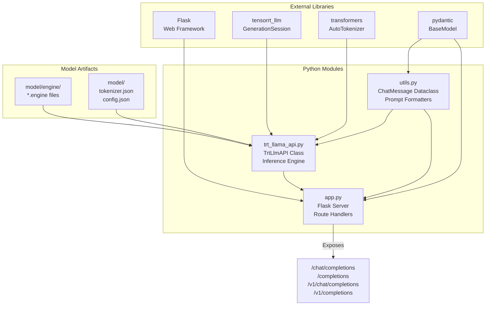
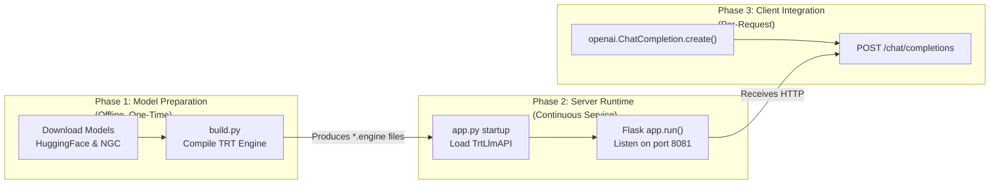
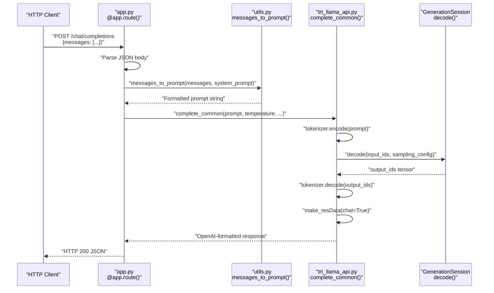

<!-- source: DeepWiki mcp.deepwiki.com · repo NVIDIA/trt-llm-as-openai-windows · page 1 Home · fetched 2026-10-26 -->

# Home

<details>
<summary>Relevant source files</summary>

The following files were used as context for generating this wiki page:

- [README.md](README.md)

</details>


This wiki documents the **TensorRT-LLM as OpenAI API on Windows** system, a Flask-based web server that provides OpenAI-compatible REST API endpoints while using NVIDIA TensorRT-LLM as the inference backend. The system enables developers to run Llama 2 and CodeLlama models on Windows with GPU-accelerated inference, maintaining full compatibility with existing OpenAI API clients.

For detailed setup instructions, see [Getting Started](#2). For architecture details, see [Architecture and Implementation](#4). For API usage examples, see [API Usage](#3).

## System Purpose

The system serves as a drop-in replacement for the OpenAI API, allowing applications built for OpenAI's Chat Completions and Text Completions endpoints to run locally on Windows using optimized TensorRT engines. This enables:

- **Local inference** without external API dependencies
- **Accelerated performance** through TensorRT-LLM quantization and GPU optimization
- **API compatibility** with the OpenAI specification for seamless integration
- **Windows support** for native deployment on Windows systems with NVIDIA GPUs

**Sources:** [README.md:1-7]()

## Key Features

| Feature | Description |
|---------|-------------|
| **OpenAI API Compatibility** | Implements `/chat/completions`, `/completions`, and `/v1/*` variants |
| **TensorRT-LLM Backend** | Uses optimized TensorRT engines for fast inference |
| **AWQ 4-bit Quantization** | Reduces memory footprint while maintaining quality |
| **Supported Models** | Llama-2-13b-chat-hf and CodeLlama-13b-Instruct-hf |
| **Streaming Support** | Server-sent events for incremental response delivery |
| **Windows Native** | Runs directly on Windows with NVIDIA GPU |

**Sources:** [README.md:3-7](), [README.md:116-122]()

## Core Components

The system consists of three primary Python modules that work together to provide the OpenAI-compatible API:

### Component Architecture



**Sources:** [app.py:1-65](), [trt_llama_api.py:1-111](), [utils.py:1-102]()

### Module Responsibilities

| Module | Primary Classes/Functions | Purpose |
|--------|--------------------------|---------|
| `app.py` | Flask routes: `/chat/completions`, `/completions` | HTTP endpoint handlers, request parsing, response formatting |
| `trt_llama_api.py` | `TrtLlmAPI.__init__()`, `complete_common()`, `stream_complete_common()` | Engine initialization, tokenization, TensorRT inference execution |
| `utils.py` | `ChatMessage`, `messages_to_prompt()`, `completion_to_prompt()` | Data models, prompt formatting with special tokens |

**Sources:** [app.py:95-177](), [trt_llama_api.py:112-288](), [utils.py:18-102]()

## System Workflow

The system operates in three distinct phases, each with different requirements and execution patterns:

### Three-Phase Workflow



**Sources:** [README.md:10-77]()

### Phase Details

**Phase 1: Model Preparation** (see [Model Preparation](#2.2))
- Download Llama 2 or CodeLlama models from HuggingFace
- Download AWQ int4 quantized weights from NVIDIA NGC
- Run `build.py` from TensorRT-LLM repository to compile TensorRT engines
- Engines are GPU-specific and must be rebuilt for different GPU architectures
- This phase can take hours and requires significant disk space (multiple GB)

**Phase 2: Server Runtime** (see [Launching the Server](#2.3))
- Start Flask server with command: `python app.py --trt_engine_path model/ --trt_engine_name llama_float16_tp1_rank0.engine --tokenizer_dir_path model/ --port 8081`
- `TrtLlmAPI.__init__()` loads engine files and tokenizer at startup [trt_llama_api.py:112-179]()
- Server listens on specified port (default 8081) for HTTP requests
- Single-threaded execution (`threaded=False`) due to TensorRT engine constraints [app.py:180]()

**Phase 3: Client Integration** (see [Client Integration Examples](#3.4))
- Clients send OpenAI-formatted requests to local endpoints
- Compatible with Python `openai` library, Continue.dev VS Code extension, and any OpenAI client
- Set `openai.api_base = "http://127.0.0.1:8081"` to redirect to local server

**Sources:** [README.md:10-77](), [README.md:95-151]()

## Request Processing Flow

When a client sends a chat completion request, data flows through the following pipeline:

### End-to-End Request Flow



**Sources:** [app.py:95-140](), [utils.py:59-94](), [trt_llama_api.py:203-249]()

### Data Transformations

The request undergoes six transformation stages:

1. **JSON Parsing**: HTTP request body → Python dict [app.py:99-102]()
2. **Message Extraction**: Python dict → `ChatMessage[]` objects [utils.py:18-41]()
3. **Prompt Formatting**: `ChatMessage[]` → formatted string with `<s>`, `[INST]`, `<<SYS>>` tokens [utils.py:59-94]()
4. **Tokenization**: Formatted string → token IDs tensor [trt_llama_api.py:262-268]()
5. **Inference**: Input token IDs → output token IDs via TensorRT engine [trt_llama_api.py:227-239]()
6. **Response Formatting**: Output tokens → OpenAI-compatible JSON response [trt_llama_api.py:49-80]()

**Sources:** [app.py:95-140](), [utils.py:59-102](), [trt_llama_api.py:203-288]()

## File Organization

The repository is structured with Python source files at the root and model artifacts in the `model/` directory:

```
trt-llm-as-openai-windows/
├── app.py                          # Flask server entrypoint
├── trt_llama_api.py               # TensorRT-LLM wrapper
├── utils.py                        # Prompt formatting utilities
├── requirements.txt                # Python dependencies
├── README.md                       # Setup instructions
└── model/                          # Model artifacts directory
    ├── tokenizer.json              # HuggingFace tokenizer
    ├── tokenizer_config.json       # Tokenizer configuration
    ├── config.json                 # Model metadata
    └── engine/                     # TensorRT engines directory
        ├── llama_float16_tp1_rank0.engine  # Compiled engine (not in Git)
        └── config.json             # Engine build configuration
```

The `model/engine/` directory contains GPU-specific compiled engines that are typically multiple gigabytes in size and cannot be committed to version control. These must be generated locally using the TensorRT-LLM build process (see [Building TensorRT Engines](#2.2.2)).

**Sources:** [README.md:54-57](), [model/README.md](), [model/engine/.gitkeep]()

## API Endpoints

The server exposes four HTTP endpoints that implement OpenAI API compatibility:

| Endpoint | Purpose | Request Format |
|----------|---------|----------------|
| `/chat/completions` | Chat-style completions with message history | `{"messages": [{"role": "user", "content": "..."}]}` |
| `/completions` | Raw text completions without message structure | `{"prompt": "text string"}` |
| `/v1/chat/completions` | OpenAI v1 API compatible chat endpoint | Same as `/chat/completions` |
| `/v1/completions` | OpenAI v1 API compatible completions endpoint | Same as `/completions` |

All endpoints support both streaming (`"stream": true`) and non-streaming modes. For detailed API documentation, see [Available Endpoints](#3.1).

**Sources:** [README.md:116-122](), [app.py:95-177]()

## Configuration Parameters

The server is launched with command-line arguments that specify engine paths, token limits, and behavior:

### Core Arguments

| Argument | Description | Example |
|----------|-------------|---------|
| `--trt_engine_path` | Directory containing TensorRT engine files | `model/engine/` |
| `--trt_engine_name` | Engine filename | `llama_float16_tp1_rank0.engine` |
| `--tokenizer_dir_path` | Directory with tokenizer and config.json | `model/` |
| `--port` | HTTP server port (default: 8081) | `8081` |
| `--max_output_tokens` | Maximum output tokens (default: 2048) | `1024` |
| `--max_input_tokens` | Maximum input tokens (default: 2048) | `3500` |
| `--no_system_prompt` | Disable default system prompt (required for CodeLlama) | `True` |

For complete configuration reference, see [Server Configuration](#5.1).

**Sources:** [README.md:99-113](), [app.py:22-65]()

## Next Steps

- **Setup**: To get started with installation and model preparation, see [Getting Started](#2)
- **Usage**: For API usage examples and client integration, see [API Usage](#3)
- **Architecture**: For implementation details and code organization, see [Architecture and Implementation](#4)
- **Configuration**: For detailed configuration options, see [Configuration Reference](#5)

**Sources:** [README.md:1-154]()

---

