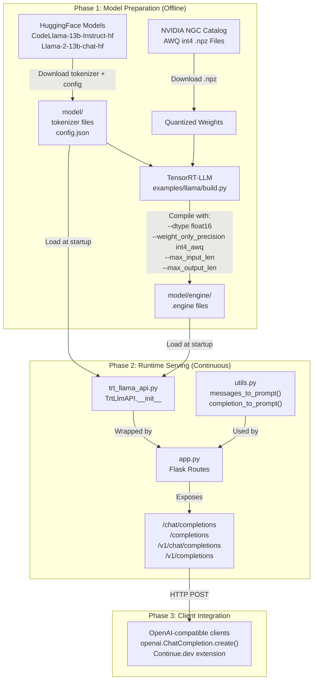
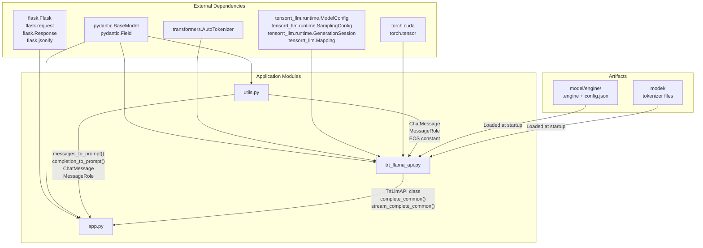
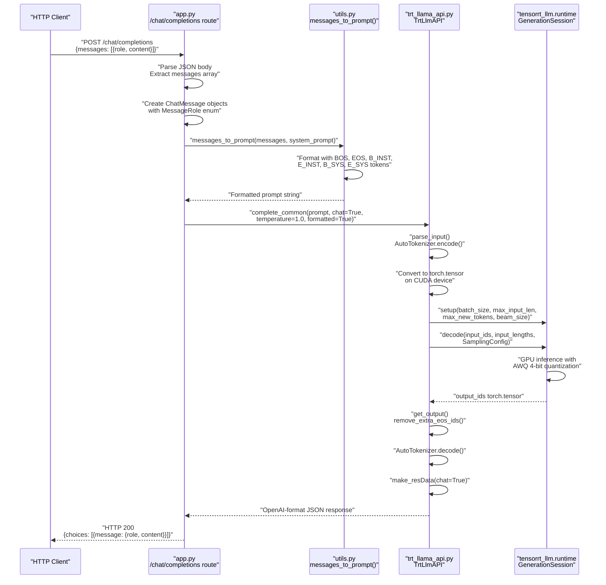
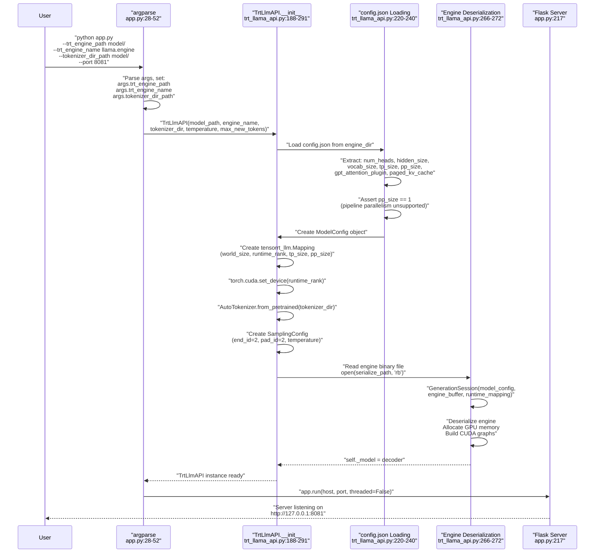
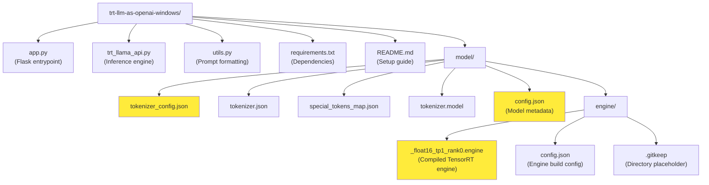

<!-- source: DeepWiki mcp.deepwiki.com · repo NVIDIA/trt-llm-as-openai-windows · page 1.1 System Architecture · fetched 2026-10-26 -->

# System Architecture

<details>
<summary>Relevant source files</summary>

The following files were used as context for generating this wiki page:

- [README.md](README.md)
- [app.py](app.py)
- [trt_llama_api.py](trt_llama_api.py)
- [utils.py](utils.py)

</details>


## Purpose and Scope

This document provides a high-level overview of the TensorRT-LLM OpenAI API system architecture, explaining how the three distinct phases (model preparation, runtime serving, and client integration) work together to provide an OpenAI-compatible REST API backed by TensorRT-LLM inference. This page focuses on the structural organization of the system, component relationships, and data flow patterns.

For detailed setup instructions, see [Getting Started](#2). For API endpoint specifications and usage examples, see [API Usage](#3). For implementation details of individual components, see [Architecture and Implementation](#4).

---

## Three-Phase System Lifecycle

The system operates across three distinct phases, each with different requirements and execution contexts:



**Sources:** [README.md:10-57](), [README.md:64-93](), [README.md:95-122]()

### Phase 1: Model Preparation (Offline)

This one-time setup phase involves:

1. **Model Download**: Obtaining tokenizer files and `config.json` from HuggingFace repositories
2. **Weight Download**: Fetching AWQ 4-bit quantized `.npz` checkpoint files from NVIDIA NGC
3. **Engine Compilation**: Running `build.py` from TensorRT-LLM repository to compile model + weights into GPU-specific `.engine` files

The compiled engine is **GPU-architecture specific** and typically several gigabytes in size. This phase can take hours and requires significant disk space.

**Sources:** [README.md:21-46](), [README.md:54-57]()

### Phase 2: Runtime Serving (Continuous)

The HTTP server process that loads compiled artifacts and serves inference requests:

1. **Initialization**: `TrtLlmAPI.__init__` loads engine and tokenizer into memory, allocates GPU resources
2. **Request Handling**: Flask routes in `app.py` accept HTTP requests, parse JSON, format prompts
3. **Inference Execution**: `TrtLlmAPI` methods tokenize input, execute GPU inference, detokenize output
4. **Response Formatting**: Results formatted as OpenAI-compatible JSON responses

This phase runs continuously as a single-threaded Flask server (`threaded=False` in [app.py:217]()).

**Sources:** [app.py:22-86](), [trt_llama_api.py:188-291]()

### Phase 3: Client Integration

Standard OpenAI API clients interact with the local server without modification. The server exposes four endpoint variants: `/completions`, `/chat/completions`, `/v1/completions`, `/v1/chat/completions`.

**Sources:** [README.md:78-95](), [README.md:116-122]()

---

## Core Component Dependencies

The Python application consists of three modules with unidirectional dependencies:



**Sources:** [app.py:1-26](), [trt_llama_api.py:1-73](), [utils.py:1-53]()

### Module Responsibilities

| Module | Primary Classes | Key Functions | Purpose |
|--------|----------------|---------------|---------|
| `app.py` | None | `chat_completions()`, `completion()`, `models()` | HTTP endpoint layer, request parsing, Flask route definitions |
| `trt_llama_api.py` | `TrtLlmAPI`, `LLMMetadata` | `complete_common()`, `stream_complete_common()`, `parse_input()`, `get_output()` | TensorRT-LLM inference abstraction, tokenization, model initialization |
| `utils.py` | `ChatMessage`, `MessageRole` | `messages_to_prompt()`, `completion_to_prompt()` | Prompt formatting with special tokens (BOS, EOS, INST, SYS) |

**Sources:** [app.py:88-217](), [trt_llama_api.py:158-481](), [utils.py:64-131]()

---

## Request Processing Pipeline

### Non-Streaming Request Flow



**Sources:** [app.py:117-171](), [utils.py:84-122](), [trt_llama_api.py:313-365]()

### Data Transformation Stages

Each request undergoes six distinct transformations:

| Stage | Input Type | Output Type | Module | Functions |
|-------|-----------|-------------|--------|-----------|
| **1. Parsing** | JSON string | `ChatMessage[]` or `str` | `app.py` | `chat_completions()`, `completion()` [app.py:133-158]() |
| **2. Formatting** | `ChatMessage[]` or `str` | Formatted prompt string | `utils.py` | `messages_to_prompt()`, `completion_to_prompt()` [utils.py:84-131]() |
| **3. Tokenization** | Prompt string | `torch.tensor` (int32, CUDA) | `trt_llama_api.py` | `parse_input()` [trt_llama_api.py:367-386]() |
| **4. Inference** | Input token IDs | Output token IDs | `tensorrt_llm.runtime` | `GenerationSession.decode()` [trt_llama_api.py:333]() |
| **5. Detokenization** | Output token IDs | Text string | `trt_llama_api.py` | `get_output()`, `remove_extra_eos_ids()` [trt_llama_api.py:388-408]() |
| **6. Response Formatting** | Text string | OpenAI JSON | `trt_llama_api.py` | `make_resData()` [trt_llama_api.py:75-108]() |

**Sources:** [app.py:95-177](), [utils.py:59-131](), [trt_llama_api.py:203-365]()

---

## System Initialization Sequence

The server initialization is a heavyweight, one-time process that occurs when `app.py` is executed:



**Sources:** [app.py:22-85](), [trt_llama_api.py:188-291]()

### Initialization Parameters

The `TrtLlmAPI` class requires these initialization parameters:

| Parameter | Type | Source | Purpose |
|-----------|------|--------|---------|
| `model_path` | `str` | `--trt_engine_path` | Directory containing `.engine` and `config.json` |
| `engine_name` | `str` | `--trt_engine_name` | Filename of compiled TensorRT engine |
| `tokenizer_dir` | `str` | `--tokenizer_dir_path` | Directory containing HuggingFace tokenizer files |
| `temperature` | `float` | Default: 0.1 | Sampling temperature for generation |
| `max_new_tokens` | `int` | `--max_output_tokens`, default: 2048 | Maximum tokens to generate |
| `context_window` | `int` | `--max_input_tokens`, default: 2048 | Maximum input context length |

**Sources:** [app.py:32-49](), [app.py:75-85](), [trt_llama_api.py:188-201]()

---

## File System Organization

The repository follows this directory structure:



**Sources:** [README.md:49-57](), [model/README.md](), [model/engine/.gitkeep]()

### Critical Artifacts

| Path | Size | Generated By | Purpose |
|------|------|--------------|---------|
| `model/engine/*.engine` | ~GBs | `build.py` from TensorRT-LLM | GPU-specific compiled inference engine (not in Git) |
| `model/engine/config.json` | ~KB | `build.py` | Engine build configuration (tp_size, pp_size, num_heads, etc.) |
| `model/tokenizer*.json` | ~KB | Downloaded from HuggingFace | Tokenizer vocabulary and configuration |
| `model/config.json` | ~KB | Downloaded from HuggingFace | Model architecture metadata |

The `.engine` files are excluded from Git due to size and GPU-specificity. They must be generated per-GPU-architecture using the instructions in [Model Preparation](#2.2).

**Sources:** [README.md:19-46](), [README.md:54-57]()

---

## Key Classes and Responsibilities

### TrtLlmAPI Class

Located in [trt_llama_api.py:158-481](), this is the core inference engine wrapper.

**Attributes:**
- `_model`: `tensorrt_llm.runtime.GenerationSession` - The loaded TensorRT engine
- `_model_config`: `tensorrt_llm.runtime.ModelConfig` - Architecture configuration
- `_tokenizer`: `transformers.AutoTokenizer` - Tokenizer instance
- `_sampling_config`: `tensorrt_llm.runtime.SamplingConfig` - Generation parameters

**Key Methods:**
- `__init__()` [trt_llama_api.py:188-291]() - Loads engine, tokenizer, creates GPU session
- `complete_common()` [trt_llama_api.py:313-365]() - Synchronous inference with full response
- `stream_complete_common()` [trt_llama_api.py:416-481]() - Streaming inference with SSE
- `parse_input()` [trt_llama_api.py:367-386]() - Tokenization and tensor preparation
- `get_output()` [trt_llama_api.py:396-408]() - Detokenization and EOS handling

**Sources:** [trt_llama_api.py:158-481]()

### ChatMessage and MessageRole

Located in [utils.py:64-82](), these define the chat message data model.

**ChatMessage Fields:**
- `role`: `MessageRole` enum (SYSTEM, USER, ASSISTANT, FUNCTION)
- `content`: `Optional[str]` - Message text content
- `additional_kwargs`: `dict` - Extensibility for future fields

**MessageRole Values:**
- `MessageRole.SYSTEM` - System-level instructions
- `MessageRole.USER` - User input messages
- `MessageRole.ASSISTANT` - Model-generated responses
- `MessageRole.FUNCTION` - Function call results (reserved)

**Sources:** [utils.py:64-82](), [app.py:136-152]()

### Flask Routes

The following routes are defined in [app.py:88-217]():

| Route | Methods | Handler Function | Purpose |
|-------|---------|------------------|---------|
| `/chat/completions` | POST | `chat_completions()` [app.py:119]() | Chat-based inference with message history |
| `/v1/chat/completions` | POST | `chat_completions()` [app.py:118]() | OpenAI v1 API compatibility |
| `/completions` | POST | `completion()` [app.py:176]() | Raw text completion |
| `/v1/completions` | POST | `completion()` [app.py:175]() | OpenAI v1 API compatibility |
| `/models` | GET/POST | `modelsLlaMA()` [app.py:102]() | List available models |
| `/v1/models` | GET/POST | `modelsLlaMA()` [app.py:101]() | OpenAI v1 API compatibility |

**Sources:** [app.py:88-217]()

---

## Streaming vs Non-Streaming Execution

Both execution modes share the same initialization and tokenization pipeline but differ in response delivery:

| Aspect | Non-Streaming | Streaming |
|--------|---------------|-----------|
| **Function** | `complete_common()` [trt_llama_api.py:313]() | `stream_complete_common()` [trt_llama_api.py:416]() |
| **Response Type** | `flask.jsonify()` (single JSON) | `flask.Response()` with generator |
| **MIME Type** | `application/json` | `text/event-stream` (SSE) |
| **decode() Call** | `decode(..., streaming=False)` | `decode(..., streaming=True)` |
| **Client Blocking** | Waits for full response | Receives incremental tokens |
| **Response Format** | OpenAI completion object | OpenAI stream chunks (delta format) |

Streaming mode uses Python generators [trt_llama_api.py:434-481]() to yield Server-Sent Events (SSE) formatted chunks, each containing a delta of newly generated tokens.

**Sources:** [trt_llama_api.py:313-365](), [trt_llama_api.py:416-481](), [app.py:168-171]()

---

## Prompt Formatting System

The `utils.py` module implements Llama 2-style prompt formatting with special delimiter tokens:

**Special Tokens:**
- `BOS = "<s>"` - Beginning of sequence
- `EOS = "</s>"` - End of sequence
- `B_INST = "[INST]"` - Begin instruction
- `E_INST = "[/INST]"` - End instruction
- `B_SYS = "<<SYS>>\n"` - Begin system prompt
- `E_SYS = "\n<</SYS>>\n\n"` - End system prompt

**Example Formatted Chat:**
```
<s> [INST] <<SYS>>
You are a helpful assistant.
<</SYS>>

What is the capital of France? [/INST] The capital of France is Paris. </s>
```

The `messages_to_prompt()` function [utils.py:84-122]() constructs this format from a `ChatMessage` array, inserting the system prompt only in the first message pair and appending `EOS` between conversation turns.

**Sources:** [utils.py:54-131]()

---

