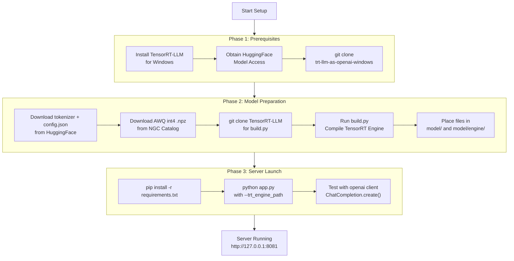
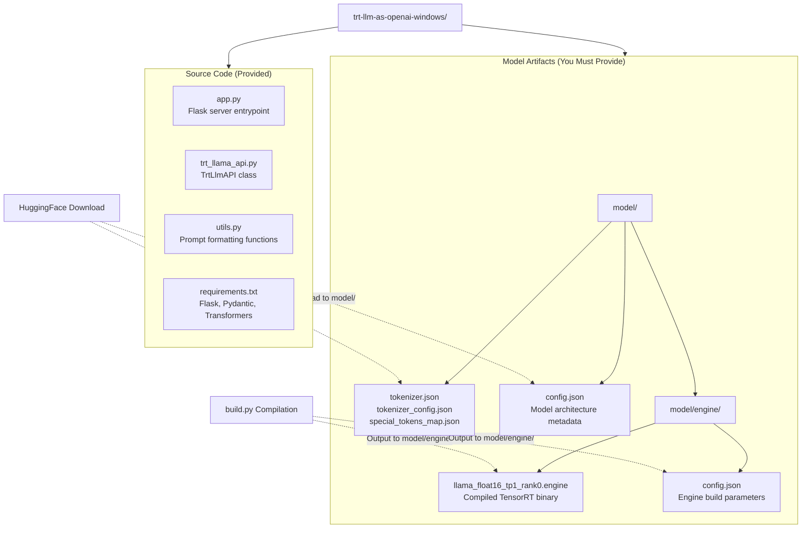
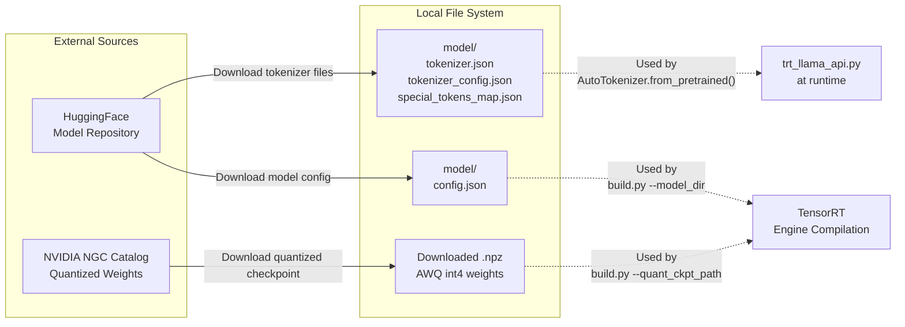
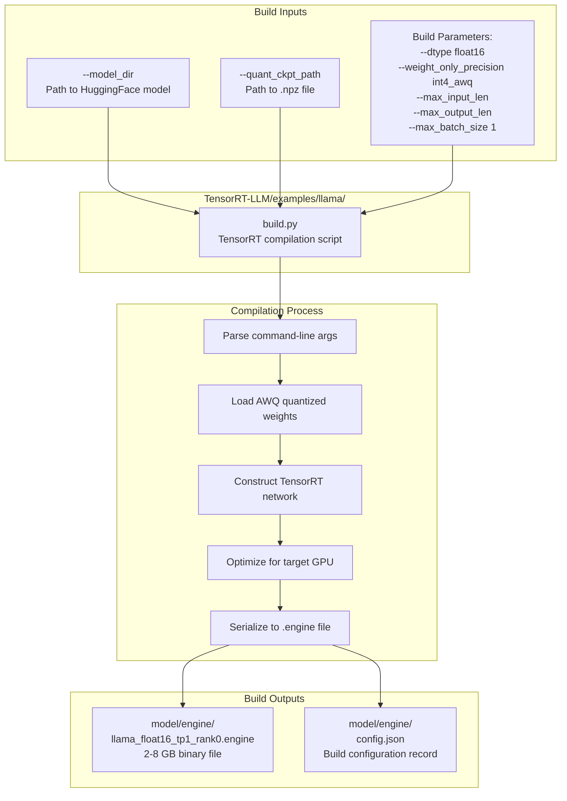
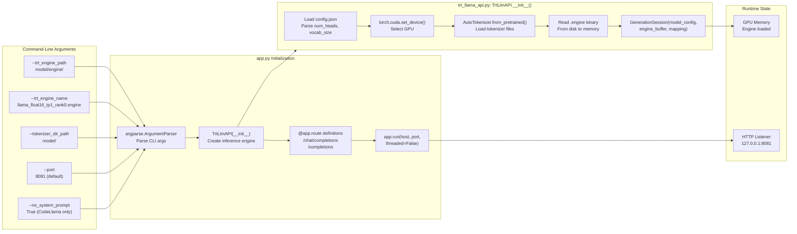

<!-- source: DeepWiki mcp.deepwiki.com · repo NVIDIA/trt-llm-as-openai-windows · page 2 Getting Started · fetched 2026-10-26 -->

# Getting Started

<details>
<summary>Relevant source files</summary>

The following files were used as context for generating this wiki page:

- [README.md](README.md)
- [requirements.txt](requirements.txt)

</details>


## Purpose and Scope

This page guides you through the complete setup process for running the TensorRT-LLM OpenAI API server on Windows. By the end of this guide, you will have a locally hosted web server that exposes OpenAI-compatible endpoints for Llama 2 or CodeLlama models with TensorRT acceleration.

For detailed API usage after setup is complete, see [API Usage](#3). For configuration options and tuning parameters, see [Configuration Reference](#5). For architectural details about how the system works internally, see [Architecture and Implementation](#4).

**Sources:** [README.md:1-8]()

## Setup Overview

The setup process consists of three distinct phases that must be completed sequentially. Each phase has different time and resource requirements.



**Diagram 1: Complete Setup Process Flow**

**Sources:** [README.md:9-77]()

### Time and Resource Requirements

The setup process has significantly different resource requirements for each phase:

| Phase | Duration | Disk Space | GPU Required | One-Time Only |
|-------|----------|------------|--------------|---------------|
| **Phase 1: Prerequisites** | 30-60 minutes | ~10 GB | Yes | Yes |
| **Phase 2: Model Preparation** | 2-4 hours | ~30 GB | Yes | Yes |
| **Phase 3: Server Launch** | 5 minutes | ~1 GB | Yes | No |

**Critical Notes:**
- **Phase 2** is the most time-consuming step, involving large downloads and a lengthy compilation process (30-90 minutes depending on GPU)
- The compiled TensorRT engine (`.engine` file) is **GPU-specific** and cannot be moved between different GPU architectures
- If you change GPUs or update TensorRT-LLM, you must rebuild the engine
- Phase 3 is repeatable - you can start and stop the server without repeating Phases 1-2

**Sources:** [README.md:19-46]()

## Prerequisites

Before beginning the setup, you must have:

1. **Windows Operating System** with NVIDIA GPU (compute capability 7.0 or higher)
2. **TensorRT-LLM installed** following the [official Windows installation guide](https://github.com/NVIDIA/TensorRT-LLM/tree/v0.6.1/windows#quick-start)
3. **HuggingFace account with access** to gated Llama repositories:
   - [CodeLlama-13b-Instruct-hf](https://huggingface.co/codellama/CodeLlama-13b-Instruct-hf)
   - [Llama-2-13b-chat-hf](https://huggingface.co/meta-llama/Llama-2-13b-chat-hf)
4. **Python 3.10+** with pip installed
5. **Git** for cloning repositories

For detailed dependency versions and installation verification, see [Prerequisites and Dependencies](#2.1).

**Sources:** [README.md:11-17]()

## Directory Structure and File Placement

After completing the setup, your repository will contain both code and model artifacts organized as follows:



**Diagram 2: Directory Structure Showing Code vs. Artifacts**

The `model/` and `model/engine/` directories exist in the repository but contain only `.gitkeep` files. You must populate them during setup by:
1. Downloading tokenizer files from HuggingFace → place in `model/`
2. Compiling the TensorRT engine using `build.py` → place in `model/engine/`

**Sources:** [README.md:54-57]()

## Model Preparation Overview

Model preparation is a two-step process: downloading source artifacts and compiling them into an optimized TensorRT engine.

### Required Downloads

You must download two sets of files from external sources:



**Diagram 3: Model Preparation Inputs and Their Usage**

**For CodeLlama 13B:**
- HuggingFace model: [CodeLlama-13b-Instruct-hf](https://huggingface.co/codellama/CodeLlama-13b-Instruct-hf)
- NGC quantized weights: [NGC CodeLlama weights](https://catalog.ngc.nvidia.com/orgs/nvidia/models/code_llama/files?version=1.1)

**For Llama 2 13B Chat:**
- HuggingFace model: [Llama-2-13b-chat-hf](https://huggingface.co/meta-llama/Llama-2-13b-chat-hf)
- NGC quantized weights: [NGC Llama2-13b weights](https://catalog.ngc.nvidia.com/orgs/nvidia/models/llama2-13b/files?version=1.3)

For detailed download instructions, see [Downloading Models and Weights](#2.2.1).

**Sources:** [README.md:25-31](), [README.md:54-56]()

### Engine Compilation Process

The TensorRT engine is compiled using `build.py` from the TensorRT-LLM repository. This script is **not included in this repository** and must be obtained separately.



**Diagram 4: TensorRT Engine Build Pipeline**

**Key Build Parameters:**

| Parameter | CodeLlama 13B | Llama 2 13B | Purpose |
|-----------|---------------|-------------|---------|
| `--max_input_len` | 15360 | 3500 | Maximum context window (tokens) |
| `--max_output_len` | 1024 | 1024 | Maximum generation length |
| `--dtype` | `float16` | `float16` | Computation precision |
| `--weight_only_precision` | `int4_awq` | `int4_awq` | AWQ 4-bit quantization |
| `--rotary_base` | 1000000 | (default) | RoPE frequency base for CodeLlama |
| `--vocab_size` | 32064 | (default) | Vocabulary size for CodeLlama |

The `--max_input_len` value determines the maximum context window the compiled engine can handle. For CodeLlama, 15360 tokens enables a ~16K context window. For Llama 2, 3500 tokens provides ~3.5K context.

For step-by-step compilation instructions with complete command examples, see [Building TensorRT Engines](#2.2.2).

**Sources:** [README.md:38-45]()

## Server Launch Process

Once model artifacts are in place, launching the server involves installing Python dependencies and executing `app.py` with appropriate arguments.

### Installation

Install required Python packages:

```bash
pip install -r requirements.txt
```

This installs:
- `Flask` - Web server framework
- `Pydantic` - Request/response validation
- `transformers` - Tokenizer (`AutoTokenizer`)
- `numpy` - Array operations

**Sources:** [requirements.txt:1-8](), [README.md:58-61]()

### Launch Command Structure



**Diagram 5: Server Initialization Sequence - Code Entity Mapping**

### Example Launch Commands

**For Llama 2 13B Chat:**
```bash
python app.py \
  --trt_engine_path model/engine/ \
  --trt_engine_name llama_float16_tp1_rank0.engine \
  --tokenizer_dir_path model/ \
  --port 8081
```

**For CodeLlama 13B Instruct:**
```bash
python app.py \
  --trt_engine_path model/engine/ \
  --trt_engine_name llama_float16_tp1_rank0.engine \
  --tokenizer_dir_path model/ \
  --port 8081 \
  --no_system_prompt True
```

The `--no_system_prompt True` flag is required for CodeLlama because the model's instruction format does not expect a system prompt in the formatted prompt string.

**Sources:** [README.md:64-76]()

### Initialization Sequence Details

When `python app.py` executes, the following code flow occurs:

1. **[app.py:22-49]()** - `argparse.ArgumentParser` parses command-line arguments
2. **[app.py:50-65]()** - `TrtLlmAPI` is instantiated, triggering `__init__`
3. **[trt_llama_api.py:118-128]()** - `config.json` is loaded and parsed for `num_heads`, `hidden_size`, `vocab_size`, `tp_size`, `pp_size`
4. **[trt_llama_api.py:131]()** - Assert `pp_size == 1` (pipeline parallelism unsupported)
5. **[trt_llama_api.py:141]()** - `torch.cuda.set_device(runtime_rank)` selects GPU
6. **[trt_llama_api.py:133-138]()** - `AutoTokenizer.from_pretrained(tokenizer_dir_path)` loads tokenizer
7. **[trt_llama_api.py:165-172]()** - Engine binary is read from disk into `engine_buffer`
8. **[trt_llama_api.py:174-179]()** - `GenerationSession(model_config, engine_buffer, mapping)` deserializes engine and allocates GPU memory
9. **[app.py:67-177]()** - Flask route definitions (`@app.route`)
10. **[app.py:180]()** - `app.run(host="0.0.0.0", port=args.port, threaded=False)` starts HTTP listener

Startup typically takes 30-60 seconds. The most expensive operations are:
- Reading the multi-gigabyte `.engine` file from disk
- Deserializing the TensorRT engine
- Allocating GPU memory for inference

**Sources:** [app.py:22-65](), [trt_llama_api.py:112-179](), [app.py:180]()

## Verification

After the server starts, verify correct operation:

### Expected Console Output

When initialization completes successfully, you should see:
```
 * Running on http://127.0.0.1:8081
 * Running on http://<your-ip>:8081
```

This indicates Flask is listening for HTTP requests.

**Sources:** [README.md:78]()

### Test with OpenAI Client

Install the OpenAI Python client (version 0.28):
```bash
pip install openai==0.28
```

Execute a test request using the chat completions endpoint:

```python
import openai

# API key is not validated but required by client
openai.api_key = "ABC"
openai.api_base = "http://127.0.0.1:8081"

response = openai.ChatCompletion.create(
    model="Llama2",  # Model name (not validated)
    messages=[{"role": "user", "content": "Hello! How are you?"}]
)

print(response)
```

**Expected Response Structure:**
```json
{
  "id": "chatcmpl-<uuid>",
  "object": "chat.completion",
  "created": 1234567890,
  "model": "Llama2",
  "choices": [
    {
      "index": 0,
      "message": {
        "role": "assistant",
        "content": "I'm doing well, thank you for asking! How can I assist you today?"
      },
      "finish_reason": "stop"
    }
  ],
  "usage": {
    "prompt_tokens": 15,
    "completion_tokens": 20,
    "total_tokens": 35
  }
}
```

If you receive a response matching this structure, the server is functioning correctly.

**Sources:** [README.md:80-95]()

### Troubleshooting Startup Issues

If the server fails to start, check:

1. **GPU is available** - `torch.cuda.is_available()` should return `True`
2. **Paths are correct** - Verify `--trt_engine_path` points to directory containing `.engine` file
3. **Engine file exists** - Verify `model/engine/llama_float16_tp1_rank0.engine` exists
4. **Tokenizer files exist** - Verify `model/tokenizer.json` and related files exist
5. **Dependencies installed** - Re-run `pip install -r requirements.txt`

Common errors:
- `FileNotFoundError` - Incorrect paths or missing files
- `AssertionError: pp_size == 1` - Engine was built with unsupported pipeline parallelism
- CUDA errors - GPU driver issues or insufficient GPU memory

**Sources:** [trt_llama_api.py:112-179]()

## Next Steps

With the server running, you can now:

1. **Explore API Endpoints** - See [Available Endpoints](#3.1) for `/completions`, `/chat/completions`, and model listing routes
2. **Use Chat Completions** - See [Chat Completions](#3.2) for detailed request/response format
3. **Use Text Completions** - See [Text Completions](#3.3) for raw text generation
4. **Integrate with Clients** - See [Client Integration Examples](#3.4) for Python openai library and Continue.dev VS Code extension
5. **Configure Server** - See [Server Configuration](#5.1) for tuning token limits, system prompts, and other parameters
6. **Understand Internals** - See [Component Overview](#4.1) to learn how `app.py`, `trt_llama_api.py`, and `utils.py` work together

For detailed information about model preparation steps, continue to [Model Preparation](#2.2).

**Sources:** [README.md:98-152]()

---

