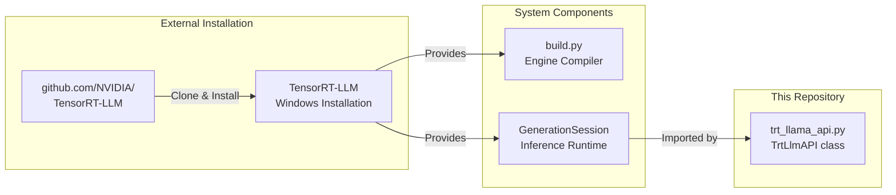
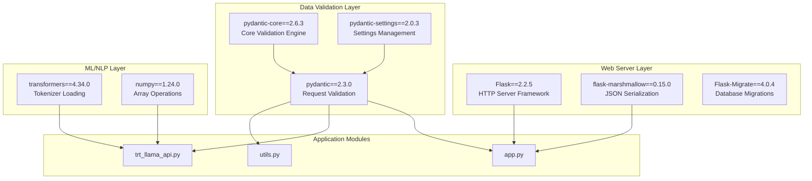
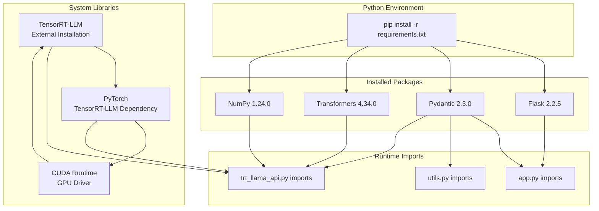

<!-- source: DeepWiki mcp.deepwiki.com · repo NVIDIA/trt-llm-as-openai-windows · page 2.1 Prerequisites and Dependencies · fetched 2026-10-26 -->

# Prerequisites and Dependencies

<details>
<summary>Relevant source files</summary>

The following files were used as context for generating this wiki page:

- [README.md](README.md)
- [requirements.txt](requirements.txt)

</details>


This page details the hardware, software, and Python package requirements necessary to run the TensorRT-LLM OpenAI API server. These prerequisites must be satisfied before proceeding with model preparation ([2.2](#2.2)) or server launch ([2.3](#2.3)).

For configuration options related to these dependencies after installation, see [Server Configuration](#5.1).

## Hardware Requirements

The system requires specific GPU hardware for TensorRT-LLM inference:

| Component | Requirement | Notes |
|-----------|-------------|-------|
| GPU | NVIDIA GPU with Compute Capability ≥ 8.0 | Required for TensorRT-LLM engine execution |
| VRAM | Minimum 12-16 GB | For 13B models with AWQ int4 quantization |
| CUDA | Compatible CUDA drivers | Installed with TensorRT-LLM |

**TensorRT Engine GPU Binding**: Engines compiled with `build.py` are bound to the specific GPU architecture they were built on. An engine built on an RTX 4090 cannot run on an A100, and vice versa. This is enforced at the TensorRT serialization level.

**Sources**: [README.md:11-19]()

## Software Requirements

### Operating System

This implementation is specifically designed for Windows. TensorRT-LLM must be installed using the Windows-specific installation procedure.

| Software | Version/Details | Purpose |
|----------|-----------------|---------|
| Operating System | Windows | Native TensorRT-LLM Windows support |
| Python | 3.8+ (recommended 3.10) | Runtime environment |
| Git | Any recent version | Repository cloning and version control |

### TensorRT-LLM Installation

The core inference engine requires TensorRT-LLM for Windows:



**Installation Command**: Follow the official TensorRT-LLM Windows installation guide at `https://github.com/NVIDIA/TensorRT-LLM/tree/v0.6.1/windows#quick-start` (version 0.6.1 as referenced in this project).

**Build Script Location**: After TensorRT-LLM installation, the `build.py` script is located at `examples/llama/build.py` within the TensorRT-LLM repository. This script is used during model preparation ([2.2.2](#2.2.2)) but is not part of this repository.

**Sources**: [README.md:13]()

### Model Access Requirements

Access to gated HuggingFace repositories is required for downloading model artifacts:

| Model | Repository | Required Files |
|-------|------------|----------------|
| Llama-2-13b-chat | `meta-llama/Llama-2-13b-chat-hf` | `tokenizer.json`, `tokenizer_config.json`, `special_tokens_map.json`, `config.json` |
| CodeLlama-13b-Instruct | `codellama/CodeLlama-13b-Instruct-hf` | `tokenizer.json`, `tokenizer_config.json`, `special_tokens_map.json`, `config.json` |

**HuggingFace Authentication**: These models require accepting license terms on HuggingFace and authenticating via `huggingface-cli login` or access tokens.

**Sources**: [README.md:15-17](), [README.md:54-56]()

## Python Package Dependencies

The following diagram shows the dependency structure defined in `requirements.txt`:



### Installation Command

Install all Python dependencies via:

```bash
pip install -r requirements.txt
```

**Sources**: [README.md:58-61](), [requirements.txt:1-8]()

### Package Details

#### Web Server Dependencies

| Package | Version | Role in System | Used By |
|---------|---------|----------------|---------|
| `Flask` | 2.2.5 | HTTP request routing and response handling | [app.py]() |
| `flask-marshmallow` | 0.15.0 | JSON serialization helpers (not actively used) | N/A |
| `Flask-Migrate` | 4.0.4 | Database migration support (not actively used) | N/A |

**Flask Configuration**: The Flask server runs with `threaded=False` in [app.py:180]() to ensure single-threaded request handling, which is required for TensorRT-LLM engine thread safety.

#### Data Validation Dependencies

| Package | Version | Role in System | Used By |
|---------|---------|----------------|---------|
| `pydantic` | 2.3.0 | Request body validation and data class definitions | [app.py](), [trt_llama_api.py](), [utils.py]() |
| `pydantic-core` | 2.6.3 | Low-level validation engine (dependency of pydantic) | Transitive |
| `pydantic-settings` | 2.0.3 | Configuration management (not actively used) | N/A |

**Pydantic Usage**: The `ChatMessage` class in [utils.py:9-12]() and `MessageRole` enum in [utils.py:5-7]() are Pydantic `BaseModel` and `Enum` respectively, providing type validation for chat completion requests.

#### ML/NLP Dependencies

| Package | Version | Role in System | Used By |
|---------|---------|----------------|---------|
| `transformers` | 4.34.0 | Tokenizer loading via `AutoTokenizer` | [trt_llama_api.py]() |
| `numpy` | 1.24.0 | Tensor operations and array manipulation | [trt_llama_api.py]() |

**Transformers Integration**: The `AutoTokenizer.from_pretrained()` call in [trt_llama_api.py:139]() loads the HuggingFace tokenizer, which is used in [trt_llama_api.py:251-258]() for encoding prompts to token IDs and [trt_llama_api.py:280-286]() for decoding generated tokens back to text.

**Numpy Usage**: Used for tensor slicing operations in [trt_llama_api.py:269-279]() when processing model outputs.

**Sources**: [requirements.txt:1-8]()

## External Dependencies Not in requirements.txt

The following critical dependencies must be installed separately:

### TensorRT-LLM Python Package

**Import Statement**: 
```python
from tensorrt_llm.runtime import ModelConfig, SamplingConfig
from tensorrt_llm.runtime import PYTHON_BINDINGS, ModelRunner
```

**Location in Code**: [trt_llama_api.py:4-7]()

**Purpose**: Provides the `GenerationSession` runtime and model configuration classes for TensorRT inference. This package is installed as part of the TensorRT-LLM Windows installation process.

### PyTorch (Implicit Dependency)

**Import Statement**:
```python
import torch
```

**Location in Code**: [trt_llama_api.py:3]()

**Purpose**: Required for:
- CUDA device management: `torch.cuda.set_device()` in [trt_llama_api.py:175-176]()
- Tensor operations: `torch.tensor()` in [trt_llama_api.py:260]()
- Data type conversions: `torch.int32` type annotations

PyTorch is typically installed as a dependency of TensorRT-LLM.

**Sources**: [trt_llama_api.py:1-10]()

## Dependency Resolution and Compatibility

The following diagram shows how dependencies are resolved at runtime:



### Version Compatibility Notes

1. **Pydantic 2.x**: This project uses Pydantic v2, which has breaking changes from v1. Code using `BaseModel` must follow v2 syntax.

2. **Flask 2.2.5**: The specific version is pinned to avoid compatibility issues with newer Flask 3.x releases.

3. **Transformers 4.34.0**: This version is compatible with the Llama 2 and CodeLlama tokenizer formats.

4. **TensorRT-LLM v0.6.1**: The README explicitly references this version for Windows installation. Newer versions may have incompatible engine formats.

**Sources**: [requirements.txt:1-8](), [README.md:13]()

## Verification Steps

After installing all prerequisites, verify the installation:

1. **Verify Python packages**:
   ```bash
   pip list | grep -E "Flask|pydantic|transformers|numpy"
   ```

2. **Verify TensorRT-LLM import**:
   ```python
   from tensorrt_llm.runtime import ModelConfig
   print("TensorRT-LLM imported successfully")
   ```

3. **Verify CUDA availability**:
   ```python
   import torch
   print(f"CUDA available: {torch.cuda.is_available()}")
   print(f"CUDA device: {torch.cuda.get_device_name(0)}")
   ```

4. **Verify HuggingFace access**:
   ```bash
   huggingface-cli whoami
   ```

If all verification steps pass, proceed to [Model Preparation](#2.2).

**Sources**: Derived from system initialization sequence in [trt_llama_api.py:112-179]()

---

