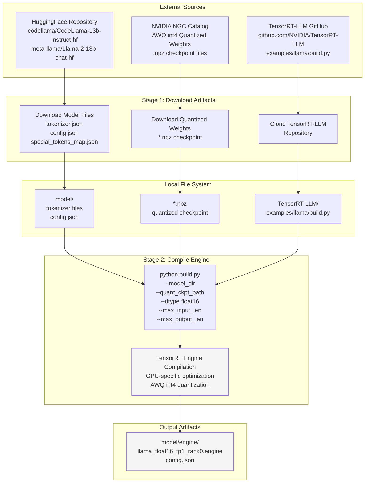
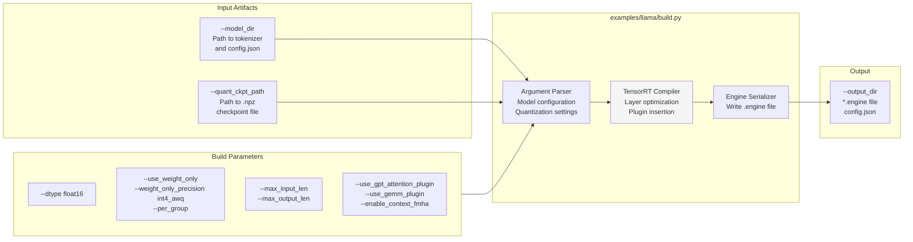
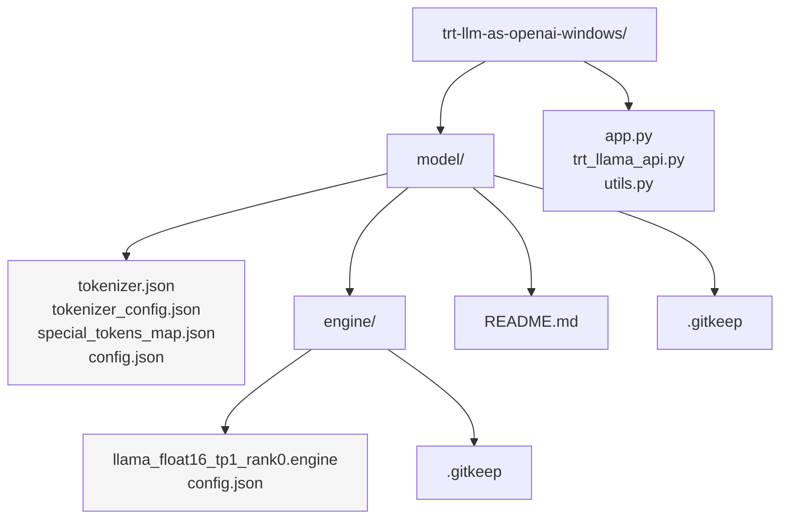

<!-- source: DeepWiki mcp.deepwiki.com · repo NVIDIA/trt-llm-as-openai-windows · page 2.2 Model Preparation · fetched 2026-10-26 -->

# Model Preparation

<details>
<summary>Relevant source files</summary>

The following files were used as context for generating this wiki page:

- [README.md](README.md)
- [model/.gitkeep](model/.gitkeep)
- [model/README.md](model/README.md)

</details>


## Purpose and Scope

This document explains the offline model preparation phase required before running the TensorRT-LLM OpenAI API server. Model preparation is a one-time, resource-intensive process that transforms downloaded model artifacts into optimized TensorRT engine files that can be used for inference. This phase must be completed successfully before the server can be launched.

For information about installing prerequisite software and dependencies, see [Prerequisites and Dependencies](#2.1). For instructions on launching the server after model preparation is complete, see [Launching the Server](#2.3). For detailed configuration of the compiled engines, see [Model and Engine Settings](#5.2).

**Sources:** [README.md:10-46]()

## Overview

Model preparation consists of two distinct stages that must be completed sequentially:

1. **Artifact Acquisition** - Downloading model files, tokenizer data, quantized weights, and build scripts from external repositories
2. **Engine Compilation** - Using TensorRT-LLM's `build.py` script to compile the model into a GPU-specific `.engine` file

The output of this process is a compiled TensorRT engine that is optimized for a specific GPU architecture and cannot be transferred between different GPU models. The compilation process typically requires significant time (potentially hours) and disk space (multiple gigabytes for intermediate and final artifacts).

**Sources:** [README.md:19-46]()

### Model Preparation Workflow



**Sources:** [README.md:25-45](), Diagram 1 from high-level architecture

## Required Artifacts

Three categories of artifacts must be obtained before engine compilation can begin:

| Artifact Type | Source | Files Needed | Purpose |
|---------------|--------|--------------|---------|
| **Model Files** | HuggingFace | `tokenizer.json`, `config.json`, `tokenizer_config.json`, `special_tokens_map.json` | Tokenization and model metadata |
| **Quantized Weights** | NVIDIA NGC Catalog | `*.npz` checkpoint file | AWQ int4 quantized model parameters |
| **Build Tools** | TensorRT-LLM GitHub | `examples/llama/build.py` | Engine compilation script |

### Supported Models

This system supports two model variants, each requiring different download sources:

#### CodeLlama-13B-Instruct
- **Model Repository**: [codellama/CodeLlama-13b-Instruct-hf](https://huggingface.co/codellama/CodeLlama-13b-Instruct-hf)
- **Quantized Weights**: [NVIDIA NGC Code Llama v1.1](https://catalog.ngc.nvidia.com/orgs/nvidia/models/code_llama/files?version=1.1)
- **Vocabulary Size**: 32,064 tokens
- **Rotary Base**: 1,000,000 (extended context support)

#### Llama-2-13B-Chat
- **Model Repository**: [meta-llama/Llama-2-13b-chat-hf](https://huggingface.co/meta-llama/Llama-2-13b-chat-hf)
- **Quantized Weights**: [NVIDIA NGC Llama2-13B v1.3](https://catalog.ngc.nvidia.com/orgs/nvidia/models/llama2-13b/files?version=1.3)
- **Vocabulary Size**: 32,000 tokens (default)
- **Rotary Base**: 10,000 (default)

**Sources:** [README.md:15-17](), [README.md:26-31](), [README.md:40]()

For detailed step-by-step download instructions, see [Downloading Models and Weights](#2.2.1).

## Engine Compilation Process

The engine compilation process transforms downloaded artifacts into an optimized TensorRT engine file using the `build.py` script from the TensorRT-LLM repository.

### Build Script Location and Invocation

The build script is located at `examples/llama/build.py` within the cloned TensorRT-LLM repository. The script must be executed from the `examples/llama` directory context.



**Sources:** [README.md:33-45]()

### Build Configuration Parameters

The `build.py` script accepts numerous parameters that control engine optimization and runtime behavior. The following table summarizes critical parameters:

| Parameter | Purpose | CodeLlama Value | Llama2 Value |
|-----------|---------|-----------------|--------------|
| `--model_dir` | Directory containing tokenizer and config.json | Path to CodeLlama model | Path to Llama2 model |
| `--quant_ckpt_path` | Path to AWQ quantized checkpoint | Path to .npz file | Path to .npz file |
| `--dtype` | Model computation data type | `float16` | `float16` |
| `--max_input_len` | Maximum input token length | `15360` | `3500` |
| `--max_output_len` | Maximum output token length | `1024` | `1024` |
| `--max_batch_size` | Maximum concurrent requests | `1` | `1` |
| `--vocab_size` | Vocabulary size override | `32064` | Default (32000) |
| `--rotary_base` | RoPE base frequency | `1000000` | Default (10000) |
| `--output_dir` | Directory for compiled engine | Engine output path | Engine output path |

**Sources:** [README.md:38-45]()

### Model-Specific Build Commands

The exact `build.py` invocation differs between CodeLlama and Llama2 due to model architecture differences.

#### CodeLlama-13B Build Command

```bash
python build.py \
  --model_dir <path to CodeLlama model> \
  --quant_ckpt_path <path to CodeLlama .npz file> \
  --dtype float16 \
  --remove_input_padding \
  --use_gpt_attention_plugin float16 \
  --enable_context_fmha \
  --use_gemm_plugin float16 \
  --use_weight_only \
  --weight_only_precision int4_awq \
  --per_group \
  --max_batch_size 1 \
  --max_input_len 15360 \
  --max_output_len 1024 \
  --output_dir <TRT engine folder> \
  --rotary_base 1000000 \
  --vocab_size 32064
```

**Key differences**: Extended context window (15,360 tokens), custom rotary base (1,000,000), explicit vocabulary size (32,064), and `--remove_input_padding` flag.

**Sources:** [README.md:38-41]()

#### Llama2-13B Build Command

```bash
python build.py \
  --model_dir <path to llama13_chat model> \
  --quant_ckpt_path <path to Llama2 .npz file> \
  --dtype float16 \
  --use_gpt_attention_plugin float16 \
  --use_gemm_plugin float16 \
  --use_weight_only \
  --weight_only_precision int4_awq \
  --per_group \
  --enable_context_fmha \
  --max_batch_size 1 \
  --max_input_len 3500 \
  --max_output_len 1024 \
  --output_dir <TRT engine folder>
```

**Key differences**: Shorter context window (3,500 tokens), default rotary base and vocabulary size.

**Sources:** [README.md:42-45]()

For detailed compilation instructions and troubleshooting, see [Building TensorRT Engines](#2.2.2).

### TensorRT Plugins and Optimization Flags

The build commands specify several TensorRT plugins that optimize inference performance:

| Flag | Purpose |
|------|---------|
| `--use_gpt_attention_plugin float16` | Optimized attention mechanism implementation |
| `--use_gemm_plugin float16` | Optimized matrix multiplication kernels |
| `--enable_context_fmha` | Fused multi-head attention for context processing |
| `--use_weight_only` | Enable weight-only quantization mode |
| `--weight_only_precision int4_awq` | Use AWQ int4 quantization for weights |
| `--per_group` | Per-group quantization for improved accuracy |

**Sources:** [README.md:40](), [README.md:44]()

## Directory Structure and File Placement

The repository uses a specific directory structure for organizing model artifacts. The `model/` and `model/engine/` directories must exist before placing files, though they are initially empty in the Git repository.

### Directory Layout



**Sources:** [model/README.md:1](), [README.md:54-57]()

### File Placement Instructions

After downloading artifacts and compiling the engine, files must be placed in specific locations:

| File Type | Destination | Description |
|-----------|-------------|-------------|
| Tokenizer files | `model/` | `tokenizer.json`, `tokenizer_config.json`, `special_tokens_map.json` |
| Model config | `model/` | `config.json` from HuggingFace |
| TensorRT engine | `model/engine/` | `*.engine` file generated by `build.py` |
| Engine config | `model/engine/` | `config.json` generated by `build.py` |

**Note**: The `model/` directory contains a `README.md` that states: "Place tokenizers and the model's config.json in this directory."

**Sources:** [model/README.md:1](), [README.md:54-57]()

## Important Considerations

### GPU-Specific Compilation

TensorRT engines are compiled for a specific GPU architecture and cannot be transferred between different GPU models. The compiled `.engine` file contains GPU-specific optimizations and instruction sequences. If the GPU is changed or upgraded, the engine must be recompiled from scratch.

**Sources:** README.md context, Diagram 1 analysis

### Storage Requirements

Model preparation requires significant disk space:

- **Downloaded artifacts**: ~26-30 GB (model files + quantized weights)
- **Compiled engine**: ~7-10 GB (varies by model and configuration)
- **Temporary files**: Additional space during compilation
- **Total recommended**: 50+ GB free disk space

### Compilation Time

Engine compilation is a CPU and GPU-intensive process that can take 30 minutes to several hours depending on:

- GPU model and compute capability
- CPU performance
- Model size and configuration parameters
- Optimization flags enabled

The compilation process only needs to be performed once per model/GPU combination.

**Sources:** High-level architecture analysis, README.md context

### Version Compatibility

The compiled engine must be compatible with the TensorRT-LLM runtime version used by the server. Ensure that:

- The `build.py` script version matches the installed TensorRT-LLM version
- The engine is compiled with the same TensorRT-LLM version that will load it at runtime
- AWQ checkpoint versions are compatible with the model architecture

**Sources:** [README.md:13]()

### Quantization Impact

The AWQ int4 quantization reduces model memory requirements by approximately 75% compared to float16, enabling 13B models to run on consumer GPUs with 16-24 GB VRAM. However, quantization introduces minor accuracy degradation compared to full-precision models. For more information on AWQ quantization, see [AWQ Quantization](#7.1).

**Sources:** [README.md:19](), [README.md:29](), [README.md:31]()

## Next Steps

After completing model preparation:

1. Verify that tokenizer files are in `model/`
2. Verify that the `.engine` file is in `model/engine/`
3. Proceed to [Launching the Server](#2.3) to start the inference service

For advanced engine configuration options, see [Model and Engine Settings](#5.2).

**Sources:** [README.md:62-77]()

---

