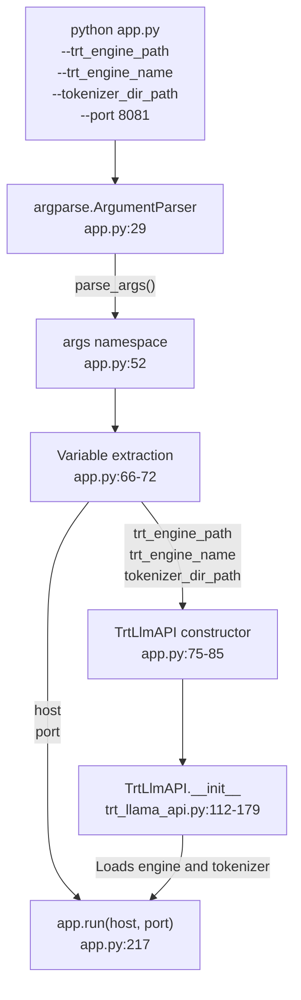
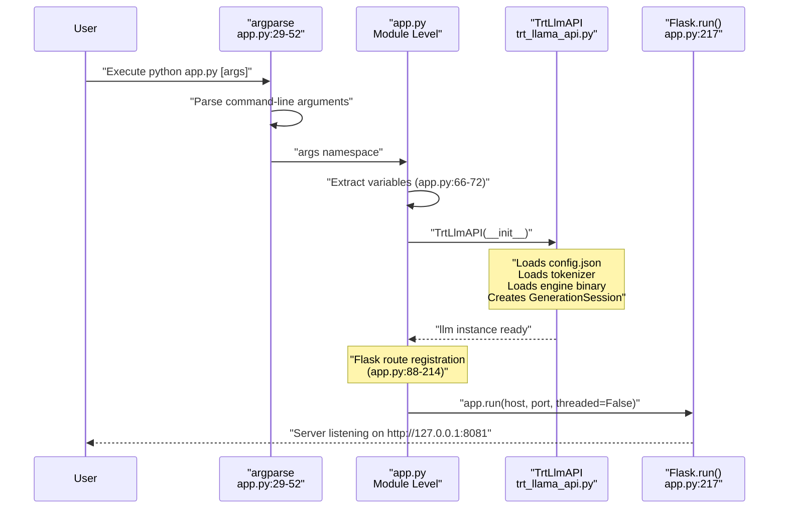
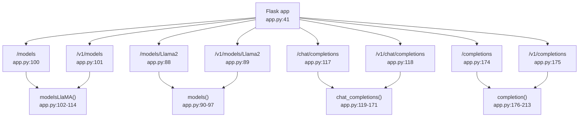

<!-- source: DeepWiki mcp.deepwiki.com · repo NVIDIA/trt-llm-as-openai-windows · page 2.3 Launching the Server · fetched 2026-10-26 -->

# Launching the Server

<details>
<summary>Relevant source files</summary>

The following files were used as context for generating this wiki page:

- [README.md](README.md)
- [app.py](app.py)

</details>


This page describes how to start the Flask web server that exposes the OpenAI-compatible API. It covers the required command-line arguments, optional configuration parameters, and the server initialization sequence. For information about preparing the TensorRT engine before launching, see [Model Preparation](#2.2). For information about using the API after the server is running, see [API Usage](#3).

## Prerequisites

Before launching the server, ensure the following are in place:
1. TensorRT engine files have been built and placed in the target directory (see [Building TensorRT Engines](#2.2.2))
2. Tokenizer files and `config.json` have been downloaded to the model directory (see [Downloading Models and Weights](#2.2.1))
3. Python dependencies from `requirements.txt` have been installed

**Sources:** [README.md:47-62]()

## Basic Launch Command

The server is started by executing `app.py` with Python. The minimum required command structure is:

```bash
python app.py \
    --trt_engine_path <path_to_engine_directory> \
    --trt_engine_name <engine_filename.engine> \
    --tokenizer_dir_path <path_to_tokenizer_directory>
```

This command initializes the Flask application at [app.py:41](), creates a `TrtLlmAPI` instance at [app.py:75-85](), and starts the HTTP server at [app.py:217]().

**Sources:** [README.md:64-67](), [app.py:22-52](), [app.py:75-85]()

## Required Arguments

The following table documents the three mandatory command-line arguments that must be provided:

| Argument | Type | Description | Example Value |
|----------|------|-------------|---------------|
| `--trt_engine_path` | `str` | Directory containing the TensorRT engine files | `model/engine/` or `model/` |
| `--trt_engine_name` | `str` | Filename of the compiled `.engine` file | `llama_float16_tp1_rank0.engine` |
| `--tokenizer_dir_path` | `str` | Directory containing tokenizer files (`tokenizer.json`, `tokenizer_config.json`) and `config.json` | `model/` |

These arguments are parsed by `argparse.ArgumentParser` at [app.py:29-37]() and passed to the `TrtLlmAPI` constructor at [app.py:75-85]().

**Sources:** [app.py:32-37](), [README.md:105-109]()

## Optional Configuration Arguments

Additional arguments provide control over server behavior and resource limits:

| Argument | Type | Default | Description |
|----------|------|---------|-------------|
| `--host` | `str` | `127.0.0.1` | IP address for the server to bind to |
| `--port` | `int` | `8081` | TCP port number for HTTP listener |
| `--max_output_tokens` | `int` | `2048` | Maximum number of tokens in generated responses |
| `--max_input_tokens` | `int` | `2048` | Maximum number of tokens in input prompts |
| `--no_system_prompt` | `bool` | `False` | Disable automatic system prompt injection (required for CodeLlama) |
| `--verbose` | `bool` | `False` | Enable detailed logging of requests and responses |

The `--host` and `--port` arguments control the network binding at [app.py:217](), while token limits are passed to `TrtLlmAPI` at [app.py:80-81](). The `--no_system_prompt` flag affects prompt formatting logic in chat completion endpoints at [app.py:154-156]().

**Sources:** [app.py:44-49](), [README.md:110-113]()

## Command-Line Argument Flow

The following diagram shows how command-line arguments flow through the application during initialization:



**Sources:** [app.py:22-85](), [app.py:217]()

## Model-Specific Launch Examples

Different models require different argument configurations:

### Llama-2-13B-chat

Standard launch command without system prompt modification:

```bash
python app.py \
    --trt_engine_path model/engine/ \
    --trt_engine_name llama_float16_tp1_rank0.engine \
    --tokenizer_dir_path model/ \
    --port 8081
```

This configuration uses the default system prompt defined in `DEFAULT_SYSTEM_PROMPT` from [utils.py]().

### CodeLlama-13B-instruct

Requires disabling the automatic system prompt:

```bash
python app.py \
    --trt_engine_path model/ \
    --trt_engine_name llama_float16_tp1_rank0.engine \
    --tokenizer_dir_path model/ \
    --port 8081 \
    --no_system_prompt True
```

The `--no_system_prompt True` argument prevents injection of the default system prompt at [app.py:154-156](), as CodeLlama uses a different prompt format than Llama 2 chat models.

**Sources:** [README.md:64-76](), [app.py:154-158]()

## Server Initialization Sequence

When `python app.py` is executed, the following initialization sequence occurs:



The initialization happens in this order:

1. **Argument Parsing** [app.py:22-52](): Command-line arguments are parsed into an `args` namespace
2. **Variable Extraction** [app.py:66-72](): Values are extracted from `args` into module-level variables
3. **TrtLlmAPI Initialization** [app.py:75-85](): The inference engine is instantiated, which internally:
   - Loads `config.json` from the engine directory
   - Loads the tokenizer from `tokenizer_dir_path`
   - Reads the `.engine` binary file
   - Creates a `GenerationSession` with the TensorRT runtime
4. **Route Registration** [app.py:88-214](): Flask routes are decorated and registered
5. **Server Start** [app.py:217](): Flask begins listening for HTTP requests

The initialization is single-threaded (`threaded=False` at [app.py:217]()), meaning the server handles requests sequentially.

**Sources:** [app.py:22-85](), [app.py:217]()

## Registered HTTP Endpoints

After initialization, the Flask application exposes the following routes:



All routes are registered with both standard and `/v1/` prefixed paths for OpenAI API compatibility. The routes are defined using Flask's `@app.route()` decorator at various locations in [app.py]().

**Sources:** [app.py:88-214](), [README.md:116-121]()

## Verifying Server Status

After launching, verify the server is running correctly:

### Check Console Output

The Flask development server prints startup messages:

```
 * Serving Flask app 'app'
 * Debug mode: on
WARNING: This is a development server. Do not use it in a production deployment.
 * Running on http://127.0.0.1:8081
Press CTRL+C to quit
```

The "Running on" line confirms the server is listening. The port number should match the `--port` argument (default 8081).

### Test Models Endpoint

Query the `/models` endpoint to verify API responsiveness:

```bash
curl http://127.0.0.1:8081/models
```

Expected response:

```json
{
  "object": "list",
  "data": [
    {
      "id": "Llama2",
      "object": "model",
      "created": 1675232119,
      "owned_by": "Meta"
    }
  ]
}
```

This response is generated by the `modelsLlaMA()` function at [app.py:102-114]().

**Sources:** [app.py:100-114](), [README.md:78-95]()

## Server Runtime Configuration

The server is configured with specific Flask settings at [app.py:217]():

| Parameter | Value | Reason |
|-----------|-------|--------|
| `debug` | `True` | Enables detailed error messages and auto-reload (development mode) |
| `use_reloader` | `False` | Disables auto-reload despite debug mode to prevent double initialization |
| `threaded` | `False` | Forces sequential request handling (likely due to TensorRT thread safety) |

The `threaded=False` setting is critical: it ensures only one request is processed at a time, preventing concurrent access to the TensorRT `GenerationSession`, which may not be thread-safe.

**Sources:** [app.py:217]()

## Common Launch Issues

### Engine Path Errors

If the engine path is incorrect, initialization fails during `TrtLlmAPI.__init__()`. Symptoms:
- `FileNotFoundError` for `config.json` 
- `FileNotFoundError` for `.engine` file

**Solution:** Verify `--trt_engine_path` points to the directory containing both `config.json` and the `.engine` file.

### Tokenizer Path Errors

If tokenizer files are missing, initialization fails when loading `AutoTokenizer`. Symptoms:
- `OSError: Can't load tokenizer`
- Missing `tokenizer.json` or `tokenizer_config.json`

**Solution:** Verify `--tokenizer_dir_path` contains all required tokenizer files from HuggingFace.

### Port Already in Use

If the specified port is already bound, Flask fails to start:
```
OSError: [WinError 10048] Only one usage of each socket address (protocol/network address/port) is normally permitted
```

**Solution:** Use a different `--port` value or terminate the process using the current port.

**Sources:** [app.py:75-85](), [app.py:217]()

## Server Shutdown

To stop the server:
1. Press `Ctrl+C` in the terminal running `app.py`
2. Flask catches the interrupt and performs cleanup
3. The TensorRT engine and CUDA resources are released when the Python process exits

The server does not persist state between runs; all inference state exists only in memory during runtime.

**Sources:** [app.py:217]()

---

