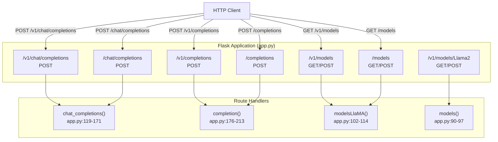
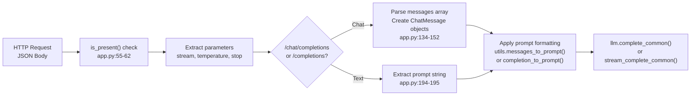
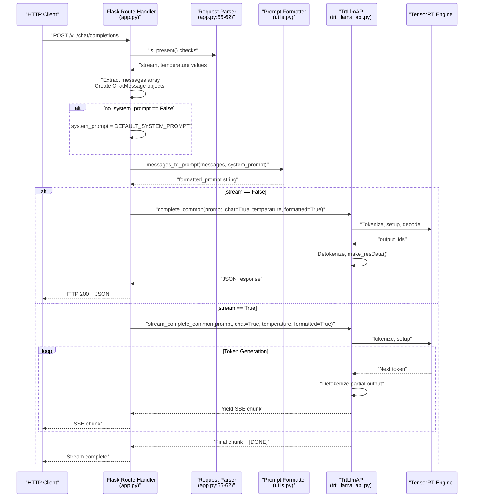

<!-- source: DeepWiki mcp.deepwiki.com · repo NVIDIA/trt-llm-as-openai-windows · page 3 API Usage · fetched 2026-10-26 -->

# API Usage

<details>
<summary>Relevant source files</summary>

The following files were used as context for generating this wiki page:

- [README.md](README.md)
- [app.py](app.py)

</details>


This page provides a comprehensive guide to making inference requests to the TensorRT-LLM OpenAI-compatible API server. It covers the HTTP endpoints, request/response formats, common parameters, and basic usage patterns.

For detailed information about specific endpoint types, see [Chat Completions](#3.2), [Text Completions](#3.3), and [Client Integration Examples](#3.4). For server configuration and startup options, see [Server Configuration](#5.1).

## Purpose and Compatibility

The TensorRT-LLM OpenAI API server exposes HTTP endpoints that conform to the OpenAI API specification. This allows any client built for the OpenAI API to interact with locally-hosted LLM inference without modification. The server implements a subset of the OpenAI API focused on text generation tasks.

**Key Compatibility Features:**
- Request/response JSON structures match OpenAI's specification
- Endpoint paths follow OpenAI's `/v1/*` and legacy naming conventions
- Streaming responses use Server-Sent Events (SSE) format
- Model identifiers work with OpenAI client libraries

**Sources:** [README.md:3-7](), [README.md:116-122]()

## Base URL and Connection

The server listens on a configurable host and port, with defaults specified as command-line arguments to `app.py`.

**Default Configuration:**
- **Host:** `127.0.0.1` (localhost only)
- **Port:** `8081`
- **Base URL:** `http://127.0.0.1:8081`
- **OpenAI-compatible Base URL:** `http://127.0.0.1:8081/v1`

These defaults can be overridden using the `--host` and `--port` command-line arguments when starting the server.

**Authentication:** The server requires an API key to be set in client requests for OpenAI client library compatibility, but does not validate its value. Any non-empty string is accepted.

```python
# Example client configuration
openai.api_key = "ABC"  # Any string works
openai.api_base = "http://127.0.0.1:8081"
```

**Sources:** [app.py:44-45](), [app.py:216-217](), [README.md:88-90]()

## Endpoint Overview

The following diagram shows the HTTP endpoints exposed by the Flask server and their routing in the codebase:



**Endpoint Routing:**
- Both `/v1/*` prefixed and legacy (non-prefixed) endpoints route to the same handler functions
- All completion endpoints require `Content-Type: application/json` header
- Model endpoints support both GET and POST methods for compatibility

**Sources:** [app.py:117-118](), [app.py:174-175](), [app.py:100-101](), [app.py:88-89]()

## Common Request Parameters

The following parameters are supported across completion endpoints (both chat and text):

| Parameter | Type | Default | Description | Code Reference |
|-----------|------|---------|-------------|----------------|
| `stream` | boolean | `false` | Enable streaming responses via SSE | [app.py:122-125](), [app.py:181-182]() |
| `temperature` | float | `1.0` | Sampling temperature (higher = more random) | [app.py:123-127](), [app.py:179-184]() |
| `stop` | string[] | `[]` | Stop sequences for generation termination | [app.py:186-188]() |
| `messages` | array | required* | Chat messages (chat completions only) | [app.py:133-152]() |
| `prompt` | string | required* | Raw text prompt (text completions only) | [app.py:194-195]() |

*One of `messages` or `prompt` is required depending on endpoint type.

**Parameter Processing Flow:**



**Parameter Validation:**
The `is_present()` utility function checks if JSON keys exist and have non-null values before extracting them. This prevents `KeyError` exceptions when optional parameters are omitted.

**Sources:** [app.py:55-62](), [app.py:122-127](), [app.py:179-188](), [app.py:133-152]()

## Response Format

All completion endpoints return JSON responses conforming to OpenAI's response structure. The response generation is handled by the `make_resData()` method in `TrtLlmAPI`.

### Non-Streaming Response Structure

```json
{
  "id": "chatcmpl-<request_id>",
  "object": "chat.completion",
  "created": <unix_timestamp>,
  "model": "Llama2",
  "choices": [
    {
      "index": 0,
      "message": {
        "role": "assistant",
        "content": "<generated_text>"
      },
      "finish_reason": "stop"
    }
  ],
  "usage": {
    "prompt_tokens": <input_token_count>,
    "completion_tokens": <output_token_count>,
    "total_tokens": <sum>
  }
}
```

**Response Object Differences:**
- Chat completions: `"object": "chat.completion"`, with `message` field
- Text completions: `"object": "text_completion"`, with `text` field instead

**Sources:** [trt_llama_api.py:49-80]() (inferred from make_resData method structure)

### Streaming Response Format

When `"stream": true` is specified, the server returns a stream of Server-Sent Events (SSE). Each event contains a JSON chunk:

```
data: {"id":"chatcmpl-xyz","object":"chat.completion.chunk","created":1234567890,"model":"Llama2","choices":[{"index":0,"delta":{"content":"Hello"},"finish_reason":null}]}

data: {"id":"chatcmpl-xyz","object":"chat.completion.chunk","created":1234567890,"model":"Llama2","choices":[{"index":0,"delta":{"content":" world"},"finish_reason":null}]}

data: {"id":"chatcmpl-xyz","object":"chat.completion.chunk","created":1234567890,"model":"Llama2","choices":[{"index":0,"delta":{},"finish_reason":"stop"}]}

data: [DONE]
```

**Streaming Characteristics:**
- Each chunk contains incremental `delta` content
- Final chunk has `"finish_reason": "stop"` with empty delta
- Stream ends with `data: [DONE]` marker
- Content-Type is `text/event-stream`

**Sources:** [app.py:168-171](), [app.py:210-213]() (streaming calls to trt_llama_api)

## Request Flow Architecture

The following sequence diagram shows how a typical API request flows through the system components:



**Key Flow Steps:**
1. **Request Reception:** Flask routes match incoming HTTP requests to handler functions
2. **Parameter Parsing:** `is_present()` safely extracts optional parameters from JSON body
3. **Message Conversion:** Chat messages are converted to `ChatMessage` objects with role enums
4. **System Prompt Injection:** Unless `--no_system_prompt` flag is set, a default system prompt is prepended
5. **Prompt Formatting:** Messages are converted to a single formatted string with special tokens
6. **Inference Execution:** `TrtLlmAPI` methods handle tokenization, engine setup, and generation
7. **Response Generation:** Output is formatted as OpenAI-compatible JSON (or SSE stream)

**Sources:** [app.py:117-171](), [app.py:174-213](), [app.py:55-62]()

## System Prompt Handling

The server automatically applies a default system prompt to requests unless disabled with the `--no_system_prompt` command-line flag.

**System Prompt Behavior:**

| Endpoint | Default Behavior | When `--no_system_prompt True` |
|----------|------------------|-------------------------------|
| `/chat/completions` | Prepends `DEFAULT_SYSTEM_PROMPT` | No system prompt added |
| `/completions` | Wraps prompt with `completion_to_prompt()` | Raw prompt passed through |

**Code References:**
- Default system prompt constant: `DEFAULT_SYSTEM_PROMPT` imported from `utils.py`
- Chat completion check: [app.py:154-158]()
- Text completion check: [app.py:205-206]()
- Command-line flag: [app.py:49](), [app.py:72]()

**Model-Specific Requirements:**
- **CodeLlama-13B-Instruct:** Requires `--no_system_prompt True` flag
- **Llama-2-13B-Chat:** Uses default system prompt (flag should be `False`)

**Sources:** [app.py:154-158](), [app.py:205-206](), [README.md:69-72]()

## Token Limits

Token limits are configurable via command-line arguments and affect the maximum context window and generation length:

| Parameter | Command-Line Arg | Default | Description |
|-----------|------------------|---------|-------------|
| Input Tokens | `--max_input_tokens` | 2048 | Maximum prompt length in tokens |
| Output Tokens | `--max_output_tokens` | 2048 | Maximum generation length in tokens |

**Enforcement:**
- Input token limits are enforced during tokenization in `TrtLlmAPI`
- Output token limits are passed to the TensorRT-LLM `GenerationSession.setup()` method
- Exceeding limits may result in truncation or errors depending on the constraint type

**Engine Build Constraints:**
These limits cannot exceed the values specified during TensorRT engine compilation:
- `--max_input_len` during `build.py` execution sets hard upper limit on input tokens
- `--max_output_len` during `build.py` execution sets hard upper limit on output tokens

For example, CodeLlama engines built with `--max_input_len 15360 --max_output_len 1024` can accept up to 15,360 input tokens but only generate up to 1,024 new tokens.

**Sources:** [app.py:47-48](), [app.py:80-81](), [README.md:40](), [README.md:44]()

## Basic Usage Examples

### Using curl

**Chat Completion:**
```bash
curl http://127.0.0.1:8081/v1/chat/completions \
  -H "Content-Type: application/json" \
  -H "Authorization: Bearer ABC" \
  -d '{
    "model": "Llama2",
    "messages": [
      {"role": "user", "content": "Hello! How are you?"}
    ],
    "temperature": 0.7
  }'
```

**Text Completion:**
```bash
curl http://127.0.0.1:8081/v1/completions \
  -H "Content-Type: application/json" \
  -H "Authorization: Bearer ABC" \
  -d '{
    "model": "Llama2",
    "prompt": "Once upon a time",
    "temperature": 0.7,
    "stream": false
  }'
```

### Using Python OpenAI Library

```python
import openai

# Configure client
openai.api_key = "ABC"
openai.api_base = "http://127.0.0.1:8081"

# Chat completion
response = openai.ChatCompletion.create(
    model="Llama2",
    messages=[
        {"role": "user", "content": "Hello! How are you?"}
    ],
    temperature=0.7
)
print(response.choices[0].message.content)

# Text completion
response = openai.Completion.create(
    model="Llama2",
    prompt="Once upon a time",
    temperature=0.7
)
print(response.choices[0].text)
```

**Sources:** [README.md:78-95]()

## Error Handling

The server performs basic validation on incoming requests:

**Common Error Cases:**

| Error Condition | HTTP Status | Description |
|----------------|-------------|-------------|
| Missing `Content-Type: application/json` | 500 | Assertion failure in route handler |
| Missing required `messages` or `prompt` | Variable | May result in incomplete generation or empty response |
| Invalid JSON body | 400 | Flask automatic parsing error |

**Assertion Checks:**
```python
# app.py:120 and app.py:177
assert request.headers.get('Content-Type') == 'application/json'
```

The server does not currently implement comprehensive error handling for malformed requests, so clients should ensure requests conform to the expected format.

**Sources:** [app.py:120](), [app.py:177]()

## Verbose Logging

Enable verbose logging with the `--verbose True` flag to see debug information printed to stdout:

**Logged Information:**
- Endpoint called (e.g., "/chat/completions called with stream=True")
- Input prompt size and content
- Raw prompts written to `prompts.txt` file (completions endpoint only)

**Log Output Locations:**
- Standard output: Controlled by `verbose` variable checks in [app.py:129-130](), [app.py:164-166](), [app.py:190-191]()
- File output: `prompts.txt` in current working directory [app.py:197-203]()

**Sources:** [app.py:38-39](), [app.py:129-130](), [app.py:164-166](), [app.py:197-203]()

---

