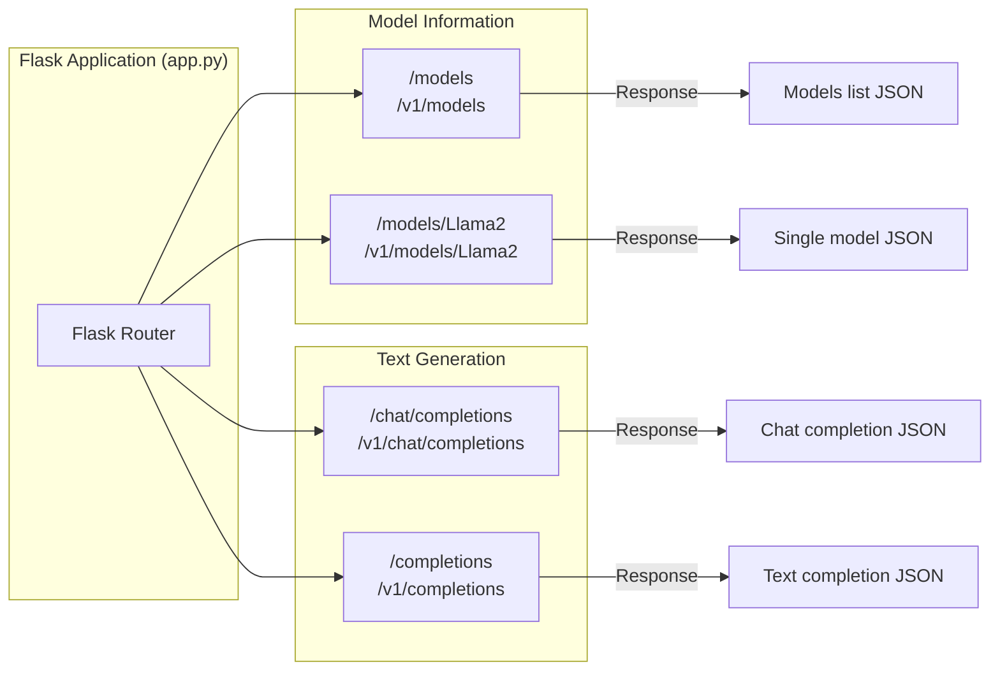
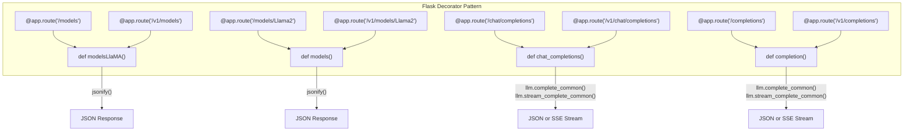
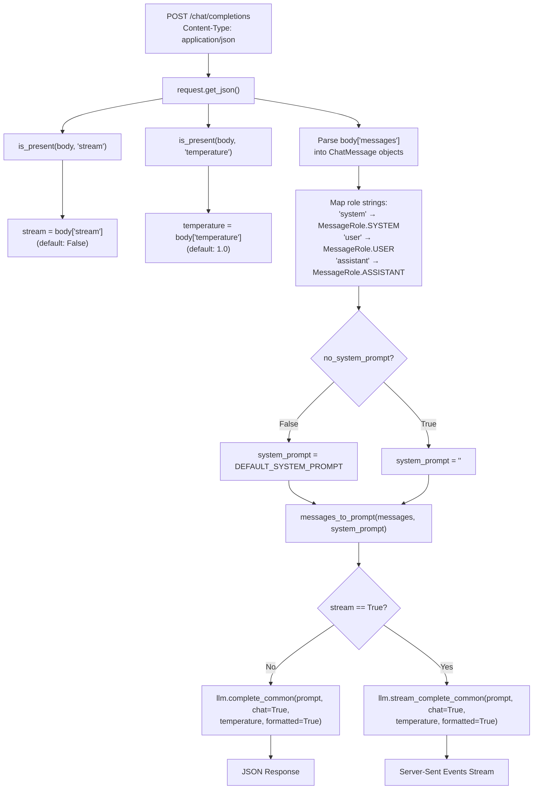
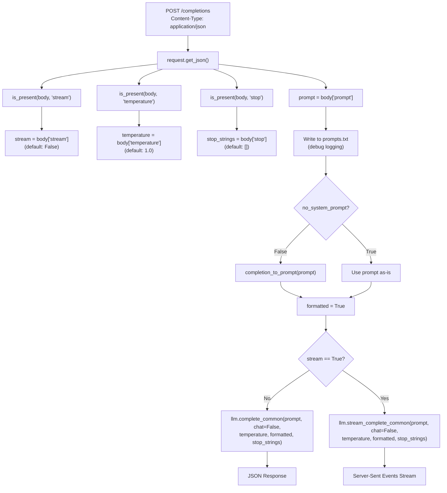
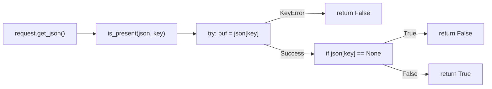

<!-- source: DeepWiki mcp.deepwiki.com · repo NVIDIA/trt-llm-as-openai-windows · page 3.1 Available Endpoints · fetched 2026-10-26 -->

# Available Endpoints

<details>
<summary>Relevant source files</summary>

The following files were used as context for generating this wiki page:

- [README.md](README.md)
- [app.py](app.py)

</details>


This page documents all HTTP endpoints exposed by the Flask server. Each endpoint provides OpenAI API-compatible functionality for model information and text generation.

For detailed information about request and response formats, see [Chat Completions](#3.2) and [Text Completions](#3.3). For client integration examples, see [Client Integration Examples](#3.4).

## Overview

The Flask application exposes four primary endpoint patterns, each available with and without the `/v1` prefix for OpenAI API compatibility:



**Sources:** [app.py:88-213]()

## Endpoint Summary Table

| Endpoint | HTTP Methods | Purpose | Streaming Support |
|----------|-------------|---------|-------------------|
| `/models` | GET, POST | List all available models | No |
| `/v1/models` | GET, POST | List all available models (v1 prefix) | No |
| `/models/Llama2` | GET, POST | Get information about specific model | No |
| `/v1/models/Llama2` | GET, POST | Get information about specific model (v1 prefix) | No |
| `/chat/completions` | POST | Generate chat-style completions with message history | Yes |
| `/v1/chat/completions` | POST | Generate chat-style completions with message history (v1 prefix) | Yes |
| `/completions` | POST | Generate raw text completions | Yes |
| `/v1/completions` | POST | Generate raw text completions (v1 prefix) | Yes |

**Sources:** [app.py:88-213](), [README.md:116-122]()

## Route Registration Architecture



Flask's decorator pattern allows multiple routes to map to a single handler function. Each endpoint function is decorated with two `@app.route()` decorators: one for the standard path and one with the `/v1` prefix. This dual registration ensures compatibility with OpenAI clients that may use either path convention.

**Sources:** [app.py:88-118](), [app.py:117-171](), [app.py:174-213]()

## Model Information Endpoints

### `/models` and `/v1/models`

Returns a list of available models on the server.

**Handler Function:** `modelsLlaMA()` [app.py:100-114]()

**HTTP Methods:** GET, POST

**Response Format:**
```json
{
  "object": "list",
  "data": [
    {
      "id": "Llama2",
      "object": "model",
      "created": 1675232119,
      "owned_by": "Meta"
    }
  ]
}
```

The response structure matches the OpenAI `/v1/models` endpoint format. The `created` field contains a Unix timestamp, and the `owned_by` field identifies the model creator.

**Sources:** [app.py:100-114]()

### `/models/Llama2` and `/v1/models/Llama2`

Returns information about a specific model. Currently, only the `Llama2` model identifier is supported.

**Handler Function:** `models()` [app.py:88-97]()

**HTTP Methods:** GET, POST

**Response Format:**
```json
{
  "id": "Llama2",
  "object": "model",
  "created": 1675232119,
  "owned_by": "Meta"
}
```

This endpoint returns a single model object rather than a list. The response structure is identical to individual items in the `/models` endpoint's data array.

**Sources:** [app.py:88-97]()

## Completion Endpoints

### `/chat/completions` and `/v1/chat/completions`

Generates chat-style completions using a conversation message history format.

**Handler Function:** `chat_completions()` [app.py:117-171]()

**HTTP Methods:** POST

**Content-Type:** `application/json`

**Request Processing Flow:**



**Key Processing Steps:**

1. **Content-Type Validation:** [app.py:120]() - Asserts request has `application/json` content type
2. **Message Parsing:** [app.py:133-152]() - Converts JSON message objects to `ChatMessage` instances
3. **Role Mapping:** [app.py:138-147]() - Maps string roles to `MessageRole` enum values
4. **System Prompt Handling:** [app.py:154-156]() - Conditionally adds default system prompt based on `--no_system_prompt` flag
5. **Prompt Formatting:** [app.py:158]() - Calls `messages_to_prompt()` from `utils.py`
6. **Inference Dispatch:** [app.py:168-171]() - Routes to either `complete_common()` or `stream_complete_common()`

**Sources:** [app.py:117-171]()

### `/completions` and `/v1/completions`

Generates raw text completions without conversation formatting.

**Handler Function:** `completion()` [app.py:174-213]()

**HTTP Methods:** POST

**Content-Type:** `application/json`

**Request Processing Flow:**



**Key Differences from Chat Completions:**

- Accepts a single `prompt` string instead of `messages` array
- Supports `stop` parameter for custom stop sequences [app.py:186-188]()
- Logs prompts to `prompts.txt` file [app.py:197-203]()
- Calls `completion_to_prompt()` instead of `messages_to_prompt()`
- Passes `chat=False` to inference functions [app.py:211-213]()

**Sources:** [app.py:174-213]()

## Endpoint Parameter Extraction

The `is_present()` utility function [app.py:55-62]() provides safe extraction of optional parameters from request JSON bodies:



This function prevents `KeyError` exceptions when accessing optional fields like `stream`, `temperature`, and `stop`. It returns `False` if the key is missing or has a `None` value, allowing safe conditional extraction with default values.

**Sources:** [app.py:55-62]()

## Server Configuration

The Flask application is launched with specific configuration parameters [app.py:216-217]():

| Parameter | Value | Purpose |
|-----------|-------|---------|
| `host` | `args.host` (default: `127.0.0.1`) | IP address to bind server |
| `port` | `args.port` (default: `8081`) | Port number to listen on |
| `debug` | `True` | Enable Flask debug mode |
| `use_reloader` | `False` | Disable auto-reload on code changes |
| `threaded` | `False` | Single-threaded request handling |

The `threaded=False` configuration ensures sequential request processing, which is necessary due to TensorRT engine thread-safety constraints. This means the server processes one request at a time.

**Sources:** [app.py:216-217](), [app.py:44-45]()

---

