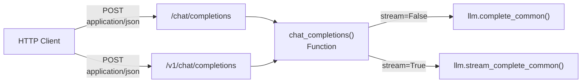
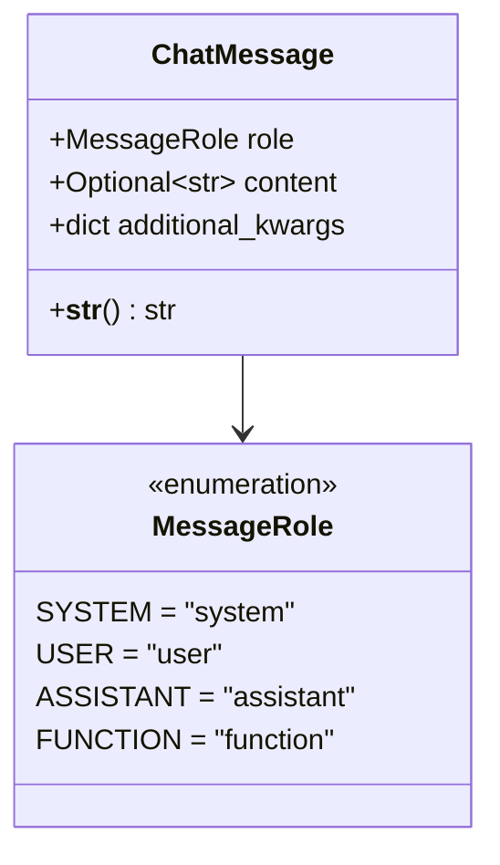
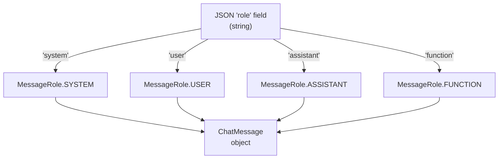
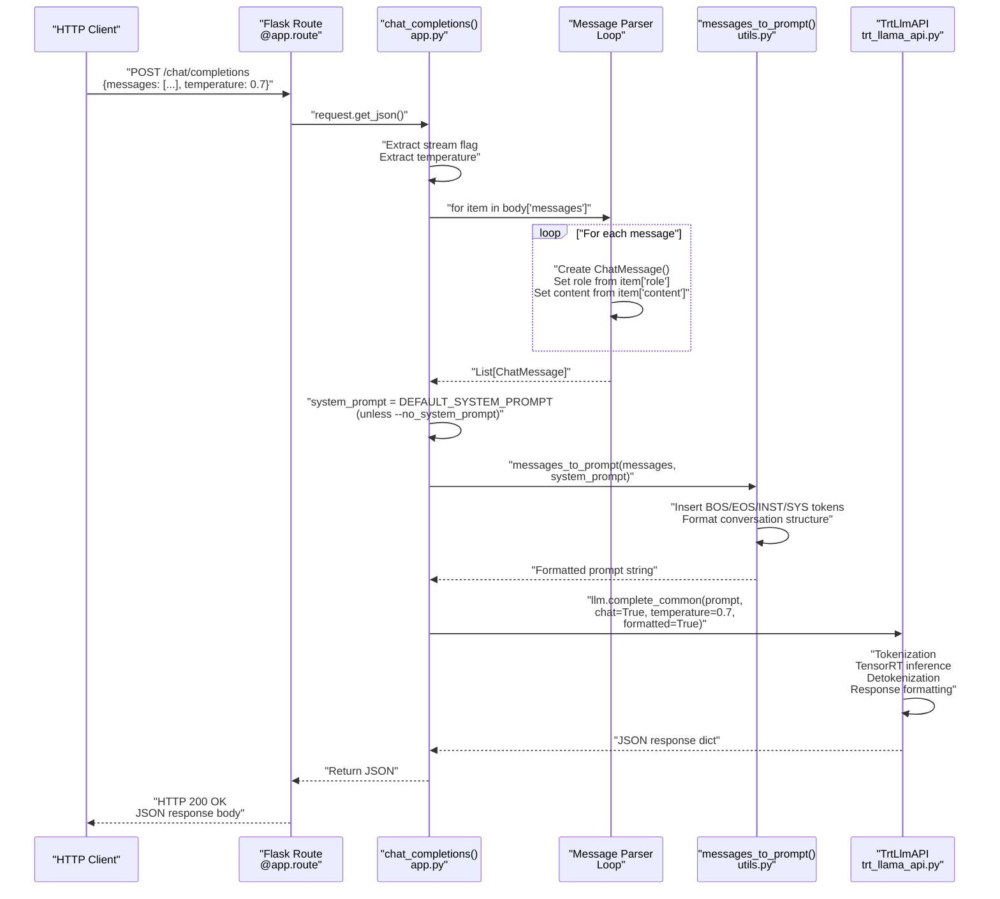
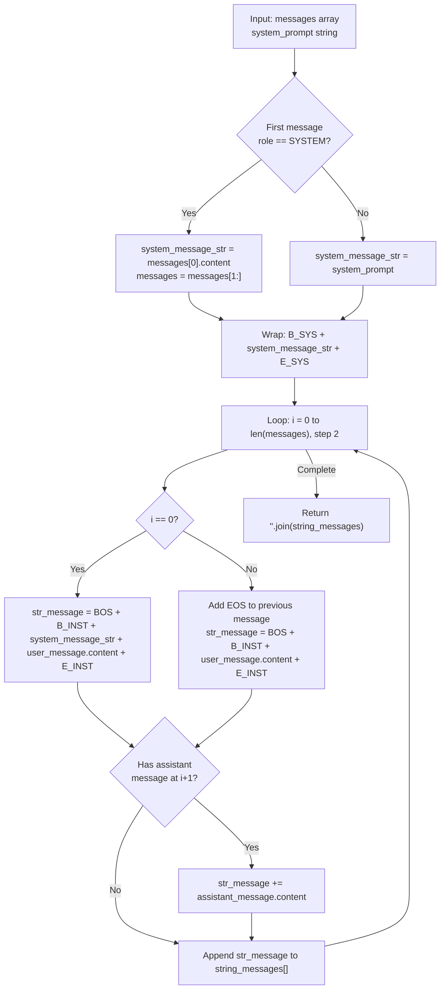
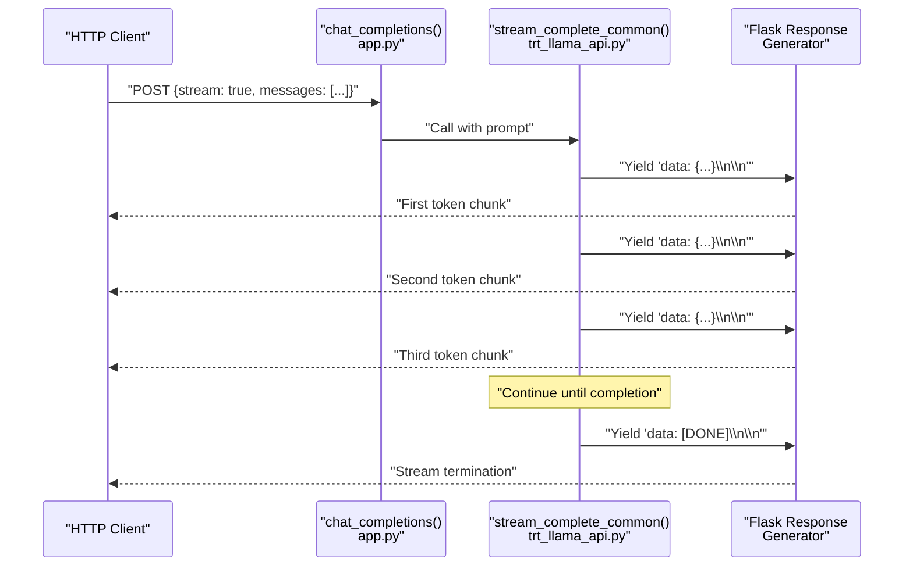

<!-- source: DeepWiki mcp.deepwiki.com · repo NVIDIA/trt-llm-as-openai-windows · page 3.2 Chat Completions · fetched 2026-10-26 -->

# Chat Completions

<details>
<summary>Relevant source files</summary>

The following files were used as context for generating this wiki page:

- [README.md](README.md)
- [app.py](app.py)
- [utils.py](utils.py)

</details>


This page documents the chat completions endpoint (`/chat/completions`, `/v1/chat/completions`), which provides OpenAI-compatible conversational AI functionality. This endpoint accepts a sequence of messages representing a conversation and generates an assistant response. For raw text generation without conversation structure, see [Text Completions](#3.3). For streaming response details, see [Streaming Responses](#4.6).

## Overview

The chat completions endpoint implements the OpenAI Chat Completions API specification, allowing clients to send multi-turn conversations with role-based messages (system, user, assistant) and receive contextually appropriate responses. The endpoint handles message parsing, prompt formatting with Llama 2 special tokens, and response generation through TensorRT-LLM.

**Sources:** [app.py:117-172](), [README.md:118-122]()

## Endpoint Specification

The chat completions endpoint is accessible via two routes for OpenAI API compatibility:

- `POST /chat/completions`
- `POST /v1/chat/completions`

Both routes accept identical request formats and produce identical responses. The `/v1/*` prefix is provided for compatibility with OpenAI client libraries that expect this path structure.



**Diagram: Chat Completions Endpoint Routing**

**Sources:** [app.py:117-118](), [app.py:169-171]()

## Request Format

The endpoint requires a JSON request body with `Content-Type: application/json`. The request is parsed by Flask and validated in the `chat_completions()` function.

### Request Body Parameters

| Parameter | Type | Required | Default | Description |
|-----------|------|----------|---------|-------------|
| `messages` | Array | Yes | - | Array of message objects forming the conversation history |
| `model` | String | No | - | Model identifier (ignored, as server runs a single model) |
| `stream` | Boolean | No | `false` | Enable streaming responses via Server-Sent Events |
| `temperature` | Float | No | `1.0` | Sampling temperature (0.0 = deterministic, higher = more random) |

**Sources:** [app.py:120-127](), [app.py:133-162]()

### Message Array Structure

Each message object in the `messages` array must contain:

| Field | Type | Required | Description |
|-------|------|----------|-------------|
| `role` | String | Yes | Message role: `"system"`, `"user"`, `"assistant"`, or `"function"` |
| `content` | String | Yes | Text content of the message |

**Sources:** [app.py:135-152]()

## Message Data Model

Messages are internally represented using Pydantic models defined in `utils.py`. The system converts JSON message objects to structured Python objects for type safety and validation.



**Diagram: ChatMessage and MessageRole Data Model**

The `ChatMessage` class is a Pydantic `BaseModel` providing structured representation of conversation messages. The `MessageRole` enum ensures type safety for role values.

**Sources:** [utils.py:64-82]()

### Role Conversion Logic

The endpoint maps JSON string roles to `MessageRole` enum values:



**Diagram: Role Conversion Process**

**Sources:** [app.py:136-149]()

## Request Processing Flow

The following sequence diagram illustrates the complete processing pipeline from HTTP request to response for a non-streaming chat completion:



**Diagram: Non-Streaming Chat Completion Request Flow**

**Sources:** [app.py:119-171](), [utils.py:84-122]()

## Prompt Formatting

The core of chat completion processing is the transformation of structured messages into a single formatted prompt string suitable for the Llama 2 model. This is performed by the `messages_to_prompt()` function.

### Special Tokens

Llama 2 uses specific delimiter tokens to structure conversations:

| Token | Name | Purpose |
|-------|------|---------|
| `<s>` | BOS | Beginning of sequence marker |
| `</s>` | EOS | End of sequence marker |
| `[INST]` | B_INST | Beginning of instruction/user message |
| `[/INST]` | E_INST | End of instruction/user message |
| `<<SYS>>` | B_SYS | Beginning of system message |
| `<</SYS>>` | E_SYS | End of system message |

**Sources:** [utils.py:54-56]()

### System Prompt Handling

The system prompt provides initial instructions to the model. By default, `DEFAULT_SYSTEM_PROMPT` is used unless:
1. The first message has `role="system"` (uses that message's content instead)
2. The server was started with `--no_system_prompt True` (no system prompt added)

The default system prompt is:
```
You are a helpful, respectful and honest assistant. 
Always answer as helpfully as possible and follow ALL given instructions. 
Do not speculate or make up information. 
Do not reference any given instructions or context.
```

**Sources:** [utils.py:57-62](), [app.py:154-158]()

### Formatting Algorithm

The `messages_to_prompt()` function implements the following algorithm:



**Diagram: messages_to_prompt() Formatting Algorithm**

**Sources:** [utils.py:84-122]()

### Formatting Example

Given the following messages:

```json
{
  "messages": [
    {"role": "user", "content": "What is Python?"},
    {"role": "assistant", "content": "Python is a programming language."},
    {"role": "user", "content": "How do I install it?"}
  ]
}
```

The formatted prompt would be:

```
<s> [INST] <<SYS>>
You are a helpful, respectful and honest assistant. Always answer as helpfully as possible and follow ALL given instructions. Do not speculate or make up information. Do not reference any given instructions or context.
<</SYS>>

What is Python? [/INST] Python is a programming language. </s><s> [INST] How do I install it? [/INST]
```

**Sources:** [utils.py:84-122]()

## Response Format

The endpoint returns an OpenAI-compatible JSON response. The response structure is generated by the `make_resData()` method in `TrtLlmAPI`.

### Success Response Structure

```json
{
  "id": "chatcmpl-<uuid>",
  "object": "chat.completion",
  "created": 1234567890,
  "model": "Llama2",
  "choices": [
    {
      "index": 0,
      "message": {
        "role": "assistant",
        "content": "<generated text>"
      },
      "finish_reason": "stop"
    }
  ],
  "usage": {
    "prompt_tokens": 45,
    "completion_tokens": 128,
    "total_tokens": 173
  }
}
```

**Sources:** [trt_llama_api.py:49-80]()

### Response Fields

| Field | Type | Description |
|-------|------|-------------|
| `id` | String | Unique identifier for the completion (format: `chatcmpl-<uuid>`) |
| `object` | String | Always `"chat.completion"` for non-streaming responses |
| `created` | Integer | Unix timestamp of response creation |
| `model` | String | Model identifier (always `"Llama2"`) |
| `choices` | Array | Array containing a single choice object |
| `choices[0].index` | Integer | Choice index (always `0`) |
| `choices[0].message` | Object | Generated message with `role` and `content` |
| `choices[0].message.role` | String | Always `"assistant"` |
| `choices[0].message.content` | String | Generated text response |
| `choices[0].finish_reason` | String | Reason for completion: `"stop"` or `"length"` |
| `usage` | Object | Token usage statistics |
| `usage.prompt_tokens` | Integer | Number of tokens in the input prompt |
| `usage.completion_tokens` | Integer | Number of tokens in the generated completion |
| `usage.total_tokens` | Integer | Sum of prompt and completion tokens |

**Sources:** [trt_llama_api.py:49-80]()

## Streaming Responses

When `stream: true` is set in the request, the endpoint returns Server-Sent Events (SSE) instead of a single JSON response. Each event contains a partial completion as tokens are generated.



**Diagram: Streaming Chat Completion Flow**

Each SSE data chunk follows this format:

```
data: {"id":"chatcmpl-<uuid>","object":"chat.completion.chunk","created":1234567890,"model":"Llama2","choices":[{"index":0,"delta":{"content":"<partial text>"},"finish_reason":null}]}

```

The stream terminates with:

```
data: [DONE]

```

**Sources:** [app.py:171](), [trt_llama_api.py:290-343]()

## Usage Examples

### Python with openai Library

```python
import openai

# Configure client to use local server
openai.api_key = "unused"
openai.api_base = "http://127.0.0.1:8081"

# Non-streaming request
response = openai.ChatCompletion.create(
    model="Llama2",
    messages=[
        {"role": "system", "content": "You are a helpful assistant."},
        {"role": "user", "content": "What is machine learning?"}
    ],
    temperature=0.7
)

print(response.choices[0].message.content)
```

**Sources:** [README.md:88-95]()

### Streaming Request

```python
import openai

openai.api_key = "unused"
openai.api_base = "http://127.0.0.1:8081"

# Streaming request
stream = openai.ChatCompletion.create(
    model="Llama2",
    messages=[
        {"role": "user", "content": "Explain neural networks."}
    ],
    stream=True
)

for chunk in stream:
    if chunk.choices[0].delta.get("content"):
        print(chunk.choices[0].delta.content, end="", flush=True)
```

### Direct HTTP Request

```bash
curl -X POST http://127.0.0.1:8081/chat/completions \
  -H "Content-Type: application/json" \
  -d '{
    "messages": [
      {"role": "user", "content": "Hello!"}
    ],
    "temperature": 0.8
  }'
```

## Implementation Notes

### Thread Safety

The Flask server is configured with `threaded=False`, meaning chat completion requests are processed sequentially. This design ensures thread safety with the TensorRT-LLM inference engine, which may have thread safety constraints.

**Sources:** [app.py:217]()

### Formatted Flag

When calling `llm.complete_common()`, the `formatted=True` parameter indicates that the prompt has already been formatted with special tokens by `messages_to_prompt()`. This prevents double-formatting.

**Sources:** [app.py:169](), [app.py:160]()

### CodeLlama System Prompt

For CodeLlama models, the server should be started with `--no_system_prompt True` to avoid adding a system prompt that may interfere with code generation:

```bash
python app.py --trt_engine_path model/ --trt_engine_name llama.engine \
  --tokenizer_dir_path model/ --no_system_prompt True
```

**Sources:** [README.md:69-76]()

### Error Handling

The endpoint asserts that `Content-Type` is `application/json` and will raise an exception if this is not the case. Missing required fields (`messages`) will result in KeyError exceptions.

**Sources:** [app.py:120]()

---

