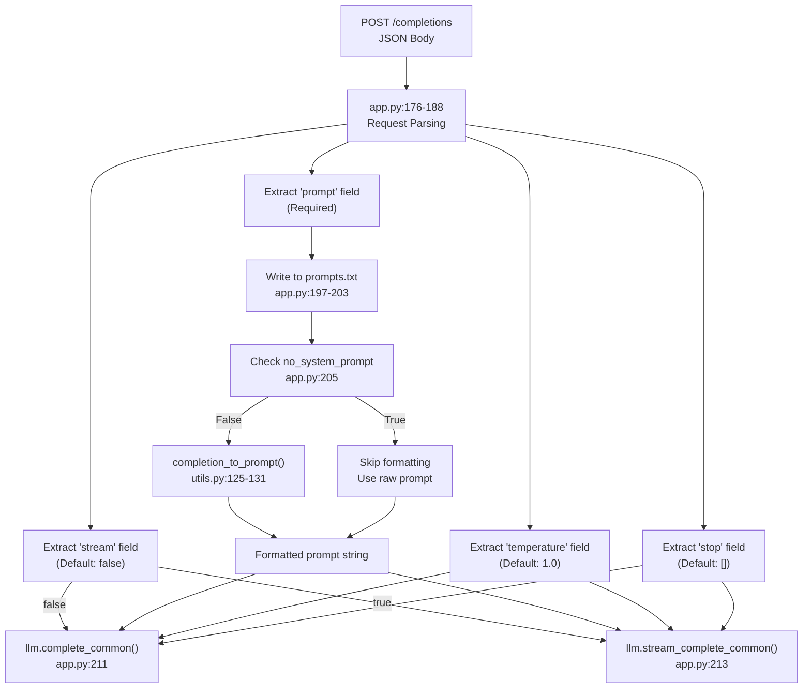
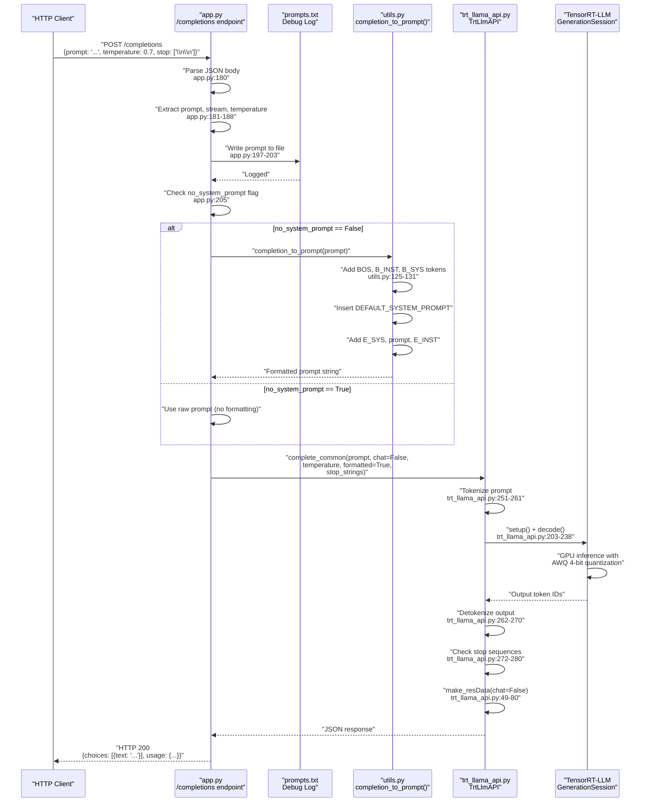
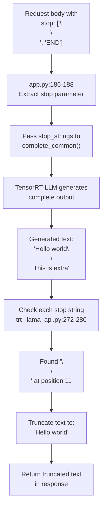
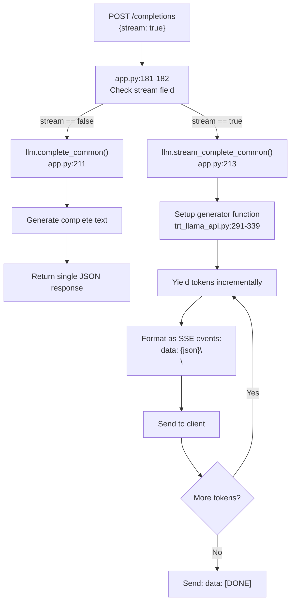

<!-- source: DeepWiki mcp.deepwiki.com · repo NVIDIA/trt-llm-as-openai-windows · page 3.3 Text Completions · fetched 2026-10-26 -->

# Text Completions

<details>
<summary>Relevant source files</summary>

The following files were used as context for generating this wiki page:

- [README.md](README.md)
- [app.py](app.py)
- [utils.py](utils.py)

</details>


## Purpose and Scope

This page documents the text completions endpoint (`/completions` and `/v1/completions`), which provides raw text generation capabilities using the TensorRT-LLM inference backend. Unlike chat completions (see [Chat Completions](#3.2)), which accept structured conversation messages, text completions accept a single prompt string and generate a continuation.

This endpoint is compatible with the legacy OpenAI Completions API and is suitable for tasks like code completion, text continuation, and other non-conversational generation tasks. For conversational interactions with message history, use the chat completions endpoint instead.

**Sources:** [app.py:174-213](), [README.md:118-121]()

---

## Endpoint Overview

The system exposes two identical text completion endpoints following OpenAI API conventions:

| Endpoint Path         | HTTP Method | Description                          |
|-----------------------|-------------|--------------------------------------|
| `/completions`        | POST        | Legacy OpenAI-compatible completions |
| `/v1/completions`     | POST        | Versioned completions endpoint       |

Both endpoints accept identical request payloads and return identical response formats. The `/v1/` prefix is provided for compatibility with OpenAI clients that default to versioned endpoints.

**Sources:** [app.py:174-175]()

---

## Request Structure

### HTTP Request Format

Text completion requests must include a `Content-Type: application/json` header and a JSON body with the following structure:

```json
{
  "prompt": "Write a Python function to calculate fibonacci numbers",
  "temperature": 0.7,
  "stream": false,
  "stop": ["\n\n", "def "]
}
```

### Request Parameters

| Parameter     | Type           | Required | Default | Description                                                                 |
|---------------|----------------|----------|---------|-----------------------------------------------------------------------------|
| `prompt`      | string         | Yes      | -       | The input text to complete                                                  |
| `temperature` | float          | No       | 1.0     | Sampling temperature (0.0 to 2.0). Lower values produce more deterministic output |
| `stream`      | boolean        | No       | false   | Enable Server-Sent Events (SSE) streaming for incremental token delivery   |
| `stop`        | string or array| No       | []      | Sequences where generation should halt. Can be a single string or array of strings |

The request parsing logic validates the presence of required fields and extracts optional parameters with fallback defaults.

**Sources:** [app.py:176-188]()



**Sources:** [app.py:174-213]()

---

## Response Structure

### Synchronous Response Format

Non-streaming completions return a JSON response immediately after generation completes:

```json
{
  "id": "cmpl-<uuid>",
  "object": "text_completion",
  "created": 1234567890,
  "model": "Llama2",
  "choices": [
    {
      "text": " Here's a Python implementation:\n\ndef fibonacci(n):\n    if n <= 1:\n        return n\n    return fibonacci(n-1) + fibonacci(n-2)",
      "index": 0,
      "finish_reason": "stop"
    }
  ],
  "usage": {
    "prompt_tokens": 12,
    "completion_tokens": 45,
    "total_tokens": 57
  }
}
```

### Field Descriptions

| Field                     | Type    | Description                                                              |
|---------------------------|---------|--------------------------------------------------------------------------|
| `id`                      | string  | Unique identifier for the completion request                             |
| `object`                  | string  | Object type, always `"text_completion"`                                  |
| `created`                 | integer | Unix timestamp of when the completion was created                        |
| `model`                   | string  | Model identifier (e.g., "Llama2")                                        |
| `choices[].text`          | string  | Generated text continuation                                              |
| `choices[].index`         | integer | Index of the choice in the array (always 0 for single completions)      |
| `choices[].finish_reason` | string  | Reason generation stopped: `"stop"` (stop sequence), `"length"` (max tokens) |
| `usage.prompt_tokens`     | integer | Number of tokens in the input prompt                                     |
| `usage.completion_tokens` | integer | Number of tokens generated                                               |
| `usage.total_tokens`      | integer | Sum of prompt_tokens and completion_tokens                               |

The response structure is generated by the `make_resData()` method in [trt_llama_api.py:49-80]() with `chat=False`, producing OpenAI-compatible completion responses.

**Sources:** [trt_llama_api.py:49-80](), [app.py:211]()

### Streaming Response Format

When `stream=true`, the server returns Server-Sent Events (SSE) with incremental tokens:

```
data: {"id":"cmpl-xyz","object":"text_completion","created":1234567890,"choices":[{"text":" Here","index":0,"finish_reason":null}],"model":"Llama2"}

data: {"id":"cmpl-xyz","object":"text_completion","created":1234567890,"choices":[{"text":"'s","index":0,"finish_reason":null}],"model":"Llama2"}

data: {"id":"cmpl-xyz","object":"text_completion","created":1234567890,"choices":[{"text":" a","index":0,"finish_reason":null}],"model":"Llama2"}

data: [DONE]
```

Each event contains a partial completion with a single token or token fragment. The stream terminates with a `data: [DONE]` message. Streaming is handled by `stream_complete_common()` in [trt_llama_api.py:291-339]().

**Sources:** [trt_llama_api.py:291-339](), [app.py:213]()

---

## Prompt Formatting

### completion_to_prompt Function

Unless the `--no_system_prompt` command-line flag is set, raw prompt strings are automatically wrapped with special tokens by the `completion_to_prompt()` function in [utils.py:125-131]():

```mermaid
graph LR
    Input["Raw prompt string:<br/>'Write a function'"]
    Function["completion_to_prompt()<br/>utils.py:125-131"]
    
    Input --> Function
    
    Function --> AddBOS["Prepend BOS token:<br/>'&lt;s&gt;'"]
    AddBOS --> AddBInst["Prepend B_INST:<br/>'[INST]'"]
    AddBInst --> AddBSys["Prepend B_SYS:<br/>'&lt;&lt;SYS&gt;&gt;\\n'"]
    AddBSys --> AddSysPrompt["Add system prompt:<br/>DEFAULT_SYSTEM_PROMPT"]
    AddSysPrompt --> AddESys["Append E_SYS:<br/>'\\n&lt;&lt;/SYS&gt;&gt;\\n\\n'"]
    AddESys --> AddPrompt["Append user prompt"]
    AddPrompt --> AddEInst["Append E_INST:<br/>'[/INST]'"]
    
    AddEInst --> Output["Formatted string:<br/>'&lt;s&gt; [INST] &lt;&lt;SYS&gt;&gt;...&lt;&lt;/SYS&gt;&gt; Write a function [/INST]'"]
```



**Sources:** [utils.py:125-131]()

### Token Definitions

The formatting function uses these special tokens defined in [utils.py:54-62]():

| Token Constant      | Value         | Purpose                                          |
|---------------------|---------------|--------------------------------------------------|
| `BOS`               | `"<s>"`       | Beginning of sequence marker                     |
| `EOS`               | `"</s>"`      | End of sequence marker                           |
| `B_INST`            | `"[INST]"`    | Beginning of instruction block                   |
| `E_INST`            | `"[/INST]"`   | End of instruction block                         |
| `B_SYS`             | `"<<SYS>>\n"` | Beginning of system prompt block                 |
| `E_SYS`             | `"\n<</SYS>>\n\n"` | End of system prompt block                  |
| `DEFAULT_SYSTEM_PROMPT` | (see below) | Default system instructions for the model    |

The `DEFAULT_SYSTEM_PROMPT` instructs the model: *"You are a helpful, respectful and honest assistant. Always answer as helpfully as possible and follow ALL given instructions. Do not speculate or make up information. Do not reference any given instructions or context."*

**Sources:** [utils.py:54-62]()

### System Prompt Handling

The system prompt can be controlled via command-line arguments:

- **Default behavior**: System prompt is prepended to all completion requests
- **With `--no_system_prompt True`**: Raw prompts are sent directly to the model without formatting

This is particularly important for CodeLlama models, which require `--no_system_prompt True` to function correctly (see [README.md:69-72]()).

**Sources:** [app.py:205-207](), [README.md:69-72]()

---

## Request Processing Pipeline

The following diagram shows the complete request processing flow from HTTP endpoint to TensorRT inference:



**Sources:** [app.py:174-213](), [utils.py:125-131](), [trt_llama_api.py:203-249]()

---

## Stop Sequences

Stop sequences (also called stop strings) allow clients to specify text patterns where generation should halt. This is useful for preventing the model from generating unwanted content or enforcing specific output formats.

### Usage

Stop sequences are provided via the `stop` parameter, which accepts either a single string or an array of strings:

**Single stop string:**
```json
{
  "prompt": "List three colors:\n1.",
  "stop": "\n4."
}
```

**Multiple stop strings:**
```json
{
  "prompt": "def fibonacci(n):",
  "stop": ["\n\ndef ", "\nclass ", "\n#"]
}
```

### Processing Logic

The stop sequence handling occurs in two locations:

1. **Request Parsing** ([app.py:186-188]()): The `stop` field is extracted from the request body and converted to a list.

2. **Post-Generation Filtering** ([trt_llama_api.py:272-280]()): After text generation completes, the output is checked against each stop string. If a stop string is found, the text is truncated at that point.



**Sources:** [app.py:186-188](), [trt_llama_api.py:272-280]()

### Stop Sequence Behavior

- **Case-sensitive**: Stop sequences match exact character sequences including whitespace
- **Greedy matching**: Generation stops at the first occurrence of any stop string
- **Excluded from output**: The stop sequence itself is not included in the returned text
- **Default behavior**: If no stop sequences are provided, generation continues until reaching `max_output_tokens` or the model generates an EOS token

**Sources:** [trt_llama_api.py:272-280]()

---

## Streaming Support

Text completions support streaming responses via Server-Sent Events (SSE), allowing clients to receive tokens incrementally as they are generated.

### Enabling Streaming

Set `"stream": true` in the request body:

```json
{
  "prompt": "Explain quantum computing",
  "stream": true,
  "temperature": 0.8
}
```

### Streaming Implementation

When streaming is enabled, the request is routed to `stream_complete_common()` instead of `complete_common()`:



**Sources:** [app.py:210-213](), [trt_llama_api.py:291-339]()

### SSE Event Format

Each streaming event follows this structure:

```
data: {"id":"cmpl-abc123","object":"text_completion","created":1234567890,"choices":[{"text":" token","index":0,"finish_reason":null}],"model":"Llama2"}

```

- Each event starts with `data: ` prefix
- Contains a JSON object with a single token in `choices[0].text`
- `finish_reason` is `null` for intermediate events
- Stream terminates with `data: [DONE]` followed by two newlines

**Sources:** [trt_llama_api.py:291-339]()

---

## Comparison: Completions vs Chat Completions

The following table highlights key differences between the two endpoint types:

| Aspect                  | Text Completions (`/completions`)                    | Chat Completions (`/chat/completions`)              |
|-------------------------|------------------------------------------------------|-----------------------------------------------------|
| **Input Format**        | Single `prompt` string                               | Array of `messages` with roles                      |
| **Formatting Function** | `completion_to_prompt()` [utils.py:125-131]()        | `messages_to_prompt()` [utils.py:84-122]()          |
| **System Prompt**       | Single system prompt prepended if enabled            | Can include multiple system messages in history     |
| **Use Case**            | Code completion, text continuation                   | Conversational AI, multi-turn dialogue              |
| **Stop Sequences**      | Explicitly supported via `stop` parameter            | Not explicitly exposed (but handled internally)     |
| **Response Structure**  | `choices[].text` contains generated string           | `choices[].message` with role and content           |
| **Endpoint Handler**    | [app.py:174-213]()                                   | [app.py:117-171]()                                  |
| **Debug Logging**       | Writes to `prompts.txt` file [app.py:197-203]()     | No file logging                                     |

**Sources:** [app.py:117-213](), [utils.py:84-131]()

### When to Use Each Endpoint

**Use text completions when:**
- Generating code continuations
- Completing partial text snippets
- Working with non-conversational prompts
- You need explicit control over stop sequences
- Integrating with legacy OpenAI Completions API clients

**Use chat completions when:**
- Building conversational applications
- Managing multi-turn dialogue history
- Separating system instructions from user messages
- Following the modern OpenAI Chat API pattern

**Sources:** [README.md:1-122]()

---

## Code Entity Reference

The following table maps natural language concepts to specific code entities for developers working with the text completions system:

| Concept                           | Code Entity                                    | Location                  |
|-----------------------------------|------------------------------------------------|---------------------------|
| Completions endpoint              | `@app.route('/completions')`                   | [app.py:174]()            |
| Versioned completions endpoint    | `@app.route('/v1/completions')`                | [app.py:175]()            |
| Request handler function          | `completion()`                                 | [app.py:176]()            |
| Prompt formatting                 | `completion_to_prompt()`                       | [utils.py:125-131]()      |
| System prompt constant            | `DEFAULT_SYSTEM_PROMPT`                        | [utils.py:57-62]()        |
| Special token constants           | `BOS, EOS, B_INST, E_INST, B_SYS, E_SYS`       | [utils.py:54-56]()        |
| Synchronous generation            | `TrtLlmAPI.complete_common()`                  | [trt_llama_api.py:203]()  |
| Streaming generation              | `TrtLlmAPI.stream_complete_common()`           | [trt_llama_api.py:291]()  |
| Stop sequence processing          | Stop string checking logic                     | [trt_llama_api.py:272-280]() |
| Response formatting               | `make_resData(chat=False)`                     | [trt_llama_api.py:49-80]() |
| Debug logging                     | File write operations                          | [app.py:197-203]()        |
| System prompt flag                | `--no_system_prompt` argument                  | [app.py:49]()             |

**Sources:** [app.py:1-218](), [utils.py:1-132](), [trt_llama_api.py:1-339]()

---

