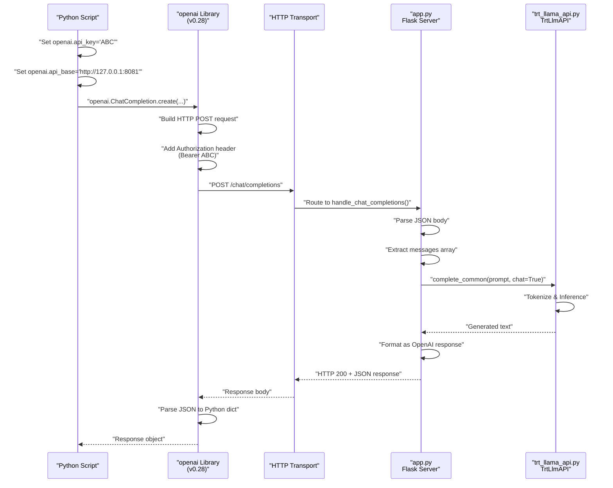
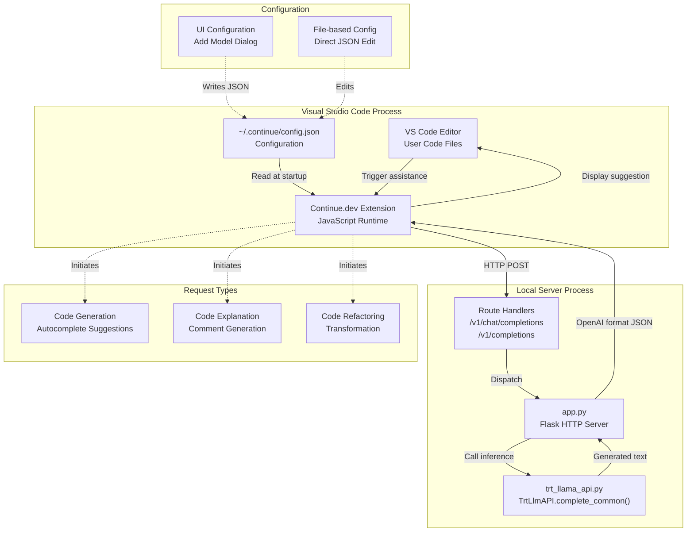
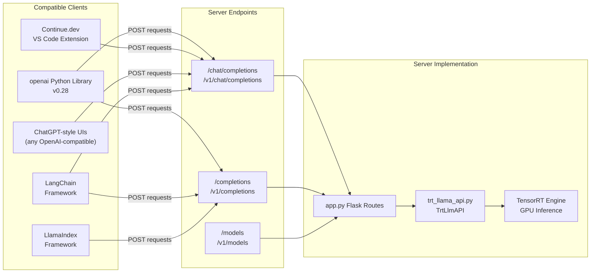

<!-- source: DeepWiki mcp.deepwiki.com · repo NVIDIA/trt-llm-as-openai-windows · page 3.4 Client Integration Examples · fetched 2026-10-26 -->

# Client Integration Examples

<details>
<summary>Relevant source files</summary>

The following files were used as context for generating this wiki page:

- [README.md](README.md)

</details>


## Purpose and Scope

This document provides concrete examples of integrating third-party applications with the TensorRT-LLM OpenAI API server. It demonstrates how to configure OpenAI-compatible clients to connect to the local inference server rather than OpenAI's cloud service.

For details on the server's API endpoint specifications, see [Available Endpoints](#3.1). For programmatic request/response formats, see [Chat Completions](#3.2) and [Text Completions](#3.3).

---

## Python OpenAI Library Integration

The Python `openai` library (version 0.28) can be configured to connect to the local TensorRT-LLM server by overriding two settings: `api_key` and `api_base`. The server does not perform authentication, so any string can be used as the API key.

### Configuration

The minimal configuration requires setting two global variables before making API calls:

| Parameter | Value | Purpose |
|-----------|-------|---------|
| `openai.api_key` | Any string (e.g., `"ABC"`) | Required by the library but not validated by server |
| `openai.api_base` | `"http://127.0.0.1:8081"` | Local server URL (port matches `--port` argument in [app.py:180]()) |

### Basic Usage Example

The README demonstrates a minimal working example:

```python
import openai

openai.api_key = "ABC"  
openai.api_base = "http://127.0.0.1:8081"

response = openai.ChatCompletion.create(
    model="Llama2",
    prompt="Hello! How are you?"
)
print(response)
```

**Note:** The `model` parameter is passed through but not enforced by the server. The loaded TensorRT engine determines which model actually processes requests.

### Integration Flow



**Sources:**
- [README.md:78-95]()

---

## Continue.dev VS Code Extension Integration

Continue.dev is a Visual Studio Code extension that provides AI-powered code assistance. It supports OpenAI-compatible API backends, making it compatible with this TensorRT-LLM server when using CodeLlama models.

### Prerequisites

The Continue.dev integration requires:
1. The TensorRT-LLM server running with CodeLlama-13B-Instruct model
2. The `--no_system_prompt True` flag set when launching [app.py]() (required for CodeLlama)
3. Continue.dev extension installed from the [Visual Studio Marketplace](https://marketplace.visualstudio.com/items?itemName=Continue.continue)

### UI-Based Configuration

Continue.dev can be configured through its Visual Studio Code UI:

| Step | Action | Value |
|------|--------|-------|
| 1 | Open Continue.dev from VS Code left panel | - |
| 2 | Click "+" to add new model | - |
| 3 | Select "Other OpenAI-compatible API" | - |
| 4 | Expand "Advanced (optional)" section | - |
| 5 | Set `apiBase` | `http://localhost:8081/v1` |
| 6 | Set `contextLength` | `16384` |
| 7 | Select model option | CodeLlama 13b instruct |

**Important:** The `apiBase` must include the `/v1` path prefix, as Continue.dev appends endpoint paths like `/chat/completions` to this base URL.

### Configuration File Format

Alternatively, the configuration can be edited directly in the Continue.dev config file located at `c:\users\<user>\.continue\config.json`:

```json
{
    "models": [
        {
            "title": "CodeLlama-13b-Instruct",
            "provider": "openai",
            "model": "codellama:13b-instruct",
            "apiBase": "http://localhost:8081",
            "contextLength": 16384
        }
    ]
}
```

### Configuration Parameters

| Parameter | Type | Value | Purpose |
|-----------|------|-------|---------|
| `title` | string | `"CodeLlama-13b-Instruct"` | Display name in VS Code UI |
| `provider` | string | `"openai"` | Tells Continue.dev to use OpenAI API format |
| `model` | string | `"codellama:13b-instruct"` | Model identifier (passed to server but not enforced) |
| `apiBase` | string | `"http://localhost:8081"` | Base URL without `/v1` suffix |
| `contextLength` | integer | `16384` | Maximum context window size in tokens |

The `contextLength` value should match the `--max_input_len` used when building the TensorRT engine. For CodeLlama, this is typically `15360` as shown in [README.md:40](), though Continue.dev's configuration uses `16384`.

### Integration Architecture



**Sources:**
- [README.md:123-151]()

---

## General Client Requirements

Any OpenAI-compatible client can connect to this server with the following requirements:

### Mandatory Configuration

| Requirement | Details |
|-------------|---------|
| Base URL | Must point to `http://127.0.0.1:<port>` where `<port>` matches the server's `--port` argument (default: `8081`) |
| API Endpoints | Must use `/chat/completions`, `/completions`, or `/v1/*` variants (see [Available Endpoints](#3.1)) |
| Request Format | Must send JSON payloads matching OpenAI's schema (see [Chat Completions](#3.2), [Text Completions](#3.3)) |
| HTTP Method | All endpoints require `POST` method |

### Optional Configuration

| Setting | Server Behavior |
|---------|-----------------|
| API Key | Ignored by server; any value accepted |
| Model Name | Passed through but not validated; loaded engine determines actual model |
| Organization ID | Ignored if present in headers |

### Client-Server Compatibility Matrix



**Sources:**
- [README.md:116-122]()
- [app.py:95-177]() (endpoint implementations)

---

## Server Launch Requirements for Clients

Different clients may require specific server configuration:

### CodeLlama-Specific Requirements

When using CodeLlama models with code-focused clients like Continue.dev:

```bash
python app.py \
    --trt_engine_path model/ \
    --trt_engine_name llama_float16_tp1_rank0.engine \
    --tokenizer_dir_path model/ \
    --port 8081 \
    --no_system_prompt True
```

The `--no_system_prompt True` flag is **mandatory** for CodeLlama models because they do not expect system prompts in their instruction format. Without this flag, generated code may be malformed.

### Llama 2 Chat Requirements

When using Llama 2 chat models with conversational clients:

```bash
python app.py \
    --trt_engine_path model/ \
    --trt_engine_name llama_float16_tp1_rank0.engine \
    --tokenizer_dir_path model/ \
    --port 8081
```

The default system prompt is enabled for Llama 2 models. The prompt formatting is handled by [utils.py:59-94]() (`messages_to_prompt()` function).

### Port Configuration

The `--port` argument in [app.py:22-65]() determines which port the Flask server listens on. This must match the `api_base` or `apiBase` URL configured in clients:

| Server Port | Client Configuration |
|-------------|---------------------|
| `8081` (default) | `http://127.0.0.1:8081` |
| Custom (e.g., `8080`) | `http://127.0.0.1:8080` |

**Sources:**
- [README.md:64-76]()
- [app.py:180]() (Flask `app.run()` call)

---

## Troubleshooting Client Connections

### Connection Refused

If clients report "Connection refused" errors:

1. Verify server is running: Check terminal for `Running on http://127.0.0.1:<port>`
2. Verify port matches: Ensure client's `api_base` uses the same port as server's `--port`
3. Check firewall: Windows Firewall may block localhost connections on non-standard ports

### Invalid Response Format

If clients report "Invalid response" or JSON parsing errors:

1. Check server logs for exceptions in [app.py:95-177]() route handlers
2. Verify request format matches OpenAI specification
3. Ensure `Content-Type: application/json` header is present in requests

### Model Not Found

If clients report "Model not found" errors:

1. The server ignores the `model` parameter; the error originates from client-side validation
2. Use any model name string; the loaded TensorRT engine determines actual model used
3. Some clients (like Continue.dev) require specific model naming patterns; use suggested values from [Continue.dev configuration](#configuration-file-format)

**Sources:**
- [app.py:95-177]() (error handling in endpoints)
- [README.md:78-95]() (API testing examples)

---

