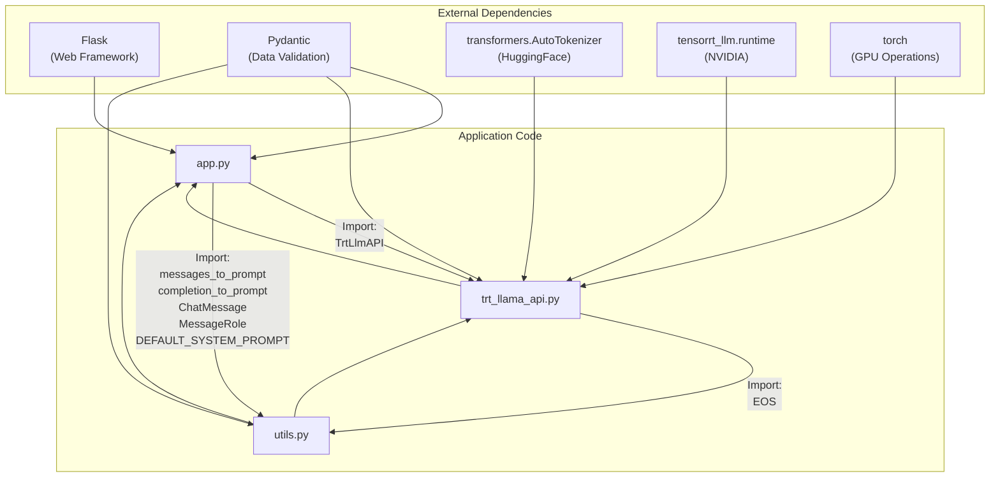
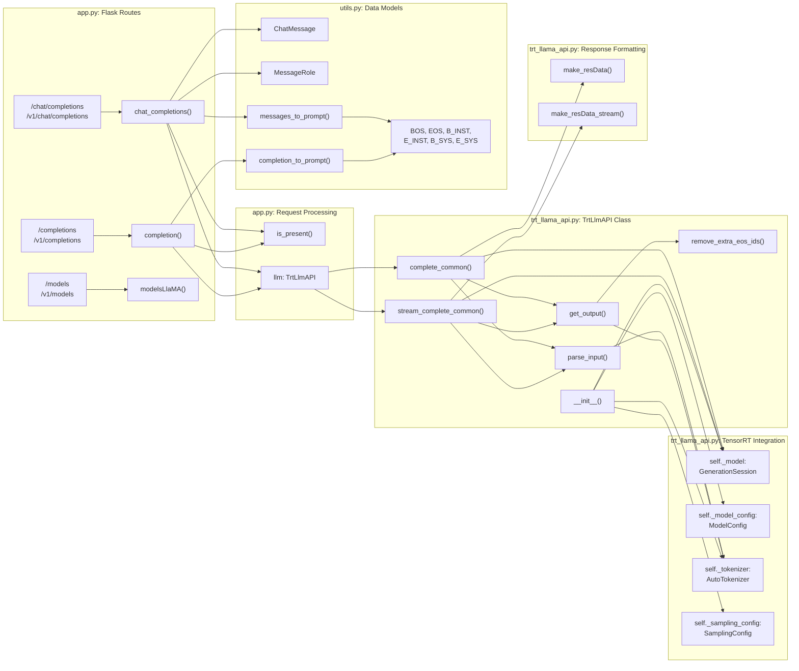
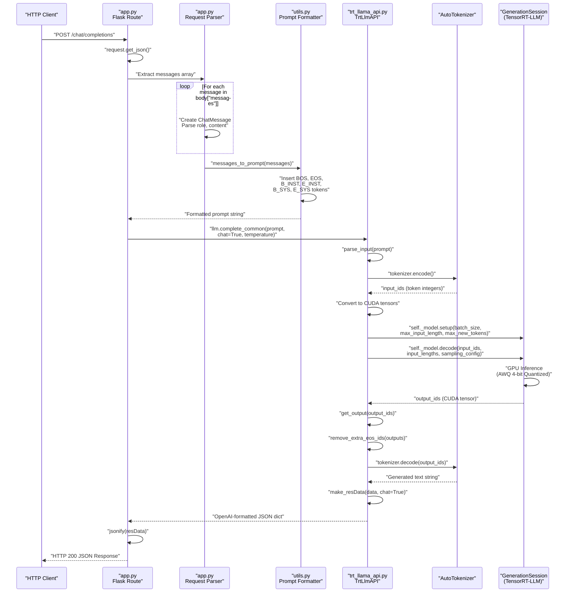
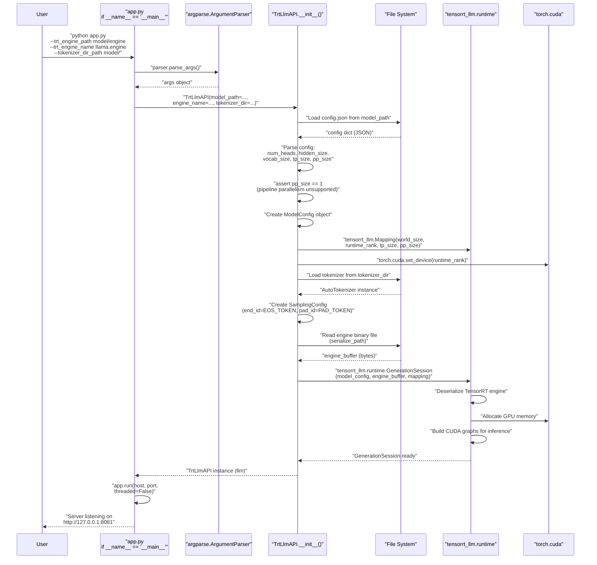

<!-- source: DeepWiki mcp.deepwiki.com · repo NVIDIA/trt-llm-as-openai-windows · page 4 Architecture and Implementation · fetched 2026-10-26 -->

# Architecture and Implementation

<details>
<summary>Relevant source files</summary>

The following files were used as context for generating this wiki page:

- [app.py](app.py)
- [trt_llama_api.py](trt_llama_api.py)
- [utils.py](utils.py)

</details>


This section provides a comprehensive technical overview of the system's internal architecture, code organization, and implementation patterns. It explains how the three core Python modules interact, how requests are processed from HTTP to GPU inference, and the key design decisions that enable OpenAI API compatibility with TensorRT-LLM acceleration.

For information about setting up and configuring the system, see [Getting Started](#2). For API usage examples and endpoint documentation, see [API Usage](#3). For detailed configuration options, see [Configuration Reference](#5).

---

## System Overview

The codebase consists of three Python modules organized in a layered architecture:

| Module | File | Primary Responsibility | Lines of Code |
|--------|------|------------------------|---------------|
| Flask Application Layer | `app.py` | HTTP request routing, request/response parsing, endpoint definitions | ~218 |
| Inference Engine Wrapper | `trt_llama_api.py` | TensorRT-LLM integration, tokenization, inference orchestration | ~482 |
| Prompt Formatting Utilities | `utils.py` | Data models, prompt template formatting with special tokens | ~132 |

The architecture follows a clear unidirectional dependency pattern where `app.py` depends on both `trt_llama_api.py` and `utils.py`, while `trt_llama_api.py` depends only on `utils.py`. This prevents circular dependencies and maintains clean separation of concerns.

**Sources:** [app.py:1-218](), [trt_llama_api.py:1-482](), [utils.py:1-132]()

---

## Module Dependency Graph



**Module Import Relationships**

This diagram shows the import dependencies between modules and external libraries. The application layer (`app.py`) imports the `TrtLlmAPI` class from the inference engine and formatting functions from utilities. The inference engine (`trt_llama_api.py`) imports only the `EOS` constant from utilities while relying heavily on TensorRT-LLM and Transformers libraries. The utilities module (`utils.py`) has minimal dependencies, using only Pydantic for data validation.

**Sources:** [app.py:22-26](), [trt_llama_api.py:22-37](), [utils.py:22-52]()

---

## Core Class and Function Mapping



**Code Entity Relationships**

This diagram maps the key classes, functions, and objects in the codebase and their relationships. Flask routes in `app.py` delegate to handler functions which use the global `llm` instance of `TrtLlmAPI`. The `TrtLlmAPI` class encapsulates TensorRT-LLM objects (`GenerationSession`, `ModelConfig`, `SamplingConfig`) and coordinates tokenization, inference, and detokenization. Utility functions format prompts using special tokens defined as module-level constants.

**Sources:** [app.py:88-214](), [trt_llama_api.py:158-481](), [utils.py:54-131]()

---

## Request Processing Pipeline

The system processes requests through six distinct stages, transforming data from JSON to text to tokens to tensors and back:



**End-to-End Request Flow for Chat Completions**

This sequence diagram traces a complete request through the system, showing method calls and data transformations. The request enters through Flask's routing layer, undergoes parsing in `app.py`, gets formatted with special tokens by `utils.py`, is tokenized and executed by `trt_llama_api.py`, and finally formatted as an OpenAI-compatible response.

**Sources:** [app.py:117-171](), [utils.py:84-122](), [trt_llama_api.py:313-365]()

---

## Initialization Sequence

System initialization is a heavyweight one-time operation that loads model artifacts and prepares GPU resources:



**System Initialization and Server Startup**

This diagram shows the initialization process that occurs once at server startup. Command-line arguments are parsed, the `TrtLlmAPI` constructor loads configuration and model artifacts from disk, creates TensorRT-LLM runtime objects, allocates GPU memory, and deserializes the compiled engine. The Flask server then starts in single-threaded mode.

**Sources:** [app.py:22-85](), [app.py:216-217](), [trt_llama_api.py:188-291]()

---

## Key Classes and Their Responsibilities

### TrtLlmAPI Class

The `TrtLlmAPI` class in [trt_llama_api.py:158-481]() is the core abstraction that wraps TensorRT-LLM functionality:

| Attribute | Type | Purpose |
|-----------|------|---------|
| `_model` | `tensorrt_llm.runtime.GenerationSession` | The deserialized TensorRT engine for GPU inference |
| `_model_config` | `tensorrt_llm.runtime.ModelConfig` | Model architecture configuration (heads, layers, hidden size) |
| `_tokenizer` | `transformers.AutoTokenizer` | HuggingFace tokenizer for text↔token conversion |
| `_sampling_config` | `tensorrt_llm.runtime.SamplingConfig` | Generation parameters (temperature, beam size, padding) |
| `_max_new_tokens` | `int` | Maximum number of tokens to generate |

| Method | Purpose |
|--------|---------|
| `__init__()` | Load engine, tokenizer, and initialize TensorRT-LLM objects |
| `complete_common()` | Synchronous inference: tokenize → generate → detokenize → format response |
| `stream_complete_common()` | Streaming inference: yield tokens incrementally as they're generated |
| `parse_input()` | Convert prompt string to CUDA tensors (input_ids, input_lengths) |
| `get_output()` | Extract generated tokens and decode to text |
| `remove_extra_eos_ids()` | Clean up multiple EOS tokens from model output |

**Sources:** [trt_llama_api.py:158-291](), [trt_llama_api.py:313-481]()

### ChatMessage and MessageRole

Defined in [utils.py:64-82](), these Pydantic models represent chat messages:

```python
class MessageRole(str, Enum):
    SYSTEM = "system"
    USER = "user"
    ASSISTANT = "assistant"
    FUNCTION = "function"

class ChatMessage(BaseModel):
    role: MessageRole = MessageRole.USER
    content: Optional[str] = ""
    additional_kwargs: dict = Field(default_factory=dict)
```

These models provide type-safe message handling and integrate with Pydantic's validation system.

**Sources:** [utils.py:64-82]()

---

## Prompt Formatting System

The system uses special delimiter tokens to structure prompts for Llama 2 models:

| Constant | Value | Purpose |
|----------|-------|---------|
| `BOS` | `"<s>"` | Beginning of sequence marker |
| `EOS` | `"</s>"` | End of sequence marker |
| `B_INST` | `"[INST]"` | Begin instruction section |
| `E_INST` | `"[/INST]"` | End instruction section |
| `B_SYS` | `"<<SYS>>\n"` | Begin system prompt section |
| `E_SYS` | `"\n<</SYS>>\n\n"` | End system prompt section |

The `messages_to_prompt()` function in [utils.py:84-122]() formats a conversation as:

```
<s> [INST] <<SYS>>
{system_prompt}
<</SYS>>

{user_message_1} [/INST] {assistant_response_1} </s>
<s> [INST] {user_message_2} [/INST] {assistant_response_2} </s>
...
```

The `completion_to_prompt()` function in [utils.py:125-131]() wraps raw text completions:

```
<s> [INST] <<SYS>>
{system_prompt}
<</SYS>>

{completion_text} [/INST]
```

**Sources:** [utils.py:54-131]()

---

## Response Generation

### Synchronous Responses

The `complete_common()` method in [trt_llama_api.py:313-365]() handles non-streaming requests:

1. **Tokenization**: Converts prompt string to token IDs via `parse_input()` [trt_llama_api.py:367-386]()
2. **Engine Setup**: Calls `self._model.setup()` with batch size and length constraints [trt_llama_api.py:328]()
3. **Inference**: Executes `self._model.decode()` with sampling configuration [trt_llama_api.py:333]()
4. **Detokenization**: Extracts output tokens and converts to text via `get_output()` [trt_llama_api.py:341-344]()
5. **Response Formatting**: Wraps in OpenAI-compatible JSON via `make_resData()` [trt_llama_api.py:75-108]()

### Streaming Responses

The `stream_complete_common()` method in [trt_llama_api.py:416-481]() implements Server-Sent Events (SSE) streaming:

1. **Streaming Setup**: Calls `self._model.decode()` with `streaming=True` [trt_llama_api.py:432]()
2. **Generator Function**: Defines inner `gen()` function that yields SSE chunks [trt_llama_api.py:434-481]()
3. **Initial Chunk**: Sends empty message with `"role": "assistant"` [trt_llama_api.py:442-443]()
4. **Delta Chunks**: For each output token batch, computes delta text and yields [trt_llama_api.py:454-467]()
5. **Final Chunk**: Sends closing message with `"stop": True` [trt_llama_api.py:476-479]()
6. **Response Wrapper**: Returns `flask.Response` with `mimetype='text/event-stream'` [trt_llama_api.py:481]()

**Sources:** [trt_llama_api.py:313-481]()

---

## Flask Application Structure

The `app.py` module defines six route handlers:

| Route | Function | Purpose |
|-------|----------|---------|
| `/models`, `/v1/models` | `modelsLlaMA()` | Return list of available models (hardcoded "Llama2") |
| `/models/Llama2`, `/v1/models/Llama2` | `models()` | Return metadata for Llama2 model |
| `/chat/completions`, `/v1/chat/completions` | `chat_completions()` | Handle chat-style messages with conversation history |
| `/completions`, `/v1/completions` | `completion()` | Handle raw text completion requests |

All routes support both streaming (`stream=True` in request body) and synchronous responses.

The global `llm` instance of `TrtLlmAPI` is created at module initialization [app.py:75-85]() and shared across all requests. The Flask server runs in single-threaded mode (`threaded=False`) [app.py:217]() to prevent concurrent access to the TensorRT engine, which is not thread-safe.

**Sources:** [app.py:88-214](), [app.py:75-85](), [app.py:216-217]()

---

## Design Decisions and Constraints

### Single-Threaded Execution

The Flask server is explicitly configured with `threaded=False` [app.py:217](). This ensures:
- Sequential request processing to avoid race conditions in TensorRT-LLM
- Simpler memory management (no need for locks or concurrent GPU access)
- Predictable performance characteristics (no context switching overhead)

### Pipeline Parallelism Unsupported

The `TrtLlmAPI` initialization includes an assertion: `assert pp_size == 1` [trt_llama_api.py:251](). Pipeline parallelism (splitting model layers across multiple GPUs) is not supported by the Python runtime interface used in this codebase. Only tensor parallelism (splitting tensors across GPUs) is allowed.

### No Reformatting for Pre-Formatted Prompts

Both `complete_common()` and `stream_complete_common()` accept a `formatted` parameter. When `formatted=True`, the prompt is passed directly to the tokenizer without applying `completion_to_prompt()`. This allows callers to provide custom-formatted prompts while still benefiting from the inference infrastructure.

**Sources:** [app.py:217](), [trt_llama_api.py:251](), [trt_llama_api.py:313-320](), [trt_llama_api.py:416-422]()

---

## Memory and Resource Management

### GPU Memory Allocation

GPU memory is allocated during initialization when the `GenerationSession` is created [trt_llama_api.py:269-272](). The engine deserializes from the binary file and allocates buffers for:
- Model weights (AWQ 4-bit quantized)
- KV cache (for attention mechanism)
- Input/output tensors

### Garbage Collection

After each inference call, the system explicitly invokes garbage collection [trt_llama_api.py:353-354]():
```python
torch.cuda.empty_cache()
gc.collect()
```

This ensures unused GPU memory is released between requests, preventing memory leaks during long-running server sessions.

### Tokenizer Caching

The `AutoTokenizer` is loaded once during initialization [trt_llama_api.py:260]() and reused for all requests. This avoids the overhead of repeatedly loading tokenizer vocabulary files from disk.

**Sources:** [trt_llama_api.py:260-272](), [trt_llama_api.py:352-354]()

---

## Data Flow: JSON to Tokens to Text

```mermaid
flowchart LR
    subgraph Input["HTTP Request"]
        JSON["JSON Body<br/>{messages: [...],<br/>temperature: 0.7}"]
    end
    
    subgraph Parse["app.py: Parsing"]
        ChatMsgs["List[ChatMessage]<br/>role + content"]
    end
    
    subgraph Format["utils.py: Formatting"]
        PromptStr["Formatted Prompt String<br/>'<s> [INST] <<SYS>>...'"]
    end
    
    subgraph Tokenize["trt_llama_api.py: parse_input()"]
        TokenIDs["token_ids: List[int]<br/>[1, 306, 4658, 29901, ...]"]
        Tensors["input_ids: torch.Tensor<br/>input_lengths: torch.Tensor<br/>(CUDA)"]
    end
    
    subgraph Infer["GenerationSession.decode()"]
        GPUInfer["AWQ 4-bit Quantized<br/>Neural Network<br/>Forward Pass"]
        OutputIDs["output_ids: torch.Tensor<br/>(CUDA)"]
    end
    
    subgraph Detokenize["trt_llama_api.py: get_output()"]
        CleanIDs["remove_extra_eos_ids()"]
        DecodeText["tokenizer.decode()"]
        OutputStr["Generated Text String"]
    end
    
    subgraph Response["make_resData()"]
        JSONResp["OpenAI-Compatible JSON<br/>{choices: [{message: {...}}],<br/>usage: {...}}"]
    end
    
    JSON --> ChatMsgs
    ChatMsgs --> PromptStr
    PromptStr --> TokenIDs
    TokenIDs --> Tensors
    Tensors --> GPUInfer
    GPUInfer --> OutputIDs
    OutputIDs --> CleanIDs
    CleanIDs --> DecodeText
    DecodeText --> OutputStr
    OutputStr --> JSONResp
```



**Complete Data Transformation Pipeline**

This flowchart shows all data transformations from HTTP request to response, highlighting the key functions responsible for each transformation. The pipeline is unidirectional with clear boundaries between text processing, numerical computation, and API formatting.

**Sources:** [app.py:117-171](), [utils.py:84-122](), [trt_llama_api.py:313-365](), [trt_llama_api.py:367-408]()

---

For detailed information about specific components:
- Flask routing and request handling: See [Flask Application Layer](#4.2)
- TensorRT-LLM integration details: See [TensorRT-LLM Inference Engine](#4.3)
- Prompt formatting implementation: See [Prompt Formatting System](#4.4)
- Request processing walkthrough: See [Request Processing Pipeline](#4.5)
- Streaming implementation: See [Streaming Responses](#4.6)

---

