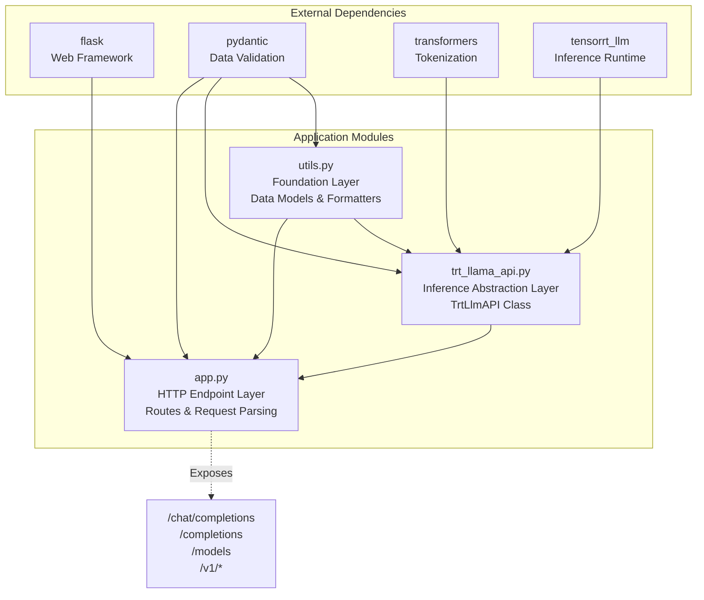
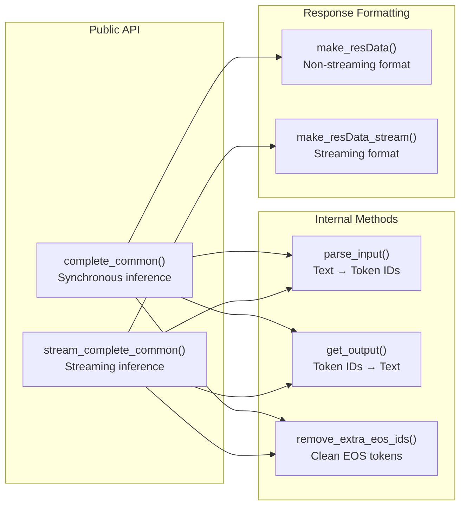
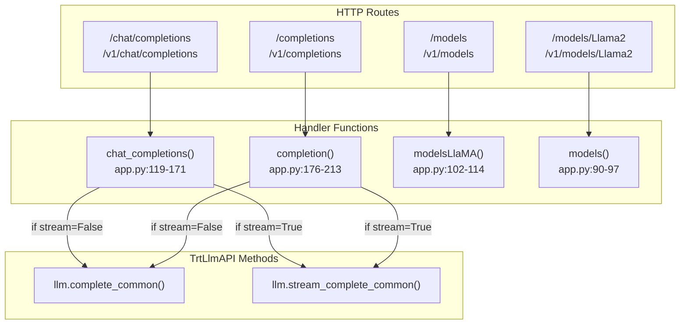
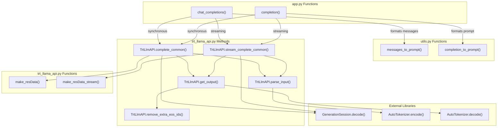

<!-- source: DeepWiki mcp.deepwiki.com · repo NVIDIA/trt-llm-as-openai-windows · page 4.1 Component Overview · fetched 2026-10-26 -->

# Component Overview

<details>
<summary>Relevant source files</summary>

The following files were used as context for generating this wiki page:

- [app.py](app.py)
- [trt_llama_api.py](trt_llama_api.py)
- [utils.py](utils.py)

</details>


## Purpose and Scope

This document provides a technical overview of the three primary Python modules that constitute the TensorRT-LLM OpenAI API server: `app.py`, `trt_llama_api.py`, and `utils.py`. It describes the architectural responsibilities of each module, their inter-dependencies, and the key classes and functions they expose. 

For detailed implementation specifics of individual modules, see [Flask Application Layer](#4.2), [TensorRT-LLM Inference Engine](#4.3), and [Prompt Formatting System](#4.4). For end-to-end request processing flow, see [Request Processing Pipeline](#4.5).

**Sources:** Table of contents JSON, Diagram 2 from high-level architecture diagrams

## Three-Module Architecture

The system is organized into three Python modules with unidirectional dependencies, forming a layered architecture:



**Module Responsibilities:**

| Module | Lines of Code | Primary Responsibility | Key Exports |
|--------|---------------|------------------------|-------------|
| `utils.py` | 132 | Data models, prompt formatting, constants | `ChatMessage`, `MessageRole`, `messages_to_prompt()`, `completion_to_prompt()` |
| `trt_llama_api.py` | 482 | TensorRT inference wrapper, tokenization, response generation | `TrtLlmAPI` class, `make_resData()`, `make_resData_stream()` |
| `app.py` | 218 | HTTP server, routing, request/response handling | Flask routes, command-line interface |

**Sources:** [app.py:1-218](), [trt_llama_api.py:1-482](), [utils.py:1-132]()

## Module 1: utils.py - Foundation Layer

The `utils.py` module provides foundational data structures and utility functions used by both higher-level modules. It has no dependencies on other application modules.

### Key Components

**Data Models:**

- `MessageRole` [utils.py:64-70]() - Enum defining four message role types: `SYSTEM`, `USER`, `ASSISTANT`, `FUNCTION`
- `ChatMessage` [utils.py:74-82]() - Pydantic model representing a single chat message with `role`, `content`, and `additional_kwargs` fields

**Formatting Functions:**

- `messages_to_prompt()` [utils.py:84-122]() - Converts a sequence of `ChatMessage` objects into a single formatted prompt string with special tokens
- `completion_to_prompt()` [utils.py:125-131]() - Wraps a raw completion string with system prompt and special tokens

**Constants:**

```python
BOS, EOS = "<s>", "</s>"              # Beginning/End of sequence
B_INST, E_INST = "[INST]", "[/INST]"  # Instruction delimiters
B_SYS, E_SYS = "<<SYS>>\n", "\n<</SYS>>\n\n"  # System prompt delimiters
DEFAULT_SYSTEM_PROMPT = "You are a helpful, respectful and honest assistant..."
```

These constants define the special tokens used by Llama 2 and CodeLlama models for prompt structuring.

**Sources:** [utils.py:22-132](), [utils.py:54-62]()

## Module 2: trt_llama_api.py - Inference Abstraction Layer

The `trt_llama_api.py` module encapsulates all TensorRT-LLM runtime operations. It provides a high-level interface for inference while managing low-level concerns like tokenization, GPU memory, and engine lifecycle.

### TrtLlmAPI Class

The primary export is the `TrtLlmAPI` class [trt_llama_api.py:158-482](), a Pydantic model that wraps the TensorRT-LLM `GenerationSession`.

**Constructor Parameters:**

| Parameter | Type | Purpose |
|-----------|------|---------|
| `model_path` | `str` | Path to directory containing TensorRT engine files |
| `engine_name` | `str` | Name of the `.engine` file to load |
| `tokenizer_dir` | `str` | Path to directory containing tokenizer files |
| `temperature` | `float` | Sampling temperature (default: 0.1) |
| `max_new_tokens` | `int` | Maximum tokens to generate per request (default: 256) |
| `context_window` | `int` | Maximum context length (default: 3900) |
| `messages_to_prompt` | `Callable` | Function to format chat messages |
| `completion_to_prompt` | `Callable` | Function to format completions |

**Private Attributes:**

```python
_model: GenerationSession        # TensorRT-LLM inference session
_model_config: ModelConfig       # Engine configuration (heads, layers, etc.)
_tokenizer: AutoTokenizer        # HuggingFace tokenizer
_sampling_config: SamplingConfig # Temperature, beam size, end/pad tokens
```

**Sources:** [trt_llama_api.py:158-291](), [trt_llama_api.py:181-186]()

### Core Methods



**Method Responsibilities:**

- `complete_common()` [trt_llama_api.py:313-365]() - Synchronous inference: tokenizes input, runs `GenerationSession.decode()`, detokenizes output, returns JSON response
- `stream_complete_common()` [trt_llama_api.py:416-481]() - Streaming inference: yields partial outputs as Server-Sent Events (SSE)
- `parse_input()` [trt_llama_api.py:367-386]() - Converts text to CUDA tensors of token IDs with padding/length calculation
- `get_output()` [trt_llama_api.py:396-408]() - Extracts generated tokens from beam search outputs and decodes to text
- `remove_extra_eos_ids()` [trt_llama_api.py:388-394]() - Removes trailing EOS tokens (ID=2) from output sequences

**Sources:** [trt_llama_api.py:313-481]()

### Response Formatting Functions

Two module-level functions generate OpenAI-compatible response structures:

**`make_resData()` [trt_llama_api.py:75-108]():**
- Creates synchronous completion responses
- Includes `id`, `created` timestamp, `usage` statistics, and `choices` array
- Differentiates between chat completions (message format) and text completions (text format)

**`make_resData_stream()` [trt_llama_api.py:111-141]():**
- Creates streaming chunk responses
- Sets `object` to `"chat.completion.chunk"` or `"text_completion.chunk"`
- Includes delta content in `choices[0].delta` for chat or `choices[0].text` for completions

**Sources:** [trt_llama_api.py:75-141]()

## Module 3: app.py - HTTP Endpoint Layer

The `app.py` module is the entry point for the application. It defines Flask routes, parses incoming requests, delegates to `TrtLlmAPI`, and returns responses.

### Command-Line Interface

The module uses `argparse` to accept configuration via command-line arguments:

```python
--trt_engine_path      # Path to directory containing engine
--trt_engine_name      # Name of .engine file
--tokenizer_dir_path   # Path to tokenizer directory
--host                 # Server bind address (default: 127.0.0.1)
--port                 # Server port (default: 8081)
--max_output_tokens    # Max generation length (default: 2048)
--max_input_tokens     # Max context length (default: 2048)
--no_system_prompt     # Disable default system prompt
--verbose              # Enable debug logging
```

**Sources:** [app.py:22-52]()

### Route Definitions

The module exposes six HTTP routes, each with both `/` and `/v1/` prefixed variants:



**Route Handler Logic:**

1. **`chat_completions()`** [app.py:119-171]():
   - Parses `messages` array from request body
   - Converts JSON objects to `ChatMessage` instances
   - Calls `messages_to_prompt()` to format prompt
   - Invokes `llm.complete_common()` or `llm.stream_complete_common()`

2. **`completion()`** [app.py:176-213]():
   - Extracts `prompt` string from request body
   - Optionally wraps with `completion_to_prompt()`
   - Handles `stop` strings for early termination
   - Invokes appropriate `TrtLlmAPI` method

3. **`models()` and `modelsLlaMA()`** [app.py:88-114]():
   - Return static metadata about available models
   - Always report model ID as `"Llama2"` with owner `"Meta"`

**Sources:** [app.py:88-214]()

### Global Initialization

The module initializes a single `TrtLlmAPI` instance at module load time:

```python
llm = TrtLlmAPI(
    model_path=trt_engine_path,
    engine_name=trt_engine_name,
    tokenizer_dir=tokenizer_dir_path,
    temperature=0.1,
    max_new_tokens=args.max_output_tokens,
    context_window=args.max_input_tokens,
    messages_to_prompt=messages_to_prompt,
    completion_to_prompt=completion_to_prompt,
    verbose=False
)
```

This instance is shared across all requests. The server runs with `threaded=False` [app.py:217](), enforcing sequential request processing.

**Sources:** [app.py:65-85](), [app.py:217]()

## Inter-Module Function Call Graph

The following diagram maps the call relationships between public functions across modules:



**Sources:** [app.py:119-213](), [trt_llama_api.py:313-481](), [utils.py:84-131]()

## Data Structure Flow

The following table traces how data structures transform as they pass through the module layers:

| Stage | Module | Data Type | Description |
|-------|--------|-----------|-------------|
| 1. HTTP Request | `app.py` | `dict` (JSON) | Raw request body with `messages` or `prompt` key |
| 2. Parsing | `app.py` | `List[ChatMessage]` or `str` | Structured message objects or raw string |
| 3. Formatting | `utils.py` | `str` | Prompt with special tokens (`BOS`, `INST`, `SYS`, etc.) |
| 4. Tokenization | `trt_llama_api.py` | `torch.Tensor` (int32) | Token IDs on CUDA device |
| 5. Inference | `trt_llama_api.py` | `torch.Tensor` (int32) | Generated token IDs |
| 6. Detokenization | `trt_llama_api.py` | `str` | Generated text with EOS tokens removed |
| 7. Response Formatting | `trt_llama_api.py` | `dict` | OpenAI-compatible JSON structure |
| 8. HTTP Response | `app.py` | `flask.Response` | Serialized JSON with status code 200 |

**Sources:** [app.py:119-171](), [utils.py:84-122](), [trt_llama_api.py:313-365]()

## Module Coupling and Dependencies

### Import Statements

**`app.py` imports:**
```python
from flask import Flask, Response, request, jsonify
from trt_llama_api import TrtLlmAPI
from utils import messages_to_prompt, completion_to_prompt, ChatMessage, MessageRole, DEFAULT_SYSTEM_PROMPT
```
[app.py:24-26]()

**`trt_llama_api.py` imports:**
```python
from flask import jsonify
from transformers import AutoTokenizer
from tensorrt_llm.runtime import ModelConfig, SamplingConfig
import tensorrt_llm
from utils import EOS
```
[trt_llama_api.py:23-37]()

**`utils.py` imports:**
```python
from typing import Optional, Sequence
from enum import Enum
from pydantic import BaseModel, Field  # (with v1 compatibility fallback)
```
[utils.py:22-52]()

### Dependency Direction

The dependency graph is strictly hierarchical with no circular dependencies:

```
app.py
  ├── trt_llama_api.py
  │     └── utils.py
  └── utils.py
```

- `utils.py` has zero dependencies on other application modules
- `trt_llama_api.py` depends only on `utils.py`
- `app.py` depends on both `trt_llama_api.py` and `utils.py`

This design allows each module to be tested independently, with `utils.py` being the most isolated and `app.py` being the integration point.

**Sources:** [app.py:1-26](), [trt_llama_api.py:1-37](), [utils.py:1-52]()

---

