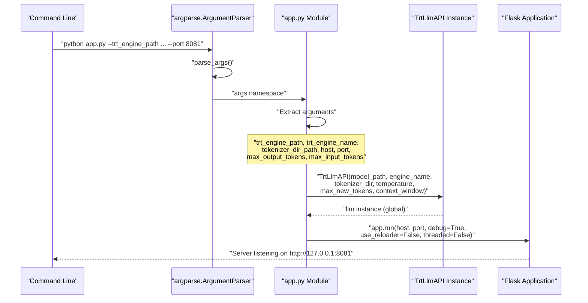
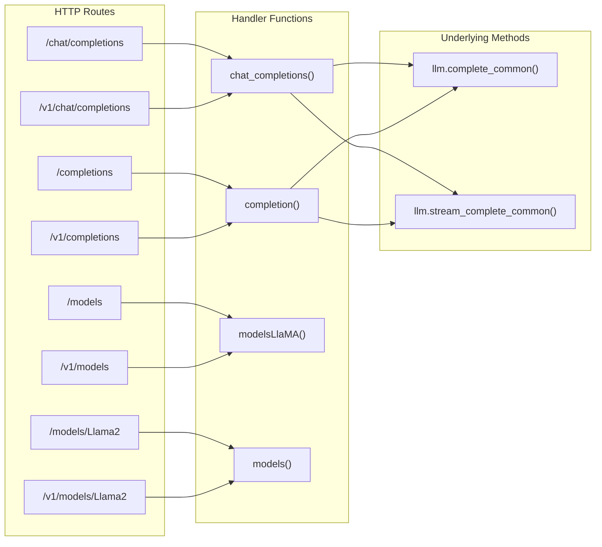
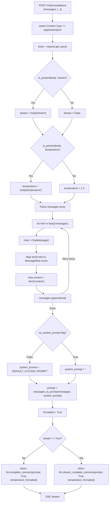
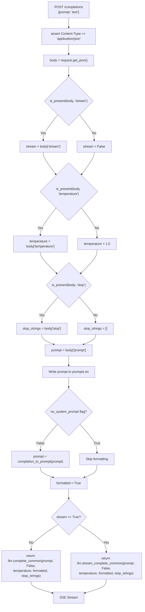
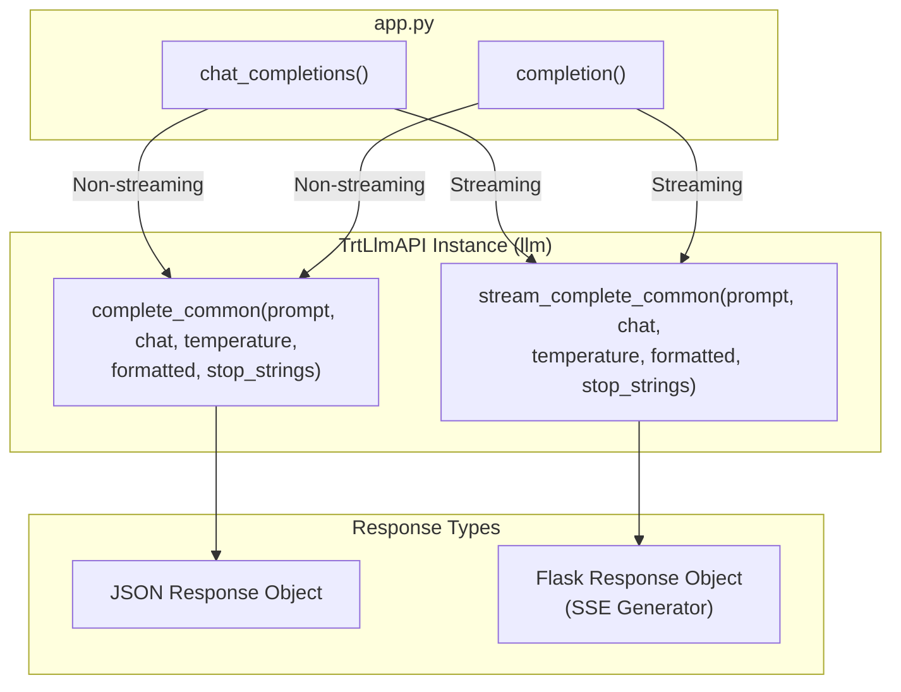

<!-- source: DeepWiki mcp.deepwiki.com · repo NVIDIA/trt-llm-as-openai-windows · page 4.2 Flask Application Layer · fetched 2026-10-26 -->

# Flask Application Layer

<details>
<summary>Relevant source files</summary>

The following files were used as context for generating this wiki page:

- [app.py](app.py)

</details>


## Purpose and Scope

This document describes the Flask application layer implemented in `app.py`, which serves as the HTTP interface and orchestration layer for the TensorRT-LLM inference system. The Flask application exposes OpenAI-compatible REST endpoints, handles request parsing and validation, manages the lifecycle of the `TrtLlmAPI` instance, and coordinates between HTTP clients and the underlying inference engine.

For details on the inference engine itself, see [TensorRT-LLM Inference Engine](#4.3). For information on prompt formatting utilities used by this layer, see [Prompt Formatting System](#4.4). For API usage examples, see [API Usage](#3).

**Sources:** [app.py:1-218]()

---

## Module Overview

The `app.py` module is the entry point for the entire server application. It serves three primary functions:

1. **Command-line interface** - Parses and validates server configuration arguments
2. **HTTP server** - Exposes Flask routes that implement OpenAI-compatible endpoints
3. **Request orchestrator** - Bridges HTTP requests to the `TrtLlmAPI` inference engine

The module imports the following key dependencies:
- `Flask` - Web framework for HTTP server functionality
- `TrtLlmAPI` - Inference engine wrapper from [trt_llama_api.py:112-288]()
- `messages_to_prompt`, `completion_to_prompt` - Prompt formatting functions from [utils.py:59-102]()
- `ChatMessage`, `MessageRole`, `DEFAULT_SYSTEM_PROMPT` - Data structures from [utils.py:1-56]()

**Sources:** [app.py:22-26]()

---

## Initialization Sequence



**Diagram: Server Initialization Flow**

**Sources:** [app.py:28-52](), [app.py:65-85](), [app.py:217]()

### Command-Line Arguments

The argument parser defines the following configuration parameters:

| Argument | Type | Required | Default | Description |
|----------|------|----------|---------|-------------|
| `--trt_engine_path` | str | Yes | - | Directory containing TensorRT engine files |
| `--trt_engine_name` | str | Yes | - | Filename of the compiled `.engine` file |
| `--tokenizer_dir_path` | str | Yes | - | Directory containing tokenizer artifacts |
| `--host` | str | No | `127.0.0.1` | IP address for server to bind to |
| `--port` | int | No | `8081` | TCP port for HTTP listener |
| `--max_output_tokens` | int | No | `2048` | Maximum tokens to generate per request |
| `--max_input_tokens` | int | No | `2048` | Maximum input context window size |
| `--no_system_prompt` | bool | No | `False` | Disable automatic system prompt injection |
| `--verbose` | bool | No | `False` | Enable debug logging to console |

**Sources:** [app.py:28-52]()

### TrtLlmAPI Instantiation

After parsing arguments, the module instantiates a single global `TrtLlmAPI` object at module load time [app.py:75-85](). This instance is shared across all HTTP requests. The constructor is called with:

- `model_path` - Path to engine directory
- `engine_name` - Engine filename
- `tokenizer_dir` - Tokenizer directory
- `temperature` - Default sampling temperature (0.1)
- `max_new_tokens` - Output token limit from `--max_output_tokens`
- `context_window` - Input token limit from `--max_input_tokens`
- `messages_to_prompt` - Function reference for chat formatting
- `completion_to_prompt` - Function reference for completion formatting

The `TrtLlmAPI` constructor performs heavyweight initialization including loading the TensorRT engine, allocating GPU memory, and initializing the tokenizer. This occurs once at startup, not per-request.

**Sources:** [app.py:75-85]()

### Flask Server Configuration

The Flask application is started with specific threading and debugging configurations [app.py:217]():

```python
app.run(host, port=port, debug=True, use_reloader=False, threaded=False)
```

- `debug=True` - Enables Flask's debug mode for error reporting
- `use_reloader=False` - Prevents Flask from restarting on code changes (critical because TensorRT engine initialization is expensive)
- `threaded=False` - Forces single-threaded request handling (likely required for TensorRT engine thread safety)

The single-threaded configuration means requests are processed sequentially, not concurrently.

**Sources:** [app.py:217]()

---

## Route Definitions and Mappings



**Diagram: Route-to-Handler Mappings**

The Flask application exposes eight HTTP routes, with each endpoint available both at the root path and under the `/v1` prefix to match OpenAI API conventions. The routes map to four handler functions:

**Sources:** [app.py:88-213]()

### Chat Completions Routes

- **Routes:** `/chat/completions`, `/v1/chat/completions`
- **Methods:** `POST`
- **Handler:** `chat_completions()` [app.py:117-171]()
- **Purpose:** Process conversational messages with role-based formatting

### Text Completions Routes

- **Routes:** `/completions`, `/v1/completions`
- **Methods:** `POST`
- **Handler:** `completion()` [app.py:174-213]()
- **Purpose:** Process raw text prompts without role-based formatting

### Models List Routes

- **Routes:** `/models`, `/v1/models`
- **Methods:** `GET`, `POST`
- **Handler:** `modelsLlaMA()` [app.py:100-114]()
- **Purpose:** Return list of available models (static response)

### Single Model Routes

- **Routes:** `/models/Llama2`, `/v1/models/Llama2`
- **Methods:** `GET`, `POST`
- **Handler:** `models()` [app.py:88-97]()
- **Purpose:** Return metadata for specific model (static response)

**Sources:** [app.py:88-114](), [app.py:117-171](), [app.py:174-213]()

---

## Request Processing: Chat Completions



**Diagram: Chat Completions Request Processing Flow**

**Sources:** [app.py:117-171]()

### Request Structure

The `chat_completions()` handler expects a JSON request body with the following structure:

```json
{
  "messages": [
    {"role": "system", "content": "You are a helpful assistant."},
    {"role": "user", "content": "Hello!"}
  ],
  "temperature": 0.7,
  "stream": false
}
```

**Sources:** [app.py:133-162]()

### Message Parsing

Messages are parsed from the JSON array into `ChatMessage` objects [app.py:133-152]():

1. Iterate over each item in `body["messages"]`
2. Create a new `ChatMessage()` instance
3. Map the string role (`"system"`, `"user"`, `"assistant"`, `"function"`) to the `MessageRole` enum
4. Set the `content` field from `item["content"]`
5. Append to the `messages` list

Supported role mappings:
- `"system"` → `MessageRole.SYSTEM`
- `"user"` → `MessageRole.USER`
- `"assistant"` → `MessageRole.ASSISTANT`
- `"function"` → `MessageRole.FUNCTION`

**Sources:** [app.py:136-152]()

### System Prompt Injection

Unless the `--no_system_prompt` flag is set, a default system prompt is automatically prepended [app.py:154-158]():

```python
system_prompt = ""
if not no_system_prompt:
    system_prompt = DEFAULT_SYSTEM_PROMPT
```

The `DEFAULT_SYSTEM_PROMPT` constant is imported from `utils.py` and provides baseline instructions to the model.

**Sources:** [app.py:154-158]()

### Prompt Formatting

The `messages_to_prompt()` function is called to convert the message list into a formatted string [app.py:158]():

```python
prompt = messages_to_prompt(messages, system_prompt)
```

This function inserts special tokens (BOS, EOS, INST, SYS) required by Llama models. The `formatted=True` flag is set to indicate that prompt formatting has already been applied [app.py:160]().

**Sources:** [app.py:158-160]()

### Execution and Response

The handler branches based on the `stream` parameter [app.py:168-171]():

- **Non-streaming:** Calls `llm.complete_common(prompt, True, temperature, formatted)` and returns a complete JSON response
- **Streaming:** Calls `llm.stream_complete_common(prompt, True, temperature, formatted)` and returns a Server-Sent Events (SSE) stream

The second positional argument (`True`) indicates this is a chat completion (affects response formatting).

**Sources:** [app.py:168-171]()

---

## Request Processing: Text Completions



**Diagram: Text Completions Request Processing Flow**

**Sources:** [app.py:174-213]()

### Key Differences from Chat Completions

The `completion()` handler differs from `chat_completions()` in several ways:

1. **Input format** - Expects a single `"prompt"` string instead of a `"messages"` array [app.py:194-195]()
2. **Stop strings** - Supports a `"stop"` parameter for custom stopping sequences [app.py:186-188]()
3. **Formatting function** - Uses `completion_to_prompt()` instead of `messages_to_prompt()` [app.py:205-206]()
4. **Chat flag** - Passes `False` as the second argument to indicate non-chat response format [app.py:211-213]()
5. **Debug logging** - Writes prompts to `prompts.txt` file [app.py:197-203]()

**Sources:** [app.py:174-213]()

### Stop Strings

The completions endpoint supports custom stop sequences [app.py:186-188]():

```python
stop_strings = []
if is_present(body, "stop"):
    stop_strings = body["stop"]
```

These strings are passed to the inference engine, which will terminate generation when any stop string is encountered.

**Sources:** [app.py:186-188]()

---

## Request Parsing Helper

The `is_present()` utility function checks for key existence and non-null values [app.py:55-62]():

```python
def is_present(json, key):
    try:
        buf = json[key]
    except KeyError:
        return False
    if json[key] == None:
        return False
    return True
```

This function is used throughout the handlers to safely check for optional parameters like `"stream"`, `"temperature"`, and `"stop"`. It returns `False` if the key is missing or if its value is `None`.

**Sources:** [app.py:55-62]()

---

## Models Endpoint Implementation

The models endpoints return static JSON responses without calling the inference engine:

### List All Models

The `modelsLlaMA()` handler [app.py:100-114]() returns:

```json
{
  "object": "list",
  "data": [
    {
      "id": "Llama2",
      "object": "model",
      "created": 1675232119,
      "owned_by": "Meta"
    }
  ]
}
```

### Single Model Info

The `models()` handler [app.py:88-97]() returns:

```json
{
  "id": "Llama2",
  "object": "model",
  "created": 1675232119,
  "owned_by": "Meta"
}
```

These responses maintain OpenAI API compatibility but do not reflect the actual model being served. The model ID is hardcoded as "Llama2" regardless of which engine is loaded.

**Sources:** [app.py:88-114]()

---

## Integration with TrtLlmAPI

The Flask layer communicates with the inference engine exclusively through the `TrtLlmAPI` instance:



**Diagram: Flask-to-TrtLlmAPI Method Calls**

**Sources:** [app.py:168-171](), [app.py:211-213]()

### Method Call Patterns

Both handlers call one of two methods on the global `llm` instance:

**Non-streaming completions:**
```python
return llm.complete_common(prompt, chat=True/False, temperature=temperature, 
                          formatted=True, stop_strings=[])
```

**Streaming completions:**
```python
return llm.stream_complete_common(prompt, chat=True/False, temperature=temperature,
                                  formatted=True, stop_strings=[])
```

The `chat` boolean parameter determines the response format:
- `True` - Response structured as `{"choices": [{"message": {...}}]}`
- `False` - Response structured as `{"choices": [{"text": "..."}]}`

**Sources:** [app.py:168-171](), [app.py:211-213]()

---

## Server Configuration and Runtime

### Threading Model

The server is configured with `threaded=False` [app.py:217](), forcing single-threaded request handling. This means:

- Requests are processed sequentially in FIFO order
- No concurrent inference execution
- Simple mutex-free design
- Potential head-of-line blocking for long-running requests

This configuration is likely required because TensorRT engines may not be thread-safe or may require complex locking for concurrent access.

**Sources:** [app.py:217]()

### Debug and Reload Settings

The server runs with `debug=True` and `use_reloader=False` [app.py:217]():

- `debug=True` enables detailed error messages and stack traces in HTTP responses
- `use_reloader=False` prevents Flask from restarting the process when source files change, which is critical because re-initializing the TensorRT engine takes significant time and GPU memory

**Sources:** [app.py:217]()

### Global State

The module maintains minimal global state:

- `app` - Flask application instance [app.py:41]()
- `llm` - TrtLlmAPI instance [app.py:75-85]()
- `slot_id` - Unused variable set to `-1` [app.py:43]()
- Command-line argument values extracted into module-level variables [app.py:66-72]()

This global state is initialized once at module import time and shared across all requests.

**Sources:** [app.py:41](), [app.py:43](), [app.py:65-85]()

---

## Error Handling

The Flask application uses assertion-based validation for request content type [app.py:120](), [app.py:177]():

```python
assert request.headers.get('Content-Type') == 'application/json'
```

If this assertion fails, Flask will return a 500 Internal Server Error. More sophisticated error handling (400 Bad Request) could be implemented but is not present in the current implementation.

Missing required fields (like `"messages"` or `"prompt"`) result in silent failures or empty strings rather than explicit error responses. The verbose logging option prints warnings to console but does not affect HTTP responses [app.py:147-149]().

**Sources:** [app.py:120](), [app.py:147-149](), [app.py:177]()

---

## Summary

The Flask application layer serves as a thin orchestration layer that:

1. **Parses command-line arguments** to configure server behavior and pass engine/tokenizer paths
2. **Initializes a single TrtLlmAPI instance** at startup (expensive operation)
3. **Exposes OpenAI-compatible HTTP endpoints** with both root and `/v1` prefixed routes
4. **Parses incoming JSON requests** and validates basic structure
5. **Applies prompt formatting** using utilities from `utils.py` based on request type
6. **Delegates to TrtLlmAPI methods** for actual inference execution
7. **Returns responses** either as complete JSON objects or SSE streams
8. **Runs single-threaded** to avoid concurrency issues with TensorRT engines

The design prioritizes simplicity and OpenAI API compatibility over sophisticated error handling or multi-tenancy features.

**Sources:** [app.py:1-218]()

---

