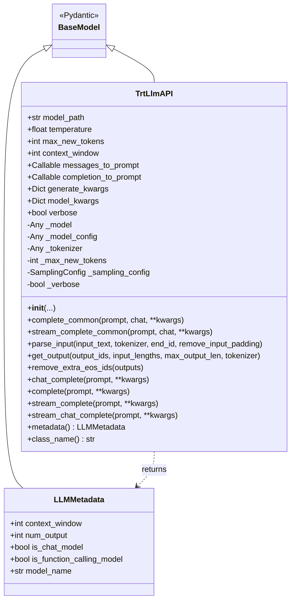
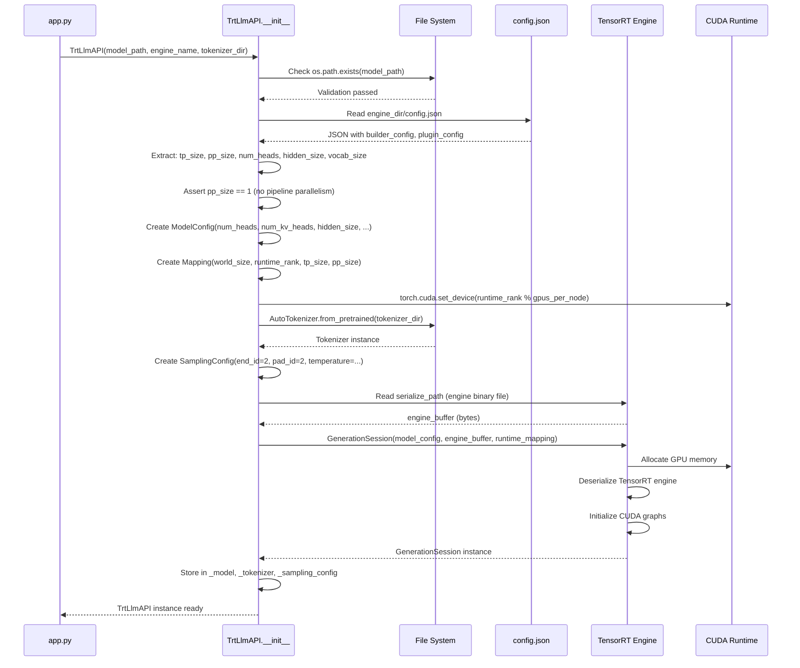
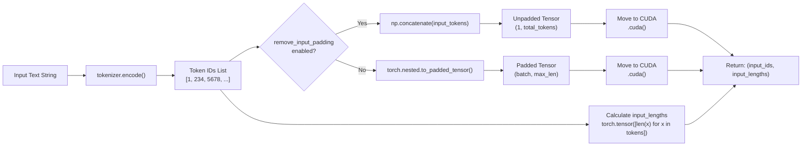
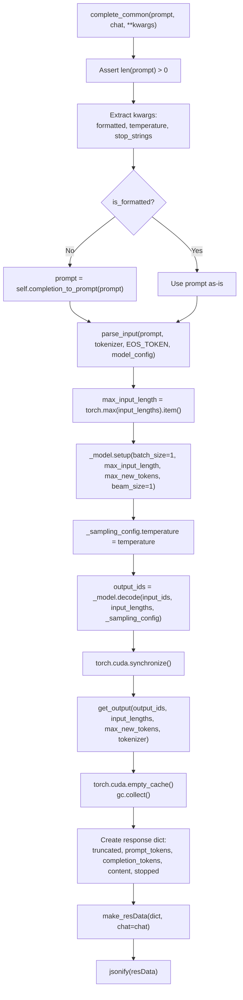
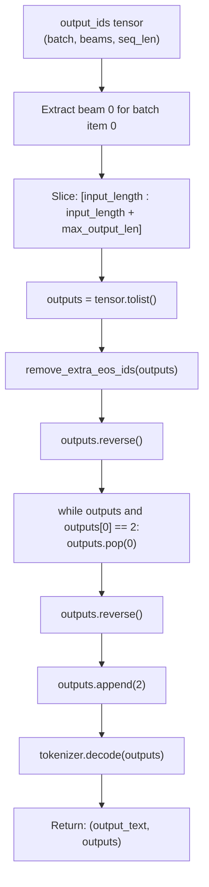
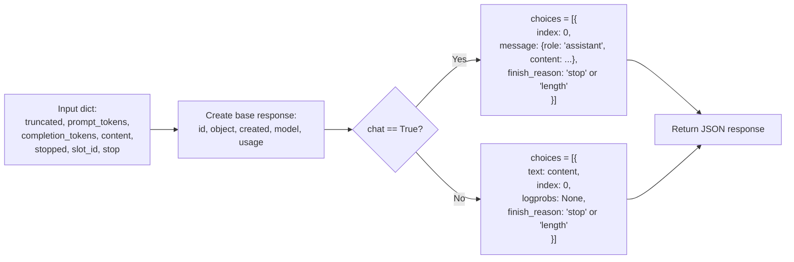
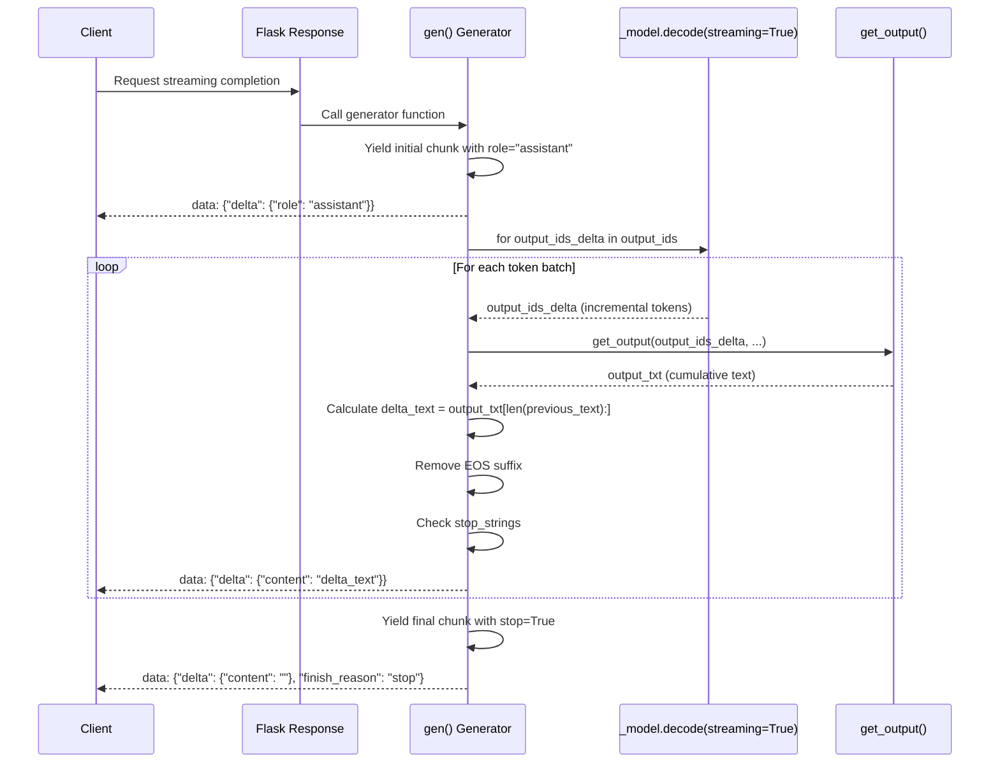
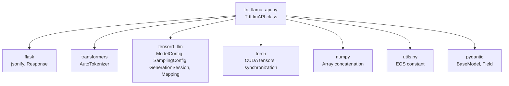

<!-- source: DeepWiki mcp.deepwiki.com · repo NVIDIA/trt-llm-as-openai-windows · page 4.3 TensorRT-LLM Inference Engine · fetched 2026-10-26 -->

# TensorRT-LLM Inference Engine

<details>
<summary>Relevant source files</summary>

The following files were used as context for generating this wiki page:

- [trt_llama_api.py](trt_llama_api.py)

</details>


## Purpose and Scope

This document provides a detailed technical explanation of the `trt_llama_api.py` module, which serves as the core inference engine wrapper for the TensorRT-LLM runtime. The `TrtLlmAPI` class encapsulates all interactions with TensorRT-LLM's low-level GPU inference capabilities, providing a high-level Python API for text generation.

This page focuses specifically on the inference engine implementation. For information about the Flask web server that calls this module, see [Flask Application Layer](#4.2). For details about prompt formatting utilities used by this module, see [Prompt Formatting System](#4.4). For the complete end-to-end request flow, see [Request Processing Pipeline](#4.5).

**Sources:** [trt_llama_api.py:1-482]()

---

## Module Overview

The `trt_llama_api.py` module provides three primary responsibilities:

1. **Engine Initialization**: Loading compiled TensorRT engines and tokenizers from disk
2. **Inference Orchestration**: Managing the tokenization → inference → detokenization pipeline
3. **Response Formatting**: Converting model outputs into OpenAI-compatible JSON structures

The module exposes a single public class, `TrtLlmAPI`, which is instantiated once at server startup and reused for all inference requests.

### Key Components

| Component | Type | Purpose |
|-----------|------|---------|
| `TrtLlmAPI` | Pydantic BaseModel | Main inference API class |
| `LLMMetadata` | Pydantic BaseModel | Model metadata container |
| `make_resData` | Function | Formats non-streaming responses |
| `make_resData_stream` | Function | Formats streaming response chunks |
| `EOS_TOKEN` | Constant (int) | End-of-sequence token ID (2) |
| `PAD_TOKEN` | Constant (int) | Padding token ID (2) |
| `DEFAULT_CONTEXT_WINDOW` | Constant (int) | Default context window (3900 tokens) |
| `DEFAULT_NUM_OUTPUTS` | Constant (int) | Default output length (256 tokens) |

**Sources:** [trt_llama_api.py:39-156]()

---

## TrtLlmAPI Class Architecture

The `TrtLlmAPI` class inherits from Pydantic's `BaseModel` for automatic validation and uses both public fields and private attributes to manage state.



### Public Fields

Public fields are defined using Pydantic's `Field` descriptor and are validated at construction time:

- `model_path`: Path to the TensorRT engine directory
- `temperature`: Sampling temperature for generation
- `max_new_tokens`: Maximum number of tokens to generate
- `context_window`: Maximum context length for input
- `messages_to_prompt`: Callable for converting chat messages to prompts
- `completion_to_prompt`: Callable for converting completion requests to prompts
- `generate_kwargs`: Additional generation parameters
- `model_kwargs`: Additional model initialization parameters
- `verbose`: Enable verbose logging

### Private Attributes

Private attributes (prefixed with `_`) store runtime objects not serializable by Pydantic:

- `_model`: `tensorrt_llm.runtime.GenerationSession` instance
- `_model_config`: `tensorrt_llm.runtime.ModelConfig` instance
- `_tokenizer`: HuggingFace `AutoTokenizer` instance
- `_sampling_config`: `tensorrt_llm.runtime.SamplingConfig` instance

**Sources:** [trt_llama_api.py:158-291]()

---

## Initialization and Model Loading

The `__init__` method performs heavyweight initialization that loads the compiled TensorRT engine and tokenizer into GPU memory. This process can take several seconds and is only executed once at server startup.



### Configuration Loading

The initialization process reads `config.json` from the engine directory to extract critical model parameters:

| Parameter | JSON Path | Purpose |
|-----------|-----------|---------|
| `tp_size` | `builder_config.tensor_parallel` | Tensor parallelism size |
| `pp_size` | `builder_config.pipeline_parallel` | Pipeline parallelism size (must be 1) |
| `num_heads` | `builder_config.num_heads` | Number of attention heads |
| `hidden_size` | `builder_config.hidden_size` | Hidden layer dimension |
| `vocab_size` | `builder_config.vocab_size` | Vocabulary size |
| `num_layers` | `builder_config.num_layers` | Number of transformer layers |
| `num_kv_heads` | `builder_config.num_kv_heads` | Number of key-value heads |
| `use_gpt_attention_plugin` | `plugin_config.gpt_attention_plugin` | Enable attention plugin |
| `remove_input_padding` | `plugin_config.remove_input_padding` | Remove padding optimization |
| `paged_kv_cache` | `plugin_config.paged_kv_cache` | Enable paged KV cache |

The initialization performs several critical validations:

1. **World Size Validation**: Ensures `tp_size * pp_size == tensorrt_llm.mpi_world_size()`
2. **Pipeline Parallelism Check**: Asserts `pp_size == 1` (Python runtime limitation)
3. **Multi-Query Mode Deprecation**: Warns if deprecated `multi_query_mode` is set

**Sources:** [trt_llama_api.py:188-291](), [trt_llama_api.py:217-259]()

---

## Tokenization Pipeline

The `parse_input` method converts text strings into GPU tensors suitable for TensorRT-LLM inference.



### Tokenization Modes

The method supports two tokenization strategies based on the `remove_input_padding` configuration:

**Mode 1: Padded Input** (remove_input_padding=False)
- Tokens are converted to a nested tensor, then padded to the maximum sequence length
- Shape: `(batch_size, max_sequence_length)`
- Uses `end_id` (EOS_TOKEN=2) as padding value
- Implementation: [trt_llama_api.py:382-384]()

**Mode 2: Unpadded Input** (remove_input_padding=True)
- Tokens are concatenated into a single flat array
- Shape: `(1, total_tokens)`
- More memory-efficient for variable-length inputs
- Implementation: [trt_llama_api.py:377-380]()

### Key Method Signature

```python
def parse_input(self, input_text: str, tokenizer, end_id: int,
                remove_input_padding: bool):
    # Returns: (input_ids, input_lengths)
    # input_ids: torch.Tensor on CUDA, dtype=torch.int32
    # input_lengths: torch.Tensor on CUDA, dtype=torch.int32
```

**Sources:** [trt_llama_api.py:367-386]()

---

## Inference Execution

The `complete_common` method orchestrates the core inference pipeline for non-streaming requests.



### Generation Session Setup

Before decoding, the method calls `_model.setup()` to prepare the TensorRT engine:

```python
self._model.setup(
    batch_size=input_lengths.size(0),  # Always 1 for single requests
    max_input_length=torch.max(input_lengths).item(),
    max_new_tokens=self._max_new_tokens,
    beam_size=1  # Greedy decoding only
)
```

This allocates GPU buffers and initializes the KV cache for the specific input/output dimensions.

### Sampling Configuration

The `_sampling_config` object controls generation behavior:

| Parameter | Value | Purpose |
|-----------|-------|---------|
| `end_id` | 2 (EOS_TOKEN) | Token ID that stops generation |
| `pad_id` | 2 (PAD_TOKEN) | Padding token ID |
| `num_beams` | 1 | Beam search width (greedy decoding) |
| `temperature` | Dynamic | Passed from request, controls randomness |

The temperature is updated per-request via `_sampling_config.temperature = temperature` before calling `decode()`.

### Inference Timing

When `verbose=True`, the method tracks inference time:

```python
start_time = time.time()
output_ids = self._model.decode(...)
torch.cuda.synchronize()  # Wait for GPU
end_time = time.time()
elapsed_time = end_time - start_time
```

The synchronization ensures accurate timing by waiting for all GPU operations to complete.

**Sources:** [trt_llama_api.py:313-365]()

---

## Detokenization and Output Processing

After inference generates token IDs, the `get_output` and `remove_extra_eos_ids` methods convert them back to text.



### EOS Token Handling

The `remove_extra_eos_ids` method cleans up trailing EOS tokens (ID=2) that may appear multiple times in the output:

1. **Reverse** the token list to access trailing tokens
2. **Pop** all leading EOS tokens (which were trailing before reversal)
3. **Reverse** back to original order
4. **Append** a single EOS token

This ensures exactly one EOS token appears at the end, preventing issues with multiple consecutive EOS tokens that could appear during generation.

### Beam Search Handling

Although the system currently uses greedy decoding (`num_beams=1`), the code supports beam search:

```python
for b in range(input_lengths.size(0)):  # Batch iteration
    for beam in range(num_beams):       # Beam iteration
        output_begin = input_lengths[b]
        output_end = input_lengths[b] + max_output_len
        outputs = output_ids[b][beam][output_begin:output_end].tolist()
```

Only the first beam's output is used when `num_beams=1`.

**Sources:** [trt_llama_api.py:388-408]()

---

## Response Formatting

The module provides two response formatting functions that convert model outputs into OpenAI-compatible JSON structures.

### Non-Streaming Responses: make_resData



The function generates a unique ID for each response:
- Chat completions: `chatcmpl-{uuid}`
- Text completions: `cmpl-{uuid}`

The `finish_reason` field is determined by the `stopped` flag:
- `"stop"`: Generation stopped due to EOS token
- `"length"`: Generation stopped due to max token limit

### Streaming Responses: make_resData_stream

For streaming responses, the function generates multiple JSON chunks:

**Initial Chunk** (start=True):
```json
{
  "id": "chatcmpl",
  "object": "chat.completion.chunk",
  "choices": [{
    "delta": {"role": "assistant"},
    "finish_reason": null
  }]
}
```

**Intermediate Chunks**:
```json
{
  "choices": [{
    "delta": {"content": "delta_text"},
    "finish_reason": null
  }]
}
```

**Final Chunk** (stop=True):
```json
{
  "choices": [{
    "delta": {"content": ""},
    "finish_reason": "stop"
  }]
}
```

**Sources:** [trt_llama_api.py:75-141]()

---

## Streaming Mode

The `stream_complete_common` method implements token-by-token streaming for real-time response delivery.



### Generator Function Pattern

Streaming uses Flask's `Response` object with a generator function:

```python
def gen() -> flask.Response:
    # Yield initial chunk
    yield 'data: {}\n'.format(json.dumps(initial_chunk))
    
    # Yield incremental tokens
    for output_ids_delta in output_ids:
        text_delta = compute_delta(output_ids_delta)
        yield 'data: {}\n'.format(json.dumps(delta_chunk))
    
    # Yield final chunk
    yield 'data: {}\n'.format(json.dumps(final_chunk))

return flask.Response(gen(), mimetype='text/event-stream')
```

### Stop String Handling

The streaming loop checks for stop strings in the accumulated text:

```python
for stop_string in stop_strings:
    if stop_string in text:
        dictForDelta["truncated"] = True
        break
```

When a stop string is detected, `truncated` is set to `True`, preventing further token emission.

### Delta Calculation

Each iteration computes the text delta since the last emission:

```python
delta_text = output_txt[len(text):]  # New text since last iteration
text = output_txt.removesuffix(EOS)  # Update accumulated text
dictForDelta["content"] = delta_text.removesuffix(EOS)
```

This ensures only new tokens are sent to the client, not the entire cumulative output.

**Sources:** [trt_llama_api.py:416-481]()

---

## Configuration and Metadata

### LLMMetadata Class

The `LLMMetadata` class provides model capability information:

```python
class LLMMetadata(BaseModel):
    context_window: int = DEFAULT_CONTEXT_WINDOW  # 3900
    num_output: int = DEFAULT_NUM_OUTPUTS          # 256
    is_chat_model: bool = False
    is_function_calling_model: bool = False
    model_name: str = "unknown"
```

This metadata is accessible via the `metadata` property:

```python
@property
def metadata(self) -> LLMMetadata:
    return LLMMetadata(
        context_window=self.context_window,
        num_output=self.max_new_tokens,
        model_name=self.model_path,
    )
```

### Entry Point Methods

The class provides convenience methods that delegate to the core `complete_common` and `stream_complete_common`:

| Method | Chat Mode | Streaming | Delegates To |
|--------|-----------|-----------|--------------|
| `complete` | False | No | `complete_common(prompt, False)` |
| `chat_complete` | True | No | `complete_common(prompt, True)` |
| `stream_complete` | False | Yes | `stream_complete_common(prompt, False)` |
| `stream_chat_complete` | True | Yes | `stream_complete_common(prompt, True)` |

These methods provide a cleaner API for callers in `app.py` to specify the response type without manually passing boolean flags.

**Sources:** [trt_llama_api.py:144-156](), [trt_llama_api.py:293-414]()

---

## Module Dependencies



The module has minimal external dependencies beyond the core ML stack (TensorRT-LLM, PyTorch, Transformers) and web framework (Flask). The only internal dependency is on `utils.py` for the `EOS` constant.

**Sources:** [trt_llama_api.py:22-37]()

---

