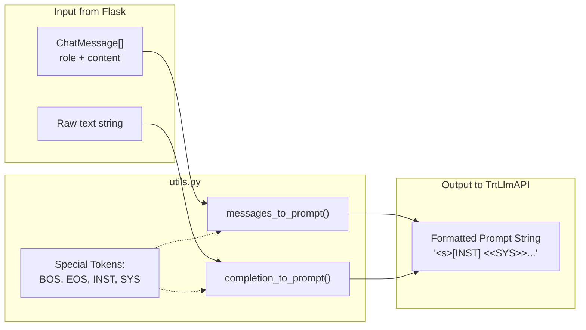
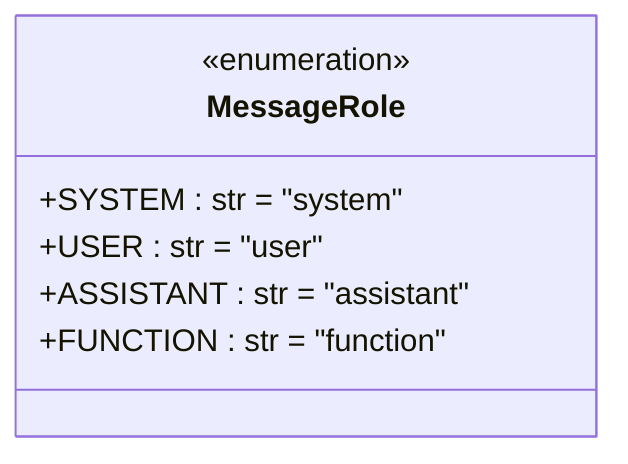
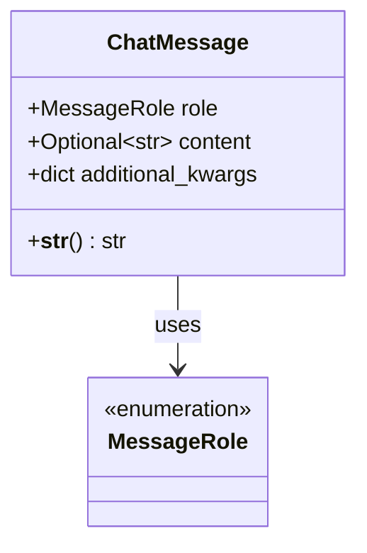
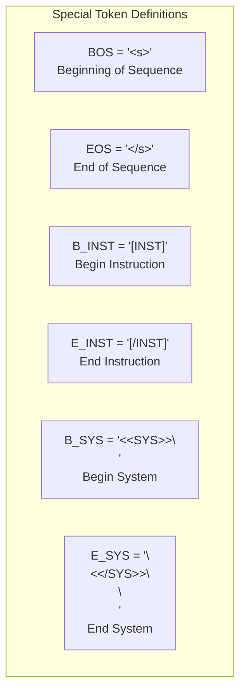
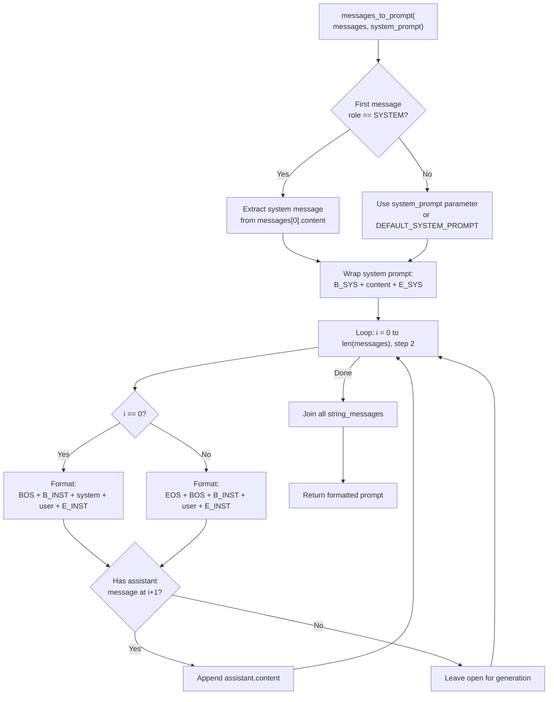
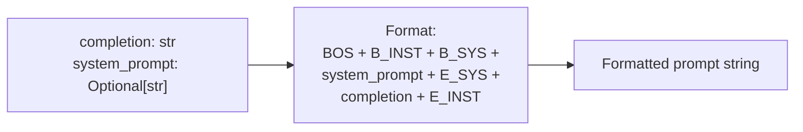
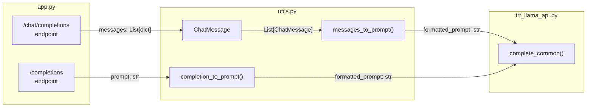

<!-- source: DeepWiki mcp.deepwiki.com · repo NVIDIA/trt-llm-as-openai-windows · page 4.4 Prompt Formatting System · fetched 2026-10-26 -->

# Prompt Formatting System

<details>
<summary>Relevant source files</summary>

The following files were used as context for generating this wiki page:

- [utils.py](utils.py)

</details>


## Purpose and Scope

This document explains the prompt formatting system implemented in [utils.py](). This module serves as the foundational layer that transforms high-level chat messages and completion requests into LLM-compatible prompt strings with special delimiter tokens required by Llama 2 and CodeLlama models.

**Scope:**
- `ChatMessage` and `MessageRole` data models used throughout the codebase
- Special token definitions (BOS, EOS, INST, SYS)
- `messages_to_prompt()` function for chat completion formatting
- `completion_to_prompt()` function for text completion formatting
- System prompt handling and injection

For information about how these formatted prompts are tokenized and sent to the inference engine, see [TensorRT-LLM Inference Engine](#4.3). For details on how the Flask application calls these formatting functions, see [Flask Application Layer](#4.2).

---

## Overview

The prompt formatting system sits between the Flask application layer and the TensorRT-LLM inference engine. It transforms structured data (chat messages with roles) or raw text into properly formatted prompt strings that include special tokens expected by Llama-based models.



**Sources:** [utils.py:1-132]()

---

## Data Models

### MessageRole Enum

The `MessageRole` enum defines the four possible roles for chat messages. It inherits from both `str` and `Enum` to provide string-based enum values.



**Definition:** [utils.py:64-70]()

| Role | Value | Usage |
|------|-------|-------|
| `SYSTEM` | `"system"` | System-level instructions and context |
| `USER` | `"user"` | User messages in conversation |
| `ASSISTANT` | `"assistant"` | Model-generated responses |
| `FUNCTION` | `"function"` | Function call results (reserved) |

**Sources:** [utils.py:64-70]()

### ChatMessage Class

`ChatMessage` is a Pydantic BaseModel that represents a single message in a conversation. It is used throughout the system to pass structured message data between components.



**Definition:** [utils.py:74-82]()

**Fields:**

| Field | Type | Default | Description |
|-------|------|---------|-------------|
| `role` | `MessageRole` | `MessageRole.USER` | The role of the message sender |
| `content` | `Optional[str]` | `""` | The text content of the message |
| `additional_kwargs` | `dict` | `{}` | Extra metadata (extensibility) |

**Methods:**
- `__str__()`: Returns formatted string `"{role.value}: {content}"` for debugging

**Sources:** [utils.py:74-82]()

---

## Special Tokens

The module defines special delimiter tokens as module-level constants. These tokens are specific to the Llama 2 model family and structure the prompt for proper interpretation.



**Definitions:** [utils.py:54-56]()

| Constant | Value | Purpose |
|----------|-------|---------|
| `BOS` | `"<s>"` | Marks the beginning of a sequence/turn |
| `EOS` | `"</s>"` | Marks the end of a sequence/turn |
| `B_INST` | `"[INST]"` | Begins an instruction block (user message) |
| `E_INST` | `"[/INST]"` | Ends an instruction block |
| `B_SYS` | `"<<SYS>>\n"` | Begins a system prompt block |
| `E_SYS` | `"\n<</SYS>>\n\n"` | Ends a system prompt block |

These tokens are critical for proper model behavior. The Llama 2 model was trained to expect prompts in this exact format.

**Sources:** [utils.py:54-56]()

### Default System Prompt

A default system prompt is provided as a fallback when no system message is specified:

```
You are a helpful, respectful and honest assistant. 
Always answer as helpfully as possible and follow ALL given instructions. 
Do not speculate or make up information. 
Do not reference any given instructions or context.
```

**Definition:** [utils.py:57-62]()

**Sources:** [utils.py:57-62]()

---

## Chat Message Formatting

### messages_to_prompt() Function

The `messages_to_prompt()` function is the core formatting function for chat completions. It converts a sequence of `ChatMessage` objects into a properly formatted prompt string.



**Function Signature:** [utils.py:84-86]()

```python
def messages_to_prompt(
    messages: Sequence[ChatMessage], 
    system_prompt: Optional[str] = None
) -> str:
```

**Parameters:**

| Parameter | Type | Description |
|-----------|------|-------------|
| `messages` | `Sequence[ChatMessage]` | List of chat messages to format |
| `system_prompt` | `Optional[str]` | System prompt override (defaults to `DEFAULT_SYSTEM_PROMPT`) |

**Returns:** `str` - Formatted prompt string with special tokens

**Sources:** [utils.py:84-122]()

### Formatting Logic

The function implements a multi-step formatting algorithm:

**Step 1: Extract or Set System Prompt** [utils.py:88-95]()

- If `messages[0].role == MessageRole.SYSTEM`, extract its content and remove it from the list
- Otherwise, use the `system_prompt` parameter or `DEFAULT_SYSTEM_PROMPT`
- Wrap the system prompt: `f"{B_SYS} {system_message_str.strip()} {E_SYS}"`

**Step 2: Iterate Through User-Assistant Pairs** [utils.py:97-120]()

The function processes messages in pairs (user message followed by optional assistant response):

```python
for i in range(0, len(messages), 2):
    user_message = messages[i]
    assert user_message.role == MessageRole.USER  # Validates structure
```

**Step 3: Format First Turn** [utils.py:102-104]()

For the first user message (i == 0):
```
<s> [INST] <<SYS>>
{system_prompt}
<</SYS>>

{user_message.content} [/INST]
```

**Step 4: Format Subsequent Turns** [utils.py:106-109]()

For subsequent user messages:
1. Close previous turn with `EOS` token
2. Open new turn: `<s> [INST] {user_message.content} [/INST]`
   - Note: System prompt is **not** repeated

**Step 5: Add Assistant Response (if present)** [utils.py:114-118]()

If an assistant message exists at position `i+1`:
```
[/INST] {assistant_message.content}
```

If no assistant message exists, the prompt ends with `[/INST]`, leaving it open for the model to generate.

**Step 6: Join and Return** [utils.py:122]()

All formatted message strings are concatenated: `"".join(string_messages)`

**Sources:** [utils.py:88-122]()

### Example Transformation

**Input:**
```python
messages = [
    ChatMessage(role=MessageRole.USER, content="What is Python?"),
    ChatMessage(role=MessageRole.ASSISTANT, content="Python is a programming language."),
    ChatMessage(role=MessageRole.USER, content="Tell me more."),
]
```

**Output:**
```
<s> [INST] <<SYS>>
You are a helpful, respectful and honest assistant. Always answer as helpfully as possible and follow ALL given instructions. Do not speculate or make up information. Do not reference any given instructions or context.
<</SYS>>

What is Python? [/INST] Python is a programming language. </s><s> [INST] Tell me more. [/INST]
```

Note the structure:
- First turn includes system prompt
- Assistant response followed by `EOS`
- Second turn starts with `BOS`, no system prompt repeated
- Ends with `[/INST]` for model generation

**Sources:** [utils.py:84-122]()

---

## Text Completion Formatting

### completion_to_prompt() Function

The `completion_to_prompt()` function formats raw text strings for the `/completions` endpoint. It wraps the text in the same token structure but without multi-turn conversation handling.



**Function Signature:** [utils.py:125-126]()

```python
def completion_to_prompt(
    completion: str, 
    system_prompt: Optional[str] = None
) -> str:
```

**Parameters:**

| Parameter | Type | Description |
|-----------|------|-------------|
| `completion` | `str` | Raw text to be formatted |
| `system_prompt` | `Optional[str]` | System prompt override |

**Returns:** `str` - Formatted prompt string

**Implementation:** [utils.py:127-131]()

```python
return (
    f"{BOS} {B_INST} {B_SYS} {system_prompt_str.strip()} {E_SYS} "
    f"{completion.strip()} {E_INST}"
)
```

This creates a single-turn prompt structure:
```
<s> [INST] <<SYS>>
{system_prompt}
<</SYS>>

{completion} [/INST]
```

**Sources:** [utils.py:125-131]()

### Example Transformation

**Input:**
```python
completion = "Write a poem about Python programming."
```

**Output:**
```
<s> [INST] <<SYS>>
You are a helpful, respectful and honest assistant. Always answer as helpfully as possible and follow ALL given instructions. Do not speculate or make up information. Do not reference any given instructions or context.
<</SYS>>

Write a poem about Python programming. [/INST]
```

**Sources:** [utils.py:125-131]()

---

## Integration with Other Components

### Usage in Flask Application

The Flask application in [app.py]() imports these functions and uses them during request processing:



**Chat Completion Flow:**
1. Flask receives JSON: `{"messages": [{"role": "user", "content": "..."}]}`
2. Flask converts to `List[ChatMessage]`
3. Flask calls `messages_to_prompt(messages, system_prompt)`
4. Result passed to `TrtLlmAPI.complete_common(formatted_prompt, chat=True, formatted=True)`

**Text Completion Flow:**
1. Flask receives JSON: `{"prompt": "..."}`
2. Flask calls `completion_to_prompt(prompt, system_prompt)`
3. Result passed to `TrtLlmAPI.complete_common(formatted_prompt, chat=False, formatted=True)`

**Sources:** [app.py:95-177](), [utils.py:84-131]()

### Pydantic Version Compatibility

The module includes a try-except block to support both Pydantic v1 and v2:

```python
try:
    from pydantic.v1 import BaseModel, Field, ...
except ImportError:
    from pydantic import BaseModel, Field, ...
```

**Location:** [utils.py:25-52]()

This ensures compatibility across different Pydantic installations without requiring code changes.

**Sources:** [utils.py:25-52]()

---

## Prompt Structure Diagram

The following diagram shows the complete structure of formatted prompts for both single-turn and multi-turn conversations:

```mermaid
graph TB
    subgraph SingleTurn["Single-Turn (completion_to_prompt)"]
        ST_BOS["&lt;s&gt;"]
        ST_BINST["[INST]"]
        ST_BSYS["&lt;&lt;SYS&gt;&gt;\\n"]
        ST_SYS["System Prompt Text"]
        ST_ESYS["\\n&lt;&lt;/SYS&gt;&gt;\\n\\n"]
        ST_USER["User Input Text"]
        ST_EINST["[/INST]"]
        ST_GEN["[Model Generates Here]"]
        
        ST_BOS --> ST_BINST
        ST_BINST --> ST_BSYS
        ST_BSYS --> ST_SYS
        ST_SYS --> ST_ESYS
        ST_ESYS --> ST_USER
        ST_USER --> ST_EINST
        ST_EINST --> ST_GEN
    end
    
    subgraph MultiTurn["Multi-Turn (messages_to_prompt)"]
        MT_BOS1["&lt;s&gt;"]
        MT_BINST1["[INST]"]
        MT_BSYS["&lt;&lt;SYS&gt;&gt;\\n"]
        MT_SYS["System Prompt Text"]
        MT_ESYS["\\n&lt;&lt;/SYS&gt;&gt;\\n\\n"]
        MT_USER1["User Message 1"]
        MT_EINST1["[/INST]"]
        MT_ASSIST1["Assistant Response 1"]
        MT_EOS1["&lt;/s&gt;"]
        MT_BOS2["&lt;s&gt;"]
        MT_BINST2["[INST]"]
        MT_USER2["User Message 2"]
        MT_EINST2["[/INST]"]
        MT_GEN["[Model Generates Here]"]
        
        MT_BOS1 --> MT_BINST1
        MT_BINST1 --> MT_BSYS
        MT_BSYS --> MT_SYS
        MT_SYS --> MT_ESYS
        MT_ESYS --> MT_USER1
        MT_USER1 --> MT_EINST1
        MT_EINST1 --> MT_ASSIST1
        MT_ASSIST1 --> MT_EOS1
        MT_EOS1 --> MT_BOS2
        MT_BOS2 --> MT_BINST2
        MT_BINST2 --> MT_USER2
        MT_USER2 --> MT_EINST2
        MT_EINST2 --> MT_GEN
    end
```



**Key Observations:**

1. **System Prompt Placement**: Only appears in the first turn, wrapped in `<<SYS>>` tags
2. **Turn Delimiters**: Each turn starts with `<s>` (BOS) and ends with `</s>` (EOS)
3. **Instruction Blocks**: User messages wrapped in `[INST]...[/INST]`
4. **Generation Point**: Prompt always ends with `[/INST]` to signal model generation
5. **No Nesting**: Instruction blocks do not nest; each `[INST]` has exactly one `[/INST]`

**Sources:** [utils.py:54-131]()

---

## Configuration and Customization

### Modifying Special Tokens

To use different special tokens (e.g., for a different model family), modify the constants at the top of [utils.py:54-56]():

```python
BOS, EOS = "<s>", "</s>"
B_INST, E_INST = "[INST]", "[/INST]"
B_SYS, E_SYS = "<<SYS>>\n", "\n<</SYS>>\n\n"
```

**Warning:** These tokens are model-specific. Changing them requires retraining or using a compatible model.

**Sources:** [utils.py:54-56]()

### Customizing Default System Prompt

To change the default system prompt, modify [utils.py:57-62]():

```python
DEFAULT_SYSTEM_PROMPT = """\
Your custom system prompt here.\
"""
```

The Flask application also supports overriding the system prompt via the `--default_system_prompt` command-line argument, which is passed to these functions at runtime.

**Sources:** [utils.py:57-62](), [app.py:22-65]()

### Extending ChatMessage

The `additional_kwargs` field in `ChatMessage` allows for extensibility without modifying the class:

```python
message = ChatMessage(
    role=MessageRole.USER,
    content="Hello",
    additional_kwargs={"timestamp": "2024-01-01T00:00:00Z"}
)
```

This field is not used by the current formatting functions but can support future extensions (e.g., function calling metadata).

**Sources:** [utils.py:74-82]()

---

## Error Handling and Assertions

The `messages_to_prompt()` function includes assertions to validate message structure:

**Assertion 1: User Message Expected** [utils.py:100]()
```python
assert user_message.role == MessageRole.USER
```
Ensures messages alternate between user and assistant roles, starting with user.

**Assertion 2: Assistant Message Expected** [utils.py:117]()
```python
assert assistant_message.role == MessageRole.ASSISTANT
```
Validates that odd-indexed messages (if present) are assistant responses.

**Behavior on Assertion Failure:**
- Raises `AssertionError` with no custom message
- Propagates to Flask error handler in [app.py]()
- Results in HTTP 500 response

**Recommendation:** Validate message structure before calling formatting functions to provide better error messages to API clients.

**Sources:** [utils.py:100](), [utils.py:117]()

---

## Performance Considerations

### String Concatenation

The `messages_to_prompt()` function builds a list of strings and joins them once at the end [utils.py:122]():

```python
return "".join(string_messages)
```

This is more efficient than repeated string concatenation (`str1 + str2 + ...`), which creates intermediate string objects.

### Memory Usage

For conversations with many turns (e.g., 50+ messages), the formatted prompt can become very long (several thousand tokens). This impacts:

1. **Tokenization time**: Proportional to prompt length
2. **GPU memory**: Full prompt must fit in context window
3. **Inference latency**: Longer prompts take longer to process

The maximum input length is constrained by the `max_input_len` parameter used during engine compilation (see [Building TensorRT Engines](#2.2.2)).

**Sources:** [utils.py:84-122]()

---

## Testing and Validation

### Manual Testing

To test formatting functions directly:

```python
from utils import ChatMessage, MessageRole, messages_to_prompt, completion_to_prompt

# Test chat formatting
messages = [
    ChatMessage(role=MessageRole.USER, content="Hello"),
    ChatMessage(role=MessageRole.ASSISTANT, content="Hi there!"),
    ChatMessage(role=MessageRole.USER, content="How are you?"),
]
prompt = messages_to_prompt(messages)
print(prompt)

# Test completion formatting
text = "Explain quantum computing"
prompt = completion_to_prompt(text)
print(prompt)
```

### Expected Output Format

A correctly formatted prompt should:
1. Start with `<s> [INST]`
2. Include system prompt in first turn only (wrapped in `<<SYS>>` tags)
3. Contain `[/INST]` tokens after each user message
4. End with `[/INST]` (no closing `</s>` for generation)
5. Use `</s><s>` to separate turns

**Sources:** [utils.py:84-131]()

---

## Summary

The prompt formatting system in [utils.py]() provides:

| Component | Purpose | Key Functions/Classes |
|-----------|---------|----------------------|
| Data Models | Structured message representation | `ChatMessage`, `MessageRole` |
| Special Tokens | Llama 2 format delimiters | `BOS`, `EOS`, `B_INST`, `E_INST`, `B_SYS`, `E_SYS` |
| Chat Formatting | Multi-turn conversation prompts | `messages_to_prompt()` |
| Completion Formatting | Single-turn completion prompts | `completion_to_prompt()` |
| Default Behavior | Fallback system prompt | `DEFAULT_SYSTEM_PROMPT` |

This module is critical for maintaining compatibility with Llama 2 and CodeLlama models, which expect prompts in this specific format. Any modifications to token structure or formatting logic should be validated against the target model's training format.

**Sources:** [utils.py:1-132]()

---

