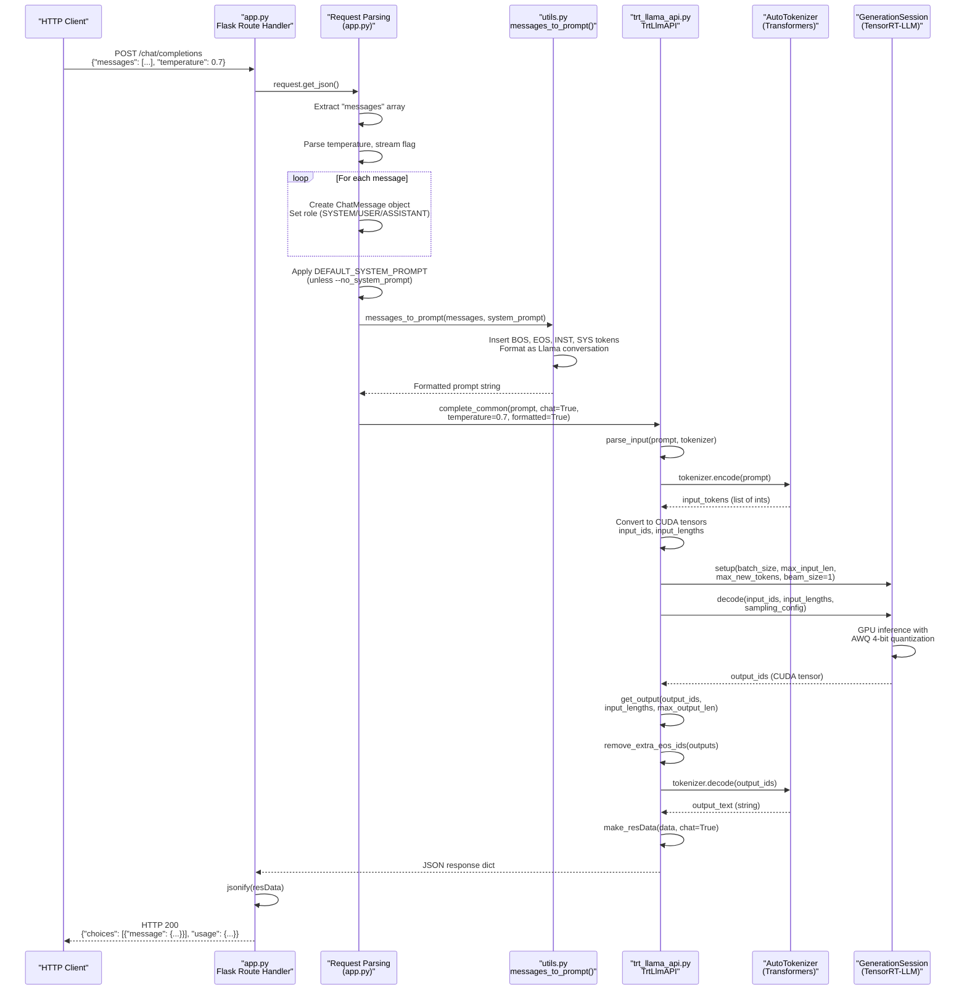
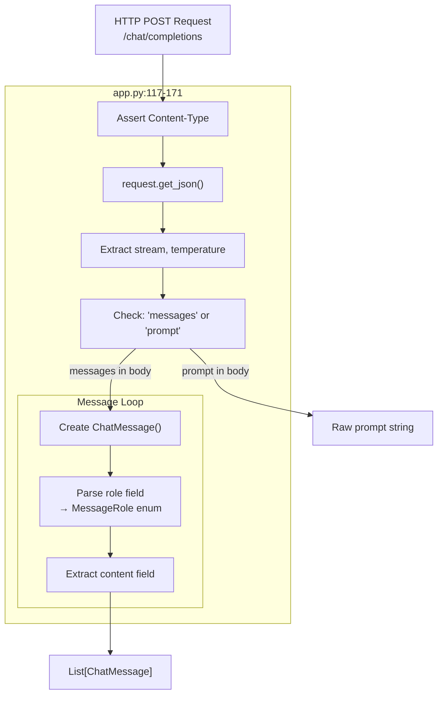
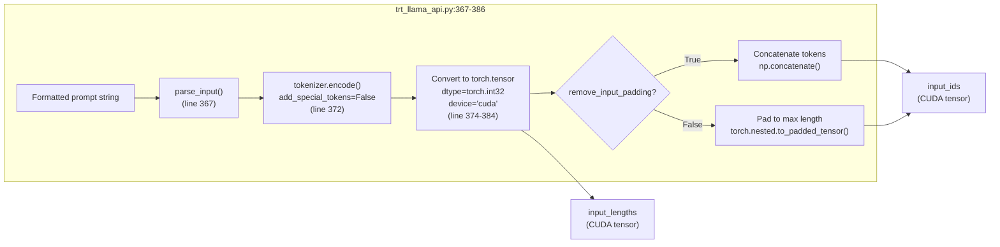
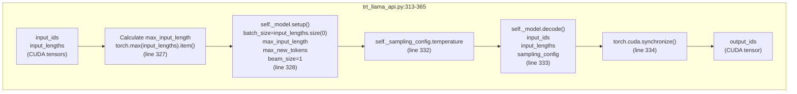

<!-- source: DeepWiki mcp.deepwiki.com · repo NVIDIA/trt-llm-as-openai-windows · page 4.5 Request Processing Pipeline · fetched 2026-10-26 -->

# Request Processing Pipeline

<details>
<summary>Relevant source files</summary>

The following files were used as context for generating this wiki page:

- [app.py](app.py)
- [trt_llama_api.py](trt_llama_api.py)
- [utils.py](utils.py)

</details>


## Purpose and Scope

This document provides an end-to-end walkthrough of how HTTP requests are processed through the TensorRT-LLM OpenAI API system, from initial receipt to final response. It traces the complete data transformation pipeline across all three Python modules ([app.py](), [trt_llama_api.py](), and [utils.py]()), showing how raw JSON requests become formatted prompts, then token tensors, then inference results, and finally OpenAI-compatible JSON responses.

For detailed information about individual components, see [Flask Application Layer](#4.2), [TensorRT-LLM Inference Engine](#4.3), and [Prompt Formatting System](#4.4). For streaming-specific behavior, see [Streaming Responses](#4.6).

---

## Request Flow Overview

### Complete Request Processing Sequence

The following diagram illustrates the complete sequence of operations for a chat completion request, showing the interactions between all system components:



**Sources:** [app.py:117-171](), [trt_llama_api.py:313-365](), [utils.py:84-122]()

---

## Processing Stages

### Stage 1: HTTP Request Parsing

When an HTTP request arrives at the `/chat/completions` or `/v1/chat/completions` endpoint, [app.py:117-171]() performs the following operations:

1. **Content-Type Validation**: Asserts `Content-Type: application/json` header [app.py:120]()
2. **JSON Body Extraction**: Calls `request.get_json()` to parse request body [app.py:121]()
3. **Parameter Extraction**: Extracts optional parameters using `is_present()` helper:
   - `stream` (boolean) - determines sync vs streaming response [app.py:124-125]()
   - `temperature` (float) - sampling temperature for generation [app.py:126-127]()
4. **Message Array Processing**: Iterates through `messages` array [app.py:133-152]():
   - Creates `ChatMessage` objects for each entry
   - Parses `role` field and converts to `MessageRole` enum (SYSTEM/USER/ASSISTANT/FUNCTION)
   - Extracts `content` field as message text



**Sources:** [app.py:117-152](), [utils.py:64-70](), [utils.py:74-82]()

---

### Stage 2: Prompt Formatting

After parsing, the system applies model-specific formatting to convert messages into a prompt string that the LLM can understand.

#### Chat Completions Path

For chat completions, [app.py:154-160]() performs:

1. **System Prompt Selection**: Uses `DEFAULT_SYSTEM_PROMPT` from [utils.py:57-62]() unless `--no_system_prompt` flag is set [app.py:49]()
2. **Prompt Formatting**: Calls `messages_to_prompt(messages, system_prompt)` [app.py:158]()

The `messages_to_prompt()` function [utils.py:84-122]() implements Llama-specific formatting:

| Special Token | Purpose | Example |
|---------------|---------|---------|
| `BOS` (`<s>`) | Beginning of sequence | Marks start of each user-assistant turn |
| `EOS` (`</s>`) | End of sequence | Marks end of each turn |
| `B_INST` (`[INST]`) | Begin instruction | Wraps user messages |
| `E_INST` (`[/INST]`) | End instruction | Closes user message block |
| `B_SYS` (`<<SYS>>\n`) | Begin system | Wraps system prompt |
| `E_SYS` (`\n<</SYS>>\n\n`) | End system | Closes system prompt |

Example formatted output:
```
<s> [INST] <<SYS>>
You are a helpful, respectful and honest assistant.
<</SYS>>

What is the capital of France? [/INST] Paris is the capital of France. </s> <s> [INST] What about Germany? [/INST]
```

#### Text Completions Path

For text completions, [app.py:205-207]() applies:

1. **Completion Formatting**: Calls `completion_to_prompt(prompt)` [app.py:206]() unless `--no_system_prompt` is set
2. The `completion_to_prompt()` function [utils.py:125-131]() wraps the raw text with system prompt and instruction tokens

**Sources:** [app.py:154-160](), [app.py:205-207](), [utils.py:84-122](), [utils.py:125-131]()

---

### Stage 3: Tokenization

The formatted prompt string is converted to integer token IDs that can be processed by the neural network.



The `parse_input()` method [trt_llama_api.py:367-386]() performs:

1. **Encoding**: Calls `tokenizer.encode(input_text, add_special_tokens=False)` [trt_llama_api.py:372]()
   - Returns list of integer token IDs
   - `add_special_tokens=False` because formatting stage already added them
2. **Length Calculation**: Creates `input_lengths` tensor with sequence length [trt_llama_api.py:374-376]()
3. **Tensor Creation**: Converts token IDs to CUDA tensors [trt_llama_api.py:377-384]()
   - If `remove_input_padding` is enabled: concatenates all tokens
   - Otherwise: pads sequences to same length using `EOS_TOKEN` (2) as padding

**Sources:** [trt_llama_api.py:367-386](), [trt_llama_api.py:322-325]()

---

### Stage 4: Model Setup and Inference

With tokenized input on GPU, the system performs inference using TensorRT-LLM.



The inference process [trt_llama_api.py:327-334]():

1. **Maximum Length Calculation**: Finds longest sequence in batch [trt_llama_api.py:327]()
2. **Session Setup**: Calls `GenerationSession.setup()` [trt_llama_api.py:328]() to allocate GPU memory for:
   - Batch size (number of sequences)
   - Maximum input length (for attention/KV cache)
   - Maximum output tokens to generate
   - Beam size (set to 1 for greedy decoding)
3. **Temperature Configuration**: Updates `SamplingConfig` with request temperature [trt_llama_api.py:332]()
4. **Decoding**: Executes `decode()` [trt_llama_api.py:333]() which:
   - Runs AWQ 4-bit quantized model on GPU
   - Generates tokens autoregressively
   - Returns tensor of output token IDs
5. **Synchronization**: Ensures GPU operations complete [trt_llama_api.py:334]()

**Sources:** [trt_llama_api.py:327-334](), [trt_llama_api.py:261-264]()

---

### Stage 5: Detokenization

Output token IDs are converted back to human-readable text.

```mermaid
flowchart TB
    subgraph "trt_llama_api.py:341-408"
        OutputIDs["output_ids tensor<br/>(includes input + generated)"]
        
        GetOutput["get_output()<br/>(line 341)"]
        
        Extract["Extract generated portion<br/>output_begin = input_lengths[b]<br/>output_end = input_lengths[b] + max_output_len<br/>(line 402-404)"]
        
        ToList["Convert to Python list<br/>.tolist()<br/>(line 404)"]
        
        RemoveEOS["remove_extra_eos_ids()<br/>(line 388-394)"]
        
        Reverse1["outputs.reverse()"]
        Loop["Remove trailing EOS tokens<br/>while outputs[0] == 2: pop()"]
        Reverse2["outputs.reverse()"]
        AppendEOS["outputs.append(2)"]
        
        Decode["tokenizer.decode(outputs)<br/>(line 406)"]
        
        OutputText["output_text (string)"]
    end
    
    OutputIDs --> GetOutput
    GetOutput --> Extract
    Extract --> ToList
    ToList --> RemoveEOS
    
    RemoveEOS --> Reverse1
    Reverse1 --> Loop
    Loop --> Reverse2
    Reverse2 --> AppendEOS
    
    AppendEOS --> Decode
    Decode --> OutputText
```



The `get_output()` method [trt_llama_api.py:396-408]() performs:

1. **Token Extraction**: Slices generated tokens from full output tensor [trt_llama_api.py:402-404]()
   - `output_begin` = length of input (start of generated text)
   - `output_end` = input length + max output tokens
2. **List Conversion**: Converts CUDA tensor to Python list [trt_llama_api.py:404]()
3. **EOS Cleanup**: Calls `remove_extra_eos_ids()` [trt_llama_api.py:388-394]() to:
   - Remove duplicate trailing EOS tokens
   - Keep exactly one EOS at end
4. **Text Decoding**: Calls `tokenizer.decode()` [trt_llama_api.py:406]() to convert token IDs to text

**Sources:** [trt_llama_api.py:341-344](), [trt_llama_api.py:396-408](), [trt_llama_api.py:388-394]()

---

### Stage 6: Response Formatting

The generated text is formatted into an OpenAI-compatible JSON response.

```mermaid
flowchart TB
    subgraph "trt_llama_api.py:356-365"
        GenText["Generated text string"]
        Metrics["Token counts:<br/>prompt_tokens<br/>completion_tokens"]
        
        CreateDict["Create response dict<br/>truncated=False<br/>stopped=False<br/>slot_id=1<br/>stop=True<br/>(line 356-362)"]
        
        MakeRes["make_resData(dict, chat=True)<br/>(line 364)"]
        
        subgraph "make_resData() (line 75-108)"
            GenID["Generate unique ID<br/>uuid.uuid4()"]
            SetType["Set object type:<br/>chat.completion or text_completion"]
            Usage["Add usage field:<br/>prompt_tokens<br/>completion_tokens<br/>total_tokens"]
            
            CheckChat{"chat flag?"}
            
            ChatChoice["Format as chat message:<br/>choices[0].message.role = 'assistant'<br/>choices[0].message.content = text"]
            
            TextChoice["Format as text:<br/>choices[0].text = text"]
        end
        
        JSONify["jsonify(resData)<br/>(line 365)"]
        HTTPResp["HTTP 200 JSON Response"]
    end
    
    GenText --> CreateDict
    Metrics --> CreateDict
    CreateDict --> MakeRes
    
    MakeRes --> GenID
    GenID --> SetType
    SetType --> Usage
    Usage --> CheckChat
    
    CheckChat -->|True| ChatChoice
    CheckChat -->|False| TextChoice
    
    ChatChoice --> JSONify
    TextChoice --> JSONify
    JSONify --> HTTPResp
```



The `make_resData()` function [trt_llama_api.py:75-108]() creates OpenAI-compatible response structure:

**Chat Completion Response Structure:**
```json
{
  "id": "chatcmpl-<uuid>",
  "object": "chat.completion",
  "created": 1234567890,
  "truncated": false,
  "model": "LLaMA",
  "usage": {
    "prompt_tokens": 45,
    "completion_tokens": 128,
    "total_tokens": 173
  },
  "choices": [{
    "index": 0,
    "message": {
      "role": "assistant",
      "content": "Generated response text..."
    },
    "finish_reason": "stop"
  }]
}
```

**Text Completion Response Structure:**
```json
{
  "id": "cmpl-<uuid>",
  "object": "text_completion",
  "created": 1234567890,
  "truncated": false,
  "model": "LLaMA",
  "usage": {
    "prompt_tokens": 45,
    "completion_tokens": 128,
    "total_tokens": 173
  },
  "choices": [{
    "text": "Generated response text...",
    "index": 0,
    "logprobs": null,
    "finish_reason": "stop"
  }]
}
```

The `finish_reason` field is set based on `stopped` flag [trt_llama_api.py:98](), [trt_llama_api.py:106]():
- `"stop"` - generation completed normally (hit EOS token or stop string)
- `"length"` - generation truncated due to `max_new_tokens` limit

**Sources:** [trt_llama_api.py:356-365](), [trt_llama_api.py:75-108]()

---

## Data Transformation Summary

The following table summarizes how data transforms at each pipeline stage:

| Stage | Input Format | Output Format | Key Operations | Code Location |
|-------|-------------|---------------|----------------|---------------|
| **1. Parsing** | JSON string | `List[ChatMessage]` or raw string | JSON deserialization, role enum conversion | [app.py:121-152]() |
| **2. Formatting** | `List[ChatMessage]` | Formatted prompt string | Insert BOS/EOS/INST/SYS tokens | [utils.py:84-122]() |
| **3. Tokenization** | String | CUDA `torch.tensor` (int32) | Text encoding, padding, GPU transfer | [trt_llama_api.py:367-386]() |
| **4. Inference** | Input token IDs | Output token IDs | Neural network forward pass (AWQ 4-bit) | [trt_llama_api.py:327-334]() |
| **5. Detokenization** | Output token IDs | Generated text string | EOS cleanup, token decoding | [trt_llama_api.py:396-408]() |
| **6. Response Formatting** | Text + metrics | JSON object | OpenAI format conversion, UUID generation | [trt_llama_api.py:75-108]() |

---

## Error Handling and Edge Cases

### Missing Request Fields

The system handles missing or optional fields gracefully:

- **Missing `stream` parameter**: Defaults to `False` (synchronous response) [app.py:122]()
- **Missing `temperature` parameter**: Defaults to `1.0` [app.py:123]()
- **Missing `messages` or `prompt`**: Results in empty prompt, caught by assertion [trt_llama_api.py:314]()

The `is_present()` helper function [app.py:55-62]() checks both existence and null values.

### Stop String Handling

For text completions, stop strings can be provided to truncate output [app.py:186-188]():

```python
stop_strings = []
if is_present(body, "stop"):
    stop_strings = body["stop"]
```

Stop strings are passed to `complete_common()` [app.py:211]() but their implementation is marked as TODO [trt_llama_api.py:317]().

### Resource Cleanup

After inference, the system explicitly frees GPU memory [trt_llama_api.py:352-354]():

```python
torch.cuda.empty_cache()
gc.collect()
```

This prevents memory accumulation across multiple requests.

**Sources:** [app.py:55-62](), [app.py:186-188](), [trt_llama_api.py:314](), [trt_llama_api.py:352-354]()

---

## Performance Characteristics

### Latency Breakdown

The system tracks inference time when verbose mode is enabled [trt_llama_api.py:329-350]():

1. **Tokenization**: Typically <10ms for moderate-length prompts
2. **Session Setup**: Amortized cost, happens once per inference
3. **GPU Inference**: Dominant cost, depends on:
   - Input length (context tokens)
   - Output length (generated tokens)
   - Model size (13B parameters in recommended setup)
   - AWQ quantization (4-bit reduces memory, increases throughput)
4. **Detokenization**: <5ms typically

Verbose output shows per-request metrics [trt_llama_api.py:346-350]():
```
Input context length  : 256
Inference time        : 2.34 seconds
Output context length : 128
Inference token/sec   : 54.70
```

### Synchronous vs Streaming

The request processing pipeline differs for streaming responses:

- **Synchronous**: Complete pipeline executes once, returns full response
- **Streaming**: Pipeline modified at inference stage to yield incremental results (see [Streaming Responses](#4.6))

Route selection [app.py:168-171]():
```python
if not stream:
    return llm.complete_common(prompt, True, temperature=temperature, formatted=formatted)
else:
    return llm.stream_complete_common(prompt, True, temperature=temperature, formatted=formatted)
```

**Sources:** [trt_llama_api.py:329-350](), [app.py:168-171]()

---

## Code Entity Reference

### Key Functions in Pipeline

| Function | Location | Role |
|----------|----------|------|
| `chat_completions()` | [app.py:117-171]() | Flask route handler for `/chat/completions` |
| `completion()` | [app.py:174-213]() | Flask route handler for `/completions` |
| `messages_to_prompt()` | [utils.py:84-122]() | Formats chat messages with Llama tokens |
| `completion_to_prompt()` | [utils.py:125-131]() | Wraps text with system prompt and tokens |
| `complete_common()` | [trt_llama_api.py:313-365]() | Main synchronous inference pipeline |
| `parse_input()` | [trt_llama_api.py:367-386]() | Tokenization and tensor creation |
| `get_output()` | [trt_llama_api.py:396-408]() | Detokenization and text extraction |
| `remove_extra_eos_ids()` | [trt_llama_api.py:388-394]() | Cleanup duplicate EOS tokens |
| `make_resData()` | [trt_llama_api.py:75-108]() | Format OpenAI-compatible response |

### Key Data Structures

| Class/Type | Location | Purpose |
|------------|----------|---------|
| `ChatMessage` | [utils.py:74-82]() | Represents single message in conversation |
| `MessageRole` | [utils.py:64-70]() | Enum for message roles (SYSTEM/USER/ASSISTANT/FUNCTION) |
| `TrtLlmAPI` | [trt_llama_api.py:158-291]() | Main inference engine wrapper |
| `SamplingConfig` | [trt_llama_api.py:261-264]() | TensorRT-LLM sampling parameters |
| `GenerationSession` | [trt_llama_api.py:269-272]() | TensorRT-LLM inference session |

**Sources:** All cited file locations above

---

