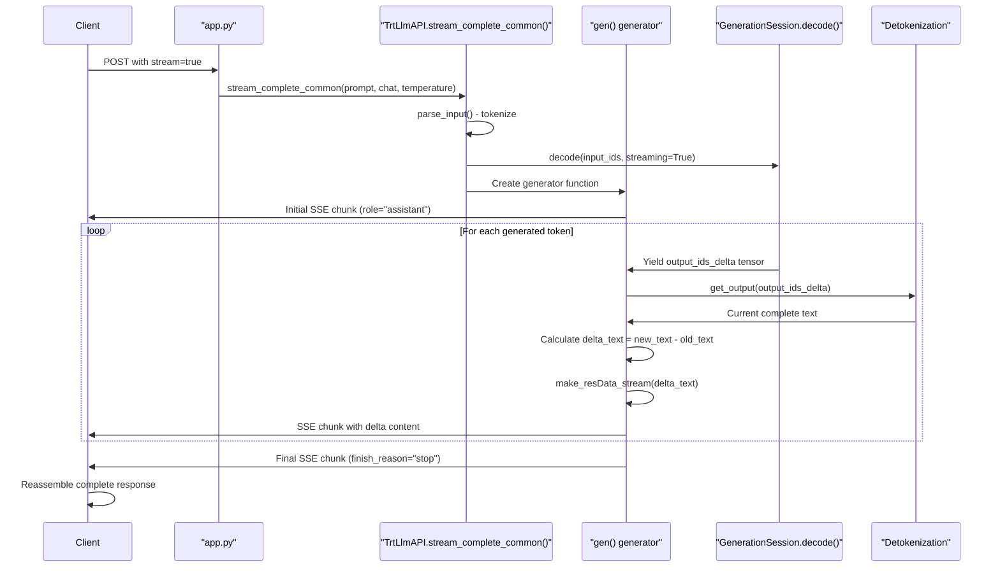
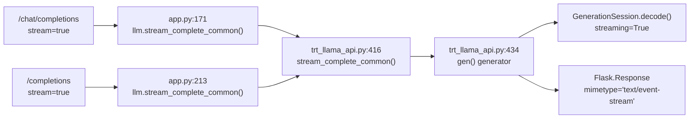

<!-- source: DeepWiki mcp.deepwiki.com · repo NVIDIA/trt-llm-as-openai-windows · page 4.6 Streaming Responses · fetched 2026-10-26 -->

# Streaming Responses

<details>
<summary>Relevant source files</summary>

The following files were used as context for generating this wiki page:

- [app.py](app.py)
- [trt_llama_api.py](trt_llama_api.py)

</details>


This document explains the technical implementation of streaming completions in the TensorRT-LLM OpenAI API server. Streaming allows clients to receive generated tokens incrementally as they are produced, rather than waiting for the complete response. This provides a better user experience by reducing perceived latency for long responses.

For information about the non-streaming request processing pipeline, see [Request Processing Pipeline](#4.5). For details on the API endpoints that support streaming, see [Chat Completions](#3.2) and [Text Completions](#3.3).

## Overview

Streaming mode is enabled via the `stream` parameter in API requests. When enabled, the server returns a series of partial responses using Server-Sent Events (SSE) format, allowing clients to display tokens as they are generated rather than waiting for the entire completion.

**Sources:** [app.py:168-171](), [trt_llama_api.py:416-481]()

## Enabling Streaming Mode

Streaming is controlled by a boolean `stream` field in the request body for both chat and text completion endpoints:

```json
{
  "prompt": "Explain quantum computing",
  "stream": true
}
```

The Flask application extracts this parameter and routes to the appropriate method:

| Endpoint | Non-Streaming Method | Streaming Method |
|----------|---------------------|------------------|
| `/chat/completions` | `complete_common()` | `stream_complete_common()` |
| `/completions` | `complete_common()` | `stream_complete_common()` |

The routing logic checks for the presence of the `stream` parameter using the `is_present()` helper function, which safely handles missing or null values.

**Sources:** [app.py:124-125](), [app.py:168-171](), [app.py:181-182](), [app.py:210-213]()

## Streaming vs Non-Streaming Comparison

```mermaid
graph TB
    subgraph NonStreaming["Non-Streaming Flow"]
        NS_Request["Request with stream=false"]
        NS_Decode["decode() returns complete tensor"]
        NS_Detok["Detokenize entire output"]
        NS_Format["make_resData()"]
        NS_Response["Single JSON response"]
        
        NS_Request --> NS_Decode
        NS_Decode --> NS_Detok
        NS_Detok --> NS_Format
        NS_Format --> NS_Response
    end
    
    subgraph Streaming["Streaming Flow"]
        S_Request["Request with stream=true"]
        S_Decode["decode(streaming=True) returns generator"]
        S_GenFunc["gen() generator function"]
        S_Loop["Loop over output_ids_delta"]
        S_Detok["Detokenize partial output"]
        S_Delta["Calculate delta text"]
        S_Format["make_resData_stream()"]
        S_Yield["Yield SSE chunk"]
        S_Response["Multiple SSE events"]
        
        S_Request --> S_Decode
        S_Decode --> S_GenFunc
        S_GenFunc --> S_Loop
        S_Loop --> S_Detok
        S_Detok --> S_Delta
        S_Delta --> S_Format
        S_Format --> S_Yield
        S_Yield --> S_Response
        S_Yield -.->|Next token| S_Loop
    end
```



**Sources:** [trt_llama_api.py:313-365](), [trt_llama_api.py:416-481]()

## Technical Implementation

### Generator Function Pattern

The streaming implementation uses Python generator functions to yield partial responses incrementally. The `stream_complete_common` method returns a Flask `Response` object wrapping a generator function named `gen()`:

```python
def gen() -> flask.Response:
    # Initial response
    yield 'data: {}\n'.format(json.dumps(resData))
    
    # Incremental responses
    for output_ids_delta in output_ids:
        # Process and yield delta
        yield 'data: {}\n'.format(json.dumps(resData))
    
    # Final response
    yield 'data: {}\n'.format(json.dumps(resData))

return flask.Response(gen(), mimetype='text/event-stream')
```

This pattern allows the Flask server to stream responses without buffering the entire output in memory.

**Sources:** [trt_llama_api.py:434-481]()

### TensorRT-LLM Streaming Decode

The critical difference between streaming and non-streaming at the TensorRT-LLM level is the `streaming=True` parameter passed to the `decode()` method:

```python
# Non-streaming (line 333)
output_ids = self._model.decode(input_ids, input_lengths, self._sampling_config)

# Streaming (line 432)
output_ids = self._model.decode(input_ids, input_lengths, self._sampling_config, streaming=True)
```

When `streaming=True`, the `decode()` method returns an iterator that yields partial output tensors after each token generation step, rather than returning a single complete tensor at the end.

**Sources:** [trt_llama_api.py:333](), [trt_llama_api.py:432]()

### Streaming Pipeline Diagram



**Sources:** [trt_llama_api.py:416-481](), [app.py:168-171]()

### Incremental Text Extraction

The streaming generator maintains state across iterations to calculate text deltas:

```python
text = ""  # Cumulative text from all tokens
for output_ids_delta in output_ids:
    output_txt, output_token_ids = self.get_output(output_ids_delta, ...)
    delta_text = output_txt[len(text):]  # Only the new text
    text = output_txt.removesuffix(EOS)  # Update cumulative
    
    dictForDelta["content"] = delta_text.removesuffix(EOS)
    yield 'data: {}\n'.format(json.dumps(resData))
```

This ensures each SSE event contains only the newly generated text, not the entire response up to that point. The `removesuffix(EOS)` call strips the EOS token string to prevent it from appearing in partial responses.

**Sources:** [trt_llama_api.py:454-467](), [utils.py:37]()

### Stop String Handling

The generator checks for stop strings in the accumulated text during streaming:

```python
for stop_string in stop_strings:
    if stop_string in text:
        dictForDelta["truncated"] = True
        break
```

When a stop string is detected, the `truncated` flag prevents further output chunks from being sent, even if the model continues generating tokens internally.

**Sources:** [trt_llama_api.py:469-472]()

## Response Format

### Server-Sent Events (SSE)

All streaming responses use the `text/event-stream` MIME type and follow the SSE protocol. Each chunk is prefixed with `data: ` and contains a JSON object:

```
data: {"id":"chatcmpl","object":"chat.completion.chunk",...}
data: {"id":"chatcmpl","object":"chat.completion.chunk",...}
data: {"id":"chatcmpl","object":"chat.completion.chunk",...}
```

The Flask response is constructed as:

```python
return flask.Response(gen(), mimetype='text/event-stream')
```

**Sources:** [trt_llama_api.py:481]()

### Streaming Response Structure

The `make_resData_stream()` function formats each streaming chunk differently than the non-streaming `make_resData()`:

| Field | Non-Streaming | Streaming |
|-------|--------------|-----------|
| `object` | `"chat.completion"` or `"text_completion"` | `"chat.completion.chunk"` or `"text_completion.chunk"` |
| Content field (chat) | `choices[0].message.content` | `choices[0].delta.content` |
| Content field (text) | `choices[0].text` | `choices[0].text` |
| `finish_reason` | Present in single response | `null` until final chunk |

The initial chunk in chat mode includes the role:

```json
{
  "choices": [{
    "delta": {"role": "assistant"},
    "finish_reason": null
  }]
}
```

Subsequent chunks contain only content deltas:

```json
{
  "choices": [{
    "delta": {"content": "The "},
    "finish_reason": null
  }]
}
```

The final chunk signals completion:

```json
{
  "choices": [{
    "delta": {"content": ""},
    "finish_reason": "stop"
  }]
}
```

**Sources:** [trt_llama_api.py:111-141](), [trt_llama_api.py:442-443](), [trt_llama_api.py:466-467](), [trt_llama_api.py:476-479]()

## Code Entity Reference

### Key Functions and Methods

| Entity | Location | Purpose |
|--------|----------|---------|
| `stream_complete_common()` | [trt_llama_api.py:416-481]() | Main streaming orchestration method |
| `stream_chat_complete()` | [trt_llama_api.py:413-414]() | Chat endpoint wrapper |
| `stream_complete()` | [trt_llama_api.py:410-412]() | Text completion endpoint wrapper |
| `gen()` | [trt_llama_api.py:434-481]() | Generator function that yields SSE chunks |
| `make_resData_stream()` | [trt_llama_api.py:111-141]() | Formats streaming response chunks |
| `get_output()` | [trt_llama_api.py:396-408]() | Detokenizes tensor to text |
| `parse_input()` | [trt_llama_api.py:367-386]() | Tokenizes input text |

### Request Flow Mapping



**Sources:** [app.py:117-171](), [app.py:174-213](), [trt_llama_api.py:416-481]()

## Performance Characteristics

Streaming mode has several performance implications:

1. **Time to First Token (TTFT)**: Identical to non-streaming mode, as tokenization and model setup are the same
2. **Perceived Latency**: Lower for end users, as they see output immediately rather than waiting for completion
3. **Memory Usage**: Lower peak memory usage, as the server doesn't buffer the complete response
4. **Network Overhead**: Higher total bytes transmitted due to SSE protocol overhead and repeated field names
5. **Client Complexity**: Clients must implement SSE parsing and response reassembly

The server runs in single-threaded mode (`threaded=False`), so streaming does not improve concurrent request throughput.

**Sources:** [app.py:217](), [trt_llama_api.py:432-481]()

---

