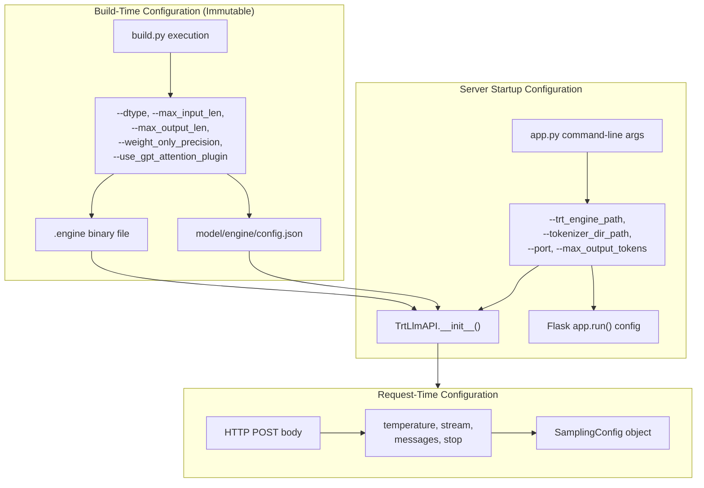
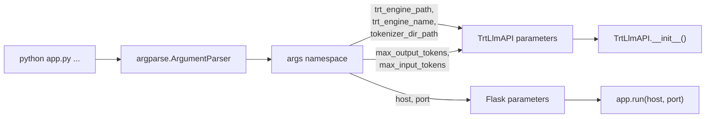
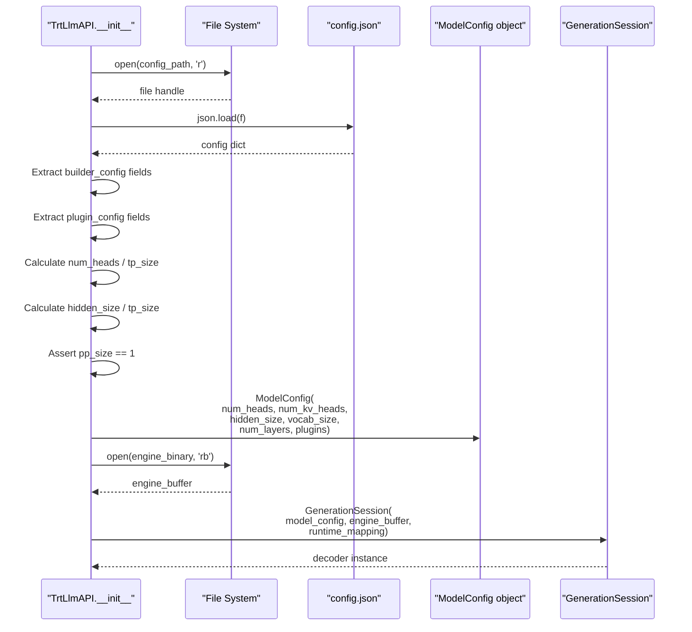
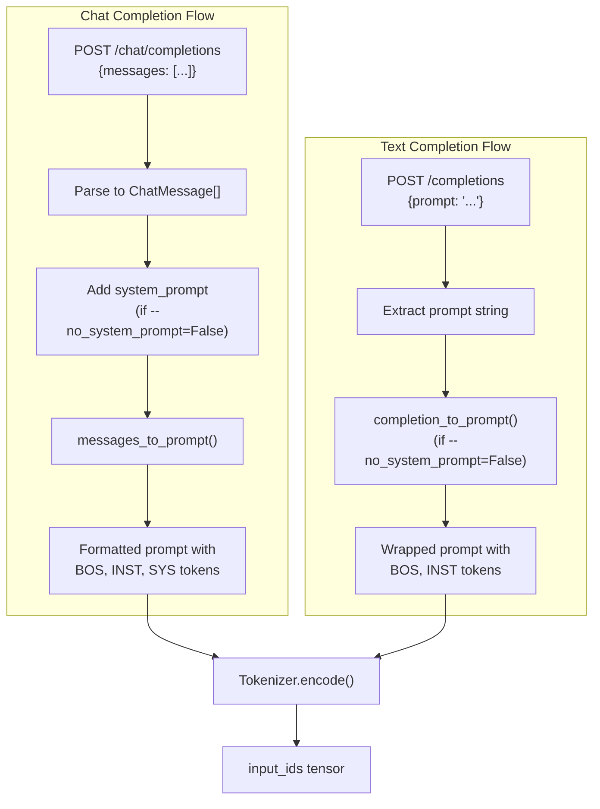

<!-- source: DeepWiki mcp.deepwiki.com · repo NVIDIA/trt-llm-as-openai-windows · page 5 Configuration Reference · fetched 2026-10-26 -->

# Configuration Reference

<details>
<summary>Relevant source files</summary>

The following files were used as context for generating this wiki page:

- [README.md](README.md)
- [app.py](app.py)
- [trt_llama_api.py](trt_llama_api.py)

</details>


This page documents all configuration options available in the TensorRT-LLM OpenAI API system. Configuration occurs at three distinct stages: engine build time, server startup time, and request time. This reference covers server command-line arguments, engine configuration files, and prompt formatting settings.

For instructions on building engines with specific parameters, see [Model Preparation](#2.2). For API request parameters, see [API Usage](#3). For implementation details of how configuration is processed, see [Architecture and Implementation](#4).

## Configuration Layers

The system uses a multi-layered configuration approach. Build-time parameters are compiled into the TensorRT engine and cannot be changed without rebuilding. Runtime parameters are specified when launching the server and remain fixed for the server's lifetime. Request-time parameters can vary per API call.



**Diagram: Configuration Lifecycle and Scope**

The diagram shows three configuration stages with different mutability. Build-time configuration is burned into the engine file and defines hardware-level optimizations. Server startup configuration loads the engine and sets operational parameters. Request-time configuration adjusts generation behavior per API call.

**Sources:** [README.md:38-45](), [app.py:22-86](), [trt_llama_api.py:188-273]()

---

## Server Configuration

Server configuration is specified via command-line arguments when launching `app.py`. All arguments control server behavior and cannot be modified without restarting the server process.

### Command-Line Arguments

The following table lists all arguments accepted by `app.py`:

| Argument | Required | Type | Default | Purpose |
|----------|----------|------|---------|---------|
| `--trt_engine_path` | Yes | string | - | Directory containing the compiled TensorRT engine and `config.json` |
| `--trt_engine_name` | Yes | string | - | Filename of the `.engine` binary (e.g., `llama_float16_tp1_rank0.engine`) |
| `--tokenizer_dir_path` | Yes | string | - | Directory containing HuggingFace tokenizer files (`tokenizer.json`, `tokenizer_config.json`, etc.) |
| `--host` | No | string | `127.0.0.1` | IP address for the Flask server to bind to |
| `--port` | No | integer | `8081` | TCP port for the Flask server to listen on |
| `--max_output_tokens` | No | integer | `2048` | Maximum number of tokens the model can generate per request |
| `--max_input_tokens` | No | integer | `2048` | Maximum number of input tokens accepted (context window size) |
| `--verbose` | No | boolean | `False` | Enable verbose logging of requests and inference timing |
| `--no_system_prompt` | No | boolean | `False` | Disable automatic system prompt injection (required for CodeLlama) |

**Sources:** [app.py:28-52]()

### Argument Processing Flow



**Diagram: Command-Line Argument Flow**

Arguments are parsed by `argparse` at [app.py:29-52](), then routed to two destinations. Engine-related arguments initialize the `TrtLlmAPI` instance at [app.py:75-85](). Server-related arguments configure Flask at [app.py:217]().

**Sources:** [app.py:22-86](), [app.py:217]()

### Configuration Example

Minimal configuration for Llama 2:
```bash
python app.py \
  --trt_engine_path model/engine \
  --trt_engine_name llama_float16_tp1_rank0.engine \
  --tokenizer_dir_path model/
```

CodeLlama configuration (requires `--no_system_prompt`):
```bash
python app.py \
  --trt_engine_path model/engine \
  --trt_engine_name llama_float16_tp1_rank0.engine \
  --tokenizer_dir_path model/ \
  --port 8081 \
  --no_system_prompt True
```

**Sources:** [README.md:64-76]()

### Token Limit Configuration

The `--max_input_tokens` and `--max_output_tokens` arguments define buffer sizes but do not override engine-compiled limits. The effective limits are constrained by the engine's `max_input_len` and `max_output_len` specified during `build.py` execution.

At [trt_llama_api.py:328](), the model is configured with:
```python
self._model.setup(input_lengths.size(0), max_input_length, self._max_new_tokens, 1)
```

The `self._max_new_tokens` value comes from the `--max_output_tokens` argument but cannot exceed the engine's compiled `max_output_len`.

**Sources:** [app.py:47-48](), [trt_llama_api.py:194-206](), [trt_llama_api.py:328]()

---

## Model and Engine Settings

Engine configuration is determined at build time and stored in two files: the compiled `.engine` binary and a `config.json` metadata file. Both files reside in the directory specified by `--trt_engine_path`.

### Engine Build Parameters

The engine is compiled using `build.py` from the TensorRT-LLM repository. Build parameters define model architecture, quantization, plugins, and context windows. These parameters are immutable after compilation.

#### CodeLlama Build Parameters

```bash
python build.py \
  --model_dir <path to CodeLlama model> \
  --quant_ckpt_path <path to .npz weights> \
  --dtype float16 \
  --remove_input_padding \
  --use_gpt_attention_plugin float16 \
  --enable_context_fmha \
  --use_gemm_plugin float16 \
  --use_weight_only \
  --weight_only_precision int4_awq \
  --per_group \
  --max_batch_size 1 \
  --max_input_len 15360 \
  --max_output_len 1024 \
  --output_dir <TRT engine folder> \
  --rotary_base 1000000 \
  --vocab_size 32064
```

#### Llama 2 Build Parameters

```bash
python build.py \
  --model_dir <path to Llama2 model> \
  --quant_ckpt_path <path to .npz weights> \
  --dtype float16 \
  --use_gpt_attention_plugin float16 \
  --use_gemm_plugin float16 \
  --use_weight_only \
  --weight_only_precision int4_awq \
  --per_group \
  --enable_context_fmha \
  --max_batch_size 1 \
  --max_input_len 3500 \
  --max_output_len 1024 \
  --output_dir <TRT engine folder>
```

**Sources:** [README.md:38-45]()

### Build Parameter Reference

| Parameter | Purpose | CodeLlama Value | Llama 2 Value |
|-----------|---------|----------------|---------------|
| `--dtype` | Activation precision | `float16` | `float16` |
| `--weight_only_precision` | Quantization method | `int4_awq` | `int4_awq` |
| `--max_input_len` | Maximum input tokens | `15360` | `3500` |
| `--max_output_len` | Maximum output tokens | `1024` | `1024` |
| `--max_batch_size` | Maximum concurrent requests | `1` | `1` |
| `--use_gpt_attention_plugin` | Enable optimized attention | `float16` | `float16` |
| `--enable_context_fmha` | Enable fused multi-head attention | enabled | enabled |
| `--use_gemm_plugin` | Enable optimized GEMM kernels | `float16` | `float16` |
| `--remove_input_padding` | Remove padding optimization | enabled | not enabled |
| `--rotary_base` | RoPE base frequency | `1000000` | default |
| `--vocab_size` | Vocabulary size | `32064` | default |

**Sources:** [README.md:38-45]()

### config.json Structure

The `config.json` file at `<trt_engine_path>/config.json` contains engine metadata loaded at [trt_llama_api.py:217-249](). The structure is:

```json
{
  "builder_config": {
    "num_heads": <int>,
    "hidden_size": <int>,
    "vocab_size": <int>,
    "num_layers": <int>,
    "num_kv_heads": <int>,
    "tensor_parallel": <int>,
    "pipeline_parallel": <int>
  },
  "plugin_config": {
    "gpt_attention_plugin": <dtype_string>,
    "remove_input_padding": <bool>,
    "paged_kv_cache": <bool>
  }
}
```

#### Configuration Fields

**`builder_config` Fields:**

| Field | Type | Purpose |
|-------|------|---------|
| `num_heads` | integer | Number of attention heads in the transformer |
| `hidden_size` | integer | Dimension of hidden layers |
| `vocab_size` | integer | Size of the token vocabulary |
| `num_layers` | integer | Number of transformer layers |
| `num_kv_heads` | integer | Number of key-value heads (for grouped-query attention) |
| `tensor_parallel` | integer | Tensor parallelism degree (must equal GPU count) |
| `pipeline_parallel` | integer | Pipeline parallelism degree (must be 1) |

**`plugin_config` Fields:**

| Field | Type | Purpose |
|-------|------|---------|
| `gpt_attention_plugin` | string | Attention plugin precision (`float16`, `float32`, or `false`) |
| `remove_input_padding` | boolean | Whether input padding removal is enabled |
| `paged_kv_cache` | boolean | Whether paged key-value cache is enabled |

**Sources:** [trt_llama_api.py:217-249]()

### Configuration Loading Process



**Diagram: Engine Configuration Loading Sequence**

Configuration loading occurs in `TrtLlmAPI.__init__` at [trt_llama_api.py:217-273](). The process reads `config.json`, validates parallelism settings, adjusts per-GPU parameters, creates a `ModelConfig` object, then deserializes the engine binary.

**Sources:** [trt_llama_api.py:217-273]()

### Parallelism Constraints

The system enforces specific parallelism constraints:

1. **Pipeline Parallelism:** Must be 1 (single pipeline stage)
   - Validated at [trt_llama_api.py:251](): `assert pp_size == 1`
   - Python runtime does not support multi-stage pipelines

2. **Tensor Parallelism:** Must match GPU count
   - Validated at [trt_llama_api.py:227-228]():
   ```python
   assert world_size == tensorrt_llm.mpi_world_size()
   ```

3. **World Size:** `world_size = tp_size * pp_size`
   - Must equal the number of available GPUs

**Sources:** [trt_llama_api.py:224-259]()

---

## Prompt Customization

Prompt formatting determines how API requests are converted to LLM input. The system uses special delimiter tokens to structure prompts for instruction-tuned models.

### System Prompt Configuration

The `--no_system_prompt` flag controls whether a default system prompt is automatically prepended to requests.

**Default Behavior (Llama 2):**
- System prompt is enabled
- `DEFAULT_SYSTEM_PROMPT` from [utils.py]() is prepended
- Applied at [app.py:154-156]()

**CodeLlama Configuration:**
- System prompt must be disabled
- Specified with `--no_system_prompt True`
- Prevents injection at [app.py:155-156]()

**Sources:** [app.py:49](), [app.py:72](), [app.py:154-156]()

### Delimiter Tokens

Prompt formatting uses model-specific delimiter tokens defined in `utils.py`. These tokens structure the conversation format expected by instruction-tuned models.

| Token | Value | Purpose |
|-------|-------|---------|
| `BOS` | `<s>` | Beginning of sequence |
| `EOS` | `</s>` | End of sequence |
| `B_INST` | `[INST]` | Begin instruction |
| `E_INST` | `[/INST]` | End instruction |
| `B_SYS` | `<<SYS>>\n` | Begin system message |
| `E_SYS` | `\n<</SYS>>\n\n` | End system message |

These tokens are not configurable via command-line arguments. To modify them, edit the constants at [utils.py:8-13]().

**Sources:** [utils.py:8-13]()

### Prompt Formatting Functions

The system provides two formatting functions in `utils.py`:

#### messages_to_prompt

Used for chat completions. Converts a list of `ChatMessage` objects to a formatted prompt string.

**Function Signature:**
```python
def messages_to_prompt(messages: Sequence[ChatMessage], system_prompt: str = "") -> str
```

**Format Structure:**
```
<s>[INST] <<SYS>>
{system_prompt}
<</SYS>>

{user_message_1} [/INST] {assistant_response_1} </s><s>[INST] {user_message_2} [/INST]
```

**Location:** [utils.py:59-94]()

#### completion_to_prompt

Used for text completions. Wraps a raw prompt string with delimiters.

**Function Signature:**
```python
def completion_to_prompt(completion: str) -> str
```

**Format Structure:**
```
<s>[INST] {completion} [/INST]
```

**Location:** [utils.py:97-102]()

**Sources:** [utils.py:59-102]()

### Formatting Flow Diagram



**Diagram: Prompt Formatting Paths**

Chat completions follow a multi-step formatting process at [app.py:133-160](), while text completions use simpler wrapping at [app.py:193-208](). Both paths ultimately produce tokenizable strings with appropriate delimiters.

**Sources:** [app.py:117-171](), [app.py:174-213](), [utils.py:59-102]()

### Customizing Prompt Format

To modify prompt formatting behavior, edit the formatting functions in `utils.py`:

1. **Change Delimiter Tokens:** Modify constants at [utils.py:8-13]()
2. **Alter Chat Format:** Modify `messages_to_prompt` at [utils.py:59-94]()
3. **Alter Completion Format:** Modify `completion_to_prompt` at [utils.py:97-102]()

After modifications, restart the server to apply changes. Note that delimiter tokens must match the model's training format to generate coherent responses.

**Sources:** [utils.py:8-13](), [utils.py:59-102]()

---

## Request-Time Parameters

While not server configuration, the following parameters can be specified per-request in the API body:

| Parameter | Endpoint | Type | Default | Purpose |
|-----------|----------|------|---------|---------|
| `temperature` | Both | float | `1.0` | Sampling temperature (higher = more random) |
| `stream` | Both | boolean | `false` | Enable streaming responses |
| `stop` | `/completions` | string[] | `[]` | Stop generation when these strings appear |
| `messages` | `/chat/completions` | array | required | Conversation messages |
| `prompt` | `/completions` | string | required | Raw text prompt |

Request parameters are processed at [app.py:122-127]() and [app.py:178-188](), then passed to `complete_common` at [app.py:169]() or `stream_complete_common` at [app.py:171]().

Temperature is applied to `SamplingConfig` at [trt_llama_api.py:332]():
```python
self._sampling_config.temperature = temperature
```

**Sources:** [app.py:117-213](), [trt_llama_api.py:313-365](), [trt_llama_api.py:416-481]()

---

