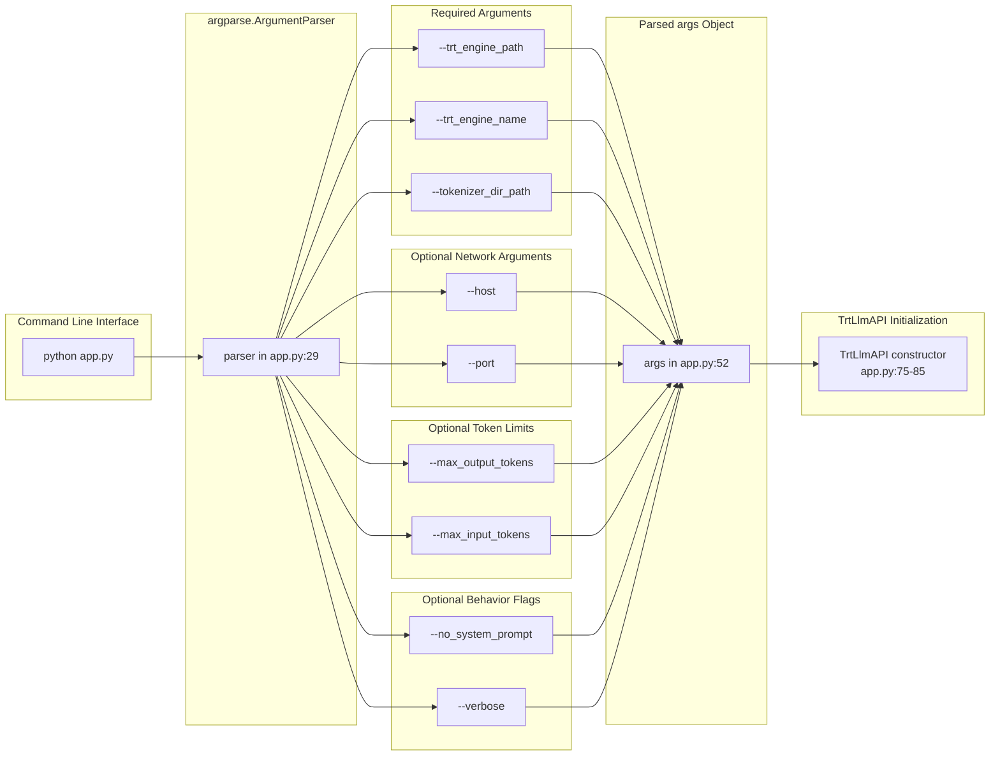
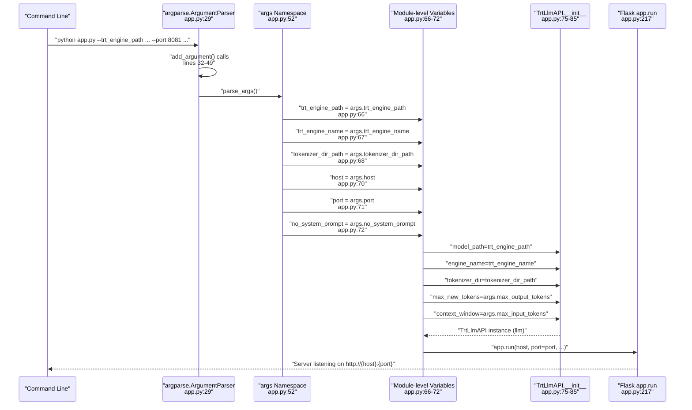

<!-- source: DeepWiki mcp.deepwiki.com · repo NVIDIA/trt-llm-as-openai-windows · page 5.1 Server Configuration · fetched 2026-10-26 -->

# Server Configuration

<details>
<summary>Relevant source files</summary>

The following files were used as context for generating this wiki page:

- [README.md](README.md)
- [app.py](app.py)

</details>


## Purpose and Scope

This document provides a comprehensive reference for all command-line arguments accepted by `app.py`, the Flask-based HTTP server that exposes the TensorRT-LLM inference backend as an OpenAI-compatible API. These configuration options control critical runtime behavior including model loading, network binding, token limits, and prompt formatting.

For information about the model and engine build parameters that affect the compiled TensorRT engine files, see [Model and Engine Settings](#5.2). For customization of prompt formatting behavior, see [Prompt Customization](#5.3).

**Sources:** [README.md:98-113](), [app.py:22-52]()

---

## Configuration Overview

The server is launched using the `app.py` script with command-line arguments that specify paths to model artifacts and runtime behavior settings. All arguments are passed via the standard `argparse` interface defined in [app.py:22-52]().



**Diagram: Command-line argument parsing and flow into system initialization**

**Sources:** [app.py:22-52](), [app.py:65-85]()

---

## Required Arguments

The following three arguments must be provided when launching the server. Omitting any of these will cause the argument parser to fail with an error.

### --trt_engine_path

| Property | Value |
|----------|-------|
| Type | `str` |
| Required | Yes |
| Default | `""` (empty string) |
| Code Reference | [app.py:32-33]() |
| Used By | [app.py:66](), [app.py:76]() |

Specifies the directory containing the compiled TensorRT engine files. This directory typically corresponds to the output directory specified during the `build.py` execution (see [Building TensorRT Engines](#2.2.2)). The path should point to a directory, not a specific file.

**Example Values:**
- `model/engine/`
- `C:\models\codellama\engine\`
- `./trt_engines/llama2_13b/`

The specified directory must contain:
1. The `.engine` binary file (name specified by `--trt_engine_name`)
2. A `config.json` file describing the model architecture (loaded by `TrtLlmAPI.__init__` at [trt_llama_api.py:133-147]())

**Sources:** [app.py:32-33](), [README.md:107](), [app.py:76]()

---

### --trt_engine_name

| Property | Value |
|----------|-------|
| Type | `str` |
| Required | Yes |
| Default | `""` (empty string) |
| Code Reference | [app.py:34-35]() |
| Used By | [app.py:67](), [app.py:77]() |

Specifies the filename of the compiled TensorRT engine binary within the directory specified by `--trt_engine_path`. This is the `.engine` file produced by the TensorRT-LLM `build.py` script.

**Typical Values:**
- `llama_float16_tp1_rank0.engine` (single-GPU, float16 dtype)
- `codellama_float16_tp1_rank0.engine`
- `llama_float16_tp2_rank0.engine` (tensor parallel rank 0)

The engine name format typically follows the pattern: `{model}_{dtype}_tp{tensor_parallel_size}_rank{rank}.engine`

**Important:** The engine file is GPU-architecture specific and cannot be transferred between different GPU models (e.g., an engine built on an RTX 4090 will not run on an A100).

**Sources:** [app.py:34-35](), [README.md:108](), [README.md:75]()

---

### --tokenizer_dir_path

| Property | Value |
|----------|-------|
| Type | `str` |
| Required | Yes |
| Default | `""` (empty string) |
| Code Reference | [app.py:36-37]() |
| Used By | [app.py:68](), [app.py:78]() |

Specifies the directory containing the Hugging Face tokenizer files and model configuration. This directory should be populated by downloading files from the appropriate Hugging Face model repository:
- [CodeLlama-13b-Instruct-hf](https://huggingface.co/codellama/CodeLlama-13b-Instruct-hf/tree/main)
- [Llama-2-13b-chat-hf](https://huggingface.co/meta-llama/Llama-2-13b-chat-hf/tree/main)

**Required Files in Directory:**
- `tokenizer_config.json`
- `tokenizer.json`
- `special_tokens_map.json`
- `config.json` (model metadata)

The tokenizer is loaded using Hugging Face's `AutoTokenizer.from_pretrained()` in [trt_llama_api.py:163-164]().

**Example Values:**
- `model/`
- `C:\huggingface\codellama-13b\`

**Sources:** [app.py:36-37](), [README.md:109](), [README.md:54-56]()

---

## Optional Arguments

### Network Configuration

#### --host

| Property | Value |
|----------|-------|
| Type | `str` |
| Required | No |
| Default | `'127.0.0.1'` |
| Code Reference | [app.py:44]() |
| Used By | [app.py:70](), [app.py:217]() |

Specifies the IP address on which the Flask server will listen for incoming HTTP connections. 

**Common Values:**
- `127.0.0.1` (localhost only, default)
- `0.0.0.0` (all network interfaces)
- Specific IP address for multi-homed systems

The value is passed directly to Flask's `app.run()` method at [app.py:217]().

**Security Note:** Using `0.0.0.0` exposes the server to all network interfaces. Since this server does not implement authentication, binding to `0.0.0.0` on a networked machine exposes the API to other machines on the network.

**Sources:** [app.py:44](), [app.py:70](), [app.py:217]()

---

#### --port

| Property | Value |
|----------|-------|
| Type | `int` |
| Required | No |
| Default | `8081` |
| Code Reference | [app.py:45]() |
| Used By | [app.py:71](), [app.py:217]() |

Specifies the TCP port on which the Flask server will listen.

**Example Values:**
- `8081` (default)
- `8080`
- `5000` (Flask's traditional default)

The port value is passed to Flask's `app.run()` at [app.py:217](). Multiple instances of the server can run simultaneously on different ports if using different engine files.

**Sources:** [app.py:45](), [README.md:110](), [README.md:75]()

---

### Token Limits

#### --max_output_tokens

| Property | Value |
|----------|-------|
| Type | `int` |
| Required | No |
| Default | `2048` |
| Code Reference | [app.py:47]() |
| Used By | [app.py:80]() |

Specifies the maximum number of tokens that can be generated in a single completion response. This value is passed to the `TrtLlmAPI` constructor as the `max_new_tokens` parameter at [app.py:80]().

**Constraints:**
- Must not exceed the `max_output_len` specified during engine compilation (see [Building TensorRT Engines](#2.2.2))
- For CodeLlama engines built per README instructions: limit is 1024 tokens ([README.md:40]())
- For Llama2 engines built per README instructions: limit is 1024 tokens ([README.md:44]())

If a request attempts to generate more tokens than this limit, generation will stop at the limit.

**Sources:** [app.py:47](), [app.py:80](), [README.md:111]()

---

#### --max_input_tokens

| Property | Value |
|----------|-------|
| Type | `int` |
| Required | No |
| Default | `2048` |
| Code Reference | [app.py:48]() |
| Used By | [app.py:81]() |

Specifies the maximum context window size (maximum number of input tokens). This value is passed to the `TrtLlmAPI` constructor as the `context_window` parameter at [app.py:81]().

**Constraints:**
- Must not exceed the `max_input_len` specified during engine compilation
- For CodeLlama engines: can be up to 15360 tokens ([README.md:40]())
- For Llama2 engines: can be up to 3500 tokens ([README.md:44]())

If a request's prompt exceeds this token count after tokenization, the request may fail or the prompt may be truncated depending on the TensorRT-LLM backend behavior.

**Performance Note:** Larger context windows require more GPU memory during inference. The engine must be built with a `max_input_len` at least as large as this value.

**Sources:** [app.py:48](), [app.py:81](), [README.md:112]()

---

### Behavior Flags

#### --no_system_prompt

| Property | Value |
|----------|-------|
| Type | `bool` |
| Required | No |
| Default | `False` |
| Code Reference | [app.py:49]() |
| Used By | [app.py:72](), [app.py:155-156](), [app.py:205-206]() |

Controls whether the server automatically prepends a system prompt to chat completion requests. When `False` (default), the `DEFAULT_SYSTEM_PROMPT` from `utils.py` is prepended to the formatted prompt for chat completions at [app.py:155-156](). When `True`, no implicit system prompt is added.

**Usage:**
- **Llama-2-13b-chat:** Should be `False` (default behavior)
- **CodeLlama-13b-Instruct:** Should be `True` ([README.md:69-72]())

The flag affects:
1. Chat completions endpoint ([app.py:155-156]())
2. Text completions endpoint ([app.py:205-206]())

When enabled (`True`), the system relies on the client to include any necessary system messages in the request's `messages` array.

**Sources:** [app.py:49](), [app.py:72](), [app.py:155-156](), [app.py:205-206](), [README.md:69-72](), [README.md:113]()

---

#### --verbose

| Property | Value |
|----------|-------|
| Type | `bool` |
| Required | No |
| Default | `False` |
| Code Reference | [app.py:38-39]() |
| Used By | [app.py:69](), [app.py:84](), [app.py:129-130](), [app.py:164-166](), [app.py:190-191]() |

Enables verbose logging to stdout. When `True`, the server prints:
- Endpoint invocation messages ([app.py:129-130](), [app.py:190-191]())
- Input prompt size and content ([app.py:164-166]())
- Whether streaming is enabled for the request

This flag is useful for debugging request handling and understanding prompt formatting. The verbose output appears in the console where `app.py` is running.

**Note:** This flag is passed to `TrtLlmAPI` constructor but is hardcoded to `False` at [app.py:84](), meaning TensorRT-LLM internal verbose logging is always disabled regardless of this command-line flag.

**Sources:** [app.py:38-39](), [app.py:69](), [app.py:84](), [app.py:129-130](), [app.py:164-166]()

---

## Configuration Argument Flow

The following diagram traces how command-line arguments are parsed, stored, and ultimately used to initialize the inference system:



**Diagram: Configuration argument processing sequence**

**Sources:** [app.py:22-52](), [app.py:66-85](), [app.py:217]()

---

## Complete Configuration Examples

### Example 1: Llama-2-13b-chat (Standard Configuration)

```bash
python app.py \
  --trt_engine_path model/engine \
  --trt_engine_name llama_float16_tp1_rank0.engine \
  --tokenizer_dir_path model/ \
  --port 8081
```

This configuration:
- Uses default system prompt behavior (appropriate for Llama-2-chat)
- Binds to localhost only (`127.0.0.1`)
- Uses default token limits (2048 input, 2048 output)
- Disables verbose logging

**Sources:** [README.md:64-67]()

---

### Example 2: CodeLlama-13b-Instruct (No System Prompt)

```bash
python app.py \
  --trt_engine_path model/ \
  --trt_engine_name llama_float16_tp1_rank0.engine \
  --tokenizer_dir_path model/ \
  --port 8081 \
  --no_system_prompt True
```

This configuration:
- Disables automatic system prompt insertion (required for CodeLlama)
- Otherwise uses default settings

**Sources:** [README.md:69-76]()

---

### Example 3: Extended Context and Custom Port

```bash
python app.py \
  --trt_engine_path model/engine \
  --trt_engine_name llama_float16_tp1_rank0.engine \
  --tokenizer_dir_path model/ \
  --port 5000 \
  --max_input_tokens 4096 \
  --max_output_tokens 1024 \
  --verbose True
```

This configuration:
- Uses port 5000 instead of default 8081
- Extends input context window to 4096 tokens
- Limits output to 1024 tokens
- Enables verbose logging

**Note:** The `max_input_tokens` value must not exceed the `max_input_len` used during engine compilation.

**Sources:** [app.py:44-49](), [README.md:98-113]()

---

## Configuration Validation and Error Handling

The argument parser performs minimal validation at [app.py:52](). Additional validation occurs during `TrtLlmAPI` initialization:

| Validation Type | Location | Error Condition |
|----------------|----------|-----------------|
| Required arguments present | [app.py:32-37]() | Parser fails if `--trt_engine_path`, `--trt_engine_name`, or `--tokenizer_dir_path` missing |
| Engine directory exists | [trt_llama_api.py:133-134]() | `TrtLlmAPI.__init__` fails if `config.json` not found in engine path |
| Tokenizer directory valid | [trt_llama_api.py:163-164]() | `AutoTokenizer.from_pretrained()` fails if tokenizer files missing |
| Pipeline parallelism disabled | [trt_llama_api.py:157-158]() | Assertion fails if `pp_size != 1` in engine config |

**Sources:** [app.py:32-52](), [trt_llama_api.py:133-158]()

---

## Flask Server Configuration

Beyond command-line arguments, the Flask server has hardcoded configuration at [app.py:217]():

```python
app.run(host, port=port, debug=True, use_reloader=False, threaded=False)
```

| Parameter | Value | Rationale |
|-----------|-------|-----------|
| `debug` | `True` | Enables Flask debug mode and automatic error pages |
| `use_reloader` | `False` | Disables automatic reloading on code changes (prevents TensorRT engine reload issues) |
| `threaded` | `False` | Forces single-threaded request handling (likely due to TensorRT-LLM thread-safety constraints) |

The `threaded=False` configuration means requests are processed sequentially. Concurrent requests will queue and wait for previous requests to complete. This design choice prevents potential race conditions or GPU memory conflicts in the TensorRT runtime.

**Sources:** [app.py:217]()

---

## Summary Table: All Configuration Arguments

| Argument | Type | Required | Default | Purpose |
|----------|------|----------|---------|---------|
| `--trt_engine_path` | `str` | Yes | `""` | Directory containing TensorRT engine |
| `--trt_engine_name` | `str` | Yes | `""` | Filename of `.engine` binary |
| `--tokenizer_dir_path` | `str` | Yes | `""` | Directory containing HF tokenizer files |
| `--host` | `str` | No | `'127.0.0.1'` | IP address for server binding |
| `--port` | `int` | No | `8081` | TCP port for server listening |
| `--max_output_tokens` | `int` | No | `2048` | Maximum tokens to generate |
| `--max_input_tokens` | `int` | No | `2048` | Maximum input context size |
| `--no_system_prompt` | `bool` | No | `False` | Skip automatic system prompt insertion |
| `--verbose` | `bool` | No | `False` | Enable detailed logging to stdout |

**Sources:** [app.py:22-52](), [README.md:103-113]()

---

