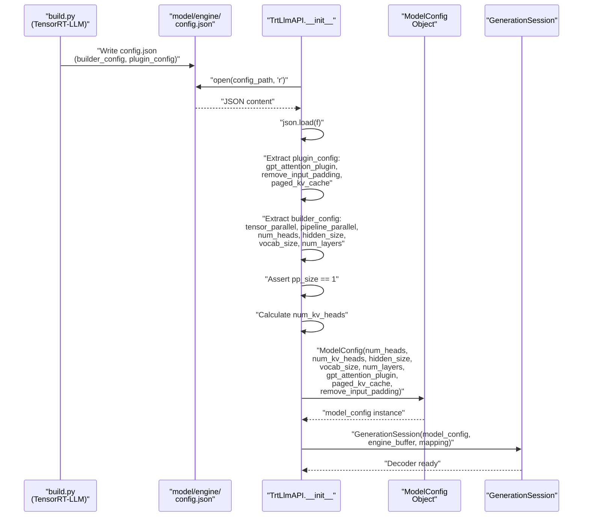
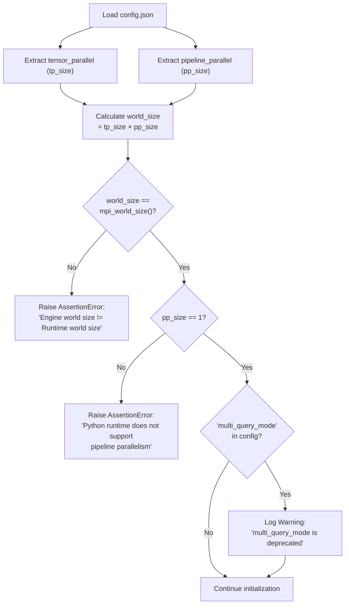
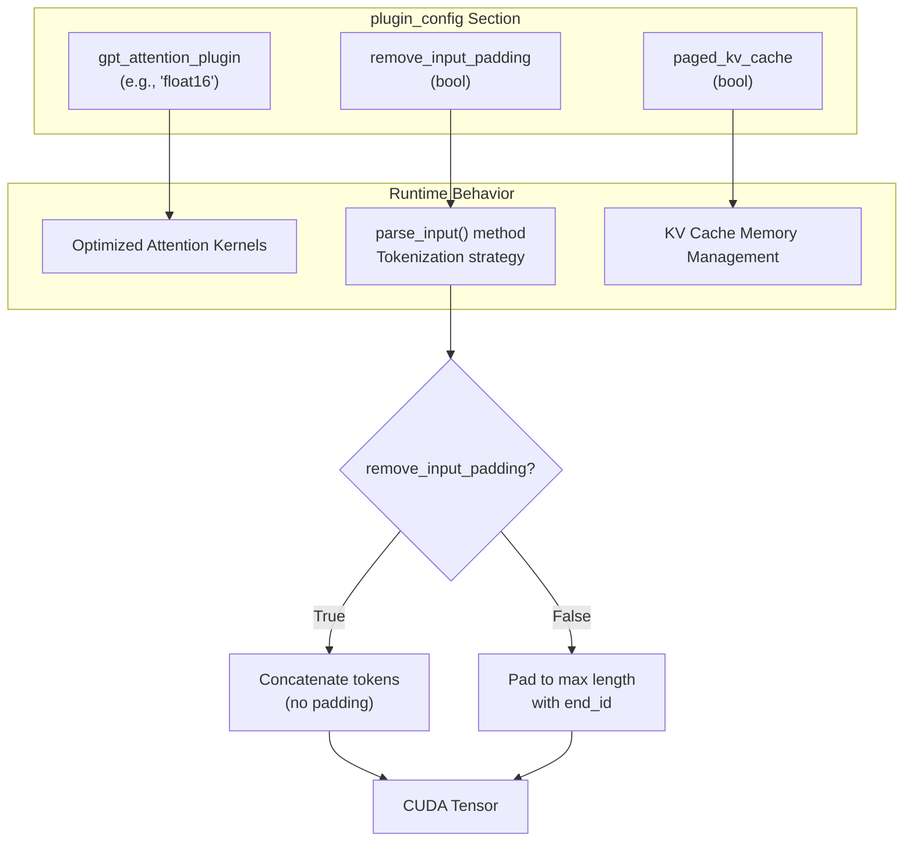
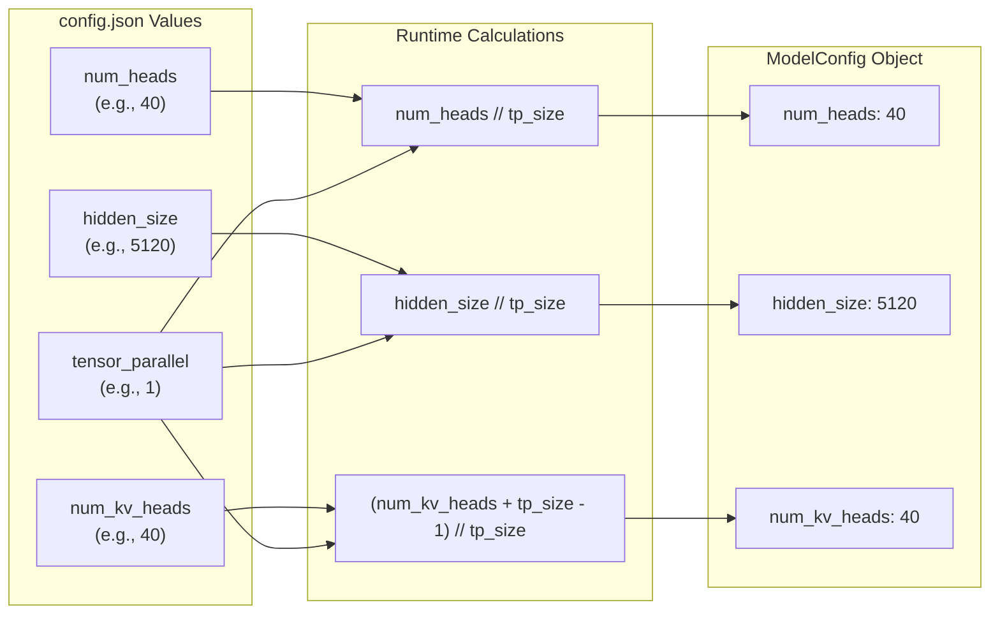
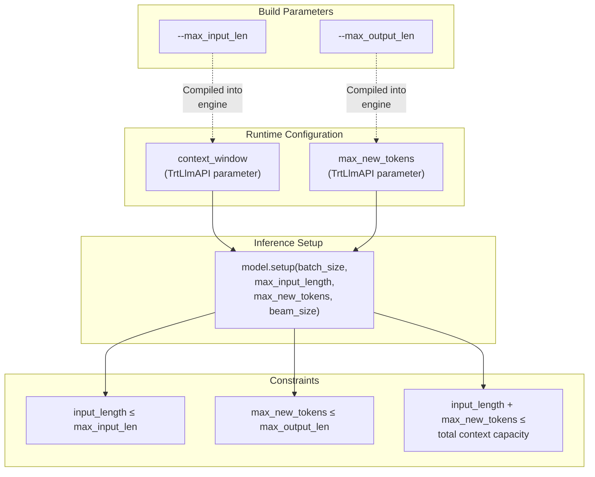
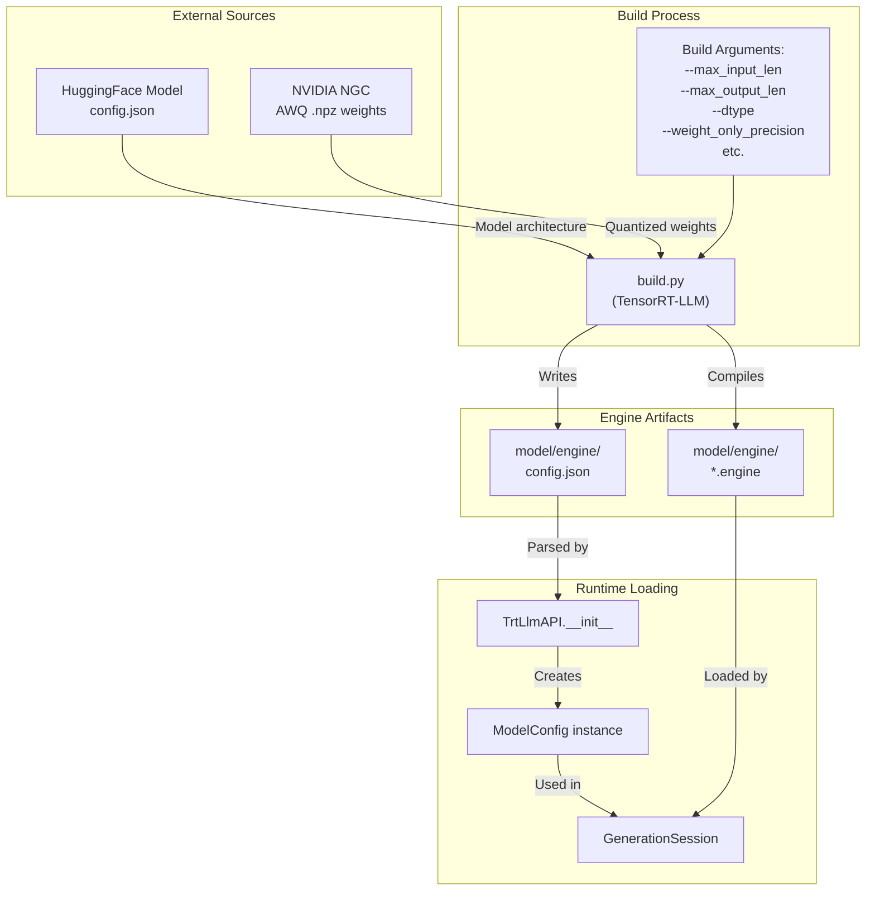

<!-- source: DeepWiki mcp.deepwiki.com · repo NVIDIA/trt-llm-as-openai-windows · page 5.2 Model and Engine Settings · fetched 2026-10-26 -->

# Model and Engine Settings

<details>
<summary>Relevant source files</summary>

The following files were used as context for generating this wiki page:

- [README.md](README.md)
- [trt_llama_api.py](trt_llama_api.py)

</details>


This page documents the configuration files and build parameters that control TensorRT engine behavior and model architecture settings. These settings are determined during the offline engine build process and cannot be changed at runtime without rebuilding the engine.

For server launch parameters and command-line arguments, see [Server Configuration](#5.1). For customizing prompt formatting behavior, see [Prompt Customization](#5.3).

---

## Configuration File Overview

The TensorRT engine directory contains a `config.json` file that stores metadata about the compiled engine. This file is automatically generated during the `build.py` compilation process and is loaded by `TrtLlmAPI` during server initialization.

**Configuration File Loading Flow**



**Sources:** [trt_llama_api.py:217-273]()

---

## Configuration File Structure

The `config.json` file contains two primary sections: `builder_config` and `plugin_config`. These sections define the model architecture and optimization strategies used during engine compilation.

### Key Configuration Fields

| Field Path | Type | Description | Impact on Runtime |
|------------|------|-------------|-------------------|
| `builder_config.tensor_parallel` | int | Number of GPUs for tensor parallelism | Must match runtime GPU count; world_size = tp_size × pp_size |
| `builder_config.pipeline_parallel` | int | Pipeline parallelism degree | **Must be 1** - pipeline parallelism unsupported in Python runtime |
| `builder_config.num_heads` | int | Number of attention heads | Divided by tp_size for per-GPU allocation |
| `builder_config.hidden_size` | int | Model hidden dimension size | Divided by tp_size for per-GPU allocation |
| `builder_config.vocab_size` | int | Vocabulary size of tokenizer | Must match tokenizer vocabulary |
| `builder_config.num_layers` | int | Number of transformer layers | Defines model depth |
| `builder_config.num_kv_heads` | int | Number of key-value heads (GQA) | Falls back to num_heads if not specified |
| `builder_config.multi_query_mode` | bool | Legacy MQA setting | **Deprecated** - rebuild engine if present |
| `plugin_config.gpt_attention_plugin` | str/bool | Attention plugin dtype (e.g., "float16") | Enables optimized attention kernels |
| `plugin_config.remove_input_padding` | bool | Remove padding from input tensors | Affects tokenization in `parse_input()` |
| `plugin_config.paged_kv_cache` | bool | Enable paged KV cache | Optimizes memory usage for KV cache |

**Sources:** [trt_llama_api.py:220-249]()

### Configuration Validation

The initialization process performs several validation checks:



**Sources:** [trt_llama_api.py:227-251]()

---

## Engine Build Parameters

The TensorRT engine is compiled using `build.py` from the TensorRT-LLM repository. Build parameters directly determine the contents of `config.json` and the engine's runtime characteristics.

### CodeLlama-13B Build Parameters

```bash
python build.py \
  --model_dir <path to CodeLlama model> \
  --quant_ckpt_path <path to CodeLlama .npz file> \
  --dtype float16 \
  --remove_input_padding \
  --use_gpt_attention_plugin float16 \
  --enable_context_fmha \
  --use_gemm_plugin float16 \
  --use_weight_only \
  --weight_only_precision int4_awq \
  --per_group \
  --max_batch_size 1 \
  --max_input_len 15360 \
  --max_output_len 1024 \
  --output_dir <TRT engine folder> \
  --rotary_base 1000000 \
  --vocab_size 32064
```

### Llama-2-13B Build Parameters

```bash
python build.py \
  --model_dir <path to llama13_chat model> \
  --quant_ckpt_path <path to Llama2 .npz file> \
  --dtype float16 \
  --use_gpt_attention_plugin float16 \
  --use_gemm_plugin float16 \
  --use_weight_only \
  --weight_only_precision int4_awq \
  --per_group \
  --enable_context_fmha \
  --max_batch_size 1 \
  --max_input_len 3500 \
  --max_output_len 1024 \
  --output_dir <TRT engine folder>
```

**Sources:** [README.md:38-45]()

### Build Parameter Reference

| Parameter | CodeLlama Value | Llama-2 Value | Purpose |
|-----------|-----------------|---------------|---------|
| `--dtype` | float16 | float16 | Base precision for non-quantized layers |
| `--max_input_len` | 15360 | 3500 | Maximum input context length in tokens |
| `--max_output_len` | 1024 | 1024 | Maximum generation length in tokens |
| `--max_batch_size` | 1 | 1 | Maximum batch size (single request processing) |
| `--weight_only_precision` | int4_awq | int4_awq | AWQ 4-bit weight quantization |
| `--per_group` | ✓ | ✓ | Group-wise quantization for AWQ |
| `--use_gpt_attention_plugin` | float16 | float16 | Optimized attention kernel precision |
| `--use_gemm_plugin` | float16 | float16 | Optimized GEMM operations |
| `--enable_context_fmha` | ✓ | ✓ | Flash Multi-Head Attention for context |
| `--remove_input_padding` | ✓ | ✗ | Remove padding tokens from input (CodeLlama only) |
| `--rotary_base` | 1000000 | (default) | RoPE base frequency for extended context |
| `--vocab_size` | 32064 | (default) | Vocabulary size override |

**Sources:** [README.md:38-45]()

---

## Plugin Configuration

TensorRT-LLM plugins are optimized kernels that accelerate specific operations. The `plugin_config` section of `config.json` determines which plugins are enabled.

**Plugin Configuration Impact**



**Sources:** [trt_llama_api.py:222-249](), [trt_llama_api.py:367-386]()

### Plugin Details

**GPT Attention Plugin** (`gpt_attention_plugin`)
- Enables fused multi-head attention kernels
- Specified as dtype string (e.g., `"float16"`) or boolean
- Used in `ModelConfig` initialization: [trt_llama_api.py:247]()

**Remove Input Padding** (`remove_input_padding`)
- Eliminates padding tokens from input tensors
- Reduces memory usage and computation for variable-length inputs
- Affects `parse_input()` method behavior:
  - If `True`: Uses `np.concatenate()` without padding [trt_llama_api.py:378-380]()
  - If `False`: Uses `torch.nested.to_padded_tensor()` [trt_llama_api.py:382-384]()

**Paged KV Cache** (`paged_kv_cache`)
- Enables memory-efficient paging for key-value cache
- Reduces memory fragmentation during inference
- Passed to `ModelConfig`: [trt_llama_api.py:248]()

**Sources:** [trt_llama_api.py:222-249](), [trt_llama_api.py:367-386]()

---

## Model Architecture Settings

The `builder_config` section defines the transformer architecture parameters. These settings must match the source model architecture from HuggingFace.

### Architecture Parameter Calculation



**Sources:** [trt_llama_api.py:229-240]()

### Grouped Query Attention (GQA)

The `num_kv_heads` field enables Grouped Query Attention, where multiple query heads share the same key-value heads:

- If `num_kv_heads < num_heads`: GQA is used (memory-efficient)
- If `num_kv_heads == num_heads`: Standard multi-head attention (MHA)
- If `multi_query_mode == True`: Legacy mode, forces `num_kv_heads = 1` (deprecated)

**Sources:** [trt_llama_api.py:233-240]()

---

## Runtime Constraints and Validation

Several constraints are enforced during initialization to ensure correct operation:

### Constraint Table

| Constraint | Check Location | Error Message | Reason |
|------------|----------------|---------------|--------|
| `pp_size == 1` | [trt_llama_api.py:251]() | "Python runtime does not support pipeline parallelism" | Python runtime limitation |
| `world_size == mpi_world_size()` | [trt_llama_api.py:227-228]() | "Engine world size != Runtime world size" | GPU count mismatch |
| `model_path` exists | [trt_llama_api.py:209-213]() | "Provided model path does not exist" | Invalid engine directory |

### World Size Calculation

```python
# From trt_llama_api.py:224-226
tp_size = config['builder_config']['tensor_parallel']
pp_size = config['builder_config']['pipeline_parallel']
world_size = tp_size * pp_size
```

The `world_size` must equal the number of GPUs available at runtime. This is verified using `tensorrt_llm.mpi_world_size()`.

**Sources:** [trt_llama_api.py:224-228](), [trt_llama_api.py:251]()

---

## Context Window and Token Limits

The engine build parameters `--max_input_len` and `--max_output_len` determine the maximum context window and generation length. These limits are **hard constraints** enforced by the compiled engine and cannot be exceeded at runtime.

### Token Limit Configuration



**Sources:** [README.md:38-45](), [trt_llama_api.py:328](), [app.py:32-44]()

### Model-Specific Limits

| Model | max_input_len | max_output_len | Total Context | Reason for Limits |
|-------|---------------|----------------|---------------|-------------------|
| CodeLlama-13B | 15360 | 1024 | 16384 | Extended context with rotary_base=1000000 |
| Llama-2-13B | 3500 | 1024 | 4524 | Standard context window |

The CodeLlama model uses a larger `max_input_len` value combined with `--rotary_base 1000000` to support extended context windows for code completion tasks.

**Sources:** [README.md:38-45]()

### Runtime Token Management

During inference, the system manages tokens as follows:

1. **Input Processing**: [trt_llama_api.py:323-325]()
   ```python
   input_ids, input_lengths = self.parse_input(input_text, self._tokenizer,
                                                EOS_TOKEN,
                                                self._model_config)
   max_input_length = torch.max(input_lengths).item()
   ```

2. **Setup Phase**: [trt_llama_api.py:328]()
   ```python
   self._model.setup(input_lengths.size(0), max_input_length, 
                     self._max_new_tokens, 1)  # beam size = 1
   ```

3. **Output Extraction**: [trt_llama_api.py:402-403]()
   ```python
   output_begin = input_lengths[b]
   output_end = input_lengths[b] + max_output_len
   ```

The `max_input_length` is derived from the actual tokenized input, while `max_output_len` is constrained by the `_max_new_tokens` parameter.

**Sources:** [trt_llama_api.py:323-328](), [trt_llama_api.py:402-403]()

---

## Quantization Settings

AWQ (Activation-aware Weight Quantization) 4-bit quantization is used to reduce model size and memory footprint while maintaining accuracy.

### Quantization Configuration

**Build Parameters for AWQ:**
- `--use_weight_only`: Enable weight-only quantization
- `--weight_only_precision int4_awq`: Use AWQ 4-bit precision
- `--per_group`: Apply group-wise quantization
- `--quant_ckpt_path`: Path to `.npz` file with pre-quantized weights

### Quantization Impact

| Aspect | FP16 | AWQ INT4 | Benefit |
|--------|------|----------|---------|
| Memory per parameter | 2 bytes | 0.5 bytes | **4× reduction** |
| Model size (13B params) | ~26 GB | ~6.5 GB | Fits in smaller GPUs |
| Inference speed | Baseline | Comparable | Minimal performance loss |
| Accuracy | Baseline | ~99% retained | AWQ preserves accuracy |

The AWQ weights must be obtained from NVIDIA NGC catalog and are model-specific:
- CodeLlama: [NGC CodeLlama AWQ](https://catalog.ngc.nvidia.com/orgs/nvidia/models/code_llama/files?version=1.1)
- Llama-2: [NGC Llama-2 AWQ](https://catalog.ngc.nvidia.com/orgs/nvidia/models/llama2-13b/files?version=1.3)

**Sources:** [README.md:26-31](), [README.md:38-45]()

---

## Configuration Dependencies

The following diagram shows how configuration files and parameters flow through the system:



**Sources:** [README.md:25-45](), [trt_llama_api.py:217-273]()

---

## Summary

Model and engine settings are **immutable at runtime** - they are baked into the compiled TensorRT engine during the `build.py` process. To change these settings, you must:

1. Modify the `build.py` command-line arguments
2. Recompile the engine (this can take hours)
3. Replace the `.engine` file in the `model/engine/` directory
4. Restart the server

Key settings that require rebuild:
- Context window size (`max_input_len`, `max_output_len`)
- Quantization precision (`weight_only_precision`)
- Tensor parallelism (`tensor_parallel`)
- Plugin configurations (attention, GEMM, KV cache)

For runtime-adjustable parameters like temperature, max tokens per request, and system prompts, see [Server Configuration](#5.1).

**Sources:** [README.md:38-45](), [trt_llama_api.py:188-273]()

---

