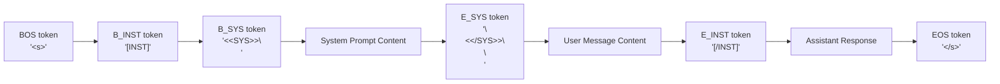
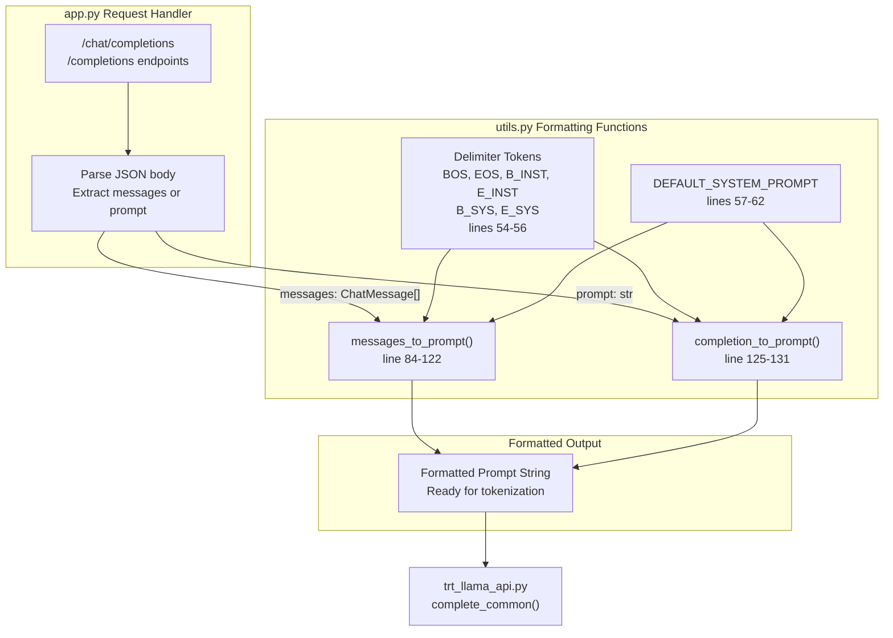
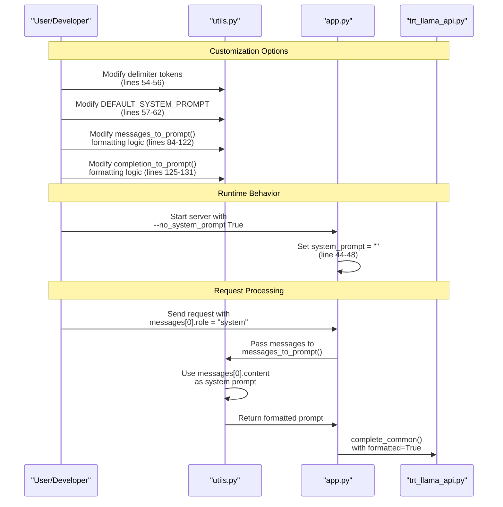

<!-- source: DeepWiki mcp.deepwiki.com · repo NVIDIA/trt-llm-as-openai-windows · page 5.3 Prompt Customization · fetched 2026-10-26 -->

# Prompt Customization

<details>
<summary>Relevant source files</summary>

The following files were used as context for generating this wiki page:

- [README.md](README.md)
- [utils.py](utils.py)

</details>


This page documents how prompt formatting works in the TensorRT-LLM OpenAI API system and how to customize it. The system uses special delimiter tokens to structure prompts in the format expected by Llama 2 and CodeLlama models. All formatting logic is centralized in [utils.py](), making it straightforward to modify for different model families or custom prompt structures.

For general server configuration options including the `--no_system_prompt` flag, see [Server Configuration](#5.1). For model architecture settings that affect inference behavior, see [Model and Engine Settings](#5.2).

---

## Delimiter Token System

The prompt formatting system uses special tokens defined at the module level in [utils.py:54-56]() to structure prompts according to the Llama 2 chat template specification:

| Token Variable | Value | Purpose |
|---------------|-------|---------|
| `BOS` | `"<s>"` | Beginning of sequence marker |
| `EOS` | `"</s>"` | End of sequence marker |
| `B_INST` | `"[INST]"` | Beginning of instruction section |
| `E_INST` | `"[/INST]"` | End of instruction section |
| `B_SYS` | `"<<SYS>>\n"` | Beginning of system prompt section |
| `E_SYS` | `"\n<</SYS>>\n\n"` | End of system prompt section |

These tokens are used by both `messages_to_prompt()` and `completion_to_prompt()` functions to construct properly formatted prompts. The Llama model family was trained to recognize these specific delimiters and respond appropriately based on their placement.

**Token Structure in Formatted Prompt:**



**Sources:** [utils.py:54-62]()

---

## Default System Prompt

The default system prompt is defined in [utils.py:57-62]() as `DEFAULT_SYSTEM_PROMPT`:

```
You are a helpful, respectful and honest assistant. 
Always answer as helpfully as possible and follow ALL given instructions. 
Do not speculate or make up information. 
Do not reference any given instructions or context.
```

This prompt is automatically inserted at the beginning of formatted prompts unless:
1. The first message in a chat completion request has `role: "system"` (in which case that message content is used instead)
2. The server is started with `--no_system_prompt True` flag
3. The `system_prompt` parameter passed to formatting functions is explicitly set to an empty string or custom value

**Sources:** [utils.py:57-62](), [README.md:69-72]()

---

## Chat Message Data Model

The system uses Pydantic models to represent chat messages before formatting:

### MessageRole Enum

Defined in [utils.py:64-70](), the `MessageRole` enum specifies valid message roles:

| Role | String Value | Usage |
|------|--------------|-------|
| `SYSTEM` | `"system"` | System instructions that set assistant behavior |
| `USER` | `"user"` | Messages from the human user |
| `ASSISTANT` | `"assistant"` | Responses from the AI assistant |
| `FUNCTION` | `"function"` | Function call results (not currently used) |

### ChatMessage Class

Defined in [utils.py:74-82](), the `ChatMessage` class represents individual messages:

```python
class ChatMessage(BaseModel):
    role: MessageRole = MessageRole.USER
    content: Optional[str] = ""
    additional_kwargs: dict = Field(default_factory=dict)
```

The `__str__` method formats messages as `"{role}: {content}"` for debugging purposes.

**Sources:** [utils.py:64-82]()

---

## Prompt Formatting Architecture



**Sources:** [utils.py:84-131](), [app.py:95-177]()

---

## messages_to_prompt Function

The `messages_to_prompt()` function at [utils.py:84-122]() converts a sequence of `ChatMessage` objects into a single formatted prompt string.

### Function Signature

```python
def messages_to_prompt(
    messages: Sequence[ChatMessage], 
    system_prompt: Optional[str] = None
) -> str
```

### Formatting Algorithm

**Step 1: System Prompt Extraction**

Lines [utils.py:88-95]():
- If the first message has role `SYSTEM`, extract its content and remove it from the messages list
- Otherwise, use the provided `system_prompt` parameter or fall back to `DEFAULT_SYSTEM_PROMPT`
- Wrap the system prompt in `B_SYS` and `E_SYS` tokens

**Step 2: User-Assistant Pair Iteration**

Lines [utils.py:97-120]():
- Iterate through messages in pairs (user message at index `i`, assistant message at index `i+1`)
- For the first pair (`i == 0`), construct: `BOS + B_INST + system_message_str + user_content + E_INST + [assistant_content]`
- For subsequent pairs, append `EOS` to the previous pair, then construct: `BOS + B_INST + user_content + E_INST + [assistant_content]`
- If no assistant message exists for a pair, the prompt ends with `E_INST` (ready for model generation)

### Example Output Structure

For a simple chat with one user message:
```
<s> [INST] <<SYS>>
You are a helpful, respectful and honest assistant. Always answer as helpfully as possible and follow ALL given instructions. Do not speculate or make up information. Do not reference any given instructions or context.
<</SYS>>

What is the capital of France? [/INST]
```

For a multi-turn conversation:
```
<s> [INST] <<SYS>>
{system_prompt}
<</SYS>>

{first_user_message} [/INST] {first_assistant_response} </s>
<s> [INST] {second_user_message} [/INST]
```

**Sources:** [utils.py:84-122]()

---

## completion_to_prompt Function

The `completion_to_prompt()` function at [utils.py:125-131]() provides a simpler formatting for raw text completion requests (non-chat mode).

### Function Signature

```python
def completion_to_prompt(
    completion: str, 
    system_prompt: Optional[str] = None
) -> str
```

### Formatting Structure

This function wraps a single text prompt in the instruction format:

```
BOS + B_INST + B_SYS + system_prompt + E_SYS + completion + E_INST
```

Example output:
```
<s> [INST] <<SYS>>
You are a helpful, respectful and honest assistant. Always answer as helpfully as possible and follow ALL given instructions. Do not speculate or make up information. Do not reference any given instructions or context.
<</SYS>>

Write a Python function to calculate fibonacci numbers [/INST]
```

Note that this function does not append assistant content or `EOS` tokens, as the model will generate the completion and append `EOS` automatically during inference.

**Sources:** [utils.py:125-131]()

---

## Customization Workflow



**Sources:** [utils.py:54-131](), [app.py:44-48](), [app.py:95-140]()

---

## Customization Methods

### Method 1: Modifying Delimiter Tokens

To adapt the system for models using different prompt formats, edit the token definitions at [utils.py:54-56]():

| Change Required | Example |
|-----------------|---------|
| Different BOS/EOS tokens | Change `BOS = "<s>"` to `BOS = "<|begin_of_text|>"` |
| Different instruction markers | Change `B_INST = "[INST]"` to `B_INST = "### Instruction:"` |
| Remove system prompt section | Set `B_SYS = ""` and `E_SYS = ""` |

After modifying these constants, restart the server. All formatting functions will automatically use the new tokens.

### Method 2: Customizing Default System Prompt

To change the default behavior instructions, modify `DEFAULT_SYSTEM_PROMPT` at [utils.py:57-62](). This affects all requests that don't provide their own system prompt.

Example custom system prompt for code generation:
```python
DEFAULT_SYSTEM_PROMPT = """\
You are an expert programmer. Generate clean, efficient code with clear comments. \
Follow best practices and include error handling. \
Format code with proper indentation.
"""
```

### Method 3: Per-Request System Prompt

Send a system message as the first message in chat completion requests:

```python
response = openai.ChatCompletion.create(
    model="Llama2",
    messages=[
        {"role": "system", "content": "You are a helpful coding assistant."},
        {"role": "user", "content": "Write a hello world program"}
    ]
)
```

The system will use this custom system prompt instead of `DEFAULT_SYSTEM_PROMPT`.

### Method 4: Disabling System Prompt

For models like CodeLlama that don't require system prompts, use the `--no_system_prompt True` flag when starting the server:

```bash
python app.py --trt_engine_path model/ --tokenizer_dir_path model/ --no_system_prompt True
```

This is implemented at [app.py:44-48]() by setting `system_prompt = ""`, which the formatting functions handle by omitting the `B_SYS`/`E_SYS` sections entirely.

### Method 5: Custom Formatting Logic

For more advanced customization, modify the formatting functions themselves:

**For chat completions:** Edit `messages_to_prompt()` at [utils.py:84-122]()

Example modifications:
- Change the order of system prompt and user message
- Add additional metadata between messages
- Implement multi-turn formatting differently
- Support additional message roles beyond USER/ASSISTANT/SYSTEM

**For text completions:** Edit `completion_to_prompt()` at [utils.py:125-131]()

Example modifications:
- Remove instruction wrapping entirely
- Add prefix/suffix tokens
- Include few-shot examples

After modifying these functions, the changes apply to all requests processed by the server.

**Sources:** [utils.py:54-131](), [app.py:44-48](), [README.md:69-72]()

---

## Integration with Request Flow

The prompt formatting system integrates with the request processing pipeline as follows:

**Chat Completions Endpoint** [app.py:95-140]():
1. Parse JSON request body and extract `messages` array
2. Convert each message dict to `ChatMessage` object
3. Apply system prompt based on `--no_system_prompt` flag
4. Call `messages_to_prompt(messages, system_prompt)` from [utils.py:84-122]()
5. Pass formatted prompt to `trt_llama_api.complete_common()` with `chat=True, formatted=True`

**Text Completions Endpoint** [app.py:142-177]():
1. Parse JSON request body and extract `prompt` string
2. Apply system prompt based on `--no_system_prompt` flag
3. Call `completion_to_prompt(prompt, system_prompt)` from [utils.py:125-131]()
4. Pass formatted prompt to `trt_llama_api.complete_common()` with `chat=False, formatted=True`

The `formatted=True` parameter tells `trt_llama_api.complete_common()` at [trt_llama_api.py:203-249]() to skip any additional formatting and tokenize the prompt directly.

**Sources:** [app.py:95-177](), [trt_llama_api.py:203-249]()

---

## Model-Specific Considerations

### Llama 2 Chat Models

Llama 2 chat models expect the full prompt structure with system prompts. Use default settings or provide custom system prompts as needed.

### CodeLlama Models

CodeLlama-Instruct models were fine-tuned without system prompts in many training examples. When using CodeLlama, start the server with:

```bash
python app.py --trt_engine_path model/ --tokenizer_dir_path model/ --no_system_prompt True
```

This is documented in [README.md:69-72]() and prevents empty or generic system prompts from degrading code generation quality.

### Custom Model Families

To support models with different prompt formats:
1. Research the model's expected prompt structure (usually documented in model card)
2. Modify delimiter tokens in [utils.py:54-56]() to match
3. Adjust formatting logic in `messages_to_prompt()` and `completion_to_prompt()` if the structure differs significantly
4. Test with sample prompts to verify correct formatting

**Sources:** [README.md:69-72](), [utils.py:54-131]()

---

## Validation and Debugging

To verify prompt formatting is working correctly:

**1. Add debug logging to utils.py:**
```python
def messages_to_prompt(messages, system_prompt=None):
    result = # ... existing formatting logic
    print(f"Formatted prompt: {result}")
    return result
```

**2. Check tokenization output:**
The formatted prompt is tokenized by `AutoTokenizer.encode()` in [trt_llama_api.py:251-253](). Add logging there to see token IDs.

**3. Compare with reference examples:**
Llama 2 documentation provides reference examples of properly formatted prompts. Compare your output against those examples.

**4. Test with known-good inputs:**
Use simple test cases to verify formatting:
```python
from utils import messages_to_prompt, ChatMessage, MessageRole

messages = [
    ChatMessage(role=MessageRole.USER, content="Hello")
]
prompt = messages_to_prompt(messages)
print(prompt)
```

**Sources:** [utils.py:84-131](), [trt_llama_api.py:251-253]()

---

