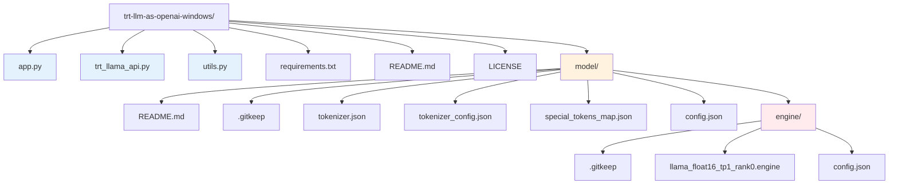
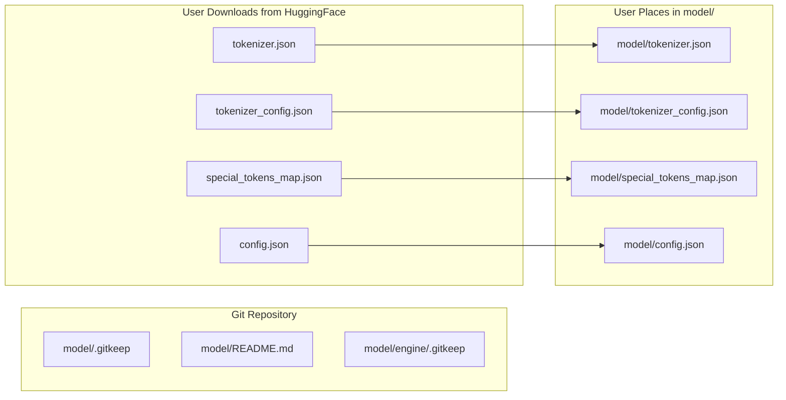
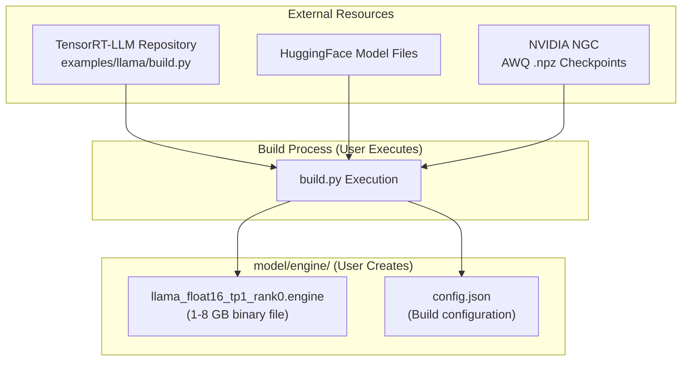
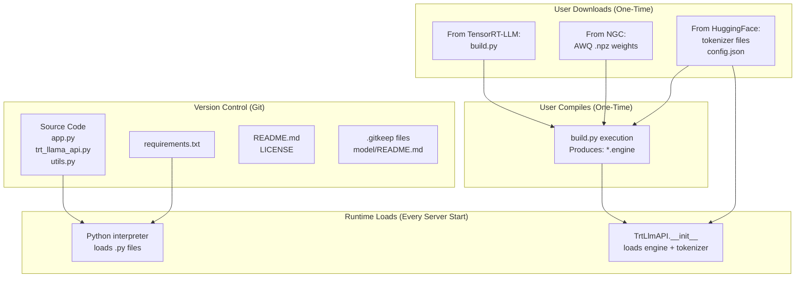
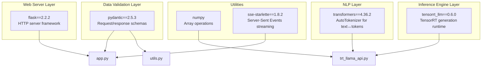

<!-- source: DeepWiki mcp.deepwiki.com · repo NVIDIA/trt-llm-as-openai-windows · page 6 Project Structure · fetched 2026-10-26 -->

# Project Structure

<details>
<summary>Relevant source files</summary>

The following files were used as context for generating this wiki page:

- [README.md](README.md)
- [model/.gitkeep](model/.gitkeep)
- [model/README.md](model/README.md)
- [model/engine/.gitkeep](model/engine/.gitkeep)

</details>


This page documents the physical organization of the repository, including directory structure, file locations, and dependencies. For information about the logical architecture and how components interact, see [Architecture and Implementation](#4). For configuration options and command-line arguments, see [Configuration Reference](#5).

## Repository Organization Overview

The repository follows a flat structure with Python source files at the root level and model artifacts organized in a dedicated `model/` directory hierarchy. This separation distinguishes version-controlled source code from large binary artifacts that must be downloaded or compiled separately.



**Sources:** [README.md:49-57](), [model/README.md:1](), [model/.gitkeep:1](), [model/engine/.gitkeep:1]()

## Root Directory Structure

The root directory contains all executable Python source files and project metadata:

| File | Purpose | Version Controlled |
|------|---------|-------------------|
| `app.py` | Flask application entry point and HTTP route definitions | Yes |
| `trt_llama_api.py` | TensorRT-LLM inference engine wrapper and tokenization logic | Yes |
| `utils.py` | Prompt formatting utilities and data models | Yes |
| `requirements.txt` | Python package dependencies | Yes |
| `README.md` | Setup instructions and usage documentation | Yes |
| `LICENSE` | MIT license text | Yes |

All Python source files are co-located at the root level with no subdirectory nesting, reflecting the system's simple modular structure. The three `.py` files form a clean dependency hierarchy with no circular imports. See [Component Overview](#4.1) for details on module interactions.

**Sources:** [README.md:1-154]()

## Model Directory (`model/`)

The `model/` directory stores all model-related artifacts required for inference. This directory is tracked in Git but remains mostly empty in the repository, with only placeholder files committed.



### Required Files in `model/`

Users must manually download and place the following files from HuggingFace model repositories:

| File | Source | Purpose |
|------|--------|---------|
| `tokenizer.json` | HuggingFace | Vocabulary and tokenization rules used by `AutoTokenizer` |
| `tokenizer_config.json` | HuggingFace | Tokenizer configuration and special token definitions |
| `special_tokens_map.json` | HuggingFace | Mapping of special tokens (BOS, EOS, PAD, etc.) |
| `config.json` | HuggingFace | Model architecture metadata (hidden size, num layers, vocab size) |

The specific HuggingFace repositories are:
- CodeLlama: [codellama/CodeLlama-13b-Instruct-hf](https://huggingface.co/codellama/CodeLlama-13b-Instruct-hf/tree/main)
- Llama 2: [meta-llama/Llama-2-13b-chat-hf](https://huggingface.co/meta-llama/Llama-2-13b-chat-hf/tree/main)

**Sources:** [README.md:54-56](), [model/README.md:1]()

### Placeholder Files

Two `.gitkeep` files maintain the directory structure in Git:

- [`model/.gitkeep`]() - Ensures the `model/` directory exists when cloning the repository
- [`model/engine/.gitkeep`]() - Ensures the `model/engine/` subdirectory exists

These files are empty and serve no runtime purpose. They exist solely to commit empty directories to Git, which does not track empty directories by default.

**Sources:** [model/.gitkeep:1](), [model/engine/.gitkeep:1]()

## Engine Directory (`model/engine/`)

The `model/engine/` subdirectory stores compiled TensorRT engine files. These are **not** distributed with the repository and must be built locally using the TensorRT-LLM build scripts.



### Engine Files

The compiled TensorRT engine is the core artifact for inference:

| File | Size | GPU-Specific | Purpose |
|------|------|--------------|---------|
| `*.engine` | 1-8 GB | Yes | Optimized GPU execution graph and quantized weights |
| `config.json` | ~1 KB | No | Build-time configuration (tensor parallelism, max lengths) |

The `.engine` file format is binary and GPU architecture-specific. An engine compiled on an RTX 4090 cannot run on an RTX 3090, and vice versa. This necessitates per-GPU compilation and explains why engines are not distributed with the repository.

**Sources:** [README.md:19-45](), [README.md:57]()

### Build Command Reference

The build process uses `build.py` from the TensorRT-LLM repository with model-specific parameters:

**CodeLlama 13B:**
```bash
python build.py --model_dir <path to CodeLlama model> \
  --quant_ckpt_path <path to CodeLlama .npz file> \
  --dtype float16 \
  --remove_input_padding \
  --use_gpt_attention_plugin float16 \
  --enable_context_fmha \
  --use_gemm_plugin float16 \
  --use_weight_only \
  --weight_only_precision int4_awq \
  --per_group \
  --max_batch_size 1 \
  --max_input_len 15360 \
  --max_output_len 1024 \
  --output_dir <model/engine/> \
  --rotary_base 1000000 \
  --vocab_size 32064
```

**Llama 2 13B:**
```bash
python build.py --model_dir <path to llama13_chat model> \
  --quant_ckpt_path <path to Llama2 .npz file> \
  --dtype float16 \
  --use_gpt_attention_plugin float16 \
  --use_gemm_plugin float16 \
  --use_weight_only \
  --weight_only_precision int4_awq \
  --per_group \
  --enable_context_fmha \
  --max_batch_size 1 \
  --max_input_len 3500 \
  --max_output_len 1024 \
  --output_dir <model/engine/>
```

The `--output_dir` parameter specifies where the compiled engine files are written. Users should point this to the `model/engine/` directory in the repository.

**Sources:** [README.md:38-45]()

## File Lifecycle and Provenance

The following diagram categorizes files by their lifecycle stage and source:



**File Categories:**

1. **Version Controlled** - Committed to Git, distributed with repository clone
   - [`app.py`](), [`trt_llama_api.py`](), [`utils.py`]()
   - [`requirements.txt`](), [`README.md`](), `LICENSE`
   - [`.gitkeep`]() files, [`model/README.md`]()

2. **Downloaded Once** - Fetched from external sources during initial setup
   - Tokenizer files from HuggingFace (placed in `model/`)
   - AWQ quantized weights from NVIDIA NGC (used during build, not kept)
   - TensorRT-LLM repository (contains `build.py`, cloned separately)

3. **Compiled Once** - Generated locally, cannot be reused on different GPU architectures
   - `*.engine` file in `model/engine/`
   - `config.json` in `model/engine/` (build metadata)

4. **Loaded at Runtime** - Read from disk every time the server starts
   - Python source files (interpreted)
   - TensorRT engine (deserialized into GPU memory)
   - Tokenizer files (loaded by `transformers.AutoTokenizer`)

**Sources:** [README.md:10-77]()

## Python Dependencies

The `requirements.txt` file specifies external Python packages required for the application. Each dependency serves a specific architectural role:



### Dependency Breakdown

| Package | Version | Purpose | Used By |
|---------|---------|---------|---------|
| `flask` | 2.2.2 | Provides HTTP routing, request handling, and response formatting | [`app.py`]() |
| `pydantic` | 2.5.3 | Defines typed data models (`ChatMessage`, `MessageRole`) and validates JSON | [`utils.py`](), [`app.py`](), [`trt_llama_api.py`]() |
| `transformers` | 4.36.2 | Loads HuggingFace tokenizers for text encoding/decoding | [`trt_llama_api.py`]() |
| `tensorrt_llm` | 0.6.0 | Core inference runtime providing `GenerationSession` and `ModelConfig` | [`trt_llama_api.py`]() |
| `numpy` | (latest) | Array manipulation for token ID tensors | [`trt_llama_api.py`]() |
| `sse-starlette` | 1.8.2 | Server-Sent Events formatting for streaming completions | [`app.py`]() |

### Installation

Dependencies are installed using pip after cloning the repository:

```bash
pip install -r requirements.txt
```

The TensorRT-LLM package (`tensorrt_llm`) requires a separate installation step following the Windows-specific instructions in the [TensorRT-LLM repository](https://github.com/NVIDIA/TensorRT-LLM/tree/v0.6.1/windows#quick-start). This is a prerequisite before installing other dependencies.

**Sources:** [README.md:11-13](), [README.md:58-61]()

## Command-Line Interface

The application is launched via `app.py` with command-line arguments specifying paths to compiled artifacts:

```bash
python app.py \
  --trt_engine_path model/engine/ \
  --trt_engine_name llama_float16_tp1_rank0.engine \
  --tokenizer_dir_path model/ \
  --port 8081 \
  --no_system_prompt True
```

### Argument Reference

| Argument | Type | Required | Default | Purpose |
|----------|------|----------|---------|---------|
| `--trt_engine_path` | Path | Yes | - | Directory containing the compiled `.engine` file |
| `--trt_engine_name` | Filename | Yes | - | Name of the `.engine` file to load |
| `--tokenizer_dir_path` | Path | Yes | - | Directory containing tokenizer files and `config.json` |
| `--port` | Integer | No | 8081 | Port for the HTTP server to listen on |
| `--max_output_tokens` | Integer | No | 2048 | Maximum tokens in generated response |
| `--max_input_tokens` | Integer | No | 2048 | Maximum tokens in input prompt |
| `--no_system_prompt` | Boolean | No | False | Disable default system prompt (required for CodeLlama) |

The arguments are parsed in [`app.py:22-41`]() and passed to the `TrtLlmAPI` constructor. All paths are relative to the current working directory.

**Sources:** [README.md:64-76](), [README.md:98-114]()

## Storage Requirements

The complete system requires the following disk space:

| Component | Typical Size | Location | Notes |
|-----------|--------------|----------|-------|
| Source code | <1 MB | Root directory | Version controlled |
| Tokenizer files | ~10 MB | `model/` | Downloaded from HuggingFace |
| AWQ weights (temporary) | ~7 GB | Build directory | Only needed during compilation, can be deleted after |
| TensorRT engine | 1-8 GB | `model/engine/` | Size depends on model and quantization |
| TensorRT-LLM repository | ~100 MB | Separate directory | Contains `build.py`, not placed in this repo |

**Total persistent storage:** ~1-10 GB after setup (engine + tokenizer + source code)

**Temporary storage during setup:** ~20-30 GB (includes model downloads, weights, build artifacts)

GPU memory requirements at runtime are determined by the compiled engine's configuration and are typically 4-8 GB VRAM for 13B models with AWQ 4-bit quantization. See [Performance Considerations](#7.2) for details.

**Sources:** [README.md:10-57]()

---

