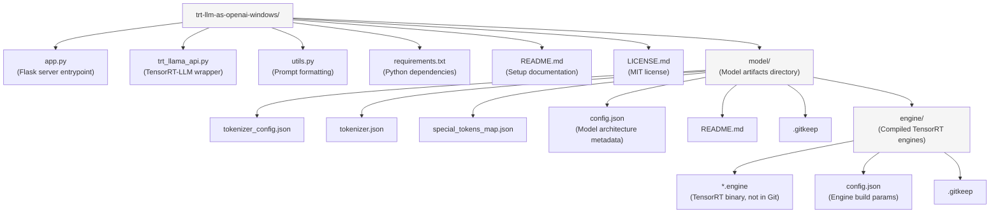
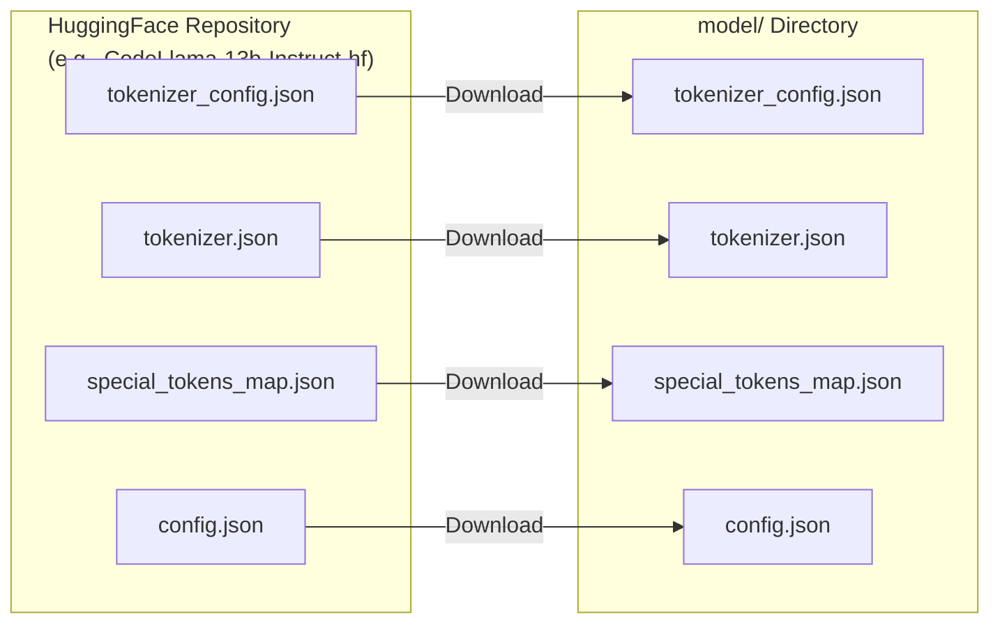
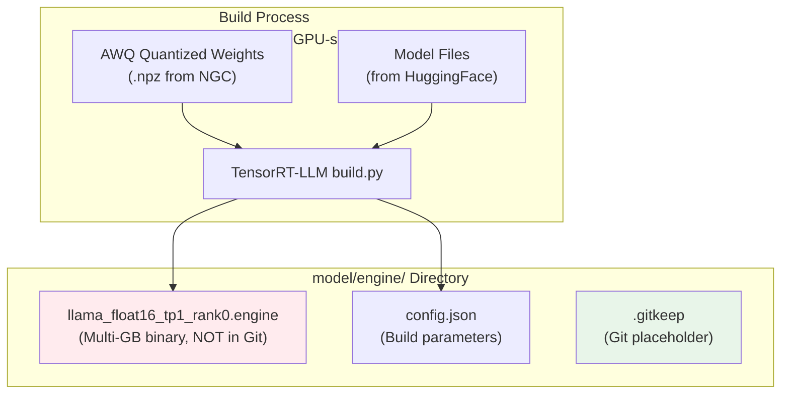
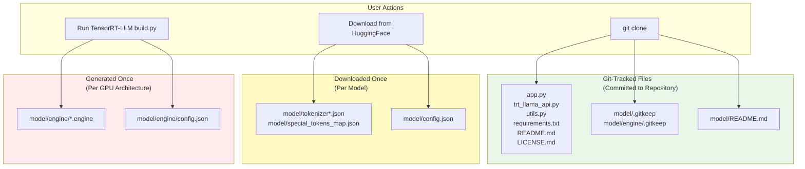

<!-- source: DeepWiki mcp.deepwiki.com · repo NVIDIA/trt-llm-as-openai-windows · page 6.1 Directory Layout · fetched 2026-10-26 -->

# Directory Layout

<details>
<summary>Relevant source files</summary>

The following files were used as context for generating this wiki page:

- [model/.gitkeep](model/.gitkeep)
- [model/README.md](model/README.md)
- [model/engine/.gitkeep](model/engine/.gitkeep)

</details>


This page documents the file and directory organization of the repository, explaining where each type of file belongs and which artifacts must be downloaded or generated versus committed to version control. For information about building the TensorRT engines that populate these directories, see [Building TensorRT Engines](#2.2.2). For details on the model configuration files themselves, see [Model and Engine Settings](#5.2).

## Repository Structure Overview

The repository follows a flat structure with Python source files at the root level and a `model/` subdirectory hierarchy for runtime artifacts. This design separates code (tracked in Git) from model artifacts (not tracked due to size).

### Root Directory Layout



**Sources:** 
- model/README.md:1
- model/.gitkeep:1
- model/engine/.gitkeep:1

## Source Code Files

The following Python source files reside at the repository root and are tracked in Git:

| File | Purpose | Key Classes/Functions |
|------|---------|----------------------|
| `app.py` | Flask web server entrypoint | `chat_completions_route()`, `completions_route()`, `models_route()` |
| `trt_llama_api.py` | TensorRT-LLM inference wrapper | `TrtLlmAPI` class |
| `utils.py` | Prompt formatting utilities | `messages_to_prompt()`, `completion_to_prompt()`, `ChatMessage` |
| `requirements.txt` | Python package dependencies | Flask, Pydantic, Transformers, TensorRT-LLM |
| `README.md` | User-facing setup documentation | Installation and usage instructions |
| `LICENSE.md` | MIT license text | Legal terms |

These files are small (typically under 500 lines) and form the complete application code. No additional subdirectories exist for Python modules.

**Sources:**
- README.md (referenced in Diagram 6)
- requirements.txt (referenced in Diagram 2)

## model/ Directory

The `model/` directory stores model artifacts downloaded from HuggingFace repositories. The [model/README.md:1]() explicitly states: "Place tokenizers and the model's config.json in this directory."

### Expected Files



### Tokenizer Files

The tokenizer files define how text is converted to token IDs and vice versa:

- **tokenizer_config.json**: Configuration parameters for the tokenizer, including special token definitions
- **tokenizer.json**: The actual vocabulary and tokenization rules used by the `AutoTokenizer` class
- **special_tokens_map.json**: Mapping of special token identifiers (BOS, EOS, PAD) to their string representations

These files are loaded by `trt_llama_api.py` during initialization using `AutoTokenizer.from_pretrained(tokenizer_dir)`.

### config.json

The `config.json` file contains model architecture metadata:

- `num_attention_heads`: Number of attention heads per layer
- `hidden_size`: Dimension of hidden layers
- `vocab_size`: Size of the vocabulary
- `num_hidden_layers`: Number of transformer layers
- Architecture-specific parameters (e.g., `rope_theta` for rotary embeddings)

This file is read by [trt_llama_api.py:112-179]() during `TrtLlmAPI.__init__()` to configure the inference session. It is **separate** from the engine's `config.json` (see next section).

### .gitkeep File

The [model/.gitkeep:1]() file is an empty placeholder that ensures the `model/` directory exists in Git even when it contains no tracked files. The large model artifacts themselves should **not** be committed to version control.

**Sources:**
- model/README.md:1
- model/.gitkeep:1

## model/engine/ Directory

The `model/engine/` directory stores compiled TensorRT engine files. These are generated by running the TensorRT-LLM build process (see [Building TensorRT Engines](#2.2.2)) and are **GPU-architecture-specific**.

### Engine File Structure



### *.engine Files

The `.engine` file (e.g., `llama_float16_tp1_rank0.engine`) is a serialized TensorRT engine containing:

- Compiled CUDA kernels optimized for the specific GPU architecture
- Quantized model weights (typically AWQ 4-bit)
- Layer fusion and optimization metadata
- Memory allocation plans

**Critical characteristics:**
- **Size**: Typically 2-8 GB depending on model size and quantization
- **GPU-specific**: Cannot be transferred between different GPU architectures (e.g., an engine built on RTX 4090 will not work on T4)
- **Not in Git**: Too large for version control; must be rebuilt on each deployment target

The engine filename follows the pattern: `<model>_<dtype>_tp<tensor_parallel_size>_rank<rank>.engine`

### config.json (Engine Build Parameters)

The engine directory's `config.json` is **distinct** from the model's `config.json`. It stores build-time parameters:

```json
{
  "builder_config": {
    "max_input_len": 2048,
    "max_output_len": 512,
    "max_batch_size": 1
  },
  "plugin_config": {
    "gemm_plugin": "auto"
  },
  "pretrained_config": {
    "architecture": "LlamaForCausalLM",
    "dtype": "float16",
    "num_hidden_layers": 40,
    "tensor_parallel": 1,
    "pipeline_parallel": 1
  }
}
```

This file is read by [trt_llama_api.py:112-179]() to validate that the engine matches the expected configuration. Key parameters:

- **max_input_len**: Maximum tokens in input prompt (hard limit set at compile time)
- **max_output_len**: Maximum tokens to generate
- **tensor_parallel** (tp_size): Number of GPUs for tensor parallelism
- **pipeline_parallel** (pp_size): Pipeline parallelism (currently must be 1)

### .gitkeep File

Like the parent directory, [model/engine/.gitkeep:1]() ensures this directory exists in the repository structure even though the `.engine` files themselves are not tracked.

**Sources:**
- model/engine/.gitkeep:1

## File Lifecycle and Git Tracking

The following diagram shows which files are tracked in Git versus generated at runtime:



### What Gets Committed to Git

✅ **Tracked in Git:**
- All Python source files (`*.py`)
- Documentation files (`README.md`, `LICENSE.md`, `model/README.md`)
- Configuration files (`requirements.txt`)
- Empty placeholder files (`model/.gitkeep`, `model/engine/.gitkeep`)

❌ **Not tracked in Git (must be obtained separately):**
- Tokenizer files (`*.json` in `model/`)
- Model configuration (`model/config.json`)
- Engine binaries (`*.engine` in `model/engine/`)
- Engine build configuration (`model/engine/config.json`)

### Typical Setup Sequence

After cloning the repository, users must populate the non-tracked directories:

1. **Download model artifacts** (see [Downloading Models and Weights](#2.2.1)):
   ```
   model/
   ├── tokenizer_config.json    (from HuggingFace)
   ├── tokenizer.json            (from HuggingFace)
   ├── special_tokens_map.json  (from HuggingFace)
   └── config.json               (from HuggingFace)
   ```

2. **Build TensorRT engine** (see [Building TensorRT Engines](#2.2.2)):
   ```
   model/engine/
   ├── llama_float16_tp1_rank0.engine  (generated by build.py)
   └── config.json                      (generated by build.py)
   ```

3. **Launch server** (see [Launching the Server](#2.3)):
   ```bash
   python app.py --trt_engine_path model/engine --tokenizer_dir_path model/
   ```

The server expects these paths as command-line arguments and will fail with an error if the required files are missing.

**Sources:**
- model/README.md:1
- model/.gitkeep:1
- model/engine/.gitkeep:1

## Directory Path Resolution

The `app.py` entrypoint accepts command-line arguments that specify paths to model artifacts:

| Argument | Default | Purpose | Expected Contents |
|----------|---------|---------|------------------|
| `--trt_engine_path` | Required | Directory containing engine files | `*.engine`, `config.json` |
| `--trt_engine_name` | Required | Filename of engine binary | `llama_float16_tp1_rank0.engine` |
| `--tokenizer_dir_path` | Required | Directory containing tokenizer | `tokenizer*.json`, `special_tokens_map.json`, `config.json` |

These paths are validated during [trt_llama_api.py:112-179]() initialization. If any required file is missing, the application will raise a `FileNotFoundError`.

**Sources:**
- app.py (referenced in Diagrams 4 and 6)
- trt_llama_api.py:112-179

## Summary

The directory layout separates concerns between source code (root level, Git-tracked) and runtime artifacts (`model/` hierarchy, not Git-tracked). The use of `.gitkeep` files ensures directory structure is preserved in version control while allowing users to populate large model files locally. This design supports the workflow where model preparation is a one-time setup step distinct from running the server.

---

