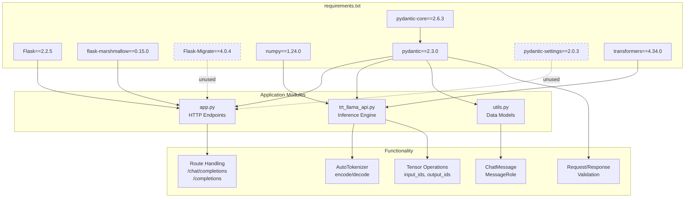
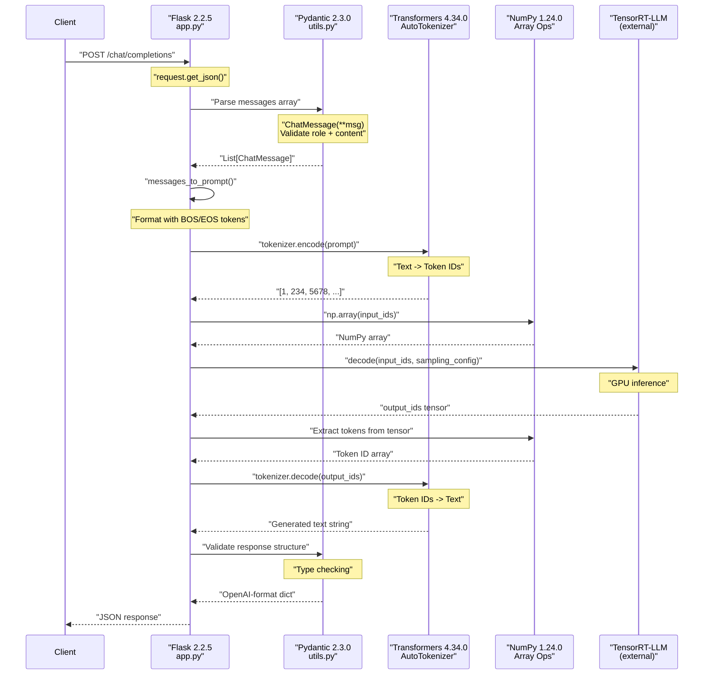

<!-- source: DeepWiki mcp.deepwiki.com · repo NVIDIA/trt-llm-as-openai-windows · page 6.2 Dependencies · fetched 2026-10-26 -->

# Dependencies

<details>
<summary>Relevant source files</summary>

The following files were used as context for generating this wiki page:

- [requirements.txt](requirements.txt)

</details>


This page provides a detailed breakdown of the Python package dependencies defined in [requirements.txt:1-8]() and their specific roles within the TensorRT-LLM OpenAI API system. Each dependency is explained in terms of which application modules consume it and what functionality it provides.

For information about external system dependencies like TensorRT-LLM and CUDA, see [Prerequisites and Dependencies](#2.1). For information about command-line configuration of the runtime system, see [Server Configuration](#5.1).

---

## Overview

The system requires eight Python packages specified in [requirements.txt:1-8](). These dependencies fall into three functional categories: web serving infrastructure, data validation and serialization, and machine learning operations. All dependencies are pinned to specific versions to ensure reproducibility and compatibility with the TensorRT-LLM runtime.

| Package | Version | Primary Role | Consuming Module(s) |
|---------|---------|--------------|---------------------|
| `Flask` | 2.2.5 | HTTP server and routing | [app.py:1-180]() |
| `flask-marshmallow` | 0.15.0 | Schema serialization | [app.py]() |
| `Flask-Migrate` | 4.0.4 | Database migrations (unused) | None |
| `numpy` | 1.24.0 | Array operations and tensor manipulation | [trt_llama_api.py]() |
| `pydantic` | 2.3.0 | Data validation and models | [app.py](), [trt_llama_api.py](), [utils.py]() |
| `pydantic-core` | 2.6.3 | Pydantic core runtime | [pydantic]() |
| `pydantic-settings` | 2.0.3 | Settings management (unused) | None |
| `transformers` | 4.34.0 | Tokenizer loading | [trt_llama_api.py:1-7]() |

**Sources:** [requirements.txt:1-8]()

---

## Dependency Architecture

The following diagram illustrates how Python packages from `requirements.txt` map to specific application modules and their roles in the request processing pipeline.



**Diagram: Package-to-Module Mapping**

This diagram shows the direct consumption relationships between packages and application code. Note that `Flask-Migrate` and `pydantic-settings` are present in `requirements.txt` but not actively used by any module, likely remnants from a template or planned features.

**Sources:** [requirements.txt:1-8](), [app.py:1-10](), [trt_llama_api.py:1-7](), [utils.py:1-5]()

---

## Web Serving Dependencies

### Flask (2.2.5)

Flask provides the HTTP server framework and route handling infrastructure. The application uses Flask to expose OpenAI-compatible REST API endpoints.

**Usage in Application:**

- **Module:** [app.py:1]()
- **Key Components:**
  - `Flask` application instance: [app.py:67]()
  - Route decorators: `@app.route()` for endpoint definitions
  - Request context: `request.get_json()` for parsing JSON bodies [app.py:97, 144]()
  - Response streaming: `Response(stream_with_context())` [app.py:120, 167]()
  - Server execution: `app.run()` [app.py:180]()

**Route Definitions:**
```
/chat/completions       [app.py:95]()
/completions            [app.py:142]()
/models                 [app.py:175]()
/v1/chat/completions    [app.py:95]()
/v1/completions         [app.py:142]()
/v1/models              [app.py:175]()
```

The Flask server is configured with `threaded=False` [app.py:180](), enforcing sequential request processing due to TensorRT-LLM thread-safety constraints.

**Sources:** [app.py:1](), [app.py:67](), [app.py:95-177](), [app.py:180]()

### flask-marshmallow (0.15.0) and Flask-Migrate (4.0.4)

These packages are included in [requirements.txt:2-3]() but do not appear to be actively used in the current codebase. They may represent planned features or template artifacts:

- `flask-marshmallow`: Typically used for object serialization and deserialization, but the codebase uses Pydantic models instead
- `Flask-Migrate`: Database migration tool, but the application has no database layer

**Sources:** [requirements.txt:2-3]()

---

## Data Validation Dependencies

### Pydantic (2.3.0, 2.6.3, 2.0.3)

The Pydantic ecosystem provides data validation, serialization, and type enforcement across all three application modules. Three Pydantic packages are installed:

| Package | Version | Purpose |
|---------|---------|---------|
| `pydantic` | 2.3.0 | Core validation library |
| `pydantic-core` | 2.6.3 | Low-level Rust implementation |
| `pydantic-settings` | 2.0.3 | Settings management (unused) |

**Usage in utils.py:**

The `utils.py` module defines data models using Pydantic's `BaseModel`:

```python
from pydantic import BaseModel  # [utils.py:3]()

class MessageRole(str, Enum):   # [utils.py:13-16]()
    SYSTEM = "system"
    USER = "user"
    ASSISTANT = "assistant"

class ChatMessage(BaseModel):   # [utils.py:19-21]()
    role: MessageRole
    content: str
```

These models enforce type safety when parsing JSON message arrays from client requests.

**Usage in app.py:**

The Flask application imports and uses these models for request parsing:

```python
from utils import ChatMessage, MessageRole  # [app.py:2]()

# Parse messages array
messages = [ChatMessage(**msg) for msg in data["messages"]]  # [app.py:99]()
```

**Usage in trt_llama_api.py:**

The inference module imports `MessageRole` for type annotations:

```python
from utils import MessageRole  # [trt_llama_api.py:8]()
```

**Sources:** [utils.py:1-21](), [app.py:2](), [app.py:99](), [trt_llama_api.py:8]()

---

## Machine Learning Dependencies

### transformers (4.34.0)

The `transformers` package from Hugging Face provides tokenizer loading and text-to-token conversion capabilities. This is critical for bridging between human-readable text and the integer token IDs that TensorRT-LLM processes.

**Usage in trt_llama_api.py:**

```python
from transformers import AutoTokenizer  # [trt_llama_api.py:6]()

class TrtLlmAPI:
    def __init__(self, ...):
        # Load tokenizer from disk
        self.tokenizer = AutoTokenizer.from_pretrained(
            tokenizer_dir_path,
            legacy=False,
            padding_side="left",
            truncation_side="left",
            trust_remote_code=True,
            use_fast=True
        )  # [trt_llama_api.py:166-174]()
```

**Key Methods Used:**

| Method | Purpose | Usage Location |
|--------|---------|----------------|
| `AutoTokenizer.from_pretrained()` | Load tokenizer from model directory | [trt_llama_api.py:166-174]() |
| `tokenizer.encode()` | Convert text to token IDs | [trt_llama_api.py:255]() |
| `tokenizer.decode()` | Convert token IDs to text | [trt_llama_api.py:277]() |
| `tokenizer.eos_token_id` | Get EOS token ID | [trt_llama_api.py:180]() |
| `tokenizer.pad_token_id` | Get padding token ID | [trt_llama_api.py:180-181]() |

The tokenizer must be compatible with the LLaMA model architecture and loaded from the same `model/` directory that contains `tokenizer_config.json`, `tokenizer.json`, and `special_tokens_map.json`.

**Sources:** [trt_llama_api.py:6](), [trt_llama_api.py:166-181](), [trt_llama_api.py:255](), [trt_llama_api.py:277]()

### numpy (1.24.0)

NumPy provides array operations used for tensor manipulation and post-processing of TensorRT-LLM outputs.

**Usage in trt_llama_api.py:**

```python
import numpy as np  # [trt_llama_api.py:4]()
```

**Key Operations:**

| Operation | Purpose | Code Location |
|-----------|---------|---------------|
| `np.array()` | Create arrays from Python lists | [trt_llama_api.py:257]() |
| Array indexing | Extract output tokens from tensors | [trt_llama_api.py:242]() |
| Tensor slicing | Remove padding and special tokens | Throughout inference methods |

NumPy serves as an intermediary between Python data structures and PyTorch CUDA tensors used by TensorRT-LLM. The specific version (1.24.0) ensures compatibility with the TensorRT-LLM runtime's tensor operations.

**Sources:** [trt_llama_api.py:4](), [trt_llama_api.py:242](), [trt_llama_api.py:257]()

---

## Dependency Flow Through Request Processing

The following diagram shows how each dependency participates in the end-to-end request processing pipeline for a chat completion request.



**Diagram: Dependency Participation in Request Pipeline**

This sequence shows that dependencies are not isolated to initialization—they actively participate in every request. Flask handles HTTP I/O, Pydantic validates data at boundaries, Transformers bridges text and tokens, and NumPy manipulates tensors.

**Sources:** [app.py:95-140](), [utils.py:59-94](), [trt_llama_api.py:203-288]()

---

## Version Constraints and Compatibility

All dependencies in [requirements.txt:1-8]() are pinned to specific versions using the `==` operator. This strict versioning ensures reproducible builds and prevents breaking changes from upstream packages.

### Critical Version Dependencies

| Package | Version | Why Pinned |
|---------|---------|------------|
| `pydantic` | 2.3.0 | Major version 2.x has breaking changes from 1.x; core validation behavior differs |
| `transformers` | 4.34.0 | Tokenizer implementation must match TensorRT-LLM's expected format |
| `Flask` | 2.2.5 | Stable version before Flask 3.0 breaking changes |
| `numpy` | 1.24.0 | Compatibility with PyTorch tensor interop used by TensorRT-LLM |

### Upgrading Considerations

If upgrading dependencies:

1. **Pydantic 2.x to 2.y**: Minor version upgrades generally safe but validate `BaseModel` behavior
2. **Transformers**: Test tokenizer output with `tokenizer.encode()` to ensure token IDs match expectations
3. **Flask**: Verify streaming response behavior with `stream_with_context()` still works
4. **NumPy**: Ensure array creation and indexing operations remain compatible with PyTorch

**Sources:** [requirements.txt:1-8]()

---

## External System Dependencies

While [requirements.txt:1-8]() specifies Python packages installable via `pip`, the system has additional external dependencies not managed by `requirements.txt`:

### TensorRT-LLM Runtime

**Not in requirements.txt.** Must be installed separately following NVIDIA's installation instructions. This is the core inference engine that loads `.engine` files and executes GPU inference.

**Imported by:** [trt_llama_api.py:1-3]()

```python
from tensorrt_llm.runtime import ModelConfig, SamplingConfig
from tensorrt_llm.runtime import PYTHON_BINDINGS, ModelRunner, GenerationSession
```

### CUDA Toolkit

**Not in requirements.txt.** PyTorch with CUDA support and NVIDIA drivers must be installed separately. The system requires:

- NVIDIA GPU with CUDA capability
- CUDA Toolkit (version compatible with TensorRT-LLM)
- PyTorch compiled with CUDA support

**Used by:** [trt_llama_api.py:163]()

```python
torch.cuda.set_device(self.runtime_rank)
```

### Installation Sequence

The correct dependency installation order is:

1. Install CUDA Toolkit and NVIDIA drivers
2. Install PyTorch with CUDA support
3. Install TensorRT-LLM following NVIDIA instructions
4. Install Python packages: `pip install -r requirements.txt`

For detailed setup instructions, see [Prerequisites and Dependencies](#2.1).

**Sources:** [trt_llama_api.py:1-3](), [trt_llama_api.py:163]()

---

## Dependency Isolation and Environment

The system assumes a dedicated Python virtual environment or conda environment to isolate dependencies and prevent version conflicts with other projects. This is particularly important because:

1. **TensorRT-LLM** has strict PyTorch version requirements
2. **Pydantic 2.x** is incompatible with code written for Pydantic 1.x
3. **Transformers 4.34.0** may conflict with newer versions used by other ML projects

Recommended environment setup:

```bash
# Create isolated environment
conda create -n trt-llm-openai python=3.10
conda activate trt-llm-openai

# Install dependencies
pip install -r requirements.txt
```

For complete setup instructions including TensorRT-LLM installation, see [Getting Started](#2).

**Sources:** [requirements.txt:1-8]()

---

## Summary Table: Package Roles

| Package | Role | Used By | Critical Path |
|---------|------|---------|---------------|
| **Flask** | HTTP server | `app.py` | Request routing |
| **flask-marshmallow** | Serialization | (unused) | - |
| **Flask-Migrate** | DB migrations | (unused) | - |
| **numpy** | Array ops | `trt_llama_api.py` | Tensor manipulation |
| **pydantic** | Validation | All modules | Data model enforcement |
| **pydantic-core** | Pydantic runtime | `pydantic` | Validation engine |
| **pydantic-settings** | Settings | (unused) | - |
| **transformers** | Tokenization | `trt_llama_api.py` | Text ↔ tokens |

**Sources:** [requirements.txt:1-8](), [app.py:1-10](), [trt_llama_api.py:1-8](), [utils.py:1-5]()

---

