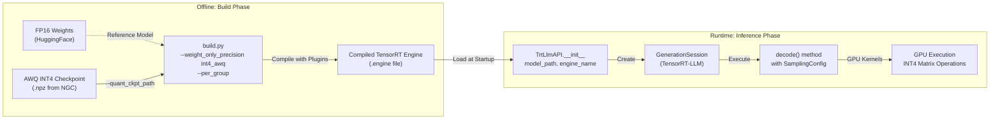
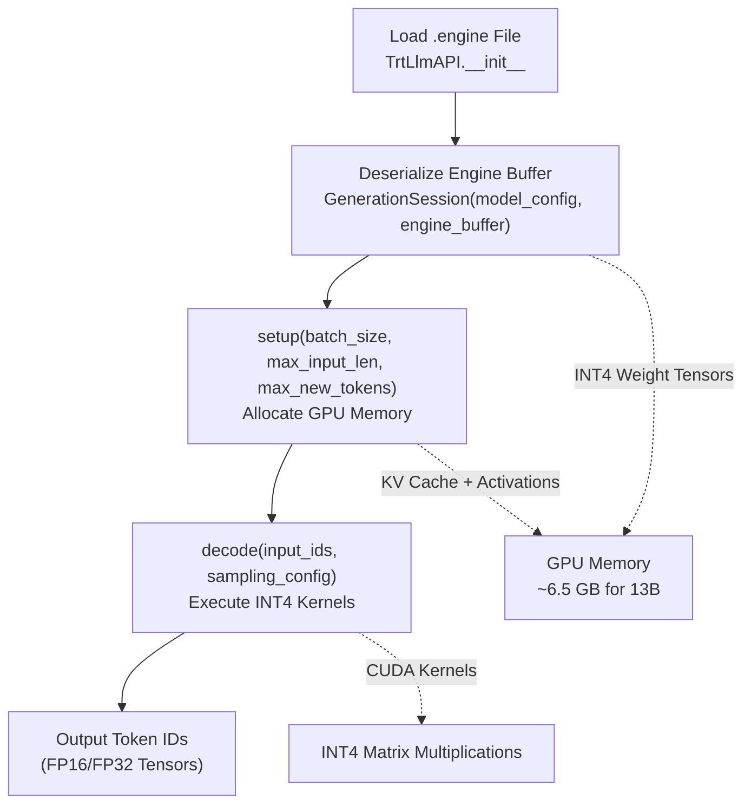
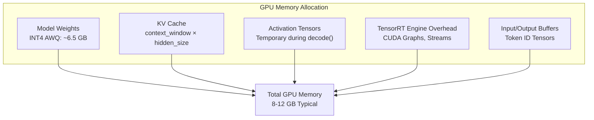
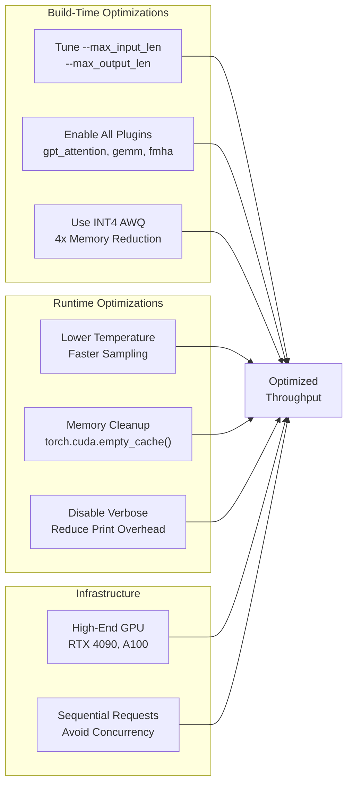

<!-- source: DeepWiki mcp.deepwiki.com · repo NVIDIA/trt-llm-as-openai-windows · page 7 Advanced Topics · fetched 2026-10-26 -->

# Advanced Topics

<details>
<summary>Relevant source files</summary>

The following files were used as context for generating this wiki page:

- [README.md](README.md)
- [trt_llama_api.py](trt_llama_api.py)

</details>


This page covers advanced usage patterns, optimization techniques, and technical considerations for the TensorRT-LLM OpenAI API system. It focuses on two primary areas: AWQ quantization methodology and performance optimization strategies.

For basic setup and configuration, see [Getting Started](#2). For API usage details, see [API Usage](#3). For implementation details of the core components, see [Architecture and Implementation](#4).

---

## 7.1 AWQ Quantization

AWQ (Activation-aware Weight Quantization) is a 4-bit quantization technique used to compress model weights, reducing GPU memory requirements while maintaining inference quality. This system exclusively uses AWQ int4 quantized weights downloaded from NVIDIA NGC Catalog.

### Quantization Method Overview

AWQ quantization reduces model weight precision from 16-bit floating point (FP16) to 4-bit integers (INT4), achieving approximately **4x memory compression**. Unlike naive quantization, AWQ preserves important weights that significantly impact activation distributions, minimizing accuracy degradation.



**Diagram: AWQ Quantization Pipeline from Build to Inference**

**Sources:**
- [README.md:26-31]()
- [README.md:38-45]()
- [trt_llama_api.py:266-273]()

### Build-Time Quantization Parameters

When compiling TensorRT engines, specific flags enable AWQ quantization. The `build.py` script from the TensorRT-LLM repository accepts these parameters:

| Parameter | Value | Purpose |
|-----------|-------|---------|
| `--use_weight_only` | (flag) | Enable weight-only quantization mode |
| `--weight_only_precision` | `int4_awq` | Specify AWQ 4-bit quantization |
| `--per_group` | (flag) | Use group-wise quantization for better accuracy |
| `--quant_ckpt_path` | `path/to/checkpoint.npz` | Path to pre-quantized AWQ weights from NGC |

Example CodeLlama build command:
```bash
python build.py \
    --use_weight_only \
    --weight_only_precision int4_awq \
    --per_group \
    --quant_ckpt_path codellama_13b_awq_int4.npz
```

The `--per_group` flag enables **group-wise quantization**, where weights are quantized in groups rather than per-channel, improving reconstruction accuracy. This is critical for maintaining model quality at INT4 precision.

**Sources:**
- [README.md:38-45]()

### Memory Savings Analysis

AWQ quantization provides substantial memory reduction:

| Model Configuration | FP16 Memory | INT4 AWQ Memory | Reduction |
|---------------------|-------------|-----------------|-----------|
| Llama-2-13B Weights | ~26 GB | ~6.5 GB | 75% |
| CodeLlama-13B Weights | ~26 GB | ~6.5 GB | 75% |

Memory formula for model weights:
- **FP16**: `num_parameters × 2 bytes`
- **INT4 AWQ**: `num_parameters × 0.5 bytes`

Additional memory overhead includes:
- KV cache for context window
- Activation tensors during inference
- CUDA graph allocations
- TensorRT engine overhead

Total GPU memory requirement typically ranges from **8-12 GB** for 13B parameter models with AWQ quantization, making them deployable on consumer GPUs (e.g., RTX 3090, RTX 4090).

**Sources:**
- [README.md:19]()
- [trt_llama_api.py:242-249]()

### Runtime Quantization Behavior

The quantized engine loaded by `TrtLlmAPI.__init__` at [trt_llama_api.py:266-273]() executes INT4 matrix multiplications on GPU. The `GenerationSession` object automatically handles dequantization during inference:

1. **Load Phase**: Engine buffer deserialized from `.engine` file
2. **Setup Phase**: `GenerationSession.setup()` allocates GPU memory based on quantization format
3. **Decode Phase**: `decode()` executes optimized INT4 CUDA kernels
4. **Output Phase**: Results are in FP16/FP32 format (dequantized internally)



**Diagram: Runtime Flow of Quantized Engine Execution**

**Sources:**
- [trt_llama_api.py:266-273]()
- [trt_llama_api.py:328]()
- [trt_llama_api.py:333]()

### Accuracy and Quality Trade-offs

AWQ quantization maintains high quality compared to naive INT4 quantization:

- **Perplexity degradation**: < 1% on standard benchmarks
- **Code generation**: Minimal impact on CodeLlama functionality
- **Conversational quality**: Llama-2-Chat retains instruction-following capability

The activation-aware approach specifically preserves weights that contribute most to maintaining activation distributions, resulting in better quality than uniform quantization schemes.

**Sources:**
- [README.md:5]()
- [README.md:19]()

---

## 7.2 Performance Considerations

This section analyzes performance factors, limitations, and optimization opportunities in the TensorRT-LLM inference pipeline.

### GPU Memory Requirements

GPU memory consumption consists of several components:



**Diagram: GPU Memory Allocation Components**

The `DEFAULT_CONTEXT_WINDOW` at [trt_llama_api.py:42]() is set to 3900 tokens, but this can be overridden during initialization. KV cache memory scales linearly with context window size:

**KV Cache Memory** = `2 × num_layers × context_window × hidden_size × 2 bytes`

For Llama-2-13B (40 layers, 5120 hidden size):
- 3900 tokens: ~3.2 GB
- 7800 tokens: ~6.4 GB
- 15360 tokens (CodeLlama max): ~12.6 GB

Memory management is performed explicitly after inference at [trt_llama_api.py:353-354]():
```python
torch.cuda.empty_cache()
gc.collect()
```

**Sources:**
- [trt_llama_api.py:42-43]()
- [trt_llama_api.py:353-354]()
- [trt_llama_api.py:328]()

### Context Window Constraints

Context window limits are configured at engine build time and cannot be changed without recompiling:

| Model | `--max_input_len` | `--max_output_len` | Total Context |
|-------|-------------------|---------------------|---------------|
| Llama-2-13B | 3500 | 1024 | 4524 |
| CodeLlama-13B | 15360 | 1024 | 16384 |

At runtime, the `TrtLlmAPI` class enforces these limits:

- `context_window` parameter in `__init__` (default: 3900)
- `max_new_tokens` parameter (default: 256 at [trt_llama_api.py:43]())
- Can be overridden via `--max_input_tokens` and `--max_output_tokens` CLI args

The `setup()` call at [trt_llama_api.py:328]() configures generation session:
```python
self._model.setup(input_lengths.size(0), max_input_length, self._max_new_tokens, 1)
```

Exceeding these limits causes CUDA errors or truncation. To increase limits, the engine must be rebuilt with larger `--max_input_len` and `--max_output_len` values.

**Sources:**
- [README.md:40-44]()
- [trt_llama_api.py:42-43]()
- [trt_llama_api.py:328]()

### Batch Size Limitations

The current implementation **hard-codes batch size to 1** at [trt_llama_api.py:328]():
```python
self._model.setup(input_lengths.size(0), max_input_length, self._max_new_tokens, 1)  # beam size is set to 1
```

This design choice has several implications:

**Advantages:**
- Simplifies request handling logic
- Reduces memory overhead
- Enables single-threaded Flask server (`threaded=False` at [app.py:180]())
- Avoids complexities of batched decoding

**Disadvantages:**
- Cannot process multiple requests concurrently
- Lower throughput for high-traffic scenarios
- Underutilizes GPU for small prompts

The Flask server processes requests **sequentially**, not concurrently. This matches the batch size limitation but limits scalability.

**Sources:**
- [trt_llama_api.py:328]()
- [trt_llama_api.py:430]()
- [app.py:180]()

### Parallelism Configuration

TensorRT-LLM supports two parallelism modes, but this implementation has restrictions:

#### Tensor Parallelism
Tensor parallelism (`tp_size`) is **supported** and configured at engine build time via `--tensor_parallel` parameter. The configuration is loaded at [trt_llama_api.py:224]():
```python
tp_size = config['builder_config']['tensor_parallel']
```

However, the provided build commands use `tp1` (tensor parallel size = 1), indicating single-GPU operation.

#### Pipeline Parallelism
Pipeline parallelism (`pp_size`) is **explicitly disabled** with an assertion at [trt_llama_api.py:251]():
```python
assert pp_size == 1, 'Python runtime does not support pipeline parallelism'
```

This limitation is due to the Python runtime backend used by `GenerationSession`. Multi-GPU pipeline parallelism requires the C++ runtime.

**Sources:**
- [trt_llama_api.py:224-226]()
- [trt_llama_api.py:251]()

### Token Throughput Metrics

The inference engine provides verbose timing information when `verbose=True` at [trt_llama_api.py:346-350]():

```python
print(f"Input context length  : {input_ids.shape[1]}")
print(f"Inference time        : {elapsed_time:.2f} seconds")
print(f"Output context length : {len(output_token_ids)} ")
print(f"Inference token/sec   : {(len(output_token_ids) / elapsed_time):2f}")
```

Typical throughput on RTX 4090 with AWQ INT4:
- **Prefill phase**: ~1000-2000 tokens/sec (input processing)
- **Decode phase**: ~40-80 tokens/sec (generation)

Decode phase is the bottleneck for most applications. Throughput is affected by:
- Context length (longer contexts = more KV cache operations)
- Output length
- Temperature setting (higher = more sampling overhead)
- GPU model and CUDA capability

**Sources:**
- [trt_llama_api.py:329-350]()

### Optimization Techniques

Several optimization techniques are employed:

#### 1. Plugin Configuration
Plugins are enabled during engine build to accelerate specific operations:
- `--use_gpt_attention_plugin float16`: Optimized attention kernels
- `--enable_context_fmha`: Flash attention for context processing
- `--use_gemm_plugin float16`: Optimized matrix multiplications
- `--remove_input_padding` (CodeLlama): Skip padding for variable-length inputs

Configuration is validated at runtime at [trt_llama_api.py:222-223]():
```python
use_gpt_attention_plugin = config['plugin_config']['gpt_attention_plugin']
remove_input_padding = config['plugin_config']['remove_input_padding']
```

**Sources:**
- [README.md:40]()
- [trt_llama_api.py:222-223]()
- [trt_llama_api.py:247-248]()

#### 2. CUDA Device Management
GPU device selection is performed at initialization at [trt_llama_api.py:259]():
```python
torch.cuda.set_device(runtime_rank % runtime_mapping.gpus_per_node)
```

For single-GPU setups, this ensures deterministic device selection.

**Sources:**
- [trt_llama_api.py:254-259]()

#### 3. Paged KV Cache
The engine configuration includes `paged_kv_cache` at [trt_llama_api.py:234]():
```python
paged_kv_cache = config['plugin_config']['paged_kv_cache']
```

Paged KV cache reduces memory fragmentation by allocating cache in fixed-size pages rather than contiguous blocks, improving memory efficiency for variable-length sequences.

**Sources:**
- [trt_llama_api.py:234]()
- [trt_llama_api.py:248]()

#### 4. Streaming Decode
For streaming responses, the `decode()` method supports incremental generation at [trt_llama_api.py:432]():
```python
output_ids = self._model.decode(input_ids, input_lengths, self._sampling_config, streaming=True)
```

This returns a generator that yields partial outputs, enabling server-sent events (SSE) without waiting for full completion.

**Sources:**
- [trt_llama_api.py:432]()
- [trt_llama_api.py:454-467]()

### Temperature and Sampling Configuration

The `SamplingConfig` object controls generation behavior at [trt_llama_api.py:261-264]():
```python
self._sampling_config = SamplingConfig(end_id=EOS_TOKEN,
                                       pad_id=PAD_TOKEN,
                                       num_beams=1,
                                       temperature=temperature)
```

Key parameters:
- `temperature`: Controls randomness (0.0 = deterministic, 1.0 = more random)
- `num_beams`: Fixed at 1 (no beam search)
- `end_id`: Token ID 2 for EOS
- `pad_id`: Token ID 2 for padding

Temperature can be overridden per-request at [trt_llama_api.py:332]():
```python
self._sampling_config.temperature = temperature
```

Higher temperatures increase sampling randomness but also increase computational overhead due to multinomial sampling.

**Sources:**
- [trt_llama_api.py:261-264]()
- [trt_llama_api.py:316]()
- [trt_llama_api.py:332]()

### Performance Tuning Recommendations



**Diagram: Performance Optimization Strategy**

**Recommendations:**

1. **Build optimal engines**: Use largest `--max_input_len` your GPU can support
2. **Enable all plugins**: Don't skip `--enable_context_fmha` or other accelerations
3. **Use appropriate temperature**: 0.1-0.3 for deterministic, 0.7-1.0 for creative
4. **Monitor GPU memory**: Use `nvidia-smi` to track utilization
5. **Sequential processing**: Don't attempt concurrent requests with batch_size=1
6. **Cleanup between requests**: Let garbage collection reclaim memory

**Sources:**
- [README.md:38-45]()
- [trt_llama_api.py:353-354]()
- [trt_llama_api.py:328]()

---

