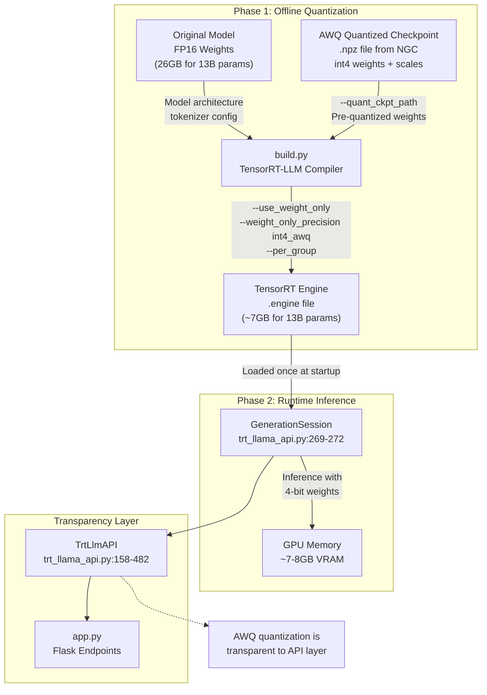
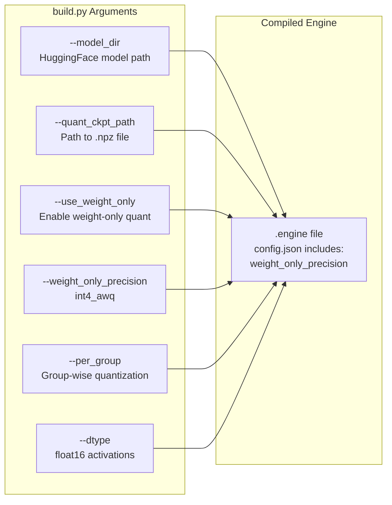
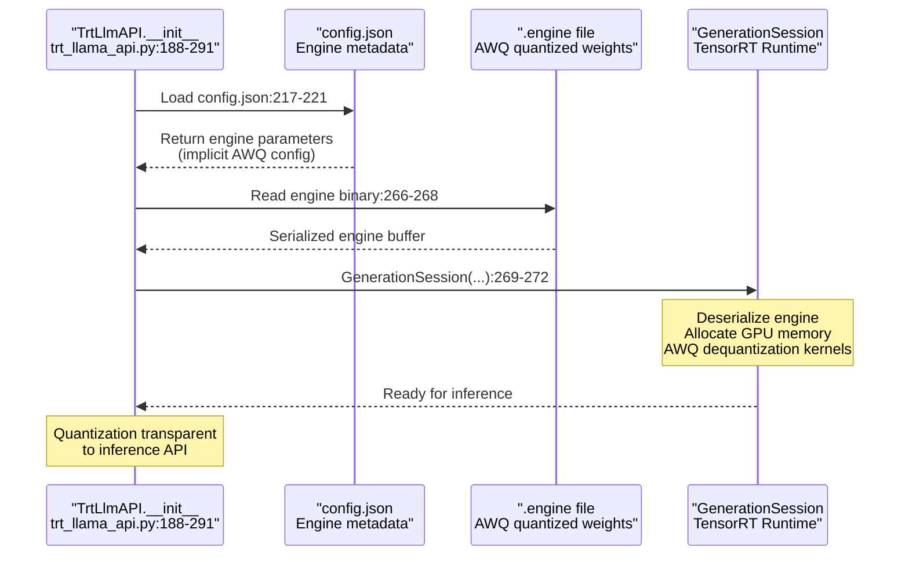
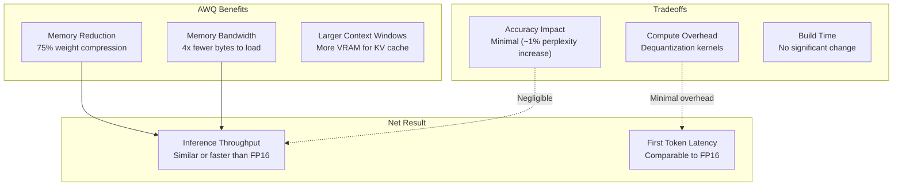

<!-- source: DeepWiki mcp.deepwiki.com · repo NVIDIA/trt-llm-as-openai-windows · page 7.1 AWQ Quantization · fetched 2026-10-26 -->

# AWQ Quantization

<details>
<summary>Relevant source files</summary>

The following files were used as context for generating this wiki page:

- [README.md](README.md)
- [trt_llama_api.py](trt_llama_api.py)

</details>


## Purpose and Scope

This document explains the AWQ (Activation-aware Weight Quantization) 4-bit quantization scheme used in this system to reduce model memory footprint and accelerate inference. AWQ quantization is applied during the offline engine building phase and remains transparent to the runtime API layer. This page covers the quantization methodology, where to obtain pre-quantized weights, how to configure quantization during engine compilation, and the performance implications for inference.

For information about building TensorRT engines in general (including non-quantized builds), see [Building TensorRT Engines](#2.2.2). For runtime performance considerations beyond quantization, see [Performance Considerations](#7.2).

---

## AWQ Quantization Overview

AWQ quantization compresses model weights from 16-bit floating point (FP16) to 4-bit integers, reducing memory requirements by approximately 75% while maintaining accuracy through activation-aware scaling. Unlike naive quantization schemes, AWQ protects salient weights that have larger activation magnitudes, minimizing accuracy loss.

### Quantization Pipeline



**Sources:**
- [README.md:19]()
- [README.md:26-31]()
- [trt_llama_api.py:269-272]()

---

## Quantized Weight Sources

Pre-quantized AWQ checkpoints are distributed by NVIDIA through the NGC (NVIDIA GPU Cloud) catalog. These checkpoints contain weights already quantized to 4-bit precision with per-group scaling factors.

### Available AWQ Checkpoints

| Model | Base Model Source | AWQ Checkpoint Source | File Format |
|-------|-------------------|----------------------|-------------|
| CodeLlama-13B-Instruct | [HuggingFace](https://huggingface.co/codellama/CodeLlama-13b-Instruct-hf) | [NGC CodeLlama v1.1](https://catalog.ngc.nvidia.com/orgs/nvidia/models/code_llama/files?version=1.1) | `.npz` |
| Llama-2-13B-Chat | [HuggingFace](https://huggingface.co/meta-llama/Llama-2-13b-chat-hf) | [NGC Llama2-13B v1.3](https://catalog.ngc.nvidia.com/orgs/nvidia/models/llama2-13b/files?version=1.3) | `.npz` |

The `.npz` files contain:
- Quantized int4 weight tensors
- Per-group scaling factors
- Zero-point values for dequantization

**Sources:**
- [README.md:26-31]()

---

## Engine Compilation with AWQ

AWQ quantization is configured during the TensorRT engine build process via `build.py` command-line arguments. The quantization parameters are baked into the compiled `.engine` file and cannot be modified at runtime.

### AWQ Build Parameters



### CodeLlama-13B Build Command

The following command from [README.md:38-41]() demonstrates AWQ quantization for CodeLlama:

```bash
python build.py \
  --model_dir <path to CodeLlama model> \
  --quant_ckpt_path <path to CodeLlama .npz file> \
  --dtype float16 \
  --use_weight_only \
  --weight_only_precision int4_awq \
  --per_group \
  --max_batch_size 1 \
  --max_input_len 15360 \
  --max_output_len 1024 \
  --output_dir <TRT engine folder> \
  --rotary_base 1000000 \
  --vocab_size 32064
```

### Llama-2-13B Build Command

From [README.md:42-45]():

```bash
python build.py \
  --model_dir <path to llama13_chat model> \
  --quant_ckpt_path <path to Llama2 .npz file> \
  --dtype float16 \
  --use_weight_only \
  --weight_only_precision int4_awq \
  --per_group \
  --max_batch_size 1 \
  --max_input_len 3500 \
  --max_output_len 1024 \
  --output_dir <TRT engine folder>
```

### Key Parameters Explained

| Parameter | Value | Purpose |
|-----------|-------|---------|
| `--use_weight_only` | Flag | Enables weight-only quantization (activations remain FP16) |
| `--weight_only_precision` | `int4_awq` | Specifies AWQ 4-bit quantization scheme |
| `--per_group` | Flag | Enables per-group (typically 128 elements) quantization for better accuracy |
| `--dtype` | `float16` | Activation dtype remains FP16; only weights are quantized |
| `--quant_ckpt_path` | Path to `.npz` | Pre-quantized weights from NGC |

**Sources:**
- [README.md:38-45]()

---

## Runtime Behavior

At runtime, AWQ quantization is completely transparent to the API layer. The `TrtLlmAPI` class loads the pre-compiled engine without awareness of the underlying quantization scheme.

### Engine Loading Sequence



The engine's `config.json` file (loaded at [trt_llama_api.py:217-221]()) contains quantization metadata, but the `TrtLlmAPI` class does not explicitly handle AWQ-specific logic. The TensorRT runtime automatically uses specialized CUDA kernels for dequantizing 4-bit weights during inference.

### Inference Path

During inference at [trt_llama_api.py:328-334]():

1. **Tokenization**: Input text converted to token IDs (FP32/INT32)
2. **Model Setup**: `GenerationSession.setup()` prepares buffers
3. **Decode**: `GenerationSession.decode()` performs inference
   - Weights remain in 4-bit format in GPU memory
   - Dequantization happens on-the-fly in CUDA kernels
   - Activations computed in FP16
4. **Detokenization**: Output tokens converted back to text

**Sources:**
- [trt_llama_api.py:188-291]()
- [trt_llama_api.py:217-221]()
- [trt_llama_api.py:266-272]()
- [trt_llama_api.py:328-334]()

---

## Memory and Performance Impact

AWQ quantization provides substantial memory savings with minimal accuracy degradation, enabling larger context windows and faster inference on consumer GPUs.

### Memory Comparison

| Configuration | Weights Size | Total GPU VRAM | Notes |
|---------------|-------------|----------------|-------|
| FP16 (unquantized) | ~26GB | ~28-30GB | Requires A100 or H100 |
| AWQ INT4 | ~6.5GB | ~7-8GB | Fits on RTX 4090 (24GB) |
| **Memory Reduction** | **~75%** | **~73%** | 4x compression ratio |

### Performance Characteristics



### Observed Performance (CodeLlama-13B)

Based on system configuration from [README.md:40-41]():

- **Max Input Length**: 15,360 tokens (enabled by reduced memory usage)
- **Max Output Length**: 1,024 tokens
- **Batch Size**: 1 (single request inference)
- **GPU Memory Usage**: ~7-8GB during inference

The single-batch limitation at [trt_llama_api.py:328]() (`self._model.setup(input_lengths.size(0), max_input_length, self._max_new_tokens, 1)`) is not specific to AWQ quantization but rather a design choice for this implementation.

**Sources:**
- [README.md:40-41]()
- [trt_llama_api.py:328]()

---

## Configuration Verification

To verify that an engine uses AWQ quantization, examine the `config.json` file in the engine directory:

```json
{
  "builder_config": {
    "precision": "float16",
    "weight_only_precision": "int4_awq",
    ...
  },
  "plugin_config": {
    ...
  }
}
```

The presence of `"weight_only_precision": "int4_awq"` confirms AWQ quantization. This configuration is read by `TrtLlmAPI.__init__` but not explicitly validated for AWQ-specific values.

**Sources:**
- [trt_llama_api.py:220-221]()

---

## Limitations and Considerations

1. **GPU-Specific Engines**: Engines compiled with AWQ quantization are tied to the specific GPU architecture and cannot be transferred between different GPU models.

2. **No Runtime Reconfiguration**: Quantization parameters are baked into the engine at build time and cannot be changed without recompiling.

3. **Pre-Quantized Weights Required**: This system requires pre-quantized checkpoints from NGC. Custom quantization of arbitrary models is not supported without external tools.

4. **Accuracy Validation**: While AWQ minimizes accuracy loss, applications requiring strict numerical precision should validate outputs against FP16 baselines.

**Sources:**
- [README.md:19]()
- [README.md:38-45]()

---

