<!-- source: DeepWiki mcp.deepwiki.com · repo NVIDIA/trt-llm-as-openai-windows · page 7.2 Performance Considerations · fetched 2026-10-26 -->

# Performance Considerations

<details>
<summary>Relevant source files</summary>

The following files were used as context for generating this wiki page:

- [README.md](README.md)
- [app.py](app.py)
- [trt_llama_api.py](trt_llama_api.py)

</details>


This document explains the performance characteristics and constraints of the TensorRT-LLM OpenAI API system. It covers GPU memory requirements, throughput limitations, context window constraints, and optimization strategies for maximizing inference performance.

For information about AWQ quantization techniques that reduce memory usage, see [AWQ Quantization](#7.1). For server configuration options that affect performance, see [Server Configuration](#5.1).

---

## GPU Memory Requirements

The system's GPU memory footprint is determined by the compiled TensorRT engine size, model architecture, and runtime allocations. AWQ 4-bit quantization significantly reduces memory requirements compared to full-precision models.

### Memory Allocation Components

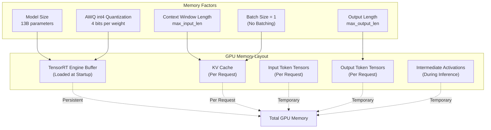

**Sources:** [trt_llama_api.py:188-273](), [README.md:38-45]()

### Engine Size Estimates

The compiled TensorRT engine size depends on model architecture and quantization settings:

| Model | Precision | Parameters | Approximate Engine Size |
|-------|-----------|------------|------------------------|
| Llama-2-13B | AWQ int4 | 13B | ~7-8 GB |
| CodeLlama-13B | AWQ int4 | 13B | ~7-8 GB |
| Llama-2-13B | float16 (unquantized) | 13B | ~26 GB |

The engine is loaded once at server startup and remains resident in GPU memory throughout the server's lifetime [trt_llama_api.py:266-272]().

**Sources:** [README.md:19-31](), [trt_llama_api.py:266-273]()

### Runtime Memory Scaling

KV cache memory scales linearly with context window size and is allocated per request:

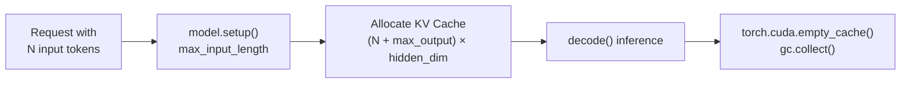

The system explicitly performs memory cleanup after each request [trt_llama_api.py:352-354]():
- `torch.cuda.empty_cache()` - Releases unused cached memory
- `gc.collect()` - Runs Python garbage collector

**Sources:** [trt_llama_api.py:328-354]()

---

## Context Window and Token Limits

Context window size directly impacts both memory usage and maximum conversation length. The system enforces different limits based on the model and build configuration.

### Model-Specific Limits

| Model | `max_input_len` | `max_output_len` | Total Context Window |
|-------|-----------------|------------------|---------------------|
| CodeLlama-13B | 15360 | 1024 | 16384 |
| Llama-2-13B | 3500 | 1024 | 4524 |

These limits are set during engine compilation and cannot be exceeded at runtime [README.md:38-45](). The CodeLlama model supports a significantly larger context window due to its `--rotary_base 1000000` parameter, which extends rotary position embeddings.

**Sources:** [README.md:38-45]()

### Token Limit Enforcement

The server allows optional overrides for maximum token counts via command-line arguments:

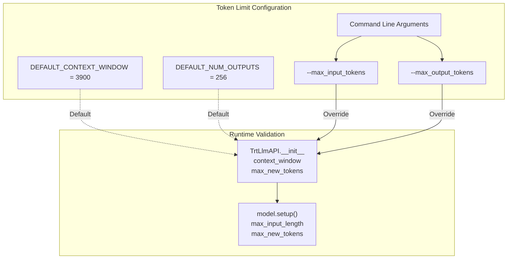

The application-level defaults [trt_llama_api.py:42-43]() are conservative (3900 input, 256 output) but can be overridden [app.py:47-48]():
- `--max_input_tokens` - Maximum input token count
- `--max_output_tokens` - Maximum output token count

These values must not exceed the engine's compiled limits or inference will fail.

**Sources:** [app.py:47-48](), [trt_llama_api.py:42-43](), [trt_llama_api.py:194-195]()

### Token Count Calculation

Token counting occurs during request processing:

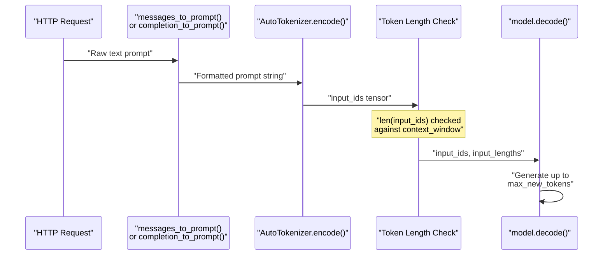

Input token count is determined after prompt formatting but before inference [trt_llama_api.py:323-325](), ensuring special tokens (BOS, EOS, INST, SYS) are included in the count.

**Sources:** [trt_llama_api.py:323-386]()

---

## Throughput and Latency Characteristics

The system is optimized for low latency single-user inference rather than high throughput multi-user serving. Several architectural decisions prioritize response time over concurrent request handling.

### Single-Threaded Request Processing

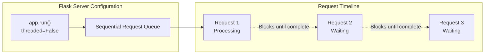

The server runs with `threaded=False` [app.py:217](), forcing sequential request processing. This design choice likely stems from TensorRT-LLM thread-safety constraints and GPU contention issues. Multiple concurrent requests would compete for GPU resources, degrading performance for all requests.

**Impact:**
- **Latency per request:** Low (no queueing overhead)
- **Concurrent request handling:** Poor (strict FIFO queue)
- **Use case fit:** Single-user applications, development, testing

**Sources:** [app.py:217]()

### Batch Size = 1 Limitation

The engine is compiled with `--max_batch_size 1` [README.md:40, 44](), preventing request batching:

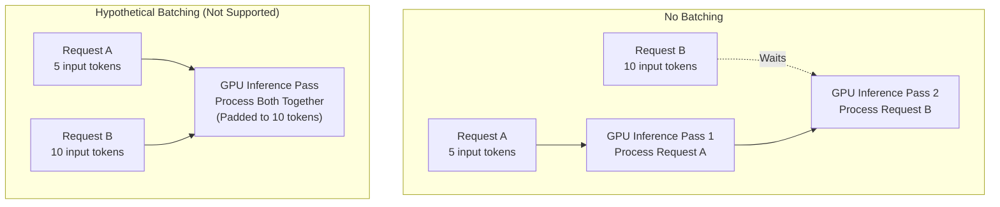

This configuration simplifies memory management and reduces latency for individual requests, but prevents throughput optimization via batching. The `model.setup()` call [trt_llama_api.py:328]() always specifies `batch_size=input_lengths.size(0)`, which is 1 for single-request processing.

**Sources:** [README.md:40](), [README.md:44](), [trt_llama_api.py:328]()

### Inference Time Components

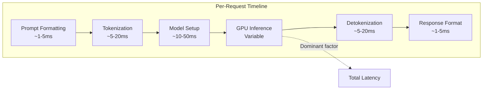

The majority of request time is spent in GPU inference [trt_llama_api.py:328-339](), which scales with:
1. **Input token count** - Prefill phase processes all input tokens
2. **Output token count** - Decode phase generates one token per iteration
3. **Model size** - 13B parameters require more compute per token
4. **Quantization** - AWQ int4 provides ~2-3x speedup vs float16

When verbose mode is enabled [trt_llama_api.py:329-350](), the system logs detailed timing information:
- Input context length (token count)
- Inference time in seconds
- Output context length (generated tokens)
- Tokens per second throughput

**Sources:** [trt_llama_api.py:313-365]()

### Streaming vs Non-Streaming Performance

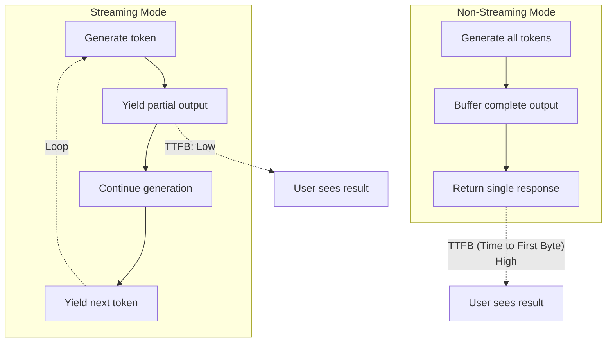

Streaming mode [trt_llama_api.py:416-481]() provides better perceived latency by yielding tokens incrementally via Server-Sent Events (SSE). The generator function [trt_llama_api.py:434-481]() yields data as soon as each token is decoded, rather than waiting for complete generation.

**Trade-offs:**
- **Streaming:** Lower TTFB, better UX, slightly higher overhead per token
- **Non-streaming:** Higher TTFB, lower overhead, simpler error handling

**Sources:** [trt_llama_api.py:416-481](), [trt_llama_api.py:313-365]()

---

## Optimization Strategies

### Memory Optimization

**1. Engine Compilation Settings**

Optimize memory usage during engine build [README.md:38-45]():

| Parameter | Purpose | Memory Impact |
|-----------|---------|---------------|
| `--dtype float16` | Use half-precision | Baseline for quantized models |
| `--use_weight_only --weight_only_precision int4_awq` | AWQ 4-bit quantization | ~75% memory reduction |
| `--per_group` | Group-wise quantization | Slight memory overhead, better accuracy |
| `--enable_context_fmha` | Fused multi-head attention | Reduces activation memory |
| `--use_gpt_attention_plugin float16` | Optimized attention kernel | Faster with similar memory |
| `--remove_input_padding` | Remove padding tokens | Reduces memory for variable-length inputs |

**2. Runtime Memory Management**

The system implements automatic memory cleanup [trt_llama_api.py:352-354]():
```python
torch.cuda.empty_cache()
gc.collect()
```

This is critical for long-running servers to prevent memory fragmentation. However, it adds ~5-10ms overhead per request.

**3. Context Window Right-Sizing**

Set `--max_input_tokens` to the minimum required for your use case [app.py:48](). Smaller context windows reduce KV cache allocation and improve throughput.

**Sources:** [README.md:38-45](), [trt_llama_api.py:352-354](), [app.py:48]()

### Latency Optimization

**1. Reduce Prompt Formatting Overhead**

For applications with fixed prompt structures, consider pre-formatting prompts and using the `formatted=True` flag [trt_llama_api.py:315](), [app.py:160]() to skip runtime formatting:

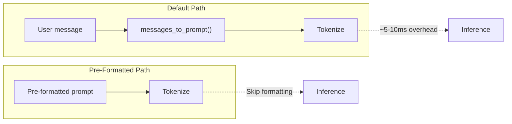

**2. Temperature Settings**

Temperature affects sampling complexity [trt_llama_api.py:332]():
- `temperature=0.0`: Greedy decoding (fastest)
- `temperature=1.0`: Full sampling distribution (slower)
- `temperature>1.0`: Increased randomness (slower)

Lower temperatures reduce sampling overhead by simplifying probability calculations.

**3. Beam Size**

The system uses `beam_size=1` [trt_llama_api.py:328]() (greedy decoding). Increasing beam size would exponentially increase computation and memory, so this is optimal for latency.

**Sources:** [trt_llama_api.py:315](), [trt_llama_api.py:328](), [trt_llama_api.py:332](), [app.py:160]()

### Throughput Optimization (Architectural Limitations)

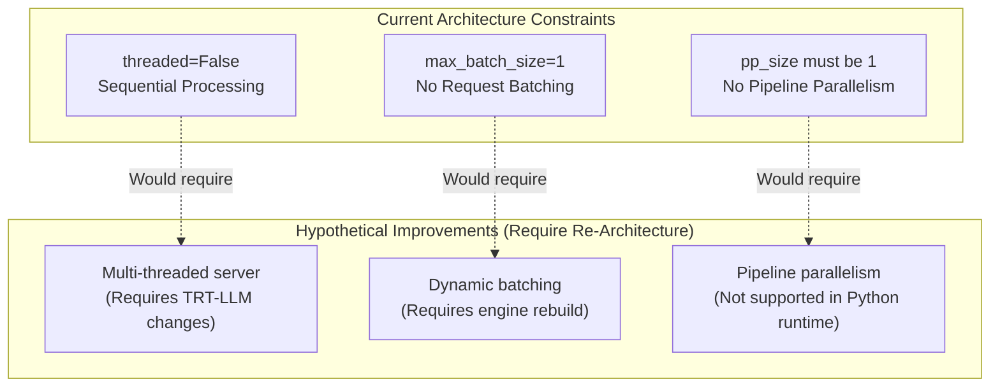

The current architecture is fundamentally limited for high-throughput scenarios:

1. **Thread-safety:** TensorRT-LLM Python runtime is not thread-safe, preventing concurrent inference
2. **Batching:** Engine compiled with `batch_size=1`, requiring recompilation to support batching
3. **Pipeline parallelism:** Python runtime assertion [trt_llama_api.py:251]() explicitly prevents `pp_size > 1`

For high-throughput production deployments, consider:
- Using TensorRT-LLM's C++ runtime with batching support
- Deploying multiple server instances behind a load balancer
- Implementing request queuing with worker pools

**Sources:** [app.py:217](), [trt_llama_api.py:251](), [README.md:40]()

### Tensor Parallelism

The system supports tensor parallelism for distributing model layers across multiple GPUs:

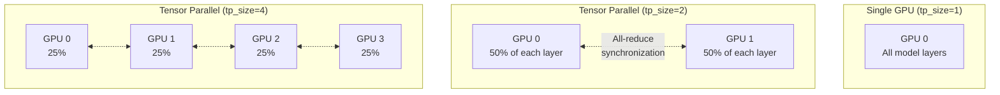

Tensor parallelism [trt_llama_api.py:224-259]() splits weight matrices across GPUs, reducing per-GPU memory requirements but adding communication overhead. This is beneficial when:
- Model doesn't fit on single GPU
- Multiple GPUs are available
- Communication bandwidth is high (NVLink)

The `tp_size` is set during engine compilation (not shown in this repository's build commands). The runtime validates that `tp_size * pp_size == world_size` [trt_llama_api.py:227-228]().

**Sources:** [trt_llama_api.py:224-259]()

---

## Performance Monitoring

### Verbose Mode Logging

Enable verbose output to track performance metrics [app.py:38-39](), [trt_llama_api.py:329-350]():

```
Input context length  : 1234
Inference time        : 5.67 seconds
Output context length : 256
Inference token/sec   : 45.15
```

This provides per-request visibility into:
- Tokenized input length (including special tokens)
- Wall-clock inference time
- Generated token count
- Generation throughput

**Sources:** [app.py:38-39](), [trt_llama_api.py:329-350]()

### GPU Utilization Monitoring

Use external tools to monitor GPU metrics during operation:

| Tool | Metrics | Usage |
|------|---------|-------|
| `nvidia-smi` | GPU memory, utilization, power | `nvidia-smi -l 1` |
| `nvidia-smi dmon` | Per-process GPU usage | `nvidia-smi dmon -s pucvmet` |
| NVML API | Programmatic access | Via `pynvml` library |

TensorRT-LLM operations are CUDA-synchronous [trt_llama_api.py:334](), ensuring accurate timing measurements but potentially leaving GPU underutilized during CPU-bound phases (tokenization, formatting).

**Sources:** [trt_llama_api.py:334]()

---

## Performance Expectations

### Typical Latency Ranges

Based on the system architecture and configuration:

| Scenario | Input Tokens | Output Tokens | Estimated Latency |
|----------|--------------|---------------|-------------------|
| Short chat response | 100-500 | 50-100 | 2-4 seconds |
| Medium conversation | 500-2000 | 100-300 | 5-12 seconds |
| Long context (CodeLlama) | 5000-15000 | 100-500 | 20-60 seconds |
| Code generation | 1000-3000 | 500-1000 | 15-40 seconds |

These estimates assume:
- NVIDIA RTX 3080 or better
- AWQ int4 quantization
- Single request (no queueing)
- `temperature=1.0`

**Actual performance varies significantly based on:**
1. GPU compute capability (SM version)
2. Available VRAM and bandwidth
3. Driver and CUDA version
4. CPU preprocessing overhead
5. Prompt complexity (impacts prefill phase)

**Sources:** [README.md:38-45](), [trt_llama_api.py:313-365]()

---

## Summary

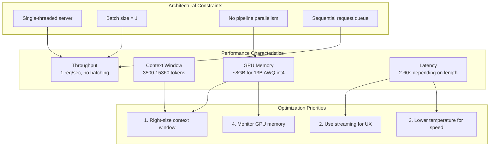

The TensorRT-LLM OpenAI API system is optimized for single-user, low-latency inference scenarios. Its performance characteristics make it well-suited for development, testing, and single-user productivity tools, but not for high-throughput multi-user serving without architectural modifications.

**Key takeaways:**
- Memory usage dominated by compiled engine (~8GB for 13B AWQ int4)
- Context window limits set at engine compile time
- Sequential request processing limits concurrent users
- Streaming mode improves perceived latency
- Tensor parallelism available for multi-GPU scaling
- Verbose logging provides detailed per-request metrics

**Sources:** [app.py:1-218](), [trt_llama_api.py:1-482](), [README.md:1-154]()

---

