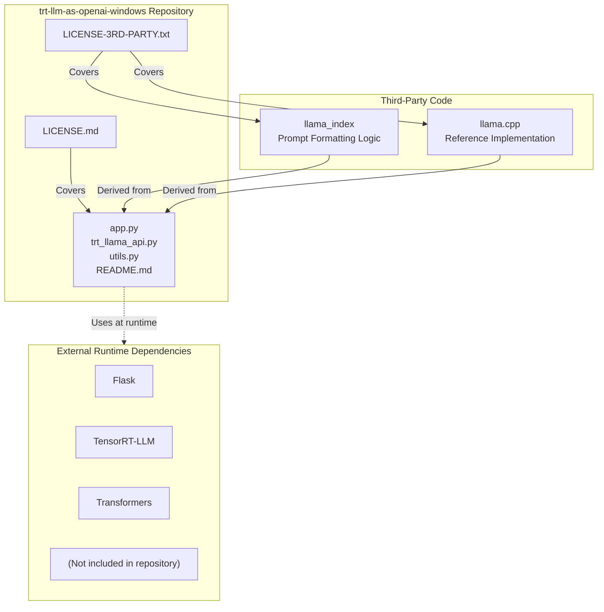
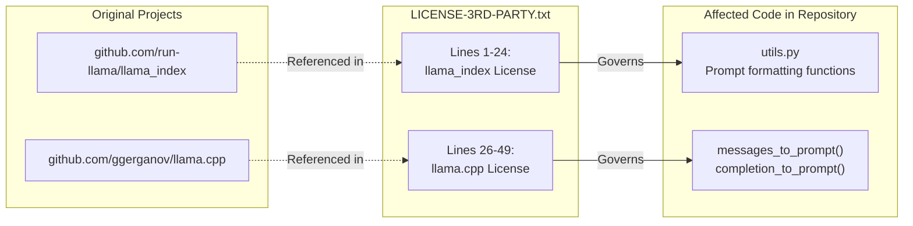
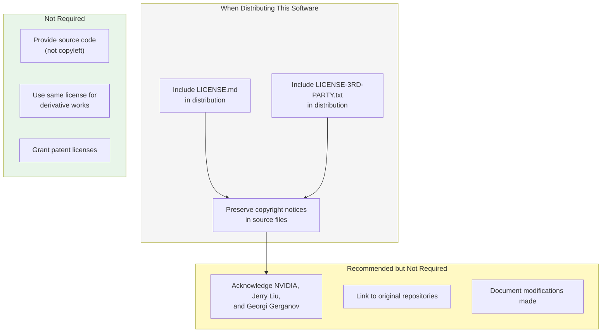

<!-- source: DeepWiki mcp.deepwiki.com · repo NVIDIA/trt-llm-as-openai-windows · page 8 Legal Information · fetched 2026-10-26 -->

# Legal Information

<details>
<summary>Relevant source files</summary>

The following files were used as context for generating this wiki page:

- [LICENSE-3RD-PARTY.txt](LICENSE-3RD-PARTY.txt)
- [LICENSE.md](LICENSE.md)

</details>


This document provides comprehensive licensing information for the TensorRT-LLM OpenAI API system. It covers the project's own license terms and the licenses of third-party dependencies included in the codebase. All software components in this repository use MIT License terms, ensuring permissive usage rights for end users.

For information about configuring and customizing the system, see [Configuration Reference](#5). For details on third-party Python packages listed in `requirements.txt`, refer to [Dependencies](#6.2).

---

## License Structure Overview



**Diagram: Licensing Coverage Relationships**

The repository contains two license files that govern different components. `LICENSE.md` applies to all original code written for this project, including the Flask application layer, TensorRT-LLM wrapper, and utility functions. `LICENSE-3RD-PARTY.txt` documents the licenses for code derived from external projects (llama_index and llama.cpp) that has been incorporated into this codebase. External runtime dependencies installed via `requirements.txt` are governed by their own licenses and are not included in this repository.

**Sources:**
- [LICENSE.md:1-8]()
- [LICENSE-3RD-PARTY.txt:1-49]()

---

## Project License

The TensorRT-LLM OpenAI API system is distributed under the **MIT License**, with copyright held by NVIDIA CORPORATION & AFFILIATES.

### License Location

The full license text is located in [LICENSE.md:1-8]().

### License Header

```
SPDX-FileCopyrightText: Copyright (c) 2023 NVIDIA CORPORATION & AFFILIATES. All rights reserved.
SPDX-License-Identifier: MIT
```

The SPDX (Software Package Data Exchange) identifiers provide machine-readable license metadata for automated compliance tools.

**Sources:**
- [LICENSE.md:1-2]()

### Permitted Uses

The MIT License grants the following permissions without restriction:

| Permission | Description |
|------------|-------------|
| **Use** | Run the software for any purpose, including commercial applications |
| **Copy** | Make copies of the software and distribute them |
| **Modify** | Alter the source code to suit specific needs |
| **Merge** | Combine this software with other projects |
| **Publish** | Share the software publicly through any medium |
| **Distribute** | Provide copies to third parties |
| **Sublicense** | Grant subset of these rights to downstream users |
| **Sell** | Include in commercial products or services |

**Sources:**
- [LICENSE.md:4]()

### License Conditions

The MIT License requires:

1. **Attribution**: The copyright notice and permission notice must be included in all copies or substantial portions of the software.
2. **No Warranty Disclaimer**: The software is provided "as is" without warranty of any kind.

These conditions are minimal compared to copyleft licenses (e.g., GPL), making the MIT License highly permissive for both open-source and proprietary projects.

**Sources:**
- [LICENSE.md:6-7]()

### Disclaimer of Liability

The license explicitly disclaims liability for:

- Merchantability fitness
- Fitness for a particular purpose
- Non-infringement of third-party rights
- Any damages arising from use of the software

This disclaimer protects NVIDIA from legal claims related to software defects, performance issues, or unintended consequences of use.

**Sources:**
- [LICENSE.md:8]()

---

## Third-Party Licenses

The codebase includes components derived from two external projects, both under MIT License. These are documented in [LICENSE-3RD-PARTY.txt:1-49]().



**Diagram: Third-Party License File Structure**

**Sources:**
- [LICENSE-3RD-PARTY.txt:1-49]()

### llama_index License

**Copyright Holder:** Jerry Liu  
**License Type:** MIT License  
**Source URL:** https://github.com/run-llama/llama_index/blob/main/LICENSE  
**File Location:** [LICENSE-3RD-PARTY.txt:1-24]()

The llama_index project provides prompt formatting utilities for large language models. Code derived from this project is primarily located in `utils.py`, specifically:

- `messages_to_prompt()` function for chat message formatting
- `completion_to_prompt()` function for text completion formatting
- Prompt template structures with special tokens (BOS, EOS, INST, SYS)

The MIT License from llama_index grants the same permissive rights as the project license: use, copy, modify, merge, publish, distribute, sublicense, and sell, with only attribution requirements.

**Sources:**
- [LICENSE-3RD-PARTY.txt:2-24]()

### llama.cpp License

**Copyright Holder:** Georgi Gerganov  
**License Type:** MIT License  
**Source URL:** https://github.com/ggerganov/llama.cpp/blob/master/LICENSE  
**File Location:** [LICENSE-3RD-PARTY.txt:26-49]()

The llama.cpp project is a reference implementation for running LLaMA models. Derived code elements include:

- Token delimiter formatting conventions
- Prompt structure patterns for instruction-following models
- Best practices for special token handling

The MIT License from llama.cpp provides identical permissions to the llama_index license, ensuring compatibility across all components.

**Sources:**
- [LICENSE-3RD-PARTY.txt:27-49]()

---

## License Compatibility Analysis

All licenses in this project are MIT License or compatible, creating a simple licensing landscape:

| Component | License | Copyright Holder | Compatibility |
|-----------|---------|------------------|---------------|
| **Project Code** | MIT | NVIDIA CORPORATION & AFFILIATES | Base license |
| **llama_index** | MIT | Jerry Liu | ✓ Compatible |
| **llama.cpp** | MIT | Georgi Gerganov | ✓ Compatible |

### Compatibility with External Dependencies

The project's MIT License is compatible with all runtime dependencies specified in `requirements.txt`:

| Dependency | Typical License | Compatibility Notes |
|------------|-----------------|---------------------|
| Flask | BSD-3-Clause | ✓ Permissive, compatible with MIT |
| tensorrt_llm | Apache 2.0 | ✓ Permissive, compatible with MIT |
| transformers | Apache 2.0 | ✓ Permissive, compatible with MIT |
| pydantic | MIT | ✓ Same license |
| numpy | BSD-3-Clause | ✓ Permissive, compatible with MIT |
| torch | BSD-3-Clause | ✓ Permissive, compatible with MIT |

No copyleft licenses (GPL, LGPL, AGPL) are present in the dependency tree, avoiding viral licensing concerns for proprietary downstream use.

**Sources:**
- [LICENSE.md:1-8]()
- [LICENSE-3RD-PARTY.txt:1-49]()

---

## Compliance Requirements



**Diagram: License Compliance Requirements**

To comply with all license terms when distributing this software:

1. **Required**: Include both [LICENSE.md:1-8]() and [LICENSE-3RD-PARTY.txt:1-49]() in any distribution (source or binary).
2. **Required**: Preserve all copyright notices in source code files.
3. **Recommended**: Provide attribution to NVIDIA, Jerry Liu (llama_index), and Georgi Gerganov (llama.cpp) in documentation.
4. **Not Required**: Release derivative works under MIT License (any license is acceptable).
5. **Not Required**: Provide source code for binary distributions (MIT is not copyleft).

**Sources:**
- [LICENSE.md:6]()
- [LICENSE-3RD-PARTY.txt:15-16]()
- [LICENSE-3RD-PARTY.txt:40-41]()

---

## Summary

This repository uses a three-layer licensing structure:

1. **Project License (MIT)**: Covers all original code written for TensorRT-LLM OpenAI API integration.
2. **Third-Party Licenses (MIT)**: Covers code derived from llama_index and llama.cpp projects.
3. **External Dependencies**: Runtime dependencies have their own licenses (not included in repository).

All licenses are permissive MIT or MIT-compatible licenses, allowing unrestricted use in both open-source and commercial contexts. The only requirement is maintaining copyright notices and including license files in distributions.

**Sources:**
- [LICENSE.md:1-8]()
- [LICENSE-3RD-PARTY.txt:1-49]()

---

