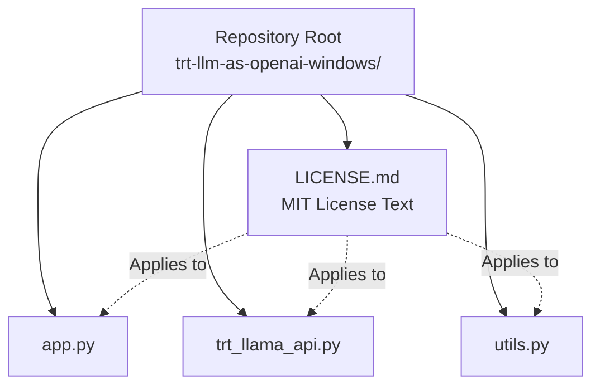
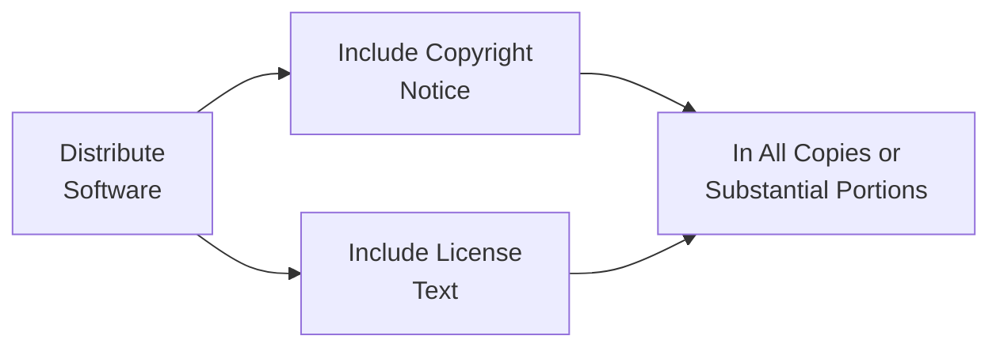
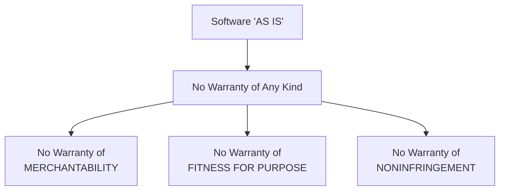
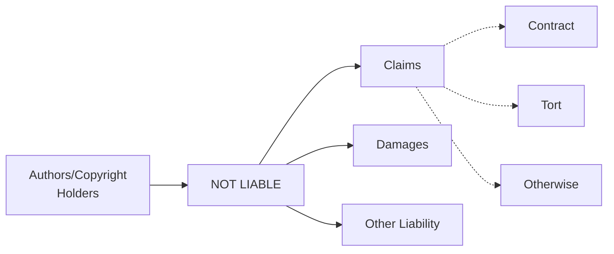
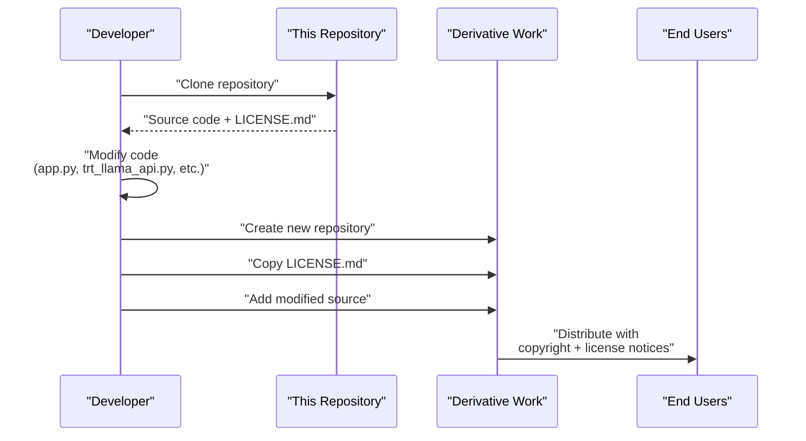

<!-- source: DeepWiki mcp.deepwiki.com · repo NVIDIA/trt-llm-as-openai-windows · page 8.1 Project License · fetched 2026-10-26 -->

# Project License

Relevant source files

The following files were used as context for generating this wiki page:

- [LICENSE.md](LICENSE.md)

## Purpose and Scope

This document explains the licensing terms for the TensorRT-LLM OpenAI API project, specifically covering the MIT license under which the project is distributed and the permissions it grants to users. This covers only the project's own source code; for information about third-party dependency licenses (llama_index and llama.cpp), see [Third-Party Licenses](#8.2).

## License Type

The TensorRT-LLM OpenAI API project is released under the **MIT License**, one of the most permissive open-source software licenses. The license is documented in [LICENSE.md:1-8]().

**Copyright Holder**: NVIDIA CORPORATION & AFFILIATES (2023)

**License Identifier**: MIT (SPDX-License-Identifier: MIT)

**Sources**: [LICENSE.md:1-2]()

## License File Location

The license terms are stored in a dedicated file at the repository root:

The [LICENSE.md]() file applies to all Python source code files in the repository, including `app.py`, `trt_llama_api.py`, and `utils.py`.

**Sources**: [LICENSE.md:1-8]()

## Permitted Actions

The MIT license grants broad permissions to anyone who obtains the software. The following table summarizes the rights granted:

| Permission | Description | License Reference |
|------------|-------------|-------------------|
| **Use** | Run the software for any purpose, commercial or non-commercial | [LICENSE.md:4]() |
| **Copy** | Make copies of the software and documentation files | [LICENSE.md:4]() |
| **Modify** | Make changes to the source code | [LICENSE.md:4]() |
| **Merge** | Combine this software with other software | [LICENSE.md:4]() |
| **Publish** | Publicly share the software | [LICENSE.md:4]() |
| **Distribute** | Give copies to others | [LICENSE.md:4]() |
| **Sublicense** | Grant the same permissions to downstream users | [LICENSE.md:4]() |
| **Sell** | Charge money for copies or modified versions | [LICENSE.md:4]() |

These permissions apply "without restriction", meaning there are no usage limitations beyond the requirements described below.

**Sources**: [LICENSE.md:4]()

## License Requirements

The MIT license imposes minimal requirements on users who distribute the software:

Specifically, users must:

1. **Include the copyright notice**: `"Copyright (c) 2023 NVIDIA CORPORATION & AFFILIATES. All rights reserved."` ([LICENSE.md:1]())

2. **Include the permission notice**: The full MIT license text from [LICENSE.md:4-6]()

3. **Apply to all copies**: These notices must be included in "all copies or substantial portions of the Software" ([LICENSE.md:6]())

The requirement applies whether distributing the original software, modified versions, or software that incorporates this code.

**Sources**: [LICENSE.md:6]()

## Warranty Disclaimer

The MIT license explicitly disclaims all warranties. The software is provided "AS IS" with no guarantees:

The license states: "THE SOFTWARE IS PROVIDED 'AS IS', WITHOUT WARRANTY OF ANY KIND, EXPRESS OR IMPLIED" ([LICENSE.md:8]()).

This disclaimer covers:
- **MERCHANTABILITY**: No guarantee the software is suitable for sale or general use
- **FITNESS FOR A PARTICULAR PURPOSE**: No guarantee it works for your specific needs
- **NONINFRINGEMENT**: No guarantee it doesn't violate third-party rights

**Sources**: [LICENSE.md:8]()

## Liability Limitation

The license limits the authors' and copyright holders' liability:

The authors and copyright holders (NVIDIA CORPORATION & AFFILIATES) shall not be liable for:
- **Claims**: Any legal claims arising from use of the software
- **Damages**: Financial or other harm resulting from the software
- **Other Liability**: Any liability "WHETHER IN AN ACTION OF CONTRACT, TORT OR OTHERWISE" ([LICENSE.md:8]())

This limitation applies regardless of the cause, "ARISING FROM, OUT OF OR IN CONNECTION WITH THE SOFTWARE OR THE USE OR OTHER DEALINGS IN THE SOFTWARE" ([LICENSE.md:8]()).

**Sources**: [LICENSE.md:8]()

## SPDX Identifiers

The license file uses standardized SPDX (Software Package Data Exchange) identifiers for machine-readable license information:

| SPDX Field | Value | Purpose |
|------------|-------|---------|
| `SPDX-FileCopyrightText` | Copyright (c) 2023 NVIDIA CORPORATION & AFFILIATES. All rights reserved. | Machine-readable copyright notice |
| `SPDX-License-Identifier` | MIT | Standard identifier for MIT license |

These identifiers enable automated license compliance tools to detect and verify the project's licensing terms.

**Sources**: [LICENSE.md:1-2]()

## Applying the License

When using or distributing this software, developers must:

1. **Preserve** [LICENSE.md]() in the repository root
2. **Copy** the copyright and permission notice into any derivative works
3. **Ensure** distributions include both notices in visible locations (e.g., in source file headers or a LICENSE file)

Example workflow for creating a derivative work:

The license does not require:
- Publishing source code of modifications
- Using the same license for derivative works (though sublicensing under MIT is common)
- Attributing changes or contributions (though good practice)

**Sources**: [LICENSE.md:1-8]()

---

