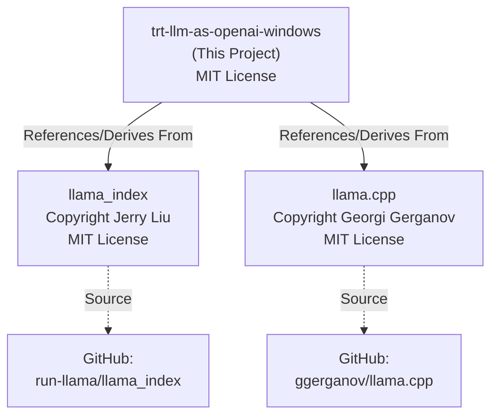

<!-- source: DeepWiki mcp.deepwiki.com · repo NVIDIA/trt-llm-as-openai-windows · page 8.2 Third-Party Licenses · fetched 2026-10-26 -->

# Third-Party Licenses

<details>
<summary>Relevant source files</summary>

The following files were used as context for generating this wiki page:

- [LICENSE-3RD-PARTY.txt](LICENSE-3RD-PARTY.txt)

</details>


## Purpose and Scope

This page documents the licenses of third-party software dependencies included in or referenced by this project. The trt-llm-as-openai-windows project includes code or concepts derived from external open-source projects, and this document provides the required attribution and license information for those dependencies.

For information about the license governing this project itself, see [Project License](#8.1).

**Sources:** [LICENSE-3RD-PARTY.txt:1-49]()

---

## Overview of Third-Party Dependencies

This project acknowledges and includes attribution for the following third-party dependencies:

| Dependency | Copyright Holder | License Type | Source Repository |
|------------|-----------------|--------------|-------------------|
| `llama_index` | Jerry Liu | MIT License | https://github.com/run-llama/llama_index |
| `llama.cpp` | Georgi Gerganov | MIT License | https://github.com/ggerganov/llama.cpp |

Both dependencies are distributed under the MIT License, which is a permissive open-source license that allows for commercial use, modification, distribution, and private use with minimal restrictions. The primary requirement is that the license and copyright notice must be included in all copies or substantial portions of the software.

**Sources:** [LICENSE-3RD-PARTY.txt:1-49]()

---

## Dependency Relationship Diagram



**Sources:** [LICENSE-3RD-PARTY.txt:1-49]()

---

## llama_index License

The `llama_index` project is licensed under the MIT License. This dependency is referenced in the system for concepts or implementations related to LLM indexing and query functionality.

### License Text

```
The MIT License

Copyright (c) Jerry Liu

Permission is hereby granted, free of charge, to any person obtaining a copy
of this software and associated documentation files (the "Software"), to deal
in the Software without restriction, including without limitation the rights
to use, copy, modify, merge, publish, distribute, sublicense, and/or sell
copies of the Software, and to permit persons to whom the Software is
furnished to do so, subject to the following conditions:

The above copyright notice and this permission notice shall be included in
all copies or substantial portions of the Software.

THE SOFTWARE IS PROVIDED "AS IS", WITHOUT WARRANTY OF ANY KIND, EXPRESS OR
IMPLIED, INCLUDING BUT NOT LIMITED TO THE WARRANTIES OF MERCHANTABILITY,
FITNESS FOR A PARTICULAR PURPOSE AND NONINFRINGEMENT. IN NO EVENT SHALL THE
AUTHORS OR COPYRIGHT HOLDERS BE LIABLE FOR ANY CLAIM, DAMAGES OR OTHER
LIABILITY, WHETHER IN AN ACTION OF CONTRACT, TORT OR OTHERWISE, ARISING FROM,
OUT OF OR IN CONNECTION WITH THE SOFTWARE OR THE USE OR OTHER DEALINGS IN
THE SOFTWARE.
```

**Repository:** https://github.com/run-llama/llama_index/blob/main/LICENSE

**Sources:** [LICENSE-3RD-PARTY.txt:1-24]()

---

## llama.cpp License

The `llama.cpp` project is licensed under the MIT License. This dependency is referenced in the system for concepts or implementations related to efficient LLM inference, particularly for Llama model architectures.

### License Text

```
MIT License

Copyright (c) 2023 Georgi Gerganov

Permission is hereby granted, free of charge, to any person obtaining a copy
of this software and associated documentation files (the "Software"), to deal
in the Software without restriction, including without limitation the rights
to use, copy, modify, merge, publish, distribute, sublicense, and/or sell
copies of the Software, and to permit persons to whom the Software is
furnished to do so, subject to the following conditions:

The above copyright notice and this permission notice shall be included in all
copies or substantial portions of the Software.

THE SOFTWARE IS PROVIDED "AS IS", WITHOUT WARRANTY OF ANY KIND, EXPRESS OR
IMPLIED, INCLUDING BUT NOT LIMITED TO THE WARRANTIES OF MERCHANTABILITY,
FITNESS FOR A PARTICULAR PURPOSE AND NONINFRINGEMENT. IN NO EVENT SHALL THE
AUTHORS OR COPYRIGHT HOLDERS BE LIABLE FOR ANY CLAIM, DAMAGES OR OTHER
LIABILITY, WHETHER IN AN ACTION OF CONTRACT, TORT OR OTHERWISE, ARISING FROM,
OUT OF OR IN CONNECTION WITH THE SOFTWARE OR THE USE OR OTHER DEALINGS IN THE
SOFTWARE.
```

**Repository:** https://github.com/ggerganov/llama.cpp/blob/master/LICENSE

**Sources:** [LICENSE-3RD-PARTY.txt:26-49]()

---

## License Compatibility

Both third-party dependencies use the MIT License, which is fully compatible with the MIT License under which this project is distributed (see [Project License](#8.1)). The MIT License is one of the most permissive open-source licenses and imposes minimal restrictions on downstream use.

### Key Permissions Granted by MIT License

| Permission | Description |
|------------|-------------|
| Commercial Use | The software may be used for commercial purposes |
| Modification | The software may be modified |
| Distribution | The software may be distributed |
| Private Use | The software may be used privately |
| Sublicensing | Derivatives may be relicensed under different terms |

### Key Requirements

| Requirement | Description |
|-------------|-------------|
| License and Copyright Notice | The license and copyright notice must be included with the software |

### Limitations

| Limitation | Description |
|------------|-------------|
| Liability | The software is provided "as is" without warranty |
| Warranty | No warranty is provided |

**Sources:** [LICENSE-3RD-PARTY.txt:1-49]()

---

## Attribution Requirements

To comply with the MIT License terms of the third-party dependencies, this project includes the full license text in the [LICENSE-3RD-PARTY.txt:1-49]() file. Users who redistribute this project must ensure that:

1. The [LICENSE-3RD-PARTY.txt:1-49]() file is included in any distribution
2. The copyright notices for Jerry Liu (`llama_index`) and Georgi Gerganov (`llama.cpp`) are preserved
3. The MIT License text is provided alongside any distributed copies

These requirements are automatically satisfied when the repository is cloned or forked, as the license file is included in version control.

**Sources:** [LICENSE-3RD-PARTY.txt:1-49]()