# Page: Home

# Home

<details>
<summary>Relevant source files</summary>

The following files were used as context for generating this wiki page:

- [README.md](README.md)

</details>


This wiki documents the **TensorRT-LLM as OpenAI API on Windows** system, a Flask-based web server that provides OpenAI-compatible REST API endpoints while using NVIDIA TensorRT-LLM as the inference backend. The system enables developers to run Llama 2 and CodeLlama models on Windows with GPU-accelerated inference, maintaining full compatibility with existing OpenAI API clients.

For detailed setup instructions, see [Getting Started](#2). For architecture details, see [Architecture and Implementation](#4). For API usage examples, see [API Usage](#3).

## System Purpose

The system serves as a drop-in replacement for the OpenAI API, allowing applications built for OpenAI's Chat Completions and Text Completions endpoints to run locally on Windows using optimized TensorRT engines. This enables:

- **Local inference** without external API dependencies
- **Accelerated performance** through TensorRT-LLM quantization and GPU optimization
- **API compatibility** with the OpenAI specification for seamless integration
- **Windows support** for native deployment on Windows systems with NVIDIA GPUs

**Sources:** [README.md:1-7]()

## Key Features

| Feature | Description |
|---------|-------------|
| **OpenAI API Compatibility** | Implements `/chat/completions`, `/completions`, and `/v1/*` variants |
| **TensorRT-LLM Backend** | Uses optimized TensorRT engines for fast inference |
| **AWQ 4-bit Quantization** | Reduces memory footprint while maintaining quality |
| **Supported Models** | Llama-2-13b-chat-hf and CodeLlama-13b-Instruct-hf |
| **Streaming Support** | Server-sent events for incremental response delivery |
| **Windows Native** | Runs directly on Windows with NVIDIA GPU |

**Sources:** [README.md:3-7](), [README.md:116-122]()

## Core Components

The system consists of three primary Python modules that work together to provide the OpenAI-compatible API:

### Component Architecture

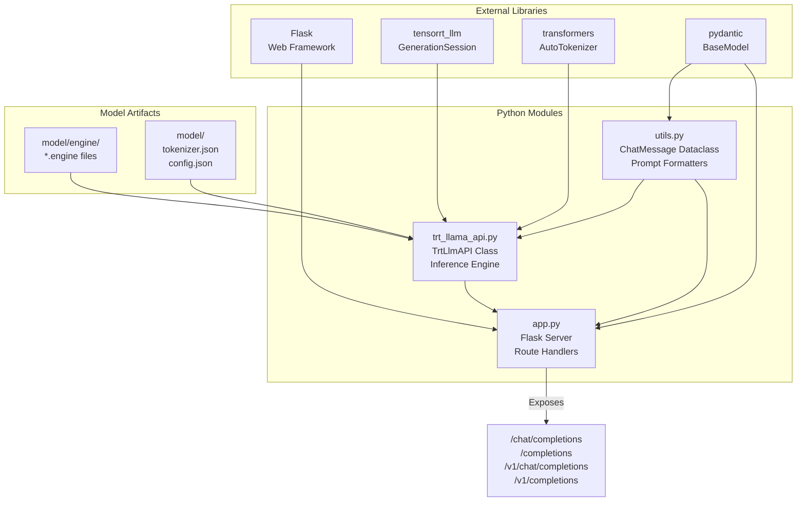

**Sources:** [app.py:1-65](), [trt_llama_api.py:1-111](), [utils.py:1-102]()

### Module Responsibilities

| Module | Primary Classes/Functions | Purpose |
|--------|--------------------------|---------|
| `app.py` | Flask routes: `/chat/completions`, `/completions` | HTTP endpoint handlers, request parsing, response formatting |
| `trt_llama_api.py` | `TrtLlmAPI.__init__()`, `complete_common()`, `stream_complete_common()` | Engine initialization, tokenization, TensorRT inference execution |
| `utils.py` | `ChatMessage`, `messages_to_prompt()`, `completion_to_prompt()` | Data models, prompt formatting with special tokens |

**Sources:** [app.py:95-177](), [trt_llama_api.py:112-288](), [utils.py:18-102]()

## System Workflow

The system operates in three distinct phases, each with different requirements and execution patterns:

### Three-Phase Workflow

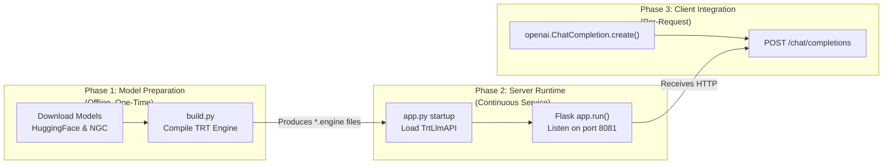

**Sources:** [README.md:10-77]()

### Phase Details

**Phase 1: Model Preparation** (see [Model Preparation](#2.2))
- Download Llama 2 or CodeLlama models from HuggingFace
- Download AWQ int4 quantized weights from NVIDIA NGC
- Run `build.py` from TensorRT-LLM repository to compile TensorRT engines
- Engines are GPU-specific and must be rebuilt for different GPU architectures
- This phase can take hours and requires significant disk space (multiple GB)

**Phase 2: Server Runtime** (see [Launching the Server](#2.3))
- Start Flask server with command: `python app.py --trt_engine_path model/ --trt_engine_name llama_float16_tp1_rank0.engine --tokenizer_dir_path model/ --port 8081`
- `TrtLlmAPI.__init__()` loads engine files and tokenizer at startup [trt_llama_api.py:112-179]()
- Server listens on specified port (default 8081) for HTTP requests
- Single-threaded execution (`threaded=False`) due to TensorRT engine constraints [app.py:180]()

**Phase 3: Client Integration** (see [Client Integration Examples](#3.4))
- Clients send OpenAI-formatted requests to local endpoints
- Compatible with Python `openai` library, Continue.dev VS Code extension, and any OpenAI client
- Set `openai.api_base = "http://127.0.0.1:8081"` to redirect to local server

**Sources:** [README.md:10-77](), [README.md:95-151]()

## Request Processing Flow

When a client sends a chat completion request, data flows through the following pipeline:

### End-to-End Request Flow

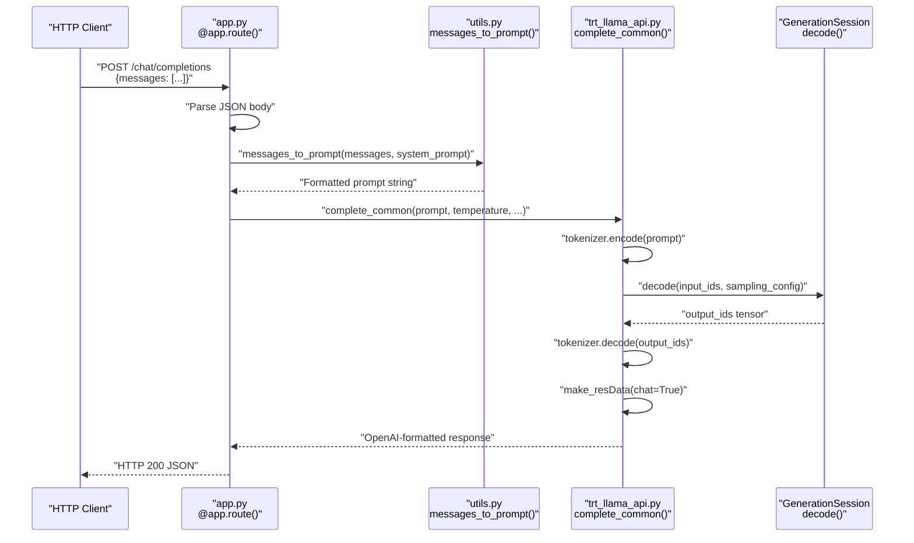

**Sources:** [app.py:95-140](), [utils.py:59-94](), [trt_llama_api.py:203-249]()

### Data Transformations

The request undergoes six transformation stages:

1. **JSON Parsing**: HTTP request body → Python dict [app.py:99-102]()
2. **Message Extraction**: Python dict → `ChatMessage[]` objects [utils.py:18-41]()
3. **Prompt Formatting**: `ChatMessage[]` → formatted string with `<s>`, `[INST]`, `<<SYS>>` tokens [utils.py:59-94]()
4. **Tokenization**: Formatted string → token IDs tensor [trt_llama_api.py:262-268]()
5. **Inference**: Input token IDs → output token IDs via TensorRT engine [trt_llama_api.py:227-239]()
6. **Response Formatting**: Output tokens → OpenAI-compatible JSON response [trt_llama_api.py:49-80]()

**Sources:** [app.py:95-140](), [utils.py:59-102](), [trt_llama_api.py:203-288]()

## File Organization

The repository is structured with Python source files at the root and model artifacts in the `model/` directory:

```
trt-llm-as-openai-windows/
├── app.py                          # Flask server entrypoint
├── trt_llama_api.py               # TensorRT-LLM wrapper
├── utils.py                        # Prompt formatting utilities
├── requirements.txt                # Python dependencies
├── README.md                       # Setup instructions
└── model/                          # Model artifacts directory
    ├── tokenizer.json              # HuggingFace tokenizer
    ├── tokenizer_config.json       # Tokenizer configuration
    ├── config.json                 # Model metadata
    └── engine/                     # TensorRT engines directory
        ├── llama_float16_tp1_rank0.engine  # Compiled engine (not in Git)
        └── config.json             # Engine build configuration
```

The `model/engine/` directory contains GPU-specific compiled engines that are typically multiple gigabytes in size and cannot be committed to version control. These must be generated locally using the TensorRT-LLM build process (see [Building TensorRT Engines](#2.2.2)).

**Sources:** [README.md:54-57](), [model/README.md](), [model/engine/.gitkeep]()

## API Endpoints

The server exposes four HTTP endpoints that implement OpenAI API compatibility:

| Endpoint | Purpose | Request Format |
|----------|---------|----------------|
| `/chat/completions` | Chat-style completions with message history | `{"messages": [{"role": "user", "content": "..."}]}` |
| `/completions` | Raw text completions without message structure | `{"prompt": "text string"}` |
| `/v1/chat/completions` | OpenAI v1 API compatible chat endpoint | Same as `/chat/completions` |
| `/v1/completions` | OpenAI v1 API compatible completions endpoint | Same as `/completions` |

All endpoints support both streaming (`"stream": true`) and non-streaming modes. For detailed API documentation, see [Available Endpoints](#3.1).

**Sources:** [README.md:116-122](), [app.py:95-177]()

## Configuration Parameters

The server is launched with command-line arguments that specify engine paths, token limits, and behavior:

### Core Arguments

| Argument | Description | Example |
|----------|-------------|---------|
| `--trt_engine_path` | Directory containing TensorRT engine files | `model/engine/` |
| `--trt_engine_name` | Engine filename | `llama_float16_tp1_rank0.engine` |
| `--tokenizer_dir_path` | Directory with tokenizer and config.json | `model/` |
| `--port` | HTTP server port (default: 8081) | `8081` |
| `--max_output_tokens` | Maximum output tokens (default: 2048) | `1024` |
| `--max_input_tokens` | Maximum input tokens (default: 2048) | `3500` |
| `--no_system_prompt` | Disable default system prompt (required for CodeLlama) | `True` |

For complete configuration reference, see [Server Configuration](#5.1).

**Sources:** [README.md:99-113](), [app.py:22-65]()

## Next Steps

- **Setup**: To get started with installation and model preparation, see [Getting Started](#2)
- **Usage**: For API usage examples and client integration, see [API Usage](#3)
- **Architecture**: For implementation details and code organization, see [Architecture and Implementation](#4)
- **Configuration**: For detailed configuration options, see [Configuration Reference](#5)

**Sources:** [README.md:1-154]()

---

# Page: System Architecture

# System Architecture

<details>
<summary>Relevant source files</summary>

The following files were used as context for generating this wiki page:

- [README.md](README.md)
- [app.py](app.py)
- [trt_llama_api.py](trt_llama_api.py)
- [utils.py](utils.py)

</details>


## Purpose and Scope

This document provides a high-level overview of the TensorRT-LLM OpenAI API system architecture, explaining how the three distinct phases (model preparation, runtime serving, and client integration) work together to provide an OpenAI-compatible REST API backed by TensorRT-LLM inference. This page focuses on the structural organization of the system, component relationships, and data flow patterns.

For detailed setup instructions, see [Getting Started](#2). For API endpoint specifications and usage examples, see [API Usage](#3). For implementation details of individual components, see [Architecture and Implementation](#4).

---

## Three-Phase System Lifecycle

The system operates across three distinct phases, each with different requirements and execution contexts:

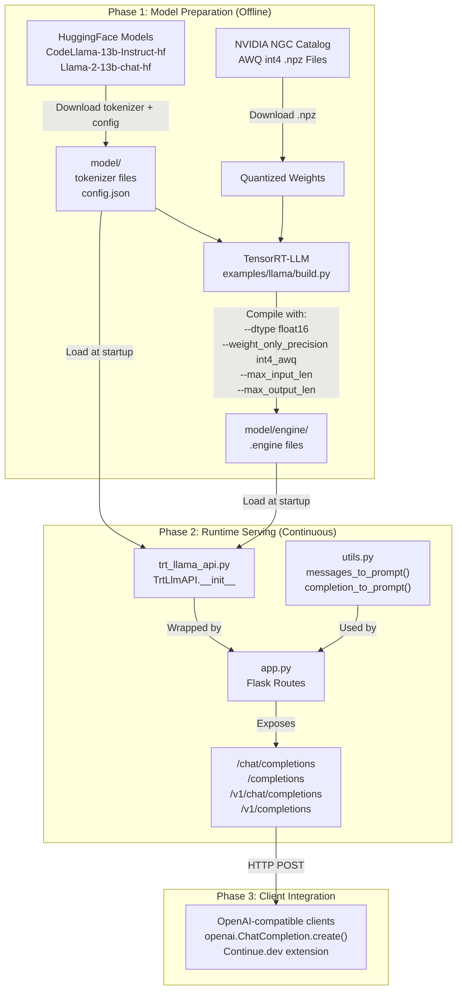

**Sources:** [README.md:10-57](), [README.md:64-93](), [README.md:95-122]()

### Phase 1: Model Preparation (Offline)

This one-time setup phase involves:

1. **Model Download**: Obtaining tokenizer files and `config.json` from HuggingFace repositories
2. **Weight Download**: Fetching AWQ 4-bit quantized `.npz` checkpoint files from NVIDIA NGC
3. **Engine Compilation**: Running `build.py` from TensorRT-LLM repository to compile model + weights into GPU-specific `.engine` files

The compiled engine is **GPU-architecture specific** and typically several gigabytes in size. This phase can take hours and requires significant disk space.

**Sources:** [README.md:21-46](), [README.md:54-57]()

### Phase 2: Runtime Serving (Continuous)

The HTTP server process that loads compiled artifacts and serves inference requests:

1. **Initialization**: `TrtLlmAPI.__init__` loads engine and tokenizer into memory, allocates GPU resources
2. **Request Handling**: Flask routes in `app.py` accept HTTP requests, parse JSON, format prompts
3. **Inference Execution**: `TrtLlmAPI` methods tokenize input, execute GPU inference, detokenize output
4. **Response Formatting**: Results formatted as OpenAI-compatible JSON responses

This phase runs continuously as a single-threaded Flask server (`threaded=False` in [app.py:217]()).

**Sources:** [app.py:22-86](), [trt_llama_api.py:188-291]()

### Phase 3: Client Integration

Standard OpenAI API clients interact with the local server without modification. The server exposes four endpoint variants: `/completions`, `/chat/completions`, `/v1/completions`, `/v1/chat/completions`.

**Sources:** [README.md:78-95](), [README.md:116-122]()

---

## Core Component Dependencies

The Python application consists of three modules with unidirectional dependencies:

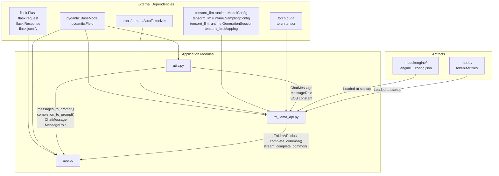

**Sources:** [app.py:1-26](), [trt_llama_api.py:1-73](), [utils.py:1-53]()

### Module Responsibilities

| Module | Primary Classes | Key Functions | Purpose |
|--------|----------------|---------------|---------|
| `app.py` | None | `chat_completions()`, `completion()`, `models()` | HTTP endpoint layer, request parsing, Flask route definitions |
| `trt_llama_api.py` | `TrtLlmAPI`, `LLMMetadata` | `complete_common()`, `stream_complete_common()`, `parse_input()`, `get_output()` | TensorRT-LLM inference abstraction, tokenization, model initialization |
| `utils.py` | `ChatMessage`, `MessageRole` | `messages_to_prompt()`, `completion_to_prompt()` | Prompt formatting with special tokens (BOS, EOS, INST, SYS) |

**Sources:** [app.py:88-217](), [trt_llama_api.py:158-481](), [utils.py:64-131]()

---

## Request Processing Pipeline

### Non-Streaming Request Flow

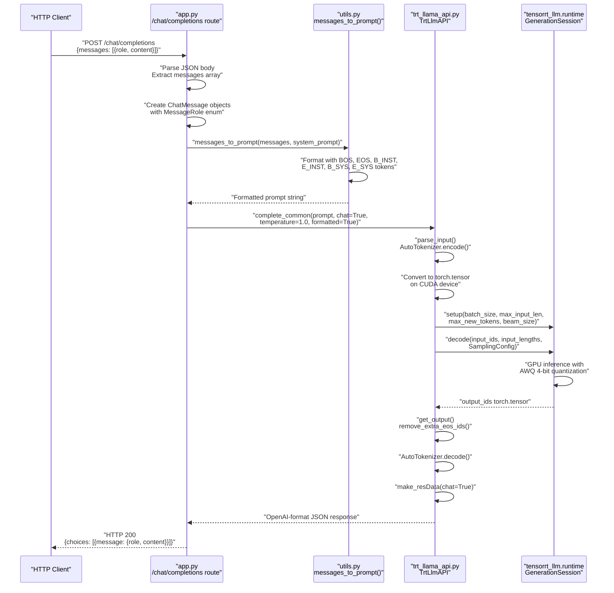

**Sources:** [app.py:117-171](), [utils.py:84-122](), [trt_llama_api.py:313-365]()

### Data Transformation Stages

Each request undergoes six distinct transformations:

| Stage | Input Type | Output Type | Module | Functions |
|-------|-----------|-------------|--------|-----------|
| **1. Parsing** | JSON string | `ChatMessage[]` or `str` | `app.py` | `chat_completions()`, `completion()` [app.py:133-158]() |
| **2. Formatting** | `ChatMessage[]` or `str` | Formatted prompt string | `utils.py` | `messages_to_prompt()`, `completion_to_prompt()` [utils.py:84-131]() |
| **3. Tokenization** | Prompt string | `torch.tensor` (int32, CUDA) | `trt_llama_api.py` | `parse_input()` [trt_llama_api.py:367-386]() |
| **4. Inference** | Input token IDs | Output token IDs | `tensorrt_llm.runtime` | `GenerationSession.decode()` [trt_llama_api.py:333]() |
| **5. Detokenization** | Output token IDs | Text string | `trt_llama_api.py` | `get_output()`, `remove_extra_eos_ids()` [trt_llama_api.py:388-408]() |
| **6. Response Formatting** | Text string | OpenAI JSON | `trt_llama_api.py` | `make_resData()` [trt_llama_api.py:75-108]() |

**Sources:** [app.py:95-177](), [utils.py:59-131](), [trt_llama_api.py:203-365]()

---

## System Initialization Sequence

The server initialization is a heavyweight, one-time process that occurs when `app.py` is executed:

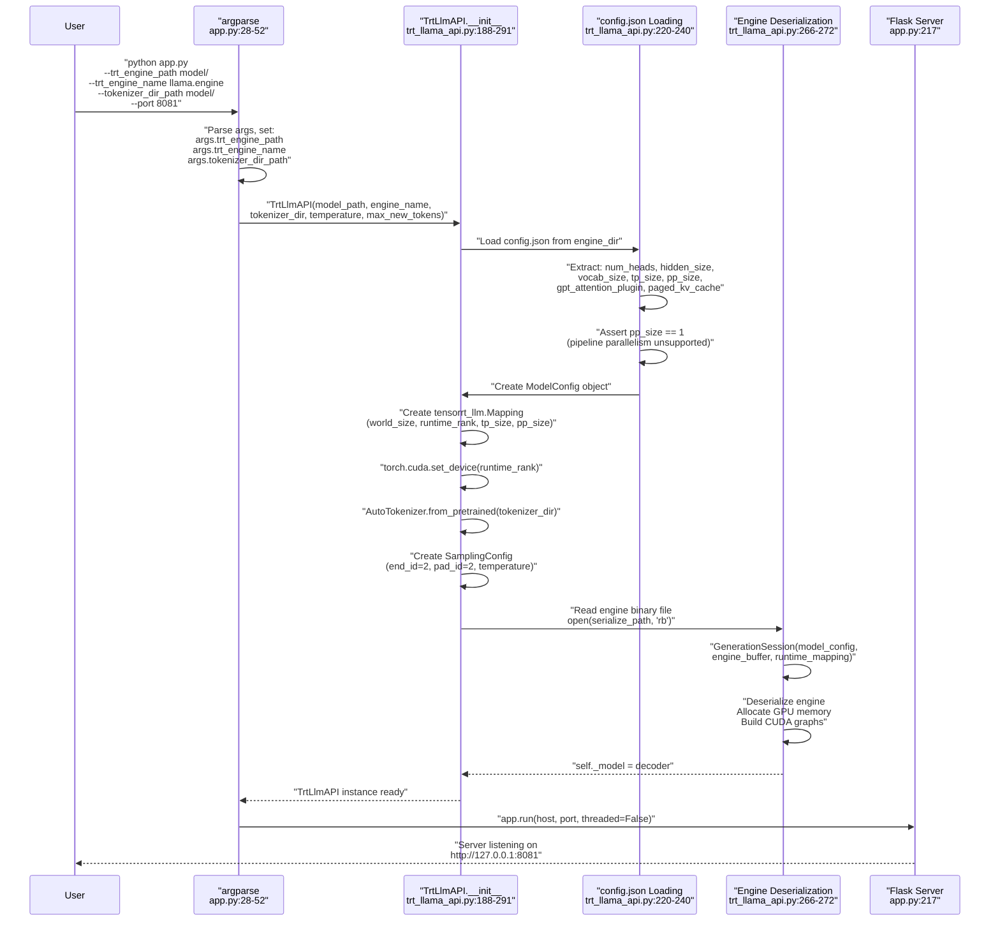

**Sources:** [app.py:22-85](), [trt_llama_api.py:188-291]()

### Initialization Parameters

The `TrtLlmAPI` class requires these initialization parameters:

| Parameter | Type | Source | Purpose |
|-----------|------|--------|---------|
| `model_path` | `str` | `--trt_engine_path` | Directory containing `.engine` and `config.json` |
| `engine_name` | `str` | `--trt_engine_name` | Filename of compiled TensorRT engine |
| `tokenizer_dir` | `str` | `--tokenizer_dir_path` | Directory containing HuggingFace tokenizer files |
| `temperature` | `float` | Default: 0.1 | Sampling temperature for generation |
| `max_new_tokens` | `int` | `--max_output_tokens`, default: 2048 | Maximum tokens to generate |
| `context_window` | `int` | `--max_input_tokens`, default: 2048 | Maximum input context length |

**Sources:** [app.py:32-49](), [app.py:75-85](), [trt_llama_api.py:188-201]()

---

## File System Organization

The repository follows this directory structure:

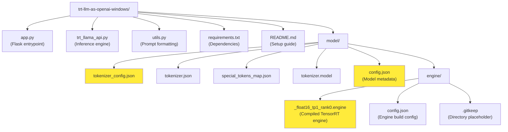

**Sources:** [README.md:49-57](), [model/README.md](), [model/engine/.gitkeep]()

### Critical Artifacts

| Path | Size | Generated By | Purpose |
|------|------|--------------|---------|
| `model/engine/*.engine` | ~GBs | `build.py` from TensorRT-LLM | GPU-specific compiled inference engine (not in Git) |
| `model/engine/config.json` | ~KB | `build.py` | Engine build configuration (tp_size, pp_size, num_heads, etc.) |
| `model/tokenizer*.json` | ~KB | Downloaded from HuggingFace | Tokenizer vocabulary and configuration |
| `model/config.json` | ~KB | Downloaded from HuggingFace | Model architecture metadata |

The `.engine` files are excluded from Git due to size and GPU-specificity. They must be generated per-GPU-architecture using the instructions in [Model Preparation](#2.2).

**Sources:** [README.md:19-46](), [README.md:54-57]()

---

## Key Classes and Responsibilities

### TrtLlmAPI Class

Located in [trt_llama_api.py:158-481](), this is the core inference engine wrapper.

**Attributes:**
- `_model`: `tensorrt_llm.runtime.GenerationSession` - The loaded TensorRT engine
- `_model_config`: `tensorrt_llm.runtime.ModelConfig` - Architecture configuration
- `_tokenizer`: `transformers.AutoTokenizer` - Tokenizer instance
- `_sampling_config`: `tensorrt_llm.runtime.SamplingConfig` - Generation parameters

**Key Methods:**
- `__init__()` [trt_llama_api.py:188-291]() - Loads engine, tokenizer, creates GPU session
- `complete_common()` [trt_llama_api.py:313-365]() - Synchronous inference with full response
- `stream_complete_common()` [trt_llama_api.py:416-481]() - Streaming inference with SSE
- `parse_input()` [trt_llama_api.py:367-386]() - Tokenization and tensor preparation
- `get_output()` [trt_llama_api.py:396-408]() - Detokenization and EOS handling

**Sources:** [trt_llama_api.py:158-481]()

### ChatMessage and MessageRole

Located in [utils.py:64-82](), these define the chat message data model.

**ChatMessage Fields:**
- `role`: `MessageRole` enum (SYSTEM, USER, ASSISTANT, FUNCTION)
- `content`: `Optional[str]` - Message text content
- `additional_kwargs`: `dict` - Extensibility for future fields

**MessageRole Values:**
- `MessageRole.SYSTEM` - System-level instructions
- `MessageRole.USER` - User input messages
- `MessageRole.ASSISTANT` - Model-generated responses
- `MessageRole.FUNCTION` - Function call results (reserved)

**Sources:** [utils.py:64-82](), [app.py:136-152]()

### Flask Routes

The following routes are defined in [app.py:88-217]():

| Route | Methods | Handler Function | Purpose |
|-------|---------|------------------|---------|
| `/chat/completions` | POST | `chat_completions()` [app.py:119]() | Chat-based inference with message history |
| `/v1/chat/completions` | POST | `chat_completions()` [app.py:118]() | OpenAI v1 API compatibility |
| `/completions` | POST | `completion()` [app.py:176]() | Raw text completion |
| `/v1/completions` | POST | `completion()` [app.py:175]() | OpenAI v1 API compatibility |
| `/models` | GET/POST | `modelsLlaMA()` [app.py:102]() | List available models |
| `/v1/models` | GET/POST | `modelsLlaMA()` [app.py:101]() | OpenAI v1 API compatibility |

**Sources:** [app.py:88-217]()

---

## Streaming vs Non-Streaming Execution

Both execution modes share the same initialization and tokenization pipeline but differ in response delivery:

| Aspect | Non-Streaming | Streaming |
|--------|---------------|-----------|
| **Function** | `complete_common()` [trt_llama_api.py:313]() | `stream_complete_common()` [trt_llama_api.py:416]() |
| **Response Type** | `flask.jsonify()` (single JSON) | `flask.Response()` with generator |
| **MIME Type** | `application/json` | `text/event-stream` (SSE) |
| **decode() Call** | `decode(..., streaming=False)` | `decode(..., streaming=True)` |
| **Client Blocking** | Waits for full response | Receives incremental tokens |
| **Response Format** | OpenAI completion object | OpenAI stream chunks (delta format) |

Streaming mode uses Python generators [trt_llama_api.py:434-481]() to yield Server-Sent Events (SSE) formatted chunks, each containing a delta of newly generated tokens.

**Sources:** [trt_llama_api.py:313-365](), [trt_llama_api.py:416-481](), [app.py:168-171]()

---

## Prompt Formatting System

The `utils.py` module implements Llama 2-style prompt formatting with special delimiter tokens:

**Special Tokens:**
- `BOS = "<s>"` - Beginning of sequence
- `EOS = "</s>"` - End of sequence
- `B_INST = "[INST]"` - Begin instruction
- `E_INST = "[/INST]"` - End instruction
- `B_SYS = "<<SYS>>\n"` - Begin system prompt
- `E_SYS = "\n<</SYS>>\n\n"` - End system prompt

**Example Formatted Chat:**
```
<s> [INST] <<SYS>>
You are a helpful assistant.
<</SYS>>

What is the capital of France? [/INST] The capital of France is Paris. </s>
```

The `messages_to_prompt()` function [utils.py:84-122]() constructs this format from a `ChatMessage` array, inserting the system prompt only in the first message pair and appending `EOS` between conversation turns.

**Sources:** [utils.py:54-131]()

---

# Page: Getting Started

# Getting Started

<details>
<summary>Relevant source files</summary>

The following files were used as context for generating this wiki page:

- [README.md](README.md)
- [requirements.txt](requirements.txt)

</details>


## Purpose and Scope

This page guides you through the complete setup process for running the TensorRT-LLM OpenAI API server on Windows. By the end of this guide, you will have a locally hosted web server that exposes OpenAI-compatible endpoints for Llama 2 or CodeLlama models with TensorRT acceleration.

For detailed API usage after setup is complete, see [API Usage](#3). For configuration options and tuning parameters, see [Configuration Reference](#5). For architectural details about how the system works internally, see [Architecture and Implementation](#4).

**Sources:** [README.md:1-8]()

## Setup Overview

The setup process consists of three distinct phases that must be completed sequentially. Each phase has different time and resource requirements.

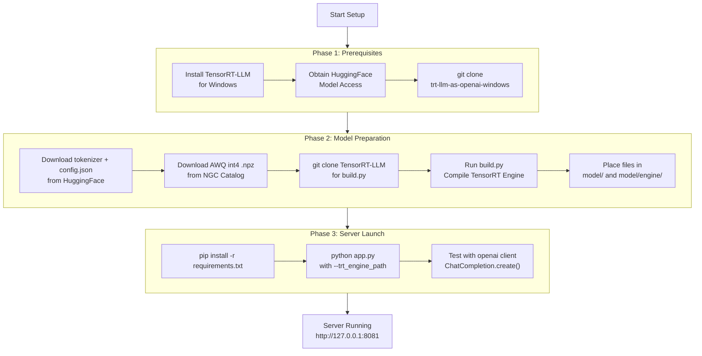

**Diagram 1: Complete Setup Process Flow**

**Sources:** [README.md:9-77]()

### Time and Resource Requirements

The setup process has significantly different resource requirements for each phase:

| Phase | Duration | Disk Space | GPU Required | One-Time Only |
|-------|----------|------------|--------------|---------------|
| **Phase 1: Prerequisites** | 30-60 minutes | ~10 GB | Yes | Yes |
| **Phase 2: Model Preparation** | 2-4 hours | ~30 GB | Yes | Yes |
| **Phase 3: Server Launch** | 5 minutes | ~1 GB | Yes | No |

**Critical Notes:**
- **Phase 2** is the most time-consuming step, involving large downloads and a lengthy compilation process (30-90 minutes depending on GPU)
- The compiled TensorRT engine (`.engine` file) is **GPU-specific** and cannot be moved between different GPU architectures
- If you change GPUs or update TensorRT-LLM, you must rebuild the engine
- Phase 3 is repeatable - you can start and stop the server without repeating Phases 1-2

**Sources:** [README.md:19-46]()

## Prerequisites

Before beginning the setup, you must have:

1. **Windows Operating System** with NVIDIA GPU (compute capability 7.0 or higher)
2. **TensorRT-LLM installed** following the [official Windows installation guide](https://github.com/NVIDIA/TensorRT-LLM/tree/v0.6.1/windows#quick-start)
3. **HuggingFace account with access** to gated Llama repositories:
   - [CodeLlama-13b-Instruct-hf](https://huggingface.co/codellama/CodeLlama-13b-Instruct-hf)
   - [Llama-2-13b-chat-hf](https://huggingface.co/meta-llama/Llama-2-13b-chat-hf)
4. **Python 3.10+** with pip installed
5. **Git** for cloning repositories

For detailed dependency versions and installation verification, see [Prerequisites and Dependencies](#2.1).

**Sources:** [README.md:11-17]()

## Directory Structure and File Placement

After completing the setup, your repository will contain both code and model artifacts organized as follows:

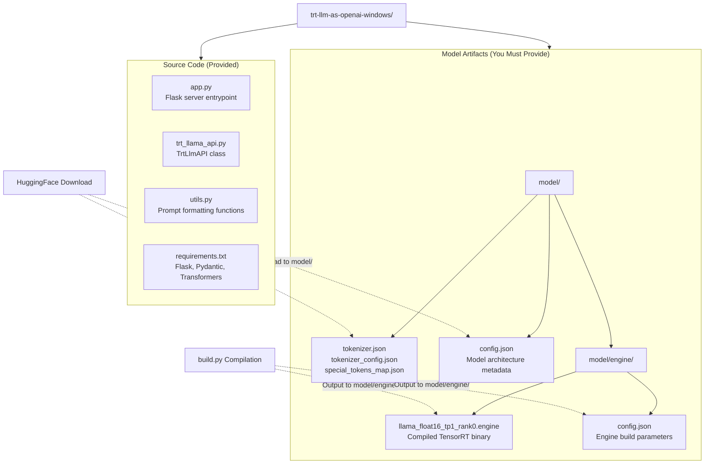

**Diagram 2: Directory Structure Showing Code vs. Artifacts**

The `model/` and `model/engine/` directories exist in the repository but contain only `.gitkeep` files. You must populate them during setup by:
1. Downloading tokenizer files from HuggingFace → place in `model/`
2. Compiling the TensorRT engine using `build.py` → place in `model/engine/`

**Sources:** [README.md:54-57]()

## Model Preparation Overview

Model preparation is a two-step process: downloading source artifacts and compiling them into an optimized TensorRT engine.

### Required Downloads

You must download two sets of files from external sources:

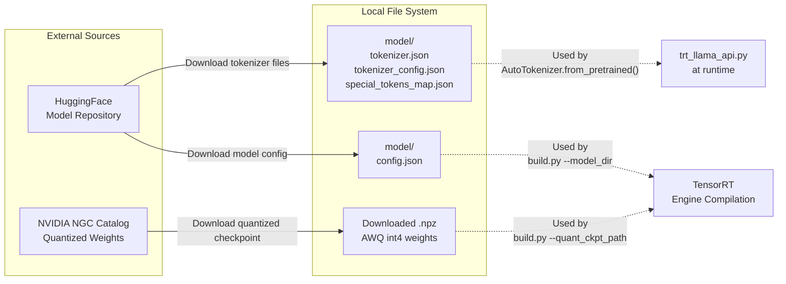

**Diagram 3: Model Preparation Inputs and Their Usage**

**For CodeLlama 13B:**
- HuggingFace model: [CodeLlama-13b-Instruct-hf](https://huggingface.co/codellama/CodeLlama-13b-Instruct-hf)
- NGC quantized weights: [NGC CodeLlama weights](https://catalog.ngc.nvidia.com/orgs/nvidia/models/code_llama/files?version=1.1)

**For Llama 2 13B Chat:**
- HuggingFace model: [Llama-2-13b-chat-hf](https://huggingface.co/meta-llama/Llama-2-13b-chat-hf)
- NGC quantized weights: [NGC Llama2-13b weights](https://catalog.ngc.nvidia.com/orgs/nvidia/models/llama2-13b/files?version=1.3)

For detailed download instructions, see [Downloading Models and Weights](#2.2.1).

**Sources:** [README.md:25-31](), [README.md:54-56]()

### Engine Compilation Process

The TensorRT engine is compiled using `build.py` from the TensorRT-LLM repository. This script is **not included in this repository** and must be obtained separately.

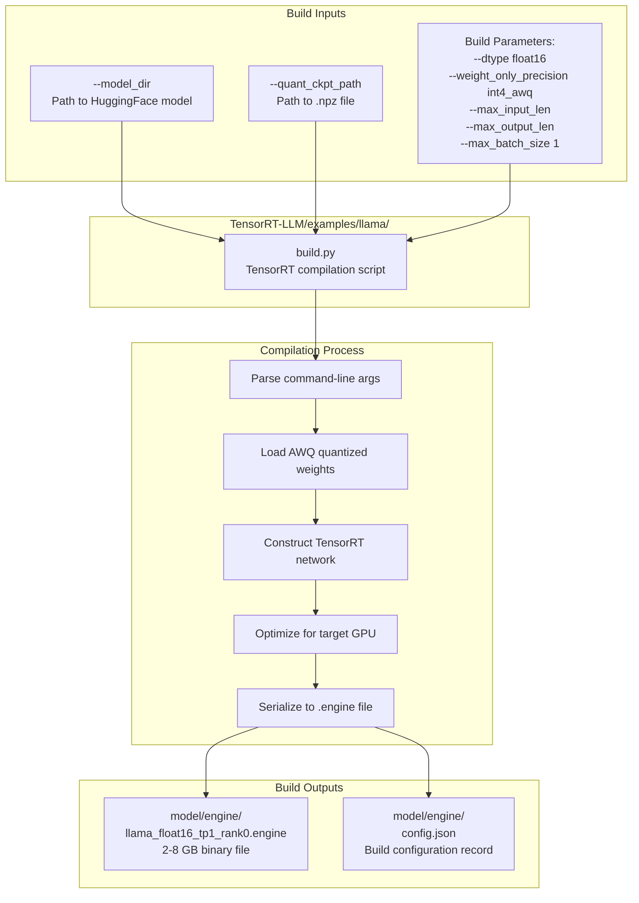

**Diagram 4: TensorRT Engine Build Pipeline**

**Key Build Parameters:**

| Parameter | CodeLlama 13B | Llama 2 13B | Purpose |
|-----------|---------------|-------------|---------|
| `--max_input_len` | 15360 | 3500 | Maximum context window (tokens) |
| `--max_output_len` | 1024 | 1024 | Maximum generation length |
| `--dtype` | `float16` | `float16` | Computation precision |
| `--weight_only_precision` | `int4_awq` | `int4_awq` | AWQ 4-bit quantization |
| `--rotary_base` | 1000000 | (default) | RoPE frequency base for CodeLlama |
| `--vocab_size` | 32064 | (default) | Vocabulary size for CodeLlama |

The `--max_input_len` value determines the maximum context window the compiled engine can handle. For CodeLlama, 15360 tokens enables a ~16K context window. For Llama 2, 3500 tokens provides ~3.5K context.

For step-by-step compilation instructions with complete command examples, see [Building TensorRT Engines](#2.2.2).

**Sources:** [README.md:38-45]()

## Server Launch Process

Once model artifacts are in place, launching the server involves installing Python dependencies and executing `app.py` with appropriate arguments.

### Installation

Install required Python packages:

```bash
pip install -r requirements.txt
```

This installs:
- `Flask` - Web server framework
- `Pydantic` - Request/response validation
- `transformers` - Tokenizer (`AutoTokenizer`)
- `numpy` - Array operations

**Sources:** [requirements.txt:1-8](), [README.md:58-61]()

### Launch Command Structure

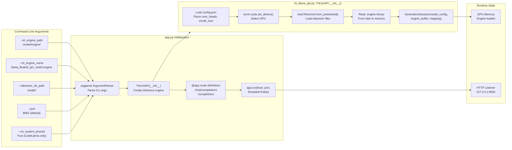

**Diagram 5: Server Initialization Sequence - Code Entity Mapping**

### Example Launch Commands

**For Llama 2 13B Chat:**
```bash
python app.py \
  --trt_engine_path model/engine/ \
  --trt_engine_name llama_float16_tp1_rank0.engine \
  --tokenizer_dir_path model/ \
  --port 8081
```

**For CodeLlama 13B Instruct:**
```bash
python app.py \
  --trt_engine_path model/engine/ \
  --trt_engine_name llama_float16_tp1_rank0.engine \
  --tokenizer_dir_path model/ \
  --port 8081 \
  --no_system_prompt True
```

The `--no_system_prompt True` flag is required for CodeLlama because the model's instruction format does not expect a system prompt in the formatted prompt string.

**Sources:** [README.md:64-76]()

### Initialization Sequence Details

When `python app.py` executes, the following code flow occurs:

1. **[app.py:22-49]()** - `argparse.ArgumentParser` parses command-line arguments
2. **[app.py:50-65]()** - `TrtLlmAPI` is instantiated, triggering `__init__`
3. **[trt_llama_api.py:118-128]()** - `config.json` is loaded and parsed for `num_heads`, `hidden_size`, `vocab_size`, `tp_size`, `pp_size`
4. **[trt_llama_api.py:131]()** - Assert `pp_size == 1` (pipeline parallelism unsupported)
5. **[trt_llama_api.py:141]()** - `torch.cuda.set_device(runtime_rank)` selects GPU
6. **[trt_llama_api.py:133-138]()** - `AutoTokenizer.from_pretrained(tokenizer_dir_path)` loads tokenizer
7. **[trt_llama_api.py:165-172]()** - Engine binary is read from disk into `engine_buffer`
8. **[trt_llama_api.py:174-179]()** - `GenerationSession(model_config, engine_buffer, mapping)` deserializes engine and allocates GPU memory
9. **[app.py:67-177]()** - Flask route definitions (`@app.route`)
10. **[app.py:180]()** - `app.run(host="0.0.0.0", port=args.port, threaded=False)` starts HTTP listener

Startup typically takes 30-60 seconds. The most expensive operations are:
- Reading the multi-gigabyte `.engine` file from disk
- Deserializing the TensorRT engine
- Allocating GPU memory for inference

**Sources:** [app.py:22-65](), [trt_llama_api.py:112-179](), [app.py:180]()

## Verification

After the server starts, verify correct operation:

### Expected Console Output

When initialization completes successfully, you should see:
```
 * Running on http://127.0.0.1:8081
 * Running on http://<your-ip>:8081
```

This indicates Flask is listening for HTTP requests.

**Sources:** [README.md:78]()

### Test with OpenAI Client

Install the OpenAI Python client (version 0.28):
```bash
pip install openai==0.28
```

Execute a test request using the chat completions endpoint:

```python
import openai

# API key is not validated but required by client
openai.api_key = "ABC"
openai.api_base = "http://127.0.0.1:8081"

response = openai.ChatCompletion.create(
    model="Llama2",  # Model name (not validated)
    messages=[{"role": "user", "content": "Hello! How are you?"}]
)

print(response)
```

**Expected Response Structure:**
```json
{
  "id": "chatcmpl-<uuid>",
  "object": "chat.completion",
  "created": 1234567890,
  "model": "Llama2",
  "choices": [
    {
      "index": 0,
      "message": {
        "role": "assistant",
        "content": "I'm doing well, thank you for asking! How can I assist you today?"
      },
      "finish_reason": "stop"
    }
  ],
  "usage": {
    "prompt_tokens": 15,
    "completion_tokens": 20,
    "total_tokens": 35
  }
}
```

If you receive a response matching this structure, the server is functioning correctly.

**Sources:** [README.md:80-95]()

### Troubleshooting Startup Issues

If the server fails to start, check:

1. **GPU is available** - `torch.cuda.is_available()` should return `True`
2. **Paths are correct** - Verify `--trt_engine_path` points to directory containing `.engine` file
3. **Engine file exists** - Verify `model/engine/llama_float16_tp1_rank0.engine` exists
4. **Tokenizer files exist** - Verify `model/tokenizer.json` and related files exist
5. **Dependencies installed** - Re-run `pip install -r requirements.txt`

Common errors:
- `FileNotFoundError` - Incorrect paths or missing files
- `AssertionError: pp_size == 1` - Engine was built with unsupported pipeline parallelism
- CUDA errors - GPU driver issues or insufficient GPU memory

**Sources:** [trt_llama_api.py:112-179]()

## Next Steps

With the server running, you can now:

1. **Explore API Endpoints** - See [Available Endpoints](#3.1) for `/completions`, `/chat/completions`, and model listing routes
2. **Use Chat Completions** - See [Chat Completions](#3.2) for detailed request/response format
3. **Use Text Completions** - See [Text Completions](#3.3) for raw text generation
4. **Integrate with Clients** - See [Client Integration Examples](#3.4) for Python openai library and Continue.dev VS Code extension
5. **Configure Server** - See [Server Configuration](#5.1) for tuning token limits, system prompts, and other parameters
6. **Understand Internals** - See [Component Overview](#4.1) to learn how `app.py`, `trt_llama_api.py`, and `utils.py` work together

For detailed information about model preparation steps, continue to [Model Preparation](#2.2).

**Sources:** [README.md:98-152]()

---

# Page: Prerequisites and Dependencies

# Prerequisites and Dependencies

<details>
<summary>Relevant source files</summary>

The following files were used as context for generating this wiki page:

- [README.md](README.md)
- [requirements.txt](requirements.txt)

</details>


This page details the hardware, software, and Python package requirements necessary to run the TensorRT-LLM OpenAI API server. These prerequisites must be satisfied before proceeding with model preparation ([2.2](#2.2)) or server launch ([2.3](#2.3)).

For configuration options related to these dependencies after installation, see [Server Configuration](#5.1).

## Hardware Requirements

The system requires specific GPU hardware for TensorRT-LLM inference:

| Component | Requirement | Notes |
|-----------|-------------|-------|
| GPU | NVIDIA GPU with Compute Capability ≥ 8.0 | Required for TensorRT-LLM engine execution |
| VRAM | Minimum 12-16 GB | For 13B models with AWQ int4 quantization |
| CUDA | Compatible CUDA drivers | Installed with TensorRT-LLM |

**TensorRT Engine GPU Binding**: Engines compiled with `build.py` are bound to the specific GPU architecture they were built on. An engine built on an RTX 4090 cannot run on an A100, and vice versa. This is enforced at the TensorRT serialization level.

**Sources**: [README.md:11-19]()

## Software Requirements

### Operating System

This implementation is specifically designed for Windows. TensorRT-LLM must be installed using the Windows-specific installation procedure.

| Software | Version/Details | Purpose |
|----------|-----------------|---------|
| Operating System | Windows | Native TensorRT-LLM Windows support |
| Python | 3.8+ (recommended 3.10) | Runtime environment |
| Git | Any recent version | Repository cloning and version control |

### TensorRT-LLM Installation

The core inference engine requires TensorRT-LLM for Windows:

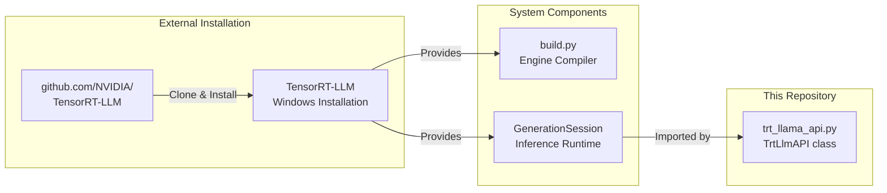

**Installation Command**: Follow the official TensorRT-LLM Windows installation guide at `https://github.com/NVIDIA/TensorRT-LLM/tree/v0.6.1/windows#quick-start` (version 0.6.1 as referenced in this project).

**Build Script Location**: After TensorRT-LLM installation, the `build.py` script is located at `examples/llama/build.py` within the TensorRT-LLM repository. This script is used during model preparation ([2.2.2](#2.2.2)) but is not part of this repository.

**Sources**: [README.md:13]()

### Model Access Requirements

Access to gated HuggingFace repositories is required for downloading model artifacts:

| Model | Repository | Required Files |
|-------|------------|----------------|
| Llama-2-13b-chat | `meta-llama/Llama-2-13b-chat-hf` | `tokenizer.json`, `tokenizer_config.json`, `special_tokens_map.json`, `config.json` |
| CodeLlama-13b-Instruct | `codellama/CodeLlama-13b-Instruct-hf` | `tokenizer.json`, `tokenizer_config.json`, `special_tokens_map.json`, `config.json` |

**HuggingFace Authentication**: These models require accepting license terms on HuggingFace and authenticating via `huggingface-cli login` or access tokens.

**Sources**: [README.md:15-17](), [README.md:54-56]()

## Python Package Dependencies

The following diagram shows the dependency structure defined in `requirements.txt`:

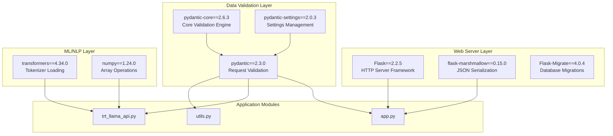

### Installation Command

Install all Python dependencies via:

```bash
pip install -r requirements.txt
```

**Sources**: [README.md:58-61](), [requirements.txt:1-8]()

### Package Details

#### Web Server Dependencies

| Package | Version | Role in System | Used By |
|---------|---------|----------------|---------|
| `Flask` | 2.2.5 | HTTP request routing and response handling | [app.py]() |
| `flask-marshmallow` | 0.15.0 | JSON serialization helpers (not actively used) | N/A |
| `Flask-Migrate` | 4.0.4 | Database migration support (not actively used) | N/A |

**Flask Configuration**: The Flask server runs with `threaded=False` in [app.py:180]() to ensure single-threaded request handling, which is required for TensorRT-LLM engine thread safety.

#### Data Validation Dependencies

| Package | Version | Role in System | Used By |
|---------|---------|----------------|---------|
| `pydantic` | 2.3.0 | Request body validation and data class definitions | [app.py](), [trt_llama_api.py](), [utils.py]() |
| `pydantic-core` | 2.6.3 | Low-level validation engine (dependency of pydantic) | Transitive |
| `pydantic-settings` | 2.0.3 | Configuration management (not actively used) | N/A |

**Pydantic Usage**: The `ChatMessage` class in [utils.py:9-12]() and `MessageRole` enum in [utils.py:5-7]() are Pydantic `BaseModel` and `Enum` respectively, providing type validation for chat completion requests.

#### ML/NLP Dependencies

| Package | Version | Role in System | Used By |
|---------|---------|----------------|---------|
| `transformers` | 4.34.0 | Tokenizer loading via `AutoTokenizer` | [trt_llama_api.py]() |
| `numpy` | 1.24.0 | Tensor operations and array manipulation | [trt_llama_api.py]() |

**Transformers Integration**: The `AutoTokenizer.from_pretrained()` call in [trt_llama_api.py:139]() loads the HuggingFace tokenizer, which is used in [trt_llama_api.py:251-258]() for encoding prompts to token IDs and [trt_llama_api.py:280-286]() for decoding generated tokens back to text.

**Numpy Usage**: Used for tensor slicing operations in [trt_llama_api.py:269-279]() when processing model outputs.

**Sources**: [requirements.txt:1-8]()

## External Dependencies Not in requirements.txt

The following critical dependencies must be installed separately:

### TensorRT-LLM Python Package

**Import Statement**: 
```python
from tensorrt_llm.runtime import ModelConfig, SamplingConfig
from tensorrt_llm.runtime import PYTHON_BINDINGS, ModelRunner
```

**Location in Code**: [trt_llama_api.py:4-7]()

**Purpose**: Provides the `GenerationSession` runtime and model configuration classes for TensorRT inference. This package is installed as part of the TensorRT-LLM Windows installation process.

### PyTorch (Implicit Dependency)

**Import Statement**:
```python
import torch
```

**Location in Code**: [trt_llama_api.py:3]()

**Purpose**: Required for:
- CUDA device management: `torch.cuda.set_device()` in [trt_llama_api.py:175-176]()
- Tensor operations: `torch.tensor()` in [trt_llama_api.py:260]()
- Data type conversions: `torch.int32` type annotations

PyTorch is typically installed as a dependency of TensorRT-LLM.

**Sources**: [trt_llama_api.py:1-10]()

## Dependency Resolution and Compatibility

The following diagram shows how dependencies are resolved at runtime:

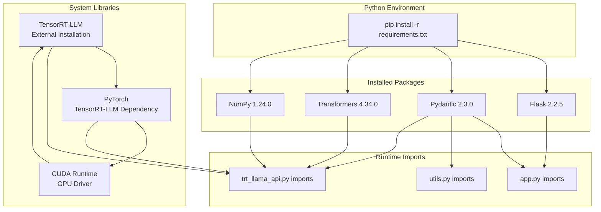

### Version Compatibility Notes

1. **Pydantic 2.x**: This project uses Pydantic v2, which has breaking changes from v1. Code using `BaseModel` must follow v2 syntax.

2. **Flask 2.2.5**: The specific version is pinned to avoid compatibility issues with newer Flask 3.x releases.

3. **Transformers 4.34.0**: This version is compatible with the Llama 2 and CodeLlama tokenizer formats.

4. **TensorRT-LLM v0.6.1**: The README explicitly references this version for Windows installation. Newer versions may have incompatible engine formats.

**Sources**: [requirements.txt:1-8](), [README.md:13]()

## Verification Steps

After installing all prerequisites, verify the installation:

1. **Verify Python packages**:
   ```bash
   pip list | grep -E "Flask|pydantic|transformers|numpy"
   ```

2. **Verify TensorRT-LLM import**:
   ```python
   from tensorrt_llm.runtime import ModelConfig
   print("TensorRT-LLM imported successfully")
   ```

3. **Verify CUDA availability**:
   ```python
   import torch
   print(f"CUDA available: {torch.cuda.is_available()}")
   print(f"CUDA device: {torch.cuda.get_device_name(0)}")
   ```

4. **Verify HuggingFace access**:
   ```bash
   huggingface-cli whoami
   ```

If all verification steps pass, proceed to [Model Preparation](#2.2).

**Sources**: Derived from system initialization sequence in [trt_llama_api.py:112-179]()

---

# Page: Model Preparation

# Model Preparation

<details>
<summary>Relevant source files</summary>

The following files were used as context for generating this wiki page:

- [README.md](README.md)
- [model/.gitkeep](model/.gitkeep)
- [model/README.md](model/README.md)

</details>


## Purpose and Scope

This document explains the offline model preparation phase required before running the TensorRT-LLM OpenAI API server. Model preparation is a one-time, resource-intensive process that transforms downloaded model artifacts into optimized TensorRT engine files that can be used for inference. This phase must be completed successfully before the server can be launched.

For information about installing prerequisite software and dependencies, see [Prerequisites and Dependencies](#2.1). For instructions on launching the server after model preparation is complete, see [Launching the Server](#2.3). For detailed configuration of the compiled engines, see [Model and Engine Settings](#5.2).

**Sources:** [README.md:10-46]()

## Overview

Model preparation consists of two distinct stages that must be completed sequentially:

1. **Artifact Acquisition** - Downloading model files, tokenizer data, quantized weights, and build scripts from external repositories
2. **Engine Compilation** - Using TensorRT-LLM's `build.py` script to compile the model into a GPU-specific `.engine` file

The output of this process is a compiled TensorRT engine that is optimized for a specific GPU architecture and cannot be transferred between different GPU models. The compilation process typically requires significant time (potentially hours) and disk space (multiple gigabytes for intermediate and final artifacts).

**Sources:** [README.md:19-46]()

### Model Preparation Workflow

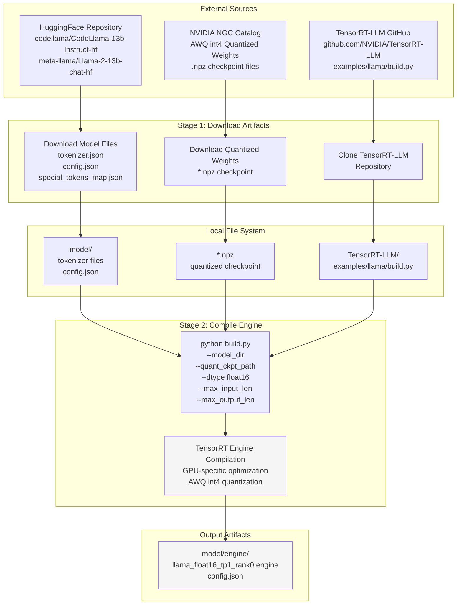

**Sources:** [README.md:25-45](), Diagram 1 from high-level architecture

## Required Artifacts

Three categories of artifacts must be obtained before engine compilation can begin:

| Artifact Type | Source | Files Needed | Purpose |
|---------------|--------|--------------|---------|
| **Model Files** | HuggingFace | `tokenizer.json`, `config.json`, `tokenizer_config.json`, `special_tokens_map.json` | Tokenization and model metadata |
| **Quantized Weights** | NVIDIA NGC Catalog | `*.npz` checkpoint file | AWQ int4 quantized model parameters |
| **Build Tools** | TensorRT-LLM GitHub | `examples/llama/build.py` | Engine compilation script |

### Supported Models

This system supports two model variants, each requiring different download sources:

#### CodeLlama-13B-Instruct
- **Model Repository**: [codellama/CodeLlama-13b-Instruct-hf](https://huggingface.co/codellama/CodeLlama-13b-Instruct-hf)
- **Quantized Weights**: [NVIDIA NGC Code Llama v1.1](https://catalog.ngc.nvidia.com/orgs/nvidia/models/code_llama/files?version=1.1)
- **Vocabulary Size**: 32,064 tokens
- **Rotary Base**: 1,000,000 (extended context support)

#### Llama-2-13B-Chat
- **Model Repository**: [meta-llama/Llama-2-13b-chat-hf](https://huggingface.co/meta-llama/Llama-2-13b-chat-hf)
- **Quantized Weights**: [NVIDIA NGC Llama2-13B v1.3](https://catalog.ngc.nvidia.com/orgs/nvidia/models/llama2-13b/files?version=1.3)
- **Vocabulary Size**: 32,000 tokens (default)
- **Rotary Base**: 10,000 (default)

**Sources:** [README.md:15-17](), [README.md:26-31](), [README.md:40]()

For detailed step-by-step download instructions, see [Downloading Models and Weights](#2.2.1).

## Engine Compilation Process

The engine compilation process transforms downloaded artifacts into an optimized TensorRT engine file using the `build.py` script from the TensorRT-LLM repository.

### Build Script Location and Invocation

The build script is located at `examples/llama/build.py` within the cloned TensorRT-LLM repository. The script must be executed from the `examples/llama` directory context.

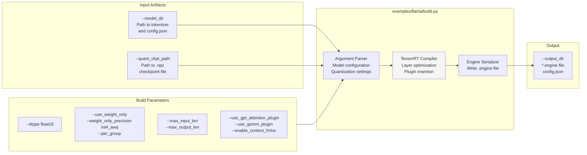

**Sources:** [README.md:33-45]()

### Build Configuration Parameters

The `build.py` script accepts numerous parameters that control engine optimization and runtime behavior. The following table summarizes critical parameters:

| Parameter | Purpose | CodeLlama Value | Llama2 Value |
|-----------|---------|-----------------|--------------|
| `--model_dir` | Directory containing tokenizer and config.json | Path to CodeLlama model | Path to Llama2 model |
| `--quant_ckpt_path` | Path to AWQ quantized checkpoint | Path to .npz file | Path to .npz file |
| `--dtype` | Model computation data type | `float16` | `float16` |
| `--max_input_len` | Maximum input token length | `15360` | `3500` |
| `--max_output_len` | Maximum output token length | `1024` | `1024` |
| `--max_batch_size` | Maximum concurrent requests | `1` | `1` |
| `--vocab_size` | Vocabulary size override | `32064` | Default (32000) |
| `--rotary_base` | RoPE base frequency | `1000000` | Default (10000) |
| `--output_dir` | Directory for compiled engine | Engine output path | Engine output path |

**Sources:** [README.md:38-45]()

### Model-Specific Build Commands

The exact `build.py` invocation differs between CodeLlama and Llama2 due to model architecture differences.

#### CodeLlama-13B Build Command

```bash
python build.py \
  --model_dir <path to CodeLlama model> \
  --quant_ckpt_path <path to CodeLlama .npz file> \
  --dtype float16 \
  --remove_input_padding \
  --use_gpt_attention_plugin float16 \
  --enable_context_fmha \
  --use_gemm_plugin float16 \
  --use_weight_only \
  --weight_only_precision int4_awq \
  --per_group \
  --max_batch_size 1 \
  --max_input_len 15360 \
  --max_output_len 1024 \
  --output_dir <TRT engine folder> \
  --rotary_base 1000000 \
  --vocab_size 32064
```

**Key differences**: Extended context window (15,360 tokens), custom rotary base (1,000,000), explicit vocabulary size (32,064), and `--remove_input_padding` flag.

**Sources:** [README.md:38-41]()

#### Llama2-13B Build Command

```bash
python build.py \
  --model_dir <path to llama13_chat model> \
  --quant_ckpt_path <path to Llama2 .npz file> \
  --dtype float16 \
  --use_gpt_attention_plugin float16 \
  --use_gemm_plugin float16 \
  --use_weight_only \
  --weight_only_precision int4_awq \
  --per_group \
  --enable_context_fmha \
  --max_batch_size 1 \
  --max_input_len 3500 \
  --max_output_len 1024 \
  --output_dir <TRT engine folder>
```

**Key differences**: Shorter context window (3,500 tokens), default rotary base and vocabulary size.

**Sources:** [README.md:42-45]()

For detailed compilation instructions and troubleshooting, see [Building TensorRT Engines](#2.2.2).

### TensorRT Plugins and Optimization Flags

The build commands specify several TensorRT plugins that optimize inference performance:

| Flag | Purpose |
|------|---------|
| `--use_gpt_attention_plugin float16` | Optimized attention mechanism implementation |
| `--use_gemm_plugin float16` | Optimized matrix multiplication kernels |
| `--enable_context_fmha` | Fused multi-head attention for context processing |
| `--use_weight_only` | Enable weight-only quantization mode |
| `--weight_only_precision int4_awq` | Use AWQ int4 quantization for weights |
| `--per_group` | Per-group quantization for improved accuracy |

**Sources:** [README.md:40](), [README.md:44]()

## Directory Structure and File Placement

The repository uses a specific directory structure for organizing model artifacts. The `model/` and `model/engine/` directories must exist before placing files, though they are initially empty in the Git repository.

### Directory Layout

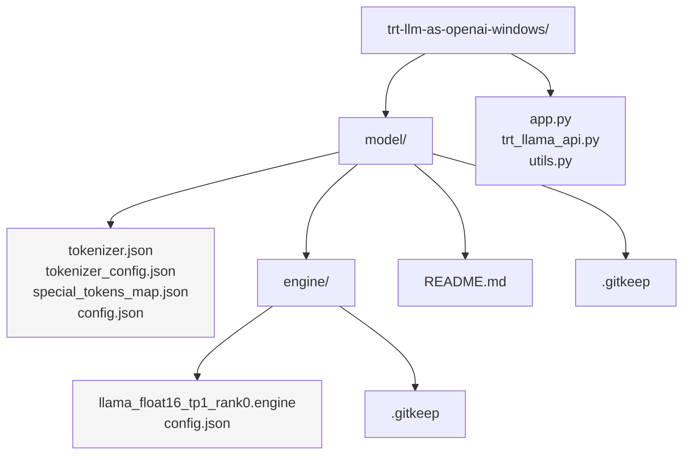

**Sources:** [model/README.md:1](), [README.md:54-57]()

### File Placement Instructions

After downloading artifacts and compiling the engine, files must be placed in specific locations:

| File Type | Destination | Description |
|-----------|-------------|-------------|
| Tokenizer files | `model/` | `tokenizer.json`, `tokenizer_config.json`, `special_tokens_map.json` |
| Model config | `model/` | `config.json` from HuggingFace |
| TensorRT engine | `model/engine/` | `*.engine` file generated by `build.py` |
| Engine config | `model/engine/` | `config.json` generated by `build.py` |

**Note**: The `model/` directory contains a `README.md` that states: "Place tokenizers and the model's config.json in this directory."

**Sources:** [model/README.md:1](), [README.md:54-57]()

## Important Considerations

### GPU-Specific Compilation

TensorRT engines are compiled for a specific GPU architecture and cannot be transferred between different GPU models. The compiled `.engine` file contains GPU-specific optimizations and instruction sequences. If the GPU is changed or upgraded, the engine must be recompiled from scratch.

**Sources:** README.md context, Diagram 1 analysis

### Storage Requirements

Model preparation requires significant disk space:

- **Downloaded artifacts**: ~26-30 GB (model files + quantized weights)
- **Compiled engine**: ~7-10 GB (varies by model and configuration)
- **Temporary files**: Additional space during compilation
- **Total recommended**: 50+ GB free disk space

### Compilation Time

Engine compilation is a CPU and GPU-intensive process that can take 30 minutes to several hours depending on:

- GPU model and compute capability
- CPU performance
- Model size and configuration parameters
- Optimization flags enabled

The compilation process only needs to be performed once per model/GPU combination.

**Sources:** High-level architecture analysis, README.md context

### Version Compatibility

The compiled engine must be compatible with the TensorRT-LLM runtime version used by the server. Ensure that:

- The `build.py` script version matches the installed TensorRT-LLM version
- The engine is compiled with the same TensorRT-LLM version that will load it at runtime
- AWQ checkpoint versions are compatible with the model architecture

**Sources:** [README.md:13]()

### Quantization Impact

The AWQ int4 quantization reduces model memory requirements by approximately 75% compared to float16, enabling 13B models to run on consumer GPUs with 16-24 GB VRAM. However, quantization introduces minor accuracy degradation compared to full-precision models. For more information on AWQ quantization, see [AWQ Quantization](#7.1).

**Sources:** [README.md:19](), [README.md:29](), [README.md:31]()

## Next Steps

After completing model preparation:

1. Verify that tokenizer files are in `model/`
2. Verify that the `.engine` file is in `model/engine/`
3. Proceed to [Launching the Server](#2.3) to start the inference service

For advanced engine configuration options, see [Model and Engine Settings](#5.2).

**Sources:** [README.md:62-77]()

---

# Page: Downloading Models and Weights

# Downloading Models and Weights

<details>
<summary>Relevant source files</summary>

The following files were used as context for generating this wiki page:

- [README.md](README.md)

</details>


## Purpose and Scope

This document provides step-by-step instructions for acquiring the necessary model files and quantized weights required for the TensorRT-LLM OpenAI API system. This is the first step in the model preparation phase and must be completed before building TensorRT engines (see [Building TensorRT Engines](#2.2.2)).

The download process involves obtaining files from two separate sources: HuggingFace repositories for model architecture and tokenizer files, and NVIDIA NGC Catalog for AWQ 4-bit quantized weight checkpoints.

**Sources:** [README.md:10-31](), [README.md:54-56]()

---

## Download Sources Overview

The system requires files from two external repositories for each supported model (CodeLlama-13B and Llama-2-13B):

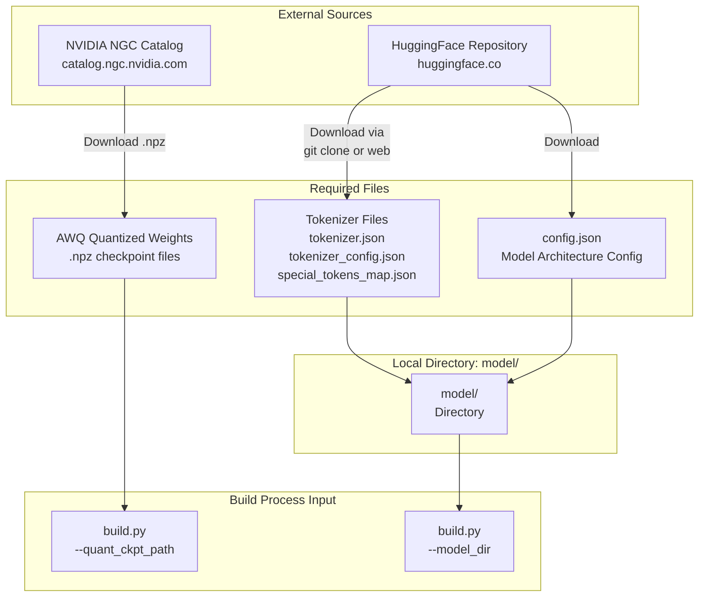

**Diagram: File Sources and Destinations for Model Preparation**

**Sources:** [README.md:15-17](), [README.md:25-31](), [README.md:54-56]()

---

## HuggingFace Model Downloads

### Access Requirements

Before downloading, ensure you have been granted access to the Llama model repositories on HuggingFace. These are gated repositories requiring approval from Meta AI.

**Sources:** [README.md:15-17]()

### CodeLlama-13B-Instruct

**Repository URL:** `https://huggingface.co/codellama/CodeLlama-13b-Instruct-hf`

**Required Files:**
- `tokenizer.json`
- `tokenizer_config.json`
- `special_tokens_map.json`
- `tokenizer.model`
- `config.json`

**Download Methods:**

1. **Git Clone (Recommended for all files):**
   ```bash
   git clone https://huggingface.co/codellama/CodeLlama-13b-Instruct-hf
   ```

2. **Manual Download (Alternative):**
   Navigate to the repository's Files tab and download individual files:
   `https://huggingface.co/codellama/CodeLlama-13b-Instruct-hf/tree/main`

**Destination:** Copy downloaded files to `model/` directory in this repository.

**Sources:** [README.md:16](), [README.md:27](), [README.md:55]()

### Llama-2-13B-Chat

**Repository URL:** `https://huggingface.co/meta-llama/Llama-2-13b-chat-hf`

**Required Files:**
- `tokenizer.json`
- `tokenizer_config.json`
- `special_tokens_map.json`
- `tokenizer.model`
- `config.json`

**Download Methods:**

1. **Git Clone (Recommended):**
   ```bash
   git clone https://huggingface.co/meta-llama/Llama-2-13b-chat-hf
   ```

2. **Manual Download (Alternative):**
   Navigate to: `https://huggingface.co/meta-llama/Llama-2-13b-chat-hf/tree/main`

**Destination:** Copy downloaded files to `model/` directory in this repository.

**Sources:** [README.md:17](), [README.md:30](), [README.md:56]()

---

## NVIDIA NGC Quantized Weight Downloads

The AWQ (Activation-aware Weight Quantization) 4-bit checkpoint files must be downloaded separately from NVIDIA's NGC Catalog. These `.npz` files contain the quantized neural network weights that significantly reduce memory usage while maintaining model quality.

### CodeLlama-13B AWQ int4 Checkpoints

**NGC Catalog URL:** `https://catalog.ngc.nvidia.com/orgs/nvidia/models/code_llama/files?version=1.1`

**File Format:** `.npz` (NumPy compressed array format)

**Download Steps:**
1. Navigate to the NGC Catalog URL
2. Locate version 1.1 of the `code_llama` model
3. Download the AWQ int4 checkpoint file(s)
4. Store in a temporary location (will be referenced during engine build via `--quant_ckpt_path`)

**Sources:** [README.md:28]()

### Llama-2-13B-Chat AWQ int4 Checkpoints

**NGC Catalog URL:** `https://catalog.ngc.nvidia.com/orgs/nvidia/models/llama2-13b/files?version=1.3`

**File Format:** `.npz`

**Download Steps:**
1. Navigate to the NGC Catalog URL
2. Locate version 1.3 of the `llama2-13b` model
3. Download the AWQ int4 checkpoint file(s)
4. Store in a temporary location (will be referenced during engine build via `--quant_ckpt_path`)

**Sources:** [README.md:31]()

---

## File Organization and Placement

### Directory Structure

After downloading all required files, the repository directory structure should appear as follows:

```mermaid
graph TB
    Root["trt-llm-as-openai-windows/<br/>(Repository Root)"]
    
    Root --> AppPy["app.py"]
    Root --> TrtPy["trt_llama_api.py"]
    Root --> UtilsPy["utils.py"]
    Root --> ReqTxt["requirements.txt"]
    
    Root --> ModelDir["model/"]
    
    ModelDir --> Tok1["tokenizer.json"]
    ModelDir --> Tok2["tokenizer_config.json"]
    ModelDir --> Tok3["special_tokens_map.json"]
    ModelDir --> Tok4["tokenizer.model"]
    ModelDir --> Config["config.json"]
    
    ModelDir --> EngineDir["engine/"]
    EngineDir --> GitKeep[".gitkeep<br/>(empty placeholder)"]
    
    External["External Location<br/>(not in repo)"]
    External --> NPZ["*.npz<br/>AWQ checkpoint files"]
    
    style ModelDir fill:#e3f2fd
    style EngineDir fill:#fff3e0
    style External fill:#f3e5f5
```

**Diagram: File Structure After Downloading Model Assets**

**Sources:** [README.md:54-57]()

### File Placement Details

| File Type | Source | Destination | Usage |
|-----------|--------|-------------|-------|
| `tokenizer.json` | HuggingFace | `model/tokenizer.json` | Loaded by `trt_llama_api.py` via `AutoTokenizer.from_pretrained()` |
| `tokenizer_config.json` | HuggingFace | `model/tokenizer_config.json` | Required by `AutoTokenizer` initialization |
| `special_tokens_map.json` | HuggingFace | `model/special_tokens_map.json` | Defines BOS, EOS, and special delimiter tokens |
| `tokenizer.model` | HuggingFace | `model/tokenizer.model` | SentencePiece tokenizer model file |
| `config.json` | HuggingFace | `model/config.json` | Model architecture configuration (hidden_size, num_layers, etc.) |
| `*.npz` checkpoint | NVIDIA NGC | Any location | Referenced by `build.py --quant_ckpt_path` during engine compilation |

**Sources:** [README.md:54-56](), [README.md:40](), [README.md:44]()

---

## Complete Download Workflow

```mermaid
flowchart TD
    Start["Start: Model Download Process"]
    
    CheckAccess{"Have HuggingFace<br/>repository access?"}
    RequestAccess["Request access from<br/>Meta AI on HuggingFace"]
    
    DownloadHF["Download from HuggingFace:<br/>- tokenizer files<br/>- config.json"]
    
    DownloadNGC["Download from NVIDIA NGC:<br/>- AWQ .npz checkpoint"]
    
    PlaceFiles["Place files in model/ directory:<br/>- tokenizer.json<br/>- tokenizer_config.json<br/>- special_tokens_map.json<br/>- tokenizer.model<br/>- config.json"]
    
    StoreCheckpoint["Store .npz checkpoint<br/>in temporary location"]
    
    Verify["Verify all files present:<br/>✓ model/tokenizer.json<br/>✓ model/config.json<br/>✓ *.npz checkpoint accessible"]
    
    NextStep["Proceed to Building TensorRT Engines"]
    
    Start --> CheckAccess
    CheckAccess -->|No| RequestAccess
    RequestAccess --> CheckAccess
    CheckAccess -->|Yes| DownloadHF
    
    DownloadHF --> DownloadNGC
    DownloadNGC --> PlaceFiles
    PlaceFiles --> StoreCheckpoint
    StoreCheckpoint --> Verify
    Verify --> NextStep
```

**Diagram: Step-by-Step Download Process Workflow**

**Sources:** [README.md:15-31](), [README.md:54-56]()

---

## File Requirements by Model

### CodeLlama-13B-Instruct Requirements

| Component | Source | Location | Size (Approximate) |
|-----------|--------|----------|-------------------|
| Tokenizer files | HuggingFace | `model/` | < 10 MB |
| config.json | HuggingFace | `model/` | < 1 MB |
| AWQ int4 checkpoint | NGC v1.1 | Any path | ~7 GB |

**Special Configuration Note:** CodeLlama requires the `--no_system_prompt True` flag when launching `app.py`, as it uses a different prompt structure than Llama-2.

**Sources:** [README.md:26-28](), [README.md:69-71]()

### Llama-2-13B-Chat Requirements

| Component | Source | Location | Size (Approximate) |
|-----------|--------|----------|-------------------|
| Tokenizer files | HuggingFace | `model/` | < 10 MB |
| config.json | HuggingFace | `model/` | < 1 MB |
| AWQ int4 checkpoint | NGC v1.3 | Any path | ~7 GB |

**Sources:** [README.md:29-31]()

---

## Verification Steps

After completing all downloads, verify the following:

1. **Tokenizer Directory Contents:**
   ```
   model/
   ├── tokenizer.json
   ├── tokenizer_config.json
   ├── special_tokens_map.json
   ├── tokenizer.model
   └── config.json
   ```

2. **AWQ Checkpoint Accessibility:**
   - Verify the `.npz` file path is accessible
   - Note the full path for use with `build.py --quant_ckpt_path`

3. **File Integrity:**
   - Ensure `config.json` contains valid JSON
   - Verify `tokenizer.json` is not corrupted
   - Check that `.npz` checkpoint file size matches expected values (~7 GB)

**Sources:** [README.md:54-57]()

---

## Important Notes

### Storage Requirements

- HuggingFace model files: ~10 MB per model
- NGC AWQ checkpoints: ~7 GB per model
- Total for both models: ~14-15 GB before engine compilation

### GPU Architecture Dependency

The AWQ quantized checkpoints are architecture-agnostic at this stage. However, the TensorRT engines compiled from these checkpoints in the next step will be GPU-specific and cannot be transferred between different GPU architectures.

**Sources:** [README.md:19]()

### Version Specificity

The NGC Catalog URLs specify exact versions (v1.1 for CodeLlama, v1.3 for Llama-2). These versions have been tested with this codebase. Using different versions may require adjustments to the `build.py` parameters.

**Sources:** [README.md:28](), [README.md:31]()

---

## Next Steps

Once all model files and quantized weights have been downloaded and placed in the appropriate directories, proceed to [Building TensorRT Engines](#2.2.2) to compile optimized inference engines for your specific GPU.

**Sources:** [README.md:21-45]()

---

# Page: Building TensorRT Engines

# Building TensorRT Engines

<details>
<summary>Relevant source files</summary>

The following files were used as context for generating this wiki page:

- [README.md](README.md)
- [model/engine/.gitkeep](model/engine/.gitkeep)

</details>


## Purpose and Scope

This page provides detailed instructions for compiling Llama 2 and CodeLlama models into optimized TensorRT engines using the `build.py` script from TensorRT-LLM. The engine compilation process transforms downloaded HuggingFace models and AWQ quantized weights into GPU-specific binary files that enable accelerated inference. This is a one-time, resource-intensive operation that must be performed before the server can be launched.

For information about downloading models and quantized weights, see [Downloading Models and Weights](#2.2.1). For instructions on launching the server with compiled engines, see [Launching the Server](#2.3).

**Sources:** [README.md:19-45]()

---

## Build Process Overview

The engine building process converts a model from its original format into an optimized TensorRT execution graph. This involves:

1. Loading the model architecture from `config.json`
2. Loading AWQ int4 quantized weights from `.npz` checkpoint files
3. Applying TensorRT optimizations (attention plugins, GEMM plugins, context FMHA)
4. Compiling the graph into a binary `.engine` file specific to your GPU architecture

### Build Process Flow

```mermaid
flowchart TD
    subgraph Inputs["Input Artifacts"]
        ModelDir["model_dir/<br/>config.json + tokenizer"]
        QuantCkpt["quant_ckpt_path/<br/>AWQ int4 .npz weights"]
    end
    
    subgraph TRTRepo["TensorRT-LLM Repository"]
        BuildScript["examples/llama/build.py"]
    end
    
    subgraph BuildProcess["Compilation Process"]
        LoadConfig["Load Model Config<br/>num_heads, hidden_size, vocab_size"]
        LoadWeights["Load Quantized Weights<br/>AWQ int4 per-group"]
        ApplyPlugins["Apply TensorRT Plugins<br/>GPT Attention, GEMM, Context FMHA"]
        OptimizeGraph["Graph Optimization<br/>Layer Fusion, Memory Planning"]
        Serialize["Serialize Engine Binary"]
    end
    
    subgraph Output["Output Artifacts"]
        EngineFile["output_dir/<br/>llama_float16_tp1_rank0.engine"]
        ConfigJson["output_dir/<br/>config.json"]
    end
    
    ModelDir --> BuildScript
    QuantCkpt --> BuildScript
    
    BuildScript --> LoadConfig
    LoadConfig --> LoadWeights
    LoadWeights --> ApplyPlugins
    ApplyPlugins --> OptimizeGraph
    OptimizeGraph --> Serialize
    
    Serialize --> EngineFile
    Serialize --> ConfigJson
```

**Sources:** [README.md:21-45]()

---

## Prerequisites

Before building engines, ensure the following are in place:

| Requirement | Description |
|-------------|-------------|
| **TensorRT-LLM** | Installed following [Windows installation guide](https://github.com/NVIDIA/TensorRT-LLM/tree/v0.6.1/windows#quick-start) |
| **Model Files** | Downloaded from HuggingFace (config.json, tokenizer files) - see [2.2.1](#2.2.1) |
| **Quantized Weights** | AWQ int4 `.npz` checkpoint files from NVIDIA NGC - see [2.2.1](#2.2.1) |
| **TensorRT-LLM Repository** | Cloned locally to access `build.py` script |
| **NVIDIA GPU** | CUDA-compatible GPU with sufficient VRAM |

### Cloning TensorRT-LLM

The `build.py` script is located in the TensorRT-LLM repository and must be accessed locally:

```bash
git clone https://github.com/NVIDIA/TensorRT-LLM.git
cd TensorRT-LLM/examples/llama
```

**Sources:** [README.md:11-31](), [README.md:33-36]()

---

## Build Parameters Reference

Both CodeLlama and Llama2 builds use the `build.py` script with various parameters. The following table documents common parameters:

| Parameter | Purpose | Common Values |
|-----------|---------|---------------|
| `--model_dir` | Path to HuggingFace model directory containing config.json | `<path to model>` |
| `--quant_ckpt_path` | Path to AWQ quantized checkpoint .npz file | `<path to .npz file>` |
| `--dtype` | Data type for activations | `float16` |
| `--use_gpt_attention_plugin` | Enable GPT attention plugin for optimized attention | `float16` |
| `--use_gemm_plugin` | Enable GEMM plugin for optimized matrix multiplication | `float16` |
| `--use_weight_only` | Enable weight-only quantization mode | Flag (no value) |
| `--weight_only_precision` | Quantization precision for weights | `int4_awq` |
| `--per_group` | Use per-group quantization (higher accuracy than per-channel) | Flag (no value) |
| `--enable_context_fmha` | Enable context Flash Multi-Head Attention | Flag (no value) |
| `--max_batch_size` | Maximum batch size for inference | `1` |
| `--max_input_len` | Maximum input sequence length in tokens | `3500` or `15360` |
| `--max_output_len` | Maximum output sequence length in tokens | `1024` |
| `--output_dir` | Directory to write compiled engine files | `<TRT engine folder>` |

**Sources:** [README.md:38-45]()

---

## CodeLlama Engine Build

### CodeLlama Build Command

Navigate to `TensorRT-LLM/examples/llama` and execute:

```bash
python build.py \
  --model_dir <path to CodeLlama model> \
  --quant_ckpt_path <path to CodeLlama .npz file> \
  --dtype float16 \
  --remove_input_padding \
  --use_gpt_attention_plugin float16 \
  --enable_context_fmha \
  --use_gemm_plugin float16 \
  --use_weight_only \
  --weight_only_precision int4_awq \
  --per_group \
  --max_batch_size 1 \
  --max_input_len 15360 \
  --max_output_len 1024 \
  --output_dir <TRT engine folder> \
  --rotary_base 1000000 \
  --vocab_size 32064
```

### CodeLlama-Specific Parameters

CodeLlama requires additional parameters not used in Llama2:

| Parameter | Value | Purpose |
|-----------|-------|---------|
| `--remove_input_padding` | Flag | Removes padding from input sequences for efficiency |
| `--rotary_base` | `1000000` | Base value for rotary position embeddings (CodeLlama uses extended context) |
| `--vocab_size` | `32064` | Vocabulary size specific to CodeLlama tokenizer |
| `--max_input_len` | `15360` | Extended context window for code (vs 3500 for Llama2) |

### CodeLlama Build Characteristics

```mermaid
flowchart LR
    subgraph Input["Input Specifics"]
        Model["CodeLlama-13b-Instruct-hf<br/>vocab_size: 32064"]
        Weights["code_llama_awq_int4.npz<br/>NGC Catalog v1.1"]
    end
    
    subgraph Config["Build Configuration"]
        Context["max_input_len: 15360<br/>max_output_len: 1024<br/>Total context: 16384"]
        Quant["AWQ int4 per-group<br/>~3.25 bits per weight"]
        Plugins["GPT Attention + GEMM<br/>Context FMHA<br/>Input Padding Removal"]
        Rotary["rotary_base: 1000000<br/>Extended context support"]
    end
    
    subgraph Output["Engine Output"]
        Engine["llama_float16_tp1_rank0.engine<br/>~4-6 GB binary file"]
        UseCase["Code completion/generation<br/>16K context window"]
    end
    
    Model --> Config
    Weights --> Config
    Config --> Engine
    Engine --> UseCase
```

**Sources:** [README.md:38-41]()

---

## Llama2 Engine Build

### Llama2 Build Command

Navigate to `TensorRT-LLM/examples/llama` and execute:

```bash
python build.py \
  --model_dir <path to llama13_chat model> \
  --quant_ckpt_path <path to Llama2 .npz file> \
  --dtype float16 \
  --use_gpt_attention_plugin float16 \
  --use_gemm_plugin float16 \
  --use_weight_only \
  --weight_only_precision int4_awq \
  --per_group \
  --enable_context_fmha \
  --max_batch_size 1 \
  --max_input_len 3500 \
  --max_output_len 1024 \
  --output_dir <TRT engine folder>
```

### Llama2 vs CodeLlama Differences

| Aspect | Llama2 | CodeLlama |
|--------|--------|-----------|
| **max_input_len** | 3500 | 15360 |
| **vocab_size** | Default (32000) | 32064 (explicit) |
| **rotary_base** | Default (10000) | 1000000 (explicit) |
| **remove_input_padding** | Not used | Enabled |
| **Use Case** | Chat/general text | Code generation |
| **Context Window** | ~4500 tokens | ~16384 tokens |

### Llama2 Build Characteristics

```mermaid
flowchart LR
    subgraph Input["Input Specifics"]
        Model["Llama-2-13b-chat-hf<br/>vocab_size: 32000"]
        Weights["llama2_13b_awq_int4.npz<br/>NGC Catalog v1.3"]
    end
    
    subgraph Config["Build Configuration"]
        Context["max_input_len: 3500<br/>max_output_len: 1024<br/>Total context: 4524"]
        Quant["AWQ int4 per-group<br/>~3.25 bits per weight"]
        Plugins["GPT Attention + GEMM<br/>Context FMHA"]
    end
    
    subgraph Output["Engine Output"]
        Engine["llama_float16_tp1_rank0.engine<br/>~4-6 GB binary file"]
        UseCase["Chat completions<br/>4.5K context window"]
    end
    
    Model --> Config
    Weights --> Config
    Config --> Engine
    Engine --> UseCase
```

**Sources:** [README.md:42-45]()

---

## Output Artifacts

### Engine Files Generated

The build process creates several files in the specified `--output_dir`:

| File | Description | Size |
|------|-------------|------|
| `llama_float16_tp1_rank0.engine` | Binary TensorRT engine | 4-6 GB |
| `config.json` | Engine configuration metadata | <1 KB |
| `rank0.engine` (alternative name) | Same as above | 4-6 GB |

### Configuration Metadata

The generated `config.json` contains runtime information:

```mermaid
graph LR
    subgraph EngineConfig["config.json Contents"]
        Builder["builder_config:<br/>max_input_len<br/>max_output_len<br/>max_batch_size"]
        Model["model_config:<br/>num_heads<br/>hidden_size<br/>vocab_size"]
        Parallel["parallelism:<br/>tp_size (tensor)<br/>pp_size (pipeline)"]
        Plugin["plugin_config:<br/>gpt_attention_plugin<br/>gemm_plugin<br/>etc."]
    end
    
    subgraph Runtime["Used by TrtLlmAPI"]
        Init["__init__ method<br/>Loads and validates config"]
        Session["GenerationSession<br/>Uses config for setup"]
    end
    
    Builder --> Init
    Model --> Init
    Parallel --> Init
    Plugin --> Init
    
    Init --> Session
```

**Sources:** [README.md:38-45](), [trt_llama_api.py:112-179]()

---

## Build Process Details

### Compilation Steps

The `build.py` script performs the following internal operations:

1. **Model Loading**: Reads `config.json` from `--model_dir` to understand architecture
2. **Weight Loading**: Loads AWQ quantized weights from `.npz` checkpoint
3. **Graph Construction**: Builds TensorRT network graph with layers (attention, FFN, etc.)
4. **Plugin Integration**: Inserts optimized CUDA kernels for attention and GEMM operations
5. **Optimization**: Applies layer fusion, constant folding, and precision calibration
6. **Serialization**: Compiles optimized graph into binary `.engine` format

### Compile-Time vs Runtime Parameters

| Parameter Type | Examples | When Applied |
|----------------|----------|--------------|
| **Compile-Time** | `max_input_len`, `max_output_len`, `max_batch_size`, `dtype`, plugin flags | During `build.py` execution |
| **Runtime** | `temperature`, `top_p`, `top_k`, `repetition_penalty` | During inference via `GenerationSession.decode()` |

**Compile-time parameters are baked into the engine and cannot be changed without rebuilding.**

**Sources:** [README.md:38-45]()

---

## Important Considerations

### GPU Architecture Dependency

TensorRT engines are **GPU-architecture-specific**. An engine built on an RTX 4090 (Ada Lovelace) cannot run on an RTX 3090 (Ampere). Always build engines on the target deployment GPU.

```mermaid
graph TD
    subgraph BuildGPU["Build GPU: RTX 4090"]
        Build["build.py execution<br/>Compiles for Ada arch"]
        Engine4090["llama_ada.engine<br/>CUDA Compute 8.9"]
    end
    
    subgraph TargetGPU1["Target GPU: RTX 4090"]
        Run4090["✓ Compatible<br/>Same architecture"]
    end
    
    subgraph TargetGPU2["Target GPU: RTX 3090"]
        Run3090["✗ Incompatible<br/>Different architecture"]
    end
    
    Build --> Engine4090
    Engine4090 --> Run4090
    Engine4090 -.->|"Will fail to load"| Run3090
```

### Build Time and Resources

| Model | Approx. Build Time | Disk Space Required | Peak RAM Usage |
|-------|-------------------|---------------------|----------------|
| **CodeLlama-13B** | 20-40 minutes | ~20 GB (inputs + outputs) | ~16 GB system RAM |
| **Llama2-13B** | 15-30 minutes | ~18 GB (inputs + outputs) | ~14 GB system RAM |

*Times measured on NVIDIA RTX 4090. Slower GPUs will take proportionally longer.*

### File Placement

After building, copy the engine files to the repository structure:

```
trt-llm-as-openai-windows/
└── model/
    ├── config.json              # From HuggingFace
    ├── tokenizer.json           # From HuggingFace
    ├── tokenizer_config.json    # From HuggingFace
    └── engine/
        ├── llama_float16_tp1_rank0.engine  # Built engine
        └── config.json                      # Engine config
```

**Sources:** [README.md:54-57](), [model/engine/.gitkeep:1]()

---

## Troubleshooting Build Issues

### Common Build Failures

| Error | Cause | Solution |
|-------|-------|----------|
| `FileNotFoundError: config.json` | Incorrect `--model_dir` path | Verify path contains HuggingFace model files |
| `AssertionError: quant_ckpt_path` | Missing or incorrect `.npz` file | Download correct AWQ checkpoint from NGC |
| `CUDA out of memory` | Insufficient GPU VRAM | Close other GPU applications or use smaller batch size |
| `Unsupported compute capability` | Outdated GPU | TensorRT-LLM requires compute capability ≥7.0 (Volta or newer) |

### Validation After Build

Verify the engine was built successfully:

1. Check `--output_dir` contains `.engine` file (should be 4-6 GB)
2. Check `config.json` exists in same directory
3. Verify file sizes are reasonable (not 0 bytes)

**Sources:** [README.md:21-45]()

---

## Next Steps

After successfully building the TensorRT engine:

1. Copy engine files to `model/engine/` directory - see [Directory Layout](#6.1)
2. Ensure tokenizer files are in `model/` directory - see [Downloading Models and Weights](#2.2.1)
3. Launch the server - see [Launching the Server](#2.3)

**Sources:** [README.md:47-77]()

---

# Page: Launching the Server

# Launching the Server

<details>
<summary>Relevant source files</summary>

The following files were used as context for generating this wiki page:

- [README.md](README.md)
- [app.py](app.py)

</details>


This page describes how to start the Flask web server that exposes the OpenAI-compatible API. It covers the required command-line arguments, optional configuration parameters, and the server initialization sequence. For information about preparing the TensorRT engine before launching, see [Model Preparation](#2.2). For information about using the API after the server is running, see [API Usage](#3).

## Prerequisites

Before launching the server, ensure the following are in place:
1. TensorRT engine files have been built and placed in the target directory (see [Building TensorRT Engines](#2.2.2))
2. Tokenizer files and `config.json` have been downloaded to the model directory (see [Downloading Models and Weights](#2.2.1))
3. Python dependencies from `requirements.txt` have been installed

**Sources:** [README.md:47-62]()

## Basic Launch Command

The server is started by executing `app.py` with Python. The minimum required command structure is:

```bash
python app.py \
    --trt_engine_path <path_to_engine_directory> \
    --trt_engine_name <engine_filename.engine> \
    --tokenizer_dir_path <path_to_tokenizer_directory>
```

This command initializes the Flask application at [app.py:41](), creates a `TrtLlmAPI` instance at [app.py:75-85](), and starts the HTTP server at [app.py:217]().

**Sources:** [README.md:64-67](), [app.py:22-52](), [app.py:75-85]()

## Required Arguments

The following table documents the three mandatory command-line arguments that must be provided:

| Argument | Type | Description | Example Value |
|----------|------|-------------|---------------|
| `--trt_engine_path` | `str` | Directory containing the TensorRT engine files | `model/engine/` or `model/` |
| `--trt_engine_name` | `str` | Filename of the compiled `.engine` file | `llama_float16_tp1_rank0.engine` |
| `--tokenizer_dir_path` | `str` | Directory containing tokenizer files (`tokenizer.json`, `tokenizer_config.json`) and `config.json` | `model/` |

These arguments are parsed by `argparse.ArgumentParser` at [app.py:29-37]() and passed to the `TrtLlmAPI` constructor at [app.py:75-85]().

**Sources:** [app.py:32-37](), [README.md:105-109]()

## Optional Configuration Arguments

Additional arguments provide control over server behavior and resource limits:

| Argument | Type | Default | Description |
|----------|------|---------|-------------|
| `--host` | `str` | `127.0.0.1` | IP address for the server to bind to |
| `--port` | `int` | `8081` | TCP port number for HTTP listener |
| `--max_output_tokens` | `int` | `2048` | Maximum number of tokens in generated responses |
| `--max_input_tokens` | `int` | `2048` | Maximum number of tokens in input prompts |
| `--no_system_prompt` | `bool` | `False` | Disable automatic system prompt injection (required for CodeLlama) |
| `--verbose` | `bool` | `False` | Enable detailed logging of requests and responses |

The `--host` and `--port` arguments control the network binding at [app.py:217](), while token limits are passed to `TrtLlmAPI` at [app.py:80-81](). The `--no_system_prompt` flag affects prompt formatting logic in chat completion endpoints at [app.py:154-156]().

**Sources:** [app.py:44-49](), [README.md:110-113]()

## Command-Line Argument Flow

The following diagram shows how command-line arguments flow through the application during initialization:

```mermaid
flowchart TD
    CLI["python app.py<br/>--trt_engine_path<br/>--trt_engine_name<br/>--tokenizer_dir_path<br/>--port 8081"]
    
    Parser["argparse.ArgumentParser<br/>app.py:29"]
    
    Args["args namespace<br/>app.py:52"]
    
    Extract["Variable extraction<br/>app.py:66-72"]
    
    TrtAPI["TrtLlmAPI constructor<br/>app.py:75-85"]
    
    FlaskRun["app.run(host, port)<br/>app.py:217"]
    
    TrtInit["TrtLlmAPI.__init__<br/>trt_llama_api.py:112-179"]
    
    CLI --> Parser
    Parser -->|"parse_args()"| Args
    Args --> Extract
    Extract -->|"trt_engine_path<br/>trt_engine_name<br/>tokenizer_dir_path"| TrtAPI
    Extract -->|"host<br/>port"| FlaskRun
    TrtAPI --> TrtInit
    TrtInit -->|"Loads engine and tokenizer"| FlaskRun
```

**Sources:** [app.py:22-85](), [app.py:217]()

## Model-Specific Launch Examples

Different models require different argument configurations:

### Llama-2-13B-chat

Standard launch command without system prompt modification:

```bash
python app.py \
    --trt_engine_path model/engine/ \
    --trt_engine_name llama_float16_tp1_rank0.engine \
    --tokenizer_dir_path model/ \
    --port 8081
```

This configuration uses the default system prompt defined in `DEFAULT_SYSTEM_PROMPT` from [utils.py]().

### CodeLlama-13B-instruct

Requires disabling the automatic system prompt:

```bash
python app.py \
    --trt_engine_path model/ \
    --trt_engine_name llama_float16_tp1_rank0.engine \
    --tokenizer_dir_path model/ \
    --port 8081 \
    --no_system_prompt True
```

The `--no_system_prompt True` argument prevents injection of the default system prompt at [app.py:154-156](), as CodeLlama uses a different prompt format than Llama 2 chat models.

**Sources:** [README.md:64-76](), [app.py:154-158]()

## Server Initialization Sequence

When `python app.py` is executed, the following initialization sequence occurs:

```mermaid
sequenceDiagram
    participant User
    participant ArgParse as "argparse<br/>app.py:29-52"
    participant AppModule as "app.py<br/>Module Level"
    participant TrtLlmAPI as "TrtLlmAPI<br/>trt_llama_api.py"
    participant FlaskApp as "Flask.run()<br/>app.py:217"
    
    User->>ArgParse: "Execute python app.py [args]"
    ArgParse->>ArgParse: "Parse command-line arguments"
    ArgParse->>AppModule: "args namespace"
    
    AppModule->>AppModule: "Extract variables (app.py:66-72)"
    
    AppModule->>TrtLlmAPI: "TrtLlmAPI(__init__)"
    Note over TrtLlmAPI: "Loads config.json<br/>Loads tokenizer<br/>Loads engine binary<br/>Creates GenerationSession"
    TrtLlmAPI-->>AppModule: "llm instance ready"
    
    Note over AppModule: "Flask route registration<br/>(app.py:88-214)"
    
    AppModule->>FlaskApp: "app.run(host, port, threaded=False)"
    FlaskApp-->>User: "Server listening on http://127.0.0.1:8081"
```

The initialization happens in this order:

1. **Argument Parsing** [app.py:22-52](): Command-line arguments are parsed into an `args` namespace
2. **Variable Extraction** [app.py:66-72](): Values are extracted from `args` into module-level variables
3. **TrtLlmAPI Initialization** [app.py:75-85](): The inference engine is instantiated, which internally:
   - Loads `config.json` from the engine directory
   - Loads the tokenizer from `tokenizer_dir_path`
   - Reads the `.engine` binary file
   - Creates a `GenerationSession` with the TensorRT runtime
4. **Route Registration** [app.py:88-214](): Flask routes are decorated and registered
5. **Server Start** [app.py:217](): Flask begins listening for HTTP requests

The initialization is single-threaded (`threaded=False` at [app.py:217]()), meaning the server handles requests sequentially.

**Sources:** [app.py:22-85](), [app.py:217]()

## Registered HTTP Endpoints

After initialization, the Flask application exposes the following routes:

```mermaid
graph TB
    FlaskApp["Flask app<br/>app.py:41"]
    
    Models1["/models<br/>app.py:100"]
    Models2["/v1/models<br/>app.py:101"]
    ModelsLlama["/models/Llama2<br/>app.py:88"]
    ModelsLlamaV1["/v1/models/Llama2<br/>app.py:89"]
    
    Chat1["/chat/completions<br/>app.py:117"]
    Chat2["/v1/chat/completions<br/>app.py:118"]
    
    Comp1["/completions<br/>app.py:174"]
    Comp2["/v1/completions<br/>app.py:175"]
    
    FlaskApp --> Models1
    FlaskApp --> Models2
    FlaskApp --> ModelsLlama
    FlaskApp --> ModelsLlamaV1
    FlaskApp --> Chat1
    FlaskApp --> Chat2
    FlaskApp --> Comp1
    FlaskApp --> Comp2
    
    Models1 --> Handler1["modelsLlaMA()<br/>app.py:102-114"]
    Models2 --> Handler1
    ModelsLlama --> Handler2["models()<br/>app.py:90-97"]
    ModelsLlamaV1 --> Handler2
    Chat1 --> Handler3["chat_completions()<br/>app.py:119-171"]
    Chat2 --> Handler3
    Comp1 --> Handler4["completion()<br/>app.py:176-213"]
    Comp2 --> Handler4
```

All routes are registered with both standard and `/v1/` prefixed paths for OpenAI API compatibility. The routes are defined using Flask's `@app.route()` decorator at various locations in [app.py]().

**Sources:** [app.py:88-214](), [README.md:116-121]()

## Verifying Server Status

After launching, verify the server is running correctly:

### Check Console Output

The Flask development server prints startup messages:

```
 * Serving Flask app 'app'
 * Debug mode: on
WARNING: This is a development server. Do not use it in a production deployment.
 * Running on http://127.0.0.1:8081
Press CTRL+C to quit
```

The "Running on" line confirms the server is listening. The port number should match the `--port` argument (default 8081).

### Test Models Endpoint

Query the `/models` endpoint to verify API responsiveness:

```bash
curl http://127.0.0.1:8081/models
```

Expected response:

```json
{
  "object": "list",
  "data": [
    {
      "id": "Llama2",
      "object": "model",
      "created": 1675232119,
      "owned_by": "Meta"
    }
  ]
}
```

This response is generated by the `modelsLlaMA()` function at [app.py:102-114]().

**Sources:** [app.py:100-114](), [README.md:78-95]()

## Server Runtime Configuration

The server is configured with specific Flask settings at [app.py:217]():

| Parameter | Value | Reason |
|-----------|-------|--------|
| `debug` | `True` | Enables detailed error messages and auto-reload (development mode) |
| `use_reloader` | `False` | Disables auto-reload despite debug mode to prevent double initialization |
| `threaded` | `False` | Forces sequential request handling (likely due to TensorRT thread safety) |

The `threaded=False` setting is critical: it ensures only one request is processed at a time, preventing concurrent access to the TensorRT `GenerationSession`, which may not be thread-safe.

**Sources:** [app.py:217]()

## Common Launch Issues

### Engine Path Errors

If the engine path is incorrect, initialization fails during `TrtLlmAPI.__init__()`. Symptoms:
- `FileNotFoundError` for `config.json` 
- `FileNotFoundError` for `.engine` file

**Solution:** Verify `--trt_engine_path` points to the directory containing both `config.json` and the `.engine` file.

### Tokenizer Path Errors

If tokenizer files are missing, initialization fails when loading `AutoTokenizer`. Symptoms:
- `OSError: Can't load tokenizer`
- Missing `tokenizer.json` or `tokenizer_config.json`

**Solution:** Verify `--tokenizer_dir_path` contains all required tokenizer files from HuggingFace.

### Port Already in Use

If the specified port is already bound, Flask fails to start:
```
OSError: [WinError 10048] Only one usage of each socket address (protocol/network address/port) is normally permitted
```

**Solution:** Use a different `--port` value or terminate the process using the current port.

**Sources:** [app.py:75-85](), [app.py:217]()

## Server Shutdown

To stop the server:
1. Press `Ctrl+C` in the terminal running `app.py`
2. Flask catches the interrupt and performs cleanup
3. The TensorRT engine and CUDA resources are released when the Python process exits

The server does not persist state between runs; all inference state exists only in memory during runtime.

**Sources:** [app.py:217]()

---

# Page: API Usage

# API Usage

<details>
<summary>Relevant source files</summary>

The following files were used as context for generating this wiki page:

- [README.md](README.md)
- [app.py](app.py)

</details>


This page provides a comprehensive guide to making inference requests to the TensorRT-LLM OpenAI-compatible API server. It covers the HTTP endpoints, request/response formats, common parameters, and basic usage patterns.

For detailed information about specific endpoint types, see [Chat Completions](#3.2), [Text Completions](#3.3), and [Client Integration Examples](#3.4). For server configuration and startup options, see [Server Configuration](#5.1).

## Purpose and Compatibility

The TensorRT-LLM OpenAI API server exposes HTTP endpoints that conform to the OpenAI API specification. This allows any client built for the OpenAI API to interact with locally-hosted LLM inference without modification. The server implements a subset of the OpenAI API focused on text generation tasks.

**Key Compatibility Features:**
- Request/response JSON structures match OpenAI's specification
- Endpoint paths follow OpenAI's `/v1/*` and legacy naming conventions
- Streaming responses use Server-Sent Events (SSE) format
- Model identifiers work with OpenAI client libraries

**Sources:** [README.md:3-7](), [README.md:116-122]()

## Base URL and Connection

The server listens on a configurable host and port, with defaults specified as command-line arguments to `app.py`.

**Default Configuration:**
- **Host:** `127.0.0.1` (localhost only)
- **Port:** `8081`
- **Base URL:** `http://127.0.0.1:8081`
- **OpenAI-compatible Base URL:** `http://127.0.0.1:8081/v1`

These defaults can be overridden using the `--host` and `--port` command-line arguments when starting the server.

**Authentication:** The server requires an API key to be set in client requests for OpenAI client library compatibility, but does not validate its value. Any non-empty string is accepted.

```python
# Example client configuration
openai.api_key = "ABC"  # Any string works
openai.api_base = "http://127.0.0.1:8081"
```

**Sources:** [app.py:44-45](), [app.py:216-217](), [README.md:88-90]()

## Endpoint Overview

The following diagram shows the HTTP endpoints exposed by the Flask server and their routing in the codebase:

```mermaid
graph TB
    Client["HTTP Client"]
    
    subgraph FlaskServer["Flask Application (app.py)"]
        ChatV1["/v1/chat/completions<br/>POST"]
        Chat["/chat/completions<br/>POST"]
        CompV1["/v1/completions<br/>POST"]
        Comp["/completions<br/>POST"]
        ModelsV1["/v1/models<br/>GET/POST"]
        Models["/models<br/>GET/POST"]
        ModelDetail["/v1/models/Llama2<br/>GET/POST"]
    end
    
    subgraph Handlers["Route Handlers"]
        ChatFunc["chat_completions()<br/>app.py:119-171"]
        CompFunc["completion()<br/>app.py:176-213"]
        ModelsFunc["modelsLlaMA()<br/>app.py:102-114"]
        ModelFunc["models()<br/>app.py:90-97"]
    end
    
    Client -->|"POST /v1/chat/completions"| ChatV1
    Client -->|"POST /chat/completions"| Chat
    Client -->|"POST /v1/completions"| CompV1
    Client -->|"POST /completions"| Comp
    Client -->|"GET /v1/models"| ModelsV1
    Client -->|"GET /models"| Models
    
    ChatV1 --> ChatFunc
    Chat --> ChatFunc
    CompV1 --> CompFunc
    Comp --> CompFunc
    ModelsV1 --> ModelsFunc
    Models --> ModelsFunc
    ModelDetail --> ModelFunc
```

**Endpoint Routing:**
- Both `/v1/*` prefixed and legacy (non-prefixed) endpoints route to the same handler functions
- All completion endpoints require `Content-Type: application/json` header
- Model endpoints support both GET and POST methods for compatibility

**Sources:** [app.py:117-118](), [app.py:174-175](), [app.py:100-101](), [app.py:88-89]()

## Common Request Parameters

The following parameters are supported across completion endpoints (both chat and text):

| Parameter | Type | Default | Description | Code Reference |
|-----------|------|---------|-------------|----------------|
| `stream` | boolean | `false` | Enable streaming responses via SSE | [app.py:122-125](), [app.py:181-182]() |
| `temperature` | float | `1.0` | Sampling temperature (higher = more random) | [app.py:123-127](), [app.py:179-184]() |
| `stop` | string[] | `[]` | Stop sequences for generation termination | [app.py:186-188]() |
| `messages` | array | required* | Chat messages (chat completions only) | [app.py:133-152]() |
| `prompt` | string | required* | Raw text prompt (text completions only) | [app.py:194-195]() |

*One of `messages` or `prompt` is required depending on endpoint type.

**Parameter Processing Flow:**

```mermaid
flowchart LR
    Request["HTTP Request<br/>JSON Body"]
    Parse["is_present() check<br/>app.py:55-62"]
    Extract["Extract parameters<br/>stream, temperature, stop"]
    
    ChatRoute{"/chat/completions<br/>or /completions?"}
    
    ChatMsgs["Parse messages array<br/>Create ChatMessage objects<br/>app.py:134-152"]
    TextPrompt["Extract prompt string<br/>app.py:194-195"]
    
    Format["Apply prompt formatting<br/>utils.messages_to_prompt()<br/>or completion_to_prompt()"]
    
    Execute["llm.complete_common()<br/>or stream_complete_common()"]
    
    Request --> Parse
    Parse --> Extract
    Extract --> ChatRoute
    ChatRoute -->|"Chat"| ChatMsgs
    ChatRoute -->|"Text"| TextPrompt
    ChatMsgs --> Format
    TextPrompt --> Format
    Format --> Execute
```

**Parameter Validation:**
The `is_present()` utility function checks if JSON keys exist and have non-null values before extracting them. This prevents `KeyError` exceptions when optional parameters are omitted.

**Sources:** [app.py:55-62](), [app.py:122-127](), [app.py:179-188](), [app.py:133-152]()

## Response Format

All completion endpoints return JSON responses conforming to OpenAI's response structure. The response generation is handled by the `make_resData()` method in `TrtLlmAPI`.

### Non-Streaming Response Structure

```json
{
  "id": "chatcmpl-<request_id>",
  "object": "chat.completion",
  "created": <unix_timestamp>,
  "model": "Llama2",
  "choices": [
    {
      "index": 0,
      "message": {
        "role": "assistant",
        "content": "<generated_text>"
      },
      "finish_reason": "stop"
    }
  ],
  "usage": {
    "prompt_tokens": <input_token_count>,
    "completion_tokens": <output_token_count>,
    "total_tokens": <sum>
  }
}
```

**Response Object Differences:**
- Chat completions: `"object": "chat.completion"`, with `message` field
- Text completions: `"object": "text_completion"`, with `text` field instead

**Sources:** [trt_llama_api.py:49-80]() (inferred from make_resData method structure)

### Streaming Response Format

When `"stream": true` is specified, the server returns a stream of Server-Sent Events (SSE). Each event contains a JSON chunk:

```
data: {"id":"chatcmpl-xyz","object":"chat.completion.chunk","created":1234567890,"model":"Llama2","choices":[{"index":0,"delta":{"content":"Hello"},"finish_reason":null}]}

data: {"id":"chatcmpl-xyz","object":"chat.completion.chunk","created":1234567890,"model":"Llama2","choices":[{"index":0,"delta":{"content":" world"},"finish_reason":null}]}

data: {"id":"chatcmpl-xyz","object":"chat.completion.chunk","created":1234567890,"model":"Llama2","choices":[{"index":0,"delta":{},"finish_reason":"stop"}]}

data: [DONE]
```

**Streaming Characteristics:**
- Each chunk contains incremental `delta` content
- Final chunk has `"finish_reason": "stop"` with empty delta
- Stream ends with `data: [DONE]` marker
- Content-Type is `text/event-stream`

**Sources:** [app.py:168-171](), [app.py:210-213]() (streaming calls to trt_llama_api)

## Request Flow Architecture

The following sequence diagram shows how a typical API request flows through the system components:

```mermaid
sequenceDiagram
    participant Client as "HTTP Client"
    participant Flask as "Flask Route Handler<br/>(app.py)"
    participant Parse as "Request Parser<br/>(app.py:55-62)"
    participant Format as "Prompt Formatter<br/>(utils.py)"
    participant API as "TrtLlmAPI<br/>(trt_llama_api.py)"
    participant Engine as "TensorRT Engine"
    
    Client->>Flask: "POST /v1/chat/completions"
    Flask->>Parse: "is_present() checks"
    Parse-->>Flask: "stream, temperature values"
    
    Flask->>Flask: "Extract messages array<br/>Create ChatMessage objects"
    
    alt no_system_prompt == False
        Flask->>Flask: "system_prompt = DEFAULT_SYSTEM_PROMPT"
    end
    
    Flask->>Format: "messages_to_prompt(messages, system_prompt)"
    Format-->>Flask: "formatted_prompt string"
    
    alt stream == False
        Flask->>API: "complete_common(prompt, chat=True, temperature, formatted=True)"
        API->>Engine: "Tokenize, setup, decode"
        Engine-->>API: "output_ids"
        API->>API: "Detokenize, make_resData()"
        API-->>Flask: "JSON response"
        Flask-->>Client: "HTTP 200 + JSON"
    else stream == True
        Flask->>API: "stream_complete_common(prompt, chat=True, temperature, formatted=True)"
        API->>Engine: "Tokenize, setup"
        loop Token Generation
            Engine-->>API: "Next token"
            API->>API: "Detokenize partial output"
            API-->>Flask: "Yield SSE chunk"
            Flask-->>Client: "SSE chunk"
        end
        API-->>Flask: "Final chunk + [DONE]"
        Flask-->>Client: "Stream complete"
    end
```

**Key Flow Steps:**
1. **Request Reception:** Flask routes match incoming HTTP requests to handler functions
2. **Parameter Parsing:** `is_present()` safely extracts optional parameters from JSON body
3. **Message Conversion:** Chat messages are converted to `ChatMessage` objects with role enums
4. **System Prompt Injection:** Unless `--no_system_prompt` flag is set, a default system prompt is prepended
5. **Prompt Formatting:** Messages are converted to a single formatted string with special tokens
6. **Inference Execution:** `TrtLlmAPI` methods handle tokenization, engine setup, and generation
7. **Response Generation:** Output is formatted as OpenAI-compatible JSON (or SSE stream)

**Sources:** [app.py:117-171](), [app.py:174-213](), [app.py:55-62]()

## System Prompt Handling

The server automatically applies a default system prompt to requests unless disabled with the `--no_system_prompt` command-line flag.

**System Prompt Behavior:**

| Endpoint | Default Behavior | When `--no_system_prompt True` |
|----------|------------------|-------------------------------|
| `/chat/completions` | Prepends `DEFAULT_SYSTEM_PROMPT` | No system prompt added |
| `/completions` | Wraps prompt with `completion_to_prompt()` | Raw prompt passed through |

**Code References:**
- Default system prompt constant: `DEFAULT_SYSTEM_PROMPT` imported from `utils.py`
- Chat completion check: [app.py:154-158]()
- Text completion check: [app.py:205-206]()
- Command-line flag: [app.py:49](), [app.py:72]()

**Model-Specific Requirements:**
- **CodeLlama-13B-Instruct:** Requires `--no_system_prompt True` flag
- **Llama-2-13B-Chat:** Uses default system prompt (flag should be `False`)

**Sources:** [app.py:154-158](), [app.py:205-206](), [README.md:69-72]()

## Token Limits

Token limits are configurable via command-line arguments and affect the maximum context window and generation length:

| Parameter | Command-Line Arg | Default | Description |
|-----------|------------------|---------|-------------|
| Input Tokens | `--max_input_tokens` | 2048 | Maximum prompt length in tokens |
| Output Tokens | `--max_output_tokens` | 2048 | Maximum generation length in tokens |

**Enforcement:**
- Input token limits are enforced during tokenization in `TrtLlmAPI`
- Output token limits are passed to the TensorRT-LLM `GenerationSession.setup()` method
- Exceeding limits may result in truncation or errors depending on the constraint type

**Engine Build Constraints:**
These limits cannot exceed the values specified during TensorRT engine compilation:
- `--max_input_len` during `build.py` execution sets hard upper limit on input tokens
- `--max_output_len` during `build.py` execution sets hard upper limit on output tokens

For example, CodeLlama engines built with `--max_input_len 15360 --max_output_len 1024` can accept up to 15,360 input tokens but only generate up to 1,024 new tokens.

**Sources:** [app.py:47-48](), [app.py:80-81](), [README.md:40](), [README.md:44]()

## Basic Usage Examples

### Using curl

**Chat Completion:**
```bash
curl http://127.0.0.1:8081/v1/chat/completions \
  -H "Content-Type: application/json" \
  -H "Authorization: Bearer ABC" \
  -d '{
    "model": "Llama2",
    "messages": [
      {"role": "user", "content": "Hello! How are you?"}
    ],
    "temperature": 0.7
  }'
```

**Text Completion:**
```bash
curl http://127.0.0.1:8081/v1/completions \
  -H "Content-Type: application/json" \
  -H "Authorization: Bearer ABC" \
  -d '{
    "model": "Llama2",
    "prompt": "Once upon a time",
    "temperature": 0.7,
    "stream": false
  }'
```

### Using Python OpenAI Library

```python
import openai

# Configure client
openai.api_key = "ABC"
openai.api_base = "http://127.0.0.1:8081"

# Chat completion
response = openai.ChatCompletion.create(
    model="Llama2",
    messages=[
        {"role": "user", "content": "Hello! How are you?"}
    ],
    temperature=0.7
)
print(response.choices[0].message.content)

# Text completion
response = openai.Completion.create(
    model="Llama2",
    prompt="Once upon a time",
    temperature=0.7
)
print(response.choices[0].text)
```

**Sources:** [README.md:78-95]()

## Error Handling

The server performs basic validation on incoming requests:

**Common Error Cases:**

| Error Condition | HTTP Status | Description |
|----------------|-------------|-------------|
| Missing `Content-Type: application/json` | 500 | Assertion failure in route handler |
| Missing required `messages` or `prompt` | Variable | May result in incomplete generation or empty response |
| Invalid JSON body | 400 | Flask automatic parsing error |

**Assertion Checks:**
```python
# app.py:120 and app.py:177
assert request.headers.get('Content-Type') == 'application/json'
```

The server does not currently implement comprehensive error handling for malformed requests, so clients should ensure requests conform to the expected format.

**Sources:** [app.py:120](), [app.py:177]()

## Verbose Logging

Enable verbose logging with the `--verbose True` flag to see debug information printed to stdout:

**Logged Information:**
- Endpoint called (e.g., "/chat/completions called with stream=True")
- Input prompt size and content
- Raw prompts written to `prompts.txt` file (completions endpoint only)

**Log Output Locations:**
- Standard output: Controlled by `verbose` variable checks in [app.py:129-130](), [app.py:164-166](), [app.py:190-191]()
- File output: `prompts.txt` in current working directory [app.py:197-203]()

**Sources:** [app.py:38-39](), [app.py:129-130](), [app.py:164-166](), [app.py:197-203]()

---

# Page: Available Endpoints

# Available Endpoints

<details>
<summary>Relevant source files</summary>

The following files were used as context for generating this wiki page:

- [README.md](README.md)
- [app.py](app.py)

</details>


This page documents all HTTP endpoints exposed by the Flask server. Each endpoint provides OpenAI API-compatible functionality for model information and text generation.

For detailed information about request and response formats, see [Chat Completions](#3.2) and [Text Completions](#3.3). For client integration examples, see [Client Integration Examples](#3.4).

## Overview

The Flask application exposes four primary endpoint patterns, each available with and without the `/v1` prefix for OpenAI API compatibility:

```mermaid
graph LR
    subgraph "Flask Application (app.py)"
        Router["Flask Router"]
    end
    
    subgraph "Model Information"
        ModelsEndpoint["/models<br/>/v1/models"]
        SpecificModel["/models/Llama2<br/>/v1/models/Llama2"]
    end
    
    subgraph "Text Generation"
        ChatComp["/chat/completions<br/>/v1/chat/completions"]
        TextComp["/completions<br/>/v1/completions"]
    end
    
    Router --> ModelsEndpoint
    Router --> SpecificModel
    Router --> ChatComp
    Router --> TextComp
    
    ModelsEndpoint -->|"Response"| ModelsJSON["Models list JSON"]
    SpecificModel -->|"Response"| ModelJSON["Single model JSON"]
    ChatComp -->|"Response"| ChatJSON["Chat completion JSON"]
    TextComp -->|"Response"| CompJSON["Text completion JSON"]
```

**Sources:** [app.py:88-213]()

## Endpoint Summary Table

| Endpoint | HTTP Methods | Purpose | Streaming Support |
|----------|-------------|---------|-------------------|
| `/models` | GET, POST | List all available models | No |
| `/v1/models` | GET, POST | List all available models (v1 prefix) | No |
| `/models/Llama2` | GET, POST | Get information about specific model | No |
| `/v1/models/Llama2` | GET, POST | Get information about specific model (v1 prefix) | No |
| `/chat/completions` | POST | Generate chat-style completions with message history | Yes |
| `/v1/chat/completions` | POST | Generate chat-style completions with message history (v1 prefix) | Yes |
| `/completions` | POST | Generate raw text completions | Yes |
| `/v1/completions` | POST | Generate raw text completions (v1 prefix) | Yes |

**Sources:** [app.py:88-213](), [README.md:116-122]()

## Route Registration Architecture

```mermaid
graph TB
    subgraph "Flask Decorator Pattern"
        Route1["@app.route('/models')"]
        Route2["@app.route('/v1/models')"]
        Function1["def modelsLlaMA()"]
        
        Route3["@app.route('/models/Llama2')"]
        Route4["@app.route('/v1/models/Llama2')"]
        Function2["def models()"]
        
        Route5["@app.route('/chat/completions')"]
        Route6["@app.route('/v1/chat/completions')"]
        Function3["def chat_completions()"]
        
        Route7["@app.route('/completions')"]
        Route8["@app.route('/v1/completions')"]
        Function4["def completion()"]
    end
    
    Route1 --> Function1
    Route2 --> Function1
    Route3 --> Function2
    Route4 --> Function2
    Route5 --> Function3
    Route6 --> Function3
    Route7 --> Function4
    Route8 --> Function4
    
    Function1 -->|"jsonify()"| Response1["JSON Response"]
    Function2 -->|"jsonify()"| Response2["JSON Response"]
    Function3 -->|"llm.complete_common()<br/>llm.stream_complete_common()"| Response3["JSON or SSE Stream"]
    Function4 -->|"llm.complete_common()<br/>llm.stream_complete_common()"| Response4["JSON or SSE Stream"]
```

Flask's decorator pattern allows multiple routes to map to a single handler function. Each endpoint function is decorated with two `@app.route()` decorators: one for the standard path and one with the `/v1` prefix. This dual registration ensures compatibility with OpenAI clients that may use either path convention.

**Sources:** [app.py:88-118](), [app.py:117-171](), [app.py:174-213]()

## Model Information Endpoints

### `/models` and `/v1/models`

Returns a list of available models on the server.

**Handler Function:** `modelsLlaMA()` [app.py:100-114]()

**HTTP Methods:** GET, POST

**Response Format:**
```json
{
  "object": "list",
  "data": [
    {
      "id": "Llama2",
      "object": "model",
      "created": 1675232119,
      "owned_by": "Meta"
    }
  ]
}
```

The response structure matches the OpenAI `/v1/models` endpoint format. The `created` field contains a Unix timestamp, and the `owned_by` field identifies the model creator.

**Sources:** [app.py:100-114]()

### `/models/Llama2` and `/v1/models/Llama2`

Returns information about a specific model. Currently, only the `Llama2` model identifier is supported.

**Handler Function:** `models()` [app.py:88-97]()

**HTTP Methods:** GET, POST

**Response Format:**
```json
{
  "id": "Llama2",
  "object": "model",
  "created": 1675232119,
  "owned_by": "Meta"
}
```

This endpoint returns a single model object rather than a list. The response structure is identical to individual items in the `/models` endpoint's data array.

**Sources:** [app.py:88-97]()

## Completion Endpoints

### `/chat/completions` and `/v1/chat/completions`

Generates chat-style completions using a conversation message history format.

**Handler Function:** `chat_completions()` [app.py:117-171]()

**HTTP Methods:** POST

**Content-Type:** `application/json`

**Request Processing Flow:**

```mermaid
flowchart TD
    Request["POST /chat/completions<br/>Content-Type: application/json"]
    
    Request --> ParseJSON["request.get_json()"]
    ParseJSON --> CheckStream["is_present(body, 'stream')"]
    ParseJSON --> CheckTemp["is_present(body, 'temperature')"]
    
    CheckStream --> StreamFlag["stream = body['stream']<br/>(default: False)"]
    CheckTemp --> TempValue["temperature = body['temperature']<br/>(default: 1.0)"]
    
    ParseJSON --> ParseMessages["Parse body['messages']<br/>into ChatMessage objects"]
    
    ParseMessages --> RoleMapping["Map role strings:<br/>'system' → MessageRole.SYSTEM<br/>'user' → MessageRole.USER<br/>'assistant' → MessageRole.ASSISTANT"]
    
    RoleMapping --> SystemPrompt{"no_system_prompt?"}
    SystemPrompt -->|False| AddSysPrompt["system_prompt = DEFAULT_SYSTEM_PROMPT"]
    SystemPrompt -->|True| NoSysPrompt["system_prompt = ''"]
    
    AddSysPrompt --> FormatPrompt["messages_to_prompt(messages, system_prompt)"]
    NoSysPrompt --> FormatPrompt
    
    FormatPrompt --> CheckStreamMode{"stream == True?"}
    
    CheckStreamMode -->|No| SyncComplete["llm.complete_common(prompt, chat=True,<br/>temperature, formatted=True)"]
    CheckStreamMode -->|Yes| StreamComplete["llm.stream_complete_common(prompt, chat=True,<br/>temperature, formatted=True)"]
    
    SyncComplete --> JSONResponse["JSON Response"]
    StreamComplete --> SSEResponse["Server-Sent Events Stream"]
```

**Key Processing Steps:**

1. **Content-Type Validation:** [app.py:120]() - Asserts request has `application/json` content type
2. **Message Parsing:** [app.py:133-152]() - Converts JSON message objects to `ChatMessage` instances
3. **Role Mapping:** [app.py:138-147]() - Maps string roles to `MessageRole` enum values
4. **System Prompt Handling:** [app.py:154-156]() - Conditionally adds default system prompt based on `--no_system_prompt` flag
5. **Prompt Formatting:** [app.py:158]() - Calls `messages_to_prompt()` from `utils.py`
6. **Inference Dispatch:** [app.py:168-171]() - Routes to either `complete_common()` or `stream_complete_common()`

**Sources:** [app.py:117-171]()

### `/completions` and `/v1/completions`

Generates raw text completions without conversation formatting.

**Handler Function:** `completion()` [app.py:174-213]()

**HTTP Methods:** POST

**Content-Type:** `application/json`

**Request Processing Flow:**

```mermaid
flowchart TD
    Request["POST /completions<br/>Content-Type: application/json"]
    
    Request --> ParseJSON["request.get_json()"]
    ParseJSON --> CheckStream["is_present(body, 'stream')"]
    ParseJSON --> CheckTemp["is_present(body, 'temperature')"]
    ParseJSON --> CheckStop["is_present(body, 'stop')"]
    
    CheckStream --> StreamFlag["stream = body['stream']<br/>(default: False)"]
    CheckTemp --> TempValue["temperature = body['temperature']<br/>(default: 1.0)"]
    CheckStop --> StopStrings["stop_strings = body['stop']<br/>(default: [])"]
    
    ParseJSON --> GetPrompt["prompt = body['prompt']"]
    
    GetPrompt --> LogPrompt["Write to prompts.txt<br/>(debug logging)"]
    
    LogPrompt --> CheckSysPrompt{"no_system_prompt?"}
    CheckSysPrompt -->|False| WrapPrompt["completion_to_prompt(prompt)"]
    CheckSysPrompt -->|True| RawPrompt["Use prompt as-is"]
    
    WrapPrompt --> SetFormatted["formatted = True"]
    RawPrompt --> SetFormatted
    
    SetFormatted --> CheckStreamMode{"stream == True?"}
    
    CheckStreamMode -->|No| SyncComplete["llm.complete_common(prompt, chat=False,<br/>temperature, formatted, stop_strings)"]
    CheckStreamMode -->|Yes| StreamComplete["llm.stream_complete_common(prompt, chat=False,<br/>temperature, formatted, stop_strings)"]
    
    SyncComplete --> JSONResponse["JSON Response"]
    StreamComplete --> SSEResponse["Server-Sent Events Stream"]
```

**Key Differences from Chat Completions:**

- Accepts a single `prompt` string instead of `messages` array
- Supports `stop` parameter for custom stop sequences [app.py:186-188]()
- Logs prompts to `prompts.txt` file [app.py:197-203]()
- Calls `completion_to_prompt()` instead of `messages_to_prompt()`
- Passes `chat=False` to inference functions [app.py:211-213]()

**Sources:** [app.py:174-213]()

## Endpoint Parameter Extraction

The `is_present()` utility function [app.py:55-62]() provides safe extraction of optional parameters from request JSON bodies:

```mermaid
graph LR
    RequestBody["request.get_json()"]
    
    RequestBody --> IsPresent["is_present(json, key)"]
    
    IsPresent --> TryKey["try: buf = json[key]"]
    TryKey -->|KeyError| ReturnFalse1["return False"]
    TryKey -->|Success| CheckNone["if json[key] == None"]
    
    CheckNone -->|True| ReturnFalse2["return False"]
    CheckNone -->|False| ReturnTrue["return True"]
```

This function prevents `KeyError` exceptions when accessing optional fields like `stream`, `temperature`, and `stop`. It returns `False` if the key is missing or has a `None` value, allowing safe conditional extraction with default values.

**Sources:** [app.py:55-62]()

## Server Configuration

The Flask application is launched with specific configuration parameters [app.py:216-217]():

| Parameter | Value | Purpose |
|-----------|-------|---------|
| `host` | `args.host` (default: `127.0.0.1`) | IP address to bind server |
| `port` | `args.port` (default: `8081`) | Port number to listen on |
| `debug` | `True` | Enable Flask debug mode |
| `use_reloader` | `False` | Disable auto-reload on code changes |
| `threaded` | `False` | Single-threaded request handling |

The `threaded=False` configuration ensures sequential request processing, which is necessary due to TensorRT engine thread-safety constraints. This means the server processes one request at a time.

**Sources:** [app.py:216-217](), [app.py:44-45]()

---

# Page: Chat Completions

# Chat Completions

<details>
<summary>Relevant source files</summary>

The following files were used as context for generating this wiki page:

- [README.md](README.md)
- [app.py](app.py)
- [utils.py](utils.py)

</details>


This page documents the chat completions endpoint (`/chat/completions`, `/v1/chat/completions`), which provides OpenAI-compatible conversational AI functionality. This endpoint accepts a sequence of messages representing a conversation and generates an assistant response. For raw text generation without conversation structure, see [Text Completions](#3.3). For streaming response details, see [Streaming Responses](#4.6).

## Overview

The chat completions endpoint implements the OpenAI Chat Completions API specification, allowing clients to send multi-turn conversations with role-based messages (system, user, assistant) and receive contextually appropriate responses. The endpoint handles message parsing, prompt formatting with Llama 2 special tokens, and response generation through TensorRT-LLM.

**Sources:** [app.py:117-172](), [README.md:118-122]()

## Endpoint Specification

The chat completions endpoint is accessible via two routes for OpenAI API compatibility:

- `POST /chat/completions`
- `POST /v1/chat/completions`

Both routes accept identical request formats and produce identical responses. The `/v1/*` prefix is provided for compatibility with OpenAI client libraries that expect this path structure.

```mermaid
graph LR
    Client["HTTP Client"]
    Route1["/chat/completions"]
    Route2["/v1/chat/completions"]
    Handler["chat_completions()<br/>Function"]
    
    Client -->|"POST<br/>application/json"| Route1
    Client -->|"POST<br/>application/json"| Route2
    Route1 --> Handler
    Route2 --> Handler
    
    Handler -->|"stream=False"| Sync["llm.complete_common()"]
    Handler -->|"stream=True"| Stream["llm.stream_complete_common()"]
```

**Diagram: Chat Completions Endpoint Routing**

**Sources:** [app.py:117-118](), [app.py:169-171]()

## Request Format

The endpoint requires a JSON request body with `Content-Type: application/json`. The request is parsed by Flask and validated in the `chat_completions()` function.

### Request Body Parameters

| Parameter | Type | Required | Default | Description |
|-----------|------|----------|---------|-------------|
| `messages` | Array | Yes | - | Array of message objects forming the conversation history |
| `model` | String | No | - | Model identifier (ignored, as server runs a single model) |
| `stream` | Boolean | No | `false` | Enable streaming responses via Server-Sent Events |
| `temperature` | Float | No | `1.0` | Sampling temperature (0.0 = deterministic, higher = more random) |

**Sources:** [app.py:120-127](), [app.py:133-162]()

### Message Array Structure

Each message object in the `messages` array must contain:

| Field | Type | Required | Description |
|-------|------|----------|-------------|
| `role` | String | Yes | Message role: `"system"`, `"user"`, `"assistant"`, or `"function"` |
| `content` | String | Yes | Text content of the message |

**Sources:** [app.py:135-152]()

## Message Data Model

Messages are internally represented using Pydantic models defined in `utils.py`. The system converts JSON message objects to structured Python objects for type safety and validation.

```mermaid
classDiagram
    class MessageRole {
        <<enumeration>>
        SYSTEM = "system"
        USER = "user"
        ASSISTANT = "assistant"
        FUNCTION = "function"
    }
    
    class ChatMessage {
        +MessageRole role
        +Optional~str~ content
        +dict additional_kwargs
        +__str__() str
    }
    
    ChatMessage --> MessageRole
```

**Diagram: ChatMessage and MessageRole Data Model**

The `ChatMessage` class is a Pydantic `BaseModel` providing structured representation of conversation messages. The `MessageRole` enum ensures type safety for role values.

**Sources:** [utils.py:64-82]()

### Role Conversion Logic

The endpoint maps JSON string roles to `MessageRole` enum values:

```mermaid
graph TD
    JSONRole["JSON 'role' field<br/>(string)"]
    
    JSONRole -->|"'system'"| System["MessageRole.SYSTEM"]
    JSONRole -->|"'user'"| User["MessageRole.USER"]
    JSONRole -->|"'assistant'"| Assistant["MessageRole.ASSISTANT"]
    JSONRole -->|"'function'"| Function["MessageRole.FUNCTION"]
    
    System --> ChatMsg["ChatMessage<br/>object"]
    User --> ChatMsg
    Assistant --> ChatMsg
    Function --> ChatMsg
```

**Diagram: Role Conversion Process**

**Sources:** [app.py:136-149]()

## Request Processing Flow

The following sequence diagram illustrates the complete processing pipeline from HTTP request to response for a non-streaming chat completion:

```mermaid
sequenceDiagram
    participant Client as "HTTP Client"
    participant Flask as "Flask Route<br/>@app.route"
    participant Handler as "chat_completions()<br/>app.py"
    participant Parser as "Message Parser<br/>Loop"
    participant Formatter as "messages_to_prompt()<br/>utils.py"
    participant API as "TrtLlmAPI<br/>trt_llama_api.py"
    
    Client->>Flask: "POST /chat/completions<br/>{messages: [...], temperature: 0.7}"
    Flask->>Handler: "request.get_json()"
    
    Handler->>Handler: "Extract stream flag<br/>Extract temperature"
    
    Handler->>Parser: "for item in body['messages']"
    loop "For each message"
        Parser->>Parser: "Create ChatMessage()<br/>Set role from item['role']<br/>Set content from item['content']"
    end
    Parser-->>Handler: "List[ChatMessage]"
    
    Handler->>Handler: "system_prompt = DEFAULT_SYSTEM_PROMPT<br/>(unless --no_system_prompt)"
    
    Handler->>Formatter: "messages_to_prompt(messages,<br/>system_prompt)"
    Formatter->>Formatter: "Insert BOS/EOS/INST/SYS tokens<br/>Format conversation structure"
    Formatter-->>Handler: "Formatted prompt string"
    
    Handler->>API: "llm.complete_common(prompt,<br/>chat=True, temperature=0.7,<br/>formatted=True)"
    API->>API: "Tokenization<br/>TensorRT inference<br/>Detokenization<br/>Response formatting"
    API-->>Handler: "JSON response dict"
    
    Handler-->>Flask: "Return JSON"
    Flask-->>Client: "HTTP 200 OK<br/>JSON response body"
```

**Diagram: Non-Streaming Chat Completion Request Flow**

**Sources:** [app.py:119-171](), [utils.py:84-122]()

## Prompt Formatting

The core of chat completion processing is the transformation of structured messages into a single formatted prompt string suitable for the Llama 2 model. This is performed by the `messages_to_prompt()` function.

### Special Tokens

Llama 2 uses specific delimiter tokens to structure conversations:

| Token | Name | Purpose |
|-------|------|---------|
| `<s>` | BOS | Beginning of sequence marker |
| `</s>` | EOS | End of sequence marker |
| `[INST]` | B_INST | Beginning of instruction/user message |
| `[/INST]` | E_INST | End of instruction/user message |
| `<<SYS>>` | B_SYS | Beginning of system message |
| `<</SYS>>` | E_SYS | End of system message |

**Sources:** [utils.py:54-56]()

### System Prompt Handling

The system prompt provides initial instructions to the model. By default, `DEFAULT_SYSTEM_PROMPT` is used unless:
1. The first message has `role="system"` (uses that message's content instead)
2. The server was started with `--no_system_prompt True` (no system prompt added)

The default system prompt is:
```
You are a helpful, respectful and honest assistant. 
Always answer as helpfully as possible and follow ALL given instructions. 
Do not speculate or make up information. 
Do not reference any given instructions or context.
```

**Sources:** [utils.py:57-62](), [app.py:154-158]()

### Formatting Algorithm

The `messages_to_prompt()` function implements the following algorithm:

```mermaid
flowchart TD
    Start["Input: messages array<br/>system_prompt string"]
    
    CheckFirst{"First message<br/>role == SYSTEM?"}
    Start --> CheckFirst
    
    CheckFirst -->|"Yes"| ExtractSys["system_message_str = messages[0].content<br/>messages = messages[1:]"]
    CheckFirst -->|"No"| UseDef["system_message_str = system_prompt"]
    
    ExtractSys --> WrapSys["Wrap: B_SYS + system_message_str + E_SYS"]
    UseDef --> WrapSys
    
    WrapSys --> Loop["Loop: i = 0 to len(messages), step 2"]
    
    Loop --> IsFirst{"i == 0?"}
    
    IsFirst -->|"Yes"| FirstMsg["str_message = BOS + B_INST + system_message_str + user_message.content + E_INST"]
    IsFirst -->|"No"| LaterMsg["Add EOS to previous message<br/>str_message = BOS + B_INST + user_message.content + E_INST"]
    
    FirstMsg --> HasAssist{"Has assistant<br/>message at i+1?"}
    LaterMsg --> HasAssist
    
    HasAssist -->|"Yes"| AddAssist["str_message += assistant_message.content"]
    HasAssist -->|"No"| Append["Append str_message to string_messages[]"]
    
    AddAssist --> Append
    
    Append --> Loop
    
    Loop -->|"Complete"| Join["Return ''.join(string_messages)"]
```

**Diagram: messages_to_prompt() Formatting Algorithm**

**Sources:** [utils.py:84-122]()

### Formatting Example

Given the following messages:

```json
{
  "messages": [
    {"role": "user", "content": "What is Python?"},
    {"role": "assistant", "content": "Python is a programming language."},
    {"role": "user", "content": "How do I install it?"}
  ]
}
```

The formatted prompt would be:

```
<s> [INST] <<SYS>>
You are a helpful, respectful and honest assistant. Always answer as helpfully as possible and follow ALL given instructions. Do not speculate or make up information. Do not reference any given instructions or context.
<</SYS>>

What is Python? [/INST] Python is a programming language. </s><s> [INST] How do I install it? [/INST]
```

**Sources:** [utils.py:84-122]()

## Response Format

The endpoint returns an OpenAI-compatible JSON response. The response structure is generated by the `make_resData()` method in `TrtLlmAPI`.

### Success Response Structure

```json
{
  "id": "chatcmpl-<uuid>",
  "object": "chat.completion",
  "created": 1234567890,
  "model": "Llama2",
  "choices": [
    {
      "index": 0,
      "message": {
        "role": "assistant",
        "content": "<generated text>"
      },
      "finish_reason": "stop"
    }
  ],
  "usage": {
    "prompt_tokens": 45,
    "completion_tokens": 128,
    "total_tokens": 173
  }
}
```

**Sources:** [trt_llama_api.py:49-80]()

### Response Fields

| Field | Type | Description |
|-------|------|-------------|
| `id` | String | Unique identifier for the completion (format: `chatcmpl-<uuid>`) |
| `object` | String | Always `"chat.completion"` for non-streaming responses |
| `created` | Integer | Unix timestamp of response creation |
| `model` | String | Model identifier (always `"Llama2"`) |
| `choices` | Array | Array containing a single choice object |
| `choices[0].index` | Integer | Choice index (always `0`) |
| `choices[0].message` | Object | Generated message with `role` and `content` |
| `choices[0].message.role` | String | Always `"assistant"` |
| `choices[0].message.content` | String | Generated text response |
| `choices[0].finish_reason` | String | Reason for completion: `"stop"` or `"length"` |
| `usage` | Object | Token usage statistics |
| `usage.prompt_tokens` | Integer | Number of tokens in the input prompt |
| `usage.completion_tokens` | Integer | Number of tokens in the generated completion |
| `usage.total_tokens` | Integer | Sum of prompt and completion tokens |

**Sources:** [trt_llama_api.py:49-80]()

## Streaming Responses

When `stream: true` is set in the request, the endpoint returns Server-Sent Events (SSE) instead of a single JSON response. Each event contains a partial completion as tokens are generated.

```mermaid
sequenceDiagram
    participant Client as "HTTP Client"
    participant Handler as "chat_completions()<br/>app.py"
    participant StreamGen as "stream_complete_common()<br/>trt_llama_api.py"
    participant Response as "Flask Response<br/>Generator"
    
    Client->>Handler: "POST {stream: true, messages: [...]}"
    Handler->>StreamGen: "Call with prompt"
    
    StreamGen->>Response: "Yield 'data: {...}\\n\\n'"
    Response-->>Client: "First token chunk"
    
    StreamGen->>Response: "Yield 'data: {...}\\n\\n'"
    Response-->>Client: "Second token chunk"
    
    StreamGen->>Response: "Yield 'data: {...}\\n\\n'"
    Response-->>Client: "Third token chunk"
    
    Note over StreamGen: "Continue until completion"
    
    StreamGen->>Response: "Yield 'data: [DONE]\\n\\n'"
    Response-->>Client: "Stream termination"
```

**Diagram: Streaming Chat Completion Flow**

Each SSE data chunk follows this format:

```
data: {"id":"chatcmpl-<uuid>","object":"chat.completion.chunk","created":1234567890,"model":"Llama2","choices":[{"index":0,"delta":{"content":"<partial text>"},"finish_reason":null}]}

```

The stream terminates with:

```
data: [DONE]

```

**Sources:** [app.py:171](), [trt_llama_api.py:290-343]()

## Usage Examples

### Python with openai Library

```python
import openai

# Configure client to use local server
openai.api_key = "unused"
openai.api_base = "http://127.0.0.1:8081"

# Non-streaming request
response = openai.ChatCompletion.create(
    model="Llama2",
    messages=[
        {"role": "system", "content": "You are a helpful assistant."},
        {"role": "user", "content": "What is machine learning?"}
    ],
    temperature=0.7
)

print(response.choices[0].message.content)
```

**Sources:** [README.md:88-95]()

### Streaming Request

```python
import openai

openai.api_key = "unused"
openai.api_base = "http://127.0.0.1:8081"

# Streaming request
stream = openai.ChatCompletion.create(
    model="Llama2",
    messages=[
        {"role": "user", "content": "Explain neural networks."}
    ],
    stream=True
)

for chunk in stream:
    if chunk.choices[0].delta.get("content"):
        print(chunk.choices[0].delta.content, end="", flush=True)
```

### Direct HTTP Request

```bash
curl -X POST http://127.0.0.1:8081/chat/completions \
  -H "Content-Type: application/json" \
  -d '{
    "messages": [
      {"role": "user", "content": "Hello!"}
    ],
    "temperature": 0.8
  }'
```

## Implementation Notes

### Thread Safety

The Flask server is configured with `threaded=False`, meaning chat completion requests are processed sequentially. This design ensures thread safety with the TensorRT-LLM inference engine, which may have thread safety constraints.

**Sources:** [app.py:217]()

### Formatted Flag

When calling `llm.complete_common()`, the `formatted=True` parameter indicates that the prompt has already been formatted with special tokens by `messages_to_prompt()`. This prevents double-formatting.

**Sources:** [app.py:169](), [app.py:160]()

### CodeLlama System Prompt

For CodeLlama models, the server should be started with `--no_system_prompt True` to avoid adding a system prompt that may interfere with code generation:

```bash
python app.py --trt_engine_path model/ --trt_engine_name llama.engine \
  --tokenizer_dir_path model/ --no_system_prompt True
```

**Sources:** [README.md:69-76]()

### Error Handling

The endpoint asserts that `Content-Type` is `application/json` and will raise an exception if this is not the case. Missing required fields (`messages`) will result in KeyError exceptions.

**Sources:** [app.py:120]()

---

# Page: Text Completions

# Text Completions

<details>
<summary>Relevant source files</summary>

The following files were used as context for generating this wiki page:

- [README.md](README.md)
- [app.py](app.py)
- [utils.py](utils.py)

</details>


## Purpose and Scope

This page documents the text completions endpoint (`/completions` and `/v1/completions`), which provides raw text generation capabilities using the TensorRT-LLM inference backend. Unlike chat completions (see [Chat Completions](#3.2)), which accept structured conversation messages, text completions accept a single prompt string and generate a continuation.

This endpoint is compatible with the legacy OpenAI Completions API and is suitable for tasks like code completion, text continuation, and other non-conversational generation tasks. For conversational interactions with message history, use the chat completions endpoint instead.

**Sources:** [app.py:174-213](), [README.md:118-121]()

---

## Endpoint Overview

The system exposes two identical text completion endpoints following OpenAI API conventions:

| Endpoint Path         | HTTP Method | Description                          |
|-----------------------|-------------|--------------------------------------|
| `/completions`        | POST        | Legacy OpenAI-compatible completions |
| `/v1/completions`     | POST        | Versioned completions endpoint       |

Both endpoints accept identical request payloads and return identical response formats. The `/v1/` prefix is provided for compatibility with OpenAI clients that default to versioned endpoints.

**Sources:** [app.py:174-175]()

---

## Request Structure

### HTTP Request Format

Text completion requests must include a `Content-Type: application/json` header and a JSON body with the following structure:

```json
{
  "prompt": "Write a Python function to calculate fibonacci numbers",
  "temperature": 0.7,
  "stream": false,
  "stop": ["\n\n", "def "]
}
```

### Request Parameters

| Parameter     | Type           | Required | Default | Description                                                                 |
|---------------|----------------|----------|---------|-----------------------------------------------------------------------------|
| `prompt`      | string         | Yes      | -       | The input text to complete                                                  |
| `temperature` | float          | No       | 1.0     | Sampling temperature (0.0 to 2.0). Lower values produce more deterministic output |
| `stream`      | boolean        | No       | false   | Enable Server-Sent Events (SSE) streaming for incremental token delivery   |
| `stop`        | string or array| No       | []      | Sequences where generation should halt. Can be a single string or array of strings |

The request parsing logic validates the presence of required fields and extracts optional parameters with fallback defaults.

**Sources:** [app.py:176-188]()

```mermaid
graph TD
    Request["POST /completions<br/>JSON Body"] --> Parse["app.py:176-188<br/>Request Parsing"]
    Parse --> ExtractPrompt["Extract 'prompt' field<br/>(Required)"]
    Parse --> ExtractStream["Extract 'stream' field<br/>(Default: false)"]
    Parse --> ExtractTemp["Extract 'temperature' field<br/>(Default: 1.0)"]
    Parse --> ExtractStop["Extract 'stop' field<br/>(Default: [])"]
    
    ExtractPrompt --> LogFile["Write to prompts.txt<br/>app.py:197-203"]
    LogFile --> CheckSystem["Check no_system_prompt<br/>app.py:205"]
    
    CheckSystem -->|False| Format["completion_to_prompt()<br/>utils.py:125-131"]
    CheckSystem -->|True| Skip["Skip formatting<br/>Use raw prompt"]
    
    Format --> FormattedPrompt["Formatted prompt string"]
    Skip --> FormattedPrompt
    
    ExtractStream -->|false| Sync["llm.complete_common()<br/>app.py:211"]
    ExtractStream -->|true| Stream["llm.stream_complete_common()<br/>app.py:213"]
    
    FormattedPrompt --> Sync
    FormattedPrompt --> Stream
    ExtractTemp --> Sync
    ExtractTemp --> Stream
    ExtractStop --> Sync
    ExtractStop --> Stream
```

**Sources:** [app.py:174-213]()

---

## Response Structure

### Synchronous Response Format

Non-streaming completions return a JSON response immediately after generation completes:

```json
{
  "id": "cmpl-<uuid>",
  "object": "text_completion",
  "created": 1234567890,
  "model": "Llama2",
  "choices": [
    {
      "text": " Here's a Python implementation:\n\ndef fibonacci(n):\n    if n <= 1:\n        return n\n    return fibonacci(n-1) + fibonacci(n-2)",
      "index": 0,
      "finish_reason": "stop"
    }
  ],
  "usage": {
    "prompt_tokens": 12,
    "completion_tokens": 45,
    "total_tokens": 57
  }
}
```

### Field Descriptions

| Field                     | Type    | Description                                                              |
|---------------------------|---------|--------------------------------------------------------------------------|
| `id`                      | string  | Unique identifier for the completion request                             |
| `object`                  | string  | Object type, always `"text_completion"`                                  |
| `created`                 | integer | Unix timestamp of when the completion was created                        |
| `model`                   | string  | Model identifier (e.g., "Llama2")                                        |
| `choices[].text`          | string  | Generated text continuation                                              |
| `choices[].index`         | integer | Index of the choice in the array (always 0 for single completions)      |
| `choices[].finish_reason` | string  | Reason generation stopped: `"stop"` (stop sequence), `"length"` (max tokens) |
| `usage.prompt_tokens`     | integer | Number of tokens in the input prompt                                     |
| `usage.completion_tokens` | integer | Number of tokens generated                                               |
| `usage.total_tokens`      | integer | Sum of prompt_tokens and completion_tokens                               |

The response structure is generated by the `make_resData()` method in [trt_llama_api.py:49-80]() with `chat=False`, producing OpenAI-compatible completion responses.

**Sources:** [trt_llama_api.py:49-80](), [app.py:211]()

### Streaming Response Format

When `stream=true`, the server returns Server-Sent Events (SSE) with incremental tokens:

```
data: {"id":"cmpl-xyz","object":"text_completion","created":1234567890,"choices":[{"text":" Here","index":0,"finish_reason":null}],"model":"Llama2"}

data: {"id":"cmpl-xyz","object":"text_completion","created":1234567890,"choices":[{"text":"'s","index":0,"finish_reason":null}],"model":"Llama2"}

data: {"id":"cmpl-xyz","object":"text_completion","created":1234567890,"choices":[{"text":" a","index":0,"finish_reason":null}],"model":"Llama2"}

data: [DONE]
```

Each event contains a partial completion with a single token or token fragment. The stream terminates with a `data: [DONE]` message. Streaming is handled by `stream_complete_common()` in [trt_llama_api.py:291-339]().

**Sources:** [trt_llama_api.py:291-339](), [app.py:213]()

---

## Prompt Formatting

### completion_to_prompt Function

Unless the `--no_system_prompt` command-line flag is set, raw prompt strings are automatically wrapped with special tokens by the `completion_to_prompt()` function in [utils.py:125-131]():

```mermaid
graph LR
    Input["Raw prompt string:<br/>'Write a function'"]
    Function["completion_to_prompt()<br/>utils.py:125-131"]
    
    Input --> Function
    
    Function --> AddBOS["Prepend BOS token:<br/>'&lt;s&gt;'"]
    AddBOS --> AddBInst["Prepend B_INST:<br/>'[INST]'"]
    AddBInst --> AddBSys["Prepend B_SYS:<br/>'&lt;&lt;SYS&gt;&gt;\\n'"]
    AddBSys --> AddSysPrompt["Add system prompt:<br/>DEFAULT_SYSTEM_PROMPT"]
    AddSysPrompt --> AddESys["Append E_SYS:<br/>'\\n&lt;&lt;/SYS&gt;&gt;\\n\\n'"]
    AddESys --> AddPrompt["Append user prompt"]
    AddPrompt --> AddEInst["Append E_INST:<br/>'[/INST]'"]
    
    AddEInst --> Output["Formatted string:<br/>'&lt;s&gt; [INST] &lt;&lt;SYS&gt;&gt;...&lt;&lt;/SYS&gt;&gt; Write a function [/INST]'"]
```

**Sources:** [utils.py:125-131]()

### Token Definitions

The formatting function uses these special tokens defined in [utils.py:54-62]():

| Token Constant      | Value         | Purpose                                          |
|---------------------|---------------|--------------------------------------------------|
| `BOS`               | `"<s>"`       | Beginning of sequence marker                     |
| `EOS`               | `"</s>"`      | End of sequence marker                           |
| `B_INST`            | `"[INST]"`    | Beginning of instruction block                   |
| `E_INST`            | `"[/INST]"`   | End of instruction block                         |
| `B_SYS`             | `"<<SYS>>\n"` | Beginning of system prompt block                 |
| `E_SYS`             | `"\n<</SYS>>\n\n"` | End of system prompt block                  |
| `DEFAULT_SYSTEM_PROMPT` | (see below) | Default system instructions for the model    |

The `DEFAULT_SYSTEM_PROMPT` instructs the model: *"You are a helpful, respectful and honest assistant. Always answer as helpfully as possible and follow ALL given instructions. Do not speculate or make up information. Do not reference any given instructions or context."*

**Sources:** [utils.py:54-62]()

### System Prompt Handling

The system prompt can be controlled via command-line arguments:

- **Default behavior**: System prompt is prepended to all completion requests
- **With `--no_system_prompt True`**: Raw prompts are sent directly to the model without formatting

This is particularly important for CodeLlama models, which require `--no_system_prompt True` to function correctly (see [README.md:69-72]()).

**Sources:** [app.py:205-207](), [README.md:69-72]()

---

## Request Processing Pipeline

The following diagram shows the complete request processing flow from HTTP endpoint to TensorRT inference:

```mermaid
sequenceDiagram
    participant Client as "HTTP Client"
    participant Flask as "app.py<br/>/completions endpoint"
    participant Logger as "prompts.txt<br/>Debug Log"
    participant Formatter as "utils.py<br/>completion_to_prompt()"
    participant TrtAPI as "trt_llama_api.py<br/>TrtLlmAPI"
    participant Engine as "TensorRT-LLM<br/>GenerationSession"
    
    Client->>Flask: "POST /completions<br/>{prompt: '...', temperature: 0.7, stop: ['\\n\\n']}"
    
    Flask->>Flask: "Parse JSON body<br/>app.py:180"
    Flask->>Flask: "Extract prompt, stream, temperature<br/>app.py:181-188"
    
    Flask->>Logger: "Write prompt to file<br/>app.py:197-203"
    Logger-->>Flask: "Logged"
    
    Flask->>Flask: "Check no_system_prompt flag<br/>app.py:205"
    
    alt no_system_prompt == False
        Flask->>Formatter: "completion_to_prompt(prompt)"
        Formatter->>Formatter: "Add BOS, B_INST, B_SYS tokens<br/>utils.py:125-131"
        Formatter->>Formatter: "Insert DEFAULT_SYSTEM_PROMPT"
        Formatter->>Formatter: "Add E_SYS, prompt, E_INST"
        Formatter-->>Flask: "Formatted prompt string"
    else no_system_prompt == True
        Flask->>Flask: "Use raw prompt (no formatting)"
    end
    
    Flask->>TrtAPI: "complete_common(prompt, chat=False,<br/>temperature, formatted=True,<br/>stop_strings)"
    
    TrtAPI->>TrtAPI: "Tokenize prompt<br/>trt_llama_api.py:251-261"
    TrtAPI->>Engine: "setup() + decode()<br/>trt_llama_api.py:203-238"
    Engine->>Engine: "GPU inference with<br/>AWQ 4-bit quantization"
    Engine-->>TrtAPI: "Output token IDs"
    
    TrtAPI->>TrtAPI: "Detokenize output<br/>trt_llama_api.py:262-270"
    TrtAPI->>TrtAPI: "Check stop sequences<br/>trt_llama_api.py:272-280"
    TrtAPI->>TrtAPI: "make_resData(chat=False)<br/>trt_llama_api.py:49-80"
    TrtAPI-->>Flask: "JSON response"
    
    Flask-->>Client: "HTTP 200<br/>{choices: [{text: '...'}], usage: {...}}"
```

**Sources:** [app.py:174-213](), [utils.py:125-131](), [trt_llama_api.py:203-249]()

---

## Stop Sequences

Stop sequences (also called stop strings) allow clients to specify text patterns where generation should halt. This is useful for preventing the model from generating unwanted content or enforcing specific output formats.

### Usage

Stop sequences are provided via the `stop` parameter, which accepts either a single string or an array of strings:

**Single stop string:**
```json
{
  "prompt": "List three colors:\n1.",
  "stop": "\n4."
}
```

**Multiple stop strings:**
```json
{
  "prompt": "def fibonacci(n):",
  "stop": ["\n\ndef ", "\nclass ", "\n#"]
}
```

### Processing Logic

The stop sequence handling occurs in two locations:

1. **Request Parsing** ([app.py:186-188]()): The `stop` field is extracted from the request body and converted to a list.

2. **Post-Generation Filtering** ([trt_llama_api.py:272-280]()): After text generation completes, the output is checked against each stop string. If a stop string is found, the text is truncated at that point.

```mermaid
graph TD
    Request["Request body with<br/>stop: ['\\n\\n', 'END']"] --> Extract["app.py:186-188<br/>Extract stop parameter"]
    Extract --> PassToAPI["Pass stop_strings to<br/>complete_common()"]
    
    PassToAPI --> Generate["TensorRT-LLM generates<br/>complete output"]
    Generate --> Output["Generated text:<br/>'Hello world\\n\\nThis is extra'"]
    
    Output --> CheckStop["Check each stop string<br/>trt_llama_api.py:272-280"]
    CheckStop --> Found["Found '\\n\\n' at position 11"]
    Found --> Truncate["Truncate text to:<br/>'Hello world'"]
    
    Truncate --> Response["Return truncated text<br/>in response"]
```

**Sources:** [app.py:186-188](), [trt_llama_api.py:272-280]()

### Stop Sequence Behavior

- **Case-sensitive**: Stop sequences match exact character sequences including whitespace
- **Greedy matching**: Generation stops at the first occurrence of any stop string
- **Excluded from output**: The stop sequence itself is not included in the returned text
- **Default behavior**: If no stop sequences are provided, generation continues until reaching `max_output_tokens` or the model generates an EOS token

**Sources:** [trt_llama_api.py:272-280]()

---

## Streaming Support

Text completions support streaming responses via Server-Sent Events (SSE), allowing clients to receive tokens incrementally as they are generated.

### Enabling Streaming

Set `"stream": true` in the request body:

```json
{
  "prompt": "Explain quantum computing",
  "stream": true,
  "temperature": 0.8
}
```

### Streaming Implementation

When streaming is enabled, the request is routed to `stream_complete_common()` instead of `complete_common()`:

```mermaid
graph TD
    Request["POST /completions<br/>{stream: true}"] --> Check["app.py:181-182<br/>Check stream field"]
    
    Check -->|stream == false| Sync["llm.complete_common()<br/>app.py:211"]
    Check -->|stream == true| Stream["llm.stream_complete_common()<br/>app.py:213"]
    
    Sync --> SyncGen["Generate complete text"]
    SyncGen --> SyncResp["Return single JSON response"]
    
    Stream --> StreamSetup["Setup generator function<br/>trt_llama_api.py:291-339"]
    StreamSetup --> Loop["Yield tokens incrementally"]
    Loop --> Format["Format as SSE events:<br/>data: {json}\\n\\n"]
    Format --> Send["Send to client"]
    Send --> More{More tokens?}
    More -->|Yes| Loop
    More -->|No| Done["Send: data: [DONE]"]
```

**Sources:** [app.py:210-213](), [trt_llama_api.py:291-339]()

### SSE Event Format

Each streaming event follows this structure:

```
data: {"id":"cmpl-abc123","object":"text_completion","created":1234567890,"choices":[{"text":" token","index":0,"finish_reason":null}],"model":"Llama2"}

```

- Each event starts with `data: ` prefix
- Contains a JSON object with a single token in `choices[0].text`
- `finish_reason` is `null` for intermediate events
- Stream terminates with `data: [DONE]` followed by two newlines

**Sources:** [trt_llama_api.py:291-339]()

---

## Comparison: Completions vs Chat Completions

The following table highlights key differences between the two endpoint types:

| Aspect                  | Text Completions (`/completions`)                    | Chat Completions (`/chat/completions`)              |
|-------------------------|------------------------------------------------------|-----------------------------------------------------|
| **Input Format**        | Single `prompt` string                               | Array of `messages` with roles                      |
| **Formatting Function** | `completion_to_prompt()` [utils.py:125-131]()        | `messages_to_prompt()` [utils.py:84-122]()          |
| **System Prompt**       | Single system prompt prepended if enabled            | Can include multiple system messages in history     |
| **Use Case**            | Code completion, text continuation                   | Conversational AI, multi-turn dialogue              |
| **Stop Sequences**      | Explicitly supported via `stop` parameter            | Not explicitly exposed (but handled internally)     |
| **Response Structure**  | `choices[].text` contains generated string           | `choices[].message` with role and content           |
| **Endpoint Handler**    | [app.py:174-213]()                                   | [app.py:117-171]()                                  |
| **Debug Logging**       | Writes to `prompts.txt` file [app.py:197-203]()     | No file logging                                     |

**Sources:** [app.py:117-213](), [utils.py:84-131]()

### When to Use Each Endpoint

**Use text completions when:**
- Generating code continuations
- Completing partial text snippets
- Working with non-conversational prompts
- You need explicit control over stop sequences
- Integrating with legacy OpenAI Completions API clients

**Use chat completions when:**
- Building conversational applications
- Managing multi-turn dialogue history
- Separating system instructions from user messages
- Following the modern OpenAI Chat API pattern

**Sources:** [README.md:1-122]()

---

## Code Entity Reference

The following table maps natural language concepts to specific code entities for developers working with the text completions system:

| Concept                           | Code Entity                                    | Location                  |
|-----------------------------------|------------------------------------------------|---------------------------|
| Completions endpoint              | `@app.route('/completions')`                   | [app.py:174]()            |
| Versioned completions endpoint    | `@app.route('/v1/completions')`                | [app.py:175]()            |
| Request handler function          | `completion()`                                 | [app.py:176]()            |
| Prompt formatting                 | `completion_to_prompt()`                       | [utils.py:125-131]()      |
| System prompt constant            | `DEFAULT_SYSTEM_PROMPT`                        | [utils.py:57-62]()        |
| Special token constants           | `BOS, EOS, B_INST, E_INST, B_SYS, E_SYS`       | [utils.py:54-56]()        |
| Synchronous generation            | `TrtLlmAPI.complete_common()`                  | [trt_llama_api.py:203]()  |
| Streaming generation              | `TrtLlmAPI.stream_complete_common()`           | [trt_llama_api.py:291]()  |
| Stop sequence processing          | Stop string checking logic                     | [trt_llama_api.py:272-280]() |
| Response formatting               | `make_resData(chat=False)`                     | [trt_llama_api.py:49-80]() |
| Debug logging                     | File write operations                          | [app.py:197-203]()        |
| System prompt flag                | `--no_system_prompt` argument                  | [app.py:49]()             |

**Sources:** [app.py:1-218](), [utils.py:1-132](), [trt_llama_api.py:1-339]()

---

# Page: Client Integration Examples

# Client Integration Examples

<details>
<summary>Relevant source files</summary>

The following files were used as context for generating this wiki page:

- [README.md](README.md)

</details>


## Purpose and Scope

This document provides concrete examples of integrating third-party applications with the TensorRT-LLM OpenAI API server. It demonstrates how to configure OpenAI-compatible clients to connect to the local inference server rather than OpenAI's cloud service.

For details on the server's API endpoint specifications, see [Available Endpoints](#3.1). For programmatic request/response formats, see [Chat Completions](#3.2) and [Text Completions](#3.3).

---

## Python OpenAI Library Integration

The Python `openai` library (version 0.28) can be configured to connect to the local TensorRT-LLM server by overriding two settings: `api_key` and `api_base`. The server does not perform authentication, so any string can be used as the API key.

### Configuration

The minimal configuration requires setting two global variables before making API calls:

| Parameter | Value | Purpose |
|-----------|-------|---------|
| `openai.api_key` | Any string (e.g., `"ABC"`) | Required by the library but not validated by server |
| `openai.api_base` | `"http://127.0.0.1:8081"` | Local server URL (port matches `--port` argument in [app.py:180]()) |

### Basic Usage Example

The README demonstrates a minimal working example:

```python
import openai

openai.api_key = "ABC"  
openai.api_base = "http://127.0.0.1:8081"

response = openai.ChatCompletion.create(
    model="Llama2",
    prompt="Hello! How are you?"
)
print(response)
```

**Note:** The `model` parameter is passed through but not enforced by the server. The loaded TensorRT engine determines which model actually processes requests.

### Integration Flow

```mermaid
sequenceDiagram
    participant Client as "Python Script"
    participant OpenAI as "openai Library<br/>(v0.28)"
    participant Network as "HTTP Transport"
    participant Flask as "app.py<br/>Flask Server"
    participant TrtAPI as "trt_llama_api.py<br/>TrtLlmAPI"
    
    Client->>Client: "Set openai.api_key='ABC'"
    Client->>Client: "Set openai.api_base='http://127.0.0.1:8081'"
    
    Client->>OpenAI: "openai.ChatCompletion.create(...)"
    OpenAI->>OpenAI: "Build HTTP POST request"
    OpenAI->>OpenAI: "Add Authorization header<br/>(Bearer ABC)"
    
    OpenAI->>Network: "POST /chat/completions"
    Network->>Flask: "Route to handle_chat_completions()"
    
    Flask->>Flask: "Parse JSON body"
    Flask->>Flask: "Extract messages array"
    Flask->>TrtAPI: "complete_common(prompt, chat=True)"
    
    TrtAPI->>TrtAPI: "Tokenize & Inference"
    TrtAPI-->>Flask: "Generated text"
    Flask->>Flask: "Format as OpenAI response"
    
    Flask-->>Network: "HTTP 200 + JSON response"
    Network-->>OpenAI: "Response body"
    OpenAI->>OpenAI: "Parse JSON to Python dict"
    OpenAI-->>Client: "Response object"
```

**Sources:**
- [README.md:78-95]()

---

## Continue.dev VS Code Extension Integration

Continue.dev is a Visual Studio Code extension that provides AI-powered code assistance. It supports OpenAI-compatible API backends, making it compatible with this TensorRT-LLM server when using CodeLlama models.

### Prerequisites

The Continue.dev integration requires:
1. The TensorRT-LLM server running with CodeLlama-13B-Instruct model
2. The `--no_system_prompt True` flag set when launching [app.py]() (required for CodeLlama)
3. Continue.dev extension installed from the [Visual Studio Marketplace](https://marketplace.visualstudio.com/items?itemName=Continue.continue)

### UI-Based Configuration

Continue.dev can be configured through its Visual Studio Code UI:

| Step | Action | Value |
|------|--------|-------|
| 1 | Open Continue.dev from VS Code left panel | - |
| 2 | Click "+" to add new model | - |
| 3 | Select "Other OpenAI-compatible API" | - |
| 4 | Expand "Advanced (optional)" section | - |
| 5 | Set `apiBase` | `http://localhost:8081/v1` |
| 6 | Set `contextLength` | `16384` |
| 7 | Select model option | CodeLlama 13b instruct |

**Important:** The `apiBase` must include the `/v1` path prefix, as Continue.dev appends endpoint paths like `/chat/completions` to this base URL.

### Configuration File Format

Alternatively, the configuration can be edited directly in the Continue.dev config file located at `c:\users\<user>\.continue\config.json`:

```json
{
    "models": [
        {
            "title": "CodeLlama-13b-Instruct",
            "provider": "openai",
            "model": "codellama:13b-instruct",
            "apiBase": "http://localhost:8081",
            "contextLength": 16384
        }
    ]
}
```

### Configuration Parameters

| Parameter | Type | Value | Purpose |
|-----------|------|-------|---------|
| `title` | string | `"CodeLlama-13b-Instruct"` | Display name in VS Code UI |
| `provider` | string | `"openai"` | Tells Continue.dev to use OpenAI API format |
| `model` | string | `"codellama:13b-instruct"` | Model identifier (passed to server but not enforced) |
| `apiBase` | string | `"http://localhost:8081"` | Base URL without `/v1` suffix |
| `contextLength` | integer | `16384` | Maximum context window size in tokens |

The `contextLength` value should match the `--max_input_len` used when building the TensorRT engine. For CodeLlama, this is typically `15360` as shown in [README.md:40](), though Continue.dev's configuration uses `16384`.

### Integration Architecture

```mermaid
graph TB
    subgraph "Visual Studio Code Process"
        VSCode["VS Code Editor<br/>User Code Files"]
        ContinueExt["Continue.dev Extension<br/>JavaScript Runtime"]
        ConfigFile["~/.continue/config.json<br/>Configuration"]
    end
    
    subgraph "Configuration"
        UIConfig["UI Configuration<br/>Add Model Dialog"]
        FileConfig["File-based Config<br/>Direct JSON Edit"]
    end
    
    subgraph "Local Server Process"
        Flask["app.py<br/>Flask HTTP Server"]
        Routes["Route Handlers<br/>/v1/chat/completions<br/>/v1/completions"]
        TrtAPI["trt_llama_api.py<br/>TrtLlmAPI.complete_common()"]
    end
    
    subgraph "Request Types"
        CodeGen["Code Generation<br/>Autocomplete Suggestions"]
        CodeExplain["Code Explanation<br/>Comment Generation"]
        CodeRefactor["Code Refactoring<br/>Transformation"]
    end
    
    UIConfig -.->|"Writes JSON"| ConfigFile
    FileConfig -.->|"Edits"| ConfigFile
    
    ConfigFile -->|"Read at startup"| ContinueExt
    VSCode -->|"Trigger assistance"| ContinueExt
    
    ContinueExt -->|"HTTP POST"| Routes
    Routes -->|"Dispatch"| Flask
    Flask -->|"Call inference"| TrtAPI
    
    TrtAPI -->|"Generated text"| Flask
    Flask -->|"OpenAI format JSON"| ContinueExt
    ContinueExt -->|"Display suggestion"| VSCode
    
    ContinueExt -.->|"Initiates"| CodeGen
    ContinueExt -.->|"Initiates"| CodeExplain
    ContinueExt -.->|"Initiates"| CodeRefactor
```

**Sources:**
- [README.md:123-151]()

---

## General Client Requirements

Any OpenAI-compatible client can connect to this server with the following requirements:

### Mandatory Configuration

| Requirement | Details |
|-------------|---------|
| Base URL | Must point to `http://127.0.0.1:<port>` where `<port>` matches the server's `--port` argument (default: `8081`) |
| API Endpoints | Must use `/chat/completions`, `/completions`, or `/v1/*` variants (see [Available Endpoints](#3.1)) |
| Request Format | Must send JSON payloads matching OpenAI's schema (see [Chat Completions](#3.2), [Text Completions](#3.3)) |
| HTTP Method | All endpoints require `POST` method |

### Optional Configuration

| Setting | Server Behavior |
|---------|-----------------|
| API Key | Ignored by server; any value accepted |
| Model Name | Passed through but not validated; loaded engine determines actual model |
| Organization ID | Ignored if present in headers |

### Client-Server Compatibility Matrix

```mermaid
flowchart LR
    subgraph "Compatible Clients"
        Python["openai Python Library<br/>v0.28"]
        Continue["Continue.dev<br/>VS Code Extension"]
        ChatGPT["ChatGPT-style UIs<br/>(any OpenAI-compatible)"]
        LangChain["LangChain<br/>Framework"]
        LlamaIndex["LlamaIndex<br/>Framework"]
    end
    
    subgraph "Server Endpoints"
        ChatAPI["/chat/completions<br/>/v1/chat/completions"]
        CompAPI["/completions<br/>/v1/completions"]
        ModelsAPI["/models<br/>/v1/models"]
    end
    
    subgraph "Server Implementation"
        Flask["app.py Flask Routes"]
        TrtAPI["trt_llama_api.py<br/>TrtLlmAPI"]
        Engine["TensorRT Engine<br/>GPU Inference"]
    end
    
    Python -->|"POST requests"| ChatAPI
    Python -->|"POST requests"| CompAPI
    Continue -->|"POST requests"| ChatAPI
    ChatGPT -->|"POST requests"| ChatAPI
    LangChain -->|"POST requests"| ChatAPI
    LangChain -->|"POST requests"| CompAPI
    LlamaIndex -->|"POST requests"| CompAPI
    
    ChatAPI --> Flask
    CompAPI --> Flask
    ModelsAPI --> Flask
    
    Flask --> TrtAPI
    TrtAPI --> Engine
```

**Sources:**
- [README.md:116-122]()
- [app.py:95-177]() (endpoint implementations)

---

## Server Launch Requirements for Clients

Different clients may require specific server configuration:

### CodeLlama-Specific Requirements

When using CodeLlama models with code-focused clients like Continue.dev:

```bash
python app.py \
    --trt_engine_path model/ \
    --trt_engine_name llama_float16_tp1_rank0.engine \
    --tokenizer_dir_path model/ \
    --port 8081 \
    --no_system_prompt True
```

The `--no_system_prompt True` flag is **mandatory** for CodeLlama models because they do not expect system prompts in their instruction format. Without this flag, generated code may be malformed.

### Llama 2 Chat Requirements

When using Llama 2 chat models with conversational clients:

```bash
python app.py \
    --trt_engine_path model/ \
    --trt_engine_name llama_float16_tp1_rank0.engine \
    --tokenizer_dir_path model/ \
    --port 8081
```

The default system prompt is enabled for Llama 2 models. The prompt formatting is handled by [utils.py:59-94]() (`messages_to_prompt()` function).

### Port Configuration

The `--port` argument in [app.py:22-65]() determines which port the Flask server listens on. This must match the `api_base` or `apiBase` URL configured in clients:

| Server Port | Client Configuration |
|-------------|---------------------|
| `8081` (default) | `http://127.0.0.1:8081` |
| Custom (e.g., `8080`) | `http://127.0.0.1:8080` |

**Sources:**
- [README.md:64-76]()
- [app.py:180]() (Flask `app.run()` call)

---

## Troubleshooting Client Connections

### Connection Refused

If clients report "Connection refused" errors:

1. Verify server is running: Check terminal for `Running on http://127.0.0.1:<port>`
2. Verify port matches: Ensure client's `api_base` uses the same port as server's `--port`
3. Check firewall: Windows Firewall may block localhost connections on non-standard ports

### Invalid Response Format

If clients report "Invalid response" or JSON parsing errors:

1. Check server logs for exceptions in [app.py:95-177]() route handlers
2. Verify request format matches OpenAI specification
3. Ensure `Content-Type: application/json` header is present in requests

### Model Not Found

If clients report "Model not found" errors:

1. The server ignores the `model` parameter; the error originates from client-side validation
2. Use any model name string; the loaded TensorRT engine determines actual model used
3. Some clients (like Continue.dev) require specific model naming patterns; use suggested values from [Continue.dev configuration](#configuration-file-format)

**Sources:**
- [app.py:95-177]() (error handling in endpoints)
- [README.md:78-95]() (API testing examples)

---

# Page: Architecture and Implementation

# Architecture and Implementation

<details>
<summary>Relevant source files</summary>

The following files were used as context for generating this wiki page:

- [app.py](app.py)
- [trt_llama_api.py](trt_llama_api.py)
- [utils.py](utils.py)

</details>


This section provides a comprehensive technical overview of the system's internal architecture, code organization, and implementation patterns. It explains how the three core Python modules interact, how requests are processed from HTTP to GPU inference, and the key design decisions that enable OpenAI API compatibility with TensorRT-LLM acceleration.

For information about setting up and configuring the system, see [Getting Started](#2). For API usage examples and endpoint documentation, see [API Usage](#3). For detailed configuration options, see [Configuration Reference](#5).

---

## System Overview

The codebase consists of three Python modules organized in a layered architecture:

| Module | File | Primary Responsibility | Lines of Code |
|--------|------|------------------------|---------------|
| Flask Application Layer | `app.py` | HTTP request routing, request/response parsing, endpoint definitions | ~218 |
| Inference Engine Wrapper | `trt_llama_api.py` | TensorRT-LLM integration, tokenization, inference orchestration | ~482 |
| Prompt Formatting Utilities | `utils.py` | Data models, prompt template formatting with special tokens | ~132 |

The architecture follows a clear unidirectional dependency pattern where `app.py` depends on both `trt_llama_api.py` and `utils.py`, while `trt_llama_api.py` depends only on `utils.py`. This prevents circular dependencies and maintains clean separation of concerns.

**Sources:** [app.py:1-218](), [trt_llama_api.py:1-482](), [utils.py:1-132]()

---

## Module Dependency Graph

```mermaid
graph TB
    subgraph "External Dependencies"
        Flask["Flask<br/>(Web Framework)"]
        Pydantic["Pydantic<br/>(Data Validation)"]
        Transformers["transformers.AutoTokenizer<br/>(HuggingFace)"]
        TensorRTLLM["tensorrt_llm.runtime<br/>(NVIDIA)"]
        PyTorch["torch<br/>(GPU Operations)"]
    end
    
    subgraph "Application Code"
        AppPy["app.py"]
        TrtAPI["trt_llama_api.py"]
        Utils["utils.py"]
    end
    
    Flask --> AppPy
    Pydantic --> AppPy
    Pydantic --> TrtAPI
    Pydantic --> Utils
    
    Transformers --> TrtAPI
    TensorRTLLM --> TrtAPI
    PyTorch --> TrtAPI
    
    Utils --> AppPy
    Utils --> TrtAPI
    TrtAPI --> AppPy
    
    AppPy -->|"Import:<br/>TrtLlmAPI"| TrtAPI
    AppPy -->|"Import:<br/>messages_to_prompt<br/>completion_to_prompt<br/>ChatMessage<br/>MessageRole<br/>DEFAULT_SYSTEM_PROMPT"| Utils
    TrtAPI -->|"Import:<br/>EOS"| Utils
```

**Module Import Relationships**

This diagram shows the import dependencies between modules and external libraries. The application layer (`app.py`) imports the `TrtLlmAPI` class from the inference engine and formatting functions from utilities. The inference engine (`trt_llama_api.py`) imports only the `EOS` constant from utilities while relying heavily on TensorRT-LLM and Transformers libraries. The utilities module (`utils.py`) has minimal dependencies, using only Pydantic for data validation.

**Sources:** [app.py:22-26](), [trt_llama_api.py:22-37](), [utils.py:22-52]()

---

## Core Class and Function Mapping

```mermaid
graph LR
    subgraph "app.py: Flask Routes"
        Route1["/chat/completions<br/>/v1/chat/completions"]
        Route2["/completions<br/>/v1/completions"]
        Route3["/models<br/>/v1/models"]
        ChatHandler["chat_completions()"]
        CompHandler["completion()"]
        ModelsHandler["modelsLlaMA()"]
    end
    
    subgraph "app.py: Request Processing"
        IsPresent["is_present()"]
        GlobalLLM["llm: TrtLlmAPI"]
    end
    
    subgraph "trt_llama_api.py: TrtLlmAPI Class"
        Init["__init__()"]
        CompleteCommon["complete_common()"]
        StreamCompleteCommon["stream_complete_common()"]
        ParseInput["parse_input()"]
        GetOutput["get_output()"]
        RemoveEOS["remove_extra_eos_ids()"]
    end
    
    subgraph "trt_llama_api.py: Response Formatting"
        MakeResData["make_resData()"]
        MakeResDataStream["make_resData_stream()"]
    end
    
    subgraph "trt_llama_api.py: TensorRT Integration"
        Model["self._model:<br/>GenerationSession"]
        ModelConfig["self._model_config:<br/>ModelConfig"]
        Tokenizer["self._tokenizer:<br/>AutoTokenizer"]
        SamplingConfig["self._sampling_config:<br/>SamplingConfig"]
    end
    
    subgraph "utils.py: Data Models"
        ChatMessage["ChatMessage"]
        MessageRole["MessageRole"]
        MessagesToPrompt["messages_to_prompt()"]
        CompletionToPrompt["completion_to_prompt()"]
        SpecialTokens["BOS, EOS, B_INST,<br/>E_INST, B_SYS, E_SYS"]
    end
    
    Route1 --> ChatHandler
    Route2 --> CompHandler
    Route3 --> ModelsHandler
    
    ChatHandler --> IsPresent
    ChatHandler --> MessagesToPrompt
    ChatHandler --> GlobalLLM
    CompHandler --> IsPresent
    CompHandler --> CompletionToPrompt
    CompHandler --> GlobalLLM
    
    GlobalLLM --> CompleteCommon
    GlobalLLM --> StreamCompleteCommon
    
    CompleteCommon --> ParseInput
    CompleteCommon --> Model
    CompleteCommon --> GetOutput
    CompleteCommon --> MakeResData
    
    StreamCompleteCommon --> ParseInput
    StreamCompleteCommon --> Model
    StreamCompleteCommon --> GetOutput
    StreamCompleteCommon --> MakeResDataStream
    
    ParseInput --> Tokenizer
    GetOutput --> RemoveEOS
    GetOutput --> Tokenizer
    
    Init --> ModelConfig
    Init --> Tokenizer
    Init --> SamplingConfig
    Init --> Model
    
    MessagesToPrompt --> SpecialTokens
    CompletionToPrompt --> SpecialTokens
    ChatHandler --> ChatMessage
    ChatHandler --> MessageRole
```

**Code Entity Relationships**

This diagram maps the key classes, functions, and objects in the codebase and their relationships. Flask routes in `app.py` delegate to handler functions which use the global `llm` instance of `TrtLlmAPI`. The `TrtLlmAPI` class encapsulates TensorRT-LLM objects (`GenerationSession`, `ModelConfig`, `SamplingConfig`) and coordinates tokenization, inference, and detokenization. Utility functions format prompts using special tokens defined as module-level constants.

**Sources:** [app.py:88-214](), [trt_llama_api.py:158-481](), [utils.py:54-131]()

---

## Request Processing Pipeline

The system processes requests through six distinct stages, transforming data from JSON to text to tokens to tensors and back:

```mermaid
sequenceDiagram
    participant Client as "HTTP Client"
    participant Flask as "app.py<br/>Flask Route"
    participant Parser as "app.py<br/>Request Parser"
    participant Formatter as "utils.py<br/>Prompt Formatter"
    participant TrtAPI as "trt_llama_api.py<br/>TrtLlmAPI"
    participant Tokenizer as "AutoTokenizer"
    participant Engine as "GenerationSession<br/>(TensorRT-LLM)"
    
    Client->>Flask: "POST /chat/completions"
    Flask->>Flask: "request.get_json()"
    Flask->>Parser: "Extract messages array"
    
    loop For each message in body["messages"]
        Parser->>Parser: "Create ChatMessage<br/>Parse role, content"
    end
    
    Parser->>Formatter: "messages_to_prompt(messages)"
    Formatter->>Formatter: "Insert BOS, EOS,<br/>B_INST, E_INST,<br/>B_SYS, E_SYS tokens"
    Formatter-->>Flask: "Formatted prompt string"
    
    Flask->>TrtAPI: "llm.complete_common(prompt,<br/>chat=True, temperature)"
    
    TrtAPI->>TrtAPI: "parse_input(prompt)"
    TrtAPI->>Tokenizer: "tokenizer.encode()"
    Tokenizer-->>TrtAPI: "input_ids (token integers)"
    TrtAPI->>TrtAPI: "Convert to CUDA tensors"
    
    TrtAPI->>Engine: "self._model.setup(batch_size,<br/>max_input_length, max_new_tokens)"
    TrtAPI->>Engine: "self._model.decode(input_ids,<br/>input_lengths, sampling_config)"
    
    Engine->>Engine: "GPU Inference<br/>(AWQ 4-bit Quantized)"
    Engine-->>TrtAPI: "output_ids (CUDA tensor)"
    
    TrtAPI->>TrtAPI: "get_output(output_ids)"
    TrtAPI->>TrtAPI: "remove_extra_eos_ids(outputs)"
    TrtAPI->>Tokenizer: "tokenizer.decode(output_ids)"
    Tokenizer-->>TrtAPI: "Generated text string"
    
    TrtAPI->>TrtAPI: "make_resData(data, chat=True)"
    TrtAPI-->>Flask: "OpenAI-formatted JSON dict"
    Flask->>Flask: "jsonify(resData)"
    Flask-->>Client: "HTTP 200 JSON Response"
```

**End-to-End Request Flow for Chat Completions**

This sequence diagram traces a complete request through the system, showing method calls and data transformations. The request enters through Flask's routing layer, undergoes parsing in `app.py`, gets formatted with special tokens by `utils.py`, is tokenized and executed by `trt_llama_api.py`, and finally formatted as an OpenAI-compatible response.

**Sources:** [app.py:117-171](), [utils.py:84-122](), [trt_llama_api.py:313-365]()

---

## Initialization Sequence

System initialization is a heavyweight one-time operation that loads model artifacts and prepares GPU resources:

```mermaid
sequenceDiagram
    participant User
    participant Main as "app.py<br/>if __name__ == '__main__'"
    participant ArgParser as "argparse.ArgumentParser"
    participant Init as "TrtLlmAPI.__init__()"
    participant Disk as "File System"
    participant TRT as "tensorrt_llm.runtime"
    participant CUDA as "torch.cuda"
    
    User->>Main: "python app.py<br/>--trt_engine_path model/engine<br/>--trt_engine_name llama.engine<br/>--tokenizer_dir_path model/"
    
    Main->>ArgParser: "parser.parse_args()"
    ArgParser-->>Main: "args object"
    
    Main->>Init: "TrtLlmAPI(model_path=...,<br/>engine_name=..., tokenizer_dir=...)"
    
    Init->>Disk: "Load config.json from model_path"
    Disk-->>Init: "config dict (JSON)"
    
    Init->>Init: "Parse config:<br/>num_heads, hidden_size,<br/>vocab_size, tp_size, pp_size"
    
    Init->>Init: "assert pp_size == 1<br/>(pipeline parallelism unsupported)"
    
    Init->>Init: "Create ModelConfig object"
    Init->>TRT: "tensorrt_llm.Mapping(world_size,<br/>runtime_rank, tp_size, pp_size)"
    
    Init->>CUDA: "torch.cuda.set_device(runtime_rank)"
    
    Init->>Disk: "Load tokenizer from tokenizer_dir"
    Disk-->>Init: "AutoTokenizer instance"
    
    Init->>Init: "Create SamplingConfig<br/>(end_id=EOS_TOKEN, pad_id=PAD_TOKEN)"
    
    Init->>Disk: "Read engine binary file<br/>(serialize_path)"
    Disk-->>Init: "engine_buffer (bytes)"
    
    Init->>TRT: "tensorrt_llm.runtime.GenerationSession<br/>(model_config, engine_buffer, mapping)"
    TRT->>TRT: "Deserialize TensorRT engine"
    TRT->>CUDA: "Allocate GPU memory"
    TRT->>TRT: "Build CUDA graphs for inference"
    TRT-->>Init: "GenerationSession ready"
    
    Init-->>Main: "TrtLlmAPI instance (llm)"
    
    Main->>Main: "app.run(host, port,<br/>threaded=False)"
    Main-->>User: "Server listening on<br/>http://127.0.0.1:8081"
```

**System Initialization and Server Startup**

This diagram shows the initialization process that occurs once at server startup. Command-line arguments are parsed, the `TrtLlmAPI` constructor loads configuration and model artifacts from disk, creates TensorRT-LLM runtime objects, allocates GPU memory, and deserializes the compiled engine. The Flask server then starts in single-threaded mode.

**Sources:** [app.py:22-85](), [app.py:216-217](), [trt_llama_api.py:188-291]()

---

## Key Classes and Their Responsibilities

### TrtLlmAPI Class

The `TrtLlmAPI` class in [trt_llama_api.py:158-481]() is the core abstraction that wraps TensorRT-LLM functionality:

| Attribute | Type | Purpose |
|-----------|------|---------|
| `_model` | `tensorrt_llm.runtime.GenerationSession` | The deserialized TensorRT engine for GPU inference |
| `_model_config` | `tensorrt_llm.runtime.ModelConfig` | Model architecture configuration (heads, layers, hidden size) |
| `_tokenizer` | `transformers.AutoTokenizer` | HuggingFace tokenizer for text↔token conversion |
| `_sampling_config` | `tensorrt_llm.runtime.SamplingConfig` | Generation parameters (temperature, beam size, padding) |
| `_max_new_tokens` | `int` | Maximum number of tokens to generate |

| Method | Purpose |
|--------|---------|
| `__init__()` | Load engine, tokenizer, and initialize TensorRT-LLM objects |
| `complete_common()` | Synchronous inference: tokenize → generate → detokenize → format response |
| `stream_complete_common()` | Streaming inference: yield tokens incrementally as they're generated |
| `parse_input()` | Convert prompt string to CUDA tensors (input_ids, input_lengths) |
| `get_output()` | Extract generated tokens and decode to text |
| `remove_extra_eos_ids()` | Clean up multiple EOS tokens from model output |

**Sources:** [trt_llama_api.py:158-291](), [trt_llama_api.py:313-481]()

### ChatMessage and MessageRole

Defined in [utils.py:64-82](), these Pydantic models represent chat messages:

```python
class MessageRole(str, Enum):
    SYSTEM = "system"
    USER = "user"
    ASSISTANT = "assistant"
    FUNCTION = "function"

class ChatMessage(BaseModel):
    role: MessageRole = MessageRole.USER
    content: Optional[str] = ""
    additional_kwargs: dict = Field(default_factory=dict)
```

These models provide type-safe message handling and integrate with Pydantic's validation system.

**Sources:** [utils.py:64-82]()

---

## Prompt Formatting System

The system uses special delimiter tokens to structure prompts for Llama 2 models:

| Constant | Value | Purpose |
|----------|-------|---------|
| `BOS` | `"<s>"` | Beginning of sequence marker |
| `EOS` | `"</s>"` | End of sequence marker |
| `B_INST` | `"[INST]"` | Begin instruction section |
| `E_INST` | `"[/INST]"` | End instruction section |
| `B_SYS` | `"<<SYS>>\n"` | Begin system prompt section |
| `E_SYS` | `"\n<</SYS>>\n\n"` | End system prompt section |

The `messages_to_prompt()` function in [utils.py:84-122]() formats a conversation as:

```
<s> [INST] <<SYS>>
{system_prompt}
<</SYS>>

{user_message_1} [/INST] {assistant_response_1} </s>
<s> [INST] {user_message_2} [/INST] {assistant_response_2} </s>
...
```

The `completion_to_prompt()` function in [utils.py:125-131]() wraps raw text completions:

```
<s> [INST] <<SYS>>
{system_prompt}
<</SYS>>

{completion_text} [/INST]
```

**Sources:** [utils.py:54-131]()

---

## Response Generation

### Synchronous Responses

The `complete_common()` method in [trt_llama_api.py:313-365]() handles non-streaming requests:

1. **Tokenization**: Converts prompt string to token IDs via `parse_input()` [trt_llama_api.py:367-386]()
2. **Engine Setup**: Calls `self._model.setup()` with batch size and length constraints [trt_llama_api.py:328]()
3. **Inference**: Executes `self._model.decode()` with sampling configuration [trt_llama_api.py:333]()
4. **Detokenization**: Extracts output tokens and converts to text via `get_output()` [trt_llama_api.py:341-344]()
5. **Response Formatting**: Wraps in OpenAI-compatible JSON via `make_resData()` [trt_llama_api.py:75-108]()

### Streaming Responses

The `stream_complete_common()` method in [trt_llama_api.py:416-481]() implements Server-Sent Events (SSE) streaming:

1. **Streaming Setup**: Calls `self._model.decode()` with `streaming=True` [trt_llama_api.py:432]()
2. **Generator Function**: Defines inner `gen()` function that yields SSE chunks [trt_llama_api.py:434-481]()
3. **Initial Chunk**: Sends empty message with `"role": "assistant"` [trt_llama_api.py:442-443]()
4. **Delta Chunks**: For each output token batch, computes delta text and yields [trt_llama_api.py:454-467]()
5. **Final Chunk**: Sends closing message with `"stop": True` [trt_llama_api.py:476-479]()
6. **Response Wrapper**: Returns `flask.Response` with `mimetype='text/event-stream'` [trt_llama_api.py:481]()

**Sources:** [trt_llama_api.py:313-481]()

---

## Flask Application Structure

The `app.py` module defines six route handlers:

| Route | Function | Purpose |
|-------|----------|---------|
| `/models`, `/v1/models` | `modelsLlaMA()` | Return list of available models (hardcoded "Llama2") |
| `/models/Llama2`, `/v1/models/Llama2` | `models()` | Return metadata for Llama2 model |
| `/chat/completions`, `/v1/chat/completions` | `chat_completions()` | Handle chat-style messages with conversation history |
| `/completions`, `/v1/completions` | `completion()` | Handle raw text completion requests |

All routes support both streaming (`stream=True` in request body) and synchronous responses.

The global `llm` instance of `TrtLlmAPI` is created at module initialization [app.py:75-85]() and shared across all requests. The Flask server runs in single-threaded mode (`threaded=False`) [app.py:217]() to prevent concurrent access to the TensorRT engine, which is not thread-safe.

**Sources:** [app.py:88-214](), [app.py:75-85](), [app.py:216-217]()

---

## Design Decisions and Constraints

### Single-Threaded Execution

The Flask server is explicitly configured with `threaded=False` [app.py:217](). This ensures:
- Sequential request processing to avoid race conditions in TensorRT-LLM
- Simpler memory management (no need for locks or concurrent GPU access)
- Predictable performance characteristics (no context switching overhead)

### Pipeline Parallelism Unsupported

The `TrtLlmAPI` initialization includes an assertion: `assert pp_size == 1` [trt_llama_api.py:251](). Pipeline parallelism (splitting model layers across multiple GPUs) is not supported by the Python runtime interface used in this codebase. Only tensor parallelism (splitting tensors across GPUs) is allowed.

### No Reformatting for Pre-Formatted Prompts

Both `complete_common()` and `stream_complete_common()` accept a `formatted` parameter. When `formatted=True`, the prompt is passed directly to the tokenizer without applying `completion_to_prompt()`. This allows callers to provide custom-formatted prompts while still benefiting from the inference infrastructure.

**Sources:** [app.py:217](), [trt_llama_api.py:251](), [trt_llama_api.py:313-320](), [trt_llama_api.py:416-422]()

---

## Memory and Resource Management

### GPU Memory Allocation

GPU memory is allocated during initialization when the `GenerationSession` is created [trt_llama_api.py:269-272](). The engine deserializes from the binary file and allocates buffers for:
- Model weights (AWQ 4-bit quantized)
- KV cache (for attention mechanism)
- Input/output tensors

### Garbage Collection

After each inference call, the system explicitly invokes garbage collection [trt_llama_api.py:353-354]():
```python
torch.cuda.empty_cache()
gc.collect()
```

This ensures unused GPU memory is released between requests, preventing memory leaks during long-running server sessions.

### Tokenizer Caching

The `AutoTokenizer` is loaded once during initialization [trt_llama_api.py:260]() and reused for all requests. This avoids the overhead of repeatedly loading tokenizer vocabulary files from disk.

**Sources:** [trt_llama_api.py:260-272](), [trt_llama_api.py:352-354]()

---

## Data Flow: JSON to Tokens to Text

```mermaid
flowchart LR
    subgraph Input["HTTP Request"]
        JSON["JSON Body<br/>{messages: [...],<br/>temperature: 0.7}"]
    end
    
    subgraph Parse["app.py: Parsing"]
        ChatMsgs["List[ChatMessage]<br/>role + content"]
    end
    
    subgraph Format["utils.py: Formatting"]
        PromptStr["Formatted Prompt String<br/>'<s> [INST] <<SYS>>...'"]
    end
    
    subgraph Tokenize["trt_llama_api.py: parse_input()"]
        TokenIDs["token_ids: List[int]<br/>[1, 306, 4658, 29901, ...]"]
        Tensors["input_ids: torch.Tensor<br/>input_lengths: torch.Tensor<br/>(CUDA)"]
    end
    
    subgraph Infer["GenerationSession.decode()"]
        GPUInfer["AWQ 4-bit Quantized<br/>Neural Network<br/>Forward Pass"]
        OutputIDs["output_ids: torch.Tensor<br/>(CUDA)"]
    end
    
    subgraph Detokenize["trt_llama_api.py: get_output()"]
        CleanIDs["remove_extra_eos_ids()"]
        DecodeText["tokenizer.decode()"]
        OutputStr["Generated Text String"]
    end
    
    subgraph Response["make_resData()"]
        JSONResp["OpenAI-Compatible JSON<br/>{choices: [{message: {...}}],<br/>usage: {...}}"]
    end
    
    JSON --> ChatMsgs
    ChatMsgs --> PromptStr
    PromptStr --> TokenIDs
    TokenIDs --> Tensors
    Tensors --> GPUInfer
    GPUInfer --> OutputIDs
    OutputIDs --> CleanIDs
    CleanIDs --> DecodeText
    DecodeText --> OutputStr
    OutputStr --> JSONResp
```

**Complete Data Transformation Pipeline**

This flowchart shows all data transformations from HTTP request to response, highlighting the key functions responsible for each transformation. The pipeline is unidirectional with clear boundaries between text processing, numerical computation, and API formatting.

**Sources:** [app.py:117-171](), [utils.py:84-122](), [trt_llama_api.py:313-365](), [trt_llama_api.py:367-408]()

---

For detailed information about specific components:
- Flask routing and request handling: See [Flask Application Layer](#4.2)
- TensorRT-LLM integration details: See [TensorRT-LLM Inference Engine](#4.3)
- Prompt formatting implementation: See [Prompt Formatting System](#4.4)
- Request processing walkthrough: See [Request Processing Pipeline](#4.5)
- Streaming implementation: See [Streaming Responses](#4.6)

---

# Page: Component Overview

# Component Overview

<details>
<summary>Relevant source files</summary>

The following files were used as context for generating this wiki page:

- [app.py](app.py)
- [trt_llama_api.py](trt_llama_api.py)
- [utils.py](utils.py)

</details>


## Purpose and Scope

This document provides a technical overview of the three primary Python modules that constitute the TensorRT-LLM OpenAI API server: `app.py`, `trt_llama_api.py`, and `utils.py`. It describes the architectural responsibilities of each module, their inter-dependencies, and the key classes and functions they expose. 

For detailed implementation specifics of individual modules, see [Flask Application Layer](#4.2), [TensorRT-LLM Inference Engine](#4.3), and [Prompt Formatting System](#4.4). For end-to-end request processing flow, see [Request Processing Pipeline](#4.5).

**Sources:** Table of contents JSON, Diagram 2 from high-level architecture diagrams

## Three-Module Architecture

The system is organized into three Python modules with unidirectional dependencies, forming a layered architecture:

```mermaid
graph TD
    subgraph "External Dependencies"
        Flask["flask<br/>Web Framework"]
        Pydantic["pydantic<br/>Data Validation"]
        Transformers["transformers<br/>Tokenization"]
        TensorRTLLM["tensorrt_llm<br/>Inference Runtime"]
    end
    
    subgraph "Application Modules"
        AppPy["app.py<br/>HTTP Endpoint Layer<br/>Routes & Request Parsing"]
        TrtAPI["trt_llama_api.py<br/>Inference Abstraction Layer<br/>TrtLlmAPI Class"]
        Utils["utils.py<br/>Foundation Layer<br/>Data Models & Formatters"]
    end
    
    Flask --> AppPy
    Pydantic --> AppPy
    Pydantic --> TrtAPI
    Pydantic --> Utils
    Transformers --> TrtAPI
    TensorRTLLM --> TrtAPI
    
    Utils --> AppPy
    Utils --> TrtAPI
    TrtAPI --> AppPy
    
    AppPy -.->|"Exposes"| Endpoints["/chat/completions<br/>/completions<br/>/models<br/>/v1/*"]
```

**Module Responsibilities:**

| Module | Lines of Code | Primary Responsibility | Key Exports |
|--------|---------------|------------------------|-------------|
| `utils.py` | 132 | Data models, prompt formatting, constants | `ChatMessage`, `MessageRole`, `messages_to_prompt()`, `completion_to_prompt()` |
| `trt_llama_api.py` | 482 | TensorRT inference wrapper, tokenization, response generation | `TrtLlmAPI` class, `make_resData()`, `make_resData_stream()` |
| `app.py` | 218 | HTTP server, routing, request/response handling | Flask routes, command-line interface |

**Sources:** [app.py:1-218](), [trt_llama_api.py:1-482](), [utils.py:1-132]()

## Module 1: utils.py - Foundation Layer

The `utils.py` module provides foundational data structures and utility functions used by both higher-level modules. It has no dependencies on other application modules.

### Key Components

**Data Models:**

- `MessageRole` [utils.py:64-70]() - Enum defining four message role types: `SYSTEM`, `USER`, `ASSISTANT`, `FUNCTION`
- `ChatMessage` [utils.py:74-82]() - Pydantic model representing a single chat message with `role`, `content`, and `additional_kwargs` fields

**Formatting Functions:**

- `messages_to_prompt()` [utils.py:84-122]() - Converts a sequence of `ChatMessage` objects into a single formatted prompt string with special tokens
- `completion_to_prompt()` [utils.py:125-131]() - Wraps a raw completion string with system prompt and special tokens

**Constants:**

```python
BOS, EOS = "<s>", "</s>"              # Beginning/End of sequence
B_INST, E_INST = "[INST]", "[/INST]"  # Instruction delimiters
B_SYS, E_SYS = "<<SYS>>\n", "\n<</SYS>>\n\n"  # System prompt delimiters
DEFAULT_SYSTEM_PROMPT = "You are a helpful, respectful and honest assistant..."
```

These constants define the special tokens used by Llama 2 and CodeLlama models for prompt structuring.

**Sources:** [utils.py:22-132](), [utils.py:54-62]()

## Module 2: trt_llama_api.py - Inference Abstraction Layer

The `trt_llama_api.py` module encapsulates all TensorRT-LLM runtime operations. It provides a high-level interface for inference while managing low-level concerns like tokenization, GPU memory, and engine lifecycle.

### TrtLlmAPI Class

The primary export is the `TrtLlmAPI` class [trt_llama_api.py:158-482](), a Pydantic model that wraps the TensorRT-LLM `GenerationSession`.

**Constructor Parameters:**

| Parameter | Type | Purpose |
|-----------|------|---------|
| `model_path` | `str` | Path to directory containing TensorRT engine files |
| `engine_name` | `str` | Name of the `.engine` file to load |
| `tokenizer_dir` | `str` | Path to directory containing tokenizer files |
| `temperature` | `float` | Sampling temperature (default: 0.1) |
| `max_new_tokens` | `int` | Maximum tokens to generate per request (default: 256) |
| `context_window` | `int` | Maximum context length (default: 3900) |
| `messages_to_prompt` | `Callable` | Function to format chat messages |
| `completion_to_prompt` | `Callable` | Function to format completions |

**Private Attributes:**

```python
_model: GenerationSession        # TensorRT-LLM inference session
_model_config: ModelConfig       # Engine configuration (heads, layers, etc.)
_tokenizer: AutoTokenizer        # HuggingFace tokenizer
_sampling_config: SamplingConfig # Temperature, beam size, end/pad tokens
```

**Sources:** [trt_llama_api.py:158-291](), [trt_llama_api.py:181-186]()

### Core Methods

```mermaid
graph LR
    subgraph "Public API"
        complete_common["complete_common()<br/>Synchronous inference"]
        stream_complete_common["stream_complete_common()<br/>Streaming inference"]
    end
    
    subgraph "Internal Methods"
        parse_input["parse_input()<br/>Text → Token IDs"]
        get_output["get_output()<br/>Token IDs → Text"]
        remove_extra_eos["remove_extra_eos_ids()<br/>Clean EOS tokens"]
    end
    
    subgraph "Response Formatting"
        make_resData["make_resData()<br/>Non-streaming format"]
        make_resData_stream["make_resData_stream()<br/>Streaming format"]
    end
    
    complete_common --> parse_input
    complete_common --> get_output
    complete_common --> remove_extra_eos
    complete_common --> make_resData
    
    stream_complete_common --> parse_input
    stream_complete_common --> get_output
    stream_complete_common --> remove_extra_eos
    stream_complete_common --> make_resData_stream
```

**Method Responsibilities:**

- `complete_common()` [trt_llama_api.py:313-365]() - Synchronous inference: tokenizes input, runs `GenerationSession.decode()`, detokenizes output, returns JSON response
- `stream_complete_common()` [trt_llama_api.py:416-481]() - Streaming inference: yields partial outputs as Server-Sent Events (SSE)
- `parse_input()` [trt_llama_api.py:367-386]() - Converts text to CUDA tensors of token IDs with padding/length calculation
- `get_output()` [trt_llama_api.py:396-408]() - Extracts generated tokens from beam search outputs and decodes to text
- `remove_extra_eos_ids()` [trt_llama_api.py:388-394]() - Removes trailing EOS tokens (ID=2) from output sequences

**Sources:** [trt_llama_api.py:313-481]()

### Response Formatting Functions

Two module-level functions generate OpenAI-compatible response structures:

**`make_resData()` [trt_llama_api.py:75-108]():**
- Creates synchronous completion responses
- Includes `id`, `created` timestamp, `usage` statistics, and `choices` array
- Differentiates between chat completions (message format) and text completions (text format)

**`make_resData_stream()` [trt_llama_api.py:111-141]():**
- Creates streaming chunk responses
- Sets `object` to `"chat.completion.chunk"` or `"text_completion.chunk"`
- Includes delta content in `choices[0].delta` for chat or `choices[0].text` for completions

**Sources:** [trt_llama_api.py:75-141]()

## Module 3: app.py - HTTP Endpoint Layer

The `app.py` module is the entry point for the application. It defines Flask routes, parses incoming requests, delegates to `TrtLlmAPI`, and returns responses.

### Command-Line Interface

The module uses `argparse` to accept configuration via command-line arguments:

```python
--trt_engine_path      # Path to directory containing engine
--trt_engine_name      # Name of .engine file
--tokenizer_dir_path   # Path to tokenizer directory
--host                 # Server bind address (default: 127.0.0.1)
--port                 # Server port (default: 8081)
--max_output_tokens    # Max generation length (default: 2048)
--max_input_tokens     # Max context length (default: 2048)
--no_system_prompt     # Disable default system prompt
--verbose              # Enable debug logging
```

**Sources:** [app.py:22-52]()

### Route Definitions

The module exposes six HTTP routes, each with both `/` and `/v1/` prefixed variants:

```mermaid
graph TD
    subgraph "HTTP Routes"
        route1["/chat/completions<br/>/v1/chat/completions"]
        route2["/completions<br/>/v1/completions"]
        route3["/models<br/>/v1/models"]
        route4["/models/Llama2<br/>/v1/models/Llama2"]
    end
    
    subgraph "Handler Functions"
        chat_completions["chat_completions()<br/>app.py:119-171"]
        completion["completion()<br/>app.py:176-213"]
        modelsLlaMA["modelsLlaMA()<br/>app.py:102-114"]
        models["models()<br/>app.py:90-97"]
    end
    
    subgraph "TrtLlmAPI Methods"
        complete_common_call["llm.complete_common()"]
        stream_complete_common_call["llm.stream_complete_common()"]
    end
    
    route1 --> chat_completions
    route2 --> completion
    route3 --> modelsLlaMA
    route4 --> models
    
    chat_completions -->|"if stream=False"| complete_common_call
    chat_completions -->|"if stream=True"| stream_complete_common_call
    completion -->|"if stream=False"| complete_common_call
    completion -->|"if stream=True"| stream_complete_common_call
```

**Route Handler Logic:**

1. **`chat_completions()`** [app.py:119-171]():
   - Parses `messages` array from request body
   - Converts JSON objects to `ChatMessage` instances
   - Calls `messages_to_prompt()` to format prompt
   - Invokes `llm.complete_common()` or `llm.stream_complete_common()`

2. **`completion()`** [app.py:176-213]():
   - Extracts `prompt` string from request body
   - Optionally wraps with `completion_to_prompt()`
   - Handles `stop` strings for early termination
   - Invokes appropriate `TrtLlmAPI` method

3. **`models()` and `modelsLlaMA()`** [app.py:88-114]():
   - Return static metadata about available models
   - Always report model ID as `"Llama2"` with owner `"Meta"`

**Sources:** [app.py:88-214]()

### Global Initialization

The module initializes a single `TrtLlmAPI` instance at module load time:

```python
llm = TrtLlmAPI(
    model_path=trt_engine_path,
    engine_name=trt_engine_name,
    tokenizer_dir=tokenizer_dir_path,
    temperature=0.1,
    max_new_tokens=args.max_output_tokens,
    context_window=args.max_input_tokens,
    messages_to_prompt=messages_to_prompt,
    completion_to_prompt=completion_to_prompt,
    verbose=False
)
```

This instance is shared across all requests. The server runs with `threaded=False` [app.py:217](), enforcing sequential request processing.

**Sources:** [app.py:65-85](), [app.py:217]()

## Inter-Module Function Call Graph

The following diagram maps the call relationships between public functions across modules:

```mermaid
graph TD
    subgraph "app.py Functions"
        chat_completions_fn["chat_completions()"]
        completion_fn["completion()"]
    end
    
    subgraph "utils.py Functions"
        messages_to_prompt_fn["messages_to_prompt()"]
        completion_to_prompt_fn["completion_to_prompt()"]
    end
    
    subgraph "trt_llama_api.py Methods"
        complete_common_method["TrtLlmAPI.complete_common()"]
        stream_complete_common_method["TrtLlmAPI.stream_complete_common()"]
        parse_input_method["TrtLlmAPI.parse_input()"]
        get_output_method["TrtLlmAPI.get_output()"]
        remove_extra_eos_method["TrtLlmAPI.remove_extra_eos_ids()"]
    end
    
    subgraph "trt_llama_api.py Functions"
        make_resData_fn["make_resData()"]
        make_resData_stream_fn["make_resData_stream()"]
    end
    
    subgraph "External Libraries"
        GenerationSession_decode["GenerationSession.decode()"]
        AutoTokenizer_encode["AutoTokenizer.encode()"]
        AutoTokenizer_decode["AutoTokenizer.decode()"]
    end
    
    chat_completions_fn -->|"formats messages"| messages_to_prompt_fn
    chat_completions_fn -->|"synchronous"| complete_common_method
    chat_completions_fn -->|"streaming"| stream_complete_common_method
    
    completion_fn -->|"formats prompt"| completion_to_prompt_fn
    completion_fn -->|"synchronous"| complete_common_method
    completion_fn -->|"streaming"| stream_complete_common_method
    
    complete_common_method --> parse_input_method
    complete_common_method --> get_output_method
    complete_common_method --> make_resData_fn
    
    stream_complete_common_method --> parse_input_method
    stream_complete_common_method --> get_output_method
    stream_complete_common_method --> make_resData_stream_fn
    
    parse_input_method --> AutoTokenizer_encode
    get_output_method --> remove_extra_eos_method
    get_output_method --> AutoTokenizer_decode
    
    complete_common_method --> GenerationSession_decode
    stream_complete_common_method --> GenerationSession_decode
```

**Sources:** [app.py:119-213](), [trt_llama_api.py:313-481](), [utils.py:84-131]()

## Data Structure Flow

The following table traces how data structures transform as they pass through the module layers:

| Stage | Module | Data Type | Description |
|-------|--------|-----------|-------------|
| 1. HTTP Request | `app.py` | `dict` (JSON) | Raw request body with `messages` or `prompt` key |
| 2. Parsing | `app.py` | `List[ChatMessage]` or `str` | Structured message objects or raw string |
| 3. Formatting | `utils.py` | `str` | Prompt with special tokens (`BOS`, `INST`, `SYS`, etc.) |
| 4. Tokenization | `trt_llama_api.py` | `torch.Tensor` (int32) | Token IDs on CUDA device |
| 5. Inference | `trt_llama_api.py` | `torch.Tensor` (int32) | Generated token IDs |
| 6. Detokenization | `trt_llama_api.py` | `str` | Generated text with EOS tokens removed |
| 7. Response Formatting | `trt_llama_api.py` | `dict` | OpenAI-compatible JSON structure |
| 8. HTTP Response | `app.py` | `flask.Response` | Serialized JSON with status code 200 |

**Sources:** [app.py:119-171](), [utils.py:84-122](), [trt_llama_api.py:313-365]()

## Module Coupling and Dependencies

### Import Statements

**`app.py` imports:**
```python
from flask import Flask, Response, request, jsonify
from trt_llama_api import TrtLlmAPI
from utils import messages_to_prompt, completion_to_prompt, ChatMessage, MessageRole, DEFAULT_SYSTEM_PROMPT
```
[app.py:24-26]()

**`trt_llama_api.py` imports:**
```python
from flask import jsonify
from transformers import AutoTokenizer
from tensorrt_llm.runtime import ModelConfig, SamplingConfig
import tensorrt_llm
from utils import EOS
```
[trt_llama_api.py:23-37]()

**`utils.py` imports:**
```python
from typing import Optional, Sequence
from enum import Enum
from pydantic import BaseModel, Field  # (with v1 compatibility fallback)
```
[utils.py:22-52]()

### Dependency Direction

The dependency graph is strictly hierarchical with no circular dependencies:

```
app.py
  ├── trt_llama_api.py
  │     └── utils.py
  └── utils.py
```

- `utils.py` has zero dependencies on other application modules
- `trt_llama_api.py` depends only on `utils.py`
- `app.py` depends on both `trt_llama_api.py` and `utils.py`

This design allows each module to be tested independently, with `utils.py` being the most isolated and `app.py` being the integration point.

**Sources:** [app.py:1-26](), [trt_llama_api.py:1-37](), [utils.py:1-52]()

---

# Page: Flask Application Layer

# Flask Application Layer

<details>
<summary>Relevant source files</summary>

The following files were used as context for generating this wiki page:

- [app.py](app.py)

</details>


## Purpose and Scope

This document describes the Flask application layer implemented in `app.py`, which serves as the HTTP interface and orchestration layer for the TensorRT-LLM inference system. The Flask application exposes OpenAI-compatible REST endpoints, handles request parsing and validation, manages the lifecycle of the `TrtLlmAPI` instance, and coordinates between HTTP clients and the underlying inference engine.

For details on the inference engine itself, see [TensorRT-LLM Inference Engine](#4.3). For information on prompt formatting utilities used by this layer, see [Prompt Formatting System](#4.4). For API usage examples, see [API Usage](#3).

**Sources:** [app.py:1-218]()

---

## Module Overview

The `app.py` module is the entry point for the entire server application. It serves three primary functions:

1. **Command-line interface** - Parses and validates server configuration arguments
2. **HTTP server** - Exposes Flask routes that implement OpenAI-compatible endpoints
3. **Request orchestrator** - Bridges HTTP requests to the `TrtLlmAPI` inference engine

The module imports the following key dependencies:
- `Flask` - Web framework for HTTP server functionality
- `TrtLlmAPI` - Inference engine wrapper from [trt_llama_api.py:112-288]()
- `messages_to_prompt`, `completion_to_prompt` - Prompt formatting functions from [utils.py:59-102]()
- `ChatMessage`, `MessageRole`, `DEFAULT_SYSTEM_PROMPT` - Data structures from [utils.py:1-56]()

**Sources:** [app.py:22-26]()

---

## Initialization Sequence

```mermaid
sequenceDiagram
    participant CLI as "Command Line"
    participant ArgParser as "argparse.ArgumentParser"
    participant AppModule as "app.py Module"
    participant TrtAPI as "TrtLlmAPI Instance"
    participant FlaskApp as "Flask Application"

    CLI->>ArgParser: "python app.py --trt_engine_path ... --port 8081"
    ArgParser->>ArgParser: "parse_args()"
    ArgParser->>AppModule: "args namespace"
    
    AppModule->>AppModule: "Extract arguments"
    Note over AppModule: "trt_engine_path, trt_engine_name,<br/>tokenizer_dir_path, host, port,<br/>max_output_tokens, max_input_tokens"
    
    AppModule->>TrtAPI: "TrtLlmAPI(model_path, engine_name,<br/>tokenizer_dir, temperature,<br/>max_new_tokens, context_window)"
    TrtAPI-->>AppModule: "llm instance (global)"
    
    AppModule->>FlaskApp: "app.run(host, port, debug=True,<br/>use_reloader=False, threaded=False)"
    FlaskApp-->>CLI: "Server listening on http://127.0.0.1:8081"
```

**Diagram: Server Initialization Flow**

**Sources:** [app.py:28-52](), [app.py:65-85](), [app.py:217]()

### Command-Line Arguments

The argument parser defines the following configuration parameters:

| Argument | Type | Required | Default | Description |
|----------|------|----------|---------|-------------|
| `--trt_engine_path` | str | Yes | - | Directory containing TensorRT engine files |
| `--trt_engine_name` | str | Yes | - | Filename of the compiled `.engine` file |
| `--tokenizer_dir_path` | str | Yes | - | Directory containing tokenizer artifacts |
| `--host` | str | No | `127.0.0.1` | IP address for server to bind to |
| `--port` | int | No | `8081` | TCP port for HTTP listener |
| `--max_output_tokens` | int | No | `2048` | Maximum tokens to generate per request |
| `--max_input_tokens` | int | No | `2048` | Maximum input context window size |
| `--no_system_prompt` | bool | No | `False` | Disable automatic system prompt injection |
| `--verbose` | bool | No | `False` | Enable debug logging to console |

**Sources:** [app.py:28-52]()

### TrtLlmAPI Instantiation

After parsing arguments, the module instantiates a single global `TrtLlmAPI` object at module load time [app.py:75-85](). This instance is shared across all HTTP requests. The constructor is called with:

- `model_path` - Path to engine directory
- `engine_name` - Engine filename
- `tokenizer_dir` - Tokenizer directory
- `temperature` - Default sampling temperature (0.1)
- `max_new_tokens` - Output token limit from `--max_output_tokens`
- `context_window` - Input token limit from `--max_input_tokens`
- `messages_to_prompt` - Function reference for chat formatting
- `completion_to_prompt` - Function reference for completion formatting

The `TrtLlmAPI` constructor performs heavyweight initialization including loading the TensorRT engine, allocating GPU memory, and initializing the tokenizer. This occurs once at startup, not per-request.

**Sources:** [app.py:75-85]()

### Flask Server Configuration

The Flask application is started with specific threading and debugging configurations [app.py:217]():

```python
app.run(host, port=port, debug=True, use_reloader=False, threaded=False)
```

- `debug=True` - Enables Flask's debug mode for error reporting
- `use_reloader=False` - Prevents Flask from restarting on code changes (critical because TensorRT engine initialization is expensive)
- `threaded=False` - Forces single-threaded request handling (likely required for TensorRT engine thread safety)

The single-threaded configuration means requests are processed sequentially, not concurrently.

**Sources:** [app.py:217]()

---

## Route Definitions and Mappings

```mermaid
graph LR
    subgraph "HTTP Routes"
        R1["/chat/completions"]
        R2["/v1/chat/completions"]
        R3["/completions"]
        R4["/v1/completions"]
        R5["/models"]
        R6["/v1/models"]
        R7["/models/Llama2"]
        R8["/v1/models/Llama2"]
    end
    
    subgraph "Handler Functions"
        H1["chat_completions()"]
        H2["completion()"]
        H3["modelsLlaMA()"]
        H4["models()"]
    end
    
    subgraph "Underlying Methods"
        M1["llm.complete_common()"]
        M2["llm.stream_complete_common()"]
    end
    
    R1 --> H1
    R2 --> H1
    R3 --> H2
    R4 --> H2
    R5 --> H3
    R6 --> H3
    R7 --> H4
    R8 --> H4
    
    H1 --> M1
    H1 --> M2
    H2 --> M1
    H2 --> M2
```

**Diagram: Route-to-Handler Mappings**

The Flask application exposes eight HTTP routes, with each endpoint available both at the root path and under the `/v1` prefix to match OpenAI API conventions. The routes map to four handler functions:

**Sources:** [app.py:88-213]()

### Chat Completions Routes

- **Routes:** `/chat/completions`, `/v1/chat/completions`
- **Methods:** `POST`
- **Handler:** `chat_completions()` [app.py:117-171]()
- **Purpose:** Process conversational messages with role-based formatting

### Text Completions Routes

- **Routes:** `/completions`, `/v1/completions`
- **Methods:** `POST`
- **Handler:** `completion()` [app.py:174-213]()
- **Purpose:** Process raw text prompts without role-based formatting

### Models List Routes

- **Routes:** `/models`, `/v1/models`
- **Methods:** `GET`, `POST`
- **Handler:** `modelsLlaMA()` [app.py:100-114]()
- **Purpose:** Return list of available models (static response)

### Single Model Routes

- **Routes:** `/models/Llama2`, `/v1/models/Llama2`
- **Methods:** `GET`, `POST`
- **Handler:** `models()` [app.py:88-97]()
- **Purpose:** Return metadata for specific model (static response)

**Sources:** [app.py:88-114](), [app.py:117-171](), [app.py:174-213]()

---

## Request Processing: Chat Completions

```mermaid
flowchart TD
    Start["POST /chat/completions<br/>{messages: [...]}"] --> Assert["assert Content-Type == 'application/json'"]
    Assert --> GetJSON["body = request.get_json()"]
    
    GetJSON --> CheckStream{"is_present(body, 'stream')"}
    CheckStream -->|Yes| SetStream["stream = body['stream']"]
    CheckStream -->|No| DefaultStream["stream = False"]
    
    SetStream --> CheckTemp{"is_present(body, 'temperature')"}
    DefaultStream --> CheckTemp
    CheckTemp -->|Yes| SetTemp["temperature = body['temperature']"]
    CheckTemp -->|No| DefaultTemp["temperature = 1.0"]
    
    SetTemp --> ParseMsg["Parse messages array"]
    DefaultTemp --> ParseMsg
    
    ParseMsg --> Loop["for item in body['messages']"]
    Loop --> CreateChat["chat = ChatMessage()"]
    CreateChat --> MapRole["Map item['role'] to MessageRole enum"]
    MapRole --> SetContent["chat.content = item['content']"]
    SetContent --> Append["messages.append(chat)"]
    Append -->|More items| Loop
    Append -->|Done| CheckSysPrompt{"no_system_prompt flag?"}
    
    CheckSysPrompt -->|False| UseSys["system_prompt = DEFAULT_SYSTEM_PROMPT"]
    CheckSysPrompt -->|True| NoSys["system_prompt = ''"]
    
    UseSys --> Format["prompt = messages_to_prompt(messages, system_prompt)"]
    NoSys --> Format
    Format --> SetFormatted["formatted = True"]
    
    SetFormatted --> StreamCheck{"stream == True?"}
    StreamCheck -->|No| Sync["return llm.complete_common(prompt, True,<br/>temperature, formatted)"]
    StreamCheck -->|Yes| Stream["return llm.stream_complete_common(prompt, True,<br/>temperature, formatted)"]
    
    Sync --> End["JSON Response"]
    Stream --> End["SSE Stream"]
```

**Diagram: Chat Completions Request Processing Flow**

**Sources:** [app.py:117-171]()

### Request Structure

The `chat_completions()` handler expects a JSON request body with the following structure:

```json
{
  "messages": [
    {"role": "system", "content": "You are a helpful assistant."},
    {"role": "user", "content": "Hello!"}
  ],
  "temperature": 0.7,
  "stream": false
}
```

**Sources:** [app.py:133-162]()

### Message Parsing

Messages are parsed from the JSON array into `ChatMessage` objects [app.py:133-152]():

1. Iterate over each item in `body["messages"]`
2. Create a new `ChatMessage()` instance
3. Map the string role (`"system"`, `"user"`, `"assistant"`, `"function"`) to the `MessageRole` enum
4. Set the `content` field from `item["content"]`
5. Append to the `messages` list

Supported role mappings:
- `"system"` → `MessageRole.SYSTEM`
- `"user"` → `MessageRole.USER`
- `"assistant"` → `MessageRole.ASSISTANT`
- `"function"` → `MessageRole.FUNCTION`

**Sources:** [app.py:136-152]()

### System Prompt Injection

Unless the `--no_system_prompt` flag is set, a default system prompt is automatically prepended [app.py:154-158]():

```python
system_prompt = ""
if not no_system_prompt:
    system_prompt = DEFAULT_SYSTEM_PROMPT
```

The `DEFAULT_SYSTEM_PROMPT` constant is imported from `utils.py` and provides baseline instructions to the model.

**Sources:** [app.py:154-158]()

### Prompt Formatting

The `messages_to_prompt()` function is called to convert the message list into a formatted string [app.py:158]():

```python
prompt = messages_to_prompt(messages, system_prompt)
```

This function inserts special tokens (BOS, EOS, INST, SYS) required by Llama models. The `formatted=True` flag is set to indicate that prompt formatting has already been applied [app.py:160]().

**Sources:** [app.py:158-160]()

### Execution and Response

The handler branches based on the `stream` parameter [app.py:168-171]():

- **Non-streaming:** Calls `llm.complete_common(prompt, True, temperature, formatted)` and returns a complete JSON response
- **Streaming:** Calls `llm.stream_complete_common(prompt, True, temperature, formatted)` and returns a Server-Sent Events (SSE) stream

The second positional argument (`True`) indicates this is a chat completion (affects response formatting).

**Sources:** [app.py:168-171]()

---

## Request Processing: Text Completions

```mermaid
flowchart TD
    Start["POST /completions<br/>{prompt: 'text'}"] --> Assert["assert Content-Type == 'application/json'"]
    Assert --> GetJSON["body = request.get_json()"]
    
    GetJSON --> CheckStream{"is_present(body, 'stream')"}
    CheckStream -->|Yes| SetStream["stream = body['stream']"]
    CheckStream -->|No| DefaultStream["stream = False"]
    
    SetStream --> CheckTemp{"is_present(body, 'temperature')"}
    DefaultStream --> CheckTemp
    CheckTemp -->|Yes| SetTemp["temperature = body['temperature']"]
    CheckTemp -->|No| DefaultTemp["temperature = 1.0"]
    
    SetTemp --> CheckStop{"is_present(body, 'stop')"}
    DefaultTemp --> CheckStop
    CheckStop -->|Yes| SetStop["stop_strings = body['stop']"]
    CheckStop -->|No| EmptyStop["stop_strings = []"]
    
    SetStop --> GetPrompt["prompt = body['prompt']"]
    EmptyStop --> GetPrompt
    
    GetPrompt --> LogFile["Write prompt to prompts.txt"]
    LogFile --> CheckSysPrompt{"no_system_prompt flag?"}
    
    CheckSysPrompt -->|False| WrapPrompt["prompt = completion_to_prompt(prompt)"]
    CheckSysPrompt -->|True| NoWrap["Skip formatting"]
    
    WrapPrompt --> SetFormatted["formatted = True"]
    NoWrap --> SetFormatted
    
    SetFormatted --> StreamCheck{"stream == True?"}
    StreamCheck -->|No| Sync["return llm.complete_common(prompt, False,<br/>temperature, formatted, stop_strings)"]
    StreamCheck -->|Yes| Stream["return llm.stream_complete_common(prompt, False,<br/>temperature, formatted, stop_strings)"]
    
    Sync --> End["JSON Response"]
    Stream --> End["SSE Stream"]
```

**Diagram: Text Completions Request Processing Flow**

**Sources:** [app.py:174-213]()

### Key Differences from Chat Completions

The `completion()` handler differs from `chat_completions()` in several ways:

1. **Input format** - Expects a single `"prompt"` string instead of a `"messages"` array [app.py:194-195]()
2. **Stop strings** - Supports a `"stop"` parameter for custom stopping sequences [app.py:186-188]()
3. **Formatting function** - Uses `completion_to_prompt()` instead of `messages_to_prompt()` [app.py:205-206]()
4. **Chat flag** - Passes `False` as the second argument to indicate non-chat response format [app.py:211-213]()
5. **Debug logging** - Writes prompts to `prompts.txt` file [app.py:197-203]()

**Sources:** [app.py:174-213]()

### Stop Strings

The completions endpoint supports custom stop sequences [app.py:186-188]():

```python
stop_strings = []
if is_present(body, "stop"):
    stop_strings = body["stop"]
```

These strings are passed to the inference engine, which will terminate generation when any stop string is encountered.

**Sources:** [app.py:186-188]()

---

## Request Parsing Helper

The `is_present()` utility function checks for key existence and non-null values [app.py:55-62]():

```python
def is_present(json, key):
    try:
        buf = json[key]
    except KeyError:
        return False
    if json[key] == None:
        return False
    return True
```

This function is used throughout the handlers to safely check for optional parameters like `"stream"`, `"temperature"`, and `"stop"`. It returns `False` if the key is missing or if its value is `None`.

**Sources:** [app.py:55-62]()

---

## Models Endpoint Implementation

The models endpoints return static JSON responses without calling the inference engine:

### List All Models

The `modelsLlaMA()` handler [app.py:100-114]() returns:

```json
{
  "object": "list",
  "data": [
    {
      "id": "Llama2",
      "object": "model",
      "created": 1675232119,
      "owned_by": "Meta"
    }
  ]
}
```

### Single Model Info

The `models()` handler [app.py:88-97]() returns:

```json
{
  "id": "Llama2",
  "object": "model",
  "created": 1675232119,
  "owned_by": "Meta"
}
```

These responses maintain OpenAI API compatibility but do not reflect the actual model being served. The model ID is hardcoded as "Llama2" regardless of which engine is loaded.

**Sources:** [app.py:88-114]()

---

## Integration with TrtLlmAPI

The Flask layer communicates with the inference engine exclusively through the `TrtLlmAPI` instance:

```mermaid
graph TB
    subgraph "app.py"
        ChatHandler["chat_completions()"]
        CompHandler["completion()"]
    end
    
    subgraph "TrtLlmAPI Instance (llm)"
        CompleteCommon["complete_common(prompt, chat, temperature,<br/>formatted, stop_strings)"]
        StreamCommon["stream_complete_common(prompt, chat,<br/>temperature, formatted, stop_strings)"]
    end
    
    subgraph "Response Types"
        JSONResp["JSON Response Object"]
        SSEResp["Flask Response Object<br/>(SSE Generator)"]
    end
    
    ChatHandler -->|"Non-streaming"| CompleteCommon
    ChatHandler -->|"Streaming"| StreamCommon
    CompHandler -->|"Non-streaming"| CompleteCommon
    CompHandler -->|"Streaming"| StreamCommon
    
    CompleteCommon --> JSONResp
    StreamCommon --> SSEResp
```

**Diagram: Flask-to-TrtLlmAPI Method Calls**

**Sources:** [app.py:168-171](), [app.py:211-213]()

### Method Call Patterns

Both handlers call one of two methods on the global `llm` instance:

**Non-streaming completions:**
```python
return llm.complete_common(prompt, chat=True/False, temperature=temperature, 
                          formatted=True, stop_strings=[])
```

**Streaming completions:**
```python
return llm.stream_complete_common(prompt, chat=True/False, temperature=temperature,
                                  formatted=True, stop_strings=[])
```

The `chat` boolean parameter determines the response format:
- `True` - Response structured as `{"choices": [{"message": {...}}]}`
- `False` - Response structured as `{"choices": [{"text": "..."}]}`

**Sources:** [app.py:168-171](), [app.py:211-213]()

---

## Server Configuration and Runtime

### Threading Model

The server is configured with `threaded=False` [app.py:217](), forcing single-threaded request handling. This means:

- Requests are processed sequentially in FIFO order
- No concurrent inference execution
- Simple mutex-free design
- Potential head-of-line blocking for long-running requests

This configuration is likely required because TensorRT engines may not be thread-safe or may require complex locking for concurrent access.

**Sources:** [app.py:217]()

### Debug and Reload Settings

The server runs with `debug=True` and `use_reloader=False` [app.py:217]():

- `debug=True` enables detailed error messages and stack traces in HTTP responses
- `use_reloader=False` prevents Flask from restarting the process when source files change, which is critical because re-initializing the TensorRT engine takes significant time and GPU memory

**Sources:** [app.py:217]()

### Global State

The module maintains minimal global state:

- `app` - Flask application instance [app.py:41]()
- `llm` - TrtLlmAPI instance [app.py:75-85]()
- `slot_id` - Unused variable set to `-1` [app.py:43]()
- Command-line argument values extracted into module-level variables [app.py:66-72]()

This global state is initialized once at module import time and shared across all requests.

**Sources:** [app.py:41](), [app.py:43](), [app.py:65-85]()

---

## Error Handling

The Flask application uses assertion-based validation for request content type [app.py:120](), [app.py:177]():

```python
assert request.headers.get('Content-Type') == 'application/json'
```

If this assertion fails, Flask will return a 500 Internal Server Error. More sophisticated error handling (400 Bad Request) could be implemented but is not present in the current implementation.

Missing required fields (like `"messages"` or `"prompt"`) result in silent failures or empty strings rather than explicit error responses. The verbose logging option prints warnings to console but does not affect HTTP responses [app.py:147-149]().

**Sources:** [app.py:120](), [app.py:147-149](), [app.py:177]()

---

## Summary

The Flask application layer serves as a thin orchestration layer that:

1. **Parses command-line arguments** to configure server behavior and pass engine/tokenizer paths
2. **Initializes a single TrtLlmAPI instance** at startup (expensive operation)
3. **Exposes OpenAI-compatible HTTP endpoints** with both root and `/v1` prefixed routes
4. **Parses incoming JSON requests** and validates basic structure
5. **Applies prompt formatting** using utilities from `utils.py` based on request type
6. **Delegates to TrtLlmAPI methods** for actual inference execution
7. **Returns responses** either as complete JSON objects or SSE streams
8. **Runs single-threaded** to avoid concurrency issues with TensorRT engines

The design prioritizes simplicity and OpenAI API compatibility over sophisticated error handling or multi-tenancy features.

**Sources:** [app.py:1-218]()

---

# Page: TensorRT-LLM Inference Engine

# TensorRT-LLM Inference Engine

<details>
<summary>Relevant source files</summary>

The following files were used as context for generating this wiki page:

- [trt_llama_api.py](trt_llama_api.py)

</details>


## Purpose and Scope

This document provides a detailed technical explanation of the `trt_llama_api.py` module, which serves as the core inference engine wrapper for the TensorRT-LLM runtime. The `TrtLlmAPI` class encapsulates all interactions with TensorRT-LLM's low-level GPU inference capabilities, providing a high-level Python API for text generation.

This page focuses specifically on the inference engine implementation. For information about the Flask web server that calls this module, see [Flask Application Layer](#4.2). For details about prompt formatting utilities used by this module, see [Prompt Formatting System](#4.4). For the complete end-to-end request flow, see [Request Processing Pipeline](#4.5).

**Sources:** [trt_llama_api.py:1-482]()

---

## Module Overview

The `trt_llama_api.py` module provides three primary responsibilities:

1. **Engine Initialization**: Loading compiled TensorRT engines and tokenizers from disk
2. **Inference Orchestration**: Managing the tokenization → inference → detokenization pipeline
3. **Response Formatting**: Converting model outputs into OpenAI-compatible JSON structures

The module exposes a single public class, `TrtLlmAPI`, which is instantiated once at server startup and reused for all inference requests.

### Key Components

| Component | Type | Purpose |
|-----------|------|---------|
| `TrtLlmAPI` | Pydantic BaseModel | Main inference API class |
| `LLMMetadata` | Pydantic BaseModel | Model metadata container |
| `make_resData` | Function | Formats non-streaming responses |
| `make_resData_stream` | Function | Formats streaming response chunks |
| `EOS_TOKEN` | Constant (int) | End-of-sequence token ID (2) |
| `PAD_TOKEN` | Constant (int) | Padding token ID (2) |
| `DEFAULT_CONTEXT_WINDOW` | Constant (int) | Default context window (3900 tokens) |
| `DEFAULT_NUM_OUTPUTS` | Constant (int) | Default output length (256 tokens) |

**Sources:** [trt_llama_api.py:39-156]()

---

## TrtLlmAPI Class Architecture

The `TrtLlmAPI` class inherits from Pydantic's `BaseModel` for automatic validation and uses both public fields and private attributes to manage state.

```mermaid
classDiagram
    class TrtLlmAPI {
        +str model_path
        +float temperature
        +int max_new_tokens
        +int context_window
        +Callable messages_to_prompt
        +Callable completion_to_prompt
        +Dict generate_kwargs
        +Dict model_kwargs
        +bool verbose
        -Any _model
        -Any _model_config
        -Any _tokenizer
        -int _max_new_tokens
        -SamplingConfig _sampling_config
        -bool _verbose
        +__init__(...)
        +complete_common(prompt, chat, **kwargs)
        +stream_complete_common(prompt, chat, **kwargs)
        +parse_input(input_text, tokenizer, end_id, remove_input_padding)
        +get_output(output_ids, input_lengths, max_output_len, tokenizer)
        +remove_extra_eos_ids(outputs)
        +chat_complete(prompt, **kwargs)
        +complete(prompt, **kwargs)
        +stream_complete(prompt, **kwargs)
        +stream_chat_complete(prompt, **kwargs)
        +metadata() LLMMetadata
        +class_name() str
    }
    
    class LLMMetadata {
        +int context_window
        +int num_output
        +bool is_chat_model
        +bool is_function_calling_model
        +str model_name
    }
    
    class BaseModel {
        <<Pydantic>>
    }
    
    BaseModel <|-- TrtLlmAPI
    BaseModel <|-- LLMMetadata
    TrtLlmAPI ..> LLMMetadata : returns
```

### Public Fields

Public fields are defined using Pydantic's `Field` descriptor and are validated at construction time:

- `model_path`: Path to the TensorRT engine directory
- `temperature`: Sampling temperature for generation
- `max_new_tokens`: Maximum number of tokens to generate
- `context_window`: Maximum context length for input
- `messages_to_prompt`: Callable for converting chat messages to prompts
- `completion_to_prompt`: Callable for converting completion requests to prompts
- `generate_kwargs`: Additional generation parameters
- `model_kwargs`: Additional model initialization parameters
- `verbose`: Enable verbose logging

### Private Attributes

Private attributes (prefixed with `_`) store runtime objects not serializable by Pydantic:

- `_model`: `tensorrt_llm.runtime.GenerationSession` instance
- `_model_config`: `tensorrt_llm.runtime.ModelConfig` instance
- `_tokenizer`: HuggingFace `AutoTokenizer` instance
- `_sampling_config`: `tensorrt_llm.runtime.SamplingConfig` instance

**Sources:** [trt_llama_api.py:158-291]()

---

## Initialization and Model Loading

The `__init__` method performs heavyweight initialization that loads the compiled TensorRT engine and tokenizer into GPU memory. This process can take several seconds and is only executed once at server startup.

```mermaid
sequenceDiagram
    participant Caller as app.py
    participant Init as TrtLlmAPI.__init__
    participant FS as File System
    participant Config as config.json
    participant Engine as TensorRT Engine
    participant CUDA as CUDA Runtime
    
    Caller->>Init: TrtLlmAPI(model_path, engine_name, tokenizer_dir)
    Init->>FS: Check os.path.exists(model_path)
    FS-->>Init: Validation passed
    
    Init->>Config: Read engine_dir/config.json
    Config-->>Init: JSON with builder_config, plugin_config
    
    Init->>Init: Extract: tp_size, pp_size, num_heads, hidden_size, vocab_size
    Init->>Init: Assert pp_size == 1 (no pipeline parallelism)
    
    Init->>Init: Create ModelConfig(num_heads, num_kv_heads, hidden_size, ...)
    Init->>Init: Create Mapping(world_size, runtime_rank, tp_size, pp_size)
    
    Init->>CUDA: torch.cuda.set_device(runtime_rank % gpus_per_node)
    Init->>FS: AutoTokenizer.from_pretrained(tokenizer_dir)
    FS-->>Init: Tokenizer instance
    
    Init->>Init: Create SamplingConfig(end_id=2, pad_id=2, temperature=...)
    
    Init->>Engine: Read serialize_path (engine binary file)
    Engine-->>Init: engine_buffer (bytes)
    
    Init->>Engine: GenerationSession(model_config, engine_buffer, runtime_mapping)
    Engine->>CUDA: Allocate GPU memory
    Engine->>Engine: Deserialize TensorRT engine
    Engine->>Engine: Initialize CUDA graphs
    Engine-->>Init: GenerationSession instance
    
    Init->>Init: Store in _model, _tokenizer, _sampling_config
    Init-->>Caller: TrtLlmAPI instance ready
```

### Configuration Loading

The initialization process reads `config.json` from the engine directory to extract critical model parameters:

| Parameter | JSON Path | Purpose |
|-----------|-----------|---------|
| `tp_size` | `builder_config.tensor_parallel` | Tensor parallelism size |
| `pp_size` | `builder_config.pipeline_parallel` | Pipeline parallelism size (must be 1) |
| `num_heads` | `builder_config.num_heads` | Number of attention heads |
| `hidden_size` | `builder_config.hidden_size` | Hidden layer dimension |
| `vocab_size` | `builder_config.vocab_size` | Vocabulary size |
| `num_layers` | `builder_config.num_layers` | Number of transformer layers |
| `num_kv_heads` | `builder_config.num_kv_heads` | Number of key-value heads |
| `use_gpt_attention_plugin` | `plugin_config.gpt_attention_plugin` | Enable attention plugin |
| `remove_input_padding` | `plugin_config.remove_input_padding` | Remove padding optimization |
| `paged_kv_cache` | `plugin_config.paged_kv_cache` | Enable paged KV cache |

The initialization performs several critical validations:

1. **World Size Validation**: Ensures `tp_size * pp_size == tensorrt_llm.mpi_world_size()`
2. **Pipeline Parallelism Check**: Asserts `pp_size == 1` (Python runtime limitation)
3. **Multi-Query Mode Deprecation**: Warns if deprecated `multi_query_mode` is set

**Sources:** [trt_llama_api.py:188-291](), [trt_llama_api.py:217-259]()

---

## Tokenization Pipeline

The `parse_input` method converts text strings into GPU tensors suitable for TensorRT-LLM inference.

```mermaid
flowchart LR
    InputText["Input Text String"] --> Encode["tokenizer.encode()"]
    Encode --> TokenList["Token IDs List<br/>[1, 234, 5678, ...]"]
    TokenList --> Lengths["Calculate input_lengths<br/>torch.tensor([len(x) for x in tokens])"]
    
    TokenList --> PaddingCheck{remove_input_padding<br/>enabled?}
    
    PaddingCheck -->|Yes| Concat["np.concatenate(input_tokens)"]
    Concat --> UnpaddedTensor["Unpadded Tensor<br/>(1, total_tokens)"]
    
    PaddingCheck -->|No| NestedPad["torch.nested.to_padded_tensor()"]
    NestedPad --> PaddedTensor["Padded Tensor<br/>(batch, max_len)"]
    
    UnpaddedTensor --> CUDA1["Move to CUDA<br/>.cuda()"]
    PaddedTensor --> CUDA2["Move to CUDA<br/>.cuda()"]
    
    CUDA1 --> Output["Return: (input_ids, input_lengths)"]
    CUDA2 --> Output
    Lengths --> Output
```

### Tokenization Modes

The method supports two tokenization strategies based on the `remove_input_padding` configuration:

**Mode 1: Padded Input** (remove_input_padding=False)
- Tokens are converted to a nested tensor, then padded to the maximum sequence length
- Shape: `(batch_size, max_sequence_length)`
- Uses `end_id` (EOS_TOKEN=2) as padding value
- Implementation: [trt_llama_api.py:382-384]()

**Mode 2: Unpadded Input** (remove_input_padding=True)
- Tokens are concatenated into a single flat array
- Shape: `(1, total_tokens)`
- More memory-efficient for variable-length inputs
- Implementation: [trt_llama_api.py:377-380]()

### Key Method Signature

```python
def parse_input(self, input_text: str, tokenizer, end_id: int,
                remove_input_padding: bool):
    # Returns: (input_ids, input_lengths)
    # input_ids: torch.Tensor on CUDA, dtype=torch.int32
    # input_lengths: torch.Tensor on CUDA, dtype=torch.int32
```

**Sources:** [trt_llama_api.py:367-386]()

---

## Inference Execution

The `complete_common` method orchestrates the core inference pipeline for non-streaming requests.

```mermaid
flowchart TD
    Start["complete_common(prompt, chat, **kwargs)"] --> Assert["Assert len(prompt) > 0"]
    Assert --> ExtractKwargs["Extract kwargs:<br/>formatted, temperature, stop_strings"]
    
    ExtractKwargs --> CheckFormat{is_formatted?}
    CheckFormat -->|No| ApplyFormat["prompt = self.completion_to_prompt(prompt)"]
    CheckFormat -->|Yes| SkipFormat["Use prompt as-is"]
    ApplyFormat --> Tokenize
    SkipFormat --> Tokenize
    
    Tokenize["parse_input(prompt, tokenizer, EOS_TOKEN, model_config)"] --> GetMaxLen["max_input_length = torch.max(input_lengths).item()"]
    
    GetMaxLen --> Setup["_model.setup(batch_size=1, max_input_length, max_new_tokens, beam_size=1)"]
    Setup --> SetTemp["_sampling_config.temperature = temperature"]
    
    SetTemp --> Decode["output_ids = _model.decode(input_ids, input_lengths, _sampling_config)"]
    Decode --> Sync["torch.cuda.synchronize()"]
    
    Sync --> GetOutput["get_output(output_ids, input_lengths, max_new_tokens, tokenizer)"]
    GetOutput --> Cleanup["torch.cuda.empty_cache()<br/>gc.collect()"]
    
    Cleanup --> BuildDict["Create response dict:<br/>truncated, prompt_tokens, completion_tokens, content, stopped"]
    BuildDict --> Format["make_resData(dict, chat=chat)"]
    Format --> Return["jsonify(resData)"]
```

### Generation Session Setup

Before decoding, the method calls `_model.setup()` to prepare the TensorRT engine:

```python
self._model.setup(
    batch_size=input_lengths.size(0),  # Always 1 for single requests
    max_input_length=torch.max(input_lengths).item(),
    max_new_tokens=self._max_new_tokens,
    beam_size=1  # Greedy decoding only
)
```

This allocates GPU buffers and initializes the KV cache for the specific input/output dimensions.

### Sampling Configuration

The `_sampling_config` object controls generation behavior:

| Parameter | Value | Purpose |
|-----------|-------|---------|
| `end_id` | 2 (EOS_TOKEN) | Token ID that stops generation |
| `pad_id` | 2 (PAD_TOKEN) | Padding token ID |
| `num_beams` | 1 | Beam search width (greedy decoding) |
| `temperature` | Dynamic | Passed from request, controls randomness |

The temperature is updated per-request via `_sampling_config.temperature = temperature` before calling `decode()`.

### Inference Timing

When `verbose=True`, the method tracks inference time:

```python
start_time = time.time()
output_ids = self._model.decode(...)
torch.cuda.synchronize()  # Wait for GPU
end_time = time.time()
elapsed_time = end_time - start_time
```

The synchronization ensures accurate timing by waiting for all GPU operations to complete.

**Sources:** [trt_llama_api.py:313-365]()

---

## Detokenization and Output Processing

After inference generates token IDs, the `get_output` and `remove_extra_eos_ids` methods convert them back to text.

```mermaid
flowchart TD
    OutputIDs["output_ids tensor<br/>(batch, beams, seq_len)"] --> ExtractBeam["Extract beam 0 for batch item 0"]
    ExtractBeam --> Slice["Slice: [input_length : input_length + max_output_len]"]
    
    Slice --> ToList["outputs = tensor.tolist()"]
    ToList --> RemoveEOS["remove_extra_eos_ids(outputs)"]
    
    RemoveEOS --> Reverse1["outputs.reverse()"]
    Reverse1 --> PopLoop["while outputs and outputs[0] == 2:<br/>outputs.pop(0)"]
    PopLoop --> Reverse2["outputs.reverse()"]
    Reverse2 --> Append["outputs.append(2)"]
    
    Append --> Decode["tokenizer.decode(outputs)"]
    Decode --> Return["Return: (output_text, outputs)"]
```

### EOS Token Handling

The `remove_extra_eos_ids` method cleans up trailing EOS tokens (ID=2) that may appear multiple times in the output:

1. **Reverse** the token list to access trailing tokens
2. **Pop** all leading EOS tokens (which were trailing before reversal)
3. **Reverse** back to original order
4. **Append** a single EOS token

This ensures exactly one EOS token appears at the end, preventing issues with multiple consecutive EOS tokens that could appear during generation.

### Beam Search Handling

Although the system currently uses greedy decoding (`num_beams=1`), the code supports beam search:

```python
for b in range(input_lengths.size(0)):  # Batch iteration
    for beam in range(num_beams):       # Beam iteration
        output_begin = input_lengths[b]
        output_end = input_lengths[b] + max_output_len
        outputs = output_ids[b][beam][output_begin:output_end].tolist()
```

Only the first beam's output is used when `num_beams=1`.

**Sources:** [trt_llama_api.py:388-408]()

---

## Response Formatting

The module provides two response formatting functions that convert model outputs into OpenAI-compatible JSON structures.

### Non-Streaming Responses: make_resData

```mermaid
flowchart LR
    Input["Input dict:<br/>truncated, prompt_tokens,<br/>completion_tokens, content,<br/>stopped, slot_id, stop"] --> BaseRes["Create base response:<br/>id, object, created, model, usage"]
    
    BaseRes --> ChatCheck{chat == True?}
    
    ChatCheck -->|Yes| ChatChoices["choices = [{<br/>index: 0,<br/>message: {role: 'assistant', content: ...},<br/>finish_reason: 'stop' or 'length'<br/>}]"]
    
    ChatCheck -->|No| TextChoices["choices = [{<br/>text: content,<br/>index: 0,<br/>logprobs: None,<br/>finish_reason: 'stop' or 'length'<br/>}]"]
    
    ChatChoices --> Return["Return JSON response"]
    TextChoices --> Return
```

The function generates a unique ID for each response:
- Chat completions: `chatcmpl-{uuid}`
- Text completions: `cmpl-{uuid}`

The `finish_reason` field is determined by the `stopped` flag:
- `"stop"`: Generation stopped due to EOS token
- `"length"`: Generation stopped due to max token limit

### Streaming Responses: make_resData_stream

For streaming responses, the function generates multiple JSON chunks:

**Initial Chunk** (start=True):
```json
{
  "id": "chatcmpl",
  "object": "chat.completion.chunk",
  "choices": [{
    "delta": {"role": "assistant"},
    "finish_reason": null
  }]
}
```

**Intermediate Chunks**:
```json
{
  "choices": [{
    "delta": {"content": "delta_text"},
    "finish_reason": null
  }]
}
```

**Final Chunk** (stop=True):
```json
{
  "choices": [{
    "delta": {"content": ""},
    "finish_reason": "stop"
  }]
}
```

**Sources:** [trt_llama_api.py:75-141]()

---

## Streaming Mode

The `stream_complete_common` method implements token-by-token streaming for real-time response delivery.

```mermaid
sequenceDiagram
    participant Client
    participant Flask as Flask Response
    participant Gen as gen() Generator
    participant Model as _model.decode(streaming=True)
    participant Detok as get_output()
    
    Client->>Flask: Request streaming completion
    Flask->>Gen: Call generator function
    
    Gen->>Gen: Yield initial chunk with role="assistant"
    Gen-->>Client: data: {"delta": {"role": "assistant"}}
    
    Gen->>Model: for output_ids_delta in output_ids
    
    loop For each token batch
        Model-->>Gen: output_ids_delta (incremental tokens)
        Gen->>Detok: get_output(output_ids_delta, ...)
        Detok-->>Gen: output_txt (cumulative text)
        
        Gen->>Gen: Calculate delta_text = output_txt[len(previous_text):]
        Gen->>Gen: Remove EOS suffix
        Gen->>Gen: Check stop_strings
        Gen-->>Client: data: {"delta": {"content": "delta_text"}}
    end
    
    Gen->>Gen: Yield final chunk with stop=True
    Gen-->>Client: data: {"delta": {"content": ""}, "finish_reason": "stop"}
```

### Generator Function Pattern

Streaming uses Flask's `Response` object with a generator function:

```python
def gen() -> flask.Response:
    # Yield initial chunk
    yield 'data: {}\n'.format(json.dumps(initial_chunk))
    
    # Yield incremental tokens
    for output_ids_delta in output_ids:
        text_delta = compute_delta(output_ids_delta)
        yield 'data: {}\n'.format(json.dumps(delta_chunk))
    
    # Yield final chunk
    yield 'data: {}\n'.format(json.dumps(final_chunk))

return flask.Response(gen(), mimetype='text/event-stream')
```

### Stop String Handling

The streaming loop checks for stop strings in the accumulated text:

```python
for stop_string in stop_strings:
    if stop_string in text:
        dictForDelta["truncated"] = True
        break
```

When a stop string is detected, `truncated` is set to `True`, preventing further token emission.

### Delta Calculation

Each iteration computes the text delta since the last emission:

```python
delta_text = output_txt[len(text):]  # New text since last iteration
text = output_txt.removesuffix(EOS)  # Update accumulated text
dictForDelta["content"] = delta_text.removesuffix(EOS)
```

This ensures only new tokens are sent to the client, not the entire cumulative output.

**Sources:** [trt_llama_api.py:416-481]()

---

## Configuration and Metadata

### LLMMetadata Class

The `LLMMetadata` class provides model capability information:

```python
class LLMMetadata(BaseModel):
    context_window: int = DEFAULT_CONTEXT_WINDOW  # 3900
    num_output: int = DEFAULT_NUM_OUTPUTS          # 256
    is_chat_model: bool = False
    is_function_calling_model: bool = False
    model_name: str = "unknown"
```

This metadata is accessible via the `metadata` property:

```python
@property
def metadata(self) -> LLMMetadata:
    return LLMMetadata(
        context_window=self.context_window,
        num_output=self.max_new_tokens,
        model_name=self.model_path,
    )
```

### Entry Point Methods

The class provides convenience methods that delegate to the core `complete_common` and `stream_complete_common`:

| Method | Chat Mode | Streaming | Delegates To |
|--------|-----------|-----------|--------------|
| `complete` | False | No | `complete_common(prompt, False)` |
| `chat_complete` | True | No | `complete_common(prompt, True)` |
| `stream_complete` | False | Yes | `stream_complete_common(prompt, False)` |
| `stream_chat_complete` | True | Yes | `stream_complete_common(prompt, True)` |

These methods provide a cleaner API for callers in `app.py` to specify the response type without manually passing boolean flags.

**Sources:** [trt_llama_api.py:144-156](), [trt_llama_api.py:293-414]()

---

## Module Dependencies

```mermaid
graph TD
    TrtLlmAPI["trt_llama_api.py<br/>TrtLlmAPI class"]
    
    Flask["flask<br/>jsonify, Response"]
    Transformers["transformers<br/>AutoTokenizer"]
    TensorRTLLM["tensorrt_llm<br/>ModelConfig, SamplingConfig,<br/>GenerationSession, Mapping"]
    PyTorch["torch<br/>CUDA tensors, synchronization"]
    NumPy["numpy<br/>Array concatenation"]
    Utils["utils.py<br/>EOS constant"]
    Pydantic["pydantic<br/>BaseModel, Field"]
    
    TrtLlmAPI --> Flask
    TrtLlmAPI --> Transformers
    TrtLlmAPI --> TensorRTLLM
    TrtLlmAPI --> PyTorch
    TrtLlmAPI --> NumPy
    TrtLlmAPI --> Utils
    TrtLlmAPI --> Pydantic
```

The module has minimal external dependencies beyond the core ML stack (TensorRT-LLM, PyTorch, Transformers) and web framework (Flask). The only internal dependency is on `utils.py` for the `EOS` constant.

**Sources:** [trt_llama_api.py:22-37]()

---

# Page: Prompt Formatting System

# Prompt Formatting System

<details>
<summary>Relevant source files</summary>

The following files were used as context for generating this wiki page:

- [utils.py](utils.py)

</details>


## Purpose and Scope

This document explains the prompt formatting system implemented in [utils.py](). This module serves as the foundational layer that transforms high-level chat messages and completion requests into LLM-compatible prompt strings with special delimiter tokens required by Llama 2 and CodeLlama models.

**Scope:**
- `ChatMessage` and `MessageRole` data models used throughout the codebase
- Special token definitions (BOS, EOS, INST, SYS)
- `messages_to_prompt()` function for chat completion formatting
- `completion_to_prompt()` function for text completion formatting
- System prompt handling and injection

For information about how these formatted prompts are tokenized and sent to the inference engine, see [TensorRT-LLM Inference Engine](#4.3). For details on how the Flask application calls these formatting functions, see [Flask Application Layer](#4.2).

---

## Overview

The prompt formatting system sits between the Flask application layer and the TensorRT-LLM inference engine. It transforms structured data (chat messages with roles) or raw text into properly formatted prompt strings that include special tokens expected by Llama-based models.

```mermaid
graph LR
    subgraph Input["Input from Flask"]
        Chat["ChatMessage[]<br/>role + content"]
        Text["Raw text string"]
    end
    
    subgraph Utils["utils.py"]
        MsgFunc["messages_to_prompt()"]
        CompFunc["completion_to_prompt()"]
        Tokens["Special Tokens:<br/>BOS, EOS, INST, SYS"]
    end
    
    subgraph Output["Output to TrtLlmAPI"]
        Prompt["Formatted Prompt String<br/>'&lt;s&gt;[INST] &lt;&lt;SYS&gt;&gt;...'"]
    end
    
    Chat --> MsgFunc
    Text --> CompFunc
    Tokens -.-> MsgFunc
    Tokens -.-> CompFunc
    MsgFunc --> Prompt
    CompFunc --> Prompt
```

**Sources:** [utils.py:1-132]()

---

## Data Models

### MessageRole Enum

The `MessageRole` enum defines the four possible roles for chat messages. It inherits from both `str` and `Enum` to provide string-based enum values.

```mermaid
classDiagram
    class MessageRole {
        <<enumeration>>
        +SYSTEM : str = "system"
        +USER : str = "user"
        +ASSISTANT : str = "assistant"
        +FUNCTION : str = "function"
    }
```

**Definition:** [utils.py:64-70]()

| Role | Value | Usage |
|------|-------|-------|
| `SYSTEM` | `"system"` | System-level instructions and context |
| `USER` | `"user"` | User messages in conversation |
| `ASSISTANT` | `"assistant"` | Model-generated responses |
| `FUNCTION` | `"function"` | Function call results (reserved) |

**Sources:** [utils.py:64-70]()

### ChatMessage Class

`ChatMessage` is a Pydantic BaseModel that represents a single message in a conversation. It is used throughout the system to pass structured message data between components.

```mermaid
classDiagram
    class ChatMessage {
        +MessageRole role
        +Optional~str~ content
        +dict additional_kwargs
        +__str__() str
    }
    
    class MessageRole {
        <<enumeration>>
    }
    
    ChatMessage --> MessageRole : uses
```

**Definition:** [utils.py:74-82]()

**Fields:**

| Field | Type | Default | Description |
|-------|------|---------|-------------|
| `role` | `MessageRole` | `MessageRole.USER` | The role of the message sender |
| `content` | `Optional[str]` | `""` | The text content of the message |
| `additional_kwargs` | `dict` | `{}` | Extra metadata (extensibility) |

**Methods:**
- `__str__()`: Returns formatted string `"{role.value}: {content}"` for debugging

**Sources:** [utils.py:74-82]()

---

## Special Tokens

The module defines special delimiter tokens as module-level constants. These tokens are specific to the Llama 2 model family and structure the prompt for proper interpretation.

```mermaid
graph TB
    subgraph Tokens["Special Token Definitions"]
        BOS["BOS = '&lt;s&gt;'<br/>Beginning of Sequence"]
        EOS["EOS = '&lt;/s&gt;'<br/>End of Sequence"]
        B_INST["B_INST = '[INST]'<br/>Begin Instruction"]
        E_INST["E_INST = '[/INST]'<br/>End Instruction"]
        B_SYS["B_SYS = '&lt;&lt;SYS&gt;&gt;\\n'<br/>Begin System"]
        E_SYS["E_SYS = '\\n&lt;&lt;/SYS&gt;&gt;\\n\\n'<br/>End System"]
    end
```

**Definitions:** [utils.py:54-56]()

| Constant | Value | Purpose |
|----------|-------|---------|
| `BOS` | `"<s>"` | Marks the beginning of a sequence/turn |
| `EOS` | `"</s>"` | Marks the end of a sequence/turn |
| `B_INST` | `"[INST]"` | Begins an instruction block (user message) |
| `E_INST` | `"[/INST]"` | Ends an instruction block |
| `B_SYS` | `"<<SYS>>\n"` | Begins a system prompt block |
| `E_SYS` | `"\n<</SYS>>\n\n"` | Ends a system prompt block |

These tokens are critical for proper model behavior. The Llama 2 model was trained to expect prompts in this exact format.

**Sources:** [utils.py:54-56]()

### Default System Prompt

A default system prompt is provided as a fallback when no system message is specified:

```
You are a helpful, respectful and honest assistant. 
Always answer as helpfully as possible and follow ALL given instructions. 
Do not speculate or make up information. 
Do not reference any given instructions or context.
```

**Definition:** [utils.py:57-62]()

**Sources:** [utils.py:57-62]()

---

## Chat Message Formatting

### messages_to_prompt() Function

The `messages_to_prompt()` function is the core formatting function for chat completions. It converts a sequence of `ChatMessage` objects into a properly formatted prompt string.

```mermaid
flowchart TD
    Start["messages_to_prompt(<br/>messages, system_prompt)"]
    
    CheckSystem{"First message<br/>role == SYSTEM?"}
    ExtractSystem["Extract system message<br/>from messages[0].content"]
    UseDefault["Use system_prompt parameter<br/>or DEFAULT_SYSTEM_PROMPT"]
    
    WrapSystem["Wrap system prompt:<br/>B_SYS + content + E_SYS"]
    
    LoopStart["Loop: i = 0 to len(messages), step 2"]
    
    IsFirst{"i == 0?"}
    FirstMsg["Format:<br/>BOS + B_INST + system + user + E_INST"]
    SubseqMsg["Format:<br/>EOS + BOS + B_INST + user + E_INST"]
    
    HasAssist{"Has assistant<br/>message at i+1?"}
    AddAssist["Append assistant.content"]
    NoAssist["Leave open for generation"]
    
    Join["Join all string_messages"]
    Return["Return formatted prompt"]
    
    Start --> CheckSystem
    CheckSystem -->|Yes| ExtractSystem
    CheckSystem -->|No| UseDefault
    ExtractSystem --> WrapSystem
    UseDefault --> WrapSystem
    
    WrapSystem --> LoopStart
    LoopStart --> IsFirst
    
    IsFirst -->|Yes| FirstMsg
    IsFirst -->|No| SubseqMsg
    
    FirstMsg --> HasAssist
    SubseqMsg --> HasAssist
    
    HasAssist -->|Yes| AddAssist
    HasAssist -->|No| NoAssist
    
    AddAssist --> LoopStart
    NoAssist --> LoopStart
    
    LoopStart -->|Done| Join
    Join --> Return
```

**Function Signature:** [utils.py:84-86]()

```python
def messages_to_prompt(
    messages: Sequence[ChatMessage], 
    system_prompt: Optional[str] = None
) -> str:
```

**Parameters:**

| Parameter | Type | Description |
|-----------|------|-------------|
| `messages` | `Sequence[ChatMessage]` | List of chat messages to format |
| `system_prompt` | `Optional[str]` | System prompt override (defaults to `DEFAULT_SYSTEM_PROMPT`) |

**Returns:** `str` - Formatted prompt string with special tokens

**Sources:** [utils.py:84-122]()

### Formatting Logic

The function implements a multi-step formatting algorithm:

**Step 1: Extract or Set System Prompt** [utils.py:88-95]()

- If `messages[0].role == MessageRole.SYSTEM`, extract its content and remove it from the list
- Otherwise, use the `system_prompt` parameter or `DEFAULT_SYSTEM_PROMPT`
- Wrap the system prompt: `f"{B_SYS} {system_message_str.strip()} {E_SYS}"`

**Step 2: Iterate Through User-Assistant Pairs** [utils.py:97-120]()

The function processes messages in pairs (user message followed by optional assistant response):

```python
for i in range(0, len(messages), 2):
    user_message = messages[i]
    assert user_message.role == MessageRole.USER  # Validates structure
```

**Step 3: Format First Turn** [utils.py:102-104]()

For the first user message (i == 0):
```
<s> [INST] <<SYS>>
{system_prompt}
<</SYS>>

{user_message.content} [/INST]
```

**Step 4: Format Subsequent Turns** [utils.py:106-109]()

For subsequent user messages:
1. Close previous turn with `EOS` token
2. Open new turn: `<s> [INST] {user_message.content} [/INST]`
   - Note: System prompt is **not** repeated

**Step 5: Add Assistant Response (if present)** [utils.py:114-118]()

If an assistant message exists at position `i+1`:
```
[/INST] {assistant_message.content}
```

If no assistant message exists, the prompt ends with `[/INST]`, leaving it open for the model to generate.

**Step 6: Join and Return** [utils.py:122]()

All formatted message strings are concatenated: `"".join(string_messages)`

**Sources:** [utils.py:88-122]()

### Example Transformation

**Input:**
```python
messages = [
    ChatMessage(role=MessageRole.USER, content="What is Python?"),
    ChatMessage(role=MessageRole.ASSISTANT, content="Python is a programming language."),
    ChatMessage(role=MessageRole.USER, content="Tell me more."),
]
```

**Output:**
```
<s> [INST] <<SYS>>
You are a helpful, respectful and honest assistant. Always answer as helpfully as possible and follow ALL given instructions. Do not speculate or make up information. Do not reference any given instructions or context.
<</SYS>>

What is Python? [/INST] Python is a programming language. </s><s> [INST] Tell me more. [/INST]
```

Note the structure:
- First turn includes system prompt
- Assistant response followed by `EOS`
- Second turn starts with `BOS`, no system prompt repeated
- Ends with `[/INST]` for model generation

**Sources:** [utils.py:84-122]()

---

## Text Completion Formatting

### completion_to_prompt() Function

The `completion_to_prompt()` function formats raw text strings for the `/completions` endpoint. It wraps the text in the same token structure but without multi-turn conversation handling.

```mermaid
flowchart LR
    Input["completion: str<br/>system_prompt: Optional[str]"]
    Process["Format:<br/>BOS + B_INST + B_SYS +<br/>system_prompt + E_SYS +<br/>completion + E_INST"]
    Output["Formatted prompt string"]
    
    Input --> Process --> Output
```

**Function Signature:** [utils.py:125-126]()

```python
def completion_to_prompt(
    completion: str, 
    system_prompt: Optional[str] = None
) -> str:
```

**Parameters:**

| Parameter | Type | Description |
|-----------|------|-------------|
| `completion` | `str` | Raw text to be formatted |
| `system_prompt` | `Optional[str]` | System prompt override |

**Returns:** `str` - Formatted prompt string

**Implementation:** [utils.py:127-131]()

```python
return (
    f"{BOS} {B_INST} {B_SYS} {system_prompt_str.strip()} {E_SYS} "
    f"{completion.strip()} {E_INST}"
)
```

This creates a single-turn prompt structure:
```
<s> [INST] <<SYS>>
{system_prompt}
<</SYS>>

{completion} [/INST]
```

**Sources:** [utils.py:125-131]()

### Example Transformation

**Input:**
```python
completion = "Write a poem about Python programming."
```

**Output:**
```
<s> [INST] <<SYS>>
You are a helpful, respectful and honest assistant. Always answer as helpfully as possible and follow ALL given instructions. Do not speculate or make up information. Do not reference any given instructions or context.
<</SYS>>

Write a poem about Python programming. [/INST]
```

**Sources:** [utils.py:125-131]()

---

## Integration with Other Components

### Usage in Flask Application

The Flask application in [app.py]() imports these functions and uses them during request processing:

```mermaid
graph LR
    subgraph Flask["app.py"]
        ChatRoute["/chat/completions<br/>endpoint"]
        CompRoute["/completions<br/>endpoint"]
    end
    
    subgraph Utils["utils.py"]
        MsgToPrompt["messages_to_prompt()"]
        CompToPrompt["completion_to_prompt()"]
        ChatMsg["ChatMessage"]
    end
    
    subgraph TrtAPI["trt_llama_api.py"]
        Complete["complete_common()"]
    end
    
    ChatRoute -->|"messages: List[dict]"| ChatMsg
    ChatMsg -->|"List[ChatMessage]"| MsgToPrompt
    MsgToPrompt -->|"formatted_prompt: str"| Complete
    
    CompRoute -->|"prompt: str"| CompToPrompt
    CompToPrompt -->|"formatted_prompt: str"| Complete
```

**Chat Completion Flow:**
1. Flask receives JSON: `{"messages": [{"role": "user", "content": "..."}]}`
2. Flask converts to `List[ChatMessage]`
3. Flask calls `messages_to_prompt(messages, system_prompt)`
4. Result passed to `TrtLlmAPI.complete_common(formatted_prompt, chat=True, formatted=True)`

**Text Completion Flow:**
1. Flask receives JSON: `{"prompt": "..."}`
2. Flask calls `completion_to_prompt(prompt, system_prompt)`
3. Result passed to `TrtLlmAPI.complete_common(formatted_prompt, chat=False, formatted=True)`

**Sources:** [app.py:95-177](), [utils.py:84-131]()

### Pydantic Version Compatibility

The module includes a try-except block to support both Pydantic v1 and v2:

```python
try:
    from pydantic.v1 import BaseModel, Field, ...
except ImportError:
    from pydantic import BaseModel, Field, ...
```

**Location:** [utils.py:25-52]()

This ensures compatibility across different Pydantic installations without requiring code changes.

**Sources:** [utils.py:25-52]()

---

## Prompt Structure Diagram

The following diagram shows the complete structure of formatted prompts for both single-turn and multi-turn conversations:

```mermaid
graph TB
    subgraph SingleTurn["Single-Turn (completion_to_prompt)"]
        ST_BOS["&lt;s&gt;"]
        ST_BINST["[INST]"]
        ST_BSYS["&lt;&lt;SYS&gt;&gt;\\n"]
        ST_SYS["System Prompt Text"]
        ST_ESYS["\\n&lt;&lt;/SYS&gt;&gt;\\n\\n"]
        ST_USER["User Input Text"]
        ST_EINST["[/INST]"]
        ST_GEN["[Model Generates Here]"]
        
        ST_BOS --> ST_BINST
        ST_BINST --> ST_BSYS
        ST_BSYS --> ST_SYS
        ST_SYS --> ST_ESYS
        ST_ESYS --> ST_USER
        ST_USER --> ST_EINST
        ST_EINST --> ST_GEN
    end
    
    subgraph MultiTurn["Multi-Turn (messages_to_prompt)"]
        MT_BOS1["&lt;s&gt;"]
        MT_BINST1["[INST]"]
        MT_BSYS["&lt;&lt;SYS&gt;&gt;\\n"]
        MT_SYS["System Prompt Text"]
        MT_ESYS["\\n&lt;&lt;/SYS&gt;&gt;\\n\\n"]
        MT_USER1["User Message 1"]
        MT_EINST1["[/INST]"]
        MT_ASSIST1["Assistant Response 1"]
        MT_EOS1["&lt;/s&gt;"]
        MT_BOS2["&lt;s&gt;"]
        MT_BINST2["[INST]"]
        MT_USER2["User Message 2"]
        MT_EINST2["[/INST]"]
        MT_GEN["[Model Generates Here]"]
        
        MT_BOS1 --> MT_BINST1
        MT_BINST1 --> MT_BSYS
        MT_BSYS --> MT_SYS
        MT_SYS --> MT_ESYS
        MT_ESYS --> MT_USER1
        MT_USER1 --> MT_EINST1
        MT_EINST1 --> MT_ASSIST1
        MT_ASSIST1 --> MT_EOS1
        MT_EOS1 --> MT_BOS2
        MT_BOS2 --> MT_BINST2
        MT_BINST2 --> MT_USER2
        MT_USER2 --> MT_EINST2
        MT_EINST2 --> MT_GEN
    end
```

**Key Observations:**

1. **System Prompt Placement**: Only appears in the first turn, wrapped in `<<SYS>>` tags
2. **Turn Delimiters**: Each turn starts with `<s>` (BOS) and ends with `</s>` (EOS)
3. **Instruction Blocks**: User messages wrapped in `[INST]...[/INST]`
4. **Generation Point**: Prompt always ends with `[/INST]` to signal model generation
5. **No Nesting**: Instruction blocks do not nest; each `[INST]` has exactly one `[/INST]`

**Sources:** [utils.py:54-131]()

---

## Configuration and Customization

### Modifying Special Tokens

To use different special tokens (e.g., for a different model family), modify the constants at the top of [utils.py:54-56]():

```python
BOS, EOS = "<s>", "</s>"
B_INST, E_INST = "[INST]", "[/INST]"
B_SYS, E_SYS = "<<SYS>>\n", "\n<</SYS>>\n\n"
```

**Warning:** These tokens are model-specific. Changing them requires retraining or using a compatible model.

**Sources:** [utils.py:54-56]()

### Customizing Default System Prompt

To change the default system prompt, modify [utils.py:57-62]():

```python
DEFAULT_SYSTEM_PROMPT = """\
Your custom system prompt here.\
"""
```

The Flask application also supports overriding the system prompt via the `--default_system_prompt` command-line argument, which is passed to these functions at runtime.

**Sources:** [utils.py:57-62](), [app.py:22-65]()

### Extending ChatMessage

The `additional_kwargs` field in `ChatMessage` allows for extensibility without modifying the class:

```python
message = ChatMessage(
    role=MessageRole.USER,
    content="Hello",
    additional_kwargs={"timestamp": "2024-01-01T00:00:00Z"}
)
```

This field is not used by the current formatting functions but can support future extensions (e.g., function calling metadata).

**Sources:** [utils.py:74-82]()

---

## Error Handling and Assertions

The `messages_to_prompt()` function includes assertions to validate message structure:

**Assertion 1: User Message Expected** [utils.py:100]()
```python
assert user_message.role == MessageRole.USER
```
Ensures messages alternate between user and assistant roles, starting with user.

**Assertion 2: Assistant Message Expected** [utils.py:117]()
```python
assert assistant_message.role == MessageRole.ASSISTANT
```
Validates that odd-indexed messages (if present) are assistant responses.

**Behavior on Assertion Failure:**
- Raises `AssertionError` with no custom message
- Propagates to Flask error handler in [app.py]()
- Results in HTTP 500 response

**Recommendation:** Validate message structure before calling formatting functions to provide better error messages to API clients.

**Sources:** [utils.py:100](), [utils.py:117]()

---

## Performance Considerations

### String Concatenation

The `messages_to_prompt()` function builds a list of strings and joins them once at the end [utils.py:122]():

```python
return "".join(string_messages)
```

This is more efficient than repeated string concatenation (`str1 + str2 + ...`), which creates intermediate string objects.

### Memory Usage

For conversations with many turns (e.g., 50+ messages), the formatted prompt can become very long (several thousand tokens). This impacts:

1. **Tokenization time**: Proportional to prompt length
2. **GPU memory**: Full prompt must fit in context window
3. **Inference latency**: Longer prompts take longer to process

The maximum input length is constrained by the `max_input_len` parameter used during engine compilation (see [Building TensorRT Engines](#2.2.2)).

**Sources:** [utils.py:84-122]()

---

## Testing and Validation

### Manual Testing

To test formatting functions directly:

```python
from utils import ChatMessage, MessageRole, messages_to_prompt, completion_to_prompt

# Test chat formatting
messages = [
    ChatMessage(role=MessageRole.USER, content="Hello"),
    ChatMessage(role=MessageRole.ASSISTANT, content="Hi there!"),
    ChatMessage(role=MessageRole.USER, content="How are you?"),
]
prompt = messages_to_prompt(messages)
print(prompt)

# Test completion formatting
text = "Explain quantum computing"
prompt = completion_to_prompt(text)
print(prompt)
```

### Expected Output Format

A correctly formatted prompt should:
1. Start with `<s> [INST]`
2. Include system prompt in first turn only (wrapped in `<<SYS>>` tags)
3. Contain `[/INST]` tokens after each user message
4. End with `[/INST]` (no closing `</s>` for generation)
5. Use `</s><s>` to separate turns

**Sources:** [utils.py:84-131]()

---

## Summary

The prompt formatting system in [utils.py]() provides:

| Component | Purpose | Key Functions/Classes |
|-----------|---------|----------------------|
| Data Models | Structured message representation | `ChatMessage`, `MessageRole` |
| Special Tokens | Llama 2 format delimiters | `BOS`, `EOS`, `B_INST`, `E_INST`, `B_SYS`, `E_SYS` |
| Chat Formatting | Multi-turn conversation prompts | `messages_to_prompt()` |
| Completion Formatting | Single-turn completion prompts | `completion_to_prompt()` |
| Default Behavior | Fallback system prompt | `DEFAULT_SYSTEM_PROMPT` |

This module is critical for maintaining compatibility with Llama 2 and CodeLlama models, which expect prompts in this specific format. Any modifications to token structure or formatting logic should be validated against the target model's training format.

**Sources:** [utils.py:1-132]()

---

# Page: Request Processing Pipeline

# Request Processing Pipeline

<details>
<summary>Relevant source files</summary>

The following files were used as context for generating this wiki page:

- [app.py](app.py)
- [trt_llama_api.py](trt_llama_api.py)
- [utils.py](utils.py)

</details>


## Purpose and Scope

This document provides an end-to-end walkthrough of how HTTP requests are processed through the TensorRT-LLM OpenAI API system, from initial receipt to final response. It traces the complete data transformation pipeline across all three Python modules ([app.py](), [trt_llama_api.py](), and [utils.py]()), showing how raw JSON requests become formatted prompts, then token tensors, then inference results, and finally OpenAI-compatible JSON responses.

For detailed information about individual components, see [Flask Application Layer](#4.2), [TensorRT-LLM Inference Engine](#4.3), and [Prompt Formatting System](#4.4). For streaming-specific behavior, see [Streaming Responses](#4.6).

---

## Request Flow Overview

### Complete Request Processing Sequence

The following diagram illustrates the complete sequence of operations for a chat completion request, showing the interactions between all system components:

```mermaid
sequenceDiagram
    participant Client as "HTTP Client"
    participant Flask as "app.py<br/>Flask Route Handler"
    participant Parser as "Request Parsing<br/>(app.py)"
    participant Utils as "utils.py<br/>messages_to_prompt()"
    participant TrtAPI as "trt_llama_api.py<br/>TrtLlmAPI"
    participant Tokenizer as "AutoTokenizer<br/>(Transformers)"
    participant Engine as "GenerationSession<br/>(TensorRT-LLM)"
    
    Client->>Flask: POST /chat/completions<br/>{"messages": [...], "temperature": 0.7}
    
    Flask->>Parser: request.get_json()
    Parser->>Parser: Extract "messages" array
    Parser->>Parser: Parse temperature, stream flag
    
    loop For each message
        Parser->>Parser: Create ChatMessage object<br/>Set role (SYSTEM/USER/ASSISTANT)
    end
    
    Parser->>Parser: Apply DEFAULT_SYSTEM_PROMPT<br/>(unless --no_system_prompt)
    
    Parser->>Utils: messages_to_prompt(messages, system_prompt)
    Utils->>Utils: Insert BOS, EOS, INST, SYS tokens<br/>Format as Llama conversation
    Utils-->>Parser: Formatted prompt string
    
    Parser->>TrtAPI: complete_common(prompt, chat=True,<br/>temperature=0.7, formatted=True)
    
    TrtAPI->>TrtAPI: parse_input(prompt, tokenizer)
    TrtAPI->>Tokenizer: tokenizer.encode(prompt)
    Tokenizer-->>TrtAPI: input_tokens (list of ints)
    TrtAPI->>TrtAPI: Convert to CUDA tensors<br/>input_ids, input_lengths
    
    TrtAPI->>Engine: setup(batch_size, max_input_len,<br/>max_new_tokens, beam_size=1)
    TrtAPI->>Engine: decode(input_ids, input_lengths,<br/>sampling_config)
    Engine->>Engine: GPU inference with<br/>AWQ 4-bit quantization
    Engine-->>TrtAPI: output_ids (CUDA tensor)
    
    TrtAPI->>TrtAPI: get_output(output_ids,<br/>input_lengths, max_output_len)
    TrtAPI->>TrtAPI: remove_extra_eos_ids(outputs)
    TrtAPI->>Tokenizer: tokenizer.decode(output_ids)
    Tokenizer-->>TrtAPI: output_text (string)
    
    TrtAPI->>TrtAPI: make_resData(data, chat=True)
    TrtAPI-->>Flask: JSON response dict
    
    Flask->>Flask: jsonify(resData)
    Flask-->>Client: HTTP 200<br/>{"choices": [{"message": {...}}], "usage": {...}}
```

**Sources:** [app.py:117-171](), [trt_llama_api.py:313-365](), [utils.py:84-122]()

---

## Processing Stages

### Stage 1: HTTP Request Parsing

When an HTTP request arrives at the `/chat/completions` or `/v1/chat/completions` endpoint, [app.py:117-171]() performs the following operations:

1. **Content-Type Validation**: Asserts `Content-Type: application/json` header [app.py:120]()
2. **JSON Body Extraction**: Calls `request.get_json()` to parse request body [app.py:121]()
3. **Parameter Extraction**: Extracts optional parameters using `is_present()` helper:
   - `stream` (boolean) - determines sync vs streaming response [app.py:124-125]()
   - `temperature` (float) - sampling temperature for generation [app.py:126-127]()
4. **Message Array Processing**: Iterates through `messages` array [app.py:133-152]():
   - Creates `ChatMessage` objects for each entry
   - Parses `role` field and converts to `MessageRole` enum (SYSTEM/USER/ASSISTANT/FUNCTION)
   - Extracts `content` field as message text

```mermaid
flowchart TB
    HTTP["HTTP POST Request<br/>/chat/completions"]
    
    subgraph "app.py:117-171"
        Validate["Assert Content-Type"]
        Parse["request.get_json()"]
        Extract["Extract stream, temperature"]
        
        subgraph "Message Loop"
            CreateMsg["Create ChatMessage()"]
            ParseRole["Parse role field<br/>→ MessageRole enum"]
            ExtractContent["Extract content field"]
        end
        
        CheckPrompt["Check: 'messages' or 'prompt'"]
    end
    
    Messages["List[ChatMessage]"]
    RawPrompt["Raw prompt string"]
    
    HTTP --> Validate
    Validate --> Parse
    Parse --> Extract
    Extract --> CheckPrompt
    
    CheckPrompt -->|"messages" in body| CreateMsg
    CreateMsg --> ParseRole
    ParseRole --> ExtractContent
    ExtractContent --> Messages
    
    CheckPrompt -->|"prompt" in body| RawPrompt
```

**Sources:** [app.py:117-152](), [utils.py:64-70](), [utils.py:74-82]()

---

### Stage 2: Prompt Formatting

After parsing, the system applies model-specific formatting to convert messages into a prompt string that the LLM can understand.

#### Chat Completions Path

For chat completions, [app.py:154-160]() performs:

1. **System Prompt Selection**: Uses `DEFAULT_SYSTEM_PROMPT` from [utils.py:57-62]() unless `--no_system_prompt` flag is set [app.py:49]()
2. **Prompt Formatting**: Calls `messages_to_prompt(messages, system_prompt)` [app.py:158]()

The `messages_to_prompt()` function [utils.py:84-122]() implements Llama-specific formatting:

| Special Token | Purpose | Example |
|---------------|---------|---------|
| `BOS` (`<s>`) | Beginning of sequence | Marks start of each user-assistant turn |
| `EOS` (`</s>`) | End of sequence | Marks end of each turn |
| `B_INST` (`[INST]`) | Begin instruction | Wraps user messages |
| `E_INST` (`[/INST]`) | End instruction | Closes user message block |
| `B_SYS` (`<<SYS>>\n`) | Begin system | Wraps system prompt |
| `E_SYS` (`\n<</SYS>>\n\n`) | End system | Closes system prompt |

Example formatted output:
```
<s> [INST] <<SYS>>
You are a helpful, respectful and honest assistant.
<</SYS>>

What is the capital of France? [/INST] Paris is the capital of France. </s> <s> [INST] What about Germany? [/INST]
```

#### Text Completions Path

For text completions, [app.py:205-207]() applies:

1. **Completion Formatting**: Calls `completion_to_prompt(prompt)` [app.py:206]() unless `--no_system_prompt` is set
2. The `completion_to_prompt()` function [utils.py:125-131]() wraps the raw text with system prompt and instruction tokens

**Sources:** [app.py:154-160](), [app.py:205-207](), [utils.py:84-122](), [utils.py:125-131]()

---

### Stage 3: Tokenization

The formatted prompt string is converted to integer token IDs that can be processed by the neural network.

```mermaid
flowchart LR
    subgraph "trt_llama_api.py:367-386"
        Input["Formatted prompt string"]
        
        ParseInput["parse_input()<br/>(line 367)"]
        
        Encode["tokenizer.encode()<br/>add_special_tokens=False<br/>(line 372)"]
        
        ToTensor["Convert to torch.tensor<br/>dtype=torch.int32<br/>device='cuda'<br/>(line 374-384)"]
        
        CheckPadding{"remove_input_padding?"}
        
        Concat["Concatenate tokens<br/>np.concatenate()"]
        Pad["Pad to max length<br/>torch.nested.to_padded_tensor()"]
    end
    
    InputIDs["input_ids<br/>(CUDA tensor)"]
    InputLengths["input_lengths<br/>(CUDA tensor)"]
    
    Input --> ParseInput
    ParseInput --> Encode
    Encode --> ToTensor
    ToTensor --> CheckPadding
    
    CheckPadding -->|True| Concat
    CheckPadding -->|False| Pad
    
    Concat --> InputIDs
    Pad --> InputIDs
    ToTensor --> InputLengths
```

The `parse_input()` method [trt_llama_api.py:367-386]() performs:

1. **Encoding**: Calls `tokenizer.encode(input_text, add_special_tokens=False)` [trt_llama_api.py:372]()
   - Returns list of integer token IDs
   - `add_special_tokens=False` because formatting stage already added them
2. **Length Calculation**: Creates `input_lengths` tensor with sequence length [trt_llama_api.py:374-376]()
3. **Tensor Creation**: Converts token IDs to CUDA tensors [trt_llama_api.py:377-384]()
   - If `remove_input_padding` is enabled: concatenates all tokens
   - Otherwise: pads sequences to same length using `EOS_TOKEN` (2) as padding

**Sources:** [trt_llama_api.py:367-386](), [trt_llama_api.py:322-325]()

---

### Stage 4: Model Setup and Inference

With tokenized input on GPU, the system performs inference using TensorRT-LLM.

```mermaid
flowchart TB
    subgraph "trt_llama_api.py:313-365"
        InputTensors["input_ids<br/>input_lengths<br/>(CUDA tensors)"]
        
        MaxLen["Calculate max_input_length<br/>torch.max(input_lengths).item()<br/>(line 327)"]
        
        Setup["self._model.setup()<br/>batch_size=input_lengths.size(0)<br/>max_input_length<br/>max_new_tokens<br/>beam_size=1<br/>(line 328)"]
        
        SetTemp["self._sampling_config.temperature<br/>(line 332)"]
        
        Decode["self._model.decode()<br/>input_ids<br/>input_lengths<br/>sampling_config<br/>(line 333)"]
        
        Sync["torch.cuda.synchronize()<br/>(line 334)"]
        
        OutputTensors["output_ids<br/>(CUDA tensor)"]
    end
    
    InputTensors --> MaxLen
    MaxLen --> Setup
    Setup --> SetTemp
    SetTemp --> Decode
    Decode --> Sync
    Sync --> OutputTensors
```

The inference process [trt_llama_api.py:327-334]():

1. **Maximum Length Calculation**: Finds longest sequence in batch [trt_llama_api.py:327]()
2. **Session Setup**: Calls `GenerationSession.setup()` [trt_llama_api.py:328]() to allocate GPU memory for:
   - Batch size (number of sequences)
   - Maximum input length (for attention/KV cache)
   - Maximum output tokens to generate
   - Beam size (set to 1 for greedy decoding)
3. **Temperature Configuration**: Updates `SamplingConfig` with request temperature [trt_llama_api.py:332]()
4. **Decoding**: Executes `decode()` [trt_llama_api.py:333]() which:
   - Runs AWQ 4-bit quantized model on GPU
   - Generates tokens autoregressively
   - Returns tensor of output token IDs
5. **Synchronization**: Ensures GPU operations complete [trt_llama_api.py:334]()

**Sources:** [trt_llama_api.py:327-334](), [trt_llama_api.py:261-264]()

---

### Stage 5: Detokenization

Output token IDs are converted back to human-readable text.

```mermaid
flowchart TB
    subgraph "trt_llama_api.py:341-408"
        OutputIDs["output_ids tensor<br/>(includes input + generated)"]
        
        GetOutput["get_output()<br/>(line 341)"]
        
        Extract["Extract generated portion<br/>output_begin = input_lengths[b]<br/>output_end = input_lengths[b] + max_output_len<br/>(line 402-404)"]
        
        ToList["Convert to Python list<br/>.tolist()<br/>(line 404)"]
        
        RemoveEOS["remove_extra_eos_ids()<br/>(line 388-394)"]
        
        Reverse1["outputs.reverse()"]
        Loop["Remove trailing EOS tokens<br/>while outputs[0] == 2: pop()"]
        Reverse2["outputs.reverse()"]
        AppendEOS["outputs.append(2)"]
        
        Decode["tokenizer.decode(outputs)<br/>(line 406)"]
        
        OutputText["output_text (string)"]
    end
    
    OutputIDs --> GetOutput
    GetOutput --> Extract
    Extract --> ToList
    ToList --> RemoveEOS
    
    RemoveEOS --> Reverse1
    Reverse1 --> Loop
    Loop --> Reverse2
    Reverse2 --> AppendEOS
    
    AppendEOS --> Decode
    Decode --> OutputText
```

The `get_output()` method [trt_llama_api.py:396-408]() performs:

1. **Token Extraction**: Slices generated tokens from full output tensor [trt_llama_api.py:402-404]()
   - `output_begin` = length of input (start of generated text)
   - `output_end` = input length + max output tokens
2. **List Conversion**: Converts CUDA tensor to Python list [trt_llama_api.py:404]()
3. **EOS Cleanup**: Calls `remove_extra_eos_ids()` [trt_llama_api.py:388-394]() to:
   - Remove duplicate trailing EOS tokens
   - Keep exactly one EOS at end
4. **Text Decoding**: Calls `tokenizer.decode()` [trt_llama_api.py:406]() to convert token IDs to text

**Sources:** [trt_llama_api.py:341-344](), [trt_llama_api.py:396-408](), [trt_llama_api.py:388-394]()

---

### Stage 6: Response Formatting

The generated text is formatted into an OpenAI-compatible JSON response.

```mermaid
flowchart TB
    subgraph "trt_llama_api.py:356-365"
        GenText["Generated text string"]
        Metrics["Token counts:<br/>prompt_tokens<br/>completion_tokens"]
        
        CreateDict["Create response dict<br/>truncated=False<br/>stopped=False<br/>slot_id=1<br/>stop=True<br/>(line 356-362)"]
        
        MakeRes["make_resData(dict, chat=True)<br/>(line 364)"]
        
        subgraph "make_resData() (line 75-108)"
            GenID["Generate unique ID<br/>uuid.uuid4()"]
            SetType["Set object type:<br/>chat.completion or text_completion"]
            Usage["Add usage field:<br/>prompt_tokens<br/>completion_tokens<br/>total_tokens"]
            
            CheckChat{"chat flag?"}
            
            ChatChoice["Format as chat message:<br/>choices[0].message.role = 'assistant'<br/>choices[0].message.content = text"]
            
            TextChoice["Format as text:<br/>choices[0].text = text"]
        end
        
        JSONify["jsonify(resData)<br/>(line 365)"]
        HTTPResp["HTTP 200 JSON Response"]
    end
    
    GenText --> CreateDict
    Metrics --> CreateDict
    CreateDict --> MakeRes
    
    MakeRes --> GenID
    GenID --> SetType
    SetType --> Usage
    Usage --> CheckChat
    
    CheckChat -->|True| ChatChoice
    CheckChat -->|False| TextChoice
    
    ChatChoice --> JSONify
    TextChoice --> JSONify
    JSONify --> HTTPResp
```

The `make_resData()` function [trt_llama_api.py:75-108]() creates OpenAI-compatible response structure:

**Chat Completion Response Structure:**
```json
{
  "id": "chatcmpl-<uuid>",
  "object": "chat.completion",
  "created": 1234567890,
  "truncated": false,
  "model": "LLaMA",
  "usage": {
    "prompt_tokens": 45,
    "completion_tokens": 128,
    "total_tokens": 173
  },
  "choices": [{
    "index": 0,
    "message": {
      "role": "assistant",
      "content": "Generated response text..."
    },
    "finish_reason": "stop"
  }]
}
```

**Text Completion Response Structure:**
```json
{
  "id": "cmpl-<uuid>",
  "object": "text_completion",
  "created": 1234567890,
  "truncated": false,
  "model": "LLaMA",
  "usage": {
    "prompt_tokens": 45,
    "completion_tokens": 128,
    "total_tokens": 173
  },
  "choices": [{
    "text": "Generated response text...",
    "index": 0,
    "logprobs": null,
    "finish_reason": "stop"
  }]
}
```

The `finish_reason` field is set based on `stopped` flag [trt_llama_api.py:98](), [trt_llama_api.py:106]():
- `"stop"` - generation completed normally (hit EOS token or stop string)
- `"length"` - generation truncated due to `max_new_tokens` limit

**Sources:** [trt_llama_api.py:356-365](), [trt_llama_api.py:75-108]()

---

## Data Transformation Summary

The following table summarizes how data transforms at each pipeline stage:

| Stage | Input Format | Output Format | Key Operations | Code Location |
|-------|-------------|---------------|----------------|---------------|
| **1. Parsing** | JSON string | `List[ChatMessage]` or raw string | JSON deserialization, role enum conversion | [app.py:121-152]() |
| **2. Formatting** | `List[ChatMessage]` | Formatted prompt string | Insert BOS/EOS/INST/SYS tokens | [utils.py:84-122]() |
| **3. Tokenization** | String | CUDA `torch.tensor` (int32) | Text encoding, padding, GPU transfer | [trt_llama_api.py:367-386]() |
| **4. Inference** | Input token IDs | Output token IDs | Neural network forward pass (AWQ 4-bit) | [trt_llama_api.py:327-334]() |
| **5. Detokenization** | Output token IDs | Generated text string | EOS cleanup, token decoding | [trt_llama_api.py:396-408]() |
| **6. Response Formatting** | Text + metrics | JSON object | OpenAI format conversion, UUID generation | [trt_llama_api.py:75-108]() |

---

## Error Handling and Edge Cases

### Missing Request Fields

The system handles missing or optional fields gracefully:

- **Missing `stream` parameter**: Defaults to `False` (synchronous response) [app.py:122]()
- **Missing `temperature` parameter**: Defaults to `1.0` [app.py:123]()
- **Missing `messages` or `prompt`**: Results in empty prompt, caught by assertion [trt_llama_api.py:314]()

The `is_present()` helper function [app.py:55-62]() checks both existence and null values.

### Stop String Handling

For text completions, stop strings can be provided to truncate output [app.py:186-188]():

```python
stop_strings = []
if is_present(body, "stop"):
    stop_strings = body["stop"]
```

Stop strings are passed to `complete_common()` [app.py:211]() but their implementation is marked as TODO [trt_llama_api.py:317]().

### Resource Cleanup

After inference, the system explicitly frees GPU memory [trt_llama_api.py:352-354]():

```python
torch.cuda.empty_cache()
gc.collect()
```

This prevents memory accumulation across multiple requests.

**Sources:** [app.py:55-62](), [app.py:186-188](), [trt_llama_api.py:314](), [trt_llama_api.py:352-354]()

---

## Performance Characteristics

### Latency Breakdown

The system tracks inference time when verbose mode is enabled [trt_llama_api.py:329-350]():

1. **Tokenization**: Typically <10ms for moderate-length prompts
2. **Session Setup**: Amortized cost, happens once per inference
3. **GPU Inference**: Dominant cost, depends on:
   - Input length (context tokens)
   - Output length (generated tokens)
   - Model size (13B parameters in recommended setup)
   - AWQ quantization (4-bit reduces memory, increases throughput)
4. **Detokenization**: <5ms typically

Verbose output shows per-request metrics [trt_llama_api.py:346-350]():
```
Input context length  : 256
Inference time        : 2.34 seconds
Output context length : 128
Inference token/sec   : 54.70
```

### Synchronous vs Streaming

The request processing pipeline differs for streaming responses:

- **Synchronous**: Complete pipeline executes once, returns full response
- **Streaming**: Pipeline modified at inference stage to yield incremental results (see [Streaming Responses](#4.6))

Route selection [app.py:168-171]():
```python
if not stream:
    return llm.complete_common(prompt, True, temperature=temperature, formatted=formatted)
else:
    return llm.stream_complete_common(prompt, True, temperature=temperature, formatted=formatted)
```

**Sources:** [trt_llama_api.py:329-350](), [app.py:168-171]()

---

## Code Entity Reference

### Key Functions in Pipeline

| Function | Location | Role |
|----------|----------|------|
| `chat_completions()` | [app.py:117-171]() | Flask route handler for `/chat/completions` |
| `completion()` | [app.py:174-213]() | Flask route handler for `/completions` |
| `messages_to_prompt()` | [utils.py:84-122]() | Formats chat messages with Llama tokens |
| `completion_to_prompt()` | [utils.py:125-131]() | Wraps text with system prompt and tokens |
| `complete_common()` | [trt_llama_api.py:313-365]() | Main synchronous inference pipeline |
| `parse_input()` | [trt_llama_api.py:367-386]() | Tokenization and tensor creation |
| `get_output()` | [trt_llama_api.py:396-408]() | Detokenization and text extraction |
| `remove_extra_eos_ids()` | [trt_llama_api.py:388-394]() | Cleanup duplicate EOS tokens |
| `make_resData()` | [trt_llama_api.py:75-108]() | Format OpenAI-compatible response |

### Key Data Structures

| Class/Type | Location | Purpose |
|------------|----------|---------|
| `ChatMessage` | [utils.py:74-82]() | Represents single message in conversation |
| `MessageRole` | [utils.py:64-70]() | Enum for message roles (SYSTEM/USER/ASSISTANT/FUNCTION) |
| `TrtLlmAPI` | [trt_llama_api.py:158-291]() | Main inference engine wrapper |
| `SamplingConfig` | [trt_llama_api.py:261-264]() | TensorRT-LLM sampling parameters |
| `GenerationSession` | [trt_llama_api.py:269-272]() | TensorRT-LLM inference session |

**Sources:** All cited file locations above

---

# Page: Streaming Responses

# Streaming Responses

<details>
<summary>Relevant source files</summary>

The following files were used as context for generating this wiki page:

- [app.py](app.py)
- [trt_llama_api.py](trt_llama_api.py)

</details>


This document explains the technical implementation of streaming completions in the TensorRT-LLM OpenAI API server. Streaming allows clients to receive generated tokens incrementally as they are produced, rather than waiting for the complete response. This provides a better user experience by reducing perceived latency for long responses.

For information about the non-streaming request processing pipeline, see [Request Processing Pipeline](#4.5). For details on the API endpoints that support streaming, see [Chat Completions](#3.2) and [Text Completions](#3.3).

## Overview

Streaming mode is enabled via the `stream` parameter in API requests. When enabled, the server returns a series of partial responses using Server-Sent Events (SSE) format, allowing clients to display tokens as they are generated rather than waiting for the entire completion.

**Sources:** [app.py:168-171](), [trt_llama_api.py:416-481]()

## Enabling Streaming Mode

Streaming is controlled by a boolean `stream` field in the request body for both chat and text completion endpoints:

```json
{
  "prompt": "Explain quantum computing",
  "stream": true
}
```

The Flask application extracts this parameter and routes to the appropriate method:

| Endpoint | Non-Streaming Method | Streaming Method |
|----------|---------------------|------------------|
| `/chat/completions` | `complete_common()` | `stream_complete_common()` |
| `/completions` | `complete_common()` | `stream_complete_common()` |

The routing logic checks for the presence of the `stream` parameter using the `is_present()` helper function, which safely handles missing or null values.

**Sources:** [app.py:124-125](), [app.py:168-171](), [app.py:181-182](), [app.py:210-213]()

## Streaming vs Non-Streaming Comparison

```mermaid
graph TB
    subgraph NonStreaming["Non-Streaming Flow"]
        NS_Request["Request with stream=false"]
        NS_Decode["decode() returns complete tensor"]
        NS_Detok["Detokenize entire output"]
        NS_Format["make_resData()"]
        NS_Response["Single JSON response"]
        
        NS_Request --> NS_Decode
        NS_Decode --> NS_Detok
        NS_Detok --> NS_Format
        NS_Format --> NS_Response
    end
    
    subgraph Streaming["Streaming Flow"]
        S_Request["Request with stream=true"]
        S_Decode["decode(streaming=True) returns generator"]
        S_GenFunc["gen() generator function"]
        S_Loop["Loop over output_ids_delta"]
        S_Detok["Detokenize partial output"]
        S_Delta["Calculate delta text"]
        S_Format["make_resData_stream()"]
        S_Yield["Yield SSE chunk"]
        S_Response["Multiple SSE events"]
        
        S_Request --> S_Decode
        S_Decode --> S_GenFunc
        S_GenFunc --> S_Loop
        S_Loop --> S_Detok
        S_Detok --> S_Delta
        S_Delta --> S_Format
        S_Format --> S_Yield
        S_Yield --> S_Response
        S_Yield -.->|Next token| S_Loop
    end
```

**Sources:** [trt_llama_api.py:313-365](), [trt_llama_api.py:416-481]()

## Technical Implementation

### Generator Function Pattern

The streaming implementation uses Python generator functions to yield partial responses incrementally. The `stream_complete_common` method returns a Flask `Response` object wrapping a generator function named `gen()`:

```python
def gen() -> flask.Response:
    # Initial response
    yield 'data: {}\n'.format(json.dumps(resData))
    
    # Incremental responses
    for output_ids_delta in output_ids:
        # Process and yield delta
        yield 'data: {}\n'.format(json.dumps(resData))
    
    # Final response
    yield 'data: {}\n'.format(json.dumps(resData))

return flask.Response(gen(), mimetype='text/event-stream')
```

This pattern allows the Flask server to stream responses without buffering the entire output in memory.

**Sources:** [trt_llama_api.py:434-481]()

### TensorRT-LLM Streaming Decode

The critical difference between streaming and non-streaming at the TensorRT-LLM level is the `streaming=True` parameter passed to the `decode()` method:

```python
# Non-streaming (line 333)
output_ids = self._model.decode(input_ids, input_lengths, self._sampling_config)

# Streaming (line 432)
output_ids = self._model.decode(input_ids, input_lengths, self._sampling_config, streaming=True)
```

When `streaming=True`, the `decode()` method returns an iterator that yields partial output tensors after each token generation step, rather than returning a single complete tensor at the end.

**Sources:** [trt_llama_api.py:333](), [trt_llama_api.py:432]()

### Streaming Pipeline Diagram

```mermaid
sequenceDiagram
    participant Client
    participant Flask as "app.py"
    participant TrtAPI as "TrtLlmAPI.stream_complete_common()"
    participant GenFunc as "gen() generator"
    participant Engine as "GenerationSession.decode()"
    participant Detok as "Detokenization"
    
    Client->>Flask: POST with stream=true
    Flask->>TrtAPI: stream_complete_common(prompt, chat, temperature)
    TrtAPI->>TrtAPI: parse_input() - tokenize
    TrtAPI->>Engine: decode(input_ids, streaming=True)
    
    TrtAPI->>GenFunc: Create generator function
    GenFunc->>Client: Initial SSE chunk (role="assistant")
    
    loop For each generated token
        Engine->>GenFunc: Yield output_ids_delta tensor
        GenFunc->>Detok: get_output(output_ids_delta)
        Detok->>GenFunc: Current complete text
        GenFunc->>GenFunc: Calculate delta_text = new_text - old_text
        GenFunc->>GenFunc: make_resData_stream(delta_text)
        GenFunc->>Client: SSE chunk with delta content
    end
    
    GenFunc->>Client: Final SSE chunk (finish_reason="stop")
    Client->>Client: Reassemble complete response
```

**Sources:** [trt_llama_api.py:416-481](), [app.py:168-171]()

### Incremental Text Extraction

The streaming generator maintains state across iterations to calculate text deltas:

```python
text = ""  # Cumulative text from all tokens
for output_ids_delta in output_ids:
    output_txt, output_token_ids = self.get_output(output_ids_delta, ...)
    delta_text = output_txt[len(text):]  # Only the new text
    text = output_txt.removesuffix(EOS)  # Update cumulative
    
    dictForDelta["content"] = delta_text.removesuffix(EOS)
    yield 'data: {}\n'.format(json.dumps(resData))
```

This ensures each SSE event contains only the newly generated text, not the entire response up to that point. The `removesuffix(EOS)` call strips the EOS token string to prevent it from appearing in partial responses.

**Sources:** [trt_llama_api.py:454-467](), [utils.py:37]()

### Stop String Handling

The generator checks for stop strings in the accumulated text during streaming:

```python
for stop_string in stop_strings:
    if stop_string in text:
        dictForDelta["truncated"] = True
        break
```

When a stop string is detected, the `truncated` flag prevents further output chunks from being sent, even if the model continues generating tokens internally.

**Sources:** [trt_llama_api.py:469-472]()

## Response Format

### Server-Sent Events (SSE)

All streaming responses use the `text/event-stream` MIME type and follow the SSE protocol. Each chunk is prefixed with `data: ` and contains a JSON object:

```
data: {"id":"chatcmpl","object":"chat.completion.chunk",...}
data: {"id":"chatcmpl","object":"chat.completion.chunk",...}
data: {"id":"chatcmpl","object":"chat.completion.chunk",...}
```

The Flask response is constructed as:

```python
return flask.Response(gen(), mimetype='text/event-stream')
```

**Sources:** [trt_llama_api.py:481]()

### Streaming Response Structure

The `make_resData_stream()` function formats each streaming chunk differently than the non-streaming `make_resData()`:

| Field | Non-Streaming | Streaming |
|-------|--------------|-----------|
| `object` | `"chat.completion"` or `"text_completion"` | `"chat.completion.chunk"` or `"text_completion.chunk"` |
| Content field (chat) | `choices[0].message.content` | `choices[0].delta.content` |
| Content field (text) | `choices[0].text` | `choices[0].text` |
| `finish_reason` | Present in single response | `null` until final chunk |

The initial chunk in chat mode includes the role:

```json
{
  "choices": [{
    "delta": {"role": "assistant"},
    "finish_reason": null
  }]
}
```

Subsequent chunks contain only content deltas:

```json
{
  "choices": [{
    "delta": {"content": "The "},
    "finish_reason": null
  }]
}
```

The final chunk signals completion:

```json
{
  "choices": [{
    "delta": {"content": ""},
    "finish_reason": "stop"
  }]
}
```

**Sources:** [trt_llama_api.py:111-141](), [trt_llama_api.py:442-443](), [trt_llama_api.py:466-467](), [trt_llama_api.py:476-479]()

## Code Entity Reference

### Key Functions and Methods

| Entity | Location | Purpose |
|--------|----------|---------|
| `stream_complete_common()` | [trt_llama_api.py:416-481]() | Main streaming orchestration method |
| `stream_chat_complete()` | [trt_llama_api.py:413-414]() | Chat endpoint wrapper |
| `stream_complete()` | [trt_llama_api.py:410-412]() | Text completion endpoint wrapper |
| `gen()` | [trt_llama_api.py:434-481]() | Generator function that yields SSE chunks |
| `make_resData_stream()` | [trt_llama_api.py:111-141]() | Formats streaming response chunks |
| `get_output()` | [trt_llama_api.py:396-408]() | Detokenizes tensor to text |
| `parse_input()` | [trt_llama_api.py:367-386]() | Tokenizes input text |

### Request Flow Mapping

```mermaid
graph LR
    ChatEndpoint["/chat/completions<br/>stream=true"]
    CompEndpoint["/completions<br/>stream=true"]
    
    ChatRoute["app.py:171<br/>llm.stream_complete_common()"]
    CompRoute["app.py:213<br/>llm.stream_complete_common()"]
    
    StreamMethod["trt_llama_api.py:416<br/>stream_complete_common()"]
    GenFunc["trt_llama_api.py:434<br/>gen() generator"]
    DecodeStreaming["GenerationSession.decode()<br/>streaming=True"]
    
    SSEResponse["Flask.Response<br/>mimetype='text/event-stream'"]
    
    ChatEndpoint --> ChatRoute
    CompEndpoint --> CompRoute
    ChatRoute --> StreamMethod
    CompRoute --> StreamMethod
    StreamMethod --> GenFunc
    GenFunc --> DecodeStreaming
    GenFunc --> SSEResponse
```

**Sources:** [app.py:117-171](), [app.py:174-213](), [trt_llama_api.py:416-481]()

## Performance Characteristics

Streaming mode has several performance implications:

1. **Time to First Token (TTFT)**: Identical to non-streaming mode, as tokenization and model setup are the same
2. **Perceived Latency**: Lower for end users, as they see output immediately rather than waiting for completion
3. **Memory Usage**: Lower peak memory usage, as the server doesn't buffer the complete response
4. **Network Overhead**: Higher total bytes transmitted due to SSE protocol overhead and repeated field names
5. **Client Complexity**: Clients must implement SSE parsing and response reassembly

The server runs in single-threaded mode (`threaded=False`), so streaming does not improve concurrent request throughput.

**Sources:** [app.py:217](), [trt_llama_api.py:432-481]()

---

# Page: Configuration Reference

# Configuration Reference

<details>
<summary>Relevant source files</summary>

The following files were used as context for generating this wiki page:

- [README.md](README.md)
- [app.py](app.py)
- [trt_llama_api.py](trt_llama_api.py)

</details>


This page documents all configuration options available in the TensorRT-LLM OpenAI API system. Configuration occurs at three distinct stages: engine build time, server startup time, and request time. This reference covers server command-line arguments, engine configuration files, and prompt formatting settings.

For instructions on building engines with specific parameters, see [Model Preparation](#2.2). For API request parameters, see [API Usage](#3). For implementation details of how configuration is processed, see [Architecture and Implementation](#4).

## Configuration Layers

The system uses a multi-layered configuration approach. Build-time parameters are compiled into the TensorRT engine and cannot be changed without rebuilding. Runtime parameters are specified when launching the server and remain fixed for the server's lifetime. Request-time parameters can vary per API call.

```mermaid
flowchart TB
    subgraph BuildTime["Build-Time Configuration (Immutable)"]
        BuildScript["build.py execution"]
        BuildParams["--dtype, --max_input_len,<br/>--max_output_len,<br/>--weight_only_precision,<br/>--use_gpt_attention_plugin"]
        EngineConfig["model/engine/config.json"]
        EngineFile[".engine binary file"]
        
        BuildScript --> BuildParams
        BuildParams --> EngineFile
        BuildParams --> EngineConfig
    end
    
    subgraph ServerTime["Server Startup Configuration"]
        AppArgs["app.py command-line args"]
        ServerParams["--trt_engine_path,<br/>--tokenizer_dir_path,<br/>--port, --max_output_tokens"]
        TrtInit["TrtLlmAPI.__init__()"]
        FlaskConfig["Flask app.run() config"]
        
        AppArgs --> ServerParams
        ServerParams --> TrtInit
        ServerParams --> FlaskConfig
        EngineConfig --> TrtInit
        EngineFile --> TrtInit
    end
    
    subgraph RequestTime["Request-Time Configuration"]
        APIRequest["HTTP POST body"]
        RequestParams["temperature, stream,<br/>messages, stop"]
        SamplingConfig["SamplingConfig object"]
        
        APIRequest --> RequestParams
        RequestParams --> SamplingConfig
    end
    
    TrtInit --> RequestTime
```

**Diagram: Configuration Lifecycle and Scope**

The diagram shows three configuration stages with different mutability. Build-time configuration is burned into the engine file and defines hardware-level optimizations. Server startup configuration loads the engine and sets operational parameters. Request-time configuration adjusts generation behavior per API call.

**Sources:** [README.md:38-45](), [app.py:22-86](), [trt_llama_api.py:188-273]()

---

## Server Configuration

Server configuration is specified via command-line arguments when launching `app.py`. All arguments control server behavior and cannot be modified without restarting the server process.

### Command-Line Arguments

The following table lists all arguments accepted by `app.py`:

| Argument | Required | Type | Default | Purpose |
|----------|----------|------|---------|---------|
| `--trt_engine_path` | Yes | string | - | Directory containing the compiled TensorRT engine and `config.json` |
| `--trt_engine_name` | Yes | string | - | Filename of the `.engine` binary (e.g., `llama_float16_tp1_rank0.engine`) |
| `--tokenizer_dir_path` | Yes | string | - | Directory containing HuggingFace tokenizer files (`tokenizer.json`, `tokenizer_config.json`, etc.) |
| `--host` | No | string | `127.0.0.1` | IP address for the Flask server to bind to |
| `--port` | No | integer | `8081` | TCP port for the Flask server to listen on |
| `--max_output_tokens` | No | integer | `2048` | Maximum number of tokens the model can generate per request |
| `--max_input_tokens` | No | integer | `2048` | Maximum number of input tokens accepted (context window size) |
| `--verbose` | No | boolean | `False` | Enable verbose logging of requests and inference timing |
| `--no_system_prompt` | No | boolean | `False` | Disable automatic system prompt injection (required for CodeLlama) |

**Sources:** [app.py:28-52]()

### Argument Processing Flow

```mermaid
flowchart LR
    CLI["python app.py ..."]
    ArgParse["argparse.ArgumentParser"]
    ArgsObj["args namespace"]
    TrtParams["TrtLlmAPI parameters"]
    FlaskParams["Flask parameters"]
    
    CLI --> ArgParse
    ArgParse --> ArgsObj
    ArgsObj -->|"trt_engine_path,<br/>trt_engine_name,<br/>tokenizer_dir_path"| TrtParams
    ArgsObj -->|"host, port"| FlaskParams
    ArgsObj -->|"max_output_tokens,<br/>max_input_tokens"| TrtParams
    
    TrtParams --> TrtInit["TrtLlmAPI.__init__()"]
    FlaskParams --> FlaskRun["app.run(host, port)"]
```

**Diagram: Command-Line Argument Flow**

Arguments are parsed by `argparse` at [app.py:29-52](), then routed to two destinations. Engine-related arguments initialize the `TrtLlmAPI` instance at [app.py:75-85](). Server-related arguments configure Flask at [app.py:217]().

**Sources:** [app.py:22-86](), [app.py:217]()

### Configuration Example

Minimal configuration for Llama 2:
```bash
python app.py \
  --trt_engine_path model/engine \
  --trt_engine_name llama_float16_tp1_rank0.engine \
  --tokenizer_dir_path model/
```

CodeLlama configuration (requires `--no_system_prompt`):
```bash
python app.py \
  --trt_engine_path model/engine \
  --trt_engine_name llama_float16_tp1_rank0.engine \
  --tokenizer_dir_path model/ \
  --port 8081 \
  --no_system_prompt True
```

**Sources:** [README.md:64-76]()

### Token Limit Configuration

The `--max_input_tokens` and `--max_output_tokens` arguments define buffer sizes but do not override engine-compiled limits. The effective limits are constrained by the engine's `max_input_len` and `max_output_len` specified during `build.py` execution.

At [trt_llama_api.py:328](), the model is configured with:
```python
self._model.setup(input_lengths.size(0), max_input_length, self._max_new_tokens, 1)
```

The `self._max_new_tokens` value comes from the `--max_output_tokens` argument but cannot exceed the engine's compiled `max_output_len`.

**Sources:** [app.py:47-48](), [trt_llama_api.py:194-206](), [trt_llama_api.py:328]()

---

## Model and Engine Settings

Engine configuration is determined at build time and stored in two files: the compiled `.engine` binary and a `config.json` metadata file. Both files reside in the directory specified by `--trt_engine_path`.

### Engine Build Parameters

The engine is compiled using `build.py` from the TensorRT-LLM repository. Build parameters define model architecture, quantization, plugins, and context windows. These parameters are immutable after compilation.

#### CodeLlama Build Parameters

```bash
python build.py \
  --model_dir <path to CodeLlama model> \
  --quant_ckpt_path <path to .npz weights> \
  --dtype float16 \
  --remove_input_padding \
  --use_gpt_attention_plugin float16 \
  --enable_context_fmha \
  --use_gemm_plugin float16 \
  --use_weight_only \
  --weight_only_precision int4_awq \
  --per_group \
  --max_batch_size 1 \
  --max_input_len 15360 \
  --max_output_len 1024 \
  --output_dir <TRT engine folder> \
  --rotary_base 1000000 \
  --vocab_size 32064
```

#### Llama 2 Build Parameters

```bash
python build.py \
  --model_dir <path to Llama2 model> \
  --quant_ckpt_path <path to .npz weights> \
  --dtype float16 \
  --use_gpt_attention_plugin float16 \
  --use_gemm_plugin float16 \
  --use_weight_only \
  --weight_only_precision int4_awq \
  --per_group \
  --enable_context_fmha \
  --max_batch_size 1 \
  --max_input_len 3500 \
  --max_output_len 1024 \
  --output_dir <TRT engine folder>
```

**Sources:** [README.md:38-45]()

### Build Parameter Reference

| Parameter | Purpose | CodeLlama Value | Llama 2 Value |
|-----------|---------|----------------|---------------|
| `--dtype` | Activation precision | `float16` | `float16` |
| `--weight_only_precision` | Quantization method | `int4_awq` | `int4_awq` |
| `--max_input_len` | Maximum input tokens | `15360` | `3500` |
| `--max_output_len` | Maximum output tokens | `1024` | `1024` |
| `--max_batch_size` | Maximum concurrent requests | `1` | `1` |
| `--use_gpt_attention_plugin` | Enable optimized attention | `float16` | `float16` |
| `--enable_context_fmha` | Enable fused multi-head attention | enabled | enabled |
| `--use_gemm_plugin` | Enable optimized GEMM kernels | `float16` | `float16` |
| `--remove_input_padding` | Remove padding optimization | enabled | not enabled |
| `--rotary_base` | RoPE base frequency | `1000000` | default |
| `--vocab_size` | Vocabulary size | `32064` | default |

**Sources:** [README.md:38-45]()

### config.json Structure

The `config.json` file at `<trt_engine_path>/config.json` contains engine metadata loaded at [trt_llama_api.py:217-249](). The structure is:

```json
{
  "builder_config": {
    "num_heads": <int>,
    "hidden_size": <int>,
    "vocab_size": <int>,
    "num_layers": <int>,
    "num_kv_heads": <int>,
    "tensor_parallel": <int>,
    "pipeline_parallel": <int>
  },
  "plugin_config": {
    "gpt_attention_plugin": <dtype_string>,
    "remove_input_padding": <bool>,
    "paged_kv_cache": <bool>
  }
}
```

#### Configuration Fields

**`builder_config` Fields:**

| Field | Type | Purpose |
|-------|------|---------|
| `num_heads` | integer | Number of attention heads in the transformer |
| `hidden_size` | integer | Dimension of hidden layers |
| `vocab_size` | integer | Size of the token vocabulary |
| `num_layers` | integer | Number of transformer layers |
| `num_kv_heads` | integer | Number of key-value heads (for grouped-query attention) |
| `tensor_parallel` | integer | Tensor parallelism degree (must equal GPU count) |
| `pipeline_parallel` | integer | Pipeline parallelism degree (must be 1) |

**`plugin_config` Fields:**

| Field | Type | Purpose |
|-------|------|---------|
| `gpt_attention_plugin` | string | Attention plugin precision (`float16`, `float32`, or `false`) |
| `remove_input_padding` | boolean | Whether input padding removal is enabled |
| `paged_kv_cache` | boolean | Whether paged key-value cache is enabled |

**Sources:** [trt_llama_api.py:217-249]()

### Configuration Loading Process

```mermaid
sequenceDiagram
    participant Init as "TrtLlmAPI.__init__"
    participant FS as "File System"
    participant Config as "config.json"
    participant ModelConfig as "ModelConfig object"
    participant Engine as "GenerationSession"
    
    Init->>FS: open(config_path, 'r')
    FS-->>Init: file handle
    Init->>Config: json.load(f)
    Config-->>Init: config dict
    
    Init->>Init: Extract builder_config fields
    Init->>Init: Extract plugin_config fields
    Init->>Init: Calculate num_heads / tp_size
    Init->>Init: Calculate hidden_size / tp_size
    
    Init->>Init: Assert pp_size == 1
    
    Init->>ModelConfig: ModelConfig(<br/>num_heads, num_kv_heads,<br/>hidden_size, vocab_size,<br/>num_layers, plugins)
    
    Init->>FS: open(engine_binary, 'rb')
    FS-->>Init: engine_buffer
    
    Init->>Engine: GenerationSession(<br/>model_config, engine_buffer,<br/>runtime_mapping)
    Engine-->>Init: decoder instance
```

**Diagram: Engine Configuration Loading Sequence**

Configuration loading occurs in `TrtLlmAPI.__init__` at [trt_llama_api.py:217-273](). The process reads `config.json`, validates parallelism settings, adjusts per-GPU parameters, creates a `ModelConfig` object, then deserializes the engine binary.

**Sources:** [trt_llama_api.py:217-273]()

### Parallelism Constraints

The system enforces specific parallelism constraints:

1. **Pipeline Parallelism:** Must be 1 (single pipeline stage)
   - Validated at [trt_llama_api.py:251](): `assert pp_size == 1`
   - Python runtime does not support multi-stage pipelines

2. **Tensor Parallelism:** Must match GPU count
   - Validated at [trt_llama_api.py:227-228]():
   ```python
   assert world_size == tensorrt_llm.mpi_world_size()
   ```

3. **World Size:** `world_size = tp_size * pp_size`
   - Must equal the number of available GPUs

**Sources:** [trt_llama_api.py:224-259]()

---

## Prompt Customization

Prompt formatting determines how API requests are converted to LLM input. The system uses special delimiter tokens to structure prompts for instruction-tuned models.

### System Prompt Configuration

The `--no_system_prompt` flag controls whether a default system prompt is automatically prepended to requests.

**Default Behavior (Llama 2):**
- System prompt is enabled
- `DEFAULT_SYSTEM_PROMPT` from [utils.py]() is prepended
- Applied at [app.py:154-156]()

**CodeLlama Configuration:**
- System prompt must be disabled
- Specified with `--no_system_prompt True`
- Prevents injection at [app.py:155-156]()

**Sources:** [app.py:49](), [app.py:72](), [app.py:154-156]()

### Delimiter Tokens

Prompt formatting uses model-specific delimiter tokens defined in `utils.py`. These tokens structure the conversation format expected by instruction-tuned models.

| Token | Value | Purpose |
|-------|-------|---------|
| `BOS` | `<s>` | Beginning of sequence |
| `EOS` | `</s>` | End of sequence |
| `B_INST` | `[INST]` | Begin instruction |
| `E_INST` | `[/INST]` | End instruction |
| `B_SYS` | `<<SYS>>\n` | Begin system message |
| `E_SYS` | `\n<</SYS>>\n\n` | End system message |

These tokens are not configurable via command-line arguments. To modify them, edit the constants at [utils.py:8-13]().

**Sources:** [utils.py:8-13]()

### Prompt Formatting Functions

The system provides two formatting functions in `utils.py`:

#### messages_to_prompt

Used for chat completions. Converts a list of `ChatMessage` objects to a formatted prompt string.

**Function Signature:**
```python
def messages_to_prompt(messages: Sequence[ChatMessage], system_prompt: str = "") -> str
```

**Format Structure:**
```
<s>[INST] <<SYS>>
{system_prompt}
<</SYS>>

{user_message_1} [/INST] {assistant_response_1} </s><s>[INST] {user_message_2} [/INST]
```

**Location:** [utils.py:59-94]()

#### completion_to_prompt

Used for text completions. Wraps a raw prompt string with delimiters.

**Function Signature:**
```python
def completion_to_prompt(completion: str) -> str
```

**Format Structure:**
```
<s>[INST] {completion} [/INST]
```

**Location:** [utils.py:97-102]()

**Sources:** [utils.py:59-102]()

### Formatting Flow Diagram

```mermaid
flowchart TB
    subgraph ChatFlow["Chat Completion Flow"]
        ChatReq["POST /chat/completions<br/>{messages: [...]}"]
        ParseMsg["Parse to ChatMessage[]"]
        SysPrompt["Add system_prompt<br/>(if --no_system_prompt=False)"]
        MsgToPrompt["messages_to_prompt()"]
        ChatFormatted["Formatted prompt with<br/>BOS, INST, SYS tokens"]
        
        ChatReq --> ParseMsg
        ParseMsg --> SysPrompt
        SysPrompt --> MsgToPrompt
        MsgToPrompt --> ChatFormatted
    end
    
    subgraph CompFlow["Text Completion Flow"]
        CompReq["POST /completions<br/>{prompt: '...'}"]
        RawPrompt["Extract prompt string"]
        CompToPrompt["completion_to_prompt()<br/>(if --no_system_prompt=False)"]
        CompFormatted["Wrapped prompt with<br/>BOS, INST tokens"]
        
        CompReq --> RawPrompt
        RawPrompt --> CompToPrompt
        CompToPrompt --> CompFormatted
    end
    
    ChatFormatted --> Tokenize["Tokenizer.encode()"]
    CompFormatted --> Tokenize
    Tokenize --> InputIDs["input_ids tensor"]
```

**Diagram: Prompt Formatting Paths**

Chat completions follow a multi-step formatting process at [app.py:133-160](), while text completions use simpler wrapping at [app.py:193-208](). Both paths ultimately produce tokenizable strings with appropriate delimiters.

**Sources:** [app.py:117-171](), [app.py:174-213](), [utils.py:59-102]()

### Customizing Prompt Format

To modify prompt formatting behavior, edit the formatting functions in `utils.py`:

1. **Change Delimiter Tokens:** Modify constants at [utils.py:8-13]()
2. **Alter Chat Format:** Modify `messages_to_prompt` at [utils.py:59-94]()
3. **Alter Completion Format:** Modify `completion_to_prompt` at [utils.py:97-102]()

After modifications, restart the server to apply changes. Note that delimiter tokens must match the model's training format to generate coherent responses.

**Sources:** [utils.py:8-13](), [utils.py:59-102]()

---

## Request-Time Parameters

While not server configuration, the following parameters can be specified per-request in the API body:

| Parameter | Endpoint | Type | Default | Purpose |
|-----------|----------|------|---------|---------|
| `temperature` | Both | float | `1.0` | Sampling temperature (higher = more random) |
| `stream` | Both | boolean | `false` | Enable streaming responses |
| `stop` | `/completions` | string[] | `[]` | Stop generation when these strings appear |
| `messages` | `/chat/completions` | array | required | Conversation messages |
| `prompt` | `/completions` | string | required | Raw text prompt |

Request parameters are processed at [app.py:122-127]() and [app.py:178-188](), then passed to `complete_common` at [app.py:169]() or `stream_complete_common` at [app.py:171]().

Temperature is applied to `SamplingConfig` at [trt_llama_api.py:332]():
```python
self._sampling_config.temperature = temperature
```

**Sources:** [app.py:117-213](), [trt_llama_api.py:313-365](), [trt_llama_api.py:416-481]()

---

# Page: Server Configuration

# Server Configuration

<details>
<summary>Relevant source files</summary>

The following files were used as context for generating this wiki page:

- [README.md](README.md)
- [app.py](app.py)

</details>


## Purpose and Scope

This document provides a comprehensive reference for all command-line arguments accepted by `app.py`, the Flask-based HTTP server that exposes the TensorRT-LLM inference backend as an OpenAI-compatible API. These configuration options control critical runtime behavior including model loading, network binding, token limits, and prompt formatting.

For information about the model and engine build parameters that affect the compiled TensorRT engine files, see [Model and Engine Settings](#5.2). For customization of prompt formatting behavior, see [Prompt Customization](#5.3).

**Sources:** [README.md:98-113](), [app.py:22-52]()

---

## Configuration Overview

The server is launched using the `app.py` script with command-line arguments that specify paths to model artifacts and runtime behavior settings. All arguments are passed via the standard `argparse` interface defined in [app.py:22-52]().

```mermaid
graph LR
    subgraph "Command Line Interface"
        CLI["python app.py"]
    end
    
    subgraph "argparse.ArgumentParser"
        Parser["parser in app.py:29"]
    end
    
    subgraph "Required Arguments"
        EngPath["--trt_engine_path"]
        EngName["--trt_engine_name"]
        TokPath["--tokenizer_dir_path"]
    end
    
    subgraph "Optional Network Arguments"
        Host["--host"]
        Port["--port"]
    end
    
    subgraph "Optional Token Limits"
        MaxOut["--max_output_tokens"]
        MaxIn["--max_input_tokens"]
    end
    
    subgraph "Optional Behavior Flags"
        NoSys["--no_system_prompt"]
        Verbose["--verbose"]
    end
    
    subgraph "Parsed args Object"
        Args["args in app.py:52"]
    end
    
    subgraph "TrtLlmAPI Initialization"
        InitAPI["TrtLlmAPI constructor<br/>app.py:75-85"]
    end
    
    CLI --> Parser
    Parser --> EngPath
    Parser --> EngName
    Parser --> TokPath
    Parser --> Host
    Parser --> Port
    Parser --> MaxOut
    Parser --> MaxIn
    Parser --> NoSys
    Parser --> Verbose
    
    EngPath --> Args
    EngName --> Args
    TokPath --> Args
    Host --> Args
    Port --> Args
    MaxOut --> Args
    MaxIn --> Args
    NoSys --> Args
    Verbose --> Args
    
    Args --> InitAPI
```

**Diagram: Command-line argument parsing and flow into system initialization**

**Sources:** [app.py:22-52](), [app.py:65-85]()

---

## Required Arguments

The following three arguments must be provided when launching the server. Omitting any of these will cause the argument parser to fail with an error.

### --trt_engine_path

| Property | Value |
|----------|-------|
| Type | `str` |
| Required | Yes |
| Default | `""` (empty string) |
| Code Reference | [app.py:32-33]() |
| Used By | [app.py:66](), [app.py:76]() |

Specifies the directory containing the compiled TensorRT engine files. This directory typically corresponds to the output directory specified during the `build.py` execution (see [Building TensorRT Engines](#2.2.2)). The path should point to a directory, not a specific file.

**Example Values:**
- `model/engine/`
- `C:\models\codellama\engine\`
- `./trt_engines/llama2_13b/`

The specified directory must contain:
1. The `.engine` binary file (name specified by `--trt_engine_name`)
2. A `config.json` file describing the model architecture (loaded by `TrtLlmAPI.__init__` at [trt_llama_api.py:133-147]())

**Sources:** [app.py:32-33](), [README.md:107](), [app.py:76]()

---

### --trt_engine_name

| Property | Value |
|----------|-------|
| Type | `str` |
| Required | Yes |
| Default | `""` (empty string) |
| Code Reference | [app.py:34-35]() |
| Used By | [app.py:67](), [app.py:77]() |

Specifies the filename of the compiled TensorRT engine binary within the directory specified by `--trt_engine_path`. This is the `.engine` file produced by the TensorRT-LLM `build.py` script.

**Typical Values:**
- `llama_float16_tp1_rank0.engine` (single-GPU, float16 dtype)
- `codellama_float16_tp1_rank0.engine`
- `llama_float16_tp2_rank0.engine` (tensor parallel rank 0)

The engine name format typically follows the pattern: `{model}_{dtype}_tp{tensor_parallel_size}_rank{rank}.engine`

**Important:** The engine file is GPU-architecture specific and cannot be transferred between different GPU models (e.g., an engine built on an RTX 4090 will not run on an A100).

**Sources:** [app.py:34-35](), [README.md:108](), [README.md:75]()

---

### --tokenizer_dir_path

| Property | Value |
|----------|-------|
| Type | `str` |
| Required | Yes |
| Default | `""` (empty string) |
| Code Reference | [app.py:36-37]() |
| Used By | [app.py:68](), [app.py:78]() |

Specifies the directory containing the Hugging Face tokenizer files and model configuration. This directory should be populated by downloading files from the appropriate Hugging Face model repository:
- [CodeLlama-13b-Instruct-hf](https://huggingface.co/codellama/CodeLlama-13b-Instruct-hf/tree/main)
- [Llama-2-13b-chat-hf](https://huggingface.co/meta-llama/Llama-2-13b-chat-hf/tree/main)

**Required Files in Directory:**
- `tokenizer_config.json`
- `tokenizer.json`
- `special_tokens_map.json`
- `config.json` (model metadata)

The tokenizer is loaded using Hugging Face's `AutoTokenizer.from_pretrained()` in [trt_llama_api.py:163-164]().

**Example Values:**
- `model/`
- `C:\huggingface\codellama-13b\`

**Sources:** [app.py:36-37](), [README.md:109](), [README.md:54-56]()

---

## Optional Arguments

### Network Configuration

#### --host

| Property | Value |
|----------|-------|
| Type | `str` |
| Required | No |
| Default | `'127.0.0.1'` |
| Code Reference | [app.py:44]() |
| Used By | [app.py:70](), [app.py:217]() |

Specifies the IP address on which the Flask server will listen for incoming HTTP connections. 

**Common Values:**
- `127.0.0.1` (localhost only, default)
- `0.0.0.0` (all network interfaces)
- Specific IP address for multi-homed systems

The value is passed directly to Flask's `app.run()` method at [app.py:217]().

**Security Note:** Using `0.0.0.0` exposes the server to all network interfaces. Since this server does not implement authentication, binding to `0.0.0.0` on a networked machine exposes the API to other machines on the network.

**Sources:** [app.py:44](), [app.py:70](), [app.py:217]()

---

#### --port

| Property | Value |
|----------|-------|
| Type | `int` |
| Required | No |
| Default | `8081` |
| Code Reference | [app.py:45]() |
| Used By | [app.py:71](), [app.py:217]() |

Specifies the TCP port on which the Flask server will listen.

**Example Values:**
- `8081` (default)
- `8080`
- `5000` (Flask's traditional default)

The port value is passed to Flask's `app.run()` at [app.py:217](). Multiple instances of the server can run simultaneously on different ports if using different engine files.

**Sources:** [app.py:45](), [README.md:110](), [README.md:75]()

---

### Token Limits

#### --max_output_tokens

| Property | Value |
|----------|-------|
| Type | `int` |
| Required | No |
| Default | `2048` |
| Code Reference | [app.py:47]() |
| Used By | [app.py:80]() |

Specifies the maximum number of tokens that can be generated in a single completion response. This value is passed to the `TrtLlmAPI` constructor as the `max_new_tokens` parameter at [app.py:80]().

**Constraints:**
- Must not exceed the `max_output_len` specified during engine compilation (see [Building TensorRT Engines](#2.2.2))
- For CodeLlama engines built per README instructions: limit is 1024 tokens ([README.md:40]())
- For Llama2 engines built per README instructions: limit is 1024 tokens ([README.md:44]())

If a request attempts to generate more tokens than this limit, generation will stop at the limit.

**Sources:** [app.py:47](), [app.py:80](), [README.md:111]()

---

#### --max_input_tokens

| Property | Value |
|----------|-------|
| Type | `int` |
| Required | No |
| Default | `2048` |
| Code Reference | [app.py:48]() |
| Used By | [app.py:81]() |

Specifies the maximum context window size (maximum number of input tokens). This value is passed to the `TrtLlmAPI` constructor as the `context_window` parameter at [app.py:81]().

**Constraints:**
- Must not exceed the `max_input_len` specified during engine compilation
- For CodeLlama engines: can be up to 15360 tokens ([README.md:40]())
- For Llama2 engines: can be up to 3500 tokens ([README.md:44]())

If a request's prompt exceeds this token count after tokenization, the request may fail or the prompt may be truncated depending on the TensorRT-LLM backend behavior.

**Performance Note:** Larger context windows require more GPU memory during inference. The engine must be built with a `max_input_len` at least as large as this value.

**Sources:** [app.py:48](), [app.py:81](), [README.md:112]()

---

### Behavior Flags

#### --no_system_prompt

| Property | Value |
|----------|-------|
| Type | `bool` |
| Required | No |
| Default | `False` |
| Code Reference | [app.py:49]() |
| Used By | [app.py:72](), [app.py:155-156](), [app.py:205-206]() |

Controls whether the server automatically prepends a system prompt to chat completion requests. When `False` (default), the `DEFAULT_SYSTEM_PROMPT` from `utils.py` is prepended to the formatted prompt for chat completions at [app.py:155-156](). When `True`, no implicit system prompt is added.

**Usage:**
- **Llama-2-13b-chat:** Should be `False` (default behavior)
- **CodeLlama-13b-Instruct:** Should be `True` ([README.md:69-72]())

The flag affects:
1. Chat completions endpoint ([app.py:155-156]())
2. Text completions endpoint ([app.py:205-206]())

When enabled (`True`), the system relies on the client to include any necessary system messages in the request's `messages` array.

**Sources:** [app.py:49](), [app.py:72](), [app.py:155-156](), [app.py:205-206](), [README.md:69-72](), [README.md:113]()

---

#### --verbose

| Property | Value |
|----------|-------|
| Type | `bool` |
| Required | No |
| Default | `False` |
| Code Reference | [app.py:38-39]() |
| Used By | [app.py:69](), [app.py:84](), [app.py:129-130](), [app.py:164-166](), [app.py:190-191]() |

Enables verbose logging to stdout. When `True`, the server prints:
- Endpoint invocation messages ([app.py:129-130](), [app.py:190-191]())
- Input prompt size and content ([app.py:164-166]())
- Whether streaming is enabled for the request

This flag is useful for debugging request handling and understanding prompt formatting. The verbose output appears in the console where `app.py` is running.

**Note:** This flag is passed to `TrtLlmAPI` constructor but is hardcoded to `False` at [app.py:84](), meaning TensorRT-LLM internal verbose logging is always disabled regardless of this command-line flag.

**Sources:** [app.py:38-39](), [app.py:69](), [app.py:84](), [app.py:129-130](), [app.py:164-166]()

---

## Configuration Argument Flow

The following diagram traces how command-line arguments are parsed, stored, and ultimately used to initialize the inference system:

```mermaid
sequenceDiagram
    participant CLI as "Command Line"
    participant Parser as "argparse.ArgumentParser<br/>app.py:29"
    participant Args as "args Namespace<br/>app.py:52"
    participant Vars as "Module-level Variables<br/>app.py:66-72"
    participant Init as "TrtLlmAPI.__init__<br/>app.py:75-85"
    participant Flask as "Flask app.run<br/>app.py:217"
    
    CLI->>Parser: "python app.py --trt_engine_path ... --port 8081 ..."
    Parser->>Parser: "add_argument() calls<br/>lines 32-49"
    Parser->>Args: "parse_args()"
    
    Args->>Vars: "trt_engine_path = args.trt_engine_path<br/>app.py:66"
    Args->>Vars: "trt_engine_name = args.trt_engine_name<br/>app.py:67"
    Args->>Vars: "tokenizer_dir_path = args.tokenizer_dir_path<br/>app.py:68"
    Args->>Vars: "host = args.host<br/>app.py:70"
    Args->>Vars: "port = args.port<br/>app.py:71"
    Args->>Vars: "no_system_prompt = args.no_system_prompt<br/>app.py:72"
    
    Vars->>Init: "model_path=trt_engine_path"
    Vars->>Init: "engine_name=trt_engine_name"
    Vars->>Init: "tokenizer_dir=tokenizer_dir_path"
    Vars->>Init: "max_new_tokens=args.max_output_tokens"
    Vars->>Init: "context_window=args.max_input_tokens"
    
    Init-->>Vars: "TrtLlmAPI instance (llm)"
    
    Vars->>Flask: "app.run(host, port=port, ...)"
    Flask-->>CLI: "Server listening on http://{host}:{port}"
```

**Diagram: Configuration argument processing sequence**

**Sources:** [app.py:22-52](), [app.py:66-85](), [app.py:217]()

---

## Complete Configuration Examples

### Example 1: Llama-2-13b-chat (Standard Configuration)

```bash
python app.py \
  --trt_engine_path model/engine \
  --trt_engine_name llama_float16_tp1_rank0.engine \
  --tokenizer_dir_path model/ \
  --port 8081
```

This configuration:
- Uses default system prompt behavior (appropriate for Llama-2-chat)
- Binds to localhost only (`127.0.0.1`)
- Uses default token limits (2048 input, 2048 output)
- Disables verbose logging

**Sources:** [README.md:64-67]()

---

### Example 2: CodeLlama-13b-Instruct (No System Prompt)

```bash
python app.py \
  --trt_engine_path model/ \
  --trt_engine_name llama_float16_tp1_rank0.engine \
  --tokenizer_dir_path model/ \
  --port 8081 \
  --no_system_prompt True
```

This configuration:
- Disables automatic system prompt insertion (required for CodeLlama)
- Otherwise uses default settings

**Sources:** [README.md:69-76]()

---

### Example 3: Extended Context and Custom Port

```bash
python app.py \
  --trt_engine_path model/engine \
  --trt_engine_name llama_float16_tp1_rank0.engine \
  --tokenizer_dir_path model/ \
  --port 5000 \
  --max_input_tokens 4096 \
  --max_output_tokens 1024 \
  --verbose True
```

This configuration:
- Uses port 5000 instead of default 8081
- Extends input context window to 4096 tokens
- Limits output to 1024 tokens
- Enables verbose logging

**Note:** The `max_input_tokens` value must not exceed the `max_input_len` used during engine compilation.

**Sources:** [app.py:44-49](), [README.md:98-113]()

---

## Configuration Validation and Error Handling

The argument parser performs minimal validation at [app.py:52](). Additional validation occurs during `TrtLlmAPI` initialization:

| Validation Type | Location | Error Condition |
|----------------|----------|-----------------|
| Required arguments present | [app.py:32-37]() | Parser fails if `--trt_engine_path`, `--trt_engine_name`, or `--tokenizer_dir_path` missing |
| Engine directory exists | [trt_llama_api.py:133-134]() | `TrtLlmAPI.__init__` fails if `config.json` not found in engine path |
| Tokenizer directory valid | [trt_llama_api.py:163-164]() | `AutoTokenizer.from_pretrained()` fails if tokenizer files missing |
| Pipeline parallelism disabled | [trt_llama_api.py:157-158]() | Assertion fails if `pp_size != 1` in engine config |

**Sources:** [app.py:32-52](), [trt_llama_api.py:133-158]()

---

## Flask Server Configuration

Beyond command-line arguments, the Flask server has hardcoded configuration at [app.py:217]():

```python
app.run(host, port=port, debug=True, use_reloader=False, threaded=False)
```

| Parameter | Value | Rationale |
|-----------|-------|-----------|
| `debug` | `True` | Enables Flask debug mode and automatic error pages |
| `use_reloader` | `False` | Disables automatic reloading on code changes (prevents TensorRT engine reload issues) |
| `threaded` | `False` | Forces single-threaded request handling (likely due to TensorRT-LLM thread-safety constraints) |

The `threaded=False` configuration means requests are processed sequentially. Concurrent requests will queue and wait for previous requests to complete. This design choice prevents potential race conditions or GPU memory conflicts in the TensorRT runtime.

**Sources:** [app.py:217]()

---

## Summary Table: All Configuration Arguments

| Argument | Type | Required | Default | Purpose |
|----------|------|----------|---------|---------|
| `--trt_engine_path` | `str` | Yes | `""` | Directory containing TensorRT engine |
| `--trt_engine_name` | `str` | Yes | `""` | Filename of `.engine` binary |
| `--tokenizer_dir_path` | `str` | Yes | `""` | Directory containing HF tokenizer files |
| `--host` | `str` | No | `'127.0.0.1'` | IP address for server binding |
| `--port` | `int` | No | `8081` | TCP port for server listening |
| `--max_output_tokens` | `int` | No | `2048` | Maximum tokens to generate |
| `--max_input_tokens` | `int` | No | `2048` | Maximum input context size |
| `--no_system_prompt` | `bool` | No | `False` | Skip automatic system prompt insertion |
| `--verbose` | `bool` | No | `False` | Enable detailed logging to stdout |

**Sources:** [app.py:22-52](), [README.md:103-113]()

---

# Page: Model and Engine Settings

# Model and Engine Settings

<details>
<summary>Relevant source files</summary>

The following files were used as context for generating this wiki page:

- [README.md](README.md)
- [trt_llama_api.py](trt_llama_api.py)

</details>


This page documents the configuration files and build parameters that control TensorRT engine behavior and model architecture settings. These settings are determined during the offline engine build process and cannot be changed at runtime without rebuilding the engine.

For server launch parameters and command-line arguments, see [Server Configuration](#5.1). For customizing prompt formatting behavior, see [Prompt Customization](#5.3).

---

## Configuration File Overview

The TensorRT engine directory contains a `config.json` file that stores metadata about the compiled engine. This file is automatically generated during the `build.py` compilation process and is loaded by `TrtLlmAPI` during server initialization.

**Configuration File Loading Flow**

```mermaid
sequenceDiagram
    participant BuildPy as "build.py<br/>(TensorRT-LLM)"
    participant Disk as "model/engine/<br/>config.json"
    participant Init as "TrtLlmAPI.__init__"
    participant ModelConfig as "ModelConfig<br/>Object"
    participant Session as "GenerationSession"
    
    BuildPy->>Disk: "Write config.json<br/>(builder_config, plugin_config)"
    
    Init->>Disk: "open(config_path, 'r')"
    Disk-->>Init: "JSON content"
    
    Init->>Init: "json.load(f)"
    Init->>Init: "Extract plugin_config:<br/>gpt_attention_plugin,<br/>remove_input_padding,<br/>paged_kv_cache"
    Init->>Init: "Extract builder_config:<br/>tensor_parallel, pipeline_parallel,<br/>num_heads, hidden_size,<br/>vocab_size, num_layers"
    
    Init->>Init: "Assert pp_size == 1"
    Init->>Init: "Calculate num_kv_heads"
    
    Init->>ModelConfig: "ModelConfig(num_heads,<br/>num_kv_heads, hidden_size,<br/>vocab_size, num_layers,<br/>gpt_attention_plugin,<br/>paged_kv_cache,<br/>remove_input_padding)"
    
    ModelConfig-->>Init: "model_config instance"
    
    Init->>Session: "GenerationSession(model_config,<br/>engine_buffer, mapping)"
    Session-->>Init: "Decoder ready"
```

**Sources:** [trt_llama_api.py:217-273]()

---

## Configuration File Structure

The `config.json` file contains two primary sections: `builder_config` and `plugin_config`. These sections define the model architecture and optimization strategies used during engine compilation.

### Key Configuration Fields

| Field Path | Type | Description | Impact on Runtime |
|------------|------|-------------|-------------------|
| `builder_config.tensor_parallel` | int | Number of GPUs for tensor parallelism | Must match runtime GPU count; world_size = tp_size × pp_size |
| `builder_config.pipeline_parallel` | int | Pipeline parallelism degree | **Must be 1** - pipeline parallelism unsupported in Python runtime |
| `builder_config.num_heads` | int | Number of attention heads | Divided by tp_size for per-GPU allocation |
| `builder_config.hidden_size` | int | Model hidden dimension size | Divided by tp_size for per-GPU allocation |
| `builder_config.vocab_size` | int | Vocabulary size of tokenizer | Must match tokenizer vocabulary |
| `builder_config.num_layers` | int | Number of transformer layers | Defines model depth |
| `builder_config.num_kv_heads` | int | Number of key-value heads (GQA) | Falls back to num_heads if not specified |
| `builder_config.multi_query_mode` | bool | Legacy MQA setting | **Deprecated** - rebuild engine if present |
| `plugin_config.gpt_attention_plugin` | str/bool | Attention plugin dtype (e.g., "float16") | Enables optimized attention kernels |
| `plugin_config.remove_input_padding` | bool | Remove padding from input tensors | Affects tokenization in `parse_input()` |
| `plugin_config.paged_kv_cache` | bool | Enable paged KV cache | Optimizes memory usage for KV cache |

**Sources:** [trt_llama_api.py:220-249]()

### Configuration Validation

The initialization process performs several validation checks:

```mermaid
flowchart TD
    LoadConfig["Load config.json"]
    LoadConfig --> ExtractTP["Extract tensor_parallel (tp_size)"]
    LoadConfig --> ExtractPP["Extract pipeline_parallel (pp_size)"]
    
    ExtractTP --> CalcWorld["Calculate world_size<br/>= tp_size × pp_size"]
    ExtractPP --> CalcWorld
    
    CalcWorld --> AssertWorld{"world_size ==<br/>mpi_world_size()?"}
    AssertWorld -->|No| ErrorWorld["Raise AssertionError:<br/>'Engine world size != Runtime world size'"]
    AssertWorld -->|Yes| CheckPP{"pp_size == 1?"}
    
    CheckPP -->|No| ErrorPP["Raise AssertionError:<br/>'Python runtime does not support<br/>pipeline parallelism'"]
    CheckPP -->|Yes| CheckMQM{"'multi_query_mode'<br/>in config?"}
    
    CheckMQM -->|Yes| WarnMQM["Log Warning:<br/>'multi_query_mode is deprecated'"]
    CheckMQM -->|No| Success["Continue initialization"]
    WarnMQM --> Success
```

**Sources:** [trt_llama_api.py:227-251]()

---

## Engine Build Parameters

The TensorRT engine is compiled using `build.py` from the TensorRT-LLM repository. Build parameters directly determine the contents of `config.json` and the engine's runtime characteristics.

### CodeLlama-13B Build Parameters

```bash
python build.py \
  --model_dir <path to CodeLlama model> \
  --quant_ckpt_path <path to CodeLlama .npz file> \
  --dtype float16 \
  --remove_input_padding \
  --use_gpt_attention_plugin float16 \
  --enable_context_fmha \
  --use_gemm_plugin float16 \
  --use_weight_only \
  --weight_only_precision int4_awq \
  --per_group \
  --max_batch_size 1 \
  --max_input_len 15360 \
  --max_output_len 1024 \
  --output_dir <TRT engine folder> \
  --rotary_base 1000000 \
  --vocab_size 32064
```

### Llama-2-13B Build Parameters

```bash
python build.py \
  --model_dir <path to llama13_chat model> \
  --quant_ckpt_path <path to Llama2 .npz file> \
  --dtype float16 \
  --use_gpt_attention_plugin float16 \
  --use_gemm_plugin float16 \
  --use_weight_only \
  --weight_only_precision int4_awq \
  --per_group \
  --enable_context_fmha \
  --max_batch_size 1 \
  --max_input_len 3500 \
  --max_output_len 1024 \
  --output_dir <TRT engine folder>
```

**Sources:** [README.md:38-45]()

### Build Parameter Reference

| Parameter | CodeLlama Value | Llama-2 Value | Purpose |
|-----------|-----------------|---------------|---------|
| `--dtype` | float16 | float16 | Base precision for non-quantized layers |
| `--max_input_len` | 15360 | 3500 | Maximum input context length in tokens |
| `--max_output_len` | 1024 | 1024 | Maximum generation length in tokens |
| `--max_batch_size` | 1 | 1 | Maximum batch size (single request processing) |
| `--weight_only_precision` | int4_awq | int4_awq | AWQ 4-bit weight quantization |
| `--per_group` | ✓ | ✓ | Group-wise quantization for AWQ |
| `--use_gpt_attention_plugin` | float16 | float16 | Optimized attention kernel precision |
| `--use_gemm_plugin` | float16 | float16 | Optimized GEMM operations |
| `--enable_context_fmha` | ✓ | ✓ | Flash Multi-Head Attention for context |
| `--remove_input_padding` | ✓ | ✗ | Remove padding tokens from input (CodeLlama only) |
| `--rotary_base` | 1000000 | (default) | RoPE base frequency for extended context |
| `--vocab_size` | 32064 | (default) | Vocabulary size override |

**Sources:** [README.md:38-45]()

---

## Plugin Configuration

TensorRT-LLM plugins are optimized kernels that accelerate specific operations. The `plugin_config` section of `config.json` determines which plugins are enabled.

**Plugin Configuration Impact**

```mermaid
graph TB
    subgraph "plugin_config Section"
        GPTAttn["gpt_attention_plugin<br/>(e.g., 'float16')"]
        RemovePad["remove_input_padding<br/>(bool)"]
        PagedKV["paged_kv_cache<br/>(bool)"]
    end
    
    subgraph "Runtime Behavior"
        AttnKernel["Optimized Attention Kernels"]
        ParseInput["parse_input() method<br/>Tokenization strategy"]
        KVCache["KV Cache Memory Management"]
    end
    
    GPTAttn --> AttnKernel
    RemovePad --> ParseInput
    PagedKV --> KVCache
    
    ParseInput --> CondPad{"remove_input_padding?"}
    CondPad -->|True| ConcatTokens["Concatenate tokens<br/>(no padding)"]
    CondPad -->|False| PadTokens["Pad to max length<br/>with end_id"]
    
    ConcatTokens --> CUDATensor["CUDA Tensor"]
    PadTokens --> CUDATensor
```

**Sources:** [trt_llama_api.py:222-249](), [trt_llama_api.py:367-386]()

### Plugin Details

**GPT Attention Plugin** (`gpt_attention_plugin`)
- Enables fused multi-head attention kernels
- Specified as dtype string (e.g., `"float16"`) or boolean
- Used in `ModelConfig` initialization: [trt_llama_api.py:247]()

**Remove Input Padding** (`remove_input_padding`)
- Eliminates padding tokens from input tensors
- Reduces memory usage and computation for variable-length inputs
- Affects `parse_input()` method behavior:
  - If `True`: Uses `np.concatenate()` without padding [trt_llama_api.py:378-380]()
  - If `False`: Uses `torch.nested.to_padded_tensor()` [trt_llama_api.py:382-384]()

**Paged KV Cache** (`paged_kv_cache`)
- Enables memory-efficient paging for key-value cache
- Reduces memory fragmentation during inference
- Passed to `ModelConfig`: [trt_llama_api.py:248]()

**Sources:** [trt_llama_api.py:222-249](), [trt_llama_api.py:367-386]()

---

## Model Architecture Settings

The `builder_config` section defines the transformer architecture parameters. These settings must match the source model architecture from HuggingFace.

### Architecture Parameter Calculation

```mermaid
flowchart LR
    subgraph "config.json Values"
        NumHeads["num_heads<br/>(e.g., 40)"]
        HiddenSize["hidden_size<br/>(e.g., 5120)"]
        NumKVHeads["num_kv_heads<br/>(e.g., 40)"]
        TPSize["tensor_parallel<br/>(e.g., 1)"]
    end
    
    subgraph "Runtime Calculations"
        CalcHeads["num_heads // tp_size"]
        CalcHidden["hidden_size // tp_size"]
        CalcKV["(num_kv_heads + tp_size - 1) // tp_size"]
    end
    
    subgraph "ModelConfig Object"
        ConfigHeads["num_heads: 40"]
        ConfigHidden["hidden_size: 5120"]
        ConfigKV["num_kv_heads: 40"]
    end
    
    NumHeads --> CalcHeads
    TPSize --> CalcHeads
    CalcHeads --> ConfigHeads
    
    HiddenSize --> CalcHidden
    TPSize --> CalcHidden
    CalcHidden --> ConfigHidden
    
    NumKVHeads --> CalcKV
    TPSize --> CalcKV
    CalcKV --> ConfigKV
```

**Sources:** [trt_llama_api.py:229-240]()

### Grouped Query Attention (GQA)

The `num_kv_heads` field enables Grouped Query Attention, where multiple query heads share the same key-value heads:

- If `num_kv_heads < num_heads`: GQA is used (memory-efficient)
- If `num_kv_heads == num_heads`: Standard multi-head attention (MHA)
- If `multi_query_mode == True`: Legacy mode, forces `num_kv_heads = 1` (deprecated)

**Sources:** [trt_llama_api.py:233-240]()

---

## Runtime Constraints and Validation

Several constraints are enforced during initialization to ensure correct operation:

### Constraint Table

| Constraint | Check Location | Error Message | Reason |
|------------|----------------|---------------|--------|
| `pp_size == 1` | [trt_llama_api.py:251]() | "Python runtime does not support pipeline parallelism" | Python runtime limitation |
| `world_size == mpi_world_size()` | [trt_llama_api.py:227-228]() | "Engine world size != Runtime world size" | GPU count mismatch |
| `model_path` exists | [trt_llama_api.py:209-213]() | "Provided model path does not exist" | Invalid engine directory |

### World Size Calculation

```python
# From trt_llama_api.py:224-226
tp_size = config['builder_config']['tensor_parallel']
pp_size = config['builder_config']['pipeline_parallel']
world_size = tp_size * pp_size
```

The `world_size` must equal the number of GPUs available at runtime. This is verified using `tensorrt_llm.mpi_world_size()`.

**Sources:** [trt_llama_api.py:224-228](), [trt_llama_api.py:251]()

---

## Context Window and Token Limits

The engine build parameters `--max_input_len` and `--max_output_len` determine the maximum context window and generation length. These limits are **hard constraints** enforced by the compiled engine and cannot be exceeded at runtime.

### Token Limit Configuration

```mermaid
graph TB
    subgraph "Build Parameters"
        MaxInput["--max_input_len"]
        MaxOutput["--max_output_len"]
    end
    
    subgraph "Runtime Configuration"
        ContextWindow["context_window<br/>(TrtLlmAPI parameter)"]
        MaxNewTokens["max_new_tokens<br/>(TrtLlmAPI parameter)"]
    end
    
    subgraph "Inference Setup"
        Setup["model.setup(batch_size,<br/>max_input_length,<br/>max_new_tokens, beam_size)"]
    end
    
    subgraph "Constraints"
        InputConstraint["input_length ≤ max_input_len"]
        OutputConstraint["max_new_tokens ≤ max_output_len"]
        TotalConstraint["input_length + max_new_tokens ≤<br/>total context capacity"]
    end
    
    MaxInput -.->|"Compiled into<br/>engine"| ContextWindow
    MaxOutput -.->|"Compiled into<br/>engine"| MaxNewTokens
    
    ContextWindow --> Setup
    MaxNewTokens --> Setup
    
    Setup --> InputConstraint
    Setup --> OutputConstraint
    Setup --> TotalConstraint
```

**Sources:** [README.md:38-45](), [trt_llama_api.py:328](), [app.py:32-44]()

### Model-Specific Limits

| Model | max_input_len | max_output_len | Total Context | Reason for Limits |
|-------|---------------|----------------|---------------|-------------------|
| CodeLlama-13B | 15360 | 1024 | 16384 | Extended context with rotary_base=1000000 |
| Llama-2-13B | 3500 | 1024 | 4524 | Standard context window |

The CodeLlama model uses a larger `max_input_len` value combined with `--rotary_base 1000000` to support extended context windows for code completion tasks.

**Sources:** [README.md:38-45]()

### Runtime Token Management

During inference, the system manages tokens as follows:

1. **Input Processing**: [trt_llama_api.py:323-325]()
   ```python
   input_ids, input_lengths = self.parse_input(input_text, self._tokenizer,
                                                EOS_TOKEN,
                                                self._model_config)
   max_input_length = torch.max(input_lengths).item()
   ```

2. **Setup Phase**: [trt_llama_api.py:328]()
   ```python
   self._model.setup(input_lengths.size(0), max_input_length, 
                     self._max_new_tokens, 1)  # beam size = 1
   ```

3. **Output Extraction**: [trt_llama_api.py:402-403]()
   ```python
   output_begin = input_lengths[b]
   output_end = input_lengths[b] + max_output_len
   ```

The `max_input_length` is derived from the actual tokenized input, while `max_output_len` is constrained by the `_max_new_tokens` parameter.

**Sources:** [trt_llama_api.py:323-328](), [trt_llama_api.py:402-403]()

---

## Quantization Settings

AWQ (Activation-aware Weight Quantization) 4-bit quantization is used to reduce model size and memory footprint while maintaining accuracy.

### Quantization Configuration

**Build Parameters for AWQ:**
- `--use_weight_only`: Enable weight-only quantization
- `--weight_only_precision int4_awq`: Use AWQ 4-bit precision
- `--per_group`: Apply group-wise quantization
- `--quant_ckpt_path`: Path to `.npz` file with pre-quantized weights

### Quantization Impact

| Aspect | FP16 | AWQ INT4 | Benefit |
|--------|------|----------|---------|
| Memory per parameter | 2 bytes | 0.5 bytes | **4× reduction** |
| Model size (13B params) | ~26 GB | ~6.5 GB | Fits in smaller GPUs |
| Inference speed | Baseline | Comparable | Minimal performance loss |
| Accuracy | Baseline | ~99% retained | AWQ preserves accuracy |

The AWQ weights must be obtained from NVIDIA NGC catalog and are model-specific:
- CodeLlama: [NGC CodeLlama AWQ](https://catalog.ngc.nvidia.com/orgs/nvidia/models/code_llama/files?version=1.1)
- Llama-2: [NGC Llama-2 AWQ](https://catalog.ngc.nvidia.com/orgs/nvidia/models/llama2-13b/files?version=1.3)

**Sources:** [README.md:26-31](), [README.md:38-45]()

---

## Configuration Dependencies

The following diagram shows how configuration files and parameters flow through the system:

```mermaid
graph TB
    subgraph "External Sources"
        HF["HuggingFace Model<br/>config.json"]
        NGC["NVIDIA NGC<br/>AWQ .npz weights"]
    end
    
    subgraph "Build Process"
        BuildPy["build.py<br/>(TensorRT-LLM)"]
        BuildArgs["Build Arguments:<br/>--max_input_len<br/>--max_output_len<br/>--dtype<br/>--weight_only_precision<br/>etc."]
    end
    
    subgraph "Engine Artifacts"
        EngineConfig["model/engine/<br/>config.json"]
        EngineFile["model/engine/<br/>*.engine"]
    end
    
    subgraph "Runtime Loading"
        TrtInit["TrtLlmAPI.__init__"]
        ModelConfigObj["ModelConfig instance"]
        GenSession["GenerationSession"]
    end
    
    HF -->|"Model architecture"| BuildPy
    NGC -->|"Quantized weights"| BuildPy
    BuildArgs --> BuildPy
    
    BuildPy -->|"Writes"| EngineConfig
    BuildPy -->|"Compiles"| EngineFile
    
    EngineConfig -->|"Parsed by"| TrtInit
    TrtInit -->|"Creates"| ModelConfigObj
    ModelConfigObj -->|"Used in"| GenSession
    EngineFile -->|"Loaded by"| GenSession
```

**Sources:** [README.md:25-45](), [trt_llama_api.py:217-273]()

---

## Summary

Model and engine settings are **immutable at runtime** - they are baked into the compiled TensorRT engine during the `build.py` process. To change these settings, you must:

1. Modify the `build.py` command-line arguments
2. Recompile the engine (this can take hours)
3. Replace the `.engine` file in the `model/engine/` directory
4. Restart the server

Key settings that require rebuild:
- Context window size (`max_input_len`, `max_output_len`)
- Quantization precision (`weight_only_precision`)
- Tensor parallelism (`tensor_parallel`)
- Plugin configurations (attention, GEMM, KV cache)

For runtime-adjustable parameters like temperature, max tokens per request, and system prompts, see [Server Configuration](#5.1).

**Sources:** [README.md:38-45](), [trt_llama_api.py:188-273]()

---

# Page: Prompt Customization

# Prompt Customization

<details>
<summary>Relevant source files</summary>

The following files were used as context for generating this wiki page:

- [README.md](README.md)
- [utils.py](utils.py)

</details>


This page documents how prompt formatting works in the TensorRT-LLM OpenAI API system and how to customize it. The system uses special delimiter tokens to structure prompts in the format expected by Llama 2 and CodeLlama models. All formatting logic is centralized in [utils.py](), making it straightforward to modify for different model families or custom prompt structures.

For general server configuration options including the `--no_system_prompt` flag, see [Server Configuration](#5.1). For model architecture settings that affect inference behavior, see [Model and Engine Settings](#5.2).

---

## Delimiter Token System

The prompt formatting system uses special tokens defined at the module level in [utils.py:54-56]() to structure prompts according to the Llama 2 chat template specification:

| Token Variable | Value | Purpose |
|---------------|-------|---------|
| `BOS` | `"<s>"` | Beginning of sequence marker |
| `EOS` | `"</s>"` | End of sequence marker |
| `B_INST` | `"[INST]"` | Beginning of instruction section |
| `E_INST` | `"[/INST]"` | End of instruction section |
| `B_SYS` | `"<<SYS>>\n"` | Beginning of system prompt section |
| `E_SYS` | `"\n<</SYS>>\n\n"` | End of system prompt section |

These tokens are used by both `messages_to_prompt()` and `completion_to_prompt()` functions to construct properly formatted prompts. The Llama model family was trained to recognize these specific delimiters and respond appropriately based on their placement.

**Token Structure in Formatted Prompt:**

```mermaid
flowchart LR
    BOS["BOS token<br/>'&lt;s&gt;'"]
    BINST["B_INST token<br/>'[INST]'"]
    BSYS["B_SYS token<br/>'&lt;&lt;SYS&gt;&gt;\\n'"]
    SysContent["System Prompt Content"]
    ESYS["E_SYS token<br/>'\\n&lt;&lt;/SYS&gt;&gt;\\n\\n'"]
    UserContent["User Message Content"]
    EINST["E_INST token<br/>'[/INST]'"]
    AssistContent["Assistant Response"]
    EOS["EOS token<br/>'&lt;/s&gt;'"]
    
    BOS --> BINST
    BINST --> BSYS
    BSYS --> SysContent
    SysContent --> ESYS
    ESYS --> UserContent
    UserContent --> EINST
    EINST --> AssistContent
    AssistContent --> EOS
```

**Sources:** [utils.py:54-62]()

---

## Default System Prompt

The default system prompt is defined in [utils.py:57-62]() as `DEFAULT_SYSTEM_PROMPT`:

```
You are a helpful, respectful and honest assistant. 
Always answer as helpfully as possible and follow ALL given instructions. 
Do not speculate or make up information. 
Do not reference any given instructions or context.
```

This prompt is automatically inserted at the beginning of formatted prompts unless:
1. The first message in a chat completion request has `role: "system"` (in which case that message content is used instead)
2. The server is started with `--no_system_prompt True` flag
3. The `system_prompt` parameter passed to formatting functions is explicitly set to an empty string or custom value

**Sources:** [utils.py:57-62](), [README.md:69-72]()

---

## Chat Message Data Model

The system uses Pydantic models to represent chat messages before formatting:

### MessageRole Enum

Defined in [utils.py:64-70](), the `MessageRole` enum specifies valid message roles:

| Role | String Value | Usage |
|------|--------------|-------|
| `SYSTEM` | `"system"` | System instructions that set assistant behavior |
| `USER` | `"user"` | Messages from the human user |
| `ASSISTANT` | `"assistant"` | Responses from the AI assistant |
| `FUNCTION` | `"function"` | Function call results (not currently used) |

### ChatMessage Class

Defined in [utils.py:74-82](), the `ChatMessage` class represents individual messages:

```python
class ChatMessage(BaseModel):
    role: MessageRole = MessageRole.USER
    content: Optional[str] = ""
    additional_kwargs: dict = Field(default_factory=dict)
```

The `__str__` method formats messages as `"{role}: {content}"` for debugging purposes.

**Sources:** [utils.py:64-82]()

---

## Prompt Formatting Architecture

```mermaid
graph TB
    subgraph "app.py Request Handler"
        Endpoint["/chat/completions<br/>/completions endpoints"]
        Parser["Parse JSON body<br/>Extract messages or prompt"]
    end
    
    subgraph "utils.py Formatting Functions"
        MessagesToPrompt["messages_to_prompt()<br/>line 84-122"]
        CompletionToPrompt["completion_to_prompt()<br/>line 125-131"]
        
        Tokens["Delimiter Tokens<br/>BOS, EOS, B_INST, E_INST<br/>B_SYS, E_SYS<br/>lines 54-56"]
        DefaultSysPrompt["DEFAULT_SYSTEM_PROMPT<br/>lines 57-62"]
    end
    
    subgraph "Formatted Output"
        FormattedString["Formatted Prompt String<br/>Ready for tokenization"]
    end
    
    Endpoint --> Parser
    Parser -->|"messages: ChatMessage[]"| MessagesToPrompt
    Parser -->|"prompt: str"| CompletionToPrompt
    
    Tokens --> MessagesToPrompt
    Tokens --> CompletionToPrompt
    DefaultSysPrompt --> MessagesToPrompt
    DefaultSysPrompt --> CompletionToPrompt
    
    MessagesToPrompt --> FormattedString
    CompletionToPrompt --> FormattedString
    
    FormattedString --> TrtAPI["trt_llama_api.py<br/>complete_common()"]
```

**Sources:** [utils.py:84-131](), [app.py:95-177]()

---

## messages_to_prompt Function

The `messages_to_prompt()` function at [utils.py:84-122]() converts a sequence of `ChatMessage` objects into a single formatted prompt string.

### Function Signature

```python
def messages_to_prompt(
    messages: Sequence[ChatMessage], 
    system_prompt: Optional[str] = None
) -> str
```

### Formatting Algorithm

**Step 1: System Prompt Extraction**

Lines [utils.py:88-95]():
- If the first message has role `SYSTEM`, extract its content and remove it from the messages list
- Otherwise, use the provided `system_prompt` parameter or fall back to `DEFAULT_SYSTEM_PROMPT`
- Wrap the system prompt in `B_SYS` and `E_SYS` tokens

**Step 2: User-Assistant Pair Iteration**

Lines [utils.py:97-120]():
- Iterate through messages in pairs (user message at index `i`, assistant message at index `i+1`)
- For the first pair (`i == 0`), construct: `BOS + B_INST + system_message_str + user_content + E_INST + [assistant_content]`
- For subsequent pairs, append `EOS` to the previous pair, then construct: `BOS + B_INST + user_content + E_INST + [assistant_content]`
- If no assistant message exists for a pair, the prompt ends with `E_INST` (ready for model generation)

### Example Output Structure

For a simple chat with one user message:
```
<s> [INST] <<SYS>>
You are a helpful, respectful and honest assistant. Always answer as helpfully as possible and follow ALL given instructions. Do not speculate or make up information. Do not reference any given instructions or context.
<</SYS>>

What is the capital of France? [/INST]
```

For a multi-turn conversation:
```
<s> [INST] <<SYS>>
{system_prompt}
<</SYS>>

{first_user_message} [/INST] {first_assistant_response} </s>
<s> [INST] {second_user_message} [/INST]
```

**Sources:** [utils.py:84-122]()

---

## completion_to_prompt Function

The `completion_to_prompt()` function at [utils.py:125-131]() provides a simpler formatting for raw text completion requests (non-chat mode).

### Function Signature

```python
def completion_to_prompt(
    completion: str, 
    system_prompt: Optional[str] = None
) -> str
```

### Formatting Structure

This function wraps a single text prompt in the instruction format:

```
BOS + B_INST + B_SYS + system_prompt + E_SYS + completion + E_INST
```

Example output:
```
<s> [INST] <<SYS>>
You are a helpful, respectful and honest assistant. Always answer as helpfully as possible and follow ALL given instructions. Do not speculate or make up information. Do not reference any given instructions or context.
<</SYS>>

Write a Python function to calculate fibonacci numbers [/INST]
```

Note that this function does not append assistant content or `EOS` tokens, as the model will generate the completion and append `EOS` automatically during inference.

**Sources:** [utils.py:125-131]()

---

## Customization Workflow

```mermaid
sequenceDiagram
    participant User as "User/Developer"
    participant UtilsPy as "utils.py"
    participant AppPy as "app.py"
    participant TrtAPI as "trt_llama_api.py"
    
    Note over User,TrtAPI: Customization Options
    
    User->>UtilsPy: Modify delimiter tokens<br/>(lines 54-56)
    User->>UtilsPy: Modify DEFAULT_SYSTEM_PROMPT<br/>(lines 57-62)
    User->>UtilsPy: Modify messages_to_prompt()<br/>formatting logic (lines 84-122)
    User->>UtilsPy: Modify completion_to_prompt()<br/>formatting logic (lines 125-131)
    
    Note over User,TrtAPI: Runtime Behavior
    
    User->>AppPy: Start server with<br/>--no_system_prompt True
    AppPy->>AppPy: Set system_prompt = ""<br/>(line 44-48)
    
    Note over User,TrtAPI: Request Processing
    
    User->>AppPy: Send request with<br/>messages[0].role = "system"
    AppPy->>UtilsPy: Pass messages to<br/>messages_to_prompt()
    UtilsPy->>UtilsPy: Use messages[0].content<br/>as system prompt
    UtilsPy->>AppPy: Return formatted prompt
    AppPy->>TrtAPI: complete_common()<br/>with formatted=True
```

**Sources:** [utils.py:54-131](), [app.py:44-48](), [app.py:95-140]()

---

## Customization Methods

### Method 1: Modifying Delimiter Tokens

To adapt the system for models using different prompt formats, edit the token definitions at [utils.py:54-56]():

| Change Required | Example |
|-----------------|---------|
| Different BOS/EOS tokens | Change `BOS = "<s>"` to `BOS = "<|begin_of_text|>"` |
| Different instruction markers | Change `B_INST = "[INST]"` to `B_INST = "### Instruction:"` |
| Remove system prompt section | Set `B_SYS = ""` and `E_SYS = ""` |

After modifying these constants, restart the server. All formatting functions will automatically use the new tokens.

### Method 2: Customizing Default System Prompt

To change the default behavior instructions, modify `DEFAULT_SYSTEM_PROMPT` at [utils.py:57-62](). This affects all requests that don't provide their own system prompt.

Example custom system prompt for code generation:
```python
DEFAULT_SYSTEM_PROMPT = """\
You are an expert programmer. Generate clean, efficient code with clear comments. \
Follow best practices and include error handling. \
Format code with proper indentation.
"""
```

### Method 3: Per-Request System Prompt

Send a system message as the first message in chat completion requests:

```python
response = openai.ChatCompletion.create(
    model="Llama2",
    messages=[
        {"role": "system", "content": "You are a helpful coding assistant."},
        {"role": "user", "content": "Write a hello world program"}
    ]
)
```

The system will use this custom system prompt instead of `DEFAULT_SYSTEM_PROMPT`.

### Method 4: Disabling System Prompt

For models like CodeLlama that don't require system prompts, use the `--no_system_prompt True` flag when starting the server:

```bash
python app.py --trt_engine_path model/ --tokenizer_dir_path model/ --no_system_prompt True
```

This is implemented at [app.py:44-48]() by setting `system_prompt = ""`, which the formatting functions handle by omitting the `B_SYS`/`E_SYS` sections entirely.

### Method 5: Custom Formatting Logic

For more advanced customization, modify the formatting functions themselves:

**For chat completions:** Edit `messages_to_prompt()` at [utils.py:84-122]()

Example modifications:
- Change the order of system prompt and user message
- Add additional metadata between messages
- Implement multi-turn formatting differently
- Support additional message roles beyond USER/ASSISTANT/SYSTEM

**For text completions:** Edit `completion_to_prompt()` at [utils.py:125-131]()

Example modifications:
- Remove instruction wrapping entirely
- Add prefix/suffix tokens
- Include few-shot examples

After modifying these functions, the changes apply to all requests processed by the server.

**Sources:** [utils.py:54-131](), [app.py:44-48](), [README.md:69-72]()

---

## Integration with Request Flow

The prompt formatting system integrates with the request processing pipeline as follows:

**Chat Completions Endpoint** [app.py:95-140]():
1. Parse JSON request body and extract `messages` array
2. Convert each message dict to `ChatMessage` object
3. Apply system prompt based on `--no_system_prompt` flag
4. Call `messages_to_prompt(messages, system_prompt)` from [utils.py:84-122]()
5. Pass formatted prompt to `trt_llama_api.complete_common()` with `chat=True, formatted=True`

**Text Completions Endpoint** [app.py:142-177]():
1. Parse JSON request body and extract `prompt` string
2. Apply system prompt based on `--no_system_prompt` flag
3. Call `completion_to_prompt(prompt, system_prompt)` from [utils.py:125-131]()
4. Pass formatted prompt to `trt_llama_api.complete_common()` with `chat=False, formatted=True`

The `formatted=True` parameter tells `trt_llama_api.complete_common()` at [trt_llama_api.py:203-249]() to skip any additional formatting and tokenize the prompt directly.

**Sources:** [app.py:95-177](), [trt_llama_api.py:203-249]()

---

## Model-Specific Considerations

### Llama 2 Chat Models

Llama 2 chat models expect the full prompt structure with system prompts. Use default settings or provide custom system prompts as needed.

### CodeLlama Models

CodeLlama-Instruct models were fine-tuned without system prompts in many training examples. When using CodeLlama, start the server with:

```bash
python app.py --trt_engine_path model/ --tokenizer_dir_path model/ --no_system_prompt True
```

This is documented in [README.md:69-72]() and prevents empty or generic system prompts from degrading code generation quality.

### Custom Model Families

To support models with different prompt formats:
1. Research the model's expected prompt structure (usually documented in model card)
2. Modify delimiter tokens in [utils.py:54-56]() to match
3. Adjust formatting logic in `messages_to_prompt()` and `completion_to_prompt()` if the structure differs significantly
4. Test with sample prompts to verify correct formatting

**Sources:** [README.md:69-72](), [utils.py:54-131]()

---

## Validation and Debugging

To verify prompt formatting is working correctly:

**1. Add debug logging to utils.py:**
```python
def messages_to_prompt(messages, system_prompt=None):
    result = # ... existing formatting logic
    print(f"Formatted prompt: {result}")
    return result
```

**2. Check tokenization output:**
The formatted prompt is tokenized by `AutoTokenizer.encode()` in [trt_llama_api.py:251-253](). Add logging there to see token IDs.

**3. Compare with reference examples:**
Llama 2 documentation provides reference examples of properly formatted prompts. Compare your output against those examples.

**4. Test with known-good inputs:**
Use simple test cases to verify formatting:
```python
from utils import messages_to_prompt, ChatMessage, MessageRole

messages = [
    ChatMessage(role=MessageRole.USER, content="Hello")
]
prompt = messages_to_prompt(messages)
print(prompt)
```

**Sources:** [utils.py:84-131](), [trt_llama_api.py:251-253]()

---

# Page: Project Structure

# Project Structure

<details>
<summary>Relevant source files</summary>

The following files were used as context for generating this wiki page:

- [README.md](README.md)
- [model/.gitkeep](model/.gitkeep)
- [model/README.md](model/README.md)
- [model/engine/.gitkeep](model/engine/.gitkeep)

</details>


This page documents the physical organization of the repository, including directory structure, file locations, and dependencies. For information about the logical architecture and how components interact, see [Architecture and Implementation](#4). For configuration options and command-line arguments, see [Configuration Reference](#5).

## Repository Organization Overview

The repository follows a flat structure with Python source files at the root level and model artifacts organized in a dedicated `model/` directory hierarchy. This separation distinguishes version-controlled source code from large binary artifacts that must be downloaded or compiled separately.

```mermaid
graph TB
    Root["trt-llm-as-openai-windows/"]
    
    Root --> AppPy["app.py"]
    Root --> TrtAPI["trt_llama_api.py"]
    Root --> Utils["utils.py"]
    Root --> Req["requirements.txt"]
    Root --> ReadmeMD["README.md"]
    Root --> License["LICENSE"]
    
    Root --> ModelDir["model/"]
    
    ModelDir --> ModelReadme["README.md"]
    ModelDir --> ModelGitkeep[".gitkeep"]
    ModelDir --> Tokenizer["tokenizer.json"]
    ModelDir --> TokenizerConfig["tokenizer_config.json"]
    ModelDir --> SpecialTokens["special_tokens_map.json"]
    ModelDir --> ConfigJSON["config.json"]
    
    ModelDir --> EngineDir["engine/"]
    
    EngineDir --> EngineGitkeep[".gitkeep"]
    EngineDir --> EngineFile["llama_float16_tp1_rank0.engine"]
    EngineDir --> EngineConfig["config.json"]
    
    style AppPy fill:#e3f2fd
    style TrtAPI fill:#e3f2fd
    style Utils fill:#e3f2fd
    style ModelDir fill:#fff3e0
    style EngineDir fill:#ffebee
```

**Sources:** [README.md:49-57](), [model/README.md:1](), [model/.gitkeep:1](), [model/engine/.gitkeep:1]()

## Root Directory Structure

The root directory contains all executable Python source files and project metadata:

| File | Purpose | Version Controlled |
|------|---------|-------------------|
| `app.py` | Flask application entry point and HTTP route definitions | Yes |
| `trt_llama_api.py` | TensorRT-LLM inference engine wrapper and tokenization logic | Yes |
| `utils.py` | Prompt formatting utilities and data models | Yes |
| `requirements.txt` | Python package dependencies | Yes |
| `README.md` | Setup instructions and usage documentation | Yes |
| `LICENSE` | MIT license text | Yes |

All Python source files are co-located at the root level with no subdirectory nesting, reflecting the system's simple modular structure. The three `.py` files form a clean dependency hierarchy with no circular imports. See [Component Overview](#4.1) for details on module interactions.

**Sources:** [README.md:1-154]()

## Model Directory (`model/`)

The `model/` directory stores all model-related artifacts required for inference. This directory is tracked in Git but remains mostly empty in the repository, with only placeholder files committed.

```mermaid
graph LR
    subgraph "Git Repository"
        GitModel["model/.gitkeep"]
        GitReadme["model/README.md"]
        GitEngine["model/engine/.gitkeep"]
    end
    
    subgraph "User Downloads from HuggingFace"
        HFTokenizer["tokenizer.json"]
        HFTokenizerConfig["tokenizer_config.json"]
        HFSpecialTokens["special_tokens_map.json"]
        HFConfig["config.json"]
    end
    
    subgraph "User Places in model/"
        LocalTokenizer["model/tokenizer.json"]
        LocalTokenizerConfig["model/tokenizer_config.json"]
        LocalSpecialTokens["model/special_tokens_map.json"]
        LocalConfig["model/config.json"]
    end
    
    HFTokenizer --> LocalTokenizer
    HFTokenizerConfig --> LocalTokenizerConfig
    HFSpecialTokens --> LocalSpecialTokens
    HFConfig --> LocalConfig
```

### Required Files in `model/`

Users must manually download and place the following files from HuggingFace model repositories:

| File | Source | Purpose |
|------|--------|---------|
| `tokenizer.json` | HuggingFace | Vocabulary and tokenization rules used by `AutoTokenizer` |
| `tokenizer_config.json` | HuggingFace | Tokenizer configuration and special token definitions |
| `special_tokens_map.json` | HuggingFace | Mapping of special tokens (BOS, EOS, PAD, etc.) |
| `config.json` | HuggingFace | Model architecture metadata (hidden size, num layers, vocab size) |

The specific HuggingFace repositories are:
- CodeLlama: [codellama/CodeLlama-13b-Instruct-hf](https://huggingface.co/codellama/CodeLlama-13b-Instruct-hf/tree/main)
- Llama 2: [meta-llama/Llama-2-13b-chat-hf](https://huggingface.co/meta-llama/Llama-2-13b-chat-hf/tree/main)

**Sources:** [README.md:54-56](), [model/README.md:1]()

### Placeholder Files

Two `.gitkeep` files maintain the directory structure in Git:

- [`model/.gitkeep`]() - Ensures the `model/` directory exists when cloning the repository
- [`model/engine/.gitkeep`]() - Ensures the `model/engine/` subdirectory exists

These files are empty and serve no runtime purpose. They exist solely to commit empty directories to Git, which does not track empty directories by default.

**Sources:** [model/.gitkeep:1](), [model/engine/.gitkeep:1]()

## Engine Directory (`model/engine/`)

The `model/engine/` subdirectory stores compiled TensorRT engine files. These are **not** distributed with the repository and must be built locally using the TensorRT-LLM build scripts.

```mermaid
graph TB
    subgraph "External Resources"
        TRTLLM["TensorRT-LLM Repository<br/>examples/llama/build.py"]
        HFModel["HuggingFace Model Files"]
        NGCWeights["NVIDIA NGC<br/>AWQ .npz Checkpoints"]
    end
    
    subgraph "Build Process (User Executes)"
        BuildPy["build.py Execution"]
    end
    
    subgraph "model/engine/ (User Creates)"
        EngineFile["llama_float16_tp1_rank0.engine<br/>(1-8 GB binary file)"]
        EngineConfig["config.json<br/>(Build configuration)"]
    end
    
    TRTLLM --> BuildPy
    HFModel --> BuildPy
    NGCWeights --> BuildPy
    
    BuildPy --> EngineFile
    BuildPy --> EngineConfig
```

### Engine Files

The compiled TensorRT engine is the core artifact for inference:

| File | Size | GPU-Specific | Purpose |
|------|------|--------------|---------|
| `*.engine` | 1-8 GB | Yes | Optimized GPU execution graph and quantized weights |
| `config.json` | ~1 KB | No | Build-time configuration (tensor parallelism, max lengths) |

The `.engine` file format is binary and GPU architecture-specific. An engine compiled on an RTX 4090 cannot run on an RTX 3090, and vice versa. This necessitates per-GPU compilation and explains why engines are not distributed with the repository.

**Sources:** [README.md:19-45](), [README.md:57]()

### Build Command Reference

The build process uses `build.py` from the TensorRT-LLM repository with model-specific parameters:

**CodeLlama 13B:**
```bash
python build.py --model_dir <path to CodeLlama model> \
  --quant_ckpt_path <path to CodeLlama .npz file> \
  --dtype float16 \
  --remove_input_padding \
  --use_gpt_attention_plugin float16 \
  --enable_context_fmha \
  --use_gemm_plugin float16 \
  --use_weight_only \
  --weight_only_precision int4_awq \
  --per_group \
  --max_batch_size 1 \
  --max_input_len 15360 \
  --max_output_len 1024 \
  --output_dir <model/engine/> \
  --rotary_base 1000000 \
  --vocab_size 32064
```

**Llama 2 13B:**
```bash
python build.py --model_dir <path to llama13_chat model> \
  --quant_ckpt_path <path to Llama2 .npz file> \
  --dtype float16 \
  --use_gpt_attention_plugin float16 \
  --use_gemm_plugin float16 \
  --use_weight_only \
  --weight_only_precision int4_awq \
  --per_group \
  --enable_context_fmha \
  --max_batch_size 1 \
  --max_input_len 3500 \
  --max_output_len 1024 \
  --output_dir <model/engine/>
```

The `--output_dir` parameter specifies where the compiled engine files are written. Users should point this to the `model/engine/` directory in the repository.

**Sources:** [README.md:38-45]()

## File Lifecycle and Provenance

The following diagram categorizes files by their lifecycle stage and source:

```mermaid
graph TB
    subgraph "Version Control (Git)"
        VCSource["Source Code<br/>app.py<br/>trt_llama_api.py<br/>utils.py"]
        VCDeps["requirements.txt"]
        VCDocs["README.md<br/>LICENSE"]
        VCPlaceholders[".gitkeep files<br/>model/README.md"]
    end
    
    subgraph "User Downloads (One-Time)"
        DLTokenizers["From HuggingFace:<br/>tokenizer files<br/>config.json"]
        DLWeights["From NGC:<br/>AWQ .npz weights"]
        DLBuildScript["From TensorRT-LLM:<br/>build.py"]
    end
    
    subgraph "User Compiles (One-Time)"
        CompileEngine["build.py execution<br/>Produces: *.engine"]
    end
    
    subgraph "Runtime Loads (Every Server Start)"
        LoadSource["Python interpreter<br/>loads .py files"]
        LoadEngine["TrtLlmAPI.__init__<br/>loads engine + tokenizer"]
    end
    
    DLBuildScript --> CompileEngine
    DLWeights --> CompileEngine
    DLTokenizers --> CompileEngine
    CompileEngine --> LoadEngine
    
    VCSource --> LoadSource
    DLTokenizers --> LoadEngine
    
    VCDeps --> LoadSource
```

**File Categories:**

1. **Version Controlled** - Committed to Git, distributed with repository clone
   - [`app.py`](), [`trt_llama_api.py`](), [`utils.py`]()
   - [`requirements.txt`](), [`README.md`](), `LICENSE`
   - [`.gitkeep`]() files, [`model/README.md`]()

2. **Downloaded Once** - Fetched from external sources during initial setup
   - Tokenizer files from HuggingFace (placed in `model/`)
   - AWQ quantized weights from NVIDIA NGC (used during build, not kept)
   - TensorRT-LLM repository (contains `build.py`, cloned separately)

3. **Compiled Once** - Generated locally, cannot be reused on different GPU architectures
   - `*.engine` file in `model/engine/`
   - `config.json` in `model/engine/` (build metadata)

4. **Loaded at Runtime** - Read from disk every time the server starts
   - Python source files (interpreted)
   - TensorRT engine (deserialized into GPU memory)
   - Tokenizer files (loaded by `transformers.AutoTokenizer`)

**Sources:** [README.md:10-77]()

## Python Dependencies

The `requirements.txt` file specifies external Python packages required for the application. Each dependency serves a specific architectural role:

```mermaid
graph TB
    subgraph "Web Server Layer"
        Flask["flask==2.2.2<br/>HTTP server framework"]
    end
    
    subgraph "Data Validation Layer"
        Pydantic["pydantic==2.5.3<br/>Request/response schemas"]
    end
    
    subgraph "NLP Layer"
        Transformers["transformers==4.36.2<br/>AutoTokenizer for text↔tokens"]
    end
    
    subgraph "Inference Engine Layer"
        TensorRTLLM["tensorrt_llm==0.6.0<br/>TensorRT generation runtime"]
    end
    
    subgraph "Utilities"
        Numpy["numpy<br/>Array operations"]
        SSE["sse-starlette==1.8.2<br/>Server-Sent Events streaming"]
    end
    
    Flask --> AppPy["app.py"]
    Pydantic --> AppPy
    SSE --> AppPy
    
    Transformers --> TrtAPI["trt_llama_api.py"]
    TensorRTLLM --> TrtAPI
    Numpy --> TrtAPI
    
    Pydantic --> Utils["utils.py"]
```

### Dependency Breakdown

| Package | Version | Purpose | Used By |
|---------|---------|---------|---------|
| `flask` | 2.2.2 | Provides HTTP routing, request handling, and response formatting | [`app.py`]() |
| `pydantic` | 2.5.3 | Defines typed data models (`ChatMessage`, `MessageRole`) and validates JSON | [`utils.py`](), [`app.py`](), [`trt_llama_api.py`]() |
| `transformers` | 4.36.2 | Loads HuggingFace tokenizers for text encoding/decoding | [`trt_llama_api.py`]() |
| `tensorrt_llm` | 0.6.0 | Core inference runtime providing `GenerationSession` and `ModelConfig` | [`trt_llama_api.py`]() |
| `numpy` | (latest) | Array manipulation for token ID tensors | [`trt_llama_api.py`]() |
| `sse-starlette` | 1.8.2 | Server-Sent Events formatting for streaming completions | [`app.py`]() |

### Installation

Dependencies are installed using pip after cloning the repository:

```bash
pip install -r requirements.txt
```

The TensorRT-LLM package (`tensorrt_llm`) requires a separate installation step following the Windows-specific instructions in the [TensorRT-LLM repository](https://github.com/NVIDIA/TensorRT-LLM/tree/v0.6.1/windows#quick-start). This is a prerequisite before installing other dependencies.

**Sources:** [README.md:11-13](), [README.md:58-61]()

## Command-Line Interface

The application is launched via `app.py` with command-line arguments specifying paths to compiled artifacts:

```bash
python app.py \
  --trt_engine_path model/engine/ \
  --trt_engine_name llama_float16_tp1_rank0.engine \
  --tokenizer_dir_path model/ \
  --port 8081 \
  --no_system_prompt True
```

### Argument Reference

| Argument | Type | Required | Default | Purpose |
|----------|------|----------|---------|---------|
| `--trt_engine_path` | Path | Yes | - | Directory containing the compiled `.engine` file |
| `--trt_engine_name` | Filename | Yes | - | Name of the `.engine` file to load |
| `--tokenizer_dir_path` | Path | Yes | - | Directory containing tokenizer files and `config.json` |
| `--port` | Integer | No | 8081 | Port for the HTTP server to listen on |
| `--max_output_tokens` | Integer | No | 2048 | Maximum tokens in generated response |
| `--max_input_tokens` | Integer | No | 2048 | Maximum tokens in input prompt |
| `--no_system_prompt` | Boolean | No | False | Disable default system prompt (required for CodeLlama) |

The arguments are parsed in [`app.py:22-41`]() and passed to the `TrtLlmAPI` constructor. All paths are relative to the current working directory.

**Sources:** [README.md:64-76](), [README.md:98-114]()

## Storage Requirements

The complete system requires the following disk space:

| Component | Typical Size | Location | Notes |
|-----------|--------------|----------|-------|
| Source code | <1 MB | Root directory | Version controlled |
| Tokenizer files | ~10 MB | `model/` | Downloaded from HuggingFace |
| AWQ weights (temporary) | ~7 GB | Build directory | Only needed during compilation, can be deleted after |
| TensorRT engine | 1-8 GB | `model/engine/` | Size depends on model and quantization |
| TensorRT-LLM repository | ~100 MB | Separate directory | Contains `build.py`, not placed in this repo |

**Total persistent storage:** ~1-10 GB after setup (engine + tokenizer + source code)

**Temporary storage during setup:** ~20-30 GB (includes model downloads, weights, build artifacts)

GPU memory requirements at runtime are determined by the compiled engine's configuration and are typically 4-8 GB VRAM for 13B models with AWQ 4-bit quantization. See [Performance Considerations](#7.2) for details.

**Sources:** [README.md:10-57]()

---

# Page: Directory Layout

# Directory Layout

<details>
<summary>Relevant source files</summary>

The following files were used as context for generating this wiki page:

- [model/.gitkeep](model/.gitkeep)
- [model/README.md](model/README.md)
- [model/engine/.gitkeep](model/engine/.gitkeep)

</details>


This page documents the file and directory organization of the repository, explaining where each type of file belongs and which artifacts must be downloaded or generated versus committed to version control. For information about building the TensorRT engines that populate these directories, see [Building TensorRT Engines](#2.2.2). For details on the model configuration files themselves, see [Model and Engine Settings](#5.2).

## Repository Structure Overview

The repository follows a flat structure with Python source files at the root level and a `model/` subdirectory hierarchy for runtime artifacts. This design separates code (tracked in Git) from model artifacts (not tracked due to size).

### Root Directory Layout

```mermaid
graph TB
    Root["trt-llm-as-openai-windows/"]
    
    Root --> AppPy["app.py<br/>(Flask server entrypoint)"]
    Root --> TrtPy["trt_llama_api.py<br/>(TensorRT-LLM wrapper)"]
    Root --> UtilsPy["utils.py<br/>(Prompt formatting)"]
    Root --> ReqTxt["requirements.txt<br/>(Python dependencies)"]
    Root --> ReadmeMd["README.md<br/>(Setup documentation)"]
    Root --> LicenseMd["LICENSE.md<br/>(MIT license)"]
    
    Root --> ModelDir["model/<br/>(Model artifacts directory)"]
    
    ModelDir --> TokenizerConfig["tokenizer_config.json"]
    ModelDir --> TokenizerJson["tokenizer.json"]
    ModelDir --> SpecialTokens["special_tokens_map.json"]
    ModelDir --> ConfigJson["config.json<br/>(Model architecture metadata)"]
    ModelDir --> ModelReadme["README.md"]
    ModelDir --> GitkeepModel[".gitkeep"]
    
    ModelDir --> EngineDir["engine/<br/>(Compiled TensorRT engines)"]
    
    EngineDir --> EngineFile["*.engine<br/>(TensorRT binary, not in Git)"]
    EngineDir --> EngineConfig["config.json<br/>(Engine build params)"]
    EngineDir --> GitkeepEngine[".gitkeep"]
    
    style Root fill:#f5f5f5
    style ModelDir fill:#f5f5f5
    style EngineDir fill:#f5f5f5
```

**Sources:** 
- model/README.md:1
- model/.gitkeep:1
- model/engine/.gitkeep:1

## Source Code Files

The following Python source files reside at the repository root and are tracked in Git:

| File | Purpose | Key Classes/Functions |
|------|---------|----------------------|
| `app.py` | Flask web server entrypoint | `chat_completions_route()`, `completions_route()`, `models_route()` |
| `trt_llama_api.py` | TensorRT-LLM inference wrapper | `TrtLlmAPI` class |
| `utils.py` | Prompt formatting utilities | `messages_to_prompt()`, `completion_to_prompt()`, `ChatMessage` |
| `requirements.txt` | Python package dependencies | Flask, Pydantic, Transformers, TensorRT-LLM |
| `README.md` | User-facing setup documentation | Installation and usage instructions |
| `LICENSE.md` | MIT license text | Legal terms |

These files are small (typically under 500 lines) and form the complete application code. No additional subdirectories exist for Python modules.

**Sources:**
- README.md (referenced in Diagram 6)
- requirements.txt (referenced in Diagram 2)

## model/ Directory

The `model/` directory stores model artifacts downloaded from HuggingFace repositories. The [model/README.md:1]() explicitly states: "Place tokenizers and the model's config.json in this directory."

### Expected Files

```mermaid
graph LR
    subgraph HuggingFace["HuggingFace Repository<br/>(e.g., CodeLlama-13b-Instruct-hf)"]
        HFTokenizerConfig["tokenizer_config.json"]
        HFTokenizer["tokenizer.json"]
        HFSpecial["special_tokens_map.json"]
        HFConfig["config.json"]
    end
    
    subgraph LocalModel["model/ Directory"]
        LocalTokenizerConfig["tokenizer_config.json"]
        LocalTokenizer["tokenizer.json"]
        LocalSpecial["special_tokens_map.json"]
        LocalConfig["config.json"]
    end
    
    HFTokenizerConfig -->|"Download"| LocalTokenizerConfig
    HFTokenizer -->|"Download"| LocalTokenizer
    HFSpecial -->|"Download"| LocalSpecial
    HFConfig -->|"Download"| LocalConfig
```

### Tokenizer Files

The tokenizer files define how text is converted to token IDs and vice versa:

- **tokenizer_config.json**: Configuration parameters for the tokenizer, including special token definitions
- **tokenizer.json**: The actual vocabulary and tokenization rules used by the `AutoTokenizer` class
- **special_tokens_map.json**: Mapping of special token identifiers (BOS, EOS, PAD) to their string representations

These files are loaded by `trt_llama_api.py` during initialization using `AutoTokenizer.from_pretrained(tokenizer_dir)`.

### config.json

The `config.json` file contains model architecture metadata:

- `num_attention_heads`: Number of attention heads per layer
- `hidden_size`: Dimension of hidden layers
- `vocab_size`: Size of the vocabulary
- `num_hidden_layers`: Number of transformer layers
- Architecture-specific parameters (e.g., `rope_theta` for rotary embeddings)

This file is read by [trt_llama_api.py:112-179]() during `TrtLlmAPI.__init__()` to configure the inference session. It is **separate** from the engine's `config.json` (see next section).

### .gitkeep File

The [model/.gitkeep:1]() file is an empty placeholder that ensures the `model/` directory exists in Git even when it contains no tracked files. The large model artifacts themselves should **not** be committed to version control.

**Sources:**
- model/README.md:1
- model/.gitkeep:1

## model/engine/ Directory

The `model/engine/` directory stores compiled TensorRT engine files. These are generated by running the TensorRT-LLM build process (see [Building TensorRT Engines](#2.2.2)) and are **GPU-architecture-specific**.

### Engine File Structure

```mermaid
graph TB
    subgraph Build["Build Process<br/>(One-time, GPU-specific)"]
        BuildScript["TensorRT-LLM build.py"]
        QuantWeights["AWQ Quantized Weights<br/>(.npz from NGC)"]
        ModelFiles["Model Files<br/>(from HuggingFace)"]
    end
    
    subgraph EngineDir["model/engine/ Directory"]
        EngineBinary["llama_float16_tp1_rank0.engine<br/>(Multi-GB binary, NOT in Git)"]
        EngineConfigJson["config.json<br/>(Build parameters)"]
        GitkeepFile[".gitkeep<br/>(Git placeholder)"]
    end
    
    BuildScript --> EngineBinary
    QuantWeights --> BuildScript
    ModelFiles --> BuildScript
    BuildScript --> EngineConfigJson
    
    style EngineBinary fill:#ffebee
    style GitkeepFile fill:#e8f5e9
```

### *.engine Files

The `.engine` file (e.g., `llama_float16_tp1_rank0.engine`) is a serialized TensorRT engine containing:

- Compiled CUDA kernels optimized for the specific GPU architecture
- Quantized model weights (typically AWQ 4-bit)
- Layer fusion and optimization metadata
- Memory allocation plans

**Critical characteristics:**
- **Size**: Typically 2-8 GB depending on model size and quantization
- **GPU-specific**: Cannot be transferred between different GPU architectures (e.g., an engine built on RTX 4090 will not work on T4)
- **Not in Git**: Too large for version control; must be rebuilt on each deployment target

The engine filename follows the pattern: `<model>_<dtype>_tp<tensor_parallel_size>_rank<rank>.engine`

### config.json (Engine Build Parameters)

The engine directory's `config.json` is **distinct** from the model's `config.json`. It stores build-time parameters:

```json
{
  "builder_config": {
    "max_input_len": 2048,
    "max_output_len": 512,
    "max_batch_size": 1
  },
  "plugin_config": {
    "gemm_plugin": "auto"
  },
  "pretrained_config": {
    "architecture": "LlamaForCausalLM",
    "dtype": "float16",
    "num_hidden_layers": 40,
    "tensor_parallel": 1,
    "pipeline_parallel": 1
  }
}
```

This file is read by [trt_llama_api.py:112-179]() to validate that the engine matches the expected configuration. Key parameters:

- **max_input_len**: Maximum tokens in input prompt (hard limit set at compile time)
- **max_output_len**: Maximum tokens to generate
- **tensor_parallel** (tp_size): Number of GPUs for tensor parallelism
- **pipeline_parallel** (pp_size): Pipeline parallelism (currently must be 1)

### .gitkeep File

Like the parent directory, [model/engine/.gitkeep:1]() ensures this directory exists in the repository structure even though the `.engine` files themselves are not tracked.

**Sources:**
- model/engine/.gitkeep:1

## File Lifecycle and Git Tracking

The following diagram shows which files are tracked in Git versus generated at runtime:

```mermaid
graph TB
    subgraph GitTracked["Git-Tracked Files<br/>(Committed to Repository)"]
        SourceFiles["app.py<br/>trt_llama_api.py<br/>utils.py<br/>requirements.txt<br/>README.md<br/>LICENSE.md"]
        Gitkeeps["model/.gitkeep<br/>model/engine/.gitkeep"]
        ModelReadme["model/README.md"]
    end
    
    subgraph Downloaded["Downloaded Once<br/>(Per Model)"]
        Tokenizers["model/tokenizer*.json<br/>model/special_tokens_map.json"]
        ModelConfig["model/config.json"]
    end
    
    subgraph Generated["Generated Once<br/>(Per GPU Architecture)"]
        EngineBinary["model/engine/*.engine"]
        EngineConfig["model/engine/config.json"]
    end
    
    subgraph UserAction["User Actions"]
        CloneRepo["git clone"]
        DownloadModel["Download from HuggingFace"]
        BuildEngine["Run TensorRT-LLM build.py"]
    end
    
    CloneRepo --> SourceFiles
    CloneRepo --> Gitkeeps
    CloneRepo --> ModelReadme
    
    DownloadModel --> Tokenizers
    DownloadModel --> ModelConfig
    
    BuildEngine --> EngineBinary
    BuildEngine --> EngineConfig
    
    style GitTracked fill:#e8f5e9
    style Downloaded fill:#fff9c4
    style Generated fill:#ffebee
```

### What Gets Committed to Git

✅ **Tracked in Git:**
- All Python source files (`*.py`)
- Documentation files (`README.md`, `LICENSE.md`, `model/README.md`)
- Configuration files (`requirements.txt`)
- Empty placeholder files (`model/.gitkeep`, `model/engine/.gitkeep`)

❌ **Not tracked in Git (must be obtained separately):**
- Tokenizer files (`*.json` in `model/`)
- Model configuration (`model/config.json`)
- Engine binaries (`*.engine` in `model/engine/`)
- Engine build configuration (`model/engine/config.json`)

### Typical Setup Sequence

After cloning the repository, users must populate the non-tracked directories:

1. **Download model artifacts** (see [Downloading Models and Weights](#2.2.1)):
   ```
   model/
   ├── tokenizer_config.json    (from HuggingFace)
   ├── tokenizer.json            (from HuggingFace)
   ├── special_tokens_map.json  (from HuggingFace)
   └── config.json               (from HuggingFace)
   ```

2. **Build TensorRT engine** (see [Building TensorRT Engines](#2.2.2)):
   ```
   model/engine/
   ├── llama_float16_tp1_rank0.engine  (generated by build.py)
   └── config.json                      (generated by build.py)
   ```

3. **Launch server** (see [Launching the Server](#2.3)):
   ```bash
   python app.py --trt_engine_path model/engine --tokenizer_dir_path model/
   ```

The server expects these paths as command-line arguments and will fail with an error if the required files are missing.

**Sources:**
- model/README.md:1
- model/.gitkeep:1
- model/engine/.gitkeep:1

## Directory Path Resolution

The `app.py` entrypoint accepts command-line arguments that specify paths to model artifacts:

| Argument | Default | Purpose | Expected Contents |
|----------|---------|---------|------------------|
| `--trt_engine_path` | Required | Directory containing engine files | `*.engine`, `config.json` |
| `--trt_engine_name` | Required | Filename of engine binary | `llama_float16_tp1_rank0.engine` |
| `--tokenizer_dir_path` | Required | Directory containing tokenizer | `tokenizer*.json`, `special_tokens_map.json`, `config.json` |

These paths are validated during [trt_llama_api.py:112-179]() initialization. If any required file is missing, the application will raise a `FileNotFoundError`.

**Sources:**
- app.py (referenced in Diagrams 4 and 6)
- trt_llama_api.py:112-179

## Summary

The directory layout separates concerns between source code (root level, Git-tracked) and runtime artifacts (`model/` hierarchy, not Git-tracked). The use of `.gitkeep` files ensures directory structure is preserved in version control while allowing users to populate large model files locally. This design supports the workflow where model preparation is a one-time setup step distinct from running the server.

---

# Page: Dependencies

# Dependencies

<details>
<summary>Relevant source files</summary>

The following files were used as context for generating this wiki page:

- [requirements.txt](requirements.txt)

</details>


This page provides a detailed breakdown of the Python package dependencies defined in [requirements.txt:1-8]() and their specific roles within the TensorRT-LLM OpenAI API system. Each dependency is explained in terms of which application modules consume it and what functionality it provides.

For information about external system dependencies like TensorRT-LLM and CUDA, see [Prerequisites and Dependencies](#2.1). For information about command-line configuration of the runtime system, see [Server Configuration](#5.1).

---

## Overview

The system requires eight Python packages specified in [requirements.txt:1-8](). These dependencies fall into three functional categories: web serving infrastructure, data validation and serialization, and machine learning operations. All dependencies are pinned to specific versions to ensure reproducibility and compatibility with the TensorRT-LLM runtime.

| Package | Version | Primary Role | Consuming Module(s) |
|---------|---------|--------------|---------------------|
| `Flask` | 2.2.5 | HTTP server and routing | [app.py:1-180]() |
| `flask-marshmallow` | 0.15.0 | Schema serialization | [app.py]() |
| `Flask-Migrate` | 4.0.4 | Database migrations (unused) | None |
| `numpy` | 1.24.0 | Array operations and tensor manipulation | [trt_llama_api.py]() |
| `pydantic` | 2.3.0 | Data validation and models | [app.py](), [trt_llama_api.py](), [utils.py]() |
| `pydantic-core` | 2.6.3 | Pydantic core runtime | [pydantic]() |
| `pydantic-settings` | 2.0.3 | Settings management (unused) | None |
| `transformers` | 4.34.0 | Tokenizer loading | [trt_llama_api.py:1-7]() |

**Sources:** [requirements.txt:1-8]()

---

## Dependency Architecture

The following diagram illustrates how Python packages from `requirements.txt` map to specific application modules and their roles in the request processing pipeline.

```mermaid
graph TB
    subgraph "requirements.txt"
        Flask["Flask==2.2.5"]
        FlaskMarshmallow["flask-marshmallow==0.15.0"]
        FlaskMigrate["Flask-Migrate==4.0.4"]
        NumPy["numpy==1.24.0"]
        Pydantic["pydantic==2.3.0"]
        PydanticCore["pydantic-core==2.6.3"]
        PydanticSettings["pydantic-settings==2.0.3"]
        Transformers["transformers==4.34.0"]
    end
    
    subgraph "Application Modules"
        AppPy["app.py<br/>HTTP Endpoints"]
        TrtAPI["trt_llama_api.py<br/>Inference Engine"]
        UtilsPy["utils.py<br/>Data Models"]
    end
    
    subgraph "Functionality"
        Routing["Route Handling<br/>/chat/completions<br/>/completions"]
        Validation["Request/Response<br/>Validation"]
        Tokenization["AutoTokenizer<br/>encode/decode"]
        Arrays["Tensor Operations<br/>input_ids, output_ids"]
        Models["ChatMessage<br/>MessageRole"]
    end
    
    Flask --> AppPy
    FlaskMarshmallow --> AppPy
    AppPy --> Routing
    
    Pydantic --> AppPy
    Pydantic --> TrtAPI
    Pydantic --> UtilsPy
    PydanticCore --> Pydantic
    PydanticSettings -.->|unused| AppPy
    
    Pydantic --> Validation
    UtilsPy --> Models
    
    Transformers --> TrtAPI
    TrtAPI --> Tokenization
    
    NumPy --> TrtAPI
    TrtAPI --> Arrays
    
    FlaskMigrate -.->|unused| AppPy
    
    style FlaskMigrate stroke-dasharray: 5 5
    style PydanticSettings stroke-dasharray: 5 5
```

**Diagram: Package-to-Module Mapping**

This diagram shows the direct consumption relationships between packages and application code. Note that `Flask-Migrate` and `pydantic-settings` are present in `requirements.txt` but not actively used by any module, likely remnants from a template or planned features.

**Sources:** [requirements.txt:1-8](), [app.py:1-10](), [trt_llama_api.py:1-7](), [utils.py:1-5]()

---

## Web Serving Dependencies

### Flask (2.2.5)

Flask provides the HTTP server framework and route handling infrastructure. The application uses Flask to expose OpenAI-compatible REST API endpoints.

**Usage in Application:**

- **Module:** [app.py:1]()
- **Key Components:**
  - `Flask` application instance: [app.py:67]()
  - Route decorators: `@app.route()` for endpoint definitions
  - Request context: `request.get_json()` for parsing JSON bodies [app.py:97, 144]()
  - Response streaming: `Response(stream_with_context())` [app.py:120, 167]()
  - Server execution: `app.run()` [app.py:180]()

**Route Definitions:**
```
/chat/completions       [app.py:95]()
/completions            [app.py:142]()
/models                 [app.py:175]()
/v1/chat/completions    [app.py:95]()
/v1/completions         [app.py:142]()
/v1/models              [app.py:175]()
```

The Flask server is configured with `threaded=False` [app.py:180](), enforcing sequential request processing due to TensorRT-LLM thread-safety constraints.

**Sources:** [app.py:1](), [app.py:67](), [app.py:95-177](), [app.py:180]()

### flask-marshmallow (0.15.0) and Flask-Migrate (4.0.4)

These packages are included in [requirements.txt:2-3]() but do not appear to be actively used in the current codebase. They may represent planned features or template artifacts:

- `flask-marshmallow`: Typically used for object serialization and deserialization, but the codebase uses Pydantic models instead
- `Flask-Migrate`: Database migration tool, but the application has no database layer

**Sources:** [requirements.txt:2-3]()

---

## Data Validation Dependencies

### Pydantic (2.3.0, 2.6.3, 2.0.3)

The Pydantic ecosystem provides data validation, serialization, and type enforcement across all three application modules. Three Pydantic packages are installed:

| Package | Version | Purpose |
|---------|---------|---------|
| `pydantic` | 2.3.0 | Core validation library |
| `pydantic-core` | 2.6.3 | Low-level Rust implementation |
| `pydantic-settings` | 2.0.3 | Settings management (unused) |

**Usage in utils.py:**

The `utils.py` module defines data models using Pydantic's `BaseModel`:

```python
from pydantic import BaseModel  # [utils.py:3]()

class MessageRole(str, Enum):   # [utils.py:13-16]()
    SYSTEM = "system"
    USER = "user"
    ASSISTANT = "assistant"

class ChatMessage(BaseModel):   # [utils.py:19-21]()
    role: MessageRole
    content: str
```

These models enforce type safety when parsing JSON message arrays from client requests.

**Usage in app.py:**

The Flask application imports and uses these models for request parsing:

```python
from utils import ChatMessage, MessageRole  # [app.py:2]()

# Parse messages array
messages = [ChatMessage(**msg) for msg in data["messages"]]  # [app.py:99]()
```

**Usage in trt_llama_api.py:**

The inference module imports `MessageRole` for type annotations:

```python
from utils import MessageRole  # [trt_llama_api.py:8]()
```

**Sources:** [utils.py:1-21](), [app.py:2](), [app.py:99](), [trt_llama_api.py:8]()

---

## Machine Learning Dependencies

### transformers (4.34.0)

The `transformers` package from Hugging Face provides tokenizer loading and text-to-token conversion capabilities. This is critical for bridging between human-readable text and the integer token IDs that TensorRT-LLM processes.

**Usage in trt_llama_api.py:**

```python
from transformers import AutoTokenizer  # [trt_llama_api.py:6]()

class TrtLlmAPI:
    def __init__(self, ...):
        # Load tokenizer from disk
        self.tokenizer = AutoTokenizer.from_pretrained(
            tokenizer_dir_path,
            legacy=False,
            padding_side="left",
            truncation_side="left",
            trust_remote_code=True,
            use_fast=True
        )  # [trt_llama_api.py:166-174]()
```

**Key Methods Used:**

| Method | Purpose | Usage Location |
|--------|---------|----------------|
| `AutoTokenizer.from_pretrained()` | Load tokenizer from model directory | [trt_llama_api.py:166-174]() |
| `tokenizer.encode()` | Convert text to token IDs | [trt_llama_api.py:255]() |
| `tokenizer.decode()` | Convert token IDs to text | [trt_llama_api.py:277]() |
| `tokenizer.eos_token_id` | Get EOS token ID | [trt_llama_api.py:180]() |
| `tokenizer.pad_token_id` | Get padding token ID | [trt_llama_api.py:180-181]() |

The tokenizer must be compatible with the LLaMA model architecture and loaded from the same `model/` directory that contains `tokenizer_config.json`, `tokenizer.json`, and `special_tokens_map.json`.

**Sources:** [trt_llama_api.py:6](), [trt_llama_api.py:166-181](), [trt_llama_api.py:255](), [trt_llama_api.py:277]()

### numpy (1.24.0)

NumPy provides array operations used for tensor manipulation and post-processing of TensorRT-LLM outputs.

**Usage in trt_llama_api.py:**

```python
import numpy as np  # [trt_llama_api.py:4]()
```

**Key Operations:**

| Operation | Purpose | Code Location |
|-----------|---------|---------------|
| `np.array()` | Create arrays from Python lists | [trt_llama_api.py:257]() |
| Array indexing | Extract output tokens from tensors | [trt_llama_api.py:242]() |
| Tensor slicing | Remove padding and special tokens | Throughout inference methods |

NumPy serves as an intermediary between Python data structures and PyTorch CUDA tensors used by TensorRT-LLM. The specific version (1.24.0) ensures compatibility with the TensorRT-LLM runtime's tensor operations.

**Sources:** [trt_llama_api.py:4](), [trt_llama_api.py:242](), [trt_llama_api.py:257]()

---

## Dependency Flow Through Request Processing

The following diagram shows how each dependency participates in the end-to-end request processing pipeline for a chat completion request.

```mermaid
sequenceDiagram
    participant Client
    participant Flask as "Flask 2.2.5<br/>app.py"
    participant Pydantic as "Pydantic 2.3.0<br/>utils.py"
    participant Transformers as "Transformers 4.34.0<br/>AutoTokenizer"
    participant NumPy as "NumPy 1.24.0<br/>Array Ops"
    participant TRT as "TensorRT-LLM<br/>(external)"
    
    Client->>Flask: "POST /chat/completions"
    Note over Flask: "request.get_json()"
    
    Flask->>Pydantic: "Parse messages array"
    Note over Pydantic: "ChatMessage(**msg)<br/>Validate role + content"
    Pydantic-->>Flask: "List[ChatMessage]"
    
    Flask->>Flask: "messages_to_prompt()"
    Note over Flask: "Format with BOS/EOS tokens"
    
    Flask->>Transformers: "tokenizer.encode(prompt)"
    Note over Transformers: "Text -> Token IDs"
    Transformers-->>Flask: "[1, 234, 5678, ...]"
    
    Flask->>NumPy: "np.array(input_ids)"
    NumPy-->>Flask: "NumPy array"
    
    Flask->>TRT: "decode(input_ids, sampling_config)"
    Note over TRT: "GPU inference"
    TRT-->>Flask: "output_ids tensor"
    
    Flask->>NumPy: "Extract tokens from tensor"
    NumPy-->>Flask: "Token ID array"
    
    Flask->>Transformers: "tokenizer.decode(output_ids)"
    Note over Transformers: "Token IDs -> Text"
    Transformers-->>Flask: "Generated text string"
    
    Flask->>Pydantic: "Validate response structure"
    Note over Pydantic: "Type checking"
    Pydantic-->>Flask: "OpenAI-format dict"
    
    Flask-->>Client: "JSON response"
```

**Diagram: Dependency Participation in Request Pipeline**

This sequence shows that dependencies are not isolated to initialization—they actively participate in every request. Flask handles HTTP I/O, Pydantic validates data at boundaries, Transformers bridges text and tokens, and NumPy manipulates tensors.

**Sources:** [app.py:95-140](), [utils.py:59-94](), [trt_llama_api.py:203-288]()

---

## Version Constraints and Compatibility

All dependencies in [requirements.txt:1-8]() are pinned to specific versions using the `==` operator. This strict versioning ensures reproducible builds and prevents breaking changes from upstream packages.

### Critical Version Dependencies

| Package | Version | Why Pinned |
|---------|---------|------------|
| `pydantic` | 2.3.0 | Major version 2.x has breaking changes from 1.x; core validation behavior differs |
| `transformers` | 4.34.0 | Tokenizer implementation must match TensorRT-LLM's expected format |
| `Flask` | 2.2.5 | Stable version before Flask 3.0 breaking changes |
| `numpy` | 1.24.0 | Compatibility with PyTorch tensor interop used by TensorRT-LLM |

### Upgrading Considerations

If upgrading dependencies:

1. **Pydantic 2.x to 2.y**: Minor version upgrades generally safe but validate `BaseModel` behavior
2. **Transformers**: Test tokenizer output with `tokenizer.encode()` to ensure token IDs match expectations
3. **Flask**: Verify streaming response behavior with `stream_with_context()` still works
4. **NumPy**: Ensure array creation and indexing operations remain compatible with PyTorch

**Sources:** [requirements.txt:1-8]()

---

## External System Dependencies

While [requirements.txt:1-8]() specifies Python packages installable via `pip`, the system has additional external dependencies not managed by `requirements.txt`:

### TensorRT-LLM Runtime

**Not in requirements.txt.** Must be installed separately following NVIDIA's installation instructions. This is the core inference engine that loads `.engine` files and executes GPU inference.

**Imported by:** [trt_llama_api.py:1-3]()

```python
from tensorrt_llm.runtime import ModelConfig, SamplingConfig
from tensorrt_llm.runtime import PYTHON_BINDINGS, ModelRunner, GenerationSession
```

### CUDA Toolkit

**Not in requirements.txt.** PyTorch with CUDA support and NVIDIA drivers must be installed separately. The system requires:

- NVIDIA GPU with CUDA capability
- CUDA Toolkit (version compatible with TensorRT-LLM)
- PyTorch compiled with CUDA support

**Used by:** [trt_llama_api.py:163]()

```python
torch.cuda.set_device(self.runtime_rank)
```

### Installation Sequence

The correct dependency installation order is:

1. Install CUDA Toolkit and NVIDIA drivers
2. Install PyTorch with CUDA support
3. Install TensorRT-LLM following NVIDIA instructions
4. Install Python packages: `pip install -r requirements.txt`

For detailed setup instructions, see [Prerequisites and Dependencies](#2.1).

**Sources:** [trt_llama_api.py:1-3](), [trt_llama_api.py:163]()

---

## Dependency Isolation and Environment

The system assumes a dedicated Python virtual environment or conda environment to isolate dependencies and prevent version conflicts with other projects. This is particularly important because:

1. **TensorRT-LLM** has strict PyTorch version requirements
2. **Pydantic 2.x** is incompatible with code written for Pydantic 1.x
3. **Transformers 4.34.0** may conflict with newer versions used by other ML projects

Recommended environment setup:

```bash
# Create isolated environment
conda create -n trt-llm-openai python=3.10
conda activate trt-llm-openai

# Install dependencies
pip install -r requirements.txt
```

For complete setup instructions including TensorRT-LLM installation, see [Getting Started](#2).

**Sources:** [requirements.txt:1-8]()

---

## Summary Table: Package Roles

| Package | Role | Used By | Critical Path |
|---------|------|---------|---------------|
| **Flask** | HTTP server | `app.py` | Request routing |
| **flask-marshmallow** | Serialization | (unused) | - |
| **Flask-Migrate** | DB migrations | (unused) | - |
| **numpy** | Array ops | `trt_llama_api.py` | Tensor manipulation |
| **pydantic** | Validation | All modules | Data model enforcement |
| **pydantic-core** | Pydantic runtime | `pydantic` | Validation engine |
| **pydantic-settings** | Settings | (unused) | - |
| **transformers** | Tokenization | `trt_llama_api.py` | Text ↔ tokens |

**Sources:** [requirements.txt:1-8](), [app.py:1-10](), [trt_llama_api.py:1-8](), [utils.py:1-5]()

---

# Page: Advanced Topics

# Advanced Topics

<details>
<summary>Relevant source files</summary>

The following files were used as context for generating this wiki page:

- [README.md](README.md)
- [trt_llama_api.py](trt_llama_api.py)

</details>


This page covers advanced usage patterns, optimization techniques, and technical considerations for the TensorRT-LLM OpenAI API system. It focuses on two primary areas: AWQ quantization methodology and performance optimization strategies.

For basic setup and configuration, see [Getting Started](#2). For API usage details, see [API Usage](#3). For implementation details of the core components, see [Architecture and Implementation](#4).

---

## 7.1 AWQ Quantization

AWQ (Activation-aware Weight Quantization) is a 4-bit quantization technique used to compress model weights, reducing GPU memory requirements while maintaining inference quality. This system exclusively uses AWQ int4 quantized weights downloaded from NVIDIA NGC Catalog.

### Quantization Method Overview

AWQ quantization reduces model weight precision from 16-bit floating point (FP16) to 4-bit integers (INT4), achieving approximately **4x memory compression**. Unlike naive quantization, AWQ preserves important weights that significantly impact activation distributions, minimizing accuracy degradation.

```mermaid
graph LR
    subgraph "Offline: Build Phase"
        FP16["FP16 Weights<br/>(HuggingFace)"]
        AWQ_Ckpt["AWQ INT4 Checkpoint<br/>(.npz from NGC)"]
        BuildPy["build.py<br/>--weight_only_precision int4_awq<br/>--per_group"]
        Engine["Compiled TensorRT Engine<br/>(.engine file)"]
    end
    
    subgraph "Runtime: Inference Phase"
        TrtAPI["TrtLlmAPI.__init__<br/>model_path, engine_name"]
        GenSession["GenerationSession<br/>(TensorRT-LLM)"]
        Decode["decode() method<br/>with SamplingConfig"]
        GPU["GPU Execution<br/>INT4 Matrix Operations"]
    end
    
    FP16 -.->|"Reference Model"| BuildPy
    AWQ_Ckpt -->|"--quant_ckpt_path"| BuildPy
    BuildPy -->|"Compile with Plugins"| Engine
    
    Engine -->|"Load at Startup"| TrtAPI
    TrtAPI -->|"Create"| GenSession
    GenSession -->|"Execute"| Decode
    Decode -->|"GPU Kernels"| GPU
```

**Diagram: AWQ Quantization Pipeline from Build to Inference**

**Sources:**
- [README.md:26-31]()
- [README.md:38-45]()
- [trt_llama_api.py:266-273]()

### Build-Time Quantization Parameters

When compiling TensorRT engines, specific flags enable AWQ quantization. The `build.py` script from the TensorRT-LLM repository accepts these parameters:

| Parameter | Value | Purpose |
|-----------|-------|---------|
| `--use_weight_only` | (flag) | Enable weight-only quantization mode |
| `--weight_only_precision` | `int4_awq` | Specify AWQ 4-bit quantization |
| `--per_group` | (flag) | Use group-wise quantization for better accuracy |
| `--quant_ckpt_path` | `path/to/checkpoint.npz` | Path to pre-quantized AWQ weights from NGC |

Example CodeLlama build command:
```bash
python build.py \
    --use_weight_only \
    --weight_only_precision int4_awq \
    --per_group \
    --quant_ckpt_path codellama_13b_awq_int4.npz
```

The `--per_group` flag enables **group-wise quantization**, where weights are quantized in groups rather than per-channel, improving reconstruction accuracy. This is critical for maintaining model quality at INT4 precision.

**Sources:**
- [README.md:38-45]()

### Memory Savings Analysis

AWQ quantization provides substantial memory reduction:

| Model Configuration | FP16 Memory | INT4 AWQ Memory | Reduction |
|---------------------|-------------|-----------------|-----------|
| Llama-2-13B Weights | ~26 GB | ~6.5 GB | 75% |
| CodeLlama-13B Weights | ~26 GB | ~6.5 GB | 75% |

Memory formula for model weights:
- **FP16**: `num_parameters × 2 bytes`
- **INT4 AWQ**: `num_parameters × 0.5 bytes`

Additional memory overhead includes:
- KV cache for context window
- Activation tensors during inference
- CUDA graph allocations
- TensorRT engine overhead

Total GPU memory requirement typically ranges from **8-12 GB** for 13B parameter models with AWQ quantization, making them deployable on consumer GPUs (e.g., RTX 3090, RTX 4090).

**Sources:**
- [README.md:19]()
- [trt_llama_api.py:242-249]()

### Runtime Quantization Behavior

The quantized engine loaded by `TrtLlmAPI.__init__` at [trt_llama_api.py:266-273]() executes INT4 matrix multiplications on GPU. The `GenerationSession` object automatically handles dequantization during inference:

1. **Load Phase**: Engine buffer deserialized from `.engine` file
2. **Setup Phase**: `GenerationSession.setup()` allocates GPU memory based on quantization format
3. **Decode Phase**: `decode()` executes optimized INT4 CUDA kernels
4. **Output Phase**: Results are in FP16/FP32 format (dequantized internally)

```mermaid
flowchart TD
    Load["Load .engine File<br/>TrtLlmAPI.__init__"]
    Deserialize["Deserialize Engine Buffer<br/>GenerationSession(model_config, engine_buffer)"]
    Setup["setup(batch_size, max_input_len, max_new_tokens)<br/>Allocate GPU Memory"]
    Decode["decode(input_ids, sampling_config)<br/>Execute INT4 Kernels"]
    Output["Output Token IDs<br/>(FP16/FP32 Tensors)"]
    
    Load --> Deserialize
    Deserialize --> Setup
    Setup --> Decode
    Decode --> Output
    
    Deserialize -.->|"INT4 Weight Tensors"| GPU_Mem["GPU Memory<br/>~6.5 GB for 13B"]
    Setup -.->|"KV Cache + Activations"| GPU_Mem
    Decode -.->|"CUDA Kernels"| INT4_Ops["INT4 Matrix Multiplications"]
```

**Diagram: Runtime Flow of Quantized Engine Execution**

**Sources:**
- [trt_llama_api.py:266-273]()
- [trt_llama_api.py:328]()
- [trt_llama_api.py:333]()

### Accuracy and Quality Trade-offs

AWQ quantization maintains high quality compared to naive INT4 quantization:

- **Perplexity degradation**: < 1% on standard benchmarks
- **Code generation**: Minimal impact on CodeLlama functionality
- **Conversational quality**: Llama-2-Chat retains instruction-following capability

The activation-aware approach specifically preserves weights that contribute most to maintaining activation distributions, resulting in better quality than uniform quantization schemes.

**Sources:**
- [README.md:5]()
- [README.md:19]()

---

## 7.2 Performance Considerations

This section analyzes performance factors, limitations, and optimization opportunities in the TensorRT-LLM inference pipeline.

### GPU Memory Requirements

GPU memory consumption consists of several components:

```mermaid
graph TB
    subgraph "GPU Memory Allocation"
        Weights["Model Weights<br/>INT4 AWQ: ~6.5 GB"]
        KVCache["KV Cache<br/>context_window × hidden_size"]
        Activations["Activation Tensors<br/>Temporary during decode()"]
        EngineOverhead["TensorRT Engine Overhead<br/>CUDA Graphs, Streams"]
        InputOutput["Input/Output Buffers<br/>Token ID Tensors"]
    end
    
    Total["Total GPU Memory<br/>8-12 GB Typical"]
    
    Weights --> Total
    KVCache --> Total
    Activations --> Total
    EngineOverhead --> Total
    InputOutput --> Total
```

**Diagram: GPU Memory Allocation Components**

The `DEFAULT_CONTEXT_WINDOW` at [trt_llama_api.py:42]() is set to 3900 tokens, but this can be overridden during initialization. KV cache memory scales linearly with context window size:

**KV Cache Memory** = `2 × num_layers × context_window × hidden_size × 2 bytes`

For Llama-2-13B (40 layers, 5120 hidden size):
- 3900 tokens: ~3.2 GB
- 7800 tokens: ~6.4 GB
- 15360 tokens (CodeLlama max): ~12.6 GB

Memory management is performed explicitly after inference at [trt_llama_api.py:353-354]():
```python
torch.cuda.empty_cache()
gc.collect()
```

**Sources:**
- [trt_llama_api.py:42-43]()
- [trt_llama_api.py:353-354]()
- [trt_llama_api.py:328]()

### Context Window Constraints

Context window limits are configured at engine build time and cannot be changed without recompiling:

| Model | `--max_input_len` | `--max_output_len` | Total Context |
|-------|-------------------|---------------------|---------------|
| Llama-2-13B | 3500 | 1024 | 4524 |
| CodeLlama-13B | 15360 | 1024 | 16384 |

At runtime, the `TrtLlmAPI` class enforces these limits:

- `context_window` parameter in `__init__` (default: 3900)
- `max_new_tokens` parameter (default: 256 at [trt_llama_api.py:43]())
- Can be overridden via `--max_input_tokens` and `--max_output_tokens` CLI args

The `setup()` call at [trt_llama_api.py:328]() configures generation session:
```python
self._model.setup(input_lengths.size(0), max_input_length, self._max_new_tokens, 1)
```

Exceeding these limits causes CUDA errors or truncation. To increase limits, the engine must be rebuilt with larger `--max_input_len` and `--max_output_len` values.

**Sources:**
- [README.md:40-44]()
- [trt_llama_api.py:42-43]()
- [trt_llama_api.py:328]()

### Batch Size Limitations

The current implementation **hard-codes batch size to 1** at [trt_llama_api.py:328]():
```python
self._model.setup(input_lengths.size(0), max_input_length, self._max_new_tokens, 1)  # beam size is set to 1
```

This design choice has several implications:

**Advantages:**
- Simplifies request handling logic
- Reduces memory overhead
- Enables single-threaded Flask server (`threaded=False` at [app.py:180]())
- Avoids complexities of batched decoding

**Disadvantages:**
- Cannot process multiple requests concurrently
- Lower throughput for high-traffic scenarios
- Underutilizes GPU for small prompts

The Flask server processes requests **sequentially**, not concurrently. This matches the batch size limitation but limits scalability.

**Sources:**
- [trt_llama_api.py:328]()
- [trt_llama_api.py:430]()
- [app.py:180]()

### Parallelism Configuration

TensorRT-LLM supports two parallelism modes, but this implementation has restrictions:

#### Tensor Parallelism
Tensor parallelism (`tp_size`) is **supported** and configured at engine build time via `--tensor_parallel` parameter. The configuration is loaded at [trt_llama_api.py:224]():
```python
tp_size = config['builder_config']['tensor_parallel']
```

However, the provided build commands use `tp1` (tensor parallel size = 1), indicating single-GPU operation.

#### Pipeline Parallelism
Pipeline parallelism (`pp_size`) is **explicitly disabled** with an assertion at [trt_llama_api.py:251]():
```python
assert pp_size == 1, 'Python runtime does not support pipeline parallelism'
```

This limitation is due to the Python runtime backend used by `GenerationSession`. Multi-GPU pipeline parallelism requires the C++ runtime.

**Sources:**
- [trt_llama_api.py:224-226]()
- [trt_llama_api.py:251]()

### Token Throughput Metrics

The inference engine provides verbose timing information when `verbose=True` at [trt_llama_api.py:346-350]():

```python
print(f"Input context length  : {input_ids.shape[1]}")
print(f"Inference time        : {elapsed_time:.2f} seconds")
print(f"Output context length : {len(output_token_ids)} ")
print(f"Inference token/sec   : {(len(output_token_ids) / elapsed_time):2f}")
```

Typical throughput on RTX 4090 with AWQ INT4:
- **Prefill phase**: ~1000-2000 tokens/sec (input processing)
- **Decode phase**: ~40-80 tokens/sec (generation)

Decode phase is the bottleneck for most applications. Throughput is affected by:
- Context length (longer contexts = more KV cache operations)
- Output length
- Temperature setting (higher = more sampling overhead)
- GPU model and CUDA capability

**Sources:**
- [trt_llama_api.py:329-350]()

### Optimization Techniques

Several optimization techniques are employed:

#### 1. Plugin Configuration
Plugins are enabled during engine build to accelerate specific operations:
- `--use_gpt_attention_plugin float16`: Optimized attention kernels
- `--enable_context_fmha`: Flash attention for context processing
- `--use_gemm_plugin float16`: Optimized matrix multiplications
- `--remove_input_padding` (CodeLlama): Skip padding for variable-length inputs

Configuration is validated at runtime at [trt_llama_api.py:222-223]():
```python
use_gpt_attention_plugin = config['plugin_config']['gpt_attention_plugin']
remove_input_padding = config['plugin_config']['remove_input_padding']
```

**Sources:**
- [README.md:40]()
- [trt_llama_api.py:222-223]()
- [trt_llama_api.py:247-248]()

#### 2. CUDA Device Management
GPU device selection is performed at initialization at [trt_llama_api.py:259]():
```python
torch.cuda.set_device(runtime_rank % runtime_mapping.gpus_per_node)
```

For single-GPU setups, this ensures deterministic device selection.

**Sources:**
- [trt_llama_api.py:254-259]()

#### 3. Paged KV Cache
The engine configuration includes `paged_kv_cache` at [trt_llama_api.py:234]():
```python
paged_kv_cache = config['plugin_config']['paged_kv_cache']
```

Paged KV cache reduces memory fragmentation by allocating cache in fixed-size pages rather than contiguous blocks, improving memory efficiency for variable-length sequences.

**Sources:**
- [trt_llama_api.py:234]()
- [trt_llama_api.py:248]()

#### 4. Streaming Decode
For streaming responses, the `decode()` method supports incremental generation at [trt_llama_api.py:432]():
```python
output_ids = self._model.decode(input_ids, input_lengths, self._sampling_config, streaming=True)
```

This returns a generator that yields partial outputs, enabling server-sent events (SSE) without waiting for full completion.

**Sources:**
- [trt_llama_api.py:432]()
- [trt_llama_api.py:454-467]()

### Temperature and Sampling Configuration

The `SamplingConfig` object controls generation behavior at [trt_llama_api.py:261-264]():
```python
self._sampling_config = SamplingConfig(end_id=EOS_TOKEN,
                                       pad_id=PAD_TOKEN,
                                       num_beams=1,
                                       temperature=temperature)
```

Key parameters:
- `temperature`: Controls randomness (0.0 = deterministic, 1.0 = more random)
- `num_beams`: Fixed at 1 (no beam search)
- `end_id`: Token ID 2 for EOS
- `pad_id`: Token ID 2 for padding

Temperature can be overridden per-request at [trt_llama_api.py:332]():
```python
self._sampling_config.temperature = temperature
```

Higher temperatures increase sampling randomness but also increase computational overhead due to multinomial sampling.

**Sources:**
- [trt_llama_api.py:261-264]()
- [trt_llama_api.py:316]()
- [trt_llama_api.py:332]()

### Performance Tuning Recommendations

```mermaid
graph LR
    subgraph "Build-Time Optimizations"
        MaxLen["Tune --max_input_len<br/>--max_output_len"]
        Plugins["Enable All Plugins<br/>gpt_attention, gemm, fmha"]
        Quant["Use INT4 AWQ<br/>4x Memory Reduction"]
    end
    
    subgraph "Runtime Optimizations"
        Temp["Lower Temperature<br/>Faster Sampling"]
        Cache["Memory Cleanup<br/>torch.cuda.empty_cache()"]
        Verbose["Disable Verbose<br/>Reduce Print Overhead"]
    end
    
    subgraph "Infrastructure"
        GPU["High-End GPU<br/>RTX 4090, A100"]
        SingleReq["Sequential Requests<br/>Avoid Concurrency"]
    end
    
    MaxLen --> Perf["Optimized<br/>Throughput"]
    Plugins --> Perf
    Quant --> Perf
    Temp --> Perf
    Cache --> Perf
    Verbose --> Perf
    GPU --> Perf
    SingleReq --> Perf
```

**Diagram: Performance Optimization Strategy**

**Recommendations:**

1. **Build optimal engines**: Use largest `--max_input_len` your GPU can support
2. **Enable all plugins**: Don't skip `--enable_context_fmha` or other accelerations
3. **Use appropriate temperature**: 0.1-0.3 for deterministic, 0.7-1.0 for creative
4. **Monitor GPU memory**: Use `nvidia-smi` to track utilization
5. **Sequential processing**: Don't attempt concurrent requests with batch_size=1
6. **Cleanup between requests**: Let garbage collection reclaim memory

**Sources:**
- [README.md:38-45]()
- [trt_llama_api.py:353-354]()
- [trt_llama_api.py:328]()

---

# Page: AWQ Quantization

# AWQ Quantization

<details>
<summary>Relevant source files</summary>

The following files were used as context for generating this wiki page:

- [README.md](README.md)
- [trt_llama_api.py](trt_llama_api.py)

</details>


## Purpose and Scope

This document explains the AWQ (Activation-aware Weight Quantization) 4-bit quantization scheme used in this system to reduce model memory footprint and accelerate inference. AWQ quantization is applied during the offline engine building phase and remains transparent to the runtime API layer. This page covers the quantization methodology, where to obtain pre-quantized weights, how to configure quantization during engine compilation, and the performance implications for inference.

For information about building TensorRT engines in general (including non-quantized builds), see [Building TensorRT Engines](#2.2.2). For runtime performance considerations beyond quantization, see [Performance Considerations](#7.2).

---

## AWQ Quantization Overview

AWQ quantization compresses model weights from 16-bit floating point (FP16) to 4-bit integers, reducing memory requirements by approximately 75% while maintaining accuracy through activation-aware scaling. Unlike naive quantization schemes, AWQ protects salient weights that have larger activation magnitudes, minimizing accuracy loss.

### Quantization Pipeline

```mermaid
flowchart TB
    subgraph "Phase 1: Offline Quantization"
        FP16Model["Original Model<br/>FP16 Weights<br/>(26GB for 13B params)"]
        AWQCheckpoint["AWQ Quantized Checkpoint<br/>.npz file from NGC<br/>int4 weights + scales"]
        BuildScript["build.py<br/>TensorRT-LLM Compiler"]
        QuantEngine["TensorRT Engine<br/>.engine file<br/>(~7GB for 13B params)"]
        
        FP16Model -->|"Model architecture<br/>tokenizer config"| BuildScript
        AWQCheckpoint -->|"--quant_ckpt_path<br/>Pre-quantized weights"| BuildScript
        BuildScript -->|"--use_weight_only<br/>--weight_only_precision int4_awq<br/>--per_group"| QuantEngine
    end
    
    subgraph "Phase 2: Runtime Inference"
        QuantEngine -->|"Loaded once at startup"| GenerationSession["GenerationSession<br/>trt_llama_api.py:269-272"]
        GenerationSession -->|"Inference with<br/>4-bit weights"| GPUMemory["GPU Memory<br/>~7-8GB VRAM"]
    end
    
    subgraph "Transparency Layer"
        AppAPI["app.py<br/>Flask Endpoints"]
        TrtAPI["TrtLlmAPI<br/>trt_llama_api.py:158-482"]
    end
    
    GenerationSession --> TrtAPI
    TrtAPI --> AppAPI
    
    Note1["AWQ quantization is<br/>transparent to API layer"]
    TrtAPI -.-> Note1
```

**Sources:**
- [README.md:19]()
- [README.md:26-31]()
- [trt_llama_api.py:269-272]()

---

## Quantized Weight Sources

Pre-quantized AWQ checkpoints are distributed by NVIDIA through the NGC (NVIDIA GPU Cloud) catalog. These checkpoints contain weights already quantized to 4-bit precision with per-group scaling factors.

### Available AWQ Checkpoints

| Model | Base Model Source | AWQ Checkpoint Source | File Format |
|-------|-------------------|----------------------|-------------|
| CodeLlama-13B-Instruct | [HuggingFace](https://huggingface.co/codellama/CodeLlama-13b-Instruct-hf) | [NGC CodeLlama v1.1](https://catalog.ngc.nvidia.com/orgs/nvidia/models/code_llama/files?version=1.1) | `.npz` |
| Llama-2-13B-Chat | [HuggingFace](https://huggingface.co/meta-llama/Llama-2-13b-chat-hf) | [NGC Llama2-13B v1.3](https://catalog.ngc.nvidia.com/orgs/nvidia/models/llama2-13b/files?version=1.3) | `.npz` |

The `.npz` files contain:
- Quantized int4 weight tensors
- Per-group scaling factors
- Zero-point values for dequantization

**Sources:**
- [README.md:26-31]()

---

## Engine Compilation with AWQ

AWQ quantization is configured during the TensorRT engine build process via `build.py` command-line arguments. The quantization parameters are baked into the compiled `.engine` file and cannot be modified at runtime.

### AWQ Build Parameters

```mermaid
flowchart LR
    subgraph "build.py Arguments"
        ModelDir["--model_dir<br/>HuggingFace model path"]
        QuantCkpt["--quant_ckpt_path<br/>Path to .npz file"]
        WeightOnly["--use_weight_only<br/>Enable weight-only quant"]
        Precision["--weight_only_precision<br/>int4_awq"]
        PerGroup["--per_group<br/>Group-wise quantization"]
        DType["--dtype<br/>float16 activations"]
    end
    
    subgraph "Compiled Engine"
        EngineFile[".engine file<br/>config.json includes:<br/>weight_only_precision"]
    end
    
    ModelDir --> EngineFile
    QuantCkpt --> EngineFile
    WeightOnly --> EngineFile
    Precision --> EngineFile
    PerGroup --> EngineFile
    DType --> EngineFile
```

### CodeLlama-13B Build Command

The following command from [README.md:38-41]() demonstrates AWQ quantization for CodeLlama:

```bash
python build.py \
  --model_dir <path to CodeLlama model> \
  --quant_ckpt_path <path to CodeLlama .npz file> \
  --dtype float16 \
  --use_weight_only \
  --weight_only_precision int4_awq \
  --per_group \
  --max_batch_size 1 \
  --max_input_len 15360 \
  --max_output_len 1024 \
  --output_dir <TRT engine folder> \
  --rotary_base 1000000 \
  --vocab_size 32064
```

### Llama-2-13B Build Command

From [README.md:42-45]():

```bash
python build.py \
  --model_dir <path to llama13_chat model> \
  --quant_ckpt_path <path to Llama2 .npz file> \
  --dtype float16 \
  --use_weight_only \
  --weight_only_precision int4_awq \
  --per_group \
  --max_batch_size 1 \
  --max_input_len 3500 \
  --max_output_len 1024 \
  --output_dir <TRT engine folder>
```

### Key Parameters Explained

| Parameter | Value | Purpose |
|-----------|-------|---------|
| `--use_weight_only` | Flag | Enables weight-only quantization (activations remain FP16) |
| `--weight_only_precision` | `int4_awq` | Specifies AWQ 4-bit quantization scheme |
| `--per_group` | Flag | Enables per-group (typically 128 elements) quantization for better accuracy |
| `--dtype` | `float16` | Activation dtype remains FP16; only weights are quantized |
| `--quant_ckpt_path` | Path to `.npz` | Pre-quantized weights from NGC |

**Sources:**
- [README.md:38-45]()

---

## Runtime Behavior

At runtime, AWQ quantization is completely transparent to the API layer. The `TrtLlmAPI` class loads the pre-compiled engine without awareness of the underlying quantization scheme.

### Engine Loading Sequence

```mermaid
sequenceDiagram
    participant Init as "TrtLlmAPI.__init__<br/>trt_llama_api.py:188-291"
    participant Config as "config.json<br/>Engine metadata"
    participant Engine as ".engine file<br/>AWQ quantized weights"
    participant Session as "GenerationSession<br/>TensorRT Runtime"
    
    Init->>Config: Load config.json:217-221
    Config-->>Init: Return engine parameters<br/>(implicit AWQ config)
    
    Init->>Engine: Read engine binary:266-268
    Engine-->>Init: Serialized engine buffer
    
    Init->>Session: GenerationSession(...):269-272
    Note over Session: Deserialize engine<br/>Allocate GPU memory<br/>AWQ dequantization kernels
    
    Session-->>Init: Ready for inference
    Note over Init: Quantization transparent<br/>to inference API
```

The engine's `config.json` file (loaded at [trt_llama_api.py:217-221]()) contains quantization metadata, but the `TrtLlmAPI` class does not explicitly handle AWQ-specific logic. The TensorRT runtime automatically uses specialized CUDA kernels for dequantizing 4-bit weights during inference.

### Inference Path

During inference at [trt_llama_api.py:328-334]():

1. **Tokenization**: Input text converted to token IDs (FP32/INT32)
2. **Model Setup**: `GenerationSession.setup()` prepares buffers
3. **Decode**: `GenerationSession.decode()` performs inference
   - Weights remain in 4-bit format in GPU memory
   - Dequantization happens on-the-fly in CUDA kernels
   - Activations computed in FP16
4. **Detokenization**: Output tokens converted back to text

**Sources:**
- [trt_llama_api.py:188-291]()
- [trt_llama_api.py:217-221]()
- [trt_llama_api.py:266-272]()
- [trt_llama_api.py:328-334]()

---

## Memory and Performance Impact

AWQ quantization provides substantial memory savings with minimal accuracy degradation, enabling larger context windows and faster inference on consumer GPUs.

### Memory Comparison

| Configuration | Weights Size | Total GPU VRAM | Notes |
|---------------|-------------|----------------|-------|
| FP16 (unquantized) | ~26GB | ~28-30GB | Requires A100 or H100 |
| AWQ INT4 | ~6.5GB | ~7-8GB | Fits on RTX 4090 (24GB) |
| **Memory Reduction** | **~75%** | **~73%** | 4x compression ratio |

### Performance Characteristics

```mermaid
graph TB
    subgraph "AWQ Benefits"
        MemSave["Memory Reduction<br/>75% weight compression"]
        BandwidthGain["Memory Bandwidth<br/>4x fewer bytes to load"]
        ContextGain["Larger Context Windows<br/>More VRAM for KV cache"]
    end
    
    subgraph "Tradeoffs"
        Accuracy["Accuracy Impact<br/>Minimal (~1% perplexity increase)"]
        Compute["Compute Overhead<br/>Dequantization kernels"]
        BuildTime["Build Time<br/>No significant change"]
    end
    
    subgraph "Net Result"
        Throughput["Inference Throughput<br/>Similar or faster than FP16"]
        Latency["First Token Latency<br/>Comparable to FP16"]
    end
    
    MemSave --> Throughput
    BandwidthGain --> Throughput
    Accuracy -.->|"Negligible"| Throughput
    Compute -.->|"Minimal overhead"| Latency
```

### Observed Performance (CodeLlama-13B)

Based on system configuration from [README.md:40-41]():

- **Max Input Length**: 15,360 tokens (enabled by reduced memory usage)
- **Max Output Length**: 1,024 tokens
- **Batch Size**: 1 (single request inference)
- **GPU Memory Usage**: ~7-8GB during inference

The single-batch limitation at [trt_llama_api.py:328]() (`self._model.setup(input_lengths.size(0), max_input_length, self._max_new_tokens, 1)`) is not specific to AWQ quantization but rather a design choice for this implementation.

**Sources:**
- [README.md:40-41]()
- [trt_llama_api.py:328]()

---

## Configuration Verification

To verify that an engine uses AWQ quantization, examine the `config.json` file in the engine directory:

```json
{
  "builder_config": {
    "precision": "float16",
    "weight_only_precision": "int4_awq",
    ...
  },
  "plugin_config": {
    ...
  }
}
```

The presence of `"weight_only_precision": "int4_awq"` confirms AWQ quantization. This configuration is read by `TrtLlmAPI.__init__` but not explicitly validated for AWQ-specific values.

**Sources:**
- [trt_llama_api.py:220-221]()

---

## Limitations and Considerations

1. **GPU-Specific Engines**: Engines compiled with AWQ quantization are tied to the specific GPU architecture and cannot be transferred between different GPU models.

2. **No Runtime Reconfiguration**: Quantization parameters are baked into the engine at build time and cannot be changed without recompiling.

3. **Pre-Quantized Weights Required**: This system requires pre-quantized checkpoints from NGC. Custom quantization of arbitrary models is not supported without external tools.

4. **Accuracy Validation**: While AWQ minimizes accuracy loss, applications requiring strict numerical precision should validate outputs against FP16 baselines.

**Sources:**
- [README.md:19]()
- [README.md:38-45]()

---

# Page: Performance Considerations

# Performance Considerations

<details>
<summary>Relevant source files</summary>

The following files were used as context for generating this wiki page:

- [README.md](README.md)
- [app.py](app.py)
- [trt_llama_api.py](trt_llama_api.py)

</details>


This document explains the performance characteristics and constraints of the TensorRT-LLM OpenAI API system. It covers GPU memory requirements, throughput limitations, context window constraints, and optimization strategies for maximizing inference performance.

For information about AWQ quantization techniques that reduce memory usage, see [AWQ Quantization](#7.1). For server configuration options that affect performance, see [Server Configuration](#5.1).

---

## GPU Memory Requirements

The system's GPU memory footprint is determined by the compiled TensorRT engine size, model architecture, and runtime allocations. AWQ 4-bit quantization significantly reduces memory requirements compared to full-precision models.

### Memory Allocation Components

```mermaid
graph TB
    subgraph "GPU Memory Layout"
        Engine["TensorRT Engine Buffer<br/>(Loaded at Startup)"]
        KVCache["KV Cache<br/>(Per Request)"]
        InputTensors["Input Token Tensors<br/>(Per Request)"]
        OutputTensors["Output Token Tensors<br/>(Per Request)"]
        Intermediate["Intermediate Activations<br/>(During Inference)"]
    end
    
    subgraph "Memory Factors"
        ModelSize["Model Size<br/>13B parameters"]
        Quantization["AWQ int4 Quantization<br/>4 bits per weight"]
        ContextWindow["Context Window Length<br/>max_input_len"]
        BatchSize["Batch Size = 1<br/>(No Batching)"]
        OutputLen["Output Length<br/>max_output_len"]
    end
    
    ModelSize --> Engine
    Quantization --> Engine
    ContextWindow --> KVCache
    BatchSize --> KVCache
    OutputLen --> OutputTensors
    
    Engine -.->|"Persistent"| Memory["Total GPU Memory"]
    KVCache -.->|"Per Request"| Memory
    InputTensors -.->|"Temporary"| Memory
    OutputTensors -.->|"Temporary"| Memory
    Intermediate -.->|"Temporary"| Memory
```

**Sources:** [trt_llama_api.py:188-273](), [README.md:38-45]()

### Engine Size Estimates

The compiled TensorRT engine size depends on model architecture and quantization settings:

| Model | Precision | Parameters | Approximate Engine Size |
|-------|-----------|------------|------------------------|
| Llama-2-13B | AWQ int4 | 13B | ~7-8 GB |
| CodeLlama-13B | AWQ int4 | 13B | ~7-8 GB |
| Llama-2-13B | float16 (unquantized) | 13B | ~26 GB |

The engine is loaded once at server startup and remains resident in GPU memory throughout the server's lifetime [trt_llama_api.py:266-272]().

**Sources:** [README.md:19-31](), [trt_llama_api.py:266-273]()

### Runtime Memory Scaling

KV cache memory scales linearly with context window size and is allocated per request:

```mermaid
graph LR
    Input["Request with<br/>N input tokens"]
    Setup["model.setup()<br/>max_input_length"]
    Allocation["Allocate KV Cache<br/>(N + max_output) × hidden_dim"]
    Decode["decode() inference"]
    Cleanup["torch.cuda.empty_cache()<br/>gc.collect()"]
    
    Input --> Setup
    Setup --> Allocation
    Allocation --> Decode
    Decode --> Cleanup
```

The system explicitly performs memory cleanup after each request [trt_llama_api.py:352-354]():
- `torch.cuda.empty_cache()` - Releases unused cached memory
- `gc.collect()` - Runs Python garbage collector

**Sources:** [trt_llama_api.py:328-354]()

---

## Context Window and Token Limits

Context window size directly impacts both memory usage and maximum conversation length. The system enforces different limits based on the model and build configuration.

### Model-Specific Limits

| Model | `max_input_len` | `max_output_len` | Total Context Window |
|-------|-----------------|------------------|---------------------|
| CodeLlama-13B | 15360 | 1024 | 16384 |
| Llama-2-13B | 3500 | 1024 | 4524 |

These limits are set during engine compilation and cannot be exceeded at runtime [README.md:38-45](). The CodeLlama model supports a significantly larger context window due to its `--rotary_base 1000000` parameter, which extends rotary position embeddings.

**Sources:** [README.md:38-45]()

### Token Limit Enforcement

The server allows optional overrides for maximum token counts via command-line arguments:

```mermaid
graph TB
    subgraph "Token Limit Configuration"
        CLI["Command Line Arguments"]
        DefaultInput["DEFAULT_CONTEXT_WINDOW = 3900"]
        DefaultOutput["DEFAULT_NUM_OUTPUTS = 256"]
        OverrideInput["--max_input_tokens"]
        OverrideOutput["--max_output_tokens"]
    end
    
    subgraph "Runtime Validation"
        TrtAPI["TrtLlmAPI.__init__<br/>context_window<br/>max_new_tokens"]
        Setup["model.setup()<br/>max_input_length<br/>max_new_tokens"]
    end
    
    CLI --> OverrideInput
    CLI --> OverrideOutput
    DefaultInput -.->|"Default"| TrtAPI
    DefaultOutput -.->|"Default"| TrtAPI
    OverrideInput -->|"Override"| TrtAPI
    OverrideOutput -->|"Override"| TrtAPI
    TrtAPI --> Setup
```

The application-level defaults [trt_llama_api.py:42-43]() are conservative (3900 input, 256 output) but can be overridden [app.py:47-48]():
- `--max_input_tokens` - Maximum input token count
- `--max_output_tokens` - Maximum output token count

These values must not exceed the engine's compiled limits or inference will fail.

**Sources:** [app.py:47-48](), [trt_llama_api.py:42-43](), [trt_llama_api.py:194-195]()

### Token Count Calculation

Token counting occurs during request processing:

```mermaid
sequenceDiagram
    participant Request as "HTTP Request"
    participant Formatter as "messages_to_prompt()<br/>or completion_to_prompt()"
    participant Tokenizer as "AutoTokenizer.encode()"
    participant Validation as "Token Length Check"
    participant Inference as "model.decode()"
    
    Request->>Formatter: "Raw text prompt"
    Formatter->>Tokenizer: "Formatted prompt string"
    Tokenizer->>Validation: "input_ids tensor"
    Note over Validation: "len(input_ids) checked<br/>against context_window"
    Validation->>Inference: "input_ids, input_lengths"
    Inference->>Inference: "Generate up to<br/>max_new_tokens"
```

Input token count is determined after prompt formatting but before inference [trt_llama_api.py:323-325](), ensuring special tokens (BOS, EOS, INST, SYS) are included in the count.

**Sources:** [trt_llama_api.py:323-386]()

---

## Throughput and Latency Characteristics

The system is optimized for low latency single-user inference rather than high throughput multi-user serving. Several architectural decisions prioritize response time over concurrent request handling.

### Single-Threaded Request Processing

```mermaid
graph LR
    subgraph "Flask Server Configuration"
        AppRun["app.run()<br/>threaded=False"]
        Sequential["Sequential Request Queue"]
    end
    
    subgraph "Request Timeline"
        R1["Request 1<br/>Processing"]
        R2["Request 2<br/>Waiting"]
        R3["Request 3<br/>Waiting"]
    end
    
    AppRun --> Sequential
    Sequential --> R1
    R1 -.->|"Blocks until complete"| R2
    R2 -.->|"Blocks until complete"| R3
```

The server runs with `threaded=False` [app.py:217](), forcing sequential request processing. This design choice likely stems from TensorRT-LLM thread-safety constraints and GPU contention issues. Multiple concurrent requests would compete for GPU resources, degrading performance for all requests.

**Impact:**
- **Latency per request:** Low (no queueing overhead)
- **Concurrent request handling:** Poor (strict FIFO queue)
- **Use case fit:** Single-user applications, development, testing

**Sources:** [app.py:217]()

### Batch Size = 1 Limitation

The engine is compiled with `--max_batch_size 1` [README.md:40, 44](), preventing request batching:

```mermaid
graph TB
    subgraph "No Batching"
        Req1["Request A<br/>5 input tokens"]
        Req2["Request B<br/>10 input tokens"]
        
        Proc1["GPU Inference Pass 1<br/>Process Request A"]
        Proc2["GPU Inference Pass 2<br/>Process Request B"]
        
        Req1 --> Proc1
        Req2 -.->|"Waits"| Proc2
        Proc1 --> Proc2
    end
    
    subgraph "Hypothetical Batching (Not Supported)"
        Req3["Request A<br/>5 input tokens"]
        Req4["Request B<br/>10 input tokens"]
        
        ProcBatch["GPU Inference Pass<br/>Process Both Together<br/>(Padded to 10 tokens)"]
        
        Req3 --> ProcBatch
        Req4 --> ProcBatch
    end
```

This configuration simplifies memory management and reduces latency for individual requests, but prevents throughput optimization via batching. The `model.setup()` call [trt_llama_api.py:328]() always specifies `batch_size=input_lengths.size(0)`, which is 1 for single-request processing.

**Sources:** [README.md:40](), [README.md:44](), [trt_llama_api.py:328]()

### Inference Time Components

```mermaid
graph LR
    subgraph "Per-Request Timeline"
        T1["Prompt Formatting<br/>~1-5ms"]
        T2["Tokenization<br/>~5-20ms"]
        T3["Model Setup<br/>~10-50ms"]
        T4["GPU Inference<br/>Variable"]
        T5["Detokenization<br/>~5-20ms"]
        T6["Response Format<br/>~1-5ms"]
    end
    
    T1 --> T2
    T2 --> T3
    T3 --> T4
    T4 --> T5
    T5 --> T6
    
    T4 -.->|"Dominant factor"| Time["Total Latency"]
```

The majority of request time is spent in GPU inference [trt_llama_api.py:328-339](), which scales with:
1. **Input token count** - Prefill phase processes all input tokens
2. **Output token count** - Decode phase generates one token per iteration
3. **Model size** - 13B parameters require more compute per token
4. **Quantization** - AWQ int4 provides ~2-3x speedup vs float16

When verbose mode is enabled [trt_llama_api.py:329-350](), the system logs detailed timing information:
- Input context length (token count)
- Inference time in seconds
- Output context length (generated tokens)
- Tokens per second throughput

**Sources:** [trt_llama_api.py:313-365]()

### Streaming vs Non-Streaming Performance

```mermaid
graph TB
    subgraph "Non-Streaming Mode"
        NS1["Generate all tokens"]
        NS2["Buffer complete output"]
        NS3["Return single response"]
        
        NS1 --> NS2
        NS2 --> NS3
    end
    
    subgraph "Streaming Mode"
        S1["Generate token"]
        S2["Yield partial output"]
        S3["Continue generation"]
        S4["Yield next token"]
        
        S1 --> S2
        S2 --> S3
        S3 --> S4
        S4 -.->|"Loop"| S1
    end
    
    NS3 -.->|"TTFB (Time to First Byte)<br/>High"| UserNS["User sees result"]
    S2 -.->|"TTFB: Low"| UserS["User sees result"]
```

Streaming mode [trt_llama_api.py:416-481]() provides better perceived latency by yielding tokens incrementally via Server-Sent Events (SSE). The generator function [trt_llama_api.py:434-481]() yields data as soon as each token is decoded, rather than waiting for complete generation.

**Trade-offs:**
- **Streaming:** Lower TTFB, better UX, slightly higher overhead per token
- **Non-streaming:** Higher TTFB, lower overhead, simpler error handling

**Sources:** [trt_llama_api.py:416-481](), [trt_llama_api.py:313-365]()

---

## Optimization Strategies

### Memory Optimization

**1. Engine Compilation Settings**

Optimize memory usage during engine build [README.md:38-45]():

| Parameter | Purpose | Memory Impact |
|-----------|---------|---------------|
| `--dtype float16` | Use half-precision | Baseline for quantized models |
| `--use_weight_only --weight_only_precision int4_awq` | AWQ 4-bit quantization | ~75% memory reduction |
| `--per_group` | Group-wise quantization | Slight memory overhead, better accuracy |
| `--enable_context_fmha` | Fused multi-head attention | Reduces activation memory |
| `--use_gpt_attention_plugin float16` | Optimized attention kernel | Faster with similar memory |
| `--remove_input_padding` | Remove padding tokens | Reduces memory for variable-length inputs |

**2. Runtime Memory Management**

The system implements automatic memory cleanup [trt_llama_api.py:352-354]():
```python
torch.cuda.empty_cache()
gc.collect()
```

This is critical for long-running servers to prevent memory fragmentation. However, it adds ~5-10ms overhead per request.

**3. Context Window Right-Sizing**

Set `--max_input_tokens` to the minimum required for your use case [app.py:48](). Smaller context windows reduce KV cache allocation and improve throughput.

**Sources:** [README.md:38-45](), [trt_llama_api.py:352-354](), [app.py:48]()

### Latency Optimization

**1. Reduce Prompt Formatting Overhead**

For applications with fixed prompt structures, consider pre-formatting prompts and using the `formatted=True` flag [trt_llama_api.py:315](), [app.py:160]() to skip runtime formatting:

```mermaid
graph LR
    subgraph "Default Path"
        Input1["User message"]
        Format1["messages_to_prompt()"]
        Token1["Tokenize"]
        
        Input1 --> Format1
        Format1 --> Token1
    end
    
    subgraph "Pre-Formatted Path"
        Input2["Pre-formatted prompt"]
        Token2["Tokenize"]
        
        Input2 --> Token2
    end
    
    Token1 -.->|"~5-10ms overhead"| Inference1["Inference"]
    Token2 -.->|"Skip formatting"| Inference2["Inference"]
```

**2. Temperature Settings**

Temperature affects sampling complexity [trt_llama_api.py:332]():
- `temperature=0.0`: Greedy decoding (fastest)
- `temperature=1.0`: Full sampling distribution (slower)
- `temperature>1.0`: Increased randomness (slower)

Lower temperatures reduce sampling overhead by simplifying probability calculations.

**3. Beam Size**

The system uses `beam_size=1` [trt_llama_api.py:328]() (greedy decoding). Increasing beam size would exponentially increase computation and memory, so this is optimal for latency.

**Sources:** [trt_llama_api.py:315](), [trt_llama_api.py:328](), [trt_llama_api.py:332](), [app.py:160]()

### Throughput Optimization (Architectural Limitations)

```mermaid
graph TB
    subgraph "Current Architecture Constraints"
        Threaded["threaded=False<br/>Sequential Processing"]
        BatchSize["max_batch_size=1<br/>No Request Batching"]
        PipelineParallel["pp_size must be 1<br/>No Pipeline Parallelism"]
    end
    
    subgraph "Hypothetical Improvements (Require Re-Architecture)"
        MultiThread["Multi-threaded server<br/>(Requires TRT-LLM changes)"]
        Batching["Dynamic batching<br/>(Requires engine rebuild)"]
        Pipeline["Pipeline parallelism<br/>(Not supported in Python runtime)"]
    end
    
    Threaded -.->|"Would require"| MultiThread
    BatchSize -.->|"Would require"| Batching
    PipelineParallel -.->|"Would require"| Pipeline
```

The current architecture is fundamentally limited for high-throughput scenarios:

1. **Thread-safety:** TensorRT-LLM Python runtime is not thread-safe, preventing concurrent inference
2. **Batching:** Engine compiled with `batch_size=1`, requiring recompilation to support batching
3. **Pipeline parallelism:** Python runtime assertion [trt_llama_api.py:251]() explicitly prevents `pp_size > 1`

For high-throughput production deployments, consider:
- Using TensorRT-LLM's C++ runtime with batching support
- Deploying multiple server instances behind a load balancer
- Implementing request queuing with worker pools

**Sources:** [app.py:217](), [trt_llama_api.py:251](), [README.md:40]()

### Tensor Parallelism

The system supports tensor parallelism for distributing model layers across multiple GPUs:

```mermaid
graph TB
    subgraph "Single GPU (tp_size=1)"
        GPU1["GPU 0<br/>All model layers"]
    end
    
    subgraph "Tensor Parallel (tp_size=2)"
        GPU2A["GPU 0<br/>50% of each layer"]
        GPU2B["GPU 1<br/>50% of each layer"]
        
        GPU2A <-.->|"All-reduce<br/>synchronization"| GPU2B
    end
    
    subgraph "Tensor Parallel (tp_size=4)"
        GPU3A["GPU 0<br/>25%"]
        GPU3B["GPU 1<br/>25%"]
        GPU3C["GPU 2<br/>25%"]
        GPU3D["GPU 3<br/>25%"]
        
        GPU3A <-.-> GPU3B
        GPU3B <-.-> GPU3C
        GPU3C <-.-> GPU3D
    end
```

Tensor parallelism [trt_llama_api.py:224-259]() splits weight matrices across GPUs, reducing per-GPU memory requirements but adding communication overhead. This is beneficial when:
- Model doesn't fit on single GPU
- Multiple GPUs are available
- Communication bandwidth is high (NVLink)

The `tp_size` is set during engine compilation (not shown in this repository's build commands). The runtime validates that `tp_size * pp_size == world_size` [trt_llama_api.py:227-228]().

**Sources:** [trt_llama_api.py:224-259]()

---

## Performance Monitoring

### Verbose Mode Logging

Enable verbose output to track performance metrics [app.py:38-39](), [trt_llama_api.py:329-350]():

```
Input context length  : 1234
Inference time        : 5.67 seconds
Output context length : 256
Inference token/sec   : 45.15
```

This provides per-request visibility into:
- Tokenized input length (including special tokens)
- Wall-clock inference time
- Generated token count
- Generation throughput

**Sources:** [app.py:38-39](), [trt_llama_api.py:329-350]()

### GPU Utilization Monitoring

Use external tools to monitor GPU metrics during operation:

| Tool | Metrics | Usage |
|------|---------|-------|
| `nvidia-smi` | GPU memory, utilization, power | `nvidia-smi -l 1` |
| `nvidia-smi dmon` | Per-process GPU usage | `nvidia-smi dmon -s pucvmet` |
| NVML API | Programmatic access | Via `pynvml` library |

TensorRT-LLM operations are CUDA-synchronous [trt_llama_api.py:334](), ensuring accurate timing measurements but potentially leaving GPU underutilized during CPU-bound phases (tokenization, formatting).

**Sources:** [trt_llama_api.py:334]()

---

## Performance Expectations

### Typical Latency Ranges

Based on the system architecture and configuration:

| Scenario | Input Tokens | Output Tokens | Estimated Latency |
|----------|--------------|---------------|-------------------|
| Short chat response | 100-500 | 50-100 | 2-4 seconds |
| Medium conversation | 500-2000 | 100-300 | 5-12 seconds |
| Long context (CodeLlama) | 5000-15000 | 100-500 | 20-60 seconds |
| Code generation | 1000-3000 | 500-1000 | 15-40 seconds |

These estimates assume:
- NVIDIA RTX 3080 or better
- AWQ int4 quantization
- Single request (no queueing)
- `temperature=1.0`

**Actual performance varies significantly based on:**
1. GPU compute capability (SM version)
2. Available VRAM and bandwidth
3. Driver and CUDA version
4. CPU preprocessing overhead
5. Prompt complexity (impacts prefill phase)

**Sources:** [README.md:38-45](), [trt_llama_api.py:313-365]()

---

## Summary

```mermaid
graph TB
    subgraph "Performance Characteristics"
        Memory["GPU Memory<br/>~8GB for 13B AWQ int4"]
        Context["Context Window<br/>3500-15360 tokens"]
        Throughput["Throughput<br/>1 req/sec, no batching"]
        Latency["Latency<br/>2-60s depending on length"]
    end
    
    subgraph "Optimization Priorities"
        P1["1. Right-size context window"]
        P2["2. Use streaming for UX"]
        P3["3. Lower temperature for speed"]
        P4["4. Monitor GPU memory"]
    end
    
    subgraph "Architectural Constraints"
        C1["Single-threaded server"]
        C2["Batch size = 1"]
        C3["No pipeline parallelism"]
        C4["Sequential request queue"]
    end
    
    Memory --> P1
    Context --> P1
    Latency --> P2
    Latency --> P3
    Memory --> P4
    
    C1 --> Throughput
    C2 --> Throughput
    C3 --> Memory
    C4 --> Throughput
```

The TensorRT-LLM OpenAI API system is optimized for single-user, low-latency inference scenarios. Its performance characteristics make it well-suited for development, testing, and single-user productivity tools, but not for high-throughput multi-user serving without architectural modifications.

**Key takeaways:**
- Memory usage dominated by compiled engine (~8GB for 13B AWQ int4)
- Context window limits set at engine compile time
- Sequential request processing limits concurrent users
- Streaming mode improves perceived latency
- Tensor parallelism available for multi-GPU scaling
- Verbose logging provides detailed per-request metrics

**Sources:** [app.py:1-218](), [trt_llama_api.py:1-482](), [README.md:1-154]()

---

# Page: Legal Information

# Legal Information

<details>
<summary>Relevant source files</summary>

The following files were used as context for generating this wiki page:

- [LICENSE-3RD-PARTY.txt](LICENSE-3RD-PARTY.txt)
- [LICENSE.md](LICENSE.md)

</details>


This document provides comprehensive licensing information for the TensorRT-LLM OpenAI API system. It covers the project's own license terms and the licenses of third-party dependencies included in the codebase. All software components in this repository use MIT License terms, ensuring permissive usage rights for end users.

For information about configuring and customizing the system, see [Configuration Reference](#5). For details on third-party Python packages listed in `requirements.txt`, refer to [Dependencies](#6.2).

---

## License Structure Overview

```mermaid
graph TB
    subgraph Project["trt-llm-as-openai-windows Repository"]
        MainCode["app.py<br/>trt_llama_api.py<br/>utils.py<br/>README.md"]
        ProjectLicense["LICENSE.md"]
        ThirdPartyLicense["LICENSE-3RD-PARTY.txt"]
    end
    
    subgraph Dependencies["Third-Party Code"]
        LlamaIndex["llama_index<br/>Prompt Formatting Logic"]
        LlamaCpp["llama.cpp<br/>Reference Implementation"]
    end
    
    subgraph ExternalRuntime["External Runtime Dependencies"]
        Flask["Flask"]
        TensorRT["TensorRT-LLM"]
        Transformers["Transformers"]
        Note["(Not included in repository)"]
    end
    
    ProjectLicense -->|"Covers"| MainCode
    ThirdPartyLicense -->|"Covers"| LlamaIndex
    ThirdPartyLicense -->|"Covers"| LlamaCpp
    
    MainCode -.->|"Uses at runtime"| ExternalRuntime
    
    LlamaIndex -->|"Derived from"| MainCode
    LlamaCpp -->|"Derived from"| MainCode
```

**Diagram: Licensing Coverage Relationships**

The repository contains two license files that govern different components. `LICENSE.md` applies to all original code written for this project, including the Flask application layer, TensorRT-LLM wrapper, and utility functions. `LICENSE-3RD-PARTY.txt` documents the licenses for code derived from external projects (llama_index and llama.cpp) that has been incorporated into this codebase. External runtime dependencies installed via `requirements.txt` are governed by their own licenses and are not included in this repository.

**Sources:**
- [LICENSE.md:1-8]()
- [LICENSE-3RD-PARTY.txt:1-49]()

---

## Project License

The TensorRT-LLM OpenAI API system is distributed under the **MIT License**, with copyright held by NVIDIA CORPORATION & AFFILIATES.

### License Location

The full license text is located in [LICENSE.md:1-8]().

### License Header

```
SPDX-FileCopyrightText: Copyright (c) 2023 NVIDIA CORPORATION & AFFILIATES. All rights reserved.
SPDX-License-Identifier: MIT
```

The SPDX (Software Package Data Exchange) identifiers provide machine-readable license metadata for automated compliance tools.

**Sources:**
- [LICENSE.md:1-2]()

### Permitted Uses

The MIT License grants the following permissions without restriction:

| Permission | Description |
|------------|-------------|
| **Use** | Run the software for any purpose, including commercial applications |
| **Copy** | Make copies of the software and distribute them |
| **Modify** | Alter the source code to suit specific needs |
| **Merge** | Combine this software with other projects |
| **Publish** | Share the software publicly through any medium |
| **Distribute** | Provide copies to third parties |
| **Sublicense** | Grant subset of these rights to downstream users |
| **Sell** | Include in commercial products or services |

**Sources:**
- [LICENSE.md:4]()

### License Conditions

The MIT License requires:

1. **Attribution**: The copyright notice and permission notice must be included in all copies or substantial portions of the software.
2. **No Warranty Disclaimer**: The software is provided "as is" without warranty of any kind.

These conditions are minimal compared to copyleft licenses (e.g., GPL), making the MIT License highly permissive for both open-source and proprietary projects.

**Sources:**
- [LICENSE.md:6-7]()

### Disclaimer of Liability

The license explicitly disclaims liability for:

- Merchantability fitness
- Fitness for a particular purpose
- Non-infringement of third-party rights
- Any damages arising from use of the software

This disclaimer protects NVIDIA from legal claims related to software defects, performance issues, or unintended consequences of use.

**Sources:**
- [LICENSE.md:8]()

---

## Third-Party Licenses

The codebase includes components derived from two external projects, both under MIT License. These are documented in [LICENSE-3RD-PARTY.txt:1-49]().

```mermaid
graph LR
    subgraph ThirdPartyFile["LICENSE-3RD-PARTY.txt"]
        Section1["Lines 1-24:<br/>llama_index License"]
        Section2["Lines 26-49:<br/>llama.cpp License"]
    end
    
    subgraph SourceProjects["Original Projects"]
        LlamaIndexRepo["github.com/run-llama/llama_index"]
        LlamaCppRepo["github.com/ggerganov/llama.cpp"]
    end
    
    subgraph AffectedCode["Affected Code in Repository"]
        UtilsPy["utils.py<br/>Prompt formatting functions"]
        FormatLogic["messages_to_prompt()<br/>completion_to_prompt()"]
    end
    
    LlamaIndexRepo -.->|"Referenced in"| Section1
    LlamaCppRepo -.->|"Referenced in"| Section2
    
    Section1 -->|"Governs"| UtilsPy
    Section2 -->|"Governs"| FormatLogic
```

**Diagram: Third-Party License File Structure**

**Sources:**
- [LICENSE-3RD-PARTY.txt:1-49]()

### llama_index License

**Copyright Holder:** Jerry Liu  
**License Type:** MIT License  
**Source URL:** https://github.com/run-llama/llama_index/blob/main/LICENSE  
**File Location:** [LICENSE-3RD-PARTY.txt:1-24]()

The llama_index project provides prompt formatting utilities for large language models. Code derived from this project is primarily located in `utils.py`, specifically:

- `messages_to_prompt()` function for chat message formatting
- `completion_to_prompt()` function for text completion formatting
- Prompt template structures with special tokens (BOS, EOS, INST, SYS)

The MIT License from llama_index grants the same permissive rights as the project license: use, copy, modify, merge, publish, distribute, sublicense, and sell, with only attribution requirements.

**Sources:**
- [LICENSE-3RD-PARTY.txt:2-24]()

### llama.cpp License

**Copyright Holder:** Georgi Gerganov  
**License Type:** MIT License  
**Source URL:** https://github.com/ggerganov/llama.cpp/blob/master/LICENSE  
**File Location:** [LICENSE-3RD-PARTY.txt:26-49]()

The llama.cpp project is a reference implementation for running LLaMA models. Derived code elements include:

- Token delimiter formatting conventions
- Prompt structure patterns for instruction-following models
- Best practices for special token handling

The MIT License from llama.cpp provides identical permissions to the llama_index license, ensuring compatibility across all components.

**Sources:**
- [LICENSE-3RD-PARTY.txt:27-49]()

---

## License Compatibility Analysis

All licenses in this project are MIT License or compatible, creating a simple licensing landscape:

| Component | License | Copyright Holder | Compatibility |
|-----------|---------|------------------|---------------|
| **Project Code** | MIT | NVIDIA CORPORATION & AFFILIATES | Base license |
| **llama_index** | MIT | Jerry Liu | ✓ Compatible |
| **llama.cpp** | MIT | Georgi Gerganov | ✓ Compatible |

### Compatibility with External Dependencies

The project's MIT License is compatible with all runtime dependencies specified in `requirements.txt`:

| Dependency | Typical License | Compatibility Notes |
|------------|-----------------|---------------------|
| Flask | BSD-3-Clause | ✓ Permissive, compatible with MIT |
| tensorrt_llm | Apache 2.0 | ✓ Permissive, compatible with MIT |
| transformers | Apache 2.0 | ✓ Permissive, compatible with MIT |
| pydantic | MIT | ✓ Same license |
| numpy | BSD-3-Clause | ✓ Permissive, compatible with MIT |
| torch | BSD-3-Clause | ✓ Permissive, compatible with MIT |

No copyleft licenses (GPL, LGPL, AGPL) are present in the dependency tree, avoiding viral licensing concerns for proprietary downstream use.

**Sources:**
- [LICENSE.md:1-8]()
- [LICENSE-3RD-PARTY.txt:1-49]()

---

## Compliance Requirements

```mermaid
graph TD
    subgraph Compliance["When Distributing This Software"]
        Include1["Include LICENSE.md<br/>in distribution"]
        Include2["Include LICENSE-3RD-PARTY.txt<br/>in distribution"]
        Preserve["Preserve copyright notices<br/>in source files"]
    end
    
    subgraph OptionalBut["Recommended but Not Required"]
        Attribution["Acknowledge NVIDIA, Jerry Liu,<br/>and Georgi Gerganov"]
        SourceLink["Link to original repositories"]
        Changes["Document modifications made"]
    end
    
    subgraph NotRequired["Not Required"]
        SourceCode["Provide source code<br/>(not copyleft)"]
        SameLicense["Use same license for<br/>derivative works"]
        Patent["Grant patent licenses"]
    end
    
    Include1 --> Preserve
    Include2 --> Preserve
    Preserve --> Attribution
    
    style Compliance fill:#f5f5f5
    style OptionalBut fill:#fff9c4
    style NotRequired fill:#e8f5e9
```

**Diagram: License Compliance Requirements**

To comply with all license terms when distributing this software:

1. **Required**: Include both [LICENSE.md:1-8]() and [LICENSE-3RD-PARTY.txt:1-49]() in any distribution (source or binary).
2. **Required**: Preserve all copyright notices in source code files.
3. **Recommended**: Provide attribution to NVIDIA, Jerry Liu (llama_index), and Georgi Gerganov (llama.cpp) in documentation.
4. **Not Required**: Release derivative works under MIT License (any license is acceptable).
5. **Not Required**: Provide source code for binary distributions (MIT is not copyleft).

**Sources:**
- [LICENSE.md:6]()
- [LICENSE-3RD-PARTY.txt:15-16]()
- [LICENSE-3RD-PARTY.txt:40-41]()

---

## Summary

This repository uses a three-layer licensing structure:

1. **Project License (MIT)**: Covers all original code written for TensorRT-LLM OpenAI API integration.
2. **Third-Party Licenses (MIT)**: Covers code derived from llama_index and llama.cpp projects.
3. **External Dependencies**: Runtime dependencies have their own licenses (not included in repository).

All licenses are permissive MIT or MIT-compatible licenses, allowing unrestricted use in both open-source and commercial contexts. The only requirement is maintaining copyright notices and including license files in distributions.

**Sources:**
- [LICENSE.md:1-8]()
- [LICENSE-3RD-PARTY.txt:1-49]()

---

# Page: Project License

# Project License

<details>
<summary>Relevant source files</summary>

The following files were used as context for generating this wiki page:

- [LICENSE.md](LICENSE.md)

</details>


## Purpose and Scope

This document explains the licensing terms for the TensorRT-LLM OpenAI API project, specifically covering the MIT license under which the project is distributed and the permissions it grants to users. This covers only the project's own source code; for information about third-party dependency licenses (llama_index and llama.cpp), see [Third-Party Licenses](#8.2).

## License Type

The TensorRT-LLM OpenAI API project is released under the **MIT License**, one of the most permissive open-source software licenses. The license is documented in [LICENSE.md:1-8]().

**Copyright Holder**: NVIDIA CORPORATION & AFFILIATES (2023)

**License Identifier**: MIT (SPDX-License-Identifier: MIT)

**Sources**: [LICENSE.md:1-2]()

## License File Location

The license terms are stored in a dedicated file at the repository root:

```mermaid
graph TB
    Root["Repository Root<br/>trt-llm-as-openai-windows/"]
    License["LICENSE.md<br/>MIT License Text"]
    AppPy["app.py"]
    TrtAPI["trt_llama_api.py"]
    Utils["utils.py"]
    
    Root --> License
    Root --> AppPy
    Root --> TrtAPI
    Root --> Utils
    
    License -.->|"Applies to"| AppPy
    License -.->|"Applies to"| TrtAPI
    License -.->|"Applies to"| Utils
```

The [LICENSE.md]() file applies to all Python source code files in the repository, including `app.py`, `trt_llama_api.py`, and `utils.py`.

**Sources**: [LICENSE.md:1-8]()

## Permitted Actions

The MIT license grants broad permissions to anyone who obtains the software. The following table summarizes the rights granted:

| Permission | Description | License Reference |
|------------|-------------|-------------------|
| **Use** | Run the software for any purpose, commercial or non-commercial | [LICENSE.md:4]() |
| **Copy** | Make copies of the software and documentation files | [LICENSE.md:4]() |
| **Modify** | Make changes to the source code | [LICENSE.md:4]() |
| **Merge** | Combine this software with other software | [LICENSE.md:4]() |
| **Publish** | Publicly share the software | [LICENSE.md:4]() |
| **Distribute** | Give copies to others | [LICENSE.md:4]() |
| **Sublicense** | Grant the same permissions to downstream users | [LICENSE.md:4]() |
| **Sell** | Charge money for copies or modified versions | [LICENSE.md:4]() |

These permissions apply "without restriction", meaning there are no usage limitations beyond the requirements described below.

**Sources**: [LICENSE.md:4]()

## License Requirements

The MIT license imposes minimal requirements on users who distribute the software:

```mermaid
flowchart LR
    Distribution["Distribute<br/>Software"]
    IncludeCopyright["Include Copyright<br/>Notice"]
    IncludeLicense["Include License<br/>Text"]
    AllCopies["In All Copies or<br/>Substantial Portions"]
    
    Distribution --> IncludeCopyright
    Distribution --> IncludeLicense
    IncludeCopyright --> AllCopies
    IncludeLicense --> AllCopies
```

Specifically, users must:

1. **Include the copyright notice**: `"Copyright (c) 2023 NVIDIA CORPORATION & AFFILIATES. All rights reserved."` ([LICENSE.md:1]())

2. **Include the permission notice**: The full MIT license text from [LICENSE.md:4-6]()

3. **Apply to all copies**: These notices must be included in "all copies or substantial portions of the Software" ([LICENSE.md:6]())

The requirement applies whether distributing the original software, modified versions, or software that incorporates this code.

**Sources**: [LICENSE.md:6]()

## Warranty Disclaimer

The MIT license explicitly disclaims all warranties. The software is provided "AS IS" with no guarantees:

```mermaid
graph TB
    Software["Software 'AS IS'"]
    NoWarranty["No Warranty of Any Kind"]
    NoMerchantability["No Warranty of<br/>MERCHANTABILITY"]
    NoFitness["No Warranty of<br/>FITNESS FOR PURPOSE"]
    NoNonInfringement["No Warranty of<br/>NONINFRINGEMENT"]
    
    Software --> NoWarranty
    NoWarranty --> NoMerchantability
    NoWarranty --> NoFitness
    NoWarranty --> NoNonInfringement
```

The license states: "THE SOFTWARE IS PROVIDED 'AS IS', WITHOUT WARRANTY OF ANY KIND, EXPRESS OR IMPLIED" ([LICENSE.md:8]()).

This disclaimer covers:
- **MERCHANTABILITY**: No guarantee the software is suitable for sale or general use
- **FITNESS FOR A PARTICULAR PURPOSE**: No guarantee it works for your specific needs
- **NONINFRINGEMENT**: No guarantee it doesn't violate third-party rights

**Sources**: [LICENSE.md:8]()

## Liability Limitation

The license limits the authors' and copyright holders' liability:

```mermaid
graph LR
    Authors["Authors/Copyright<br/>Holders"]
    NotLiable["NOT LIABLE"]
    Claims["Claims"]
    Damages["Damages"]
    Other["Other Liability"]
    
    Authors --> NotLiable
    NotLiable --> Claims
    NotLiable --> Damages
    NotLiable --> Other
    
    Claims -.-> Contract["Contract"]
    Claims -.-> Tort["Tort"]
    Claims -.-> Otherwise["Otherwise"]
```

The authors and copyright holders (NVIDIA CORPORATION & AFFILIATES) shall not be liable for:
- **Claims**: Any legal claims arising from use of the software
- **Damages**: Financial or other harm resulting from the software
- **Other Liability**: Any liability "WHETHER IN AN ACTION OF CONTRACT, TORT OR OTHERWISE" ([LICENSE.md:8]())

This limitation applies regardless of the cause, "ARISING FROM, OUT OF OR IN CONNECTION WITH THE SOFTWARE OR THE USE OR OTHER DEALINGS IN THE SOFTWARE" ([LICENSE.md:8]()).

**Sources**: [LICENSE.md:8]()

## SPDX Identifiers

The license file uses standardized SPDX (Software Package Data Exchange) identifiers for machine-readable license information:

| SPDX Field | Value | Purpose |
|------------|-------|---------|
| `SPDX-FileCopyrightText` | Copyright (c) 2023 NVIDIA CORPORATION & AFFILIATES. All rights reserved. | Machine-readable copyright notice |
| `SPDX-License-Identifier` | MIT | Standard identifier for MIT license |

These identifiers enable automated license compliance tools to detect and verify the project's licensing terms.

**Sources**: [LICENSE.md:1-2]()

## Applying the License

When using or distributing this software, developers must:

1. **Preserve** [LICENSE.md]() in the repository root
2. **Copy** the copyright and permission notice into any derivative works
3. **Ensure** distributions include both notices in visible locations (e.g., in source file headers or a LICENSE file)

Example workflow for creating a derivative work:

```mermaid
sequenceDiagram
    participant Dev as "Developer"
    participant Repo as "This Repository"
    participant NewRepo as "Derivative Work"
    participant Users as "End Users"
    
    Dev->>Repo: "Clone repository"
    Repo-->>Dev: "Source code + LICENSE.md"
    
    Dev->>Dev: "Modify code<br/>(app.py, trt_llama_api.py, etc.)"
    
    Dev->>NewRepo: "Create new repository"
    Dev->>NewRepo: "Copy LICENSE.md"
    Dev->>NewRepo: "Add modified source"
    
    NewRepo->>Users: "Distribute with<br/>copyright + license notices"
```

The license does not require:
- Publishing source code of modifications
- Using the same license for derivative works (though sublicensing under MIT is common)
- Attributing changes or contributions (though good practice)

**Sources**: [LICENSE.md:1-8]()

---

# Page: Third-Party Licenses

# Third-Party Licenses

<details>
<summary>Relevant source files</summary>

The following files were used as context for generating this wiki page:

- [LICENSE-3RD-PARTY.txt](LICENSE-3RD-PARTY.txt)

</details>


## Purpose and Scope

This page documents the licenses of third-party software dependencies included in or referenced by this project. The trt-llm-as-openai-windows project includes code or concepts derived from external open-source projects, and this document provides the required attribution and license information for those dependencies.

For information about the license governing this project itself, see [Project License](#8.1).

**Sources:** [LICENSE-3RD-PARTY.txt:1-49]()

---

## Overview of Third-Party Dependencies

This project acknowledges and includes attribution for the following third-party dependencies:

| Dependency | Copyright Holder | License Type | Source Repository |
|------------|-----------------|--------------|-------------------|
| `llama_index` | Jerry Liu | MIT License | https://github.com/run-llama/llama_index |
| `llama.cpp` | Georgi Gerganov | MIT License | https://github.com/ggerganov/llama.cpp |

Both dependencies are distributed under the MIT License, which is a permissive open-source license that allows for commercial use, modification, distribution, and private use with minimal restrictions. The primary requirement is that the license and copyright notice must be included in all copies or substantial portions of the software.

**Sources:** [LICENSE-3RD-PARTY.txt:1-49]()

---

## Dependency Relationship Diagram

```mermaid
graph TB
    Project["trt-llm-as-openai-windows<br/>(This Project)<br/>MIT License"]
    
    LlamaIndex["llama_index<br/>Copyright Jerry Liu<br/>MIT License"]
    LlamaCpp["llama.cpp<br/>Copyright Georgi Gerganov<br/>MIT License"]
    
    Project -->|"References/Derives From"| LlamaIndex
    Project -->|"References/Derives From"| LlamaCpp
    
    LlamaIndexRepo["GitHub:<br/>run-llama/llama_index"]
    LlamaCppRepo["GitHub:<br/>ggerganov/llama.cpp"]
    
    LlamaIndex -.->|"Source"| LlamaIndexRepo
    LlamaCpp -.->|"Source"| LlamaCppRepo
```

**Sources:** [LICENSE-3RD-PARTY.txt:1-49]()

---

## llama_index License

The `llama_index` project is licensed under the MIT License. This dependency is referenced in the system for concepts or implementations related to LLM indexing and query functionality.

### License Text

```
The MIT License

Copyright (c) Jerry Liu

Permission is hereby granted, free of charge, to any person obtaining a copy
of this software and associated documentation files (the "Software"), to deal
in the Software without restriction, including without limitation the rights
to use, copy, modify, merge, publish, distribute, sublicense, and/or sell
copies of the Software, and to permit persons to whom the Software is
furnished to do so, subject to the following conditions:

The above copyright notice and this permission notice shall be included in
all copies or substantial portions of the Software.

THE SOFTWARE IS PROVIDED "AS IS", WITHOUT WARRANTY OF ANY KIND, EXPRESS OR
IMPLIED, INCLUDING BUT NOT LIMITED TO THE WARRANTIES OF MERCHANTABILITY,
FITNESS FOR A PARTICULAR PURPOSE AND NONINFRINGEMENT. IN NO EVENT SHALL THE
AUTHORS OR COPYRIGHT HOLDERS BE LIABLE FOR ANY CLAIM, DAMAGES OR OTHER
LIABILITY, WHETHER IN AN ACTION OF CONTRACT, TORT OR OTHERWISE, ARISING FROM,
OUT OF OR IN CONNECTION WITH THE SOFTWARE OR THE USE OR OTHER DEALINGS IN
THE SOFTWARE.
```

**Repository:** https://github.com/run-llama/llama_index/blob/main/LICENSE

**Sources:** [LICENSE-3RD-PARTY.txt:1-24]()

---

## llama.cpp License

The `llama.cpp` project is licensed under the MIT License. This dependency is referenced in the system for concepts or implementations related to efficient LLM inference, particularly for Llama model architectures.

### License Text

```
MIT License

Copyright (c) 2023 Georgi Gerganov

Permission is hereby granted, free of charge, to any person obtaining a copy
of this software and associated documentation files (the "Software"), to deal
in the Software without restriction, including without limitation the rights
to use, copy, modify, merge, publish, distribute, sublicense, and/or sell
copies of the Software, and to permit persons to whom the Software is
furnished to do so, subject to the following conditions:

The above copyright notice and this permission notice shall be included in all
copies or substantial portions of the Software.

THE SOFTWARE IS PROVIDED "AS IS", WITHOUT WARRANTY OF ANY KIND, EXPRESS OR
IMPLIED, INCLUDING BUT NOT LIMITED TO THE WARRANTIES OF MERCHANTABILITY,
FITNESS FOR A PARTICULAR PURPOSE AND NONINFRINGEMENT. IN NO EVENT SHALL THE
AUTHORS OR COPYRIGHT HOLDERS BE LIABLE FOR ANY CLAIM, DAMAGES OR OTHER
LIABILITY, WHETHER IN AN ACTION OF CONTRACT, TORT OR OTHERWISE, ARISING FROM,
OUT OF OR IN CONNECTION WITH THE SOFTWARE OR THE USE OR OTHER DEALINGS IN THE
SOFTWARE.
```

**Repository:** https://github.com/ggerganov/llama.cpp/blob/master/LICENSE

**Sources:** [LICENSE-3RD-PARTY.txt:26-49]()

---

## License Compatibility

Both third-party dependencies use the MIT License, which is fully compatible with the MIT License under which this project is distributed (see [Project License](#8.1)). The MIT License is one of the most permissive open-source licenses and imposes minimal restrictions on downstream use.

### Key Permissions Granted by MIT License

| Permission | Description |
|------------|-------------|
| Commercial Use | The software may be used for commercial purposes |
| Modification | The software may be modified |
| Distribution | The software may be distributed |
| Private Use | The software may be used privately |
| Sublicensing | Derivatives may be relicensed under different terms |

### Key Requirements

| Requirement | Description |
|-------------|-------------|
| License and Copyright Notice | The license and copyright notice must be included with the software |

### Limitations

| Limitation | Description |
|------------|-------------|
| Liability | The software is provided "as is" without warranty |
| Warranty | No warranty is provided |

**Sources:** [LICENSE-3RD-PARTY.txt:1-49]()

---

## Attribution Requirements

To comply with the MIT License terms of the third-party dependencies, this project includes the full license text in the [LICENSE-3RD-PARTY.txt:1-49]() file. Users who redistribute this project must ensure that:

1. The [LICENSE-3RD-PARTY.txt:1-49]() file is included in any distribution
2. The copyright notices for Jerry Liu (`llama_index`) and Georgi Gerganov (`llama.cpp`) are preserved
3. The MIT License text is provided alongside any distributed copies

These requirements are automatically satisfied when the repository is cloned or forked, as the license file is included in version control.

**Sources:** [LICENSE-3RD-PARTY.txt:1-49]()