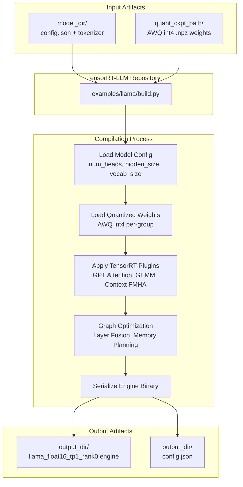
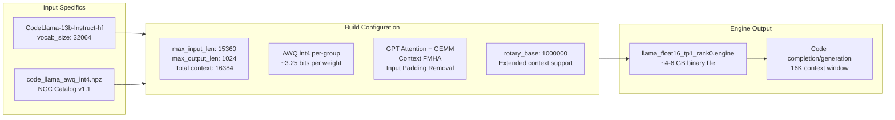
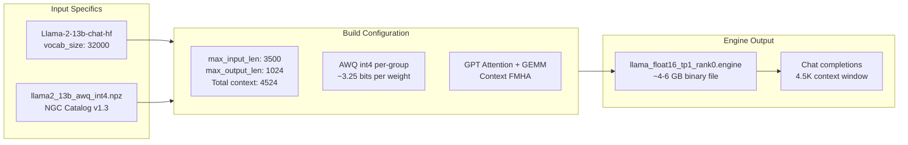
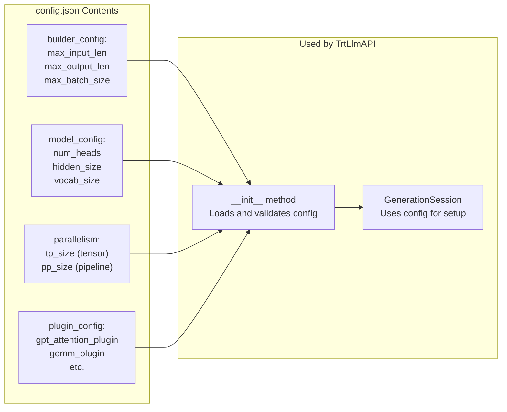
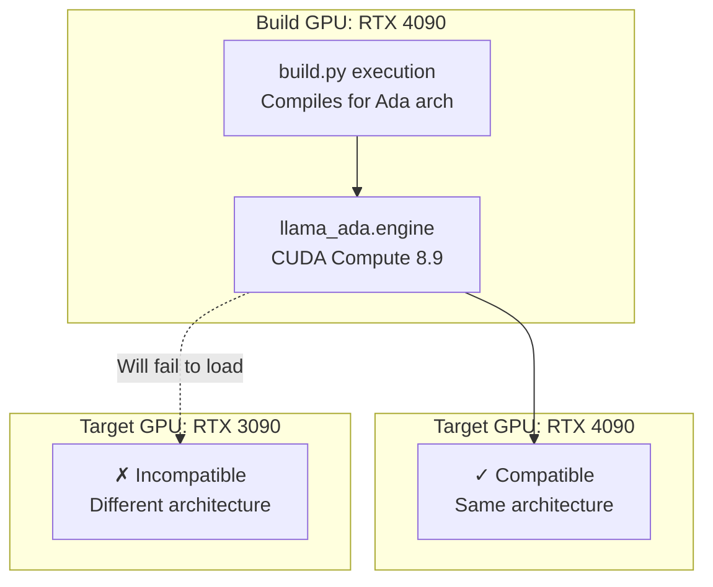

<!-- source: DeepWiki mcp.deepwiki.com · repo NVIDIA/trt-llm-as-openai-windows · extra page Building TensorRT Engines · fetched 2026-10-26 -->

# Building TensorRT Engines

<details>
<summary>Relevant source files</summary>

The following files were used as context for generating this wiki page:

- [README.md](README.md)
- [model/engine/.gitkeep](model/engine/.gitkeep)

</details>


## Purpose and Scope

This page provides detailed instructions for compiling Llama 2 and CodeLlama models into optimized TensorRT engines using the `build.py` script from TensorRT-LLM. The engine compilation process transforms downloaded HuggingFace models and AWQ quantized weights into GPU-specific binary files that enable accelerated inference. This is a one-time, resource-intensive operation that must be performed before the server can be launched.

For information about downloading models and quantized weights, see [Downloading Models and Weights](#2.2.1). For instructions on launching the server with compiled engines, see [Launching the Server](#2.3).

**Sources:** [README.md:19-45]()

---

## Build Process Overview

The engine building process converts a model from its original format into an optimized TensorRT execution graph. This involves:

1. Loading the model architecture from `config.json`
2. Loading AWQ int4 quantized weights from `.npz` checkpoint files
3. Applying TensorRT optimizations (attention plugins, GEMM plugins, context FMHA)
4. Compiling the graph into a binary `.engine` file specific to your GPU architecture

### Build Process Flow



**Sources:** [README.md:21-45]()

---

## Prerequisites

Before building engines, ensure the following are in place:

| Requirement | Description |
|-------------|-------------|
| **TensorRT-LLM** | Installed following [Windows installation guide](https://github.com/NVIDIA/TensorRT-LLM/tree/v0.6.1/windows#quick-start) |
| **Model Files** | Downloaded from HuggingFace (config.json, tokenizer files) - see [2.2.1](#2.2.1) |
| **Quantized Weights** | AWQ int4 `.npz` checkpoint files from NVIDIA NGC - see [2.2.1](#2.2.1) |
| **TensorRT-LLM Repository** | Cloned locally to access `build.py` script |
| **NVIDIA GPU** | CUDA-compatible GPU with sufficient VRAM |

### Cloning TensorRT-LLM

The `build.py` script is located in the TensorRT-LLM repository and must be accessed locally:

```bash
git clone https://github.com/NVIDIA/TensorRT-LLM.git
cd TensorRT-LLM/examples/llama
```

**Sources:** [README.md:11-31](), [README.md:33-36]()

---

## Build Parameters Reference

Both CodeLlama and Llama2 builds use the `build.py` script with various parameters. The following table documents common parameters:

| Parameter | Purpose | Common Values |
|-----------|---------|---------------|
| `--model_dir` | Path to HuggingFace model directory containing config.json | `<path to model>` |
| `--quant_ckpt_path` | Path to AWQ quantized checkpoint .npz file | `<path to .npz file>` |
| `--dtype` | Data type for activations | `float16` |
| `--use_gpt_attention_plugin` | Enable GPT attention plugin for optimized attention | `float16` |
| `--use_gemm_plugin` | Enable GEMM plugin for optimized matrix multiplication | `float16` |
| `--use_weight_only` | Enable weight-only quantization mode | Flag (no value) |
| `--weight_only_precision` | Quantization precision for weights | `int4_awq` |
| `--per_group` | Use per-group quantization (higher accuracy than per-channel) | Flag (no value) |
| `--enable_context_fmha` | Enable context Flash Multi-Head Attention | Flag (no value) |
| `--max_batch_size` | Maximum batch size for inference | `1` |
| `--max_input_len` | Maximum input sequence length in tokens | `3500` or `15360` |
| `--max_output_len` | Maximum output sequence length in tokens | `1024` |
| `--output_dir` | Directory to write compiled engine files | `<TRT engine folder>` |

**Sources:** [README.md:38-45]()

---

## CodeLlama Engine Build

### CodeLlama Build Command

Navigate to `TensorRT-LLM/examples/llama` and execute:

```bash
python build.py \
  --model_dir <path to CodeLlama model> \
  --quant_ckpt_path <path to CodeLlama .npz file> \
  --dtype float16 \
  --remove_input_padding \
  --use_gpt_attention_plugin float16 \
  --enable_context_fmha \
  --use_gemm_plugin float16 \
  --use_weight_only \
  --weight_only_precision int4_awq \
  --per_group \
  --max_batch_size 1 \
  --max_input_len 15360 \
  --max_output_len 1024 \
  --output_dir <TRT engine folder> \
  --rotary_base 1000000 \
  --vocab_size 32064
```

### CodeLlama-Specific Parameters

CodeLlama requires additional parameters not used in Llama2:

| Parameter | Value | Purpose |
|-----------|-------|---------|
| `--remove_input_padding` | Flag | Removes padding from input sequences for efficiency |
| `--rotary_base` | `1000000` | Base value for rotary position embeddings (CodeLlama uses extended context) |
| `--vocab_size` | `32064` | Vocabulary size specific to CodeLlama tokenizer |
| `--max_input_len` | `15360` | Extended context window for code (vs 3500 for Llama2) |

### CodeLlama Build Characteristics



**Sources:** [README.md:38-41]()

---

## Llama2 Engine Build

### Llama2 Build Command

Navigate to `TensorRT-LLM/examples/llama` and execute:

```bash
python build.py \
  --model_dir <path to llama13_chat model> \
  --quant_ckpt_path <path to Llama2 .npz file> \
  --dtype float16 \
  --use_gpt_attention_plugin float16 \
  --use_gemm_plugin float16 \
  --use_weight_only \
  --weight_only_precision int4_awq \
  --per_group \
  --enable_context_fmha \
  --max_batch_size 1 \
  --max_input_len 3500 \
  --max_output_len 1024 \
  --output_dir <TRT engine folder>
```

### Llama2 vs CodeLlama Differences

| Aspect | Llama2 | CodeLlama |
|--------|--------|-----------|
| **max_input_len** | 3500 | 15360 |
| **vocab_size** | Default (32000) | 32064 (explicit) |
| **rotary_base** | Default (10000) | 1000000 (explicit) |
| **remove_input_padding** | Not used | Enabled |
| **Use Case** | Chat/general text | Code generation |
| **Context Window** | ~4500 tokens | ~16384 tokens |

### Llama2 Build Characteristics



**Sources:** [README.md:42-45]()

---

## Output Artifacts

### Engine Files Generated

The build process creates several files in the specified `--output_dir`:

| File | Description | Size |
|------|-------------|------|
| `llama_float16_tp1_rank0.engine` | Binary TensorRT engine | 4-6 GB |
| `config.json` | Engine configuration metadata | <1 KB |
| `rank0.engine` (alternative name) | Same as above | 4-6 GB |

### Configuration Metadata

The generated `config.json` contains runtime information:



**Sources:** [README.md:38-45](), [trt_llama_api.py:112-179]()

---

## Build Process Details

### Compilation Steps

The `build.py` script performs the following internal operations:

1. **Model Loading**: Reads `config.json` from `--model_dir` to understand architecture
2. **Weight Loading**: Loads AWQ quantized weights from `.npz` checkpoint
3. **Graph Construction**: Builds TensorRT network graph with layers (attention, FFN, etc.)
4. **Plugin Integration**: Inserts optimized CUDA kernels for attention and GEMM operations
5. **Optimization**: Applies layer fusion, constant folding, and precision calibration
6. **Serialization**: Compiles optimized graph into binary `.engine` format

### Compile-Time vs Runtime Parameters

| Parameter Type | Examples | When Applied |
|----------------|----------|--------------|
| **Compile-Time** | `max_input_len`, `max_output_len`, `max_batch_size`, `dtype`, plugin flags | During `build.py` execution |
| **Runtime** | `temperature`, `top_p`, `top_k`, `repetition_penalty` | During inference via `GenerationSession.decode()` |

**Compile-time parameters are baked into the engine and cannot be changed without rebuilding.**

**Sources:** [README.md:38-45]()

---

## Important Considerations

### GPU Architecture Dependency

TensorRT engines are **GPU-architecture-specific**. An engine built on an RTX 4090 (Ada Lovelace) cannot run on an RTX 3090 (Ampere). Always build engines on the target deployment GPU.



### Build Time and Resources

| Model | Approx. Build Time | Disk Space Required | Peak RAM Usage |
|-------|-------------------|---------------------|----------------|
| **CodeLlama-13B** | 20-40 minutes | ~20 GB (inputs + outputs) | ~16 GB system RAM |
| **Llama2-13B** | 15-30 minutes | ~18 GB (inputs + outputs) | ~14 GB system RAM |

*Times measured on NVIDIA RTX 4090. Slower GPUs will take proportionally longer.*

### File Placement

After building, copy the engine files to the repository structure:

```
trt-llm-as-openai-windows/
└── model/
    ├── config.json              # From HuggingFace
    ├── tokenizer.json           # From HuggingFace
    ├── tokenizer_config.json    # From HuggingFace
    └── engine/
        ├── llama_float16_tp1_rank0.engine  # Built engine
        └── config.json                      # Engine config
```

**Sources:** [README.md:54-57](), [model/engine/.gitkeep:1]()

---

## Troubleshooting Build Issues

### Common Build Failures

| Error | Cause | Solution |
|-------|-------|----------|
| `FileNotFoundError: config.json` | Incorrect `--model_dir` path | Verify path contains HuggingFace model files |
| `AssertionError: quant_ckpt_path` | Missing or incorrect `.npz` file | Download correct AWQ checkpoint from NGC |
| `CUDA out of memory` | Insufficient GPU VRAM | Close other GPU applications or use smaller batch size |
| `Unsupported compute capability` | Outdated GPU | TensorRT-LLM requires compute capability ≥7.0 (Volta or newer) |

### Validation After Build

Verify the engine was built successfully:

1. Check `--output_dir` contains `.engine` file (should be 4-6 GB)
2. Check `config.json` exists in same directory
3. Verify file sizes are reasonable (not 0 bytes)

**Sources:** [README.md:21-45]()

---

## Next Steps

After successfully building the TensorRT engine:

1. Copy engine files to `model/engine/` directory - see [Directory Layout](#6.1)
2. Ensure tokenizer files are in `model/` directory - see [Downloading Models and Weights](#2.2.1)
3. Launch the server - see [Launching the Server](#2.3)

**Sources:** [README.md:47-77]()

---

